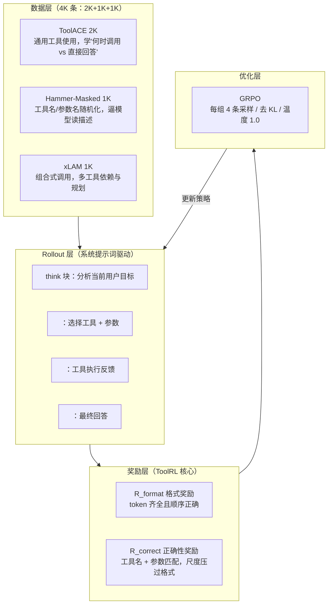

> **TL;DR**
>
> * **核心问题与结论**：SFT 学出来的工具调用泛化差，换批 API 就露馅；ToolRL 把力气花在奖励上——格式奖励（结构合规）加正确性奖励（预测调用与真值调用逐项匹配），用 GRPO 把 Qwen2.5-1.5B 冷启动的 Overall 从 19.41% 提到 46.20%（BFCL）、从 30.65% 提到 63.15%（API-Bank，Table 1/2）。
> * **关键证据**：冷启动 GRPO 在四个模型上全胜 PPO——BFCL Overall 46.20/52.98/58.38/44.10 对 38.32/51.15/46.68/42.98；但用 SFT-400 起步后 PPO 多数反超（API-Bank 3B 65.16 对 62.48、7B 63.15 对 54.10）。胜负取决于初始化，不是算法。
> * **适用边界与代价**：正确性奖励比对**真值调用**，不读执行结果，也不判「该不该调」——无关工具识别论文明确说未进训练数据，是泛化出来的。尺度压到与格式同级时 Overall 只小幅下滑（46.20→39.47），但无关工具识别从 56.44% 崩到 16.44%（Table 6）：代价先落在拒答上。
> * **定位**：ToolRL（UIUC，[arXiv:2504.13958](https://arxiv.org/abs/2504.13958)）是工具选择与调用领域第一篇系统研究奖励设计的 RL 工作，代码基于 veRL + TinyZero 开源。它和 RAGEN / Search-R1 / Agent-R1 / OpenManus-RL 一起构成了 2025-2026 年「Agentic RL」开源版图的骨干。



---

## 1. 背景：SFT 学工具调用，卡在哪了？

让 LLM 用工具（Tool-Integrated Reasoning，TIR）是 Agent 范式的技术底座。行业里最主流的做法是 **SFT**：攒一批「用户问题 → 工具调用序列 → 最终答案」的轨迹，在基础模型上做有监督微调。这条路线催生了 ToolBench、ToolACE、xLAM 等一批数据工程，也催生了 Gorilla、ToolLLM 等一批模型。

但 SFT 有几个结构性缺陷，在真实 Agent 场景里逐渐暴露：

1. **泛化差**：SFT 学的是「训练分布里的调用模式」。换一个没见过的新 API、换一套参数 schema、换一种多工具组合，模型就开始胡编工具名或参数（业界俗称 hallucinated tool call）。
2. **不会自我纠错**：训练轨迹是静态的，模型从没学会「看 `obs` 反馈 → 发现调用失败 → 换一个工具重试」这条闭环。
3. **数据天花板**：高质量轨迹靠人工或昂贵模型蒸馏，规模上不去，而且 SFT 的下限是「复读训练数据」，上限也高不到哪去。

与此同时，DeepSeek-R1 证明了另一条路：**RL 能把模型从「会模仿」推到「会推理与泛化」**。R1 之后，社区很快意识到：推理任务能 RL，工具调用为什么不能 RL？这就是 ToolRL 论文的出发点。论文原文的表述是：

> “Recent advancements in reinforcement learning, particularly with R1-like models, have demonstrated promising reasoning and generalization abilities. Yet, reward design for tool use presents unique challenges.”

**RL 做工具调用的独特难点在哪？** 推理任务（如数学）的奖励是「最终答案对不对」，简单粗暴但有效。工具调用不一样：

- 一个**动作空间巨大**：成百上千个工具，每个工具几十个参数，正确的 (tool, params) 组合是稀疏的；
- **奖励信号是混合的**：格式（结构合法）+ 语义（调用正确）+ 最终结果（任务完成），三层目标纠缠在一起；
- **中间步骤也有对错**：第 2 步的坏工具选择，可能被第 5 步的补救掩盖，也可能直接带崩整个轨迹——只看最终答案的粗奖励（coarse reward）给不出细粒度反馈。

所以 ToolRL 把问题收敛成一句话：**奖励是工具学习的全部（Reward is All Tool Learning Needs）**——先别急着堆数据和算力，把奖励设计研究明白。

## 2. 方法全景：一条 ToolRL 训练管线

### 2.1 训练数据：4K 条的「小而精」混合集

ToolRL 的 RL 训练数据只有 **4K 条**（仓库里的 [`dataset/rlla_4k`](https://github.com/qiancheng0/ToolRL/tree/8cee13ec0ca72f0461da372a93a6fd8140dbb840/dataset/rlla_4k)），由三块拼成，刻意兼顾广度与难度：

| 数据源 | 数量 | 设计意图 |
|---|---|---|
| **ToolACE** | 2K | 通用工具使用场景，覆盖「该调工具时调、不该调时直接答」的决策边界 |
| **Hammer（Masked）** | 1K | 把工具名和参数名**随机打码**，逼模型靠工具描述而非死记名字做选择，抗过拟合 |
| **xLAM** | 1K | 组合式场景，单轮内要串联调用多个工具，练工具依赖与多步规划 |

值得注意的细节：**SFT 阶段每条样本都带 thought 字段，内容是从 DeepSeek-R1 蒸馏出来的推理轨迹；而 GRPO 阶段不需要 thought 标注**——论文的原话是「only the tool calls are used to compute rewards」，奖励只由工具调用算，推理是模型自己探索出来的。论文对这一规模的解释是：三个子集同分布，继续加同类数据不增加任务多样性，超过 4K 后收敛与最终性能都没有明显收益。

### 2.2 Rollout：让模型在系统提示词约束下自由发挥

训练时的 rollout 用一套固定的系统提示词驱动，定义了模型输出的三段式结构：

```
1. Think：回顾上下文，分析当前用户目标
2. Decide on Tool Usage：如果需要工具，指明工具名和参数
3. Respond Appropriately：给出最终结构化回答
```

模型输出必须使用三个特殊 token 包装：`<think>`（推理）、`<tool_call>`（工具调用）、`<response>`（最终回答）；`<tool_call>` 与 `<response>` 不互斥，可以同一条输出里同时出现。工具执行结果以 `<obs>` 反馈回对话历史，形成多轮闭环。这个设计同时服务两个目的：**给奖励判定提供明确的结构锚点**，以及**让 rollout 阶段就能把外部执行结果接回上下文**。

#### 执行边界：工具不是模型跑的

把上面这条管线拆开，能看清「tool call 到底算什么」：

| 环节 | 谁来做 | 论文依据 |
|---|---|---|
| 产出调用意图 | 模型（策略 πθ），输出 `<tool_call>` 里的 JSON | §3.2 |
| 解析成单次调用 | rollout 管线（非模型） | §3.2：automatically parse the tool calls into individual invocations |
| 真正执行 | 外部执行环境 | §3.1：观察 o_i 来自「执行工具集合」之后 |
| 把结果写回上下文 | rollout 管线，塞进 `<obs>` 追加到对话历史 | §3.2 |
| 算奖励 | 规则函数，比对**真值调用**，不读执行结果 | §3.3 |

后两点是关键：**奖励函数只读「预测调用 P 与真值调用 G 的匹配度」，不读 `obs`**。由此有两个直接推论：一是「参数填错但后端恰好成功」仍然被扣分；二是「参数填对但后端报错」不会因此扣分。奖励优化的是「像不像正确调用」，不是「任务有没有做成」。Bamboogle 那类只看最终答案的评测是**评测**手段，不是训练奖励。

这也回答了「tool call 包括 agent 吗」：在 ToolRL 的建模里，agent 的完整循环是 状态 → 思考 → 动作（tool call）→ 观察，而**被优化的只有策略（模型）；解析、执行、写回、算分都在模型外部**。训练数据里每条样本被拆成单步（多步轨迹拆开、历史塞进 user prompt），所以一次前向就对应一个决策点，而不是整条 agent 轨迹。Appendix B 说得很直接：GRPO 只需要 tool call 标注就能算奖励，thought 不需要真值。

#### 系统提示词怎么约束输出

rollout 的全部约束都在一段系统提示词里（论文 Figure 4），结构是「可用工具清单 + 三步流程 + 输出格式 + 注意事项」：

```text
You are a helpful dialogue assistant capable of leveraging tool calls ...
Available Tools
In your response, you can use the following tools:
[Tool List 占位符]

Steps for Each Turn
1. Think: Recall relevant context and analyze the current user goal.
2. Decide on Tool Usage: If a tool is needed, specify the tool and its parameters.
3. Respond Appropriately: If a response is needed, generate one ...

Output Format
<think> Your thoughts and reasoning </think>
<tool_call>
{"name": "Tool name", "parameters": {"Parameter name": "Parameter content"}}
</tool_call>
<response> AI's final response </response>

Important Notes
1. You must always include the <think> field ... Provide at least one of <tool_call> or <response>.
2. You can invoke multiple tool calls simultaneously ... empty dictionary if no parameters needed.
3. Refer to the previous dialogue records ... including <tool_call>, <response>, and <obs> (if exists).
```

三个设计点值得注意：**`<think>` 强制存在但内容不限**（奖励不判推理质量，只判结构）；**`<tool_call>` 与 `<response>` 至少给一个**（所以「不需要工具」是一种合法输出，不是异常）；**历史里显式点名 `<obs>`**（把外部执行结果当作一等公民写进提示词，模型才知道要读它）。工具清单是变量，换一批工具就是换一次提示词——但它**不参与训练目标**，只决定观测空间。


### 2.3 奖励设计：论文的心脏（3.3 节）

ToolRL 的奖励是经典的两层分解：

$$R_{\text{final}} = R_{\text{format}} + R_{\text{correct}}$$

**① 格式奖励 `R_format ∈ {0, 1}`**：判据只有一条——输出里**该出现的特殊 token 是否齐全、顺序是否正确**（`<think>` → `<tool_call>` → `<response>`），按真值里有没有 `tool_call` / `response` 选模板做整条正则匹配。JSON 合法性、该不该调用，都不在这一项里。

**② 正确性奖励 `R_correct ∈ [-3, 3]`**：把预测调用集合 $$P=\{P_1,\dots,P_m\}$$ 与真值调用集合 $$G=\{G_1,\dots,G_n\}$$ 做三项匹配，论文的写法是先求**最优配对**使总分最大：

$$r_{\text{match}} = r_{\text{name}} + r_{\text{param}} + r_{\text{value}} \in [0, S_{\max}]$$

- **工具名**：集合 IoU，$$r_{\text{name}} = \lvert N_G \cap N_P\rvert / \lvert N_G \cup N_P\rvert \in [0,1]$$；
- **参数名**：逐真值调用算键集合 IoU 再求和，$$r_{\text{param}} \in [0, \lvert G\rvert]$$；
- **参数值**：逐键精确相等计数，$$r_{\text{value}} \in [0, \sum_{G_j}\lvert \mathrm{keys}(G_j)\rvert]$$。

三项上限相加即 $$S_{\max} = 1 + \lvert G\rvert + \sum_{G_j}\lvert\mathrm{keys}(G_j)\rvert$$，归一化后：

$$R_{\text{correct}} = 6\cdot\frac{R_{\max}}{S_{\max}} - 3 \in [-3, 3]$$

最终 $$R_{\text{final}} = R_{\text{format}} + R_{\text{correct}} \in [-3, 4]$$。**关键设计是正确性奖励的尺度（[-3,3]）压过格式奖励（{0,1}）**——论文 5.2 节做了把正确性压到 [-1,1]、与格式同量级上限的消融，代价先落在拒答能力上（见 §4.2）。三项不等权：工具名最多 1 分、参数名最多 $$\lvert G\rvert$$ 分、参数值随键数线性增，参数越多参数值项占比越大。论文正文只说 optimal matching，没给配对算法；开源实现是贪心，见 §4.4。


### 2.4 优化器：GRPO + 激进探索

- **算法**：Group Relative Policy Optimization（GRPO），每组 4 条采样，相对组内均值归一化 advantage，不需要价值网络；
- **Batch**：512 条 / step；
- **Epochs**：15；
- **策略**：**去掉 KL 正则、生成温度 1.0** —— 论文明确说这是为了「鼓励更广的策略探索」（broader policy exploration）。对工具调用这种动作空间巨大的任务，探索不够就是困在 SFT 的局部最优里。

## 3. 实验结果：BFCL 与 API-Bank 两张主表

评估覆盖三个 benchmark：**BFCL V3**（伯克利函数调用榜，含单步/多步/实时执行/无关工具拒答/多工具并行等多种挑战）、**API-Bank**（73 个 API 工具、三级多轮对话难度）、**Bamboogle**（只看最终答案正确率的 QA 型测试）。

**BFCL V3 主结果（论文 Table 1，Accuracy）**——这里按子任务拆列，Qwen2.5-1.5B 这一档最全：

| Qwen2.5-1.5B-Instruct | Overall | Non-Live AST | Non-Live Exec | Live | Multi Turn | Relevance | Irrelevance |
|---|---|---|---|---|---|---|---|
| Raw | 19.41% | 16.00% | 13.18% | 35.58% | 0.00% | 44.44% | 82.49% |
| SFT-400 | 40.21% | 65.12% | 61.11% | 56.69% | 1.00% | 94.44% | 60.14% |
| SFT-4k | 40.67% | 59.94% | 59.84% | 59.31% | 1.00% | 88.89% | 71.34% |
| SFT-400 + PPO | 42.95% | 77.65% | 69.75% | 55.73% | 1.88% | 100.00% | 48.40% |
| SFT-400 + GRPO | 40.93% | 70.54% | 60.79% | 56.33% | 1.00% | 94.44% | 58.63% |
| PPO 冷启动 | 38.32% | 79.40% | 70.11% | 45.24% | 0.87% | 100.00% | 18.09% |
| **GRPO 冷启动（论文默认）** | **46.20%** | 77.96% | 76.98% | 60.73% | 2.25% | 100.00% | 56.44% |

四个模型的 Overall 对比（同样是 GRPO 冷启动）：Qwen2.5-1.5B **46.20%**、Qwen2.5-3B **52.98%**、Qwen2.5-7B **58.38%**、Llama-3.2-3B **44.10%**。

**API-Bank 主结果（论文 Table 2，Accuracy）**——按三级难度拆列：

| Qwen2.5-1.5B-Instruct | Overall | Level 1 | Level 2 | Level 3 |
|---|---|---|---|---|
| Raw | 30.65% | 28.32% | 35.82% | 35.11% |
| SFT-400 | 53.60% | 57.14% | 50.75% | 44.27% |
| SFT-4k | 47.07% | 52.88% | 52.24% | 26.72% |
| SFT-400 + PPO | 57.12% | 60.9% | 50.75% | 48.85% |
| SFT-400 + GRPO | 61.31% | 64.16% | 58.21% | 54.20% |
| PPO 冷启动 | 40.54% | 44.61% | 31.34% | 32.82% |
| **GRPO 冷启动（论文默认）** | **63.15%** | 70.68% | 61.19% | 41.22% |

> 表号说明：论文 4.3 节正文写「BFCL and API-Bank results in Table 1 and Table 3」，但 Level 1/2/3 这套分级来自 API-Bank（§4.2 明确说 API-Bank 是 three-level framework），Bamboogle 才是 Table 3（§7 正文「As shown in Table 3」）。按表体内容与 Figure 2 柱标对账，Table 1 = BFCL、Table 2 = API-Bank、Table 3 = Bamboogle，正文那句是论文自身的笔误。

几个读表要点：

1. **冷启动 GRPO 是论文主推的配置，也是总体最好的一档**：BFCL 上 46.20 / 52.98 / 58.38 / 44.10，前三个模型都压过同尺寸的 SFT 与 PPO 变体；唯一例外是 Llama-3.2-3B 的 SFT-4k（44.16%）比它高 0.06 个点，基本打平。另外要注意：常被引用的一组数字（30.65 → 61.31）其实是 API-Bank 上 SFT-400+GRPO 的结果，既不是 BFCL，也不是冷启动。
2. **GRPO 与 PPO 的胜负取决于初始化方式**：冷启动下 GRPO 全面领先（BFCL 46.20 对 38.32、52.98 对 51.15、58.38 对 46.68、44.10 对 42.98）；但用 SFT-400 起步后 PPO 多数反超——API-Bank 上 3B（65.16 对 62.48）、7B（63.15 对 54.10）、Llama（57.79 对 56.78）都是 PPO 赢，BFCL 上 1.5B 也是 PPO 赢（42.95 对 40.93）。论文的解释是「PPO 受益于 SFT 初始化，GRPO 更适合从零训练」。
3. **小数据 SFT 起步优于纯大数据 SFT，但都比冷启动 GRPO 差**：API-Bank 上 SFT-400+GRPO（61.31%）比 SFT-4k（47.07%）高 14.24 个点，比 SFT-400（53.60%）高 7.71；BFCL 上这三个数换成 40.93 / 40.67 / 40.21，几乎持平。也就是说「10 倍数据不如 RL」这个结论在 API-Bank 上成立，在 BFCL 上不成立。
4. **困难档上大数据 SFT 会倒退**：API-Bank 的 Level 3，Raw 35.11% → SFT-400+GRPO 54.20%；而纯 SFT-4k 掉到 26.72%，比 Raw 还低 8.4 个点——但这一格只出现在 Qwen2.5-1.5B，3B 的 SFT-4k Level 3 是 40.46%（Raw 36.64%）并没有退。
5. **模型规模与底座都影响收益，但增量不跟参数量走**：BFCL 上冷启动 GRPO 相对 Raw 的提升，1.5B 是 +26.79（19.41% → 46.20%）、3B 是 +19.94（33.04% → 52.98%）、7B 是 +16.41（41.97% → 58.38%）——小模型反而吃到的增量最大，绝对水位则仍是越大越高。Llama-3.2-3B 的冷启动 GRPO 只到 44.10%，甚至低于它自己的纯 SFT-4k（44.16%），这才是论文说「Llama 对 GRPO 式泛化的适应性较弱」的依据：同样是 Instruct 模型，底座的对齐方式会影响 RL 的胃口。论文正文称相对同数据量 SFT 有「约 10 个点」的绝对提升，但逐格差别很大：API-Bank 上 1.5B 是 +7.71、3B 是 +9.72；BFCL 上 1.5B 只有 +0.72，3B 是 +12.34。

摘要里的「平均 +17%（对基座）、+15%（对 SFT）」就是跨模型跨 benchmark 汇总出的总体提升幅度。


## 4. 深度剖析：奖励设计的三块基石

这一节是论文最值钱的部分——第五章的系列消融，回答「什么样的奖励对工具学习是好的」。

### 4.1 长度奖励：反直觉的 Takeaway 1

R1 之后社区有个惯性：**想让模型变聪明，就给思考长度发奖励**。ToolRL 专门做了这个实验，结论很打脸：

> **Takeaway 1**：While length rewards encourage longer reasoning traces, they do not consistently improve task performance and may even harm it in smaller models, highlighting that longer reasoning is not inherently better for tool use tasks.

奖励项本身是**先线性、后封顶**，不是简单地和长度成正比：

$$R_{\text{length}} = \min\!\left(\frac{L_{\text{think}}}{L_{\text{target}}}, 1\right),\quad L_{\text{target}} = 512$$

512 这个目标值的来历是「原始模型很少生成超过它一半长度的回复」，所以设 512 足以起推动作用。论文试了两个版本：固定目标（`WITHLENGTH`）与随训练进度拉长目标的动态版（`SCHEDULELENGTH`，第 4.4 节的开关名）。两者的 think 长度确实都稳步增长——**但是成绩不涨，小模型甚至掉点**：

| Qwen2.5-1.5B-Instruct | Overall | Live | Irrelevance |
|---|---|---|---|
| 默认（无长度奖励） | 46.20% | 60.73% | 56.44% |
| 加固定长度奖励 | 33.23% | 35.63% | 4.52% |
| 加动态长度奖励 | 28.51% | 38.07% | 25.08% |

原因也不难理解：工具调用任务里，正确性取决于「选对工具、填对参数」，而不是「想得够长」。模型如果发现「想得长 = 拿分」，就会把计算花在无意义的推理膨胀上，挤压真正有用的探索。Table 5 里更刺眼的是无关工具识别（Irrelevance）从 56.44% 掉到 4.52%——模型不再拒答了。

**实操启示**：给 Agent 做 RL，别把「思维链长度」当奖励信号。要奖励的是**结果达成 + 过程合法性**，不是修辞学的丰富程度。

### 4.2 奖励尺度：正确性要压过格式（防 reward hacking）

格式奖励存在天然的 hack 风险：模型可以不学任何语义，只把输出结构调整得漂漂亮亮，就有稳定收益。ToolRL 的默认配置让**正确性奖励的尺度（[-3,3]）压过格式奖励（{0,1}）**——相当于告诉模型「格式是入场券，正确调用才是得分项」。

论文的消融很干净：把正确性奖励的归一化范围改成 [-1,1]，与格式奖励**同量级上限**（Equal Max）。结果分两层看：

- **综合准确率只是小幅下滑**：1.5B 46.20% → 39.47%，3B 52.98% → 51.76%（基本持平），Llama 44.10% → 42.47%；
- **拒答能力断崖**：1.5B 的 Irrelevance Detection 从 56.44% 崩到 16.44%，3B 从 84.85% 掉到 78.07%——模型开始「见工具就调」。

也就是说，尺度压平不会让训练曲线立刻难看，它先把「不该调用时别调用」这个能力打掉。真正值得记的是 **Takeaway 2**：同样在调尺度，**两阶段硬切**（前 30 步把正确性压到 1/3，之后翻回来并把格式压到 [0,0.5]）反而全面掉点（1.5B 38.85%、3B 50.66%、Llama 41.33%），而**连续插值的动态尺度**能把 3B / Llama 推到 53.81% / 46.85%，超过固定尺度的默认配置。

> **Takeaway 2**：Gradually adjusting reward scales during training, rather than abrupt changes, better supports model learning and generalization.

**实操启示**：工具 RL 奖励的第一条军规是「语义正确性 > 格式合法性」的尺度分层；第二条是尺度**要动就平滑地动**，别在训练中途硬切——论文的 Two stage 消融就是硬切的反例。

### 4.3 奖励粒度：越细越好，但「细」指的是匹配项拆分

论文观察到工具选择/应用任务和 QA 任务的一个本质差别：**工具数据里每一步都有真值调用**（ground truth tool calls at each step），所以逐步奖励信号是天然稠密的，而 QA 只有最终答案。§5.3 的粒度消融正是沿着这个思路，把正确性奖励**逐级变粗**（从默认设计出发，共四档）：

| 档位 | 工具名 | 参数名 | 参数值 | 等价于 |
|---|---|---|---|---|
| **默认设计**（最细） | 集合 IoU | 键集合 IoU 逐调用求和 | 逐键精确相等计数 | §2.3 的 $$r_{\text{name}}+r_{\text{param}}+r_{\text{value}}$$ |
| Finegrained | 严格全等 | 键集合严格全等 | 不变 | 把前两项的 IoU 收紧成 1/0 |
| Intermediate | 不变 | 与参数值合并 | 与参数名合并 | 整个参数字典精确相等才给分 |
| Coarse | 全部纠缠 | — | — | 整个工具集完全一致才给分 |

论文自己的默认是最细的那一档，粗化全部掉点（Table 7，Overall）：

| 模型 | 默认设计 | Finegrained | Intermediate | Coarse |
|---|---|---|---|---|
| Qwen2.5-1.5B | 46.20% | 40.71% | 37.65% | 36.72% |
| Qwen2.5-3B | 52.98% | 52.06% | 51.36% | 51.40% |
| Llama-3.2-3B | 44.10% | 39.82% | 38.62% | 35.95% |

**Takeaway 3**：细粒度的奖励分解给出更丰富的学习信号，粗化会拖慢甚至劣化最终表现。要注意这里的「细」不是引入 PRM 之类的学习型过程奖励模型，而是用**规则可判定的匹配项拆分**（真值在数据里，每一步对错都可计算）。


### 4.4 奖励代码长什么样（锁定作者的实现）

奖励的落点是 `verl/utils/reward_score/rlla.py` 一个文件（
[permalink，commit `8cee13e`](https://github.com/qiancheng0/ToolRL/blob/8cee13ec0ca72f0461da372a93a6fd8140dbb840/verl/utils/reward_score/rlla.py)）。
入口 `compute_score()` 把三项加起来（[:257–305](https://github.com/qiancheng0/ToolRL/blob/8cee13ec0ca72f0461da372a93a6fd8140dbb840/verl/utils/reward_score/rlla.py#L257-L305)）：

```python
tool_max_possible, tool_min_possible = 3.0, -3.0        # 默认；CORRECTMAX1=1 时改成 ±1
format_max_possible, format_min_possible = 1.0, 0.0     # 格式奖励固定 {0,1}
length_max_possible, length_min_possible = 1.0, 0.0

fomrat_score      = customize_format_reward_func(...)[0]
correctness_score = customize_correctness_reward_tool(...)[0]
length_score      = customize_length_reward_func(...)[0] if WITHLENGTH == "1" else 0

score = fomrat_score + correctness_score + length_score   # R_final
```

变量映射（数学 ↔ 代码）：

| 数学符号 | 代码里的量 | 取值 | 含义 |
|---|---|---|---|
| $$R_{\text{format}}$$ | `fomrat_score`（原文拼写如此） | `{0, 1}` | 特殊 token 是否齐全且顺序正确 |
| $$R_{\text{correct}}$$ | `correctness_score` | 默认 `[-3, 3]` | 与**真值调用**的匹配度，不读执行结果 |
| $$R_{\text{length}}$$ | `length_score` | `[0, 1]`，默认不启用 | 需 `WITHLENGTH=1` |
| $$R_{\text{final}}$$ | `score` | `[-3, 4]` | 三项直接相加，无额外权重 |

几个值得注意的实现细节：

1. **格式奖励是逐模板匹配，不是「有没有 JSON」**。函数按真值里 `tool_call` / `response` 的有无选三种正则模板之一，要求整条回复形如 `<think>…</think>\n<tool_call>…</tool_call>\n<response>…</response>`，且每个标签**只出现一次**（[:44–97](https://github.com/qiancheng0/ToolRL/blob/8cee13ec0ca72f0461da372a93a6fd8140dbb840/verl/utils/reward_score/rlla.py#L44-L97)）。
2. **正确性奖励做贪心一对一配对**，不是全局最优指派。它先算工具名集合的带频次相似度，再逐个真值调用找一个**尚未被占用**的同名预测调用，取参数名相似度 + 参数值精确命中数最高者（[:131–198](https://github.com/qiancheng0/ToolRL/blob/8cee13ec0ca72f0461da372a93a6fd8140dbb840/verl/utils/reward_score/rlla.py#L131-L198)）。归一化的分母是同一次调用里**动态累加**的 `local_max_possible`（工具名 1 分 + 每个真值调用的 `1 + len(gt_params)`），所以命中率越高分越高，但错配会被这套贪心顺序影响。
3. **`match_score` 忽略顺序、按频次算交集**（[:21–40](https://github.com/qiancheng0/ToolRL/blob/8cee13ec0ca72f0461da372a93a6fd8140dbb840/verl/utils/reward_score/rlla.py#L21-L40)），所以工具名顺序不同不扣分；`REFINEDREWARD=1` 时才退化成严格全等。
4. **所有复杂度都落在调用层**，`obs` 不进奖励，`exp_name` 只用来切 Qwen / Llama 的 chat 模板。
5. **「该不该调」在代码里是一段空转**。真值里没有 `<tool_call>` 时，正确性奖励直接给 `0.0` 并 `continue`（[:227–233](https://github.com/qiancheng0/ToolRL/blob/8cee13ec0ca72f0461da372a93a6fd8140dbb840/verl/utils/reward_score/rlla.py#L227-L233)）——**「不该调用」的样本在正确性项上恒得 0 分，组内四条采样在这一项上没有区别**，唯一能拉开差距的是格式奖励（学「不调用时也要有 `<response>`」）。这解释了论文为什么说无关工具识别是泛化出来的：训练信号里它只被格式项间接覆盖。
6. **格式坏了连正确性一起罚**：解析 `<tool_call>` 抛异常或格式断言失败时，`reward = min_possible_reward`（默认即 -3），这是代码里加的硬约束——格式不对就没有「部分正确」可言（[:238–247](https://github.com/qiancheng0/ToolRL/blob/8cee13ec0ca72f0461da372a93a6fd8140dbb840/verl/utils/reward_score/rlla.py#L238-L247)）。

奖励变体全部通过环境变量开关，README 里给了到论文小节的对照（[README，commit `8cee13e`](https://github.com/qiancheng0/ToolRL/blob/8cee13ec0ca72f0461da372a93a6fd8140dbb840/README.md#L44-L57)）：

```bash
export WITHLENGTH=1         # 加固定长度奖励（§5.1）
export SCHEDULELENGTH=1     # 加动态长度奖励（§5.1）
export CORRECTMAX1=1        # 正确性压到 ±1，与格式同量级（§5.2）
export MAX1STEP30MAX3=1     # 两阶段硬切尺度（§5.2）
export SCHEDULEREWARD=1     # 连续插值的动态尺度（§5.2）
export REFINEDREWARD=1      # 工具名/参数名改成严格全等（§5.3）
export INTERMEDIATEREWARD=1 # 参数字典整体精确相等（§5.3）
export COARSEREWARD=1       # 整个工具集完全一致才给分（§5.3）
```

想复现任意奖励假说的对比实验，开一个环境变量就行——这种「奖励即配置」的工程化思路本身就很值得抄。


## 5. 生态地图：ToolRL 在 Agentic RL 版图里的位置

ToolRL 不是孤岛。2025-2026 年，「用 RL 训练 Agent」从论文变成了开源运动，ToolRL 是其中「工具调用 + 奖励设计」这一支的代表。横向看一圈：

| 项目 | 时间 | 定位 | 与 ToolRL 的关系 |
|---|---|---|---|
| **ToolRL** | 2025.04 | 工具选择/调用的奖励设计 + GRPO | 本尊，聚焦「奖励怎么设」 |
| **RAGEN / StarPO** | 2025.04 | 轨迹级多轮 Agent RL 框架（4 个环境） | 更通用：MDP 视角统一 think/action，支持 PPO+GRPO |
| **Search-R1** | 2025 | 用 RL 教模型「调用搜索引擎 + 推理」 | 单工具场景验证了 RL 学检索式推理的可行性 |
| **Agent-R1** | 2025 | 端到端 RL 训练通用 Agent | 把 RL 推到完整 agent loop，而非单轮工具调用 |
| **OpenManus-RL** | 2025 | 对开源 Agent 框架（OpenManus）做 RL 微调 | 工业界视角：已有 Agent 产品怎么叠加 RL |
| **veRL** | — | ByteDance 开源 RL 框架（HybridFlow） | ToolRL / RAGEN 的公共底座 |
| **Kimi K2** | 2025.07 | 1T 参数 MoE，大规模 agentic RL | 「奖励怎么设」这套配方在工业规模上的验证 |

几组值得点名的方法论传承：

**RAGEN（StarPO）** 把 ToolRL 的「单轮工具调用」推广到了完整 MDP：状态-思考-动作-奖励的统一格式，支持轨迹级整条优化或 turn-wise 训练；论文在四个 stylized 环境上观察到 **Echo Trap**（奖励方差断崖 + 梯度尖峰），并用轨迹过滤、引入 critic、梯度稳定化缓解。它的 2026 版（RAGEN-2）进一步捅破了一层窗户纸——**推理坍缩（template collapse）**：熵看着稳定，但推理其实是在套固定模板，对不同输入毫无区分度。它把推理质量拆成「同输入内多样性（熵）」与「跨输入可区分性（互信息）」两个量，用互信息代理做在线诊断，并给出 SNR 机制解释——奖励方差低 → 任务梯度弱 → 正则项主导 → 跨输入的推理差异被抹平；干预手段是按奖励方差挑高信号 prompt（SNR-Aware Filtering）。这提醒我们：ToolRL 验证的「正确奖励」只是必要条件，**奖励信号的信噪比**同样决定训练成败。

**Search-R1 / WebRL** 证明 RL 学工具的收益能跨域迁移：工具从「函数调用」换成「搜索引擎」，RL 依然能让模型学会「何时搜、搜什么、怎么用结果」。

**Kimi K2 的工业验证**：闭源侧，Moonshot 的 Kimi K2（[arXiv:2507.20534](https://arxiv.org/abs/2507.20534)）用大规模 agentic RL（可验证奖励 + 自评奖励）训练工具使用能力，1T 参数 MoE 把「RL 教工具使用」从论文变成了产品底座。ToolRL 这类小规模开源研究提供的正是这套配方里「奖励函数怎么写」的精确答案。

一句话定位：**ToolRL 是「奖励设计」这一层的说明书，RAGEN 是「轨迹框架」的通用底盘，Search-R1 是「单工具泛化」的验证样板，Kimi K2 是「大规模落地」的工业 proof。**

## 6. 实战建议：在真实 Agent 产品里做 Tool RL

结合 ToolRL 的结论和 veRL/RAGEN 的工程经验，如果要在自己的 Agent 上跑工具 RL，这份 checklist 可以直接抄：

**① 数据（先小后大）**
- 起步 4K 条足够验证奖励设计（ToolRL 的 4K 就是证明，2K+1K+1K 三类混采）；
- 混合「通用工具」+「打码抗过拟合」+「组合多工具」三类数据，别只喂一种；
- SFT 初始化只需要 400 条来学输出格式，别迷信大数据 SFT——论文里 SFT-4k 起步的 GRPO 反而不如 400 条起步，冷启动 GRPO 才是最优。

**② 奖励（按优先级排序）**
1. 正确性奖励（工具名 + 参数名 + 参数值三项匹配）为主尺度；
2. 格式奖励做入场券，尺度要低于正确性——压平它先坏的是拒答能力；
3. 粒度要细：把匹配项拆开（名字/参数名/参数值）比整体比对更稳；
4. **不要加长度奖励**——这是 ToolRL 用实验换来的教训；
5. 全程监控 reward hacking 信号：正确率不涨但格式分猛涨 = 模型在 hack；Irrelevance Detection 掉点 = 模型在乱调。

**③ 训练配置**
- 冷启动下 GRPO 优于 PPO（无价值网络、更稳）；已有 SFT 底座时 PPO 可能反超，别照抄；
- 去 KL 正则 + 温度 1.0 鼓励探索（但如果你的 base 很容易乱，可以适度加回一点 KL）；
- 尺度调度要平滑，别中途硬切（论文的 Two stage 消融就是反例）；
- 每步监控：轨迹长度分布、工具调用成功率的**逐步**曲线（只看最终 accuracy 会漏掉中间步骤退化）。

**④ 验证**
- 测试集要含训练分布之外的**新工具**和**不该调用**的样本（Mask 版本数据就是为前者生的；论文的无关工具识别是泛化出来的，训练集里没有）；
- 多轮闭环场景单独测——单轮调用对和完整任务完成是两回事。

## 7. 批判与展望：奖励还不是全部

ToolRL 的价值是「把奖励从玄学变成工程」，但它的边界也要说清楚：

1. **奖励依赖标注**：逐步正确性奖励需要每步的 GT 工具调用，这意味着数据要标注到「动作级」。真实产品的日志里有轨迹，但未必有动作级标签——如何从弱监督（只有最终结果，或只有 user 反馈）里长出细粒度奖励，是下一个问题。论文自己也承认这一层：`r_correct` 的真值是标注出来的调用，不是执行结果。
2. **奖励不读执行结果**：这是优点也是天花板。参数填对但后端挂掉、参数糊涂但凑巧成功，在奖励里都不体现。要做到「按任务成败给奖励」，就得把执行闭环接进 rollout 并处理延迟与不可复现，成本是完全不同量级。
3. **规则奖励的边界**：ToolRL 的奖励全是规则可判定的。一旦工具输出是开放式的（自由文本、不可结构化比对），规则奖励就失灵。**学习型奖励模型（PRM）** 在工具场景的回归，几乎是必然。
4. **从「调用对」到「任务成」**：BFCL / API-Bank 测的是调用准确率，真实 Agent 的 KPI 是任务完成率。ToolRL 的 Bamboogle 实验（只看最终答案，1.5B 从 20.8% 到 44.0%，且平均调用次数只有 1.19）已经迈出半步，但「最终结果奖励」与「每步正确性奖励」如何组合到最优，还没有定论。
5. **推理坍缩与新范式**：RAGEN-2 指出模板坍缩是 agentic RL 的隐形杀手（熵看不出来，互信息才看得出来），按奖励方差筛 prompt（SNR-Aware Filtering）这类干预会越来越主流。奖励设计之外，**样本筛选与训练动力学诊断**正在成为第二战场。

展望一条主线：**ToolRL（单轮工具奖励）→ RAGEN（多轮轨迹 MDP）→ 带学习型过程奖励的 Agent RL → 与世界交互的完整闭环**。奖励设计的原则（尺度分层、粒度匹配、防 hack）会贯穿始终——这才是这篇文章真正想沉淀的东西。

> 🧪 **动手练习**：① 用 `CORRECTMAX1=1` 把正确性尺度压到 ±1，对比默认配置的 Irrelevance Detection 曲线，验证「尺度压平先坏拒答」；② 仿照 `rlla.py` 的 `compute_tool_call_reward` 给你的自定义工具写一个奖励函数，跑通一组 4-sample 组相对优势。

## 参考与延伸阅读

- 论文：Cheng Qian et al., *ToolRL: Reward is All Tool Learning Needs*, [arXiv:2504.13958](https://arxiv.org/abs/2504.13958)（UIUC；奖励设计见 §3.3，消融见 §5.1–5.3，超参见 Appendix B）
- 代码：[qiancheng0/ToolRL @ `8cee13e`](https://github.com/qiancheng0/ToolRL/tree/8cee13ec0ca72f0461da372a93a6fd8140dbb840)（veRL + TinyZero 底座；奖励模块 [`verl/utils/reward_score/rlla.py`](https://github.com/qiancheng0/ToolRL/blob/8cee13ec0ca72f0461da372a93a6fd8140dbb840/verl/utils/reward_score/rlla.py)，奖励变体对照见 [README](https://github.com/qiancheng0/ToolRL/blob/8cee13ec0ca72f0461da372a93a6fd8140dbb840/README.md#L44-L57)）
- 数据：ToolACE (Liu et al., 2024) / Hammer (Lin et al., 2024) / xLAM (Zhang et al., 2024)
- RAGEN（StarPO）：*Understanding Self-Evolution in LLM Agents via Multi-Turn Reinforcement Learning*, [arXiv:2504.20073](https://arxiv.org/abs/2504.20073)；RAGEN-2：*Reasoning Collapse in Agentic RL*, [arXiv:2604.06268](https://arxiv.org/abs/2604.06268)
- veRL：[volcengine/verl](https://github.com/volcengine/verl)（HybridFlow，Sheng et al. 2024）；TinyZero：[Jiayi-Pan/TinyZero](https://github.com/Jiayi-Pan/TinyZero)
- Benchmark：BFCL V3（[gorilla.cs.berkeley.edu](https://gorilla.cs.berkeley.edu/blogs/13_bfcl_v3_multi_turn.html)）、API-Bank (Li et al., 2023)、Bamboogle (Press et al., 2022)
- Kimi K2：*Kimi K2: Open Agentic Intelligence*, [arXiv:2507.20534](https://arxiv.org/abs/2507.20534)
- 延伸：Search-R1 / Agent-R1 / OpenManus-RL / WebRL
- 中文社区视角：[《大模型Agent技术路线解析:模块化vs端到端,强化学习工具调用指南!》](https://zhuanlan.zhihu.com/p/1955641191589720532)（知乎）
