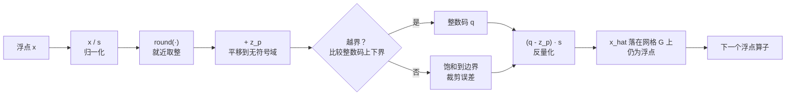
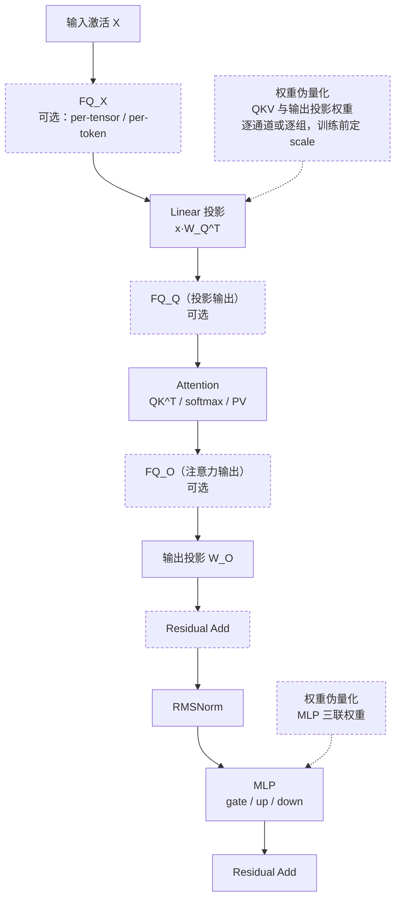
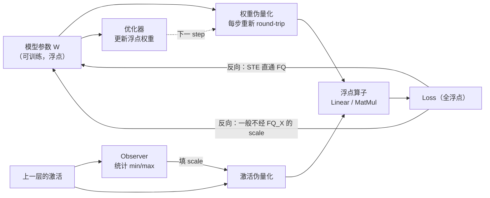
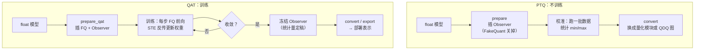

> **系列导航** ｜ [课程路线图](/quantization-roadmap/) ｜ **Part 4 · QAT** ｜ 第 17 篇 / 共 26 篇
>
> [← 16 QServe/QQQ](/2026/08/24/ptq-13-qserve-qqq/) ｜ [18 LSQ/PACT/DSQ →](/2026/08/29/llm-quant-18-lsq-pact-dsq/)

> **TL;DR**
>
> * **核心问题与结论**：伪量化（Fake Quantize）不是“量化的近似”，而是**量化器本身的一种表示**——浮点进、浮点出，输出钉在量化网格上。定义必须量化与反量化成对执行，零点在解码时减掉：$$q=\mathrm{clip}(\mathrm{round}(x/s)+z_p,q_{\min},q_{\max})$$、$$\hat{x}=s(q-z_p)$$。同一算子既是 PTQ 的离线评估工具，也是 QAT 里模拟量化的节点，差别只在是否处在优化循环里。
> * **关键证据**：① 漏写 $$z_p$$ 有两种错法——解码漏减使全体平移 $$s\,z_p$$（$$x=0$$ 都保不住），编解码同漏只偏在饱和元素上（§3.3，1(e) 组）；② 重尾激活上 4-bit min-max 只用 9/16 个码字，0.999 分位裁剪降 4.66 dB，8-bit 上却**反亏 16.00 dB**（`fake_quant_ste` C 组）；③ 权重与伪量化权重的差距**不单调**：峰值在第 2 步、40 步内回落 28 次，冻结 scale 后仍不单调（2b 组）。
> * **适用边界与代价**：伪量化**不省任何计算**——训练更慢、显存更大，推理不会变快；加速发生在部署侧，由引擎把 QDQ 图 lower 成整数 kernel（§7.3）。以上数字来自合成探针与 torch 2.10 实测，不是真实模型精度。

---

## 1. 为什么需要伪量化

### 1.1 训练与部署运行在两套数值体系上

训练用 FP32/BF16 的反向传播，部署用 INT4/INT8/FP8 的前向。这不是精度参数上的微调，而是**一次函数替换**：层里那个矩阵乘换了一个完全不同的算子，它的输入输出取值范围、舍入方式、溢出行为都由整数算术决定。

[01 篇](/2026/08/23/llm-quant-00-quantizer-fundamentals-rtn/) 已经算清了替换的代价：固定网格下，误差被拆成舍入误差（$$\lvert\epsilon\rvert\le s/2$$，只要不饱和）和裁剪误差（尾部质量 × 网格粗细）。PTQ 在**权重**上做这次替换、用校准集定 scale，之后不再动参数；代价是模型从未见过自己的量化版本，误差无法挽回。

QAT 的思路是反过来：**在训练里先把替换“排练”一遍**，让梯度在量化约束下继续更新那些还没被量化的浮点参数（“shadow weights”）。排练用的那个算子就是伪量化。

### 1.2 伪量化、PTQ、QAT 三者的关系

这三者常被说成“三种量化方法”，实际是**一个算子 + 两种用法**：

| 维度 | 伪量化算子 FQ | PTQ | QAT |
|---|---|---|---|
| 本体 | 一个算子（前向 round-trip、反向 STE） | 一套流程（校准 → 定 scale → 求量化权重） | 一套流程（插 FQ → 训练 → 导出） |
| FQ 的角色 | — | 可选：用来**评估**量化误差 | 必需：训练中**模拟**量化 |
| 权重是否更新 | 不涉及 | 否 | 是（在量化约束下） |
| 计算图 | 单个节点 | 不改图，只换数值 | 图里多出 FQ 节点 |

关键在于：**PTQ 和 QAT 的差别不在算子，而在算子所处的上下文**（是否在优化循环里、scale 是冻结还是可学）。这也是为什么理解了这个算子，就等于拿到了 QAT 的全部地基。

### 1.3 伪量化 ≠ 低比特计算

最容易被误解的一条：**伪量化不省任何计算**。

FQ 的前向是“量化 → 反量化”，中间那个整数码是一过性的中间量，输出仍然是浮点张量，随后的矩阵乘仍然在浮点单元上跑。所以：

- 用 FQ 做 QAT，训练**更慢**（多了一次 round-trip），显存**更大**（多存 scale/zero-point 与统计状态），推理**不变快**；
- FQ 唯一的产品是**一组适应了量化误差的参数**，以及（对激活而言）一套可用的 scale；
- 真正的加速发生在部署侧，由推理引擎把 QDQ 图 lower 成整数 kernel（§7.3）。

把这件事说清楚，后面所有工程描述才有意义：QAT 训练图里的浮点计算和部署图里的整数计算，是**同一个量化方案的两种实现**，而不是同一个东西。

---

## 2. 符号约定

[01 篇 §2](/2026/08/23/llm-quant-00-quantizer-fundamentals-rtn/) 锁定的符号（$$x, W, s, z_p, b, q, \hat{x}, q_{\min}, q_{\max}$$）含义不变。本篇新增：

| 符号 | 含义 | 易混淆提示 |
|---|---|---|
| $$\mathrm{FQ}(\cdot)$$ | 伪量化算子，前向 round-trip、输出浮点 | 不是量化器 $$Q(\cdot)$$：FQ 输出浮点，$$Q$$ 输出整数 |
| $$\lfloor\cdot\rceil$$ | 最近整数舍入（ties-to-even，与 IEEE / ONNX 一致） | 不是向上取整 |
| $$\mathcal{G}$$ | 量化网格 $$\mathcal{G}=\{s(q-z_p)\mid q\in[q_{\min},q_{\max}]\}$$ | FQ 的输出必落在 $$\mathcal{G}$$ 上 |
| $$\mathcal{R}$$ | FQ 的**可表示区间** $$[s(q_{\min}-z_p),\;s(q_{\max}-z_p)]$$ | 超出 $$\mathcal{R}$$ 即饱和，误差不再受 $$s/2$$ 约束 |
| $$\delta_{\mathrm{STE}}$$ | STE 的隐式梯度算子 | 是替代导数的假设，不是真导数 |
| $$\mathrm{FQ}_W,\mathrm{FQ}_X$$ | 权重侧 / 激活侧的伪量化 | 两者在训练中的**生命周期**不同（§6.2） |

一个贯穿全文的记号约定：**$$\hat{x}$$ 指 FQ 的输出（浮点、在网格上）**，$$q$$ 指中间整数码。凡出现“量化误差”，默认指 $$x-\hat{x}$$。

---

## 3. 伪量化算子的定义

### 3.1 完整定义：先量化，再反量化

[01 篇 §3.1](/2026/08/23/llm-quant-00-quantizer-fundamentals-rtn/) 的仿射量化器是两步，伪量化就是把这两步**串起来执行一次**：

$$
\underbrace{q=\mathrm{clip}\Big(\mathrm{round}\big(\tfrac{x}{s}\big)+z_p,\;q_{\min},\,q_{\max}\Big)}_{\text{QuantizeLinear}}
\qquad
\underbrace{\hat{x}=s\,(q-z_p)}_{\text{DequantizeLinear}}
$$

合成一步写，FQ 的完整定义是

$$
\boxed{\;\hat{x}=\mathrm{FQ}(x)=s\Big[\mathrm{clip}\Big(\mathrm{round}\big(\tfrac{x}{s}\big)+z_p,\;q_{\min},\,q_{\max}\Big)-z_p\Big]\;}
$$

**这里的 $$-z_p$$ 不能省。** 常见的错误写法是 $$\hat{x}=s\cdot\mathrm{clip}(\mathrm{round}(x/s),q_{\min},q_{\max})$$——它在编码时漏掉 $$+z_p$$、解码时也漏掉 $$-z_p$$，两个偏移互相抵消，看起来“自洽”，代价是可表示区间被整体平移了 $$z_r=s\,z_p$$：正确区间是 $$[s(q_{\min}-z_p),\,s(q_{\max}-z_p)]$$，而它覆盖的是 $$[s\,q_{\min},\,s\,q_{\max}]$$。于是在两个区间错开的那一段里，量化值被钉在错误的边界上，误差可以远超 $$s/2$$（§3.2 的算例把它们逐元素列出来）。只有强制 $$z_p=0$$ 时两种写法才重合，而这恰好是后面 §3.3 要拆穿的那条“对称量化常识”。

用 01 篇的实数零点 $$z_r=s\,z_p$$ 可以把定义看得很干净。代入可得

$$
\hat{x}=s\cdot\mathrm{clip}\Big(\mathrm{round}\big(\tfrac{x}{s}\big)+z_p,\;q_{\min},q_{\max}\Big)-z_r
=s\cdot\mathrm{round}\Big(\tfrac{x}{s}\Big)-z_r\quad(\text{未饱和时})
$$

也就是说，**未饱和时 FQ 就是“把 $$x$$ 就近吸附到间距 $$s$$、相位 $$z_r$$ 的栅格上”**，与 zero-point 是几无关；$$z_p$$ 只决定这个栅格能覆盖哪一段实数轴。这个视角后面有两处用处：解释 STE 的梯度行为（§5），以及解释为什么“共享网格”不是语义要求（§6.5）。



### 3.2 一个能手算的算例

不看代码，先用 8 个元素把这两步走一遍。取非对称参数 $$s=0.1$$、$$z_p=10$$、$$q_{\min}=0$$、$$q_{\max}=255$$（这是一段 $$\mathcal{R}=[-1.0,\,24.5]$$ 的网格，覆盖 ReLU 之后单边偏斜的激活很自然），输入

$$
x=[0,\;0.3,\;-0.2,\;1.0,\;-3.0,\;30.0,\;0.05,\;24.5]
$$

$$
\begin{aligned}
&\tfrac{x}{s} = [0,\;3,\;-2,\;10,\;-30,\;300,\;0.5,\;245]\\
&\mathrm{round} = [0,\;3,\;-2,\;10,\;-30,\;300,\;0,\;245] \quad(\text{ties-to-even：}0.5\to0)\\
&\mathrm{round}+z_p = [10,\;13,\;8,\;20,\;-20,\;310,\;10,\;255]\\
&q = \mathrm{clip}(\mathrm{round}+z_p)=\big[10,\;13,\;8,\;20,\;\mathbf{0},\;\mathbf{255},\;10,\;255\big]\\
&\hat{x}=s(q-z_p)=[0,\;0.3,\;-0.2,\;1.0,\;\mathbf{-1.0},\;\mathbf{24.5},\;0,\;24.5]
\end{aligned}
$$

这 8 个元素刚好把三种情形都覆盖了：

| 元素 | 情形 | 结果 | 误差 $$x-\hat{x}$$ | 性质 |
|---|---|---|---|---|
| $$0$$、$$24.5$$ | 恰好落在网格上 | 不变 | $$0$$ | 误差 0，但梯度是否通过由 STE 决定（§5.3） |
| $$0.3$$、$$1.0$$、$$0.05$$ | 未饱和 | 吸附到最近格点 | $$0$$、$$0$$、$$0.05$$ | $$\lvert\epsilon\rvert\le s/2=0.05$$ |
| $$-3.0$$ | 下溢饱和 | 截到下界 $$-1.0$$ | $$-2.0$$ | $$\lvert\epsilon\rvert=2.0\gg s/2$$ |
| $$30.0$$ | 上溢饱和 | 截到上界 $$24.5$$ | $$5.5$$ | $$\lvert\epsilon\rvert=5.5\gg s/2$$ |

两件事值得盯住。第一，$$x=-0.2$$ 反量化回 $$-0.2$$——它是格点，负零点并没有问题。而两种错写法都会在这里翻车：**编码加了 $$z_p$$、解码漏减**的版本算成 $$s(\mathrm{round}(x/s)+z_p)=0.1\times(-2+10)=0.8$$，误差 1.0，是 $$s/2$$ 的 20 倍；**编码解码都漏**的版本算成 $$s\cdot\mathrm{round}(x/s)=0$$，误差 0.2，也已经是 $$s/2$$ 的 4 倍。第二，饱和元素的误差完全由“超出多少”决定，与 $$s$$ 无关（$$s$$ 再小十倍，$$-3.0$$ 仍然只到 $$-1.0$$）。这就是 §3.4 要量的东西。


（同一套四步流程在配套实验 `fake_quant_ste` A 组里对另一组参数 $$s=0.5,\;z_p=20$$ 逐元素断言过，含 ties-to-even 那一格：$$x/s=10.5\to10$$。）

### 3.3 “对称量化 $$z_p=0$$”是个误解

01 篇把对称量化写成“强制 $$z_r=0$$”，读起来像是 $$z_p$$ 恒为 0。实际实现里不是：PyTorch 的 `MinMaxObserver(quant_min=-128, quant_max=127)` 对输入 $$[-1,0,2,5]$$ 算出的 qparams 是 **`scale=0.0235, zero_point=-86`**（配套实验 `fake_quant_torch_onnx` 的 1(c) 组）。原因很直接：默认 `qscheme` 是 `per_tensor_affine`，于是

$$
s=\frac{x_{\max}-x_{\min}}{q_{\max}-q_{\min}}=\frac{6}{255}=0.0235,\qquad
z_p=\mathrm{round}\big(q_{\min}-x_{\min}/s\big)=\mathrm{round}(-128+42.5)=-86
$$

（$$-85.5$$ 按 ties-to-even 落到 $$-86$$。）**要记住的区分是：给出有符号码字范围不等于做对称量化。** 同一份数据把 `qscheme` 显式换成 `per_tensor_symmetric`，$$z_p$$ 就被钉在码字中点——`qint8` 下是 0、`quint8` 下是 127，而 scale 变成 $$10/255=0.0392$$（PyTorch 的对称 scale 用的是 $$x_{\max}-x_{\min}$$ 而不是 $$\max\lvert x\rvert$$）。决定对称性的是 `qscheme`，不是码字范围。

所以这里要分清**两条彼此独立的性质**，教科书常把它们混成一条“对称”：

| 性质 | 数学内容 | 由什么保证 | $$z_p$$ 必须为 0 吗 |
|---|---|---|---|
| 零可精确表示 | 存在码字 $$q$$ 使 $$s(q-z_p)=0$$ | $$z_p$$ 是整数即可（取 $$q=z_p$$） | **不必** |
| 可表示区间关于 0 对称 | $$s(q_{\min}-z_p)=-s(q_{\max}-z_p)$$ | 需要 $$z_p=(q_{\max}+q_{\min})/2$$ | 视码字范围而定 |

第二条才是通常说的“对称量化”。它保证的是**网格关于 0 对称**，不保证数据端点可精确表示：`qint8` 对称下 $$s=0.039216$$，可表示区间是 $$[-5.0196,\,4.9804]$$，而数据的 absmax 是 $$5.0$$——$$x=5.0$$ 舍到 $$127.5\to128$$ 越界、被截成 $$4.9804$$（`fake_quant_torch_onnx` 1(c) 组实测）。也就是“对称”与“端点可达”是两件事。而在 `quint8` 的 $$[0,255]$$ 上，$$z_p$$ 落在中点 $$127$$，**同一个 `per_tensor_symmetric` 配置在不同 dtype 下 $$z_p$$ 完全不同**——把 $$z_p=0$$ 当成对称量化的定义，在 quint8 上一眼就会写错。

结论：**$$z_p$$ 是元数据里的一个整数，反量化时照减不误**；“对称”是 $$s$$ 与码字范围的选择，不是一句“$$z_p=0$$”可以代替的。

这个区分有实际后果：**任何“对称所以可以省掉 $$z_p$$”的推论都是错的**，省掉的只是“实数零点不为零”那部分偏移，而不是解码公式里的减法。

配套实验 `fake_quant_ste` A 组把这件事断言成了数字：取 $$s=0.5,\;z_p=20,\;q\in[0,255]$$，正确的可表示区间是 $$[s(q_{\min}-z_p),\,s(q_{\max}-z_p)]=[-10.0,\,117.5]$$；而编码、解码两处都不写 $$z_p$$ 的 `s*clip(round(x/s),q_min,q_max)` 把区间平移成 $$[s\,q_{\min},\,s\,q_{\max}]=[0.0,\,127.5]$$——**负半轴整段被截断**。A 组的断言里，$$x=3.2$$ 正确写法给 $$3.00$$（误差 0.20），只在解码漏减 $$z_p$$ 的写法给 $$13.00$$（误差 9.80，放大 49 倍）；$$x=-25.0$$ 正确写法给下溢后的 $$-10.0$$，而“两处都不写”的写法直接给 0。

**这类错误的隐蔽之处正在于此，而且两种漏法的偏差形态完全不同**（`fake_quant_torch_onnx` 1(e) 组把这四种取值做成了断言）。仍取 int4 那组 $$s=5/7,\;z_p=-8$$：

| $$x$$ | 正确 | 写法一：编码解码都不带 $$z_p$$ | 写法二：编码带、解码漏减 |
|---|---|---|---|
| $$0.0$$ | 0.0000 | 0.0000（**偏 0**） | $$-5.7143$$（偏 $$s\,z_p$$） |
| $$2.0$$ | 2.1429 | 2.1429（偏 0） | $$-3.5714$$（偏 $$s\,z_p$$） |
| $$-1.0$$（饱和） | 0.0000 | $$-0.7143$$ | $$-5.7143$$ |

- **写法一**：只在**饱和元素**上偏，偏差量随元素取值变（未饱和区两者逐元素相等）——抽查正常值完全看不出来；
- **写法二**：每个元素都偏一个常数 $$z_r=s\,z_p=-5.7143$$，包括本该精确映回 0 的 $$x=0$$——**zero-point 的定义性作用（精确表示 0）直接被破坏**。

所以「漏掉 zero-point」不是一种错误而是两种，症状、量级、被发现难度都不同；写推理 kernel 或校验导出图时，两种都要单独测。

### 3.4 两条误差来源，只有一条有 $$s/2$$ 界

把 FQ 拆成“舍入”和“裁剪”两段，就能精确说出误差界从哪来：

$$
\epsilon_r = x-\hat{x}\big|_{\text{未饱和}}=\;? \qquad\epsilon_c = x-\hat{x}\big|_{\text{饱和}}=\;?
$$

**阶段一（只舍入、不裁剪）**：$$\hat{x}=s\,\mathrm{round}(x/s)$$，最近整数舍入下

$$
\lvert\epsilon_r\rvert\le\frac{s}{2}
$$

这条界**只对未饱和元素成立**，且前提是舍入到最近（不是随机舍入、不是向零取整）。

**阶段二（裁剪）**：$$x\notin\mathcal{R}$$ 时，$$\hat{x}$$ 被钉在边界上，

$$
\epsilon_c=x-\hat{x}_{\rm edge},\qquad \lvert\epsilon_c\rvert\ \text{无界}
$$

注意 $$\epsilon\ne\epsilon_r+\epsilon_c$$ 那种线性分解是**错的**：一个元素要么未饱和（只有 $$\epsilon_r$$），要么饱和（误差由 $$\epsilon_c$$ 主导）。把两者写成“和”会让人误以为边界外还能享受 $$s/2$$ 的小误差。

于是“减小 $$s$$”的收益是**分段的**：

- 对**大多数未饱和元素**，误差随 $$s$$ 线性下降；
- 对**尾部元素**，减小 $$s$$ 会让 $$\mathcal{R}$$ 同步缩小，饱和元素变多、每个的误差变大——这一项与 $$s$$ 的依赖方向相反。

这就是为什么“激活侧要模拟部署会做的裁剪”（§6.4）：只模拟 round 的训练目标里根本没有这一项，优化器会心安理得地把激活推到 $$\mathcal{R}$$ 之外，代价在部署时才兑现。


（本仓 `fake_quant_ste` 的 C 组把这条账算到了数字上：重尾激活上 min-max scale 被离群值撑大、4-bit 只用到 9/16 个码字；按 0.999 分位裁剪后相对误差从 $$3.0236\times10^{-1}$$ 降到 $$1.0346\times10^{-1}$$（**$$+4.66$$ dB**）。**但同一条操作在 8-bit 上是反的**：$$1.8780\times10^{-3}\to7.4811\times10^{-2}$$，裁剪让误差涨了两个数量级（**$$-16.00$$ dB**）。口径见 §6.4。）

### 3.5 粒度：把 $$(s,z_p)$$ 从标量换成分组向量

粒度不是新算子，只是让 $$s$$（以及必要时 $$z_p$$）沿某个轴广播：

| 粒度 | 一组覆盖的元素 | 权重侧典型取值 | scale 个数 |
|---|---|---|---|
| per-tensor | 整个张量 | 激活常见的保守选择 | 1 |
| per-channel | 一个输出通道（权重的行） | 权重量化默认 | $$m$$ |
| per-group | 一组相邻输入通道（如 32/64/128） | INT4 权重工业标配 | $$m\cdot n/g$$ |


数学上它只是把 $$s$$ 从标量换成可广播数组，但**误差模型的形状会变**：per-channel 消除“行与行之间动态范围差异”，per-group 进一步消除“行内散点”，代价是元数据（[01 篇 §7.2](/2026/08/23/llm-quant-00-quantizer-fundamentals-rtn/) 的有效位宽）。需要注意，**分组并不总比通道好**：当 group 沿输入维切块、块内把多个输出通道的权重混在一起取 absmax 时，它比 per-channel 更粗——本仓实验里 2-bit 就出现了 per-group 误差高于 per-channel 的格子（$$0.7700$$ 对 $$0.7107$$，差 $$8.3\%$$；`fake_quant_ste` B 组，如实列出，不藏）。

---

## 4. 前向易改，反向难：STE 从哪里来

### 4.1 round 与 clip 的真导数

$$
\frac{\partial q}{\partial x}=\frac{\partial}{\partial x}\Big[\mathrm{clip}\big(\mathrm{round}(x/s)\big)\Big]=\underbrace{\frac{1}{s}\sum_{k}\delta(x-ks)}_{\text{只在格点有值}}\cdot\underbrace{\mathbf 1_{\{x\in\mathcal R\}}}_{\text{裁剪的 0/1 掩码}}
$$

两个事实决定了它不能直接用于训练：

1. **几乎处处为 0**：在任意两个格点之间 $$q$$ 是常数，梯度为 0；在格点上导数是 Dirac 冲量，不可用；
2. **有（相对）测度零的支撑集**：梯度只在测度零的格点上非零，随机初始化下几乎不可能正好落上去。

如果照实传这个梯度，权重更新的第一步就会把所有权重判成“与 loss 无关”。

### 4.2 一种可用的替代：STE

Bengio 等人的 straight-through estimator 给出一个替代导数：

$$
\frac{\partial\mathcal L}{\partial x}\;\approx\;\frac{\partial\mathcal L}{\partial\hat{x}}\cdot \delta_{\mathrm{STE}}(x),\qquad
\delta_{\mathrm{STE}}(x)=\mathbf 1\big\{\,\mathrm{round}(x/s)+z_p\in[q_{\min},\,q_{\max}]\,\big\}
$$

注意判据落在**舍入之后的整数码**上，不是直接落在 $$x\in\mathcal R$$ 上——很多材料写成后者，两端各差半格，§5.2 会把实测的切点摆出来。

它不是“假装量化不存在”这么简单，而是一个**两段的替代**：

- **在可表示区间内**：把 round 的导数当作 1（直通），clip 的导数本来就是 1；
- **在区间外**：导数为 0（裁剪的掩码照实传），因为那里 $$q$$ 确实是常数，且我们希望优化器**不要**再往区间外推。

PyTorch 的实测梯度正是这个形状。`fake_quant_torch_onnx` 1(b) 组在 $$s=0.1,\;z_p=0,\;q\in[-128,127]$$ 下逐点打印 $$d\hat{x}/dx$$：格点 $$x=0$$、格中点 $$x=0.05$$、端点 $$x=12.7=q_{\max}s$$ 与 $$x=-12.8=q_{\min}s$$ 全给 **1**，远超范围的 $$x=100$$ 给 **0**（对算子做一次 `backward` 即得）。范围外为 0 是**有意的设计**：PACT 之所以要把 clip 上界参数化，正是因为 STE 在这里把梯度切断了，边界本身学不动（[18 篇 §4](/2026/08/29/llm-quant-18-lsq-pact-dsq/)）。

### 4.3 偏在哪里、为什么还能训练

§5.1 会把“偏在哪”量出来，先给结论式的三条：

1. **大小偏**：区间内真实斜率几乎处处是 0，STE 给 1。单点上这是“无穷大的高估”；只有**在一格宽度上积分**，STE 的 1 才与真实的平均斜率 1 对上——这是一个**积分意义上无偏、逐点有偏**的估计。任何“STE 平均高估 $$\times$$ 倍”的说法都要先说明统计口径（对什么分布、在哪个区间取平均），否则是伪问题。
2. **边界偏**：区间外给 0 是刻意的省略，代价是“越界值没有梯度把它拉回来”，只能靠 clip 本身的效果 + 其他参数的更新间接缓解。
3. **为什么仍然有效**：只要求梯度的**方向**大体正确、尺度不至于让优化发散。STE 提供的正是“朝减小量化误差的方向走”的一阶信号；LSQ 讨论了更细的尺度问题（用 $$1/\sqrt{n_WQ_P}$$ 之类因子把 $$\partial\hat{x}/\partial s$$ 的尺度校平），而 Adam 之类的自适应优化器对逐层尺度不敏感，这是 STE 在实践中能凑效的工程原因之一。

### 4.4 scale 自己的梯度是另一回事

LSQ 的核心观察是：**round 之外的仿射部分可以对 $$s$$ 求导**，不需要给 round 额外编一个导数：

$$
\frac{\partial\hat{x}}{\partial s}=\frac{\partial}{\partial s}\big[s\cdot\bar{q}(v/s)\big]
=\bar{q}\;\underbrace{-\;\frac{v}{s}\cdot\frac{\partial\bar{q}}{\partial (v/s)}}_{\text{仍需 STE 假设}}
$$

推导与 $$\partial\hat{x}/\partial\alpha$$ 的形式（PACT）放在 [18 篇 §3–§4](/2026/08/29/llm-quant-18-lsq-pact-dsq/)，这里只强调一点：**“输入梯度”与“scale 梯度”是两个独立的近似**，用同一套 STE 假设推出来，但落在不同的量纲上，不能混着说“STE 让 scale 可学”。

---

## 5. STE 的偏差到底有多大

这一节有两个口径：`fake_quant_ste` D 组（纯 numpy，SEED=0）给「逐点 vs 一格积分」与直通比例的闭式解对照，`fake_quant_torch_onnx` 1(b) 组给 torch 2.10 的逐点梯度表。


### 5.1 逐点 vs 区间积分

在 4-bit、$$s$$ 固定、$$z_p=0$$ 的设定下扫描一整格 $$[ks,(k+1)s)$$：

- 在可表示区间内 $$\delta_{\mathrm{STE}}\equiv 1$$，处处相同；
- 同一格上做数值差分，**非零采样点只占 0.37%**，且这些非零差商恒为 $$\pm500=s/(2\varepsilon)$$——它是**差分窗口造出来的伪影**，$$\varepsilon\to0$$ 时发散，不是可用的一阶导数（真导数在格点之间是 0、在格点上是 Dirac 冲量）；
- 但把差商在一格上积分，结果仍是 $$s$$：跳变高度 $$s$$ 与 STE 的 $$\int 1\,dx=s$$ 对得上。

所以正确的说法是：**STE 在“一格平均”的意义上是准确的，在“逐点”的意义上处处错**（`fake_quant_ste` D 组，逐点段）。

### 5.2 直通比例由分布与 scale 决定，不是常数

真正能定量的是“有多少元素拿到梯度”：

先修正一个常见写法：放行判据作用在 **round 之后的整数码**上，而不是直接作用在 $$x\in\mathcal R$$ 上：

$$
P(\delta_{\mathrm{STE}}=1)=P\big(\mathrm{round}(x/s)+z_p\in[q_{\min},\,q_{\max}]\big)
$$

**这两个集合不等价**：阈值卡在**半格**处。`fake_quant_torch_onnx` 1(b) 组在 $$s=0.1,\;z_p=0,\;q\in[-128,127]$$（即 $$\mathcal R=[-12.8,\,12.7]$$）上逐点打印梯度：上界一侧 $$x/s=127.49$$ 仍为 1、$$127.50$$ 起为 0；下界一侧 $$x/s=-128.50$$ **仍为 1**、$$-128.51$$ 才变 0。也就是说放行域是 $$[-12.85,\,12.75)$$——下界含、上界不含，比 $$\mathcal R=[-12.8,\,12.7]$$ 两端各宽 $$s/2=0.05$$。**两端各只宽半格，但边界的包含性不对称**：上界 $$x/s=127.5$$（恰是 mid-point）就被切断（ties-to-even 舍到 $$128$$ 越界），下界 $$x/s=-128.5$$ 却仍放行（舍回 $$-128$$ 未越界），要到 $$-128.51$$ 才断。同一组还断言了区间内部（含格点、格中点、$$q_{\max}s$$ 端点）梯度恒为 1；1(f) 组把同样形状换成 $$s=1.0$$ 的整数格点，六个探针值 $$[127.49, 127.50, 127.51, 128.00, -128.50, -128.51]\to[1,0,0,0,1,0]$$ 可以直接手算复核。所以把 STE 写成 $$\mathbf 1[x\in\mathcal R]$$ 是与实现不符的近似，做“多少元素拿到梯度”的账时会差出半格的量。


在均匀分布 $$x\sim U(-M,M)$$ 的对称量化下，这个比例有闭式解：

$$
P(\delta_{\mathrm{STE}}=1)=\min\!\Big(1,\;\frac{(q_{\max}+1)s}{M}\Big)
$$

实测五点（$$M/(s\,q_{\max})$$ 从 0.25 到 2.0）与闭式解吻合到第三位小数：直通比例 $$1.0000\to0.5715$$，闭式 $$1.0000\to0.5714$$（`fake_quant_ste` D 组，SEED=0）。换成真实的重尾激活，各 scale 下的直通率是：min-max **100.00%**、p0.999 **99.91%**、p0.99 **99.17%**、p0.9 **91.23%**。

两点读数：① **min-max scale 下直通率恒为 100%**，这不是巧合而是定义使然——它把最大值钉在 $$q_{\max}$$ 上，按定义没有元素越界；代价是分辨率最粗、舍入误差最大。于是“梯度拿得多”与“量化误差小”在这里**方向相反**，这才是 QAT 里选 scale 的真实权衡；② 把 0.5 之类的数字当作“STE 的通用偏差”没有意义——放行比例是（分布形状 $$\times\;s$$）的函数，随 scale 收紧而下降，这也解释了校准集与训练分布不一致时 QAT 为什么会卡住。

### 5.3 真零权重拿不到梯度

边界处的行为要单独交代，因为它和 §5.2 的“宽半格”是同一件事的两面。`fake_quant_torch_onnx` 1(b) 组把这几行都打印出来了：格点 $$x=0$$、格中点 $$x/s=0.5$$、端点 $$x/s=127.0$$（即 $$x=12.7=q_{\max}s$$）梯度都是 1——**恰好落在可表示区间边界上的元素是放行的**，再往外还能再走半格才断。

这条不影响上面的比例计算，但影响一个实际现象：**被剪成 0 的权重在 QAT 里会一直停在 0**——它舍入到 0、反量化仍是 0，梯度即便为 1，更新也会被下一步的 re-quant 吃回去（除非优化器的动量/权重衰减先把浮点值搬离 0，再由 re-quant 决定它落在哪个格点）。稀疏化与 QAT 的组合因此需要特殊处理，常见做法是把“前向量化、反向落在另一份参数上”显式建模——这正是 [E4 篇](/2026/09/22/llm-quant-E4-onebit-ternary-bonsai/) 讲的 shadow weights。

---

## 6. 在 Transformer 计算图中插入伪量化

到这里算子已经定义完了。真正决定 QAT 效果的不是公式，是**插在哪、量化谁、scale 谁来定**。这一节先给出决策框架，再落到 Transformer 上的具体位置，最后给出可直接用来检查本机的代码。



图中虚线节点是**候选**量化边界，不是所有部署方案都要插。哪些最后真的留下，取决于目标格式（W4A16 / W8A8 / FP8）、kernel 能融合到哪、以及误差预算。


### 6.1 权重侧与激活侧的四个决策

“把量化插到 Linear 上”这句话至少省掉了四个独立决策：

| 决策 | 选项 | 谁决定 |
|---|---|---|
| 量化哪些张量 | 只有 $$W$$ / 只有 $$X$$ / 两者 | 目标格式（W4A16 只量化 $$W$$，W8A8 两边都量化） |
| 粒度 | per-tensor / per-channel / per-group | 权重的 outlier 结构、kernel 支持的 group size |
| scale 的来源 | 校准集统计一次 / 每步统计 / 可学习 | PTQ vs QAT，静态 vs 动态激活 |
| 精度分配 | 8-bit / 4-bit / 混合 | 误差预算（[25 篇](/2026/09/19/llm-quant-25-mixed-precision/)） |

**bias 和累加精度不属于这个决策集**：工业 kernel 里 bias 通常存 INT32、累加也在 INT32，这两件事由 kernel 决定，不由 FQ 节点表达。写 QAT 时把 bias 也插一层 FQ 是常见错误，它不模拟任何部署行为，只是白白多一层噪声。

### 6.2 权重 FQ 与激活 FQ 的生命周期不同

旧文把两者概括成“权重离线、激活在线”，差距十倍。这话混了三个概念：

| 概念 | 权重 FQ | 激活 FQ |
|---|---|---|
| **图构建** | 一次（`prepare` 时插入模块） | 一次（同上） |
| **前向执行** | **每次前向都执行**：权重是可训练参数，每步都要重新 round-trip | 每次前向都执行，输入每次不同 |
| **scale 更新** | 通常冻结（校准值）；也可学（LSQ） | 观察器滑动平均 / 冻结 / 每 token 现算 / 可学（PACT 的 $$\alpha$$） |

关键更正：**“一次插入”说的是图构建，不是数值执行**。QAT 里权重每步都被重新伪量化，所以“权重 Fake Quant 是离线的”是错的——离线的是**scale 的估计**，不是算子的执行。这一点在实验上可以直接看到：训练一阵之后，浮点权重与伪量化权重的差距会变大（`fake_quant_torch_onnx` 2 组实测：40 步训练后相对 L2 误差 $$\sqrt{\sum(W-\hat W)^2/\sum W^2}$$ 从 3.7429e-03 涨到 **5.3566e-02**；同一组还断言 `disable_observer` 后 scale 逐位不变、权重仍在变）。**口径提醒**：实验 stdout 把这个量打成 `rel.MSE`，但它的实现 `wgap()` 返回的是 $$\sqrt{\sum(W-\hat W)^2/\sum W^2}$$——开了方根，实际是**相对 L2 误差（rel-RMSE）**。读别的资料时按这个名字差异换算，别把两个量当同一个。

**两个端点不能外推成趋势。** 上引两个数是 40 步训练的首尾两点，中间过程在两个端点之外没有任何采样。把这件差距逐步量出来（`fake_quant_torch_onnx` 2b 组，逐 step 采 41 个点）可以看到它**不是单调上升**：第 5 步就已到 $$6.7455\times10^{-2}$$，峰值 $$7.0319\times10^{-2}$$ 出现在**第 2 步**，之后一路回落到第 40 步的 $$5.4800\times10^{-2}$$，40 步里回落 28 次。原因是 x86 默认观察器每步都在重定 scale，网格跟着数据走，差距被反复拉回。

值得注意的是，**把 scale 冻结住也不会让这条曲线变成单调**：`disable_observer` 之后连训 5 步，差距是 $$5.4800\to5.4645\to5.4840\to5.5140\to5.5167\to5.5115\;(\times10^{-2})$$，仍有 2 次回落。冻结的只是**网格**，权重相对这个固定网格仍在动，两件事不能混为一谈——「冻结 scale 就得到干净的单调趋势」是一个想当然的推论。

对应的训练流程图：



（注意反向那条“经过 FQ_X 回到参数”的路径：激活 FQ 的梯度会继续往前传给前面的层，一路都是 STE。）

### 6.3 Transformer 里逐位置的插入判断

下表每条都给出**判断依据**而不是“规则”。把“原因”那列换成“目标格式与 kernel 支持”来读，这才是工程决策的样子。

| 位置 | 是否量化 | 依据 | 常见陷阱 |
|---|---|---|---|
| $$W_Q,W_K,W_V,W_O$$ 权重 | 是 | 静态参数，量化收益最大 | **量化 $$W_K$$ 不等于量化 $$K$$**：前者是投影矩阵，后者是 $$x W_K$$ 的输出激活，两者是不同边界 |
| 输入激活 $$X$$（进 Linear 之前） | W8A8 是，W4A16 否 | 目标格式决定；W8A8 要求 GEMM 两侧都是整数 | 把 $$W$$ 和 $$X$$ 量化混谈，导致“量化了 QKV”这种模糊说法 |
| Q/K/V 投影输出 | 看 kernel | 若注意力用整数 kernel（QV 是 Q·K 之类）则要在投影后插；若注意力留在浮点则不必 | 插了但 kernel 不融合，白白增加误差 |
| Attention score $$QK^\top$$ | 一般否 | 动态范围随长度变化、softmax 对它极敏感 | 强行量化会让长序列精度崩 |
| Softmax 输出 | 一般否 | 值落在 $$[0,1]$$，但分布极度集中（大量近 0），8-bit 已勉强 | “值域小所以适合量化”是错直觉：值域小 ≠ 有效信息在可用码字上 |
| 残差相加的两支 | 两支各自量化，不要求同网格 | 浮点 QDQ 图里两支可各自有 scale；整数域相加才需要重缩放 | 把“整数域实现细节”当成“量化语义要求”（§6.5） |
| RMSNorm / LayerNorm | 输入或输出可选，通常至少一侧留浮点 | 归一化涉及除法与平方和，低精度累加误差会被放大 | 为了“全覆盖”把 LN 的输入输出都量化，往往得不偿失 |
| MLP 三联（gate/up/down）权重 | 是 | 与 QKV 同理，是 LLM 参数主体 | 对不同的 down_proj 用不同粒度时要按误差预算而不是便利性来分 |

### 6.4 为什么激活侧要模拟 clamp，而权重可以松一点

假设一个训练目标只模拟 round、不模拟 clip（即把 $$\hat{x}$$ 写成无限的网格，不截断）。那么损失对“激活跑到 $$\mathcal R$$ 外”是**不敏感的**——训练能把这个值推得任意大而不付出代价（在 W8A8 的激活量化下，这种“越跑越大”的激励甚至可能因 scaling 而自我强化）。部署时它被截断，误差突然兑现。

这就是“QAT 里的激活 FQ 要包含 clip”的理由：**clip 是让训练目标看见“可表示区间之外没有码字”的唯一机制**，只模拟 round 时目标函数对这个区间外的代价完全不敏感。分量级看 §3.4 引的 C 组数字：4-bit 下按 0.999 分位裁剪比 min-max 好 $$4.66$$ dB，8-bit 下反而差 $$16.00$$ dB——**“要裁剪”不是无条件规则，它随位宽换向**；但“训练时要模拟部署会做的裁剪”这件事与位宽无关，否则训练目标与部署行为就是两个函数。权重的情况不同：权重是固定的，scale 由它自己的 absmax 决定，元素越界的概率远小于激活，所以权重侧少一层 clip 的代价小得多。

### 6.5 反例：残差两支必须共享网格？

旧文写过“残差连接的两个分支都需要量化到同一网格，否则加法语义不一致”。**这是一条错误规则**，而且可以用一行代码推翻：

设两支各自 per-tensor 8-bit 非对称量化，$$\hat a=\mathrm{FQ}(a,s_a)$$、$$\hat b=\mathrm{FQ}(b,s_b)$$，相加得 $$\hat a+\hat b$$。如果“共享网格”是语义要求，那么两支持不同 scale 时加法结果应当退化（例如输出列变得相同）。`fake_quant_ste` E 组把两支的 scale 拉开到相差 **8.5 倍**（$$s_a=0.0559$$、$$s_b=0.4739$$）后实测：

| 检查项 | 实测 |
|---|---|
| A 支量化后第 0 列与第 1 列的相关系数 | $$-0.0106$$（退化情形会接近 $$\pm1$$） |
| 相加结果对浮点的 rel.MSE | $$9.101\times10^{-5}$$ |
| 逐元素最大绝对差 | $$0.2640$$ |

不退化、误差量级正常。原因就是 §3.1 的观察：**FQ 只是两步仿射变换的组合**，两个不同相位的栅格相加，结果是两个栅格的叠加，数学上完全合法。

“共享网格”真正的来历是**整数域实现**：当 kernel 要在整数域里做 `int32 add` 时，两支的 scale 必须相同（或者先把一支重缩放到另一支的 scale，即 requantize）。那是 §7 层的约束，不是 §6 层的语义约束。把实现约束写成语义规则，读者会以为换一种部署方式（两支都留浮点累加）就不合法——这正是旧文最典型的层次混淆。

这里有一处容易读错，顺手钉死：**§6 层不存在「quant 之后、dequant 之前相加」这个中间态**。FQ 是一个模块，进浮点、出浮点，中间的整数码字 `q` 不暴露给计算图（§3.1）；残差分支拿到的就是 $$\hat a$$、$$\hat b$$ 两个**浮点**张量，所以 §6.5 式子里的 $$\hat a+\hat b$$ 是浮点加法。要等到了 §7.3 的执行层，kernel 决定「这两支保持整数形态相加」时，共用 scale（或 requantize）才成为硬要求。同一个残差相加，走浮点累加的部署路径两支可各带各的 scale，走整数累加的路径才必须对齐——**区别在部署方式，不在加法本身**。

### 6.6 CNN 的特殊情况：BN 折叠要在插 FQ 之前，但要先分清是哪一种折叠

传统 Conv-BN-ReLU 流程里确有一条顺序规则：**先折叠、再定 scale**。因为折叠会把权重整体缩放 $$W'=\gamma W/\sqrt{\sigma_B^2+\epsilon}$$，尺度可能变化数倍，用折叠**前**的统计量定 $$s$$ 会差一个数量级。这条对 [18 篇](/2026/08/29/llm-quant-18-lsq-pact-dsq/) 的 LSQ 初始化直接相关。

但 torch 2.10 实测显示「折叠」有两种，产物完全不同（`fake_quant_torch_onnx` 2 组）：

| | 触发方式 | train 模式下的行为 | 产物 |
|---|---|---|---|
| eval 版 | `fuse_modules` | **报错** `Fusion only for eval!` | BN 被吸收进 conv 权重，`bn` 子模块消失 |
| QAT 版 | `fuse_modules_qat` | 可用 | **`ConvBn2d`**，BN 仍是可训练子模块、统计量继续更新 |

所以「BN 必须在插 FQ 之前处理」必须补上**哪一种处理**：eval 版把统计量折死，QAT 版把 BN 留在图里继续更新。对本系列主线的 LLM（Linear / Attention / RMSNorm / SwiGLU）来说没有 BN，这条不进主线。

### 6.7 先用代码看清自己的模型插了什么

不同框架插的节点不一样，**必须以实测图为准**。用 torch 2.10 跑一个两层 MLP 的 FX QAT：

```python
from torch.ao.quantization import get_default_qat_qconfig
from torch.ao.quantization.quantize_fx import prepare_qat_fx

qconfig = get_default_qat_qconfig("x86")
prepared = prepare_qat_fx(model.eval(), {"": qconfig}, example_input)
print(prepared.graph)
```


打出来的图长这样（`fake_quant_torch_onnx` 3 组的完整输出节选）：

```text
%activation_post_process_0 = call_module[target=activation_post_process_0](args = (%x,), kwargs = {})
%fc1 : [num_users=1] = call_module[target=fc1](args = (%activation_post_process_0,), kwargs = {})
%activation_post_process_1 : [num_users=1] = call_module[target=activation_post_process_1](args = (%fc1,), kwargs = {})
%relu : [num_users=1] = call_function[target=torch.relu](args = (%activation_post_process_1,), kwargs = {})
```

三点值得注意：

1. **节点的名字里没有“FakeQuant”**——它们叫 `activation_post_process`，真实类型是 `FusedMovingAvgObsFakeQuantize`（观察器 + 伪量化合一）。按名字找节点会漏。
2. **权重侧没有独立节点**：权重的 fake quant 发生在 `fc1` 模块内部（模块的 forward 里对自己的权重调用），所以“数图上 FQ 节点个数”不能只数激活节点。
3. **x86 的 QAT 默认 qconfig 里激活是 `reduce_range=True`**，也就是实际只用 0–127 共 128 个码字（7-bit 有效位）。这是一条会被大多数人忽略的默认值，见 §7.4。

---

## 7. 从训练图到部署图：伪量化、QDQ、整数 kernel

本节把三件事彻底分开。它们的输入输出类型、生命周期、误差语义都不同。

| 层 | 代表 | 输入 → 输出 | 谁在这一层做决定 | 数值上是否真省了计算 |
|---|---|---|---|---|
| 训练层：FQ | `FakeQuantize` / `qnn.simulated_quantize` | 浮点 → 浮点（在网格上） | 观察器 / 校准 / 学习 | 否 |
| 表示层：QDQ | ONNX `QuantizeLinear` + `DequantizeLinear` | 浮点 → 整数 → 浮点 | 训练后的 scale 固化成常量 | 否（语义层） |
| 执行层：kernel | TensorRT / 编译器 lowering | 整数 → 整数，或融合掉的低比特算 | 引擎的融合与精度选择 | **是** |

### 7.1 训练层：PyTorch 的两种流程不能合并成一条

`prepare()` / `convert()` 是两套流程**共用**的图变换，不是“一条流水线”。PTQ 与 QAT 的区别在于中间发生了什么：



差别有三处，都是容易被写错的地方：**QAT 的 `prepare_qat` 插的是“FQ + Observer”且 FQ 打开**（PTQ 的 `prepare` 插的是 Observer，FQ 的量化被禁用）；**QAT 要训练**；**QAT 在导出前必须冻结统计量**（否则 `convert` 时 scale 与训练末期不一致）。`quantize_fx()` 只是“`prepare` + `convert` 的语法糖”，它**不做校准也不做训练**，把它写成“一步完成自动插桩”会让人以为 QAT 也只需要两次调用。

### 7.2 表示层：ONNX QDQ 是有数值语义的真算子

ONNX 的 `QuantizeLinear` 定义是

$$
y=\mathrm{saturate}\Big(\mathrm{round}\Big(\frac{x}{y_{\rm scale}}\Big)+y_{\rm zero\_point}\Big)
$$

其中 `round` 是 **ties-to-even**（与 PyTorch 的 round 一致，但与 C 的 `round()`——ties away——不一致），saturate 的目标类型由 `y_zero_point` 的类型（或 `output_dtype`）决定。`DequantizeLinear` 是它的逆：

$$
y=(x-y_{\rm zero\_point})\cdot y_{\rm scale}
$$

四个细节决定了“QDQ 不是占位符”：

1. **scale 是 initializer，不是注解**：导出之后 scale 就是图里的常量张量。改 scale = 改图，不是改一个属性。
2. **判粒度只看 scale 的 shape，不能看有没有 `axis`**：torch 2.10 的 pt2e 导出链把 per-tensor 配置也写成了**每个 QDQ 节点都带 `axis=1`、而 scale 全是标量**（`fake_quant_torch_onnx` 4 组：8 个 QDQ 节点全部 `axis=1`，`shape=()`）——`axis` 在这里是冗余属性。反过来，ONNX 规范确实支持 per-axis（scale 形状为 `[out_channels]`），但**这条导出链路目前导不出来**：per-channel 配置直接失败于 `DispatchError: No ONNX function found for quantized_decomposed.dequantize_per_channel`（4b 组）。per-group 还需要 blocked quantization 的额外属性。所以“看 `axis` 反推粒度”在真实导出物上是错的。
3. **round 的模式会影响复制**：reference 实现与 kernel 实现若在 ties 上不一致，量化结果会差一个 LSB——这在小权重上不是小事。
4. **导出的三态差别可以直接看到**：同一份 QAT 模型导出后，**权重侧的 `QuantizeLinear` 被折叠成 int8 initializer，图上只剩 `DequantizeLinear`**；激活侧保留 Q/DQ 对（共 3 个 Q / 5 个 DQ，opset 20 由导出器自选，`zero_point` dtype 是 INT8）。更直接的一条：导出的 2 个矩阵乘**输入都来自 `DequantizeLinear`（浮点）**——这就是“QDQ 图 ≠ 整数 kernel”的图级证据。

**QDQ 有数值语义，但它不保证整数计算发生。** 一张 QDQ 图只说明“这里的量化方案是什么”，下游引擎完全可以选浮点实现（例如该算子没有整数 kernel、或该层被判定为精度敏感）。所以：

- “导出成 QDQ” $$\ne$$ “部署会变快”；
- “QDQ 抵消”只在**转换后的图仍保持原量化语义**时合法，例如 `DQ(Q(x))` 的两侧 scale 相同才可以合并；
- 训练图与表示图都不能证明低比特真的在算：**要判断就得在部署侧实测**（engine 的 kernel 类型、显存占用、延迟）。这是本文把“执行层”单列一层的原因。

### 7.3 执行层：谁决定能不能融合

推理引擎消费 QDQ 的典型流程（以 TensorRT 的 explicit quantization 路径为例，具体行为随版本变化，需以官方文档为准）：

1. 解析 ONNX，识别 `Q → op → DQ` 与 `Q → op → Q` 模式；
2. 从 Q 节点读 scale/zero-point，判断该 op 是否有整数实现；
3. 有就融合成整数 kernel；没有就保留浮点（在边界处插 DQ/Q）；
4. 图上再跑一轮等价变换：冗余 QDQ 抵消、scale 前推、常量折叠。

第 3 步就是**所有“量化边界白插了”的来源**：你插的节点在训练里起了作用（让权重适应了量化误差），在执行层却可能因为没有对应 kernel 而被反量化回浮点——那部分收益变成纯误差而没有速度。这也是为什么“先定部署目标、再决定插哪里”的顺序不能反：**训练图可以任意插，但只有能被 lower 的边界才值得插。**

**融合本身做什么，本篇不展开。** 把 DQ 的仿射系数提出来后，整数 GEMM 之外会多出三项 zero-point 修正（权重的行和项、激活的元素和项、一个常量项），它们是代数必需项而非精度微调；requantize 还要用定点乘子把 INT32 累加器拉回 INT8；加速的账分算力 / 带宽 / 显存三笔，decode 阶段的算术强度退化为闭式 $$16/b_W$$ 而与激活位宽无关。这三条是 §7.3 的另一半，见 [E5 篇 部署时 Q/DQ 怎么被吸收](/2026/09/22/llm-quant-E5-deploy-fusion/)。

### 7.4 一个必须知道的坑：`reduce_range=True`

torch 的 `get_default_qat_qconfig("x86")` 里，激活的 observer 是 `MovingAverageMinMaxObserver(quant_min=0, quant_max=255, reduce_range=True)`。`reduce_range=True` 会把范围收缩到 `[0,127]`，理由是历史上某些 x86 VNNI 实现处理 uint8 时存在饱和问题。后果是：**你以为在训 W8A8，激活实际只有 7-bit 有效位**。

这条对 LLM 尤其重要——LLM 的激活是重尾的，用 128 个码字去覆盖 8-bit 的量程，等于主动丢一位。所以任何引用“QAT 默认配置”的结论都要先确认 `reduce_range`。这条不要凭记忆：取路径是 `qconfig.activation.p.keywords["reduce_range"]`（`activation` 是 `_PartialWrapper`，参数挂在 `.p.keywords` 上；实例 `FusedMovingAvgObsFakeQuantize` 本身**没有** `reduce_range` 属性，直接取会抛 `AttributeError`）。`fake_quant_torch_onnx` 2 组把这个坑断言进去了。

### 7.5 TVM：`simulated_quantize` 是真算子，“三段式”不是

TVM 的 relay qnn 里确实有一个与 PyTorch `FakeQuantize` 同角色的算子：

```python
# python/tvm/relay/qnn/op/qnn.py:223（TVM v0.19.0）
simulated_quantize(data, output_scale, output_zero_point, axis=-1, out_dtype="int8")
```

它的签名**只有 scale/zero_point/axis/out_dtype**，没有 `min_range`/`max_range`；语义是“按 `out_dtype` 的整数范围做 clamp 再把结果乘回 scale”，输出仍是浮点——也就是伪量化。这是很多资料会写错的地方。

另外两件事经常被混淆：

- **`relay.qnn`** 是“量化算子集”（`qnn.quantize`/`qnn.dequantize`/`qnn.conv2d`/`qnn.simulated_quantize` 等）＋ legalization pass；
- **`relay.quantize`** 是另一套东西：annotate → calibrate → realize 的函数族，是给**前端整数图**用的。

旧文把后者的三段式写成“relay qnn 的流程”，并声称最后 `realize` 会把 QDQ 融进 INT8 算子。真实情况是：`qnn` 的职责是 legalize（把通用量化图变形为目标支持的组合），把量化图真正落成整数 kernel 的是通用的 `LowerTE`/后端 schedule；`realize` 属于 `relay.quantize` 的 API。更要紧的一条：**`relay.qnn` 在 TVM v0.20.0 就已经整个删掉了**——v0.19.0 里还有 15 个 `python/tvm/relay/qnn/` 文件，v0.20.0 起为 0；删除发生在 commit [`ccaa534b`](https://github.com/apache/tvm/commit/ccaa534b2cc96f68f85b5d7926a80f4b75b05a21)（*Phase out relay python components*，2025-02-15）。所以引用“TVM 的 qnn 量化流程”必须锁到 v0.19.0，在 main 或 v0.20+ 上读者找不到任何东西。

### 7.6 四层各自该看什么

| 层 | 核心问题 | 本篇文章/实验给出的证据 | 读者应该自己验的 |
|---|---|---|---|
| 训练层 | 伪量化怎么算、梯度怎么来 | §3 手算算例、§5 梯度口径、`print(prepared.graph)` 实测 | 在你的模型里 `print(prepared.graph)` |
| 计算图层 | 边界插在哪、量化谁 | §6 逐位置判断、§8.1 的网格对齐率 | 打印自己的 qconfig 与 `reduce_range` |
| 表示层 | 量化语义怎么表达 | §7.2 QDQ 定义、§7.2 的 Q/DQ 节点清单 | 导出后读 ONNX 的 Q/DQ 与 scale 形状 |
| 执行层 | 是否真执行低比特 | §7.3 融合流程、§7.2 的“2/2 矩阵乘输入来自 DQ” | 在目标 engine 上对比延迟与显存 |

---

## 8. 实验索引：正文每个数字对应哪条断言

两组 notebook，纯 CPU、`SEED=0`、每组末尾自校验，跑完打印断言总数。**两组都是合成探针任务，不是真实模型精度**——它们钉死的是算子与 API 的行为，不能外推成“某个 LLM 在 4-bit 下掉多少点”。

| 实验 | 内容 | 断言 |
|---|---|---|
| [`fake_quant_ste`](https://github.com/lrypcy/ipynbs/blob/7ebcff4e1c6293d580540ea180b1ebc8b05617c2/experiments/quantization/fake_quant_ste/fake_quant_ste.ipynb) | numpy：A 算子正确性与两段误差、B 粒度、C 裁剪、D STE 判据与直通比例、E 插入位置端到端 | **33** |
| [`fake_quant_torch_onnx`](https://github.com/lrypcy/ipynbs/blob/7ebcff4e1c6293d580540ea180b1ebc8b05617c2/experiments/quantization/fake_quant_torch_onnx/fake_quant_torch_onnx.ipynb) | torch 2.10 + onnx 1.20：手写式对账、STE 梯度、observer qparams、eager/FX QAT、逐 step 差距轨迹、PT2E→ONNX QDQ | **52** |

```bash
cd experiments/quantization/fake_quant_ste
jupyter nbconvert --to notebook --execute --inplace fake_quant_ste.ipynb
# torch 组需要 torch 环境
cd ../fake_quant_torch_onnx
~/Software/miniconda3/envs/torch/bin/jupyter nbconvert --to notebook --execute --inplace fake_quant_torch_onnx.ipynb
```

固化输出：[`fake_quant_ste/results/stdout.txt`](https://github.com/lrypcy/ipynbs/blob/7ebcff4e1c6293d580540ea180b1ebc8b05617c2/experiments/quantization/fake_quant_ste/results/stdout.txt) · [`fake_quant_torch_onnx/results/stdout.txt`](https://github.com/lrypcy/ipynbs/blob/7ebcff4e1c6293d580540ea180b1ebc8b05617c2/experiments/quantization/fake_quant_torch_onnx/results/stdout.txt) · [导出的 QDQ 图](https://github.com/lrypcy/ipynbs/blob/7ebcff4e1c6293d580540ea180b1ebc8b05617c2/experiments/quantization/fake_quant_torch_onnx/results/fq_qdq_model.onnx)

### 8.1 逐张量的插入效果：网格对齐率才是判据（E 组）

两层 MLP（256→64→128，中间 ReLU），**只改 `act_q` 传不传**就得到三种部署方案；测试集的激活尺度是校准集的 3 倍。逐张量对全浮点参考的 rel.MSE：

| 张量 | W4A16 | W8A8-static | W8A8-dynamic |
|---|---|---|---|
| $$X$$ | $$0.000\mathrm{e}{+}00$$ | $$4.598\mathrm{e}{-}02$$ | $$4.108\mathrm{e}{-}05$$ |
| $$h$$（pre-ReLU） | $$9.251\mathrm{e}{-}02$$ | $$4.753\mathrm{e}{-}02$$ | $$3.500\mathrm{e}{-}04$$ |
| $$a$$（post-ReLU） | $$8.732\mathrm{e}{-}02$$ | $$7.382\mathrm{e}{-}02$$ | $$3.561\mathrm{e}{-}04$$ |
| logits | $$1.504\mathrm{e}{-}01$$ | $$7.535\mathrm{e}{-}02$$ | $$5.872\mathrm{e}{-}04$$ |

**读这张表要用网格对齐率，不能用 rel.MSE。** W4A16 那一列激活也非零，但那纯粹是上游权重被量化后结果本来就不一样——判断“这个张量到底挂没挂 FQ”看它的非零元素是否精确落在网格上：

| 张量 | W4A16 对齐率 | W8A8 对齐率 |
|---|---|---|
| $$X$$ | 0.0000 | **1.0000** |
| $$a$$（post-ReLU） | 0.0000 | **1.0000** |

统计对齐率时必须排除 ReLU 压出的精确 0——0 本身就是网格点，不排除会把“未量化”误判成“已量化”（本例有 50.1% 的元素是 0）。

### 8.2 校准集错配的代价（E 组）

同一套静态激活量化，只换校准集：

| 情形 | logits rel.MSE |
|---|---|
| 静态 scale，校准集与部署分布一致 | $$7.944\mathrm{e}{-}04$$ |
| 静态 scale，校准集尺度差 3 倍 | $$7.535\mathrm{e}{-}02$$（**$$+19.8$$ dB**） |
| 动态 per-token（不依赖校准集） | $$5.872\mathrm{e}{-}04$$ |

静态 scale 一旦冻结就与当前输入脱钩，分布漂移直接变成饱和误差；动态 per-token 用运行时开销换稳健。这是 §6.1 里“scale 的来源”这一项的定价，与“权重 FQ 还是激活 FQ”是两个独立决策。

### 8.3 反向的对照实验组

| 组 | 结论 |
|---|---|
| A | 漏减 $$z_p$$ 使每个元素恰好偏移 $$s z_p=10.0$$；饱和元素误差达 $$s/2$$ 的 60～130 倍；未饱和元素 max 误差 $$0.007874=s/2$$ |
| B | 4-bit per-channel 比 per-tensor 好 **+9.26 dB**；per-group(32) 只有 +0.83 dB，且 2-bit 上**劣于** per-channel $$8.3\%$$ |
| C | 4-bit 裁剪 **+4.66 dB**、8-bit 裁剪 **−16.00 dB**，方向相反；4-bit min-max 只用 9/16 个码字 |
| D | 数值差分非零占比 0.37%、非零差商恒 $$\pm500=s/(2\varepsilon)$$；直通比例 1.0000→0.5715 与闭式解吻合 |
| torch 1(b) | STE 切断点卡在 $$\pm0.5$$ 格，两端不对称（$$127.5\to128$$ 断、$$-128.5\to-128$$ 通） |
| torch 1(c) | `qint8`+affine 得 $$z_p=-86$$；`per_tensor_symmetric` 下 qint8 是 0、quint8 是 127 |
| torch 2b | 差距**不是单调涨**：峰值 $$7.0319\times10^{-2}$$ 在第 2 步，第 40 步回落到 $$5.4800\times10^{-2}$$，40 步内回落 28 次；冻结 scale 后 5 步仍有 2 次回落（$$5.4800\to5.4645\to5.4840\to5.5140\to5.5167\to5.5115\times10^{-2}$$） |
| torch 2 | x86 QAT 默认 `reduce_range=True`，有效码字 **128** 个；`disable_observer` 后 scale 逐位不变而权重仍在变；`fuse_modules` 在 train 下报错，`fuse_modules_qat` 产出 `ConvBn2d` |
| torch 3 | 图上节点名 `activation_post_process`（无 FakeQuant 字样）；权重侧 `weight_fake_quant` 不在图上；`scale.shape` 要跑过一次前向才从 `(1,)` 变 `(32,)` |
| torch 4 | QDQ 导出成功（3 Q / 5 DQ）；8/8 节点带**冗余** `axis=1` 而 scale 全是标量；2/2 矩阵乘输入来自 DQ |
| torch 4b | per-channel 配置导出**失败**：`No ONNX function found for quantized_decomposed.dequantize_per_channel` |

### 8.4 与旧版本结论的差异

本篇在重写时推翻了五类旧结论，全部有上述实测背书：

| 旧说法 | 实测 |
|---|---|
| “4-bit per-tensor → per-group 白捡 13.02 dB” | 本网格上 per-group(32) 只有 +0.83 dB 且劣于 per-channel。那个 13.02 dB 是另一个实验（`quantizer_granularity`，per-group(128) 沿不同轴）的数字，不能跨实验搬用 |
| “STE 梯度均值 1.0 vs 软量化 0.5，系统性高估一倍” | 口径不成立：那个 0.5 依赖软量化函数与采样区间，改扫描区间就变 1.0。换成“逐点 vs 一格积分”与“直通比例闭式解”两个口径 |
| “残差两支必须量化到同一网格” | scale 差 8.5 倍时不退化（§6.5） |
| “QAT 训得越久，权重离量化网格就越远（单调上升）；冻结 observer 后差距就单调了” | 逐步实测都不是单调：观察器活着时峰值在第 2 步、40 步内回落 28 次；冻结 scale 后 5 步仍有 2 次回落（2b 组）。两个端点在涨≠趋势单调 |
| “TVM 的 relay qnn 走 annotate→calibrate→realize 三段式” | 三段式属于 `relay.quantize`；且 relay qnn 在 v0.20.0 已删除（§7.5） |

---

## 参考清单

**论文（ID 已逐一核验）**

- Bengio et al., *Estimating or Propagating Gradients Through Stochastic Neurons for Conditional Computation*, [arXiv:1308.3432](https://arxiv.org/abs/1308.3432) —— STE 直通估计器的原始论文
- Jacob et al., *Quantization and Training of Neural Networks for Efficient Integer-Arithmetic-Only Inference*, [arXiv:1712.05877](https://arxiv.org/abs/1712.05877) —— QAT 白皮书，伪量化算子的工程定义
- Han et al., *Deep Compression: Compressing Deep Neural Networks with Pruning, Trained Quantization and Huffman Coding*, [arXiv:1510.00149](https://arxiv.org/abs/1510.00149) —— 训练量化的早期工作
- Choi et al., *PACT: Parameterized Clipping Activation for Quantized Neural Networks*, [arXiv:1805.06085](https://arxiv.org/abs/1805.06085) —— 可学习 clip 上界（18 篇主角之一）
- Esser et al., *Learned Step Size Quantization*, [arXiv:1902.08153](https://arxiv.org/abs/1902.08153) —— 可学习 scale（18 篇主角之一）
- Banner et al., *Post-training 4-bit quantization of convolution networks for rapid-deployment*, [arXiv:1810.05723](https://arxiv.org/abs/1810.05723) —— AdaRound rounding 优化（19 篇）
- Li et al., *BRECQ: Pushing the Limit of Post-Training Quantization by Block Reconstruction*, [arXiv:2102.05426](https://arxiv.org/abs/2102.05426) —— block 重构（19 篇）
- Xiao et al., *SmoothQuant: Accurate and Efficient Post-Training Quantization for Large Language Models*, [arXiv:2211.10438](https://arxiv.org/abs/2211.10438) —— 09 篇主角
- Dettmers et al., *LLM.int8(): 8-bit Matrix Multiplication for Transformers at Scale*, [arXiv:2208.07339](https://arxiv.org/abs/2208.07339) —— 02 篇主角
- Frantar et al., *GPTQ: Accurate Post-Training Quantization for Generative Pre-trained Transformers*, [arXiv:2210.17323](https://arxiv.org/abs/2210.17323) —— 03 篇主角
- Lin et al., *AWQ: Activation-aware Weight Quantization*, [arXiv:2306.00978](https://arxiv.org/abs/2306.00978) —— 04 篇主角

**代码与规范**

- 本篇配套实验（两组，输出已固化）：[fake_quant_ste](https://github.com/lrypcy/ipynbs/tree/main/experiments/quantization/fake_quant_ste/)（纯 numpy，算子数学 / 粒度 / 裁剪 / STE 判据 / 插入位置，SEED=0）、[fake_quant_torch_onnx](https://github.com/lrypcy/ipynbs/tree/main/experiments/quantization/fake_quant_torch_onnx/)（torch 2.10 + onnx 1.20，observer qparams / 梯度 / eager 与 FX 流程 / 权重差距的逐 step 轨迹 / ONNX QDQ 导出）
- [PyTorch torch.ao.quantization](https://pytorch.org/docs/stable/quantization.html) —— eager / FX mode 量化 API
- [ONNX Quantization](https://onnx.ai/onnx/api/onnx_quantization.html) —— QDQ 图规范
- [TVM QNN 文档](https://tvm.apache.org/docs/tutorial/quantization.html)—— `relay.qnn` 自 v0.20.0 起已移除，本篇所有 TVM 结论锁 **v0.19.0**
- [TensorRT Quantization](https://docs.nvidia.com/deeplearning/tensorrt/developer-guide/index.html) —— explicit quantization 与 QDQ 消费

**系列导航**

- 系列规划：见站内 [模型量化课程路线图](/quantization-roadmap/)（全 26 篇目录与阅读路径）
- 上一篇：[15 GGUF k-quants / FP8 / MXFP4](/2026/08/24/ptq-08-gguf-fp8-mxfp4/) ｜ 下一篇：[18 LSQ / PACT / DSQ](/2026/08/29/llm-quant-18-lsq-pact-dsq/)
- PTQ 部分（00–16 篇）提供量化器数学基础；本篇开启 QAT 部分

> **继续阅读**：[E5 部署时 Q/DQ 怎么被吸收 →](/2026/09/22/llm-quant-E5-deploy-fusion/)（本篇 §7.3 的另一半：融合代数、requantize 与三笔收益账）｜ [18 LSQ / PACT / DSQ →](/2026/08/29/llm-quant-18-lsq-pact-dsq/)（把 scale 从常数变成可学参数）｜ [19 AdaRound / BRECQ / QDrop](/2026/09/19/llm-quant-19-adaround-brecq-qdrop/)（PTQ 与 QAT 之间的舍入决策带）
