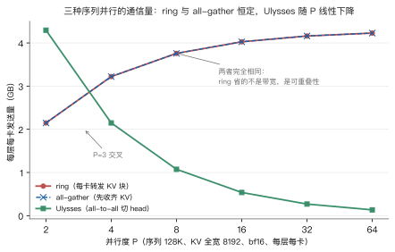
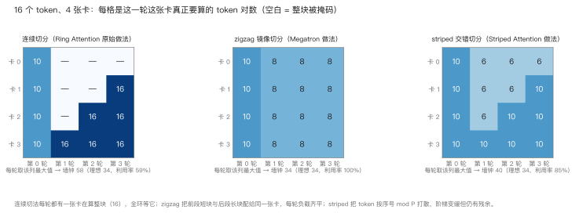
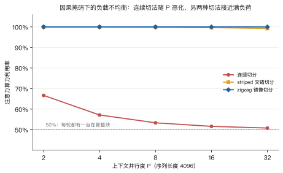
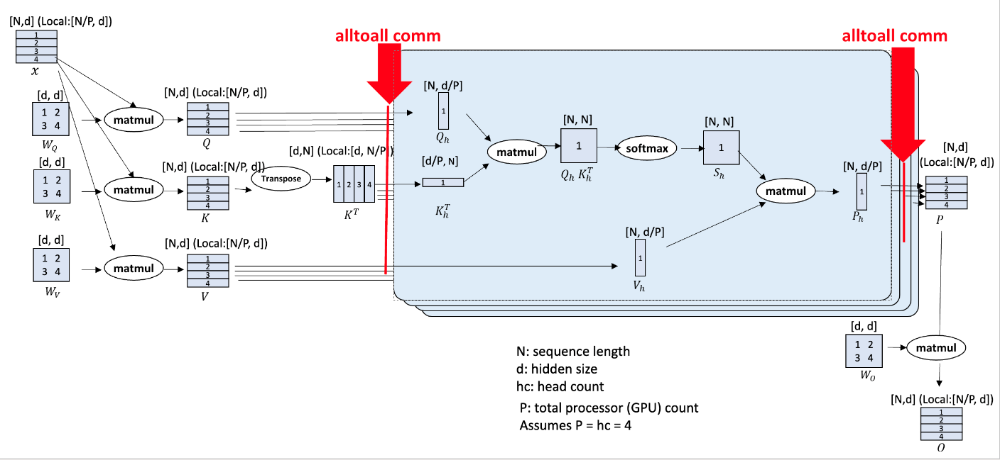

> **分布式训练系列 · 第 05 篇 / 共 08 篇**
>
> [04 流水并行](/2026/08/31/dist-train-04-pipeline-parallel/) ← **本篇** → [06 专家并行](/2026/08/31/dist-train-06-expert-parallel/)

> **TL;DR**
>
> * 序列并行是三个不同的东西：Megatron-SP 切 LayerNorm 附近的激活（TP 的附赠）、上下文并行切注意力本身、Ulysses 切 head；判据是 `hidden_states` 序列维有没有变成 $S/P$。
> * CP 的理由是「存不下」不是「算不动」：Flash Attention 已把注意力激活压到 $O(S)$，压不平的是每层 $2bsh$ 的序列维激活——128K、80 层、$h=8192$ 合 172 GB（§2 显存表）。
> * Ring 与 all-gather 每卡字节数相等，ring 省的是「可重叠」而不是带宽；门槛 $c\ge F/B$、$s\ge 6c$ 给出 A100 在 NVLink 上 6.2K token、在 IB 上 149.8K（复现 Ring Attention 论文 Table 2）。
> * 因果掩码让连续切法的利用率降到 50% 附近（§6.1）；zigzag 块级配平到 100%，striped 实测 1.45×（A100 256K）/1.65×（TPUv4），代价是 position ids 与 labels 要同步置换（本仓 `ring-attention-lab` 与 Striped Attention 论文）。

---

## 1. 先把三个同名的东西分开

「序列并行」这四个字在中文社区里至少对应三种互不相同的东西，混用会造成很具体的误判——比如以为打开 Megatron 的 `--sequence-parallel` 就能训 128K 上下文。

| 名称 | 切的是什么 | 通信原语 | 单卡显存随 $S$ | 它解决的问题 |
|---|---|---|---|---|
| **Megatron-SP**（2022） | LayerNorm / Dropout 的**输入激活**（沿序列） | All-Reduce / Reduce-Scatter / All-Gather，与 TP 共用一组 | 降到 $1/P$（仅这两类算子附近） | TP 下激活被复制的那份浪费 |
| **上下文并行 CP / Ring Attention**（2023-） | **序列本身**，含 Q/K/V 与注意力计算 | P2P 环转发 KV（或 all-gather） | 降到 $1/P$ | 单卡装不下长序列 |
| **Ulysses**（2023） | 序列切分 + **head 切分**两步走 | 两次 All-to-All | 降到 $1/P$ | 同上，但走另一条路 |

第一行的细节已经在 [03 篇的张量并行](/2026/08/31/dist-train-03-tensor-parallel/)与 megatron 系列的 [`f`/`g` 算子](/2026/10/09/megatron-03-tensor-parallel-and-sequence-parallel/)里推完了，本篇不再展开：它只是把「TP 之后每卡还复制着一份完整激活」这件事补上，通信量守恒、收益是显存，**并不能让上下文变长**。真正决定「能不能训 128K」的是后两行。

判断依据很简单：**打开之后，`hidden_states` 张量的序列维有没有变成 $S/P$。** Megatron-SP 里没有（它只在算子边界临时切），CP 与 Ulysses 里有。

---

## 2. 瓶颈不是 $S\times S$ 矩阵，是每层的序列维激活

一个常见的错误论证是这样的：单头注意力要算 $QK^\top\in\mathbb{R}^{S\times S}$，$S=128\mathrm{K}$、FP16 就是 $128\mathrm{K}\times128\mathrm{K}\times2\mathrm{B}\approx34$ GB，一张 H100 装不下。所以需要序列并行。

**这个论证在 2022 年之后就不成立了。** Flash Attention 用分块 + online softmax 把 $S\times S$ 中间量压在 SRAM 里不落地，注意力自己的激活降到 $O(S)$ 量级。单卡装不下 $S\times S$ 这件事，它已经解决了。

真正解决不了的，是**每一层输出都要留着给反向用**这件事。一层 Transformer 的输出是 $S\times h$，bf16 下每层要 $2bsh$ 字节；$L$ 层全留就是 $2Lbsh$。代入 70B 级配置（$L=80$、$h=8192$、$b=1$）：

| 序列长度 $S$ | 单层激活 $2bhS$ | 80 层合计 | 8 卡 CP 后每卡 |
|---|---|---|---|
| 8K | 134 MB | 10.7 GB | 1.3 GB |
| 32K | 537 MB | 43 GB | 5.4 GB |
| 128K | 2.15 GB | 172 GB | 21.5 GB |

1M token 时这个数会到 1.3 TB——而 H100 只有 80 GB。这才是 CP 要处理的对象：**不是注意力算不下，是激活存不下。**

> 这张表的算术是 $2\times b\times S\times h$ 字节，$b=1$、$h=8192$、$L=80$。实际训练还会叠加梯度检查点（只留层边界）与临时缓冲，所以真实数字与它同量级但不相等；量级判断不受影响。

Ring Attention 论文把这件事讲得更直接：即使同时用了 memory-efficient attention 与 blockwise FFN，把每层激活压到 $2bsh$，**一亿 token、隐藏宽 1024、$b=1$ 仍然要 1000 GB 以上**——而显卡的 HBM 上限在 100 GB 量级，且物理上很难继续涨 [1]。所以它选择了另一条路：把 $S$ 这一维本身切开。

这一步决定了后面所有设计的形态：切 $S$ 意味着**每个 token 的 query 只能看到一部分 key**，于是必须有一条路径把别的卡上的 KV 送过来。整篇文章都在讨论这条路径怎么修得足够便宜。

---

## 3. Ring Attention：outer loop 分给卡，KV 在环上转

### 3.1 机制

设序列切成 $P$ 块，第 $i$ 张卡持有 $Q_i,K_i,V_i$（各 $c=S/P$ 个 token）。要算的输出是

$$
O_i=\mathrm{softmax}\!\left(\frac{Q_iK^\top}{\sqrt{d}}\right)V,\qquad K=[K_0;\dots;K_{P-1}],\ V=[V_0;\dots;V_{P-1}]
$$

即第 $i$ 块输出依赖**全部** KV 块。朴素做法是每卡把其余 $P-1$ 块 KV 都收下来——显存回到全量，等于没切。

Ring Attention 的做法是：**不把 KV 收下来，而是让 KV 块路过。** 把 $P$ 张卡排成环，第 $t$ 轮时每张卡处理「自己上一轮收到的那块 KV」，同时把手上这块转给下一张卡。$P$ 轮之后，第 $i$ 张卡恰好见过全部 $P$ 块（含自己的），输出拼完 [1]。

每卡任一时刻的驻留量因此是常数：**自己的 $Q_i$、正在算的 $K_j,V_j$、正在接收的 $K_{j-1},V_{j-1}$、注意力输出累加器**。Ring Attention 论文把这些折成 6 个块大小，即 $6bch$ 字节——与 $S$ 无关 [1]。128K 上下文、$P=8$、$h=8192$ 时是 1.6 GB，而全量 KV 是 4.3 GB。

### 3.2 数学：为什么「路过」不会算错

关键在第 $t$ 轮的合并。每块 KV 单独算出的是一份**局部** softmax 结果，不能直接相加——因为各块的指数归一化基准不同。用 Flash Attention 的记号，把部分结果记成三元组 $(m,\ell,O)$，其中 $m$ 是行最大值、$\ell=\sum_j e^{s_j-m}$、$O=\sum_j e^{s_j-m}v_j$。两块合并是 [2]：

$$
m=\max(m_a,m_b),\qquad \ell=\ell_a e^{m_a-m}+\ell_b e^{m_b-m},\qquad O=O_a e^{m_a-m}+O_b e^{m_b-m}
$$

合并完再归一化：$O/\ell$。这个式子的三个性质正好是 ring 需要的全部：

1. **结合律成立**，所以 $P$ 轮逐块合并的最终结果 = 一次性全局 softmax，**逐元素等价**，不是近似；
2. **交换律成立**，所以 KV 块在环上以什么次序到达都无所谓——环的起点、方向、甚至每轮跳过哪些块都不影响正确性；
3. **每步只依赖 $(m,\ell,O)$ 三元组**，所以状态大小与已处理过的 block 数无关，可以一直挂着走。

第 1、2 条用 512 token、8 块、float64 实测过：任意分块与任意到达次序下，与全局 softmax 的最大绝对误差都在 $5\times10^{-16}$；而**把每块各自 softmax 再平均**这种最常被写错的实现，同一批数据上误差是 0.19——差 14 个数量级。前者是理论保证，后者是 bug。

```text
块数 NB=8，每块 64 token，ring vs 全局 softmax 最大绝对误差 4.996e-16
五种环序的最大误差： 4.44e-16, 5.55e-16, 4.44e-16, 5.55e-16, 4.44e-16
「逐块归一后平均」的最大误差 0.1864
logits 放大 20 倍后：全局 max = 98.8，ring 误差 3.109e-15
```

最后一行是在测数值稳定性：把 logits 整体放大 20 倍后，全局 softmax 的指数要到 $e^{98.8}$，朴素实现会溢出，而每步减去 running max 的 online 合并不受影响。这条不是形式上的严谨，它是长上下文必须开的前提——128K 上下文里出现个别大 logits 是常态，一旦溢出，整行输出变成 NaN，损失函数会先把梯度打成 NaN 再报错，回溯成本极高。

### 3.3 与 Flash Attention 的关系

Ring Attention 自己**不含注意力 kernel**。它的全部内容是一层调度：把「谁在什么时候算哪块」安排好，然后调用本地的 memory-efficient attention（Flash Attention 或别的）算单块。论文原文就说它「只需要在每台主机上调用任何可用的 memory-efficient 计算，并把 KV 块的通信与块计算重叠」[1]。

这也解释了为什么它容易落地：Flash Attention 升级到 Flash Attention 2 / 3 的时候，ring 那层代码不用改。反过来，如果 ring 自己实现了 kernel 内部逻辑，就会和 Flash Attention 的版本深度耦合——这是后来自研 CP 实现的团队普遍愿意沿用 TE / FA 原生 CP 支持的原因。

### 3.4 反向：为什么通信量要按前向的两倍算

前向里 KV 是「读过就走」——每张卡拿到一块就算，算完传走，不需要记住它属于谁。反向不是这样。

设第 $i$ 块输出的梯度是 $dO_i$。要算三样东西：

* $dQ_i$：只依赖本卡的 $Q_i$ 与本卡见过的那些 KV 块，**完全本地**；
* $dK_j$、$dV_j$：这两块属于第 $j$ 张卡，但它们的梯度是对**所有** query 块的贡献求和——因为第 $j$ 块 KV 在环上被每一张卡都读过一遍。

所以反向的环传语义跟前向相反：前向是把 KV **广播**出去（每卡各取所需，互不干扰），反向是把 $dK_j,dV_j$ **累加**回来（必须汇聚到属主）。实现上有两条路：

1. **再转一圈**：把 $dK/dV$ 沿环反向传递，每张卡收到后把本轮的贡献加上再传下去，$P$ 轮后回到属主时正好累加完。通信量与前向相同，且同样可以与反向计算重叠 [1]；
2. **一次 all-reduce**：每卡算出自己对全部 $P$ 块的 $dK/dV$，对 $P$ 张卡做 all-reduce。语义正确，但每卡要持有全量梯度的份额，显存回到 $O(S)$——等于把切分的收益吐回去。

生产的 ring 实现都走第 1 条。这就带来一个预算时容易漏掉的事实：**一个 step 的 CP 通信量要按前向的两倍算**，一前一后各转一圈。

还有一处隐性的连带成本：反向要重算 $S=QK^\top$（前向没有存），重算需要那一轮的 KV 块——所以反向的那一圈必须重放同样的块序列，**ring 的调度顺序在前向和反向之间不能自由改动**。这也是为什么 ring 的实现和 Flash Attention 的重算策略绑得很死：换一个重算粒度的 kernel，ring 那层的轮次编排要跟着改。

### 3.5 显存账：6 个块之外还有什么

论文给的 $6bch$ 是这么数出来的 [1]：1 份本卡 query 块、2 份正在算的 KV 块、2 份正在接收的 KV 双缓冲、1 份注意力输出累加器。$c=S/P$，所以这一项与 $S$ 无关——这正是 Ring Attention 相对「收齐全量 KV」的全部优势所在。

实际实现里还要叠加三样小东西，量级不同但都会吃掉预算：

* **LSE**：online softmax 的 $(m,\ell)$ 每行要存一份，$c\times4$ 字节（float32）。相对 $6bch$ 可以忽略，但反向合并时必须有它，否则要重算整条链；
* **$dO$ 缓冲**：反向要拿输出梯度与 KV 再算一遍，多一份 query 块大小的缓冲；
* **双缓冲的深度**：想把通信彻底藏住，接收缓冲往往要比「2 份」更深（2~3 个 in-flight 的块），实际驻留会超过论文的 6 块估计。

对比一下量级：128K 上下文、$P=8$、$h=8192$ 时，$6bch=1.6$ GB，而同一份 KV 全量是 4.3 GB、80 层激活是 172 GB。**CP 把显存从「随 $S$ 线性增长」压成「常数 + 与 $S$ 无关的通信开销」**，这才是它值得复杂度的原因。

---

## 4. 通信何时真的「免费」：一个算术强度门槛

Ring Attention 宣称「零额外开销」，这句话有个精确条件，而它决定了这套方案能不能用在你手上的机器。

一块 KV 与一个 query 块做注意力，计算量 $4dc^2$ FLOPs（$QK^\top$ 与 $PV$ 各 $2dc^2$）；同时要把这对 KV 传出去，$4cd$ 字节（两块、bf16）。要与计算重叠，必须计算时间 $\ge$ 传输时间：

$$
\frac{4dc^2}{F}\ \ge\ \frac{4cd}{B}\quad\Longrightarrow\quad c\ \ge\ \frac{F}{B}
$$

其中 $F$ 是单卡算力、$B$ 是**单向**互联带宽，$d$ 是块内每行的宽度（单头实现里就是 head 维，多头实现里是 head 维乘 head 数——两种口径下这个不等式形式不变）。再叠加「每卡要同时驻留 6 个块」，得到每卡至少要有 $s\ge 6c$ 个 token [1]。两个门槛乘起来，就是「这台机器能不能跑 ring」的判据：

| 硬件 | 单卡 BF16（TFLOPS） | 单向带宽（GB/s） | 最小块长 $c$ | 每卡最小序列 $s=6c$ |
|---|---|---|---|---|
| A100 + NVLink | 312 | 300 | 1 040 | **6.2K** |
| A100 + InfiniBand | 312 | 12.5 | 24 960 | **149.8K** |
| TPU v4 | 275 | 268 | 1 026 | 6.2K |
| H100 + NVLink | 989 | 450 | 2 198 | **13.2K** |
| H100 + IB 400G | 989 | 25 | 39 560 | **237.4K** |
| B200 + NVLink5 | 2250 | 900 | 2 500 | 15.0K |

前两行与论文 Table 2 的 1.0K / 6.2K、24.5K / 149.5K 对得上，是本仓实验直接算出来的，不是抄的。

这张表最值得看的是**第 1 行与第 5 行的差**：同一代 GPU，只把互联从 NVLink 换成 IB 400G，门槛从 13K 抬到 237K。也就是说在 H100 集群上，ring 只有在「每卡分到 24 万 token」时才能把通信藏干净——128K 上下文、64 卡，每卡只有 2K token，差两个数量级。

**跨机跑 ring 不是「带宽紧张」，是根本不满足前提。** 这不是理论洁癖：门槛没满足时，通信不再被重叠，而是变成每轮一次同步等待，$P$ 轮串起来就是 $P$ 倍的延迟暴露。

### 4.1 把门槛换算成时间占比

上面的门槛是「能否完全重叠」的判据。更实用的是直接算时间占比。以 128K 上下文、$h=8192$、80 层、$P=8$、H100、注意力与 MLP 的综合 MFU 取 50% 为例：

| 项目 | 单机 NVLink（450 GB/s） | 跨机 IB 400G（25 GB/s） |
|---|---|---|
| 每层每卡 KV 传输量 | 3.8 GB | 3.8 GB |
| 80 层合计 | 301 GB/step | 301 GB/step |
| 每层每卡计算量 | $\approx 1.5\times10^{14}$ FLOPs | 同左 |
| 每层计算时间（@494 TFLOPS） | 0.30 s | 0.30 s |
| 每层通信时间 | 8.4 ms | 150 ms |
| **通信占计算的比例** | **2.8%** | **50%** |

单机内 2.8%——这基本就是「免费」；跨机 50%——无论怎么重叠都不可能藏住，因为通信本身比计算还长。这张表是「ring 只应跑在 NVLink 域内」这句话的全部依据。

留一处需要注意的口径：门槛公式与这张表都用**峰值算力**，而实际注意力 kernel 的效率远低于峰值。如果按 50% MFU 折算，最小块长会同步减半（$c\propto F\cdot\eta$），门槛反而降低——但这不代表更容易跑，因为对应的计算时间也一起变长了，通信占比不变。**门槛降低的是「块要多大」，不是「通信占比」**，两者不要混。

### 4.2 顺带一个对比：长上下文时 CP 的通信量反超 DP

03 篇算过 TP 与 DP 的通信量关系，CP 的位置不一样：**TP 随激活增长、DP 随参数增长、CP 也随激活增长，但系数大得多**。

同样取 128K 上下文、$h=8192$、80 层、$P=8$、70B 级模型：

| | 每卡每 step 传输量 | 能否与计算重叠 |
|---|---|---|
| CP（ring，前向 + 反向各一圈） | **602 GB** | 段内可重叠，但需与同层的计算同量级才藏得住 |
| DP（梯度 All-Reduce） | 225 GB | 可按 bucket 分批，几乎完全藏进反向 |

算术：参数量 $12h^2L=6.44\times10^{10}$，bf16 梯度 129 GB，Ring All-Reduce 的因子 $2(P-1)/P=1.75$ → 225 GB；CP 前向 301 GB、反向再 301 GB。

也就是说，**在 128K 这个量级，CP 的通信量已经是 DP 的 1.3 倍（只算前向）到 2.7 倍（含反向），而且性质更差**——DP 的梯度规约本来就是「边算边传」，CP 的通信嵌在注意力内部，一旦与计算同量级就无处可藏。这就是长上下文训练普遍把 CP 压在单机 8 卡、不再往上加的原因：不是不想切更细，是每一刀的边际通信成本在陡增。

---

## 5. 一个反直觉的事实：ring 与 all-gather 通信量完全相同

讲到 ring，几乎必然会看到「ring 比 all-gather 省带宽」。这句话是错的。把三个方案的每卡字节数摆在一起（序列 $S$、KV 全宽 $h$、并行度 $P$、bf16）：

$$
\text{ring}: 2Sh\cdot\frac{P-1}{P}\qquad
\text{all-gather}: 2Sh\cdot\frac{P-1}{P}\qquad
\text{Ulysses}: 4Sh\cdot\frac{1}{P}
$$

前两个**逐字节相等**。ring 每卡转 $P-1$ 个块、每块 $2\cdot\frac{S}{P}\cdot h$ 字节，展开就是 $2Sh(P-1)/P$；all-gather 每卡收全量的 $(P-1)/P$，展开也是它。实验里把 $P$ 从 2 扫到 32，两者相对差是 0。



那张图里真正有信息的是两条不同的趋势：ring 与 all-gather 恒定在 $2Sh$ 量级（与 $P$ 无关），Ulysses 是 $4Sh/P$。两者的比值是 $(P-1)/2$——**$P\ge4$ 之后 Ulysses 的通信量就比 ring 少，$P$ 越大差得越多**；$P=2$ 时反而是 Ulysses 更贵。

### 5.1 那 ring 到底省了什么

省的是**同步点**。

all-gather 是一个全局屏障：所有卡必须等最慢的那张把 KV 收齐，然后才能开始算注意力。这个等待期是纯暴露时间，没法与计算重叠——除了第一轮之外没有「算着算着数据就到了」的余地。ring 把这一次大同步拆成 $P$ 次 P2P，每次只需要和邻居握手，而且第 $t$ 轮的传输可以和第 $t-1$ 轮的计算同时进行。

所以选型的正确问法是：

* 如果互联带宽相对算力够宽（单机 NVLink），一次 all-gather 的暴露时间只有 2~3%，**all-gather 更简单、更可控**；
* 如果互联紧张（跨机、或者序列长到通信占比上两位数），**只有 ring 的重叠能救**；
* 而如果 $P$ 足够大，Ulysses 直接把通信量按 $1/P$ 削下去，连重叠都不需要。

这条判断在下一节的实现默认值里会再出现一次，且方向一致。

---

## 6. 因果掩码：连续切法会丢掉一半效率

前面的分析都假设每个 query 块都要看全部 KV 块。但 LLM 是因果注意力：**第 $i$ 块 query 只需要看 $j\le i$ 的 KV 块**，其余整块被掩码，可以直接跳过。这个「跳过」在单卡上早就实现了（Flash Attention 的 causal 模式就是这么快的），但在 ring 上它带来一个新问题——**跳过之后，各卡的活不一样多**。

### 6.1 连续切分：每轮都有一张卡在算整块

把序列连续切成 $P$ 段，第 $i$ 张卡拿第 $i$ 段。$P$ 轮之后每张卡都见过全部 $P$ 块，但第 0 张卡只有第一轮算出非零结果（对角块），最后一张卡四轮全满。更要紧的是**每一轮**：总有某张卡正好拿到「比自己靠后」的 KV 块，那一块对它是整块有效、一点都跳不掉。

于是每轮墙钟 = 一整块的计算时间，全环所有卡陪着等一张卡。16 个 token、4 张卡的例子：



这张图是本篇最该看的一张。它把「负载不均」拆成可数的格子：**每格是这一轮这张卡真正要算的 token 对数**，空白表示整块被掩码。连续切法下，卡 0 只有第一轮有活、卡 3 四轮全满——而墙钟是「每轮取该列最大值再相加」，所以那些空白格子并没有变成省下来的时间。

这个损失有多大？把 $P$ 从 2 扫到 32：



连续切法的利用率单调下滑并收敛到 50%——这正是理论上限 2× 的另一种写法：**不管怎么优化，连续切法的因果 ring 最多只能拿回一半**。$P$ 越大越亏，而长上下文恰恰是 $P$ 大。

### 6.2 zigzag：把前段的短块与后段的长块配给同一张卡

既然「位置越靠后负载越重」是单调的，那就把首尾配对。序列先切成 $2P$ 块，第 $i$ 张卡拿第 $i$ 块**和倒数第 $i$ 块**：

```text
P=4、16 个 token 的归属：
contiguous   [0 0 0 0 | 1 1 1 1 | 2 2 2 2 | 3 3 3 3]
zigzag       [0 0 1 1 | 2 2 3 3 | 3 3 2 2 | 1 1 0 0]
```

第 $i$ 张卡的两块在序列里一前一后，第一块的负载轻、第二块的重，加起来恒定。块级模型下这个配平是**严格相等**的，不是近似：每卡每轮都是 10/8/8/8，墙钟 34 = 理想值。

Megatron 的实现就是这个小把戏，核心逻辑在 `megatron/core/utils.py` 里不到十五行 [3]：

```python
val = val.view(
    *val.shape[0:seq_dim],
    2 * cp_size,
    val.shape[seq_dim] // (2 * cp_size),
    *val.shape[(seq_dim + 1):],
)
index = torch.zeros(2, dtype=torch.int64, device=val.device)
index[0].fill_(cp_rank)
index[1].fill_(2 * cp_size - cp_rank - 1)
val = val.index_select(seq_dim, index)
val = val.view(*val.shape[0:seq_dim], -1, *val.shape[(seq_dim + 2):])
```

把序列维 reshape 成 `(2P, S/2P)`，取第 `cp_rank` 块和第 `2P-1-cp_rank` 块，再拼回长度为 $S/P$ 的连续张量——下游完全看不出区别，只是这段 token 在物理上不再连续。`index_select` 之后的那次 `view` 之所以成立，是因为两块都是等长的，拼起来正好是 `(2, S/2P)` 展平成 `S/P`。

### 6.3 striped：把 token 按序号打散

Striped Attention 换了思路：不重排块，而是把 token 按序号取模分给各卡——$P=4$ 时第 0 张卡拿 token 0, 4, 8, …，第 1 张卡拿 1, 5, 9, … [4]。这样任何一次「query 块 × KV 块」的交互里，因果掩码都是一个梯形而不是整齐的三角，于是**每张卡每轮都有活干**，只是活的多寡被拉平了。

在块级模型里 striped 的利用率在 99% 上下（$P=32$ 时 99.2%），比 zigzag 略差，但实现上有个额外好处：**它不需要把 $2P$ 当整除条件**，只要 $P$ 能整除序列长度即可。

代价在别处，而且很隐蔽：

* 序列被打散，**position ids 必须用同一套置换**，否则 RoPE 会把每个 token 按错误的位置旋转；
* 训练时 **labels / loss mask 也要跟着置换**，否则算的是「第 $i$ 个位置的 logits 对第 $\pi(i)$ 个位置的标签」的交叉熵，损失曲线看着正常但模型学不到东西；
* 推理时如果要在生成中途插入新的 token，置换关系会破。

这三条里第二条最危险：它不报错、不 NaN，只是让训练慢慢变差。Striped Attention 的论文把这条写在方法节里 [4]，但博客文章里极少提到。

### 6.4 实测能拿回多少

| 配置 | 相对连续切法的端到端加速 | 出处 |
|---|---|---|
| A100 × 8 NVLink，256K 序列，因果 Transformer | **1.45×**（Striped Attention） | [4] |
| TPUv4 × 16，256K 序列 | **1.65×**（Striped Attention） | [4] |
| 理论上限（只算注意力、块级模型） | 2.0× | [4] 与本仓实验 |

实测低于 2× 的原因不是切法不够好，而是**注意力只占端到端时间的一部分**——MLP、归一化、优化器更新、通信都不受影响。把注意力那部分的时间减半，端到端自然只快 1.45~1.65 倍。这个换算关系在评估任何「注意力优化」时都成立，值得记住。

### 6.5 变长序列：块级模型失效之后

上面所有配平都依赖一个隐含假设：**负载是位置的线性函数**。一旦序列被 document packing 拼成变长的 `cu_seqlens`，或者注意力是滑窗 / 文档内隔离的，这个假设就不成立了，zigzag 的「首尾配对」会配错。

两家框架各自给了对策，且方向一致——**从「按位置算」退到「按实际 mask 算」**：

* Megatron v0.20 的 `get_batch_on_this_cp_rank` 有三条分支：无 `cu_seqlens` 时走 per-sequence zigzag；有 `cu_seqlens` 时走 **per-document zigzag**（在每个文档内部做首尾配对）；还支持 `a2a+p2p` 的分层 CP [3]。
* PyTorch 的 `_load_balancer.py` 里有三个均衡器：`_HeadTailLoadBalancer`（就是 zigzag）、`_PerDocumentHeadTailLoadBalancer`（按文档）、以及 `_PTRRLoadBalancer`——后者把每个 block 的**实际处理耗时**排序后做蛇形分组，任何形状的 mask 都能配平。它有前提：只能在 `flex_attention` 的 `BlockMask` 上跑（那里能拿到逐块的耗时信息），不是所有注意力后端都能用 [5]。

从「按位置假设」到「按实测耗时」，是这条线上最近两年最实际的一次进步：它把负载均衡从「需要证明的数学」变成了「量一次就行」。

---

## 7. Ulysses：不切序列，切 head

Ring 的路线是「序列切开、KV 到处跑」。Ulysses 走的是另一条：**序列切开，但算注意力之前把序列换回来，改用 head 切分** [6]。

具体是两次 All-to-All：

1. 进注意力之前：把每个 token 的 $h$ 维按 head 切开，每个 rank 拿走**全部序列、但只有 $1/P$ 的 head**（Q/K/V 的宽度从 $h$ 降到 $h/P$）；
2. 出注意力之后：把 head 维的结果换回序列维，恢复成「本 rank 的那段序列、全部 head」。



*图源：DeepSpeed Ulysses，[arXiv:2309.14509](https://arxiv.org/abs/2309.14509) Figure 2，许可 [CC BY 4.0](https://creativecommons.org/licenses/by/4.0/)，未改动。*

关键在于：**每个 head 的注意力是完整的**，不需要 online softmax 跨块合并，也不需要环。所以它对注意力 kernel 完全透明——dense、sparse、滑窗、Flash Attention 的任意版本都能直接塞进去，这正是论文主打的「attention-agnostic」[6]。

通信量的账上一节已经算过：每层每链路 $4Sh/P$，$P$ 越大越便宜。Ulysses 论文给的实测是：64 张 A100 上训 100 万 token 序列，吞吐 175 TFLOPs/GPU（超过峰值 54%），通信量比当时方案低一个数量级 [6]。

### 7.1 两条路的取舍

| 维度 | Ring Attention | Ulysses |
|---|---|---|
| 切分轴 | 序列 | 序列 + head |
| 通信原语 | P2P 环转发（或 all-gather） | All-to-All |
| 每卡通信量 | $2Sh(P-1)/P$，与 $P$ 无关 | $4Sh/P$，随 $P$ 线性降 |
| 硬约束 | 序列长需能被 $2P$ 整除（zigzag） | **head 数必须 $\ge P$** |
| 拓扑偏好 | 环 / torus / 相邻链路 | 全互联（NVLink、胖树 IB） |
| 对注意力的侵入 | 需要 kernel 支持分块累计 | 无（每个 head 本地算完整） |
| 主要风险 | 负载不均、跨机不满足 $c\ge F/B$ | $P$ 超过 head 数直接退化 |

head 数那条约束经常被低估：LLaMA-3 8B 是 32 个 query head，按 GQA 只有 8 个 KV head。用 Ulysses 时，如果按 KV head 切，$P$ 最多 8；按 query head 切，$P$ 最多 32。想要 $P=64$ 就必须**同时叠加 ring**——这正是 USP 做的事：把 $P$ 拆成「ring 度 × ulysses 度」，二维网格上一边走 P2P、一边走 All-to-All [7]。

### 7.2 形状怎么变：$4Sh/P$ 是怎么来的

把一次 all-to-all 拆开看就清楚了。设序列 $S$、hidden $h$、并行度 $P$：

| 阶段 | 本卡持有的张量 | 动作 |
|---|---|---|
| 进注意力前 | $[S/P,\ h]$ | 本卡只有一段序列、全部 head |
| 第一次 all-to-all | $[S,\ h/P]$ | 对每个目标 rank 发 $[S/P,\ h/P]$，共 $P$ 份 |
| 本地注意力 | $[S,\ h/P]$ | 这 $1/P$ 的 head 算**完整**的 $S\times S$ |
| 第二次 all-to-all | $[S/P,\ h]$ | 逆变换，发送量相同 |

每卡每次发送 $S\cdot h/P$ 个元素；Q、K、V 各一次、输出一次，合计 $4Sh/P$——这就是上一节那个式子的来历，也是它与 $P$ 成反比的直观原因。

代价在**消息数**上：all-to-all 是 $P$ 个 rank 两两通信，逻辑上 $P^2$ 条消息；ring 只有 $2P$ 条邻居消息。所以 Ulysses 在 $P$ 大、$S/P$ 小的时候会被延迟主导——这时每条消息都装不满，带宽利用率掉下去，而 ring 反而因为只跟邻居说话而更稳。这是「Ulysses 通信量小」之外必须同时看的一条。


---

## 8. 实现现状：两家的默认值不一样

原理讲完之后，落地时最该先看的是**默认值**——它决定了你打开开关之后实际跑的是哪条路径。

### 8.1 Megatron-LM v0.20：四种通信方式

`TransformerConfig.cp_comm_type` 有四个取值 [3]：

| 取值 | 实际动作 | 能否与计算重叠 | 版本门槛 |
|---|---|---|---|
| `p2p`（默认） | 环上 P2P 交换 KV 块 | **能**（异步） | TE ≥ 1.10 |
| `all_gather` | 先收齐全序列 KV 再算 | 不能（同步屏障） | TE ≥ 1.10 |
| `a2a` | 类 Ulysses，跨 CP 组切 head | 视实现 | TE ≥ 1.10 |
| `a2a+p2p` | 分层：低层 CP 组走 A2A（NVLink 内），高层走 P2P（跨机） | 分层各有 | TE ≥ **1.12** |

两个实现事实：**CP 整套功能都落在 Transformer Engine 的 `DotProductAttention` 上**，TE < 1.0 完全不支持 CP，`cp_comm_type` 要 1.10 才有，分层要 1.12；否则这些参数会被静默忽略、跑回未分片的路径。另外 DeepSeek 式的稀疏注意力（`experimental_attention_variant="dsa"`）只允许 `all_gather`——稀疏模式的分块索引和环上的 KV 轮转对不上，得先把 KV 收齐。

### 8.2 PyTorch v2.10：默认走 all-gather

`torch.distributed.tensor.experimental.context_parallel` 是个原型 API：它做两件事——把 `scaled_dot_product_attention` 换成 CP 版本、把依赖序列维的 buffer 就地切分（可用 `no_restore_buffers` 跳过恢复）[8]。

但它在内部并不是默认走 P2P 环。`_ContextParallelOptions` 的默认值是 [5]：

```python
@dataclass
class _ContextParallelOptions:
    convert_to_f32: bool = True
    enable_load_balance: bool = True
    rotate_method: _RotateMethod = _RotateMethod.ALL_GATHER
```

三点值得注意：

* `rotate_method` 默认 **ALL_GATHER**——即「一次 all-gather 收齐 KV，然后本地跑 $P$ 轮循环，每轮只取需要的块」。另一条路 `ALL_TO_ALL` 用 `permute_tensor` 一次换到目标 rank。**默认根本没有用 P2P 流水**。
* `enable_load_balance` 默认 **True**，默认构造的就是 `_HeadTailLoadBalancer`（即 zigzag）；要换成按文档或按实测耗时的均衡器得显式指定。
* `convert_to_f32` 默认 **True**：跨卡合并注意力输出与 LSE 时先转 fp32 再累加（`_SDPAMerger.step`）。bf16 直接累加在 $P$ 大时会累积误差，这一项是为数值精度付的价——多一份 fp32 的临时缓冲，也多一点转换开销。

这跟 Megatron 的默认（`p2p`）刚好相反。谁的默认更合理？看第 5 节的结论：

* 单机内、通信占比 2~3%，**all-gather 的一次屏障几乎无损，而实现简单、没有 P2P 死锁风险**——PyTorch 的选择合理；
* 跨机、通信占比过半，**只有 P2P 流水能救**——Megatron 的选择合理。

默认值不同不是谁「落后」，是两个框架面向的部署形态不同。

---

## 9. 推理侧：prefill 能复用，decode 不能

CP 在推理里只解决一半的问题，且两半的结论相反。

**Prefill** 阶段可以完全复用训练的实现：一条 128K 的 prompt 要一次算完，$Q$ 有 128K 行，与训练时的形状同构，CP / ring / Ulysses 都能直接上。这也是「长上下文推理加速」在工程上最先落地的位置。

**Decode** 阶段不行。每一步只有 1 个（或几步 spec decode 的 $\gamma$ 个）新 token 作 query，而 KV 有几十万条。这时把 CP 套上去，每张卡会算一个「1 行 × 全序列」的注意力——**计算量小到无法与通信重叠**，第 4 节的门槛 $c\ge F/B$ 在这里被彻底击穿。正确的做法是反过来：**KV 按序列维分片存放，每卡算自己那份 KV 上的部分注意力，最后用一次小 all-reduce 合并**（合并的正是 $(m,\ell,O)$ 三元组）。通信量只有「head 数 × head 维」量级，与序列长度无关。

这个「训练/长 prefill 用环，短 query 用 KV 分片 + 归约」的分野，是长上下文推理系统里最基础的一条，展开会牵出 KV 缓存的放置、前缀复用与调度，属于 [推理服务系列](/2026/10/18/serving-05-pd-disaggregation-kv-transfer/)的边界，本篇只给结论。

---

## 10. 决策与踩坑

### 10.1 什么场景选什么

| 场景 | 选择 | 理由 |
|---|---|---|
| 训练上下文 32K~128K，单机 8 卡 | **Megatron-SP + 单机内 CP** | 序列维必须切；单机 NVLink 满足 $c\ge F/B$ |
| 训练上下文 > 128K，多机 | **CP 在机内 + Ulysses 跨机**（或 `a2a+p2p` 分层） | 跨机 P2P 不满足门槛，用 A2A 把通信量压到 $1/P$ |
| head 数少（GQA，8 个 KV head） | 优先 **ring**，Ulysses 会被 head 数卡住 | Ulysses 要求 head 数 $\ge P$ |
| 只想省 LayerNorm 附近的激活复制 | **Megatron-SP 单独开** | 通信量守恒，纯显存收益，不会让上下文变长 |
| 序列长但注意力是稀疏 / 滑窗 | **Ulysses 或 `all_gather` 式 CP** | 分块索引与环上轮转不兼容（Megatron 已强制 `all_gather`） |
| 长 prompt 的 prefill | 复用训练的 CP | 形状同构 |
| 长上下文的 decode | **不要用环**，用 KV 分片 + 归约 | 查询只有 1 行，无法重叠 |

### 10.2 硬约束与踩坑清单

1. **整除性**：zigzag 要求序列长被 $2P$ 整除（`2 * cp_size` 那个 reshape 一旦除不尽就直接报错或在错误的边界上切）；striped 要求被 $P$ 整除；Ulysses 要求 head 数被 $P$ 整除。变长序列要先 padding 或走 per-document 均衡。
2. **该切的 buffer 必须一起切**：`position_ids`、`labels`、`loss_mask`、`attention_mask` 的序列维要和 hidden states 用**同一套**分片规则。Megatron 的 `get_batch_on_this_cp_rank` 就是按 key 逐个处理的，其中 `attention_mask` 的序列维是第 2 维不是第 1 维——写成统一 `dim=1` 会静默切错。
3. **CP 组必须同机**：这不是经验，是第 4 节的门槛。跨机的 P2P 环在 128K 上下文下通信占比 50%+，无论怎么调参都救不回来。要做跨机，就把那一维换成 A2A 或 PP。
4. **不要用「每块各自归一」拼结果**：误差是 $O(1)$ 而不是 $O(10^{-16})$，且不会 NaN，只会让注意力变成「各块平均」——损失能降但明显更差。
5. **升级 TE 之后重新确认 `cp_comm_type` 真的生效**：TE < 1.10 时这个参数被忽略，训练能跑、梯度也对（回退成单卡全序列），只是显存和速度完全不同。用显存占用反查比读日志可靠。

### 10.3 一个 128K 预训练的配置怎么推

把前面的账串起来，70B dense、128K 上下文、H100 集群：

| 资源 | 数值 | 结论 |
|---|---|---|
| 参数（bf16） | $64.4\times10^{9}\times2\,\mathrm{B}=129$ GB | 单卡装不下，分片是前提 |
| 优化器状态（Adam + fp32 主权重） | $64.4\times10^{9}\times12\,\mathrm{B}=773$ GB | 必须 ZeRO-1 / FSDP 分片 |
| 128K 激活（80 层，$2bsh$） | 172 GB | full checkpointing 只留每层输入、层数不变，仍压不到单卡，必须 CP |
| CP=8 之后每卡激活 | 21.5 GB | 正好用满单机 8 卡的 NVLink 域 |

**CP 的取值被两条线夹住**：上界是「单机 NVLink 域」（第 4 节的门槛，跨机不满足），下界是「激活必须降到能放下」。两条线一交，$P=8$ 就是那个合理值——再往上没有 NVLink 可用，再往下显存放不下。

于是整套配置是：**TP=1、CP=8（机内）、FSDP/DP=16（跨机），共 128 卡**。注意 TP=1 不是省事，是被迫：单机 8 卡被 CP 占满之后没有位置留给 TP，参数只能靠 FSDP 与 CP 共用同一组 rank 来分片。这也解释了一个常见的困惑——「为什么长上下文训练不约而同地放弃 TP」，因为 NVLink 域的总带宽是个固定预算，分给 CP 之后 TP 就没份了，而 CP 省下来的显存比 TP 更关键。

### 10.4 怎么确认 CP 真的生效

三个反查点，从便宜到贵：

1. **看显存**：CP 生效后，单卡激活应随 $P$ 大致按 $1/P$ 下降。如果改了 `context_parallel_size` 显存几乎不动，说明参数被静默忽略了（TE 版本不够时就是这样）；
2. **看通信量**：在 profiler 里应该看到 `ncclSend/ncclRecv`（`p2p` 模式）或成对的 `ncclAllGather`（`all_gather` 模式），量级与第 5 节算的 $2Sh(P-1)/P$ 对得上。看到的是 `ncclAllReduce` 则说明回退成了别的路径；
3. **看数值**：把同一份 batch 在 CP=1 与 CP=P 下各跑一步，**loss 与前几个 step 的梯度范数应逐位接近**（fp32 累积下差异在 $10^{-6}$ 量级）。这一条最值钱——它能同时抓出「position ids 没跟着切」和「labels 切错」这两类静默 bug。

---

## 11. 参考

1. Liu, Zaharia, Abbeel. *Ring Attention with Blockwise Transformers for Near-Infinite Context*. [arXiv:2310.01889](https://arxiv.org/abs/2310.01889)（blockwise outer loop 分给设备、KV 环转发、Table 1 的 6 项激活、Table 2 的 $c\ge F/B$ 与 $s=6c$、Table 3 的最大上下文长度）
2. Dao et al. *FlashAttention: Fast and Memory-Efficient Exact Attention with IO-Awareness*. [arXiv:2205.14135](https://arxiv.org/abs/2205.14135)（online softmax 的 $(m,\ell,O)$ 合并公式）
3. NVIDIA. *Megatron-LM*，v0.20.0 = [`60e039626`](https://github.com/NVIDIA/Megatron-LM/tree/60e03962622a42ceb985fe898718c8d3834d9e30)。相关位置：[`megatron/core/utils.py#L2501-L2559`](https://github.com/NVIDIA/Megatron-LM/blob/60e03962622a42ceb985fe898718c8d3834d9e30/megatron/core/utils.py#L2501-L2559)（zigzag 与 per-document 分支）、[`transformer_config.py#L1023-L1037`](https://github.com/NVIDIA/Megatron-LM/blob/60e03962622a42ceb985fe898718c8d3834d9e30/megatron/core/transformer/transformer_config.py#L1023-L1037)（`cp_comm_type` 四值）、[`transformer_engine.py#L2100-L2118`](https://github.com/NVIDIA/Megatron-LM/blob/60e03962622a42ceb985fe898718c8d3834d9e30/megatron/core/extensions/transformer_engine.py#L2100-L2118)（TE 版本门槛）
4. Brandon et al. *Striped Attention: Faster Ring Attention for Causal Transformers*. [arXiv:2311.09431](https://arxiv.org/abs/2311.09431)（residue mod $N$ 的切法、$\mathrm{Work}(i,j)$ 的闭式、1.45×/1.65× 实测、position ids 与 target ids 需同步置换）
5. PyTorch，tag `v2.10.0`：[`_context_parallel/_attention.py#L70-L77`](https://github.com/pytorch/pytorch/blob/v2.10.0/torch/distributed/tensor/experimental/_context_parallel/_attention.py#L70-L77)（`_ContextParallelOptions` 的三个默认值）、[`#L236-L292`](https://github.com/pytorch/pytorch/blob/v2.10.0/torch/distributed/tensor/experimental/_context_parallel/_attention.py#L236-L292)（两种 rotater）、[`_load_balancer.py#L78`](https://github.com/pytorch/pytorch/blob/v2.10.0/torch/distributed/tensor/experimental/_context_parallel/_load_balancer.py#L78) 起（三种均衡器）
6. Jacobs et al. *DeepSpeed Ulysses: System Optimizations for Enabling Training of Extreme Long Sequence Transformer Models*. [arXiv:2309.14509](https://arxiv.org/abs/2309.14509)（两次 All-to-All、$4Sh/P$ 的通信量、64×A100 上 1M token）
7. Fang, Zhao. *USP: A Unified Sequence Parallelism Approach for Long Context Generative AI*. [arXiv:2405.07719](https://arxiv.org/abs/2405.07719)（ring 与 Ulysses 的二维组合、Figure 3 的负载均衡对比）
8. PyTorch. *torch.distributed.tensor — experimental.context_parallel*：<https://docs.pytorch.org/docs/stable/distributed.tensor.html>
9. Korthikanti et al. *Reducing Activation Recomputation in Large Transformer Models*. [arXiv:2205.05198](https://arxiv.org/abs/2205.05198)（Megatron-SP 与激活分析，详见 megatron 系列 03 篇）
10. 本仓实验：[`experiments/distributed-training/ring-attention-lab/`](https://github.com/lrypcy/ipynbs/tree/63bc77e2fabc48e1b9a9df4a10119fbbf554a12e/experiments/distributed-training/ring-attention-lab)（四组实验、20 条断言、三张配图的生成脚本）

---

*上一篇：[04 流水并行](/2026/08/31/dist-train-04-pipeline-parallel/) —— 按层切分的另一种思路：GPipe/PipeDream/1F1B 与气泡的数学。*

*下一篇：[06 专家并行](/2026/08/31/dist-train-06-expert-parallel/) —— MoE 的 All-to-All：token 去哪张卡，负载怎么均衡。*
