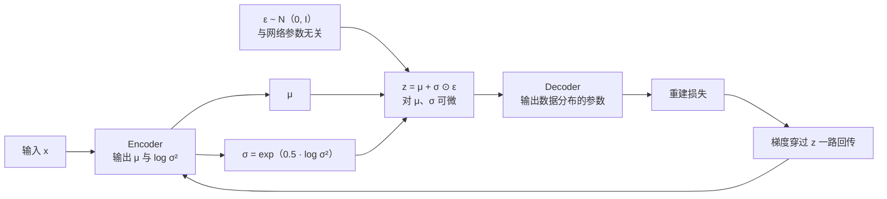
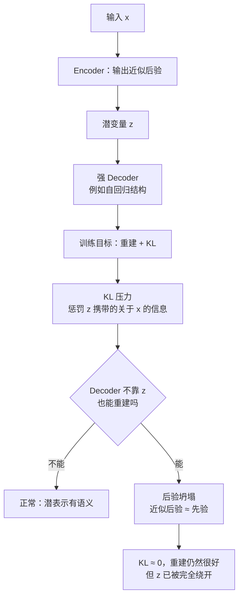
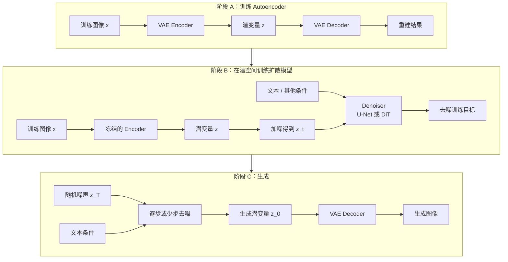

> **系列导航** ｜ 本系列承接 [Flow Matching 建模之三：条件生成、离散域与潜空间](/2026/08/22/flow-matching-03-guidance-discrete-latent/) 与 [扩散语言模型（01）](/2026/10/12/diffusion-lm-01-discrete-diffusion-elbo/) 里被当作既定前提的「潜空间」这一层，把它自己讲透：潜空间从哪来、凭什么能被采样、以及它为什么会失效。
> 上一篇：无（系列首篇）｜ 下一篇：02 离散化与码本（VQ-VAE 到 VQGAN 的量化细节，写作中）

> **TL;DR**
>
> - 普通 Autoencoder 的潜空间只有团簇、没有铺满先验，从 $$z\sim\mathcal N(0,I)$$ 采到的点落在团簇之间的空白区，解码器在那里从未被训练过。VAE 的解法不是换结构，而是**把每个样本编码成一个分布**，再约束这个分布靠近先验。
> - ELBO 是对数似然的下界，而且**恒等式** $$\log p_\theta(x)=\mathcal L_{\mathrm{ELBO}}+D_{\mathrm{KL}}(q_\phi(z\mid x)\Vert p_\theta(z\mid x))$$ 精确成立。实跑显示随机 6 组 $$q$$ 的残差 ≤ 1.6e-15，1600 万个网格点上下界间隙的最小值 2.96e-07 ≥ 0。
> - 重参数化把随机性从网络参数转移到与参数无关的 $$\epsilon$$ 上。同目标、同批样本下，它的梯度估计方差比 score-function（REINFORCE）低 **7.6 ~ 56.2 倍**，两者都无偏。
> - 「VAE 生成的图糊」不是采样造成的，而是**目标函数面对不确定性时取条件均值**造成的：MSE 最优解唯一且等于两个模态的逐像素平均，期望 MSE 0.0156（选任一模态为 0.0312），代价是锐度从 1.00 掉到 0.50。
> - KL 项是一把剪刀。线性高斯 VAE 上把 $$\beta$$ 从 0.25 推到 64：KL 总和 17.59 → 0.00006，活跃潜维度 8 → 0，重建 RMSE 0.317 → 1.053。后验坍塌就是剪到 0 的极限情形。
> - 到了 Latent Diffusion 里，VAE 的角色已经不是「生成器」，而是**压缩表示层**：LDM 论文扫过 $$f\in\{1,2,4,8,16,32\}$$，结论是 $$f=4$$ 与 $$f=8$$ 「提供了最好的条件」。

配套实验：[`ipynbs` commit `a461fc7`](https://github.com/lrypcy/ipynbs/tree/a461fc7/experiments/vae/vae_core/) 下的 `vae_core/`，纯 numpy、CPU 可跑、固定 seed，本文所有数字都来自它的实际输出。

---

## 0. 符号约定

| 符号 | 含义 | 备注 |
|---:|:---|:---|
| $$x$$ | 观测数据（图像 / 序列） | 训练时已知，生成时是要产出的东西 |
| $$z$$ | 潜变量 | 经典 VAE 里是连续向量，VQ 路线里是码本索引 |
| $$p(z)$$ | 先验 | 经典取 $$\mathcal N(0,I)$$ |
| $$p_\theta(x\mid z)$$ | Decoder 定义的条件生成分布 | $$\theta$$ 是解码器参数 |
| $$p_\theta(z\mid x)$$ | 真实后验 | 分母含 $$p_\theta(x)$$，**算不出来** |
| $$q_\phi(z\mid x)$$ | 近似后验（Encoder 输出） | $$\phi$$ 是编码器参数 |
| $$\mathcal L_{\mathrm{ELBO}}$$ | 证据下界 | 重建项减 KL 项 |
| $$d$$ | 潜变量维度 | 下标 $$j$$ 遍历各维 |
| $$\mu_\phi(x),\ \sigma_\phi^2(x)$$ | 近似后验的逐维均值与方差 | 实现里常输出 $$\log\sigma^2$$ |

> **一处容易混的记号**：KL 项约束的是**单个样本**的后验 $$q_\phi(z\mid x)$$ 与先验 $$p(z)$$ 的距离；而「整个数据集压出来的分布」叫**聚合后验** $$q_\phi(z)=\mathbb E_{p_{\mathrm{data}}(x)}[q_\phi(z\mid x)]$$。两者相关但不等价，第 3 节会给出把它们精确联系起来的分解式。

---

## 1. 为什么普通 Autoencoder 不能直接当生成器

普通 Autoencoder 只有两个网络：

- Encoder：$$z=f_\phi(x)$$
- Decoder：$$\hat x=g_\theta(z)$$

训练目标就是重建误差：

$$
\mathcal L_{\mathrm{AE}}=\lVert x-g_\theta(f_\phi(x))\rVert^2
$$

一张 $$512\times512\times3$$ 的图像进去，被压成一条远短得多的潜表示，再被还原回 $$512\times512\times3$$。只要容量够，重建误差可以做到很小。

问题在于，这个目标**只约束了训练样本所在的位置**。它要求「训练集里的点能被还原」，没有对团簇之间的区域提任何要求，于是潜空间长这样：


从先验 $$z\sim\mathcal N(0,I)$$ 里随便采一个点，它大概率落在团簇之间的空白区。Decoder 在那片区域从未收到过任何梯度，输出什么都没有定义——这就是「AE 重建很好却生成不了」的全部原因。

注意这里的措辞：**不是**「AE 的重建差」，而是「AE 的潜空间没有可采样的结构」。这是两个不同的失败模式，补救办法也完全不同：前者要加容量，后者要改目标。

VAE 的解法不是换网络结构，而是改变 Encoder 的输出类型——从输出一个点，改成**输出一个分布**，再加一项约束让这个分布靠近一个已知的、可采样的先验。

---

## 2. 概率生成过程，以及那道算不出来的积分

VAE 把数据想象成由两步产生：

$$
z\sim p(z),\qquad x\sim p_\theta(x\mid z)
$$

于是数据分布是

$$
p_\theta(x)=\int p_\theta(x\mid z)\,p(z)\,dz
$$

生成新样本的过程就是这两步：先采 $$z$$，再从 $$p_\theta(x\mid z)$$ 里采 $$x$$。训练时想做的是极大似然，即让真实数据在这个模型下有高概率。

麻烦出在这个积分上。$$p_\theta(x\mid z)$$ 是一个深度神经网络，$$p_\theta(x)$$ 既没有闭式解，也没法在高维 $$z$$ 上做数值积分。类似地，真正想知道的后验

$$
p_\theta(z\mid x)=\frac{p_\theta(x\mid z)p(z)}{p_\theta(x)}
$$

分母恰恰就是那个算不出来的积分。

VAE 的核心动作是引入一个**近似后验** $$q_\phi(z\mid x)$$，由 Encoder 参数化，用它替代真实后验去做推断。经典 VAE 把它取为对角高斯：

$$
q_\phi(z\mid x)=
\mathcal N\!\left(z;\mu_\phi(x),\,\operatorname{diag}(\sigma_\phi^2(x))\right)
$$

即 Encoder 对每个输入输出两组参数：逐维均值 $$\mu_\phi(x)$$ 和逐维方差 $$\sigma_\phi^2(x)$$。

这里有一个常被读错的点：这个高斯**不是**给输入图像加噪声。它刻画的是「给定这张图，潜变量可能在哪里」的不确定性；同一张图两次前向，采到的 $$z$$ 会略有不同。

原始论文：Kingma & Welling, *Auto-Encoding Variational Bayes*, 2013 [1](https://arxiv.org/abs/1312.6114)。

---

## 3. ELBO：下界是怎么推出来的，以及它到底有多紧

### 3.1 推导

目标是最大化 $$\log p_\theta(x)$$。在积分里乘除 $$q_\phi(z\mid x)$$ 后用 Jensen 不等式：

$$
\begin{aligned}
\log p_\theta(x)
&=\log\int q_\phi(z\mid x)
\frac{p_\theta(x,z)}{q_\phi(z\mid x)}\,dz\\
&\geq
\mathbb E_{q_\phi(z\mid x)}
\left[
\log\frac{p_\theta(x,z)}{q_\phi(z\mid x)}
\right]
\end{aligned}
$$

再用 $$p_\theta(x,z)=p_\theta(x\mid z)p(z)$$ 拆开，得到

$$
\boxed{
\begin{aligned}
\mathcal L_{\mathrm{ELBO}}
={}&\mathbb E_{q_\phi(z\mid x)}
\left[\log p_\theta(x\mid z)\right]\\
&-D_{\mathrm{KL}}
\left(q_\phi(z\mid x)\Vert p(z)\right)
\end{aligned}
}
$$

也就是「重建对数似然 − KL 正则项」。训练时最小化负 ELBO：

$$
\mathcal L_{\mathrm{VAE}}
=\underbrace{-\mathbb E_{q}\left[\log p_\theta(x\mid z)\right]}_{\text{重建项}}
+\underbrace{D_{\mathrm{KL}}\left(q_\phi(z\mid x)\Vert p(z)\right)}_{\text{KL 项}}
$$

### 3.2 它是下界，而且间隙可以精确写出来

Jensen 只给出了「≥」，但间隙到底是多少是有闭式的。从 $$\log p_\theta(x)$$ 里减掉 ELBO，剩下的正好是近似后验与真实后验的 KL：

$$
\log p_\theta(x)=
\mathcal L_{\mathrm{ELBO}}
+D_{\mathrm{KL}}
\left(q_\phi(z\mid x)\Vert p_\theta(z\mid x)\right)
$$

因为 KL 非负，ELBO 是下界；而当且仅当 $$q_\phi$$ 恰好等于真实后验时，间隙为 0。**最大化 ELBO 同时在做两件事**：抬高对数似然，以及把近似后验推向真实后验。

这不是一句修辞，是可验的。在一个 $$p(z)=\mathcal N(0,1)$$、$$p(x\mid z)=\mathcal N(z,\sigma_x^2)$$ 的一维 toy 上，边际与后验都有解析解，于是可以逐点核对：

| 检查项 | 结果 |
|---|---:|
| 恒等式残差（随机 6 组 $$q$$） | ≤ **1.6e-15** |
| 网格上 $$\log p(x)-\mathcal L_{\mathrm{ELBO}}$$ 的最小值（4001×4001 个点） | **2.96e-07**，恒 ≥ 0 |
| 网格搜索出的最优 $$q$$ 与解析真后验的差距 | $$\lvert\Delta\mu\rvert=1.7\times10^{-4}$$，$$\lvert\Delta\sigma\rvert=3.2\times10^{-4}$$ |

> **为什么值得把这条恒等式写下来**：它说明「ELBO  tighter」和「推断更准」是同一件事的两面。训练时看到的 ELBO 上不去，除了模型容量问题，也可能是 $$q_\phi$$ 这个族根本表达不了真实后验（比如真实后验是多峰的，而 $$q_\phi$$ 被限制成单峰对角高斯）。

### 3.3 KL 项真正压下去的是什么

Hoffman & Johnson 的 “ELBO surgery” 把 KL 项拆成两部分 [2](https://www.cs.columbia.edu/~blei/fogm/readings/HoffmanJohnson2016.pdf)：

$$
\mathcal L_{\mathrm{ELBO}}
=
\mathbb E_{p_{\mathrm{data}}(x)}\mathbb E_{q_\phi(z\mid x)}
\left[\log p_\theta(x\mid z)\right]
-\mathcal I_q(x;z)
-D_{\mathrm{KL}}\left(q_\phi(z)\Vert p(z)\right)
$$

其中 $$\mathcal I_q(x;z)$$ 是变分联合分布下 $$x$$ 与 $$z$$ 的互信息，$$q_\phi(z)$$ 是前面定义的聚合后验。

这一行公式把两件事讲清楚了：

- KL 项**同时**惩罚了两样东西：潜变量携带的关于输入的信息量（$$\mathcal I_q$$），以及聚合后验与先验的整体形状差异。
- 单纯让每个样本的 $$q_\phi(z\mid x)$$ 接近 $$\mathcal N(0,I)$$，并不等于让聚合后验也变成 $$\mathcal N(0,I)$$。后者才能在推理时真正「随便采都能用」，也是 $$\beta$$-VAE 之后大量先验改进工作（VampPrior、层次先验）的靶子。

---

## 4. 重参数化：凭什么随机节点能参与反向传播

### 4.1 技巧本身

前向里要做的采样是

$$
z\sim\mathcal N\!\left(\mu_\phi(x),\ \operatorname{diag}(\sigma_\phi^2(x))\right)
$$

采样动作依赖 Encoder 的输出，而采样本身不是确定性的计算图节点，梯度无法按常规方式穿过它。重参数化的处理是把它改写成

$$
\boxed{z=\mu_\phi(x)+\sigma_\phi(x)\odot\epsilon},\qquad
\epsilon\sim\mathcal N(0,I)
$$

随机性从「依赖参数的采样」转移到了「与参数完全无关的 $$\epsilon$$」上。固定住 $$\epsilon$$，$$z$$ 就是 $$\mu$$ 与 $$\sigma$$ 的确定性可微函数，梯度直接走：

$$
\frac{\partial z}{\partial\mu}=1,\qquad
\frac{\partial z}{\partial\sigma}=\epsilon
$$



注意这里用的是「固定住 $$\epsilon$$ 后求梯度」，训练中每个 batch 仍然要重新采样 $$\epsilon$$。所以它属于**随机梯度估计**，不是把随机性消除了。

### 4.2 它省下的是方差，不是偏差

替代方案是 score-function 估计器（也就是 REINFORCE）：

$$
\nabla_\phi \mathbb E_{q_\phi}\!\left[f(z)\right]
=
\mathbb E_{q_\phi}\!\left[
f(z)\,\nabla_\phi\log q_\phi(z\mid x)
\right]
$$

它不需要 $$f$$ 可微，是无偏的，但方差出了名地大。两者都在估同一个量，差别只在方差。在目标 $$J(\mu)=\mathbb E_{z\sim\mathcal N(\mu,\sigma^2)}[(z-c)^2]$$、$$\sigma=1$$、$$c=2$$、每批 2 万个样本下：

| $$\mu$$ | 真梯度 | 重参数化均值 / 方差 | REINFORCE 均值 / 方差 | 方差比 |
|---:|---:|---:|---:|---:|
| $$-1.0$$ | $$-6.0000$$ | $$-5.9892$$ / 3.9578 | $$-5.8846$$ / 222.2380 | **56.2×** |
| $$0.0$$ | $$-4.0000$$ | $$-4.0022$$ / 4.0222 | $$-4.0347$$ / 89.3426 | **22.2×** |
| $$1.0$$ | $$-2.0000$$ | $$-1.9986$$ / 4.0690 | $$-2.0220$$ / 31.0917 | **7.6×** |

两个估计器都无偏（样本均值贴着真梯度），但 REINFORCE 的方差高出 7.6 ~ 56.2 倍。这是重参数化能被规模化的直接原因：**它换来的是同一条梯度、更小的噪声**，而不是一个更准的方向。

### 4.3 实现上真正会踩的坑

```python
def reparameterize(mu, logvar):
    std = torch.exp(0.5 * logvar)
    eps = torch.randn_like(std)
    return mu + std * eps


def forward(self, x):
    mu, logvar = self.encoder(x)
    z = reparameterize(mu, logvar)
    return self.decoder(z), mu, logvar
```

坑不在重参数化本身，而在**两个损失项的口径**：

1. **似然形式必须与损失匹配。** 高斯似然对应平方误差（是否带方差系数取决于是否把 $$\sigma_x$$ 也参数化），Bernoulli 似然对应二元交叉熵，复杂图像似然则常用离散 Logistic 混合分布 [3](https://arxiv.org/abs/1701.05517)。把 BCE 用在一个连续取值的图上，损失照样会降，但它已经不是任何分布的负对数似然了，ELBO 的推导随之失效。
2. **求和与求平均要同口径。** 重建项按像素求和、KL 项按潜维度求和，与两者都取平均，是两套完全不同的 $$\beta$$ 有效值。同一份 $$\beta=1$$ 的代码，改一下 reduce 方式，训练动态能差出一个量级。

---

## 5. 高斯 KL 的闭式解

当先验是 $$\mathcal N(0,I)$$、近似后验是对角高斯时，KL 有闭式解：

$$
\boxed{
D_{\mathrm{KL}}
=\frac12\sum_{j=1}^{d}
\left(\mu_j^2+\sigma_j^2-1-\log\sigma_j^2\right)
}
$$

这一项**不需要额外网络去估计，也不需要蒙特卡洛采样**。实跑核对：随机 8 维的 $$\mu,\log\sigma^2$$ 下闭式解为 1.484809 nats，$$N=2\times10^6$$ 的 MC 估计相差 9.6e-5，且误差按 $$1/\sqrt N$$ 收敛（$$N=10^3$$ 时 0.040，$$N=10^6$$ 时 0.0013）。

Encoder 输出 `logvar` 时的标准写法：

```python
kl = -0.5 * (1 + logvar - mu.pow(2) - logvar.exp()).sum(dim=-1).mean()
```

它在 $$\mu\to0$$、$$\sigma^2\to1$$ 时趋于 0。但**KL 越小并不总是越好**：如果潜变量完全服从先验却不再携带输入信息，模型就掉进了后验坍塌，见第 7 节。

---

## 6. 「VAE 的图为什么糊」：目标函数如何面对不确定性

先说结论：VAE 不必然生成模糊图像。糊的来源是**条件似然的形式与重建目标**，不是「VAE 用了随机采样」。

### 6.1 一个潜变量可能对应多种合理输出

一张人脸的眼睛区域不清晰时，输入信息不足以确定眼睛的细节。至少这几种重建都同样合理：眼睛略微向左、略微向右、高光位置不同。

Decoder 如果只能给出一个确定的像素预测，并用平方误差去打分，那么面对多个同样合理的结果时，最优预测是什么？

$$
\text{argmin}_{\hat x}\ \mathbb E_{y\sim p(y\mid x)}\lVert \hat x-y\rVert^2
=
\mathbb E\!\left[y\right]
$$

**就是均值。** 这不是 VAE 的缺陷，而是 MSE 这个目标的数学必然：平方误差的极小点就是条件均值。

### 6.2 均值解用锐度换了期望误差

把这件事量化。一维切片上，真实边缘落在第 30 或第 34 个像素，两种重建同样合理，后验各占 0.5：


| 解码策略 | 期望 MSE | 边缘锐度 |
|---|---:|---:|
| MSE 最优（模态平均） | **0.0156** | 0.50 |
| 总是选同一个模态 | 0.0312 | **1.00** |
| 每次随机选一个模态 | 0.0312 | **1.00** |

MSE 最优解把期望误差压到选单模态的一半，代价是边缘被摊成两级台阶、锐度腰斩。两条曲线的交点就在这里：**「更低的期望像素误差」和「更锐利的输出」在这个设定下不可兼得**。

### 6.3 换目标就能换取舍

传统像素级 VAE 用对角高斯似然

$$
p_\theta(x\mid z)=\mathcal N\!\left(x;\mu_\theta(z),\sigma_x^2 I\right)
$$

当 $$\sigma_x$$ 固定时，负对数似然丢掉常数后就是

$$
-\log p_\theta(x\mid z)\propto\lVert x-\mu_\theta(z)\rVert^2
$$

也就是说：**传统像素级 VAE 的「糊」，等价于它把任务定义成了条件均值估计。**

换掉这个定义就有别的解：更有表达力的条件似然（离散 Logistic 混合、自回归分解）、感知损失、对抗训练，或者干脆两阶段（先出低分辨率再超分）。VQGAN、NVAE 走的就是这些路子。这不是「修好了 VAE」，而是**换了一个不再以条件均值为最优解的目标**。

### 6.4 重建好 ≠ 生成好

| 目标 | 关注点 |
|---|---|
| 重建 | 给定真实输入，能否恢复它的信息 |
| 无条件生成 | 能否生成合理且多样的新样本 |
| 条件生成 | 给定文本 / 图像等条件，能否生成符合要求的结果 |
| 感知质量 | 纹理、结构、语义是否自然 |
| 似然建模 | 能否为真实数据分配较高概率 |

这五项互不等价。一个模型可以重建误差很低却生成质量平庸，也可以生成极其逼真却无法精确重建某个给定输入。把它们混为一谈是「VAE 比 GAN 差」这类说法最常见的来源。

---

## 7. 后验坍塌：KL 项的反面

VAE 有一个自相矛盾的现象：Encoder 和 Decoder 都训得不错，但潜变量 $$z$$ 几乎不携带输入信息，数学上即

$$
q_\phi(z\mid x)\approx p(z)
$$

KL 项接近 0，不同输入对应的后验趋于一致。

### 7.1 机制：KL 是一把剪刀

从第 3.3 节的分解式看，KL 项里有一项 $$-\mathcal I_q(x;z)$$，它**显式惩罚潜变量携带的关于输入的信息**。如果 Decoder 足够强（典型是自回归 Decoder），它靠自己的上下文就能把重建做掉，那么「把 $$\mathcal I_q$$ 压到 0」就成了一个几乎免费的降损失手段：KL 归零，重建照旧。



图中 Decoder 的「自给自足」来自自回归结构自身的上下文，不是说架构上存在一条从 $$x$$ 直连 Decoder 的通路。

### 7.2 实测：把 $$\beta$$ 推上去会发生什么

在线性高斯 VAE 上（合成数据，真实隐因子 $$K=4$$，模型潜维 $$d=8$$）扫 $$\beta$$：

| $$\beta$$ | 重建 RMSE | KL 总和 | 活跃潜维度（单维 KL > 0.01） |
|---:|---:|---:|---:|
| 0.25 | 0.31685 | 17.59338 | 8 |
| 1.00 | 0.44567 | 7.79448 | 8 |
| 2.00 | 0.52943 | 4.92783 | 8 |
| 4.00 | 0.63024 | 2.90203 | 8 |
| 8.00 | 0.75303 | 1.47082 | 8 |
| 16.00 | 0.88320 | 0.58027 | 7 |
| 32.00 | 0.99139 | 0.14511 | 3 |
| 64.00 | 1.05285 | 0.00006 | **0** |

$$\beta$$ 一路推到 64 时，8 个潜维度被全部剪掉，KL 归零，重建退化到「干脆不用 $$z$$」的水平——这正是后验坍塌的极限形态。注意活跃维度是在 $$\beta=16$$ 之后才开始掉的：**坍塌不是渐进均匀的，而是逐个维度依次失活**，所以「只看 KL 总和」会漏掉早期信号。

> 这份扫描用的是线性高斯 VAE，只能演示「$$\beta$$ 越大压掉越多潜维度」这条单调关系。真实的后验坍塌还涉及自回归 Decoder 的容量，不在该实验范围内，也未在本文当作实测结论使用。

### 7.3 常见处理手段

| 方法 | 核心思想 | 代价 / 注意点 |
|---|---|---|
| KL Annealing | 训练初期把 KL 权重从 0 渐渐升到目标值，先让 $$z$$ 学会编码 [4](https://arxiv.org/abs/1511.06349) | 调度曲线本身就是一个超参，退火太快等于没做 |
| Free Bits | 给每组潜变量设一个信息容量下限，未超阈值不施加完整 KL 惩罚 [5](https://arxiv.org/abs/1606.04934) | 分组方式与阈值定义各实现不同，需要调试 |
| 限制 Decoder 容量 | 削弱 Decoder 绕开 $$z$$ 的能力 | 可能整体降低建模上限 |
| 更好的先验 | 让先验去贴合聚合后验，而不是反过来 | 增加模型与训练复杂度 |
| 离散潜变量 | 用量化强制信息走潜变量通道 | 引入码本利用率与量化优化问题 |

排查时不要只盯一个指标。建议同时看：重建质量、**逐维** KL、潜变量方差、以及 Decoder 输出对 $$z$$ 扰动的敏感度（把 $$z$$ 换成先验采样，看输出是否完全不变）。

---

## 8. 从连续潜变量到离散 Token：四条演进路线

把经典 VAE 的问题摆清楚之后，后续方法就都能看成「针对某一个瓶颈的改造」。下面按改造的靶子排列，不是论文发表时序。

### 8.1 $$\beta$$-VAE：把潜空间约束的旋钮显式化

$$
\mathcal L_{\beta}=
\mathcal L_{\mathrm{recon}}+\beta\,\mathcal L_{\mathrm{KL}}
$$

- $$\beta>1$$：更强的潜空间约束，通常促进解耦，但损害重建。
- $$\beta=1$$：标准 ELBO。
- $$\beta<1$$：允许更大信息容量，削弱先验匹配。

一个必须说清的边界：**加大 $$\beta$$ 不会自动带来语义解耦**。在只有观测数据、没有额外假设或监督时，解耦表示一般不可唯一识别 [6](https://arxiv.org/abs/1811.12359)。$$\beta$$-VAE 提供了一个可用的归纳偏置，不是一个保证。

原始论文：Higgins et al., *$$\beta$$-VAE: Learning Basic Visual Concepts with a Constrained Variational Framework*, ICLR 2017 [7](https://mlanthology.org/iclr/2017/higgins2017iclr-beta/)。

### 8.2 层次化 VAE：一层潜变量不够用

单个 $$z$$ 要同时承担高层语义、物体布局与低层纹理。层次化 VAE 把它拆成多层：

$$
p_\theta(x,z_1,z_2)=
p_\theta(x\mid z_1,z_2)\,p_\theta(z_1\mid z_2)\,p(z_2)
$$

表达力上去了，代价是后验推断和训练难度也上去了。代表工作 NVAE 用深度层次结构把 VAE 的似然建模推到了当时的 SOTA [8](https://arxiv.org/abs/2007.03898)，也顺带说明「VAE 必然糊」是个误解。

### 8.3 VQ-VAE：把连续表示换成离散索引

这条线与 LLM 的接口最直接。经典 VAE 的 Encoder 输出连续向量 $$z_e(x)\in\mathbb R^d$$；VQ-VAE 维护一个码本

$$
\mathcal E=\{e_1,e_2,\ldots,e_K\}
$$

然后把 Encoder 输出映射到最近的码本向量：

$$
k^\ast=\arg\min_k\lVert z_e(x)-e_k\rVert_2^2,\qquad
z_q(x)=e_{k^\ast}
$$

连续表示就此变成离散索引 $$k^\ast$$——一个视觉 Token ID。训练目标由三块组成：

$$
\begin{aligned}
\mathcal L_{\mathrm{VQ}}={}&
-\log p_\theta(x\mid z_q)\\
&+\lVert\operatorname{sg}[z_e]-e\rVert_2^2\\
&+\beta\lVert z_e-\operatorname{sg}[e]\rVert_2^2
\end{aligned}
$$

其中 $$\operatorname{sg}$$ 是 stop-gradient。三块的分工是：重建项负责质量，码本损失把码本向量拉向 Encoder 输出，commitment loss 防止 Encoder 输出远离选中的码本向量。最近邻量化本身不可微，梯度靠 straight-through estimator 穿过。

与连续 VAE 的关键差别在于：离散编码之上可以再学一个**离散序列的先验**（原论文用 PixelCNN），于是图像 / 视频 / 音频都被统一成了「可被自回归模型预测的 Token 序列」。这是 VQ-VAE 能接进 Transformer 世界的原因。

原始论文：van den Oord et al., *Neural Discrete Representation Learning*, 2017 [9](https://arxiv.org/abs/1711.00937)。

### 8.4 VQGAN：给离散潜空间补上感知与对抗目标

VQ-VAE 的重建在像素层面可以很好，但不一定保住人眼最在意的纹理。VQGAN 在离散量化之上叠加感知损失与判别器：

$$
\mathcal L =
\mathcal L_{\mathrm{recon}}
+\lambda_{\mathrm{perceptual}}\mathcal L_{\mathrm{perceptual}}
+\lambda_{\mathrm{GAN}}\mathcal L_{\mathrm{GAN}}
+\mathcal L_{\mathrm{codebook}}
$$

这正是第 6.3 节那条路：把目标从「条件均值」换成「感知与对抗」，输出就不再被迫取平均。但它仍然属于离散量化路线，与现代扩散模型用的连续潜空间 VAE 不是同一种编码机制。

原始论文：Esser et al., *Taming Transformers for High-Resolution Image Synthesis*, CVPR 2021 [10](https://arxiv.org/abs/2012.09841)。

---

## 9. VAE 在 Latent Diffusion 里到底做什么

### 9.1 完整链路



这里 VAE 的价值**不是**独立完成高质量随机生成，而是提供一个紧凑的连续潜空间，让扩散过程在这个空间里发生。工程上最关键的判断是：把计算最贵的生成过程搬到压缩后的空间里做。

### 9.2 压缩率的账怎么算

图像尺寸 $$H\times W\times 3$$，Encoder 压到 $$h\times w\times c$$，定义空间压缩率 $$f=H/h=W/w$$，则潜空间的位置数是原来的

$$
\frac{hw}{HW}=\frac1{f^2}
$$

$$f=8$$ 时位置数变为 $$1/64$$。这不等于总计算量严格减少 64 倍——潜空间的通道数、网络结构、注意力实现与硬件利用率都会参与进来——但它解释了为什么潜空间扩散通常更高效。

LDM 论文系统地扫过 $$f\in\{1,2,4,8,16,32\}$$，原文的结论是 $$f=4$$ 与 $$f=8$$ “offer the best conditions for achieving high-quality synthesis results”，而 $$f=1$$（即像素空间）与 $$f=32$$ 都不在最优区间 [11](https://arxiv.org/abs/2112.10752)。压缩率是一个**两端都失效**的旋钮，不是越大越好。

### 9.3 两个工程事实

- **Encoder 在训练扩散模型时是冻结的。** 扩散模型学的是潜空间里的生成分布；推理时才用 VAE Decoder 把潜变量还原成图像。
- **LDM 的第一阶段用的是轻微 KL 正则的自编码器。** 原文的说法是 “a slight KL-penalty towards a standard normal on the learned latent”，另有 VQ 正则的变体 [11](https://arxiv.org/abs/2112.10752)。也就是说，工业界用的这个「VAE」在 KL 权重上已经远离标准 ELBO 的 $$\beta=1$$——它更接近一个被轻微正则化的自编码器。

压缩过强会丢掉小物体、细线条、高频纹理、文字与边缘；压缩过弱则计算量回升。所以图像生成系统里，Autoencoder 必须**独立评估**，不能只看扩散模型的生成指标。

---

## 10. 连续 VAE 与 VQ-VAE 怎么选

| 目标 | 优先考虑 |
|---|---|
| 为图像 / 视频扩散模型提供压缩潜空间 | 连续 VAE |
| 把视觉内容编码成可预测的离散 Token | VQ-VAE / VQGAN |
| 学习可解释的潜在因子 | $$\beta$$-VAE 等变分表示学习方法 |
| 极高分辨率生成 | 压缩率合适的 Autoencoder + 潜空间生成器 |
| 连续时间 / 连续状态建模 | 连续潜变量模型通常更自然，但不是唯一方案 |

这不是绝对边界。连续与离散都可以用于多种生成任务，最终取决于表示质量、生成器架构、训练稳定性与推理成本。

---

## 11. 训练 VAE 时该监控什么

不要只看总 loss。至少看这五项：

1. **重建损失** —— 必须明确口径：像素均值、像素求和，还是概率负对数似然。换口径等于换了 $$\beta$$。
2. **KL 总和** —— 突然掉到接近 0，先怀疑后验坍塌。
3. **逐维 KL** —— 看有多少潜维度真的在携带信息。第 7.2 节的扫描显示，维度是逐个失活的，只看总和会在早期漏掉信号。
4. **先验采样质量** —— 直接从 $$z\sim\mathcal N(0,I)$$ 采样再解码。这是唯一能检验「潜空间是否真的可采样」的指标。
5. **潜空间插值** —— 对两个样本的 $$z$$ 做插值并观察输出变化。插值平滑是有用的诊断，但**不证明**模型学到了语义解耦。

一个实用的排查顺序：先验采样质量异常 → 看逐维 KL → 看潜变量方差 → 测 Decoder 对 $$z$$ 的敏感度（把 $$z$$ 换成先验噪声，输出是否完全不变）。

需要提醒的是，KL 不为零也不能保证潜变量被充分利用；KL 接近零也不代表所有任务都失败。三个指标要合起来看。

---

## 12. 小结

- **概率建模层**：VAE 用 $$z$$、$$p(z)$$、$$p_\theta(x\mid z)$$ 描述数据的产生过程，把「生成」还原成「从先验采样 + 条件生成」两步。
- **可优化的推断层**：ELBO 把算不出来的对数似然换成「重建似然 − KL」，且紧度恒等式精确成立；重参数化让随机潜变量能参与端到端梯度训练，代价是方差比 REINFORCE 低一个量级。
- **现代系统里的表示层**：连续 VAE 为扩散模型提供压缩潜空间（LDM 实测 $$f=4,8$$ 最优），VQ-VAE / VQGAN 把视觉内容变成离散 Token 以接进 Transformer。
- **两个必须记住的边界**：KL 项同时惩罚互信息与聚合后验偏差，所以它既是可采样性的来源，也是后验坍塌的来源；MSE 的最优解是条件均值，所以「糊」是目标函数的性质，不是架构的缺陷。

下一步最有价值的主题是 VAE 的压缩率、重建损失、潜空间分布与扩散生成质量之间的关系——它直接决定实际系统的训练成本、推理效率与最终画质。

---

## 参考链接

* Kingma & Welling, Auto-Encoding Variational Bayes —— [arXiv:1312.6114](https://arxiv.org/abs/1312.6114)
* Hoffman & Johnson, ELBO surgery: yet another way to carve up the variational evidence lower bound（聚合后验与互信息的分解）—— [PDF](https://www.cs.columbia.edu/~blei/fogm/readings/HoffmanJohnson2016.pdf)
* Salimans et al., PixelCNN++: Improving the PixelCNN with Discretized Logistic Mixture Likelihood and Other Modifications —— [arXiv:1701.05517](https://arxiv.org/abs/1701.05517)
* Bowman et al., Generating Sentences from a Continuous Space（KL annealing 的出处）—— [arXiv:1511.06349](https://arxiv.org/abs/1511.06349)
* Kingma et al., Improved Variational Inference with Inverse Autoregressive Flow（Free bits 的出处）—— [arXiv:1606.04934](https://arxiv.org/abs/1606.04934)
* Locatello et al., Challenging Common Assumptions in the Unsupervised Learning of Disentangled Representations —— [arXiv:1811.12359](https://arxiv.org/abs/1811.12359)
* Higgins et al., $$\beta$$-VAE: Learning Basic Visual Concepts with a Constrained Variational Framework, ICLR 2017 —— [ICLR](https://mlanthology.org/iclr/2017/higgins2017iclr-beta/)
* Vahdat & Kautz, NVAE: A Deep Hierarchical Variational Autoencoder —— [arXiv:2007.03898](https://arxiv.org/abs/2007.03898)
* van den Oord et al., Neural Discrete Representation Learning（VQ-VAE） —— [arXiv:1711.00937](https://arxiv.org/abs/1711.00937)
* Esser et al., Taming Transformers for High-Resolution Image Synthesis（VQGAN），CVPR 2021 —— [arXiv:2012.09841](https://arxiv.org/abs/2012.09841)
* Rombach et al., High-Resolution Image Synthesis with Latent Diffusion Models，CVPR 2022 —— [arXiv:2112.10752](https://arxiv.org/abs/2112.10752) ｜ [CVF 正式版](https://openaccess.thecvf.com/content/CVPR2022/html/Rombach_High-Resolution_Image_Synthesis_With_Latent_Diffusion_Models_CVPR_2022_paper.html)
* 配套实验：`ipynbs` commit [`a461fc7`](https://github.com/lrypcy/ipynbs/tree/a461fc7/experiments/vae/vae_core/) 的 `vae_core/`（纯 numpy、CPU、seed = 20261013）

> 🧪 **动手练习**：① 把 `vae_core/run.py` 第 2 组的 $$\sigma_x$$ 从 0.8 降到 0.2，重跑网格搜索，看最优 $$q$$ 是否依然贴合解析真后验（预期：贴合，但 ELBO 曲面会陡得多）；② 把第 3 组的目标从 $$(z-c)^2$$ 换成 $$\lvert z-c\rvert$$，观察 REINFORCE 与重参数化的方差比如何变化——不可微目标只能走 score-function，这正是离散潜变量绕不开的代价；③ 在第 5 组里把「活跃」阈值从 0.01 nats 改成 0.1 nats，看哪些 $$\beta$$ 会提前判定为坍塌。

> **上一篇**：无（系列首篇）｜ **下一篇**：02 离散化与码本（VQ-VAE 到 VQGAN 的量化细节，写作中）
