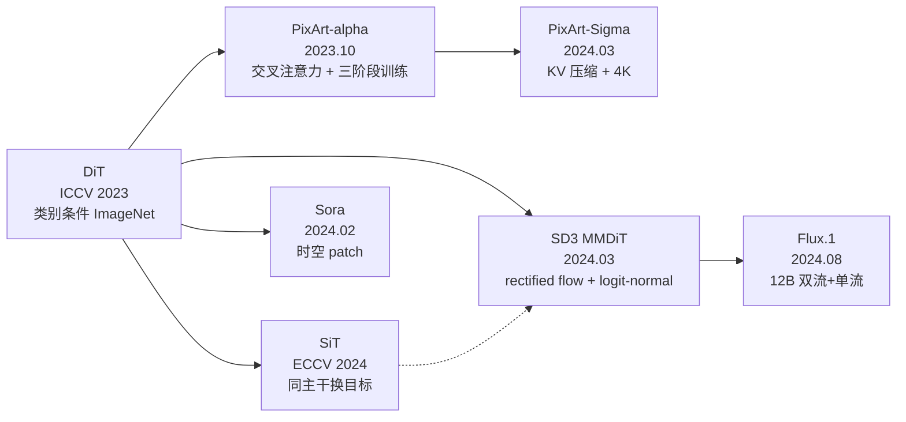

> **系列导航** ｜ 本系列承接 [变分自编码器（01）](/2026/10/13/vae-01-elbo-reparameterization-latent-space/)（潜空间这一层从哪来、凭什么能被采样）与 [Flow Matching 建模](/2026/08/22/flow-matching-01-algorithm-evolution/)（去噪目标换个写法之后剩下什么），把中间那一层补齐：**去噪函数的主干网络**。
> 上一篇：无（系列首篇）｜ 下一篇：02 条件注入的工程谱系——从 adaLN-single 到 MMDiT，再到视频时空 token（写作中）

> **TL;DR**
>
> * DiT 是**主干架构**，不是独立的生成算法。DDPM 的 $$\epsilon$$ 预测、$$x_0$$ 预测、$$v$$ 预测、Flow Matching 的速度场，都可以装进同一个 Transformer 主干——[SiT](https://arxiv.org/abs/2401.08740) 在**逐位相同的网络、相同参数量、相同 Gflops** 下换目标函数，把 ImageNet 256×256 的 FID 从 2.27 做到 2.06。
> * Patchify 决定 token 预算：$$N=\frac{HW}{p^2}$$。DiT 论文的原话是「halving $$p$$ will quadruple $$T$$, and thus at least quadruple total transformer Gflops」——实测 DiT-XL 从 $$p=8$$ 到 $$4$$ 是 3.931 倍、从 $$4$$ 到 $$2$$ 是 4.084 倍，**不到 4 倍的那一次**就是 AdaLN 调制这类不随 $$N$$ 增长的项在拉低比值。
> * 闭合公式 $$\text{MACs} = L\,(3ND^2 + 2N^2D + ND^2 + 2rND^2 + 6D^2) + 2Np^2CD + \cdots$$ 把 DiT 论文 Table 4 的 13 个 Gflops 数字全部反算到 0.4% 以内（唯一超 0.5% 的那个只有两位小数可对）。注意力二次项追平线性项的临界点是 $$N^\*=(2+r)D=6912$$ 个 token：256×256 时注意力只占 3.6%，4K 时占 82.4%。
> * AdaLN-Zero 把门控 $$\alpha$$ 初始化为零，于是 28 层堆叠后 `max|out − x| = 0`（逐位恒等），初始损失精确等于目标自身能量 0.8107，而普通初始化是 11.6910（14.42 倍）；同时被门控的分支输出非零（Attn 分支 1.14 倍、MLP 分支 1.29 倍），$$\alpha$$ 的梯度不为零——**恒等不等于死梯度**。
> * $$\epsilon$$ 预测到 $$x_0$$ 的误差放大因子是 $$\sigma/\alpha$$：$$t=0.9$$ 时 9.00 倍、$$t=0.99$$ 时 99.0 倍；$$v$$ 预测的放大因子是 $$\sigma/\Delta$$，两条常用路径下都 ≤ 1。这正是 [Salimans & Ho 引入 $$v$$ 参数化](https://arxiv.org/abs/2202.00512) 的动机。
> * 时间步**不能**从 $$x_t$$ 里推出来。方差保持路径 + 单位方差数据下，$$x_t\sim\mathcal N(0,1)$$ 对**所有** $$t$$ 成立，边缘分布对 $$t$$ 的信息量是零——但知道 $$t$$ 的贝叶斯最优 MSE 是 0.5000，不知道是 0.5949，差 **18.99%**。
> * 全局向量条件（只把整段文本池化成一个向量）能解释的能量恰好是 $$1/K$$：8 个正交语义下 MSE 下界 0.875，交叉注意力把它降到 $$7.8\times10^{-10}$$。这就是 AdaLN（全局调制）必须和交叉注意力搭配、而不是二选一的原因。
> * 推理成本 = 步数 × 单次前向。高斯 + 线性路径有解析速度场，实测 Euler 收敛阶 −0.92、Heun −2.11；折算到 DiT-XL/2，误差容限 $$10^{-3}$$ 时 Heun 的总算力是 Euler 的 **1/46**。

配套实验：[`ipynbs` commit `478fc03`](https://github.com/lrypcy/ipynbs/tree/478fc03197717af362e127209eae6690458c1866/experiments/dit/dit_core/) 下的 `dit_core/`，纯 numpy、CPU 可跑、固定 seed，30 条断言全过；本文所有实测数字都来自它的实际输出（[`results/summary.md`](https://github.com/lrypcy/ipynbs/tree/478fc03197717af362e127209eae6690458c1866/experiments/dit/dit_core/results/summary.md)）。

---

## 0. 符号约定

| 符号 | 含义 | 备注 |
|---:|:---|:---|
| $$x$$ / $$x_0$$ | 干净数据（图像，或它的 VAE latent） | latent diffusion 里实际喂给主干的是 latent |
| $$\epsilon$$ | 高斯噪声 $$\sim\mathcal N(0,I)$$ | 与数据同维度 |
| $$t$$ | 扩散 / 插值时间步 | 本文取 $$t\in[0,1]$$，$$t=0$$ 是数据、$$t=1$$ 是纯噪声 |
| $$\alpha_t,\ \sigma_t$$ | 插值系数 | $$x_t=\alpha_t x_0+\sigma_t\epsilon$$ |
| $$c$$ | 条件（类别标签或文本特征） | 也可以不含 |
| $$f_\theta(x_t,t,c)$$ | 去噪网络 | DiT 就是这个 $$f_\theta$$ 的主干 |
| $$N$$ | token 数 | $$N=HW/p^2$$ |
| $$D$$ | Transformer 隐藏维度 | DiT-XL 取 1152 |
| $$L$$ | Transformer Block 层数 | DiT-XL 取 28 |
| $$p$$ | patch 边长（latent 像素） | 型号里的 `/2` `/4` `/8` 指它 |
| $$r$$ | MLP 升维比 | DiT 取 $$r=4$$ |
| $$\hat\epsilon,\ \hat x_0,\ \hat v$$ | 网络的预测值 | hat 永远表示估计值，不带 hat 表示真值 |

> **一处容易混的记号**：$$\alpha_t$$ 在 DDPM 的离散记号里常写作 $$\sqrt{\bar\alpha_t}$$，而且 $$\bar\alpha_t$$ 是连乘出来的日程量。本文统一用连续记号 $$x_t=\alpha_t x_0+\sigma_t\epsilon$$，其中 $$\alpha_t^2+\sigma_t^2=1$$ 的路径叫**方差保持**（VP），$$\alpha_t=1-t,\ \sigma_t=t$$ 的路径叫**线性插值**（rectified flow 用的就是它）。两者在下面第 5 节都会用到。

---

## 1. DiT 是主干，不是算法

「DiT」这个词经常被当成一种生成模型，和 DDPM、Flow Matching 并列。这个并列是错的。

一个图像生成系统至少有三层，各自回答不同的问题：

- **生成过程**：$$x_0$$ 到 $$\epsilon$$ 之间怎么连线、训练目标是 $$\epsilon$$ 还是速度场、采样时走 ODE 还是 SDE。DDPM、EDM、rectified flow 都在这一层。
- **网络架构**：拿什么函数去拟合那个目标。U-Net 或 Transformer 都在这一层——DiT 只在这里。
- **条件控制**：类别、文本、布局怎么进网络。AdaLN、交叉注意力、联合注意力在这一层。

三层是**正交的**。最有力的证据是 SiT（Scalable Interpolant Transformers，[arXiv:2401.08740](https://arxiv.org/abs/2401.08740)，ECCV 2024）：它拿 DiT 的网络**原封不动**，只把生成过程从 DDPM 换成随机插值框架，然后逐项扫描「学什么目标、用什么插值、走确定性还是随机采样器」。结果是在相同 backbone、相同参数量、相同 Gflops 下，ImageNet 256×256 上全面好于 DiT：

| 模型 | 参数量 | 训练步数 | FID-50K |
|:--|--:|--:|--:|
| DiT-S | 33M | 400K | 68.4 |
| SiT-S | 33M | 400K | **57.6** |
| DiT-L | 458M | 400K | 23.3 |
| SiT-L | 458M | 400K | **18.8** |
| DiT-XL | 675M | 7M | 9.6 |
| SiT-XL | 675M | 7M | **8.3** |
| DiT-XL（cfg = 1.5） | 675M | 7M | 2.27 |
| SiT-XL（cfg = 1.5） | 675M | 7M | **2.06** |

同一张表里还能看到另一件事：**主干架构换掉之后，规模化这件事本身是成立的**——从 33M 到 675M，FID 从 68.4 一路降到 9.6。这正是 DiT 论文（Peebles & Xie，*Scalable Diffusion Models with Transformers*，[arXiv:2212.09748](https://arxiv.org/abs/2212.09748)，ICCV 2023）真正要证明的东西：Transformer 可以当扩散模型的主干，而且**算得越多越好**。

论文摘要里那句话值得原样读一遍：

> We find that DiTs with higher Gflops — through increased transformer depth/width or increased number of input tokens — consistently have lower FID.

注意主语是 **Gflops**，不是参数量。这是全文最重要的一句话，第 4 节会专门展开。

所以本文的写法是：先把 Patchify（第 2 节）、Block（第 3 节）、计算账（第 4 节）这三块架构的事讲清楚，再回到生成过程那一层（第 5 节）讲参数化，然后是条件（第 6–7 节）、演进（第 8 节）和推理（第 9 节）。

---

## 2. Patchify：latent 怎么变成 token 序列

### 2.1 从图像到 latent 到 patch

256×256×3 的图像先过一个下采样 8 倍的 VAE encoder，得到 $$32\times32\times4$$ 的 latent（这一层为什么能压缩、压缩率怎么选，[VAE 那篇](/2026/10/13/vae-01-elbo-reparameterization-latent-space/)已经讲过，LDM 论文的结论是 $$f=4$$ 与 $$f=8$$「提供了最好的条件」）。DiT 论文 3.2 节的原话：

> The input to DiT is a spatial representation $$z$$ (for 256×256×3 images, z has shape 32×32×4).

然后按 $$p\times p$$ 切 patch，每个 patch 拉平后过一个线性投影进 $$D$$ 维：

$$
N=\frac{H}{p}\cdot\frac{W}{p}=\frac{HW}{p^2},\qquad
X_0\in\mathbb R^{N\times D}
$$

<svg xmlns="http://www.w3.org/2000/svg" viewBox="0 0 680 320" role="img" font-family="-apple-system,BlinkMacSystemFont,'Segoe UI',Helvetica,Arial,sans-serif">
<rect x="0" y="0" width="680" height="320" fill="#ffffff"/>
<text x="24" y="28" font-size="15" font-weight="600" fill="#111827">Patchify：patch size 直接决定 token 序列有多长</text>
<text x="24" y="48" font-size="11.5" fill="#4b5563">同一个 32×32×4 的 latent（256×256 图像，VAE 下采样 8 倍）：p 减半，token 数翻四倍</text>
<defs>
<pattern id="tk16" width="11.000" height="14" patternUnits="userSpaceOnUse"><rect x="0" y="0" width="10.500" height="14" fill="#2563eb" opacity="0.78"/></pattern>
<pattern id="tk64" width="2.750" height="14" patternUnits="userSpaceOnUse"><rect x="0" y="0" width="2.250" height="14" fill="#2563eb" opacity="0.78"/></pattern>
<pattern id="tk256" width="0.688" height="14" patternUnits="userSpaceOnUse"><rect x="0" y="0" width="0.378" height="14" fill="#2563eb" opacity="0.78"/></pattern>
</defs>
<rect x="28.0" y="72.0" width="134.4" height="134.4" fill="#ffffff" stroke="#9ca3af" stroke-width="1"/>
<line x1="28.0" y1="72.0" x2="162.4" y2="72.0" stroke="#eef2f7" stroke-width="0.6"/><line x1="28.0" y1="72.0" x2="28.0" y2="206.4" stroke="#eef2f7" stroke-width="0.6"/><line x1="28.0" y1="76.2" x2="162.4" y2="76.2" stroke="#eef2f7" stroke-width="0.6"/><line x1="32.2" y1="72.0" x2="32.2" y2="206.4" stroke="#eef2f7" stroke-width="0.6"/><line x1="28.0" y1="80.4" x2="162.4" y2="80.4" stroke="#eef2f7" stroke-width="0.6"/><line x1="36.4" y1="72.0" x2="36.4" y2="206.4" stroke="#eef2f7" stroke-width="0.6"/><line x1="28.0" y1="84.6" x2="162.4" y2="84.6" stroke="#eef2f7" stroke-width="0.6"/><line x1="40.6" y1="72.0" x2="40.6" y2="206.4" stroke="#eef2f7" stroke-width="0.6"/><line x1="28.0" y1="88.8" x2="162.4" y2="88.8" stroke="#eef2f7" stroke-width="0.6"/><line x1="44.8" y1="72.0" x2="44.8" y2="206.4" stroke="#eef2f7" stroke-width="0.6"/><line x1="28.0" y1="93.0" x2="162.4" y2="93.0" stroke="#eef2f7" stroke-width="0.6"/><line x1="49.0" y1="72.0" x2="49.0" y2="206.4" stroke="#eef2f7" stroke-width="0.6"/><line x1="28.0" y1="97.2" x2="162.4" y2="97.2" stroke="#eef2f7" stroke-width="0.6"/><line x1="53.2" y1="72.0" x2="53.2" y2="206.4" stroke="#eef2f7" stroke-width="0.6"/><line x1="28.0" y1="101.4" x2="162.4" y2="101.4" stroke="#eef2f7" stroke-width="0.6"/><line x1="57.4" y1="72.0" x2="57.4" y2="206.4" stroke="#eef2f7" stroke-width="0.6"/><line x1="28.0" y1="105.6" x2="162.4" y2="105.6" stroke="#eef2f7" stroke-width="0.6"/><line x1="61.6" y1="72.0" x2="61.6" y2="206.4" stroke="#eef2f7" stroke-width="0.6"/><line x1="28.0" y1="109.8" x2="162.4" y2="109.8" stroke="#eef2f7" stroke-width="0.6"/><line x1="65.8" y1="72.0" x2="65.8" y2="206.4" stroke="#eef2f7" stroke-width="0.6"/><line x1="28.0" y1="114.0" x2="162.4" y2="114.0" stroke="#eef2f7" stroke-width="0.6"/><line x1="70.0" y1="72.0" x2="70.0" y2="206.4" stroke="#eef2f7" stroke-width="0.6"/><line x1="28.0" y1="118.2" x2="162.4" y2="118.2" stroke="#eef2f7" stroke-width="0.6"/><line x1="74.2" y1="72.0" x2="74.2" y2="206.4" stroke="#eef2f7" stroke-width="0.6"/><line x1="28.0" y1="122.4" x2="162.4" y2="122.4" stroke="#eef2f7" stroke-width="0.6"/><line x1="78.4" y1="72.0" x2="78.4" y2="206.4" stroke="#eef2f7" stroke-width="0.6"/><line x1="28.0" y1="126.6" x2="162.4" y2="126.6" stroke="#eef2f7" stroke-width="0.6"/><line x1="82.6" y1="72.0" x2="82.6" y2="206.4" stroke="#eef2f7" stroke-width="0.6"/><line x1="28.0" y1="130.8" x2="162.4" y2="130.8" stroke="#eef2f7" stroke-width="0.6"/><line x1="86.8" y1="72.0" x2="86.8" y2="206.4" stroke="#eef2f7" stroke-width="0.6"/><line x1="28.0" y1="135.0" x2="162.4" y2="135.0" stroke="#eef2f7" stroke-width="0.6"/><line x1="91.0" y1="72.0" x2="91.0" y2="206.4" stroke="#eef2f7" stroke-width="0.6"/><line x1="28.0" y1="139.2" x2="162.4" y2="139.2" stroke="#eef2f7" stroke-width="0.6"/><line x1="95.2" y1="72.0" x2="95.2" y2="206.4" stroke="#eef2f7" stroke-width="0.6"/><line x1="28.0" y1="143.4" x2="162.4" y2="143.4" stroke="#eef2f7" stroke-width="0.6"/><line x1="99.4" y1="72.0" x2="99.4" y2="206.4" stroke="#eef2f7" stroke-width="0.6"/><line x1="28.0" y1="147.6" x2="162.4" y2="147.6" stroke="#eef2f7" stroke-width="0.6"/><line x1="103.6" y1="72.0" x2="103.6" y2="206.4" stroke="#eef2f7" stroke-width="0.6"/><line x1="28.0" y1="151.8" x2="162.4" y2="151.8" stroke="#eef2f7" stroke-width="0.6"/><line x1="107.8" y1="72.0" x2="107.8" y2="206.4" stroke="#eef2f7" stroke-width="0.6"/><line x1="28.0" y1="156.0" x2="162.4" y2="156.0" stroke="#eef2f7" stroke-width="0.6"/><line x1="112.0" y1="72.0" x2="112.0" y2="206.4" stroke="#eef2f7" stroke-width="0.6"/><line x1="28.0" y1="160.2" x2="162.4" y2="160.2" stroke="#eef2f7" stroke-width="0.6"/><line x1="116.2" y1="72.0" x2="116.2" y2="206.4" stroke="#eef2f7" stroke-width="0.6"/><line x1="28.0" y1="164.4" x2="162.4" y2="164.4" stroke="#eef2f7" stroke-width="0.6"/><line x1="120.4" y1="72.0" x2="120.4" y2="206.4" stroke="#eef2f7" stroke-width="0.6"/><line x1="28.0" y1="168.6" x2="162.4" y2="168.6" stroke="#eef2f7" stroke-width="0.6"/><line x1="124.6" y1="72.0" x2="124.6" y2="206.4" stroke="#eef2f7" stroke-width="0.6"/><line x1="28.0" y1="172.8" x2="162.4" y2="172.8" stroke="#eef2f7" stroke-width="0.6"/><line x1="128.8" y1="72.0" x2="128.8" y2="206.4" stroke="#eef2f7" stroke-width="0.6"/><line x1="28.0" y1="177.0" x2="162.4" y2="177.0" stroke="#eef2f7" stroke-width="0.6"/><line x1="133.0" y1="72.0" x2="133.0" y2="206.4" stroke="#eef2f7" stroke-width="0.6"/><line x1="28.0" y1="181.2" x2="162.4" y2="181.2" stroke="#eef2f7" stroke-width="0.6"/><line x1="137.2" y1="72.0" x2="137.2" y2="206.4" stroke="#eef2f7" stroke-width="0.6"/><line x1="28.0" y1="185.4" x2="162.4" y2="185.4" stroke="#eef2f7" stroke-width="0.6"/><line x1="141.4" y1="72.0" x2="141.4" y2="206.4" stroke="#eef2f7" stroke-width="0.6"/><line x1="28.0" y1="189.6" x2="162.4" y2="189.6" stroke="#eef2f7" stroke-width="0.6"/><line x1="145.6" y1="72.0" x2="145.6" y2="206.4" stroke="#eef2f7" stroke-width="0.6"/><line x1="28.0" y1="193.8" x2="162.4" y2="193.8" stroke="#eef2f7" stroke-width="0.6"/><line x1="149.8" y1="72.0" x2="149.8" y2="206.4" stroke="#eef2f7" stroke-width="0.6"/><line x1="28.0" y1="198.0" x2="162.4" y2="198.0" stroke="#eef2f7" stroke-width="0.6"/><line x1="154.0" y1="72.0" x2="154.0" y2="206.4" stroke="#eef2f7" stroke-width="0.6"/><line x1="28.0" y1="202.2" x2="162.4" y2="202.2" stroke="#eef2f7" stroke-width="0.6"/><line x1="158.2" y1="72.0" x2="158.2" y2="206.4" stroke="#eef2f7" stroke-width="0.6"/><line x1="28.0" y1="206.4" x2="162.4" y2="206.4" stroke="#eef2f7" stroke-width="0.6"/><line x1="162.4" y1="72.0" x2="162.4" y2="206.4" stroke="#eef2f7" stroke-width="0.6"/><line x1="28.0" y1="72.0" x2="162.4" y2="72.0" stroke="#2563eb" stroke-width="1.5"/><line x1="28.0" y1="72.0" x2="28.0" y2="206.4" stroke="#2563eb" stroke-width="1.5"/><line x1="28.0" y1="105.6" x2="162.4" y2="105.6" stroke="#2563eb" stroke-width="1.5"/><line x1="61.6" y1="72.0" x2="61.6" y2="206.4" stroke="#2563eb" stroke-width="1.5"/><line x1="28.0" y1="139.2" x2="162.4" y2="139.2" stroke="#2563eb" stroke-width="1.5"/><line x1="95.2" y1="72.0" x2="95.2" y2="206.4" stroke="#2563eb" stroke-width="1.5"/><line x1="28.0" y1="172.8" x2="162.4" y2="172.8" stroke="#2563eb" stroke-width="1.5"/><line x1="128.8" y1="72.0" x2="128.8" y2="206.4" stroke="#2563eb" stroke-width="1.5"/><line x1="28.0" y1="206.4" x2="162.4" y2="206.4" stroke="#2563eb" stroke-width="1.5"/><line x1="162.4" y1="72.0" x2="162.4" y2="206.4" stroke="#2563eb" stroke-width="1.5"/><text x="28" y="223.4" font-size="12.5" font-weight="600" fill="#111827">p = 8</text>
<text x="28" y="239.4" font-size="11" fill="#4b5563">每 token 携带 256 个数</text>
<rect x="28" y="248.4" width="176" height="14" fill="url(#tk16)"/>
<text x="28" y="284.4" font-size="12.5" font-weight="600" fill="#2563eb">N = 16 tokens</text>
<rect x="253.0" y="72.0" width="134.4" height="134.4" fill="#ffffff" stroke="#9ca3af" stroke-width="1"/>
<line x1="253.0" y1="72.0" x2="387.4" y2="72.0" stroke="#eef2f7" stroke-width="0.6"/><line x1="253.0" y1="72.0" x2="253.0" y2="206.4" stroke="#eef2f7" stroke-width="0.6"/><line x1="253.0" y1="76.2" x2="387.4" y2="76.2" stroke="#eef2f7" stroke-width="0.6"/><line x1="257.2" y1="72.0" x2="257.2" y2="206.4" stroke="#eef2f7" stroke-width="0.6"/><line x1="253.0" y1="80.4" x2="387.4" y2="80.4" stroke="#eef2f7" stroke-width="0.6"/><line x1="261.4" y1="72.0" x2="261.4" y2="206.4" stroke="#eef2f7" stroke-width="0.6"/><line x1="253.0" y1="84.6" x2="387.4" y2="84.6" stroke="#eef2f7" stroke-width="0.6"/><line x1="265.6" y1="72.0" x2="265.6" y2="206.4" stroke="#eef2f7" stroke-width="0.6"/><line x1="253.0" y1="88.8" x2="387.4" y2="88.8" stroke="#eef2f7" stroke-width="0.6"/><line x1="269.8" y1="72.0" x2="269.8" y2="206.4" stroke="#eef2f7" stroke-width="0.6"/><line x1="253.0" y1="93.0" x2="387.4" y2="93.0" stroke="#eef2f7" stroke-width="0.6"/><line x1="274.0" y1="72.0" x2="274.0" y2="206.4" stroke="#eef2f7" stroke-width="0.6"/><line x1="253.0" y1="97.2" x2="387.4" y2="97.2" stroke="#eef2f7" stroke-width="0.6"/><line x1="278.2" y1="72.0" x2="278.2" y2="206.4" stroke="#eef2f7" stroke-width="0.6"/><line x1="253.0" y1="101.4" x2="387.4" y2="101.4" stroke="#eef2f7" stroke-width="0.6"/><line x1="282.4" y1="72.0" x2="282.4" y2="206.4" stroke="#eef2f7" stroke-width="0.6"/><line x1="253.0" y1="105.6" x2="387.4" y2="105.6" stroke="#eef2f7" stroke-width="0.6"/><line x1="286.6" y1="72.0" x2="286.6" y2="206.4" stroke="#eef2f7" stroke-width="0.6"/><line x1="253.0" y1="109.8" x2="387.4" y2="109.8" stroke="#eef2f7" stroke-width="0.6"/><line x1="290.8" y1="72.0" x2="290.8" y2="206.4" stroke="#eef2f7" stroke-width="0.6"/><line x1="253.0" y1="114.0" x2="387.4" y2="114.0" stroke="#eef2f7" stroke-width="0.6"/><line x1="295.0" y1="72.0" x2="295.0" y2="206.4" stroke="#eef2f7" stroke-width="0.6"/><line x1="253.0" y1="118.2" x2="387.4" y2="118.2" stroke="#eef2f7" stroke-width="0.6"/><line x1="299.2" y1="72.0" x2="299.2" y2="206.4" stroke="#eef2f7" stroke-width="0.6"/><line x1="253.0" y1="122.4" x2="387.4" y2="122.4" stroke="#eef2f7" stroke-width="0.6"/><line x1="303.4" y1="72.0" x2="303.4" y2="206.4" stroke="#eef2f7" stroke-width="0.6"/><line x1="253.0" y1="126.6" x2="387.4" y2="126.6" stroke="#eef2f7" stroke-width="0.6"/><line x1="307.6" y1="72.0" x2="307.6" y2="206.4" stroke="#eef2f7" stroke-width="0.6"/><line x1="253.0" y1="130.8" x2="387.4" y2="130.8" stroke="#eef2f7" stroke-width="0.6"/><line x1="311.8" y1="72.0" x2="311.8" y2="206.4" stroke="#eef2f7" stroke-width="0.6"/><line x1="253.0" y1="135.0" x2="387.4" y2="135.0" stroke="#eef2f7" stroke-width="0.6"/><line x1="316.0" y1="72.0" x2="316.0" y2="206.4" stroke="#eef2f7" stroke-width="0.6"/><line x1="253.0" y1="139.2" x2="387.4" y2="139.2" stroke="#eef2f7" stroke-width="0.6"/><line x1="320.2" y1="72.0" x2="320.2" y2="206.4" stroke="#eef2f7" stroke-width="0.6"/><line x1="253.0" y1="143.4" x2="387.4" y2="143.4" stroke="#eef2f7" stroke-width="0.6"/><line x1="324.4" y1="72.0" x2="324.4" y2="206.4" stroke="#eef2f7" stroke-width="0.6"/><line x1="253.0" y1="147.6" x2="387.4" y2="147.6" stroke="#eef2f7" stroke-width="0.6"/><line x1="328.6" y1="72.0" x2="328.6" y2="206.4" stroke="#eef2f7" stroke-width="0.6"/><line x1="253.0" y1="151.8" x2="387.4" y2="151.8" stroke="#eef2f7" stroke-width="0.6"/><line x1="332.8" y1="72.0" x2="332.8" y2="206.4" stroke="#eef2f7" stroke-width="0.6"/><line x1="253.0" y1="156.0" x2="387.4" y2="156.0" stroke="#eef2f7" stroke-width="0.6"/><line x1="337.0" y1="72.0" x2="337.0" y2="206.4" stroke="#eef2f7" stroke-width="0.6"/><line x1="253.0" y1="160.2" x2="387.4" y2="160.2" stroke="#eef2f7" stroke-width="0.6"/><line x1="341.2" y1="72.0" x2="341.2" y2="206.4" stroke="#eef2f7" stroke-width="0.6"/><line x1="253.0" y1="164.4" x2="387.4" y2="164.4" stroke="#eef2f7" stroke-width="0.6"/><line x1="345.4" y1="72.0" x2="345.4" y2="206.4" stroke="#eef2f7" stroke-width="0.6"/><line x1="253.0" y1="168.6" x2="387.4" y2="168.6" stroke="#eef2f7" stroke-width="0.6"/><line x1="349.6" y1="72.0" x2="349.6" y2="206.4" stroke="#eef2f7" stroke-width="0.6"/><line x1="253.0" y1="172.8" x2="387.4" y2="172.8" stroke="#eef2f7" stroke-width="0.6"/><line x1="353.8" y1="72.0" x2="353.8" y2="206.4" stroke="#eef2f7" stroke-width="0.6"/><line x1="253.0" y1="177.0" x2="387.4" y2="177.0" stroke="#eef2f7" stroke-width="0.6"/><line x1="358.0" y1="72.0" x2="358.0" y2="206.4" stroke="#eef2f7" stroke-width="0.6"/><line x1="253.0" y1="181.2" x2="387.4" y2="181.2" stroke="#eef2f7" stroke-width="0.6"/><line x1="362.2" y1="72.0" x2="362.2" y2="206.4" stroke="#eef2f7" stroke-width="0.6"/><line x1="253.0" y1="185.4" x2="387.4" y2="185.4" stroke="#eef2f7" stroke-width="0.6"/><line x1="366.4" y1="72.0" x2="366.4" y2="206.4" stroke="#eef2f7" stroke-width="0.6"/><line x1="253.0" y1="189.6" x2="387.4" y2="189.6" stroke="#eef2f7" stroke-width="0.6"/><line x1="370.6" y1="72.0" x2="370.6" y2="206.4" stroke="#eef2f7" stroke-width="0.6"/><line x1="253.0" y1="193.8" x2="387.4" y2="193.8" stroke="#eef2f7" stroke-width="0.6"/><line x1="374.8" y1="72.0" x2="374.8" y2="206.4" stroke="#eef2f7" stroke-width="0.6"/><line x1="253.0" y1="198.0" x2="387.4" y2="198.0" stroke="#eef2f7" stroke-width="0.6"/><line x1="379.0" y1="72.0" x2="379.0" y2="206.4" stroke="#eef2f7" stroke-width="0.6"/><line x1="253.0" y1="202.2" x2="387.4" y2="202.2" stroke="#eef2f7" stroke-width="0.6"/><line x1="383.2" y1="72.0" x2="383.2" y2="206.4" stroke="#eef2f7" stroke-width="0.6"/><line x1="253.0" y1="206.4" x2="387.4" y2="206.4" stroke="#eef2f7" stroke-width="0.6"/><line x1="387.4" y1="72.0" x2="387.4" y2="206.4" stroke="#eef2f7" stroke-width="0.6"/><line x1="253.0" y1="72.0" x2="387.4" y2="72.0" stroke="#2563eb" stroke-width="1.5"/><line x1="253.0" y1="72.0" x2="253.0" y2="206.4" stroke="#2563eb" stroke-width="1.5"/><line x1="253.0" y1="88.8" x2="387.4" y2="88.8" stroke="#2563eb" stroke-width="1.5"/><line x1="269.8" y1="72.0" x2="269.8" y2="206.4" stroke="#2563eb" stroke-width="1.5"/><line x1="253.0" y1="105.6" x2="387.4" y2="105.6" stroke="#2563eb" stroke-width="1.5"/><line x1="286.6" y1="72.0" x2="286.6" y2="206.4" stroke="#2563eb" stroke-width="1.5"/><line x1="253.0" y1="122.4" x2="387.4" y2="122.4" stroke="#2563eb" stroke-width="1.5"/><line x1="303.4" y1="72.0" x2="303.4" y2="206.4" stroke="#2563eb" stroke-width="1.5"/><line x1="253.0" y1="139.2" x2="387.4" y2="139.2" stroke="#2563eb" stroke-width="1.5"/><line x1="320.2" y1="72.0" x2="320.2" y2="206.4" stroke="#2563eb" stroke-width="1.5"/><line x1="253.0" y1="156.0" x2="387.4" y2="156.0" stroke="#2563eb" stroke-width="1.5"/><line x1="337.0" y1="72.0" x2="337.0" y2="206.4" stroke="#2563eb" stroke-width="1.5"/><line x1="253.0" y1="172.8" x2="387.4" y2="172.8" stroke="#2563eb" stroke-width="1.5"/><line x1="353.8" y1="72.0" x2="353.8" y2="206.4" stroke="#2563eb" stroke-width="1.5"/><line x1="253.0" y1="189.6" x2="387.4" y2="189.6" stroke="#2563eb" stroke-width="1.5"/><line x1="370.6" y1="72.0" x2="370.6" y2="206.4" stroke="#2563eb" stroke-width="1.5"/><line x1="253.0" y1="206.4" x2="387.4" y2="206.4" stroke="#2563eb" stroke-width="1.5"/><line x1="387.4" y1="72.0" x2="387.4" y2="206.4" stroke="#2563eb" stroke-width="1.5"/><text x="253" y="223.4" font-size="12.5" font-weight="600" fill="#111827">p = 4</text>
<text x="253" y="239.4" font-size="11" fill="#4b5563">每 token 携带 64 个数</text>
<rect x="253" y="248.4" width="176" height="14" fill="url(#tk64)"/>
<text x="253" y="284.4" font-size="12.5" font-weight="600" fill="#2563eb">N = 64 tokens</text>
<rect x="478.0" y="72.0" width="134.4" height="134.4" fill="#ffffff" stroke="#9ca3af" stroke-width="1"/>
<line x1="478.0" y1="72.0" x2="612.4" y2="72.0" stroke="#eef2f7" stroke-width="0.6"/><line x1="478.0" y1="72.0" x2="478.0" y2="206.4" stroke="#eef2f7" stroke-width="0.6"/><line x1="478.0" y1="76.2" x2="612.4" y2="76.2" stroke="#eef2f7" stroke-width="0.6"/><line x1="482.2" y1="72.0" x2="482.2" y2="206.4" stroke="#eef2f7" stroke-width="0.6"/><line x1="478.0" y1="80.4" x2="612.4" y2="80.4" stroke="#eef2f7" stroke-width="0.6"/><line x1="486.4" y1="72.0" x2="486.4" y2="206.4" stroke="#eef2f7" stroke-width="0.6"/><line x1="478.0" y1="84.6" x2="612.4" y2="84.6" stroke="#eef2f7" stroke-width="0.6"/><line x1="490.6" y1="72.0" x2="490.6" y2="206.4" stroke="#eef2f7" stroke-width="0.6"/><line x1="478.0" y1="88.8" x2="612.4" y2="88.8" stroke="#eef2f7" stroke-width="0.6"/><line x1="494.8" y1="72.0" x2="494.8" y2="206.4" stroke="#eef2f7" stroke-width="0.6"/><line x1="478.0" y1="93.0" x2="612.4" y2="93.0" stroke="#eef2f7" stroke-width="0.6"/><line x1="499.0" y1="72.0" x2="499.0" y2="206.4" stroke="#eef2f7" stroke-width="0.6"/><line x1="478.0" y1="97.2" x2="612.4" y2="97.2" stroke="#eef2f7" stroke-width="0.6"/><line x1="503.2" y1="72.0" x2="503.2" y2="206.4" stroke="#eef2f7" stroke-width="0.6"/><line x1="478.0" y1="101.4" x2="612.4" y2="101.4" stroke="#eef2f7" stroke-width="0.6"/><line x1="507.4" y1="72.0" x2="507.4" y2="206.4" stroke="#eef2f7" stroke-width="0.6"/><line x1="478.0" y1="105.6" x2="612.4" y2="105.6" stroke="#eef2f7" stroke-width="0.6"/><line x1="511.6" y1="72.0" x2="511.6" y2="206.4" stroke="#eef2f7" stroke-width="0.6"/><line x1="478.0" y1="109.8" x2="612.4" y2="109.8" stroke="#eef2f7" stroke-width="0.6"/><line x1="515.8" y1="72.0" x2="515.8" y2="206.4" stroke="#eef2f7" stroke-width="0.6"/><line x1="478.0" y1="114.0" x2="612.4" y2="114.0" stroke="#eef2f7" stroke-width="0.6"/><line x1="520.0" y1="72.0" x2="520.0" y2="206.4" stroke="#eef2f7" stroke-width="0.6"/><line x1="478.0" y1="118.2" x2="612.4" y2="118.2" stroke="#eef2f7" stroke-width="0.6"/><line x1="524.2" y1="72.0" x2="524.2" y2="206.4" stroke="#eef2f7" stroke-width="0.6"/><line x1="478.0" y1="122.4" x2="612.4" y2="122.4" stroke="#eef2f7" stroke-width="0.6"/><line x1="528.4" y1="72.0" x2="528.4" y2="206.4" stroke="#eef2f7" stroke-width="0.6"/><line x1="478.0" y1="126.6" x2="612.4" y2="126.6" stroke="#eef2f7" stroke-width="0.6"/><line x1="532.6" y1="72.0" x2="532.6" y2="206.4" stroke="#eef2f7" stroke-width="0.6"/><line x1="478.0" y1="130.8" x2="612.4" y2="130.8" stroke="#eef2f7" stroke-width="0.6"/><line x1="536.8" y1="72.0" x2="536.8" y2="206.4" stroke="#eef2f7" stroke-width="0.6"/><line x1="478.0" y1="135.0" x2="612.4" y2="135.0" stroke="#eef2f7" stroke-width="0.6"/><line x1="541.0" y1="72.0" x2="541.0" y2="206.4" stroke="#eef2f7" stroke-width="0.6"/><line x1="478.0" y1="139.2" x2="612.4" y2="139.2" stroke="#eef2f7" stroke-width="0.6"/><line x1="545.2" y1="72.0" x2="545.2" y2="206.4" stroke="#eef2f7" stroke-width="0.6"/><line x1="478.0" y1="143.4" x2="612.4" y2="143.4" stroke="#eef2f7" stroke-width="0.6"/><line x1="549.4" y1="72.0" x2="549.4" y2="206.4" stroke="#eef2f7" stroke-width="0.6"/><line x1="478.0" y1="147.6" x2="612.4" y2="147.6" stroke="#eef2f7" stroke-width="0.6"/><line x1="553.6" y1="72.0" x2="553.6" y2="206.4" stroke="#eef2f7" stroke-width="0.6"/><line x1="478.0" y1="151.8" x2="612.4" y2="151.8" stroke="#eef2f7" stroke-width="0.6"/><line x1="557.8" y1="72.0" x2="557.8" y2="206.4" stroke="#eef2f7" stroke-width="0.6"/><line x1="478.0" y1="156.0" x2="612.4" y2="156.0" stroke="#eef2f7" stroke-width="0.6"/><line x1="562.0" y1="72.0" x2="562.0" y2="206.4" stroke="#eef2f7" stroke-width="0.6"/><line x1="478.0" y1="160.2" x2="612.4" y2="160.2" stroke="#eef2f7" stroke-width="0.6"/><line x1="566.2" y1="72.0" x2="566.2" y2="206.4" stroke="#eef2f7" stroke-width="0.6"/><line x1="478.0" y1="164.4" x2="612.4" y2="164.4" stroke="#eef2f7" stroke-width="0.6"/><line x1="570.4" y1="72.0" x2="570.4" y2="206.4" stroke="#eef2f7" stroke-width="0.6"/><line x1="478.0" y1="168.6" x2="612.4" y2="168.6" stroke="#eef2f7" stroke-width="0.6"/><line x1="574.6" y1="72.0" x2="574.6" y2="206.4" stroke="#eef2f7" stroke-width="0.6"/><line x1="478.0" y1="172.8" x2="612.4" y2="172.8" stroke="#eef2f7" stroke-width="0.6"/><line x1="578.8" y1="72.0" x2="578.8" y2="206.4" stroke="#eef2f7" stroke-width="0.6"/><line x1="478.0" y1="177.0" x2="612.4" y2="177.0" stroke="#eef2f7" stroke-width="0.6"/><line x1="583.0" y1="72.0" x2="583.0" y2="206.4" stroke="#eef2f7" stroke-width="0.6"/><line x1="478.0" y1="181.2" x2="612.4" y2="181.2" stroke="#eef2f7" stroke-width="0.6"/><line x1="587.2" y1="72.0" x2="587.2" y2="206.4" stroke="#eef2f7" stroke-width="0.6"/><line x1="478.0" y1="185.4" x2="612.4" y2="185.4" stroke="#eef2f7" stroke-width="0.6"/><line x1="591.4" y1="72.0" x2="591.4" y2="206.4" stroke="#eef2f7" stroke-width="0.6"/><line x1="478.0" y1="189.6" x2="612.4" y2="189.6" stroke="#eef2f7" stroke-width="0.6"/><line x1="595.6" y1="72.0" x2="595.6" y2="206.4" stroke="#eef2f7" stroke-width="0.6"/><line x1="478.0" y1="193.8" x2="612.4" y2="193.8" stroke="#eef2f7" stroke-width="0.6"/><line x1="599.8" y1="72.0" x2="599.8" y2="206.4" stroke="#eef2f7" stroke-width="0.6"/><line x1="478.0" y1="198.0" x2="612.4" y2="198.0" stroke="#eef2f7" stroke-width="0.6"/><line x1="604.0" y1="72.0" x2="604.0" y2="206.4" stroke="#eef2f7" stroke-width="0.6"/><line x1="478.0" y1="202.2" x2="612.4" y2="202.2" stroke="#eef2f7" stroke-width="0.6"/><line x1="608.2" y1="72.0" x2="608.2" y2="206.4" stroke="#eef2f7" stroke-width="0.6"/><line x1="478.0" y1="206.4" x2="612.4" y2="206.4" stroke="#eef2f7" stroke-width="0.6"/><line x1="612.4" y1="72.0" x2="612.4" y2="206.4" stroke="#eef2f7" stroke-width="0.6"/><line x1="478.0" y1="72.0" x2="612.4" y2="72.0" stroke="#2563eb" stroke-width="1.5"/><line x1="478.0" y1="72.0" x2="478.0" y2="206.4" stroke="#2563eb" stroke-width="1.5"/><line x1="478.0" y1="80.4" x2="612.4" y2="80.4" stroke="#2563eb" stroke-width="1.5"/><line x1="486.4" y1="72.0" x2="486.4" y2="206.4" stroke="#2563eb" stroke-width="1.5"/><line x1="478.0" y1="88.8" x2="612.4" y2="88.8" stroke="#2563eb" stroke-width="1.5"/><line x1="494.8" y1="72.0" x2="494.8" y2="206.4" stroke="#2563eb" stroke-width="1.5"/><line x1="478.0" y1="97.2" x2="612.4" y2="97.2" stroke="#2563eb" stroke-width="1.5"/><line x1="503.2" y1="72.0" x2="503.2" y2="206.4" stroke="#2563eb" stroke-width="1.5"/><line x1="478.0" y1="105.6" x2="612.4" y2="105.6" stroke="#2563eb" stroke-width="1.5"/><line x1="511.6" y1="72.0" x2="511.6" y2="206.4" stroke="#2563eb" stroke-width="1.5"/><line x1="478.0" y1="114.0" x2="612.4" y2="114.0" stroke="#2563eb" stroke-width="1.5"/><line x1="520.0" y1="72.0" x2="520.0" y2="206.4" stroke="#2563eb" stroke-width="1.5"/><line x1="478.0" y1="122.4" x2="612.4" y2="122.4" stroke="#2563eb" stroke-width="1.5"/><line x1="528.4" y1="72.0" x2="528.4" y2="206.4" stroke="#2563eb" stroke-width="1.5"/><line x1="478.0" y1="130.8" x2="612.4" y2="130.8" stroke="#2563eb" stroke-width="1.5"/><line x1="536.8" y1="72.0" x2="536.8" y2="206.4" stroke="#2563eb" stroke-width="1.5"/><line x1="478.0" y1="139.2" x2="612.4" y2="139.2" stroke="#2563eb" stroke-width="1.5"/><line x1="545.2" y1="72.0" x2="545.2" y2="206.4" stroke="#2563eb" stroke-width="1.5"/><line x1="478.0" y1="147.6" x2="612.4" y2="147.6" stroke="#2563eb" stroke-width="1.5"/><line x1="553.6" y1="72.0" x2="553.6" y2="206.4" stroke="#2563eb" stroke-width="1.5"/><line x1="478.0" y1="156.0" x2="612.4" y2="156.0" stroke="#2563eb" stroke-width="1.5"/><line x1="562.0" y1="72.0" x2="562.0" y2="206.4" stroke="#2563eb" stroke-width="1.5"/><line x1="478.0" y1="164.4" x2="612.4" y2="164.4" stroke="#2563eb" stroke-width="1.5"/><line x1="570.4" y1="72.0" x2="570.4" y2="206.4" stroke="#2563eb" stroke-width="1.5"/><line x1="478.0" y1="172.8" x2="612.4" y2="172.8" stroke="#2563eb" stroke-width="1.5"/><line x1="578.8" y1="72.0" x2="578.8" y2="206.4" stroke="#2563eb" stroke-width="1.5"/><line x1="478.0" y1="181.2" x2="612.4" y2="181.2" stroke="#2563eb" stroke-width="1.5"/><line x1="587.2" y1="72.0" x2="587.2" y2="206.4" stroke="#2563eb" stroke-width="1.5"/><line x1="478.0" y1="189.6" x2="612.4" y2="189.6" stroke="#2563eb" stroke-width="1.5"/><line x1="595.6" y1="72.0" x2="595.6" y2="206.4" stroke="#2563eb" stroke-width="1.5"/><line x1="478.0" y1="198.0" x2="612.4" y2="198.0" stroke="#2563eb" stroke-width="1.5"/><line x1="604.0" y1="72.0" x2="604.0" y2="206.4" stroke="#2563eb" stroke-width="1.5"/><line x1="478.0" y1="206.4" x2="612.4" y2="206.4" stroke="#2563eb" stroke-width="1.5"/><line x1="612.4" y1="72.0" x2="612.4" y2="206.4" stroke="#2563eb" stroke-width="1.5"/><text x="478" y="223.4" font-size="12.5" font-weight="600" fill="#111827">p = 2</text>
<text x="478" y="239.4" font-size="11" fill="#4b5563">每 token 携带 16 个数</text>
<rect x="478" y="248.4" width="176" height="14" fill="url(#tk256)"/>
<text x="478" y="284.4" font-size="12.5" font-weight="600" fill="#2563eb">N = 256 tokens</text>
<text x="24" y="298.0" font-size="11.5" fill="#4b5563">下面那条蓝色带子是排成一维后的 token 序列（三段等宽，密度不同）。</text>
<text x="24" y="314.0" font-size="11.5" fill="#4b5563">缩小 p 换来的不是更多参数，而是更细的空间交互粒度：p 越小，越多的位置对能在注意力里直接见面。</text>
</svg>

型号里的 `/2` `/4` `/8` 指 patch size，**不是**层数也不是降采样次数。DiT-XL/2 在 256×256 上是 $$N=256$$ 个 token，每个 token 携带 $$p^2C=16$$ 个 latent 数；同一个模型换到 512×512，latent 变成 $$64\times64\times4$$，$$N=1024$$，论文 5.1 节原话是「this XL/2 model processes a total of 1024 tokens after patchifying the 64×64×4 input latent」。

### 2.2 patch size 的真实代价：不是参数，是「位置对」

patch 变小带来的参数增量几乎为零——patch embedding 是一个 $$p^2C\times D$$ 的线性层，$$p$$ 减半后这个矩阵反而**变小**。真正变化的是注意力的交互结构：

- 一个 patch 内部的 $$p^2$$ 个空间位置，被线性投影**压进同一个 token 向量**，它们之间的信息交换只能走两条路：patch embedding 的那次投影，以及后续逐 token 的 MLP。**注意力永远看不见它们**。
- 两个位置能在同一层 attention 里直接见面的条件是它们落在不同的 patch 里。

数一下被「锁死」在同一个 patch 里的位置对。latent 是 $$H\times W$$，每个 patch 有 $$\binom{p^2}{2}$$ 个内部位置对，共 $$\frac{HW}{p^2}$$ 个 patch：

$$
\text{被锁死的比例}
=\frac{(H/p)(W/p)\cdot\binom{p^2}{2}}{\binom{HW}{2}}
$$

代入 $$H=W=32$$：

| $$p$$ | 被锁死的位置对 | 全部位置对 | 比例 |
|--:|--:|--:|--:|
| 8 | $$16\times 2016=32256$$ | $$523776$$ | 6.1584% |
| 4 | $$64\times 120=7680$$ | $$523776$$ | 1.4663% |
| 2 | $$256\times 6=1536$$ | $$523776$$ | 0.2933% |

$$p=8$$ 时有 6.1584% 的位置对**永远**无法通过注意力直接交互，只能靠 patch 内部的线性投影与 MLP 折中；$$p=2$$ 把这个比例压到千分之三（0.2933%）。这就是「更小的 patch = 更细的空间表示粒度」的精确含义——它不是模糊的「表达力更强」，而是可数的位置对。

### 2.3 位置编码

token 化丢掉了空间排列，必须补回来。DiT 用固定的二维 sin-cos 位置编码（不做学习），加在 patch embedding 之后。后续工作在这一点上分叉明显：PixArt-α 沿用 sin-cos，SD3 沿用，Flux.1 换成了旋转位置编码（RoPE）。位置编码的选择影响的是**外推到没见过的分辨率**的能力，这里先按下不表，02 篇展开。

---

## 3. DiT Block：AdaLN-Zero 到底在调什么

### 3.1 六组调制参数

DiT 的 Block 是 Pre-Norm Transformer（自注意力 + MLP 两个子层），但每个 LayerNorm 前后都挂着**条件相关的调制**：

$$
\operatorname{AdaLN}(h,c)=(1+\gamma(c))\odot\operatorname{LN}(h)+\beta(c)
$$

$$\gamma,\beta$$ 不再是自由参数，而是从一个共享的条件向量回归出来的。这个条件向量是时间步嵌入与类别嵌入的**和**：

$$
c_{\text{cond}}=c_{\text{time}}(t)+c_{\text{label}}(y)
$$

每个 Block 里，$$c_{\text{cond}}$$ 过一个 SiLU + Linear，输出 $$6D$$ 个数——六组与隐藏维度同宽的向量：

<svg xmlns="http://www.w3.org/2000/svg" viewBox="0 0 680 452" role="img" font-family="-apple-system,BlinkMacSystemFont,'Segoe UI',Helvetica,Arial,sans-serif">
<rect x="0" y="0" width="680" height="452" fill="#ffffff"/>
<text x="24" y="28" font-size="15" font-weight="600" fill="#111827">一个 DiT Block：条件向量生成六组调制参数，其中两组是残差门控</text>
<text x="24" y="47" font-size="11.5" fill="#4b5563">AdaLN-Zero 把门控 α 初始化为零向量 —— 两条残差分支同时关闭，整个 Block 在初始时刻是恒等映射</text>
<rect x="175.0" y="62.0" width="150.0" height="32.0" rx="6" fill="#ffffff" stroke="#111827" stroke-width="1.2"/><text x="250.0" y="82.0" font-size="11.5" text-anchor="middle" fill="#111827">h（N 个 token，D 维）</text><rect x="175.0" y="98.0" width="150.0" height="32.0" rx="6" fill="#eef2ff" stroke="#2563eb" stroke-width="1.2"/><text x="250.0" y="118.0" font-size="11.5" text-anchor="middle" fill="#111827">AdaLN(γ₁, β₁)</text><rect x="175.0" y="134.0" width="150.0" height="32.0" rx="6" fill="#f8fafc" stroke="#111827" stroke-width="1.2"/><text x="250.0" y="154.0" font-size="11.5" text-anchor="middle" fill="#111827">Multi-Head Self-Attention</text><rect x="175.0" y="170.0" width="150.0" height="32.0" rx="6" fill="#fef3c7" stroke="#d97706" stroke-width="1.2"/><text x="250.0" y="190.0" font-size="11.5" text-anchor="middle" fill="#111827">× α₁</text><rect x="175.0" y="236.0" width="150.0" height="32.0" rx="6" fill="#eef2ff" stroke="#2563eb" stroke-width="1.2"/><text x="250.0" y="256.0" font-size="11.5" text-anchor="middle" fill="#111827">AdaLN(γ₂, β₂)</text><rect x="175.0" y="272.0" width="150.0" height="32.0" rx="6" fill="#f8fafc" stroke="#111827" stroke-width="1.2"/><text x="250.0" y="292.0" font-size="11.5" text-anchor="middle" fill="#111827">MLP（D → 4D → D）</text><rect x="175.0" y="308.0" width="150.0" height="32.0" rx="6" fill="#fef3c7" stroke="#d97706" stroke-width="1.2"/><text x="250.0" y="328.0" font-size="11.5" text-anchor="middle" fill="#111827">× α₂</text><line x1="250.0" y1="94.0" x2="250.0" y2="91.5" stroke="#111827" stroke-width="1.4"/><polygon points="250.0,98.0 246.6,91.5 253.4,91.5" fill="#111827"/><line x1="250.0" y1="130.0" x2="250.0" y2="127.5" stroke="#111827" stroke-width="1.4"/><polygon points="250.0,134.0 246.6,127.5 253.4,127.5" fill="#111827"/><line x1="250.0" y1="166.0" x2="250.0" y2="163.5" stroke="#111827" stroke-width="1.4"/><polygon points="250.0,170.0 246.6,163.5 253.4,163.5" fill="#111827"/><line x1="250.0" y1="268.0" x2="250.0" y2="265.5" stroke="#111827" stroke-width="1.4"/><polygon points="250.0,272.0 246.6,265.5 253.4,265.5" fill="#111827"/><line x1="250.0" y1="304.0" x2="250.0" y2="301.5" stroke="#111827" stroke-width="1.4"/><polygon points="250.0,308.0 246.6,301.5 253.4,301.5" fill="#111827"/><line x1="250.0" y1="202.0" x2="250.0" y2="194.5" stroke="#111827" stroke-width="1.4"/><polygon points="250.0,188.0 253.4,194.5 246.6,194.5" fill="#111827"/><line x1="250.0" y1="212.0" x2="250.0" y2="229.5" stroke="#111827" stroke-width="1.4"/><polygon points="250.0,236.0 246.6,229.5 253.4,229.5" fill="#111827"/><line x1="250.0" y1="340.0" x2="250.0" y2="332.5" stroke="#111827" stroke-width="1.4"/><polygon points="250.0,326.0 253.4,332.5 246.6,332.5" fill="#111827"/><circle cx="250" cy="200" r="12" fill="#ffffff" stroke="#059669" stroke-width="1.6"/><text x="250" y="204" font-size="14" text-anchor="middle" fill="#059669">+</text><circle cx="250" cy="338" r="12" fill="#ffffff" stroke="#059669" stroke-width="1.6"/><text x="250" y="342" font-size="14" text-anchor="middle" fill="#059669">+</text><path d="M 175.0,78 L 153.0,78 L 153.0,200 L 236.0,200" fill="none" stroke="#059669" stroke-width="1.6"/><text x="147.0" y="150" font-size="10.5" fill="#059669" text-anchor="end">残差</text>
<path d="M 331.0,218 L 347.0,218 L 347.0,338 L 264.0,338" fill="none" stroke="#059669" stroke-width="1.6"/><text x="355.0" y="286" font-size="10.5" fill="#059669">残差</text>
<line x1="250.0" y1="350.0" x2="250.0" y2="365.5" stroke="#111827" stroke-width="1.4"/><polygon points="250.0,372.0 246.6,365.5 253.4,365.5" fill="#111827"/><text x="250" y="390" font-size="12" font-weight="600" text-anchor="middle" fill="#111827">h′（形状不变）</text>
<rect x="445.0" y="62.0" width="120.0" height="34.0" rx="6" fill="#ecfdf5" stroke="#059669" stroke-width="1.2"/><text x="505.0" y="83.0" font-size="12" text-anchor="middle" fill="#111827">t ⊕ c</text><line x1="505.0" y1="96.0" x2="505.0" y2="117.5" stroke="#111827" stroke-width="1.4"/><polygon points="505.0,124.0 501.6,117.5 508.4,117.5" fill="#111827"/><rect x="445.0" y="124.0" width="120.0" height="36.0" rx="6" fill="#f8fafc" stroke="#111827" stroke-width="1.2"/><text x="505.0" y="146.0" font-size="11.5" text-anchor="middle" fill="#111827">SiLU + Linear</text><line x1="505.0" y1="160.0" x2="505.0" y2="181.5" stroke="#111827" stroke-width="1.4"/><polygon points="505.0,188.0 501.6,181.5 508.4,181.5" fill="#111827"/><rect x="439.0" y="188.0" width="132.0" height="122.0" rx="6" fill="#ffffff" stroke="#2563eb" stroke-width="1.2"/><text x="505.0" y="253.0" font-size="12" text-anchor="middle" fill="#111827">6 × D 个调制参数</text><text x="449.0" y="206.0" font-size="11.5" font-weight="600" fill="#2563eb">γ₁</text>
<text x="449.0" y="223.0" font-size="11.5" font-weight="600" fill="#2563eb">β₁</text>
<text x="449.0" y="240.0" font-size="11.5" font-weight="600" fill="#d97706">α₁</text>
<text x="449.0" y="257.0" font-size="11.5" font-weight="600" fill="#2563eb">γ₂</text>
<text x="449.0" y="274.0" font-size="11.5" font-weight="600" fill="#2563eb">β₂</text>
<text x="449.0" y="291.0" font-size="11.5" font-weight="600" fill="#d97706">α₂</text>
<path d="M 439.0,202.0 C 401.0,202.0 377.0,114.0 325.0,114.0" fill="none" stroke="#2563eb" stroke-width="1.1" stroke-dasharray="4 3" opacity="0.85"/><path d="M 439.0,219.0 C 401.0,219.0 377.0,114.0 325.0,114.0" fill="none" stroke="#2563eb" stroke-width="1.1" stroke-dasharray="4 3" opacity="0.85"/><path d="M 439.0,236.0 C 401.0,236.0 377.0,186.0 325.0,186.0" fill="none" stroke="#d97706" stroke-width="1.1" stroke-dasharray="4 3" opacity="0.85"/><path d="M 439.0,253.0 C 401.0,253.0 377.0,252.0 325.0,252.0" fill="none" stroke="#2563eb" stroke-width="1.1" stroke-dasharray="4 3" opacity="0.85"/><path d="M 439.0,270.0 C 401.0,270.0 377.0,252.0 325.0,252.0" fill="none" stroke="#2563eb" stroke-width="1.1" stroke-dasharray="4 3" opacity="0.85"/><path d="M 439.0,287.0 C 401.0,287.0 377.0,324.0 325.0,324.0" fill="none" stroke="#d97706" stroke-width="1.1" stroke-dasharray="4 3" opacity="0.85"/><text x="24" y="430.0" font-size="11.5" fill="#4b5563">实测：28 层堆叠后 max|out − x| = 0（逐位恒等）；被门控掉的分支本身非零（Attn 分支 1.14 倍、MLP 分支 1.29 倍），所以 α 的梯度不为零。</text>
<text x="24" y="446.0" font-size="11.5" fill="#4b5563">零初始化只作用于 γ β α 这六组调制参数与输出层，不是把注意力或 MLP 的权重清零。</text>
</svg>

$$
\bigl(\gamma_1,\ \beta_1,\ \alpha_1,\ \gamma_2,\ \beta_2,\ \alpha_2\bigr)
$$

两组 $$(\gamma,\beta)$$ 分别管自注意力和 MLP 前面的 AdaLN，两组 $$\alpha$$ 是残差分支的门控：

$$
h'=h+\alpha_1\odot\operatorname{Attn}\bigl(\operatorname{AdaLN}_1(h,c)\bigr)
$$

$$
h''=h'+\alpha_2\odot\operatorname{MLP}\bigl(\operatorname{AdaLN}_2(h',c)\bigr)
$$

论文附录 A 的原话：adaLN 层把时间步与类别嵌入的和喂进 SiLU 和一个线性层，输出神经元个数是隐藏维度的 4 倍（adaLN）或 6 倍（adaLN-Zero）。这个 $$6D^2$$ 的调制投影在 12 个 Gflops 数字里也是实打实的一项——第 4 节的公式里会看到它。

### 3.2 零初始化：把整个 Block 初始化成恒等映射

AdaLN-Zero 的全部改动只有一处：**把调制 MLP 里输出 $$\alpha$$ 的那部分初始化成零**。论文 3.2 节：

> We initialize the MLP to output the zero-vector for all α; this initializes the full DiT block as the identity function.

这里最容易理解错的一点是：**零初始化的不是注意力或 MLP 的权重**。那些权重照常随机初始化，注意力分支和 MLP 分支的输出照常非零，只是它们被 $$\alpha=0$$ 整个乘没了。所以：

- Block 的输出 = 输入（两条残差分支都关闭），**逐位相等**；
- 梯度穿过 Block 时面对的是恒等映射，$$\partial h''/\partial h=I$$；
- 而 $$\partial h''/\partial\alpha_1=\operatorname{Attn}(\operatorname{AdaLN}_1(h,c))\neq 0$$，所以**第一步更新就能动**。

这不是直觉，可以直接量。`dit_core` 第 3 组用 numpy 写了一个 DiT Block（Pre-LN + AdaLN + 多头注意力 + GELU-MLP，$$D=64$$、4 头、$$N=16$$ token），堆 28 层对比两种初始化：

```text
(a) 初始时刻整块是不是恒等映射
  AdaLN-Zero  max|out - x|                 = 0.000e+00
  普通初始化  ||out - x||_F / ||x||_F      = 37.7813

(b) 被门控掉的分支本身是不是零
  ||Attn(AdaLN(x))||_F / ||x||_F  = 1.1447
  ||MLP(AdaLN(x))||_F / ||x||_F   = 1.2881

(c) 梯度：恒等初始化有没有把梯度也一起归零
  dL/dx 的中心差分 vs 解析值：最大相对偏差 = 9.60e-09
  |dL/dx| 均值 = 2.453e-03
  dL/d(alpha1) 解析 vs 中心差分：['-8.047e-03', '-5.645e-03', '2.462e-02'] / [同左]

(d) 初始损失（输出层也零初始化）
  目标自身的能量 E||y||^2      = 0.8107
  AdaLN-Zero（初始输出 = 0）   = 0.8107
  普通初始化                   = 11.6910     比值 = 14.42x
```

三个要点：

1. **(a) 是恒等性的定义式检查**，不是近似：28 层堆叠后与输入逐位相等。同一初始化尺度下，普通初始化的 28 层堆叠把输入的幅度推到 37.8 倍。这个倍数依赖初始化尺度（本文用的是 Kaiming），与尺度无关的只有恒等性本身。
2. **(b) 是「零初始化不等于死梯度」的证据**：被门控的分支输出是输入的 1.14 / 1.29 倍——非零、量级正常，所以 $$\alpha$$ 的梯度非零，网络从第一步起就在学「什么时候该打开这条分支」。
3. **(c) 与 (d) 把恒等性的两个后果量化**：梯度原样穿过 28 层（中心差分与解析值吻合到 $$10^{-9}$$），初始损失精确等于目标自身能量，比普通初始化低 14.42 倍。输出层也零初始化，所以网络最初的预测是 0——对 $$\epsilon$$ 预测来说这恰好是个不坏的起点，因为 $$\mathbb E\lVert\epsilon\rVert^2$$ 就是它要达到的量级。

顺带一个参数量的账：每个 Block 里 adaLN 的调制投影是 $$6D^2$$ 个参数，而 QKV + 输出投影 + MLP 合计 $$12D^2$$，**调制占了 Block 参数的三分之一**。PixArt-α 把这一点当成了优化目标，第 8 节会回到它。

### 3.3 AdaLN-Zero 是必要条件吗

不是。它是一种**工程上非常有效**的条件注入与初始化设计，但不是扩散模型的数学要求：

| 设计 | 是否必要 | 原因 |
|:--|:--|:--|
| 网络能拿到时间步 $$t$$ | 对条件扩散模型基本是必要的 | 去噪函数依赖当前噪声状态，第 6 节给出量化 |
| 某种时间信息编码机制 | 必要 | 把标量 $$t$$ 变成网络可用的特征 |
| AdaLN 调制 | 不是唯一方案 | 加法嵌入、交叉注意力都能注入条件 |
| AdaLN-Zero | 不是数学要求 | 是经典 DiT 的初始化 + 门控设计 |
| Transformer 主干 | 不是必要条件 | U-Net 学的是同一个去噪函数 |

一个模型完全可以同时用 AdaLN-Zero 注入时间步、用交叉注意力处理文本——PixArt-α 和 SD3 都是这么干的。把它们当成互斥的「模型类别」是理解 DiT 演进时最常见的错误。

---

## 4. token 数的账：FLOPs 闭式公式与 DiT 的规模化结论

### 4.1 把单次前向写成显式公式

设 token 数 $$N$$、隐藏维度 $$D$$、层数 $$L$$、MLP 升维比 $$r$$、latent 通道数 $$C$$。按「1 次乘加 = 1 flop」计，单个 DiT Block 的乘加次数是：

$$
\operatorname{MACs}_{\text{block}}
=3ND^2+\;2N^2D+\;ND^2+\;2rND^2+\;6D^2
$$

| 项 | 量级 | 对应什么 |
|:--|:--|:--|
| $$3ND^2$$ | 线性 | QKV 投影 |
| $$2N^2D$$ | **二次** | 注意力矩阵：$$QK^\top$$ 与 $$AV$$ |
| $$ND^2$$ | 线性 | 注意力输出投影 |
| $$2rND^2$$ | 线性 | MLP 的两次矩阵乘（$$D\to rD\to D$$） |
| $$6D^2$$ | 常数 | AdaLN 调制投影（条件向量 → $$6D$$） |

再加上 patch embedding 与输出层（各 $$Np^2CD$$）、输出层自己的 adaLN（$$2D^2$$）和时间步嵌入 MLP（$$256D+D^2$$），就是整网：

$$
\operatorname{MACs}
=L\bigl(3ND^2+2N^2D+ND^2+2rND^2+6D^2\bigr)+2Np^2CD+2D^2+256D+D^2
$$

这个公式对不对，不用信我——DiT 论文 Table 4 给了 12 个 Gflops 数字（S/B/L/XL × $$p\in\{8,4,2\}$$，256×256），正文另给了 512×512 下 XL/2 的 524.60。13 个数字全部反算：

```text
口径：1 次乘加 = 1 flop；latent 32x32x4（256x256 图像，VAE 下采样 f=8）
公式  MACs = L(3ND^2 + 2N^2D + ND^2 + 2rND^2 + 6D^2) + 2Np^2CD + 2D^2 + 256D + D^2

  模型   p    token 数 |   闭式 Gflops   论文 Gflops   相对误差 | 注意力占比
  --------------------------------------------------------------------
  DiT-S   8         16 |        0.356         0.36      1.000% |     0.66%
  DiT-S   4         64 |        1.411         1.41      0.071% |     2.68%
  DiT-S   2        256 |        6.054         6.06      0.097% |     9.98%
  DiT-B   8         16 |        1.414         1.42      0.395% |     0.33%
  DiT-B   4         64 |        5.562         5.56      0.037% |     1.36%
  DiT-B   2        256 |       23.002        23.01      0.035% |     5.25%
  DiT-L   8         16 |        5.007         5.01      0.056% |     0.25%
  DiT-L   4         64 |       19.691        19.70      0.043% |     1.02%
  DiT-L   2        256 |       80.693        80.71      0.021% |     3.99%
  DiT-XL  8         16 |        7.388         7.39      0.031% |     0.22%
  DiT-XL  4         64 |       29.039        29.05      0.038% |     0.91%
  DiT-XL  2        256 |      118.617       118.64      0.020% |     3.56%
  DiT-XL/2 @512    1024 |      524.519       524.60      0.015% |    12.90%
```

12 个数字的相对误差在 0.015% ~ 0.40%，唯一的例外是 DiT-S/8 的 1.000%——论文只给两位小数，0.36 这一档的四舍五入颗粒度本身就是 1.4%。换句话说，**这套记帐口径就是论文用的口径**，逐算子累加与闭式公式逐位相等（每 Block 4,235,821,056 MACs）。

顺带可以核对两条来自论文的论断：

- 「halving $$p$$ 至少让 Gflops 翻四倍」：实测 DiT-XL 从 $$p=8\to4$$ 是 **3.931 倍**、$$4\to2$$ 是 **4.084 倍**。二次项严格给 4 倍，而 $$6D^2$$ 的调制项与 embed/final 不随 $$N$$ 增长，在 $$N$$ 小的时候把比值拉到 4 以下——所以原话里的「at least」在 $$N=64$$ 这一档其实并不成立，这是一个可以拿数字顶回去的小细节。
- 同样的 675M 参数，$$p=2$$ 与 $$p=8$$ 差 **16 倍 Gflops**（118.64 vs 7.39）。参数量相同、计算量差 16 倍，这就是为什么论文用 Gflops 而不是参数量当横轴。

### 4.2 二次项什么时候开始主导

让二次项追平线性项：$$2N^2D=ND^2(4+2r)$$，解得

$$
N^\*=(2+r)\,D
$$

DiT-XL（$$D=1152,\ r=4$$）的 $$N^\*=6912$$ 个 token。这个数把「分辨率 — 成本」的整条曲线分成了两段：

<svg xmlns="http://www.w3.org/2000/svg" viewBox="0 0 680 330" role="img" font-family="-apple-system,BlinkMacSystemFont,'Segoe UI',Helvetica,Arial,sans-serif">
<rect x="0" y="0" width="680" height="330" fill="#ffffff"/>
<text x="24" y="28" font-size="15" font-weight="600" fill="#111827">DiT 的计算量由两部分组成，而只有一部分是二次的</text>
<text x="24" y="47" font-size="11.5" fill="#4b5563">DiT-XL 形状（28 层 / D=1152 / r=4）；纵轴对数刻度。虚线是 N* = (2+r)D = 6912，过此线注意力开始主导</text>
<line x1="78" y1="262.0" x2="650" y2="262.0" stroke="#e5e7eb" stroke-width="1"/><text x="70" y="266.0" font-size="10.5" text-anchor="end" fill="#4b5563">1</text><line x1="78" y1="226.2" x2="650" y2="226.2" stroke="#e5e7eb" stroke-width="1"/><text x="70" y="230.2" font-size="10.5" text-anchor="end" fill="#4b5563">10</text><line x1="78" y1="190.5" x2="650" y2="190.5" stroke="#e5e7eb" stroke-width="1"/><text x="70" y="194.5" font-size="10.5" text-anchor="end" fill="#4b5563">100</text><line x1="78" y1="154.7" x2="650" y2="154.7" stroke="#e5e7eb" stroke-width="1"/><text x="70" y="158.7" font-size="10.5" text-anchor="end" fill="#4b5563">1000</text><line x1="78" y1="118.9" x2="650" y2="118.9" stroke="#e5e7eb" stroke-width="1"/><text x="70" y="122.9" font-size="10.5" text-anchor="end" fill="#4b5563">10000</text><line x1="78" y1="83.2" x2="650" y2="83.2" stroke="#e5e7eb" stroke-width="1"/><text x="70" y="87.2" font-size="10.5" text-anchor="end" fill="#4b5563">100000</text><text x="78.0" y="280.0" font-size="10.5" text-anchor="middle" fill="#4b5563">16</text><text x="182.0" y="280.0" font-size="10.5" text-anchor="middle" fill="#4b5563">64</text><text x="286.0" y="280.0" font-size="10.5" text-anchor="middle" fill="#4b5563">256</text><text x="390.0" y="280.0" font-size="10.5" text-anchor="middle" fill="#4b5563">1024</text><text x="494.0" y="280.0" font-size="10.5" text-anchor="middle" fill="#4b5563">4096</text><text x="598.0" y="280.0" font-size="10.5" text-anchor="middle" fill="#4b5563">16384</text><polygon points="78.0,231.4 81.6,230.7 85.2,229.9 88.8,229.2 92.4,228.5 96.0,227.7 99.6,227.0 103.2,226.2 106.8,225.5 110.4,224.7 114.0,224.0 117.6,223.2 121.2,222.5 124.8,221.7 128.4,221.0 132.0,220.2 135.6,219.5 139.2,218.7 142.8,218.0 146.4,217.2 149.9,216.5 153.5,215.7 157.1,215.0 160.7,214.2 164.3,213.5 167.9,212.7 171.5,212.0 175.1,211.2 178.7,210.5 182.3,209.7 185.9,209.0 189.5,208.2 193.1,207.5 196.7,206.7 200.3,206.0 203.9,205.2 207.5,204.5 211.1,203.7 214.7,202.9 218.3,202.2 221.9,201.4 225.5,200.7 229.1,199.9 232.7,199.2 236.3,198.4 239.9,197.6 243.5,196.9 247.1,196.1 250.7,195.4 254.3,194.6 257.9,193.8 261.5,193.1 265.1,192.3 268.7,191.5 272.3,190.8 275.9,190.0 279.5,189.2 283.1,188.5 286.7,187.7 290.3,186.9 293.8,186.2 297.4,185.4 301.0,184.6 304.6,183.8 308.2,183.0 311.8,182.3 315.4,181.5 319.0,180.7 322.6,179.9 326.2,179.1 329.8,178.3 333.4,177.5 337.0,176.7 340.6,175.9 344.2,175.1 347.8,174.3 351.4,173.5 355.0,172.7 358.6,171.9 362.2,171.1 365.8,170.3 369.4,169.5 373.0,168.7 376.6,167.8 380.2,167.0 383.8,166.2 387.4,165.3 391.0,164.5 394.6,163.7 398.2,162.8 401.8,161.9 405.4,161.1 409.0,160.2 412.6,159.4 416.2,158.5 419.8,157.6 423.4,156.7 427.0,155.8 430.6,155.0 434.2,154.1 437.7,153.1 441.3,152.2 444.9,151.3 448.5,150.4 452.1,149.5 455.7,148.5 459.3,147.6 462.9,146.6 466.5,145.7 470.1,144.7 473.7,143.7 477.3,142.8 480.9,141.8 484.5,140.8 488.1,139.8 491.7,138.8 495.3,137.7 498.9,136.7 502.5,135.7 506.1,134.6 509.7,133.6 513.3,132.5 516.9,131.4 520.5,130.3 524.1,129.3 527.7,128.2 531.3,127.0 534.9,125.9 538.5,124.8 542.1,123.7 545.7,122.5 549.3,121.4 552.9,120.2 556.5,119.0 560.1,117.9 563.7,116.7 567.3,115.5 570.9,114.3 574.5,113.1 578.1,111.8 581.6,110.6 585.2,109.4 588.8,108.1 592.4,106.9 596.0,105.6 599.6,104.3 603.2,103.1 606.8,101.8 610.4,100.5 614.0,99.2 617.6,97.9 621.2,96.6 624.8,95.3 628.4,93.9 632.0,92.6 635.6,91.3 639.2,89.9 642.8,88.6 646.4,87.2 650.0,85.9 650.0,113.0 646.4,113.8 642.8,114.5 639.2,115.3 635.6,116.0 632.0,116.8 628.4,117.5 624.8,118.2 621.2,119.0 617.6,119.7 614.0,120.5 610.4,121.2 606.8,122.0 603.2,122.7 599.6,123.5 596.0,124.2 592.4,125.0 588.8,125.7 585.2,126.4 581.6,127.2 578.1,127.9 574.5,128.7 570.9,129.4 567.3,130.2 563.7,130.9 560.1,131.7 556.5,132.4 552.9,133.1 549.3,133.9 545.7,134.6 542.1,135.4 538.5,136.1 534.9,136.9 531.3,137.6 527.7,138.4 524.1,139.1 520.5,139.8 516.9,140.6 513.3,141.3 509.7,142.1 506.1,142.8 502.5,143.6 498.9,144.3 495.3,145.1 491.7,145.8 488.1,146.6 484.5,147.3 480.9,148.0 477.3,148.8 473.7,149.5 470.1,150.3 466.5,151.0 462.9,151.8 459.3,152.5 455.7,153.3 452.1,154.0 448.5,154.7 444.9,155.5 441.3,156.2 437.7,157.0 434.2,157.7 430.6,158.5 427.0,159.2 423.4,160.0 419.8,160.7 416.2,161.5 412.6,162.2 409.0,162.9 405.4,163.7 401.8,164.4 398.2,165.2 394.6,165.9 391.0,166.7 387.4,167.4 383.8,168.2 380.2,168.9 376.6,169.6 373.0,170.4 369.4,171.1 365.8,171.9 362.2,172.6 358.6,173.4 355.0,174.1 351.4,174.9 347.8,175.6 344.2,176.4 340.6,177.1 337.0,177.8 333.4,178.6 329.8,179.3 326.2,180.1 322.6,180.8 319.0,181.6 315.4,182.3 311.8,183.1 308.2,183.8 304.6,184.5 301.0,185.3 297.4,186.0 293.8,186.8 290.3,187.5 286.7,188.3 283.1,189.0 279.5,189.8 275.9,190.5 272.3,191.2 268.7,192.0 265.1,192.7 261.5,193.5 257.9,194.2 254.3,195.0 250.7,195.7 247.1,196.5 243.5,197.2 239.9,198.0 236.3,198.7 232.7,199.4 229.1,200.2 225.5,200.9 221.9,201.7 218.3,202.4 214.7,203.2 211.1,203.9 207.5,204.7 203.9,205.4 200.3,206.1 196.7,206.9 193.1,207.6 189.5,208.4 185.9,209.1 182.3,209.9 178.7,210.6 175.1,211.4 171.5,212.1 167.9,212.9 164.3,213.6 160.7,214.3 157.1,215.1 153.5,215.8 149.9,216.6 146.4,217.3 142.8,218.1 139.2,218.8 135.6,219.6 132.0,220.3 128.4,221.0 124.8,221.8 121.2,222.5 117.6,223.3 114.0,224.0 110.4,224.8 106.8,225.5 103.2,226.3 99.6,227.0 96.0,227.8 92.4,228.5 88.8,229.2 85.2,230.0 81.6,230.7 78.0,231.5" fill="#dc2626" opacity="0.20"/>
<polygon points="78,262 78.0,231.5 81.6,230.7 85.2,230.0 88.8,229.2 92.4,228.5 96.0,227.8 99.6,227.0 103.2,226.3 106.8,225.5 110.4,224.8 114.0,224.0 117.6,223.3 121.2,222.5 124.8,221.8 128.4,221.0 132.0,220.3 135.6,219.6 139.2,218.8 142.8,218.1 146.4,217.3 149.9,216.6 153.5,215.8 157.1,215.1 160.7,214.3 164.3,213.6 167.9,212.9 171.5,212.1 175.1,211.4 178.7,210.6 182.3,209.9 185.9,209.1 189.5,208.4 193.1,207.6 196.7,206.9 200.3,206.1 203.9,205.4 207.5,204.7 211.1,203.9 214.7,203.2 218.3,202.4 221.9,201.7 225.5,200.9 229.1,200.2 232.7,199.4 236.3,198.7 239.9,198.0 243.5,197.2 247.1,196.5 250.7,195.7 254.3,195.0 257.9,194.2 261.5,193.5 265.1,192.7 268.7,192.0 272.3,191.2 275.9,190.5 279.5,189.8 283.1,189.0 286.7,188.3 290.3,187.5 293.8,186.8 297.4,186.0 301.0,185.3 304.6,184.5 308.2,183.8 311.8,183.1 315.4,182.3 319.0,181.6 322.6,180.8 326.2,180.1 329.8,179.3 333.4,178.6 337.0,177.8 340.6,177.1 344.2,176.4 347.8,175.6 351.4,174.9 355.0,174.1 358.6,173.4 362.2,172.6 365.8,171.9 369.4,171.1 373.0,170.4 376.6,169.6 380.2,168.9 383.8,168.2 387.4,167.4 391.0,166.7 394.6,165.9 398.2,165.2 401.8,164.4 405.4,163.7 409.0,162.9 412.6,162.2 416.2,161.5 419.8,160.7 423.4,160.0 427.0,159.2 430.6,158.5 434.2,157.7 437.7,157.0 441.3,156.2 444.9,155.5 448.5,154.7 452.1,154.0 455.7,153.3 459.3,152.5 462.9,151.8 466.5,151.0 470.1,150.3 473.7,149.5 477.3,148.8 480.9,148.0 484.5,147.3 488.1,146.6 491.7,145.8 495.3,145.1 498.9,144.3 502.5,143.6 506.1,142.8 509.7,142.1 513.3,141.3 516.9,140.6 520.5,139.8 524.1,139.1 527.7,138.4 531.3,137.6 534.9,136.9 538.5,136.1 542.1,135.4 545.7,134.6 549.3,133.9 552.9,133.1 556.5,132.4 560.1,131.7 563.7,130.9 567.3,130.2 570.9,129.4 574.5,128.7 578.1,127.9 581.6,127.2 585.2,126.4 588.8,125.7 592.4,125.0 596.0,124.2 599.6,123.5 603.2,122.7 606.8,122.0 610.4,121.2 614.0,120.5 617.6,119.7 621.2,119.0 624.8,118.2 628.4,117.5 632.0,116.8 635.6,116.0 639.2,115.3 642.8,114.5 646.4,113.8 650.0,113.0 650,262" fill="#2563eb" opacity="0.22"/>
<polyline points="78.0,231.4 81.6,230.7 85.2,229.9 88.8,229.2 92.4,228.5 96.0,227.7 99.6,227.0 103.2,226.2 106.8,225.5 110.4,224.7 114.0,224.0 117.6,223.2 121.2,222.5 124.8,221.7 128.4,221.0 132.0,220.2 135.6,219.5 139.2,218.7 142.8,218.0 146.4,217.2 149.9,216.5 153.5,215.7 157.1,215.0 160.7,214.2 164.3,213.5 167.9,212.7 171.5,212.0 175.1,211.2 178.7,210.5 182.3,209.7 185.9,209.0 189.5,208.2 193.1,207.5 196.7,206.7 200.3,206.0 203.9,205.2 207.5,204.5 211.1,203.7 214.7,202.9 218.3,202.2 221.9,201.4 225.5,200.7 229.1,199.9 232.7,199.2 236.3,198.4 239.9,197.6 243.5,196.9 247.1,196.1 250.7,195.4 254.3,194.6 257.9,193.8 261.5,193.1 265.1,192.3 268.7,191.5 272.3,190.8 275.9,190.0 279.5,189.2 283.1,188.5 286.7,187.7 290.3,186.9 293.8,186.2 297.4,185.4 301.0,184.6 304.6,183.8 308.2,183.0 311.8,182.3 315.4,181.5 319.0,180.7 322.6,179.9 326.2,179.1 329.8,178.3 333.4,177.5 337.0,176.7 340.6,175.9 344.2,175.1 347.8,174.3 351.4,173.5 355.0,172.7 358.6,171.9 362.2,171.1 365.8,170.3 369.4,169.5 373.0,168.7 376.6,167.8 380.2,167.0 383.8,166.2 387.4,165.3 391.0,164.5 394.6,163.7 398.2,162.8 401.8,161.9 405.4,161.1 409.0,160.2 412.6,159.4 416.2,158.5 419.8,157.6 423.4,156.7 427.0,155.8 430.6,155.0 434.2,154.1 437.7,153.1 441.3,152.2 444.9,151.3 448.5,150.4 452.1,149.5 455.7,148.5 459.3,147.6 462.9,146.6 466.5,145.7 470.1,144.7 473.7,143.7 477.3,142.8 480.9,141.8 484.5,140.8 488.1,139.8 491.7,138.8 495.3,137.7 498.9,136.7 502.5,135.7 506.1,134.6 509.7,133.6 513.3,132.5 516.9,131.4 520.5,130.3 524.1,129.3 527.7,128.2 531.3,127.0 534.9,125.9 538.5,124.8 542.1,123.7 545.7,122.5 549.3,121.4 552.9,120.2 556.5,119.0 560.1,117.9 563.7,116.7 567.3,115.5 570.9,114.3 574.5,113.1 578.1,111.8 581.6,110.6 585.2,109.4 588.8,108.1 592.4,106.9 596.0,105.6 599.6,104.3 603.2,103.1 606.8,101.8 610.4,100.5 614.0,99.2 617.6,97.9 621.2,96.6 624.8,95.3 628.4,93.9 632.0,92.6 635.6,91.3 639.2,89.9 642.8,88.6 646.4,87.2 650.0,85.9" fill="none" stroke="#dc2626" stroke-width="2"/>
<polyline points="78.0,231.5 81.6,230.7 85.2,230.0 88.8,229.2 92.4,228.5 96.0,227.8 99.6,227.0 103.2,226.3 106.8,225.5 110.4,224.8 114.0,224.0 117.6,223.3 121.2,222.5 124.8,221.8 128.4,221.0 132.0,220.3 135.6,219.6 139.2,218.8 142.8,218.1 146.4,217.3 149.9,216.6 153.5,215.8 157.1,215.1 160.7,214.3 164.3,213.6 167.9,212.9 171.5,212.1 175.1,211.4 178.7,210.6 182.3,209.9 185.9,209.1 189.5,208.4 193.1,207.6 196.7,206.9 200.3,206.1 203.9,205.4 207.5,204.7 211.1,203.9 214.7,203.2 218.3,202.4 221.9,201.7 225.5,200.9 229.1,200.2 232.7,199.4 236.3,198.7 239.9,198.0 243.5,197.2 247.1,196.5 250.7,195.7 254.3,195.0 257.9,194.2 261.5,193.5 265.1,192.7 268.7,192.0 272.3,191.2 275.9,190.5 279.5,189.8 283.1,189.0 286.7,188.3 290.3,187.5 293.8,186.8 297.4,186.0 301.0,185.3 304.6,184.5 308.2,183.8 311.8,183.1 315.4,182.3 319.0,181.6 322.6,180.8 326.2,180.1 329.8,179.3 333.4,178.6 337.0,177.8 340.6,177.1 344.2,176.4 347.8,175.6 351.4,174.9 355.0,174.1 358.6,173.4 362.2,172.6 365.8,171.9 369.4,171.1 373.0,170.4 376.6,169.6 380.2,168.9 383.8,168.2 387.4,167.4 391.0,166.7 394.6,165.9 398.2,165.2 401.8,164.4 405.4,163.7 409.0,162.9 412.6,162.2 416.2,161.5 419.8,160.7 423.4,160.0 427.0,159.2 430.6,158.5 434.2,157.7 437.7,157.0 441.3,156.2 444.9,155.5 448.5,154.7 452.1,154.0 455.7,153.3 459.3,152.5 462.9,151.8 466.5,151.0 470.1,150.3 473.7,149.5 477.3,148.8 480.9,148.0 484.5,147.3 488.1,146.6 491.7,145.8 495.3,145.1 498.9,144.3 502.5,143.6 506.1,142.8 509.7,142.1 513.3,141.3 516.9,140.6 520.5,139.8 524.1,139.1 527.7,138.4 531.3,137.6 534.9,136.9 538.5,136.1 542.1,135.4 545.7,134.6 549.3,133.9 552.9,133.1 556.5,132.4 560.1,131.7 563.7,130.9 567.3,130.2 570.9,129.4 574.5,128.7 578.1,127.9 581.6,127.2 585.2,126.4 588.8,125.7 592.4,125.0 596.0,124.2 599.6,123.5 603.2,122.7 606.8,122.0 610.4,121.2 614.0,120.5 617.6,119.7 621.2,119.0 624.8,118.2 628.4,117.5 632.0,116.8 635.6,116.0 639.2,115.3 642.8,114.5 646.4,113.8 650.0,113.0" fill="none" stroke="#2563eb" stroke-width="2"/>
<line x1="78" y1="262" x2="650" y2="262" stroke="#9ca3af" stroke-width="1.3"/><line x1="78" y1="76" x2="78" y2="262" stroke="#9ca3af" stroke-width="1.3"/><line x1="533.3" y1="76" x2="533.3" y2="262" stroke="#7c3aed" stroke-width="1.6" stroke-dasharray="6 4"/><text x="525.3" y="250.0" font-size="11" fill="#7c3aed" text-anchor="end">N* = 6912：注意力追平线性项</text><circle cx="286.0" cy="187.8" r="3.6" fill="#ffffff" stroke="#2563eb" stroke-width="1.9"/><text x="286.0" y="176.8" font-size="10.5" text-anchor="middle" fill="#2563eb">256×256：118.6 Gflops</text><circle cx="390.0" cy="164.7" r="3.6" fill="#ffffff" stroke="#2563eb" stroke-width="1.9"/><text x="390.0" y="153.7" font-size="10.5" text-anchor="middle" fill="#2563eb">512×512：524.5</text><circle cx="649.2" cy="86.2" r="3.6" fill="#ffffff" stroke="#dc2626" stroke-width="1.9"/><text x="653.2" y="103.2" font-size="10.5" text-anchor="end" fill="#dc2626">4K：82171</text><text x="364.0" y="298.0" font-size="11" text-anchor="middle" fill="#4b5563">token 数 N（对数刻度）</text>
<text x="114.4" y="196.0" font-size="11" fill="#2563eb">线性项：QKV + 输出投影 + MLP（∝ N）</text><text x="114.4" y="213.0" font-size="11" fill="#dc2626">二次项：注意力矩阵（∝ N²）</text><text x="24" y="324.0" font-size="11.5" fill="#4b5563">256×256 下二次项只占 3.6%，4K 下占 82.4% —— 这就是为什么 PixArt-Σ 的 KV 压缩只对超高分辨率有意义。</text>
</svg>

```text
  不同 token 规模下的注意力占比（DiT-XL 形状：28 层 / D=1152 / r=4）：
    场景                          token 数   总 Gflops   注意力占比   KV 压缩(s=2) 后
    ------------------------------------------------------------------
    256x256 (f=8, p=2)               256        118.6        3.6%          115.4
    512x512 (f=8, p=2)              1024        524.5       12.9%          473.8
    1024x1024 (f=8, p=2)            4096       2909.1       37.2%         2097.4
    3840x2160 4K (f=8, p=2)        32400      82170.9       82.4%        31379.3
```

这张表解释了 PixArt-Σ 的一个设计选择为什么只对超高分辨率有意义：它把注意力的 K 和 V 在空间上压缩 2 倍（每个空间维度），二次项直接除以 4。在 256×256 下这省了 3.2 Gflops（2.7%），无感；在 4K 下省掉 50792 Gflops（61.8%），是能不能训得动的问题。

### 4.3 与 LLM 的 Scaling Law：像，但多三个旋钮

LLM 的 scaling law 里，$$C\approx 6ND$$ 把算力摊给参数量与数据量，优化问题是一维的（固定 $$C$$，怎么分）。DiT 至少多了三个会重排算力的旋钮：

- **latent 分辨率与压缩率**：$$f=8$$ 与 $$f=16$$ 之间是 4 倍 token 数；
- **patch size**：同一个模型，16 倍 Gflops；
- **训练目标的参数化与时间步采样分布**（第 5 节）与**推理步数**（第 9 节）。

2026 年 ICLR 的 *Scaling Laws for Diffusion Transformers*（Liang, He, Yang & Dai，[会议页](https://iclr.cc/virtual/2026/poster/10009343)）第一次把这件事定量化：在 $$10^{17}\sim6\times10^{18}$$ FLOPs 的预算区间、$$10^6\sim10^9$$ 参数的模型上做 IsoFLOP 扫描，确认预训练损失对算力呈幂律，并据此外推预测了一个 1B 参数、$$1.5\times10^{21}$$ FLOPs 的文生图模型的损失；还报告了一个对架构选择直接有用的观察——**交叉注意力架构的损失下降比 in-context（拼接 token）更陡**。DiT 的规模化从此有了和 LLM 一样的定量工具，不再只靠「加大」。

---

## 5. 训练目标：$$\epsilon$$、$$x_0$$ 与 $$v$$ 是同一个函数的三种写法

### 5.1 三条互换恒等式

生成过程那一层先固定成最一般的形式：

$$
x_t=\alpha_t x_0+\sigma_t\epsilon,\qquad t\in[0,1]
$$

网络可以学三种目标里的任何一种：噪声 $$\epsilon$$、干净样本 $$x_0$$、或者速度 $$v=\dot\alpha_t x_0+\dot\sigma_t\epsilon$$。三者可以互相换算，推导只要两步：

从 $$x_t=\alpha_t x_0+\sigma_t\epsilon$$ 反解：

$$
\epsilon=\frac{x_t-\alpha_t x_0}{\sigma_t},\qquad
x_0=\frac{x_t-\sigma_t\epsilon}{\alpha_t}
$$

速度按定义展开，再用 $$x_t$$ 消掉 $$x_0$$：

$$
v=\dot\alpha_t x_0+\dot\sigma_t\epsilon
=\frac{\dot\alpha_t}{\alpha_t}x_t+\Bigl(\dot\sigma_t-\frac{\dot\alpha_t\sigma_t}{\alpha_t}\Bigr)\epsilon
$$

反过来，从 $$(x_t, v)$$ 解出 $$(x_0,\epsilon)$$ 需要一个行列式：

$$
\Delta=\alpha_t\dot\sigma_t-\dot\alpha_t\sigma_t,\qquad
x_0=\frac{\dot\sigma_t x_t-\sigma_t v}{\Delta},\qquad
\epsilon=\frac{\alpha_t v-\dot\alpha_t x_t}{\Delta}
$$

两条常用路径下这个行列式有闭式：线性路径（$$\alpha=1-t,\ \sigma=t$$）的 $$\Delta\equiv1$$；余弦路径（$$\alpha=\cos\frac{\pi t}{2},\ \sigma=\sin\frac{\pi t}{2}$$）的 $$\Delta\equiv\frac{\pi}{2}$$。

`dit_core` 第 2 组把四条恒等式在两条路径、7 个时间步上全部数值验证过，float64 下最大残差 **8.88e-15**——它们不是近似，是同一个函数的三种参数化。

### 5.2 既然等价，为什么要换

因为**同样的预测误差，落到样本上的大小不一样**。设网络对 $$\epsilon$$ 的预测差了 $$\delta$$，代回 $$x_0$$ 的反解式：

$$
\bigl\lVert\hat x_0-x_0\bigr\rVert=\frac{\sigma_t}{\alpha_t}\lVert\delta\rVert
$$

而对 $$v$$ 的预测差了 $$\delta$$：

$$
\bigl\lVert\hat x_0-x_0\bigr\rVert=\frac{\sigma_t}{\Delta}\lVert\delta\rVert
$$

<svg xmlns="http://www.w3.org/2000/svg" viewBox="0 0 680 330" role="img" font-family="-apple-system,BlinkMacSystemFont,'Segoe UI',Helvetica,Arial,sans-serif">
<rect x="0" y="0" width="680" height="330" fill="#ffffff"/>
<text x="24" y="28" font-size="15" font-weight="600" fill="#111827">同样的预测误差，落到样本上会被放大多少</text>
<text x="24" y="47" font-size="11.5" fill="#4b5563">纵轴是对数刻度。ε 预测的放大因子 σ/α 在 t→1 时无界；v 预测的放大因子 σ/Δ 两条路径下都 ≤ 1</text>
<line x1="78" y1="253.3" x2="650" y2="253.3" stroke="#e5e7eb" stroke-width="1"/><text x="70" y="257.3" font-size="10.5" text-anchor="end" fill="#4b5563">0.05</text><line x1="78" y1="224.4" x2="650" y2="224.4" stroke="#e5e7eb" stroke-width="1"/><text x="70" y="228.4" font-size="10.5" text-anchor="end" fill="#4b5563">0.2</text><line x1="78" y1="190.9" x2="650" y2="190.9" stroke="#e5e7eb" stroke-width="1"/><text x="70" y="194.9" font-size="10.5" text-anchor="end" fill="#4b5563">1</text><line x1="78" y1="157.5" x2="650" y2="157.5" stroke="#e5e7eb" stroke-width="1"/><text x="70" y="161.5" font-size="10.5" text-anchor="end" fill="#4b5563">5</text><line x1="78" y1="128.6" x2="650" y2="128.6" stroke="#e5e7eb" stroke-width="1"/><text x="70" y="132.6" font-size="10.5" text-anchor="end" fill="#4b5563">20</text><line x1="78" y1="95.2" x2="650" y2="95.2" stroke="#e5e7eb" stroke-width="1"/><text x="70" y="99.2" font-size="10.5" text-anchor="end" fill="#4b5563">100</text><line x1="78.0" y1="76" x2="78.0" y2="258" stroke="#f3f4f6" stroke-width="1"/><text x="78.0" y="276.0" font-size="10.5" text-anchor="middle" fill="#4b5563">0</text><line x1="192.4" y1="76" x2="192.4" y2="258" stroke="#f3f4f6" stroke-width="1"/><text x="192.4" y="276.0" font-size="10.5" text-anchor="middle" fill="#4b5563">0.2</text><line x1="306.8" y1="76" x2="306.8" y2="258" stroke="#f3f4f6" stroke-width="1"/><text x="306.8" y="276.0" font-size="10.5" text-anchor="middle" fill="#4b5563">0.4</text><line x1="421.2" y1="76" x2="421.2" y2="258" stroke="#f3f4f6" stroke-width="1"/><text x="421.2" y="276.0" font-size="10.5" text-anchor="middle" fill="#4b5563">0.6</text><line x1="535.6" y1="76" x2="535.6" y2="258" stroke="#f3f4f6" stroke-width="1"/><text x="535.6" y="276.0" font-size="10.5" text-anchor="middle" fill="#4b5563">0.8</text><line x1="650.0" y1="76" x2="650.0" y2="258" stroke="#f3f4f6" stroke-width="1"/><text x="650.0" y="276.0" font-size="10.5" text-anchor="middle" fill="#4b5563">1</text><line x1="78" y1="258" x2="650" y2="258" stroke="#9ca3af" stroke-width="1.3"/><line x1="78" y1="76" x2="78" y2="258" stroke="#9ca3af" stroke-width="1.3"/><text x="364.0" y="294.0" font-size="11" text-anchor="middle" fill="#4b5563">时间步 t（0 = 数据，1 = 纯噪声）</text>
<text x="26.0" y="167.0" font-size="11" fill="#4b5563" transform="rotate(-90 26 167.0)">放大因子</text>
<polyline points="83.7,286.5 85.1,281.9 86.5,278.1 88.0,274.8 89.4,272.0 90.8,269.5 92.2,267.3 93.6,265.3 95.0,263.4 96.4,261.7 97.8,260.1 99.3,258.6 100.7,257.3 102.1,255.9 103.5,254.7 104.9,253.5 106.3,252.4 107.7,251.3 109.1,250.3 110.5,249.4 112.0,248.4 113.4,247.5 114.8,246.6 116.2,245.8 117.6,245.0 119.0,244.2 120.4,243.4 121.8,242.7 123.3,242.0 124.7,241.3 126.1,240.6 127.5,240.0 128.9,239.3 130.3,238.7 131.7,238.1 133.1,237.5 134.6,236.9 136.0,236.3 137.4,235.8 138.8,235.2 140.2,234.7 141.6,234.2 143.0,233.7 144.4,233.2 145.9,232.7 147.3,232.2 148.7,231.7 150.1,231.2 151.5,230.8 152.9,230.3 154.3,229.9 155.7,229.4 157.1,229.0 158.6,228.6 160.0,228.1 161.4,227.7 162.8,227.3 164.2,226.9 165.6,226.5 167.0,226.1 168.4,225.7 169.9,225.3 171.3,225.0 172.7,224.6 174.1,224.2 175.5,223.9 176.9,223.5 178.3,223.1 179.7,222.8 181.2,222.4 182.6,222.1 184.0,221.8 185.4,221.4 186.8,221.1 188.2,220.7 189.6,220.4 191.0,220.1 192.5,219.8 193.9,219.5 195.3,219.1 196.7,218.8 198.1,218.5 199.5,218.2 200.9,217.9 202.3,217.6 203.7,217.3 205.2,217.0 206.6,216.7 208.0,216.4 209.4,216.1 210.8,215.8 212.2,215.5 213.6,215.3 215.0,215.0 216.5,214.7 217.9,214.4 219.3,214.1 220.7,213.9 222.1,213.6 223.5,213.3 224.9,213.0 226.3,212.8 227.8,212.5 229.2,212.2 230.6,212.0 232.0,211.7 233.4,211.5 234.8,211.2 236.2,210.9 237.6,210.7 239.0,210.4 240.5,210.2 241.9,209.9 243.3,209.7 244.7,209.4 246.1,209.2 247.5,208.9 248.9,208.7 250.3,208.4 251.8,208.2 253.2,208.0 254.6,207.7 256.0,207.5 257.4,207.2 258.8,207.0 260.2,206.8 261.6,206.5 263.1,206.3 264.5,206.1 265.9,205.8 267.3,205.6 268.7,205.4 270.1,205.1 271.5,204.9 272.9,204.7 274.4,204.4 275.8,204.2 277.2,204.0 278.6,203.8 280.0,203.5 281.4,203.3 282.8,203.1 284.2,202.9 285.6,202.6 287.1,202.4 288.5,202.2 289.9,202.0 291.3,201.8 292.7,201.5 294.1,201.3 295.5,201.1 296.9,200.9 298.4,200.7 299.8,200.5 301.2,200.2 302.6,200.0 304.0,199.8 305.4,199.6 306.8,199.4 308.2,199.2 309.7,198.9 311.1,198.7 312.5,198.5 313.9,198.3 315.3,198.1 316.7,197.9 318.1,197.7 319.5,197.5 320.9,197.3 322.4,197.0 323.8,196.8 325.2,196.6 326.6,196.4 328.0,196.2 329.4,196.0 330.8,195.8 332.2,195.6 333.7,195.4 335.1,195.2 336.5,195.0 337.9,194.8 339.3,194.5 340.7,194.3 342.1,194.1 343.5,193.9 345.0,193.7 346.4,193.5 347.8,193.3 349.2,193.1 350.6,192.9 352.0,192.7 353.4,192.5 354.8,192.3 356.3,192.1 357.7,191.9 359.1,191.7 360.5,191.5 361.9,191.3 363.3,191.0 364.7,190.8 366.1,190.6 367.5,190.4 369.0,190.2 370.4,190.0 371.8,189.8 373.2,189.6 374.6,189.4 376.0,189.2 377.4,189.0 378.8,188.8 380.3,188.6 381.7,188.4 383.1,188.2 384.5,188.0 385.9,187.8 387.3,187.5 388.7,187.3 390.1,187.1 391.6,186.9 393.0,186.7 394.4,186.5 395.8,186.3 397.2,186.1 398.6,185.9 400.0,185.7 401.4,185.5 402.9,185.3 404.3,185.1 405.7,184.8 407.1,184.6 408.5,184.4 409.9,184.2 411.3,184.0 412.7,183.8 414.1,183.6 415.6,183.4 417.0,183.2 418.4,182.9 419.8,182.7 421.2,182.5 422.6,182.3 424.0,182.1 425.4,181.9 426.9,181.7 428.3,181.4 429.7,181.2 431.1,181.0 432.5,180.8 433.9,180.6 435.3,180.3 436.7,180.1 438.2,179.9 439.6,179.7 441.0,179.5 442.4,179.2 443.8,179.0 445.2,178.8 446.6,178.6 448.0,178.4 449.4,178.1 450.9,177.9 452.3,177.7 453.7,177.4 455.1,177.2 456.5,177.0 457.9,176.8 459.3,176.5 460.7,176.3 462.2,176.1 463.6,175.8 465.0,175.6 466.4,175.4 467.8,175.1 469.2,174.9 470.6,174.7 472.0,174.4 473.5,174.2 474.9,173.9 476.3,173.7 477.7,173.4 479.1,173.2 480.5,173.0 481.9,172.7 483.3,172.5 484.8,172.2 486.2,172.0 487.6,171.7 489.0,171.5 490.4,171.2 491.8,170.9 493.2,170.7 494.6,170.4 496.0,170.2 497.5,169.9 498.9,169.6 500.3,169.4 501.7,169.1 503.1,168.8 504.5,168.6 505.9,168.3 507.3,168.0 508.8,167.8 510.2,167.5 511.6,167.2 513.0,166.9 514.4,166.6 515.8,166.3 517.2,166.1 518.6,165.8 520.1,165.5 521.5,165.2 522.9,164.9 524.3,164.6 525.7,164.3 527.1,164.0 528.5,163.7 529.9,163.4 531.3,163.1 532.8,162.8 534.2,162.4 535.6,162.1 537.0,161.8 538.4,161.5 539.8,161.1 541.2,160.8 542.6,160.5 544.1,160.1 545.5,159.8 546.9,159.4 548.3,159.1 549.7,158.7 551.1,158.4 552.5,158.0 553.9,157.7 555.4,157.3 556.8,156.9 558.2,156.5 559.6,156.2 561.0,155.8 562.4,155.4 563.8,155.0 565.2,154.6 566.7,154.2 568.1,153.7 569.5,153.3 570.9,152.9 572.3,152.5 573.7,152.0 575.1,151.6 576.5,151.1 577.9,150.7 579.4,150.2 580.8,149.7 582.2,149.2 583.6,148.7 585.0,148.2 586.4,147.7 587.8,147.2 589.2,146.6 590.7,146.1 592.1,145.5 593.5,145.0 594.9,144.4 596.3,143.8 597.7,143.2 599.1,142.6 600.5,141.9 602.0,141.3 603.4,140.6 604.8,139.9 606.2,139.2 607.6,138.4 609.0,137.7 610.4,136.9 611.8,136.1 613.3,135.2 614.7,134.4 616.1,133.5 617.5,132.5 618.9,131.5 620.3,130.5 621.7,129.5 623.1,128.3 624.5,127.2 626.0,125.9 627.4,124.6 628.8,123.2 630.2,121.7 631.6,120.1 633.0,118.4 634.4,116.6 635.8,114.5 637.3,112.3 638.7,109.8 640.1,107.0 641.5,103.7 642.9,99.9 644.3,95.2 645.7,89.2 647.1,80.8" fill="none" stroke="#dc2626" stroke-width="2.1"/>
<polyline points="83.7,286.7 85.1,282.1 86.5,278.4 88.0,275.2 89.4,272.4 90.8,270.0 92.2,267.8 93.6,265.9 95.0,264.1 96.4,262.4 97.8,260.9 99.3,259.4 100.7,258.1 102.1,256.8 103.5,255.7 104.9,254.5 106.3,253.5 107.7,252.5 109.1,251.5 110.5,250.6 112.0,249.7 113.4,248.8 114.8,248.0 116.2,247.2 117.6,246.5 119.0,245.8 120.4,245.1 121.8,244.4 123.3,243.7 124.7,243.1 126.1,242.5 127.5,241.9 128.9,241.3 130.3,240.7 131.7,240.1 133.1,239.6 134.6,239.1 136.0,238.6 137.4,238.1 138.8,237.6 140.2,237.1 141.6,236.6 143.0,236.2 144.4,235.7 145.9,235.3 147.3,234.9 148.7,234.4 150.1,234.0 151.5,233.6 152.9,233.2 154.3,232.8 155.7,232.5 157.1,232.1 158.6,231.7 160.0,231.4 161.4,231.0 162.8,230.7 164.2,230.3 165.6,230.0 167.0,229.6 168.4,229.3 169.9,229.0 171.3,228.7 172.7,228.4 174.1,228.1 175.5,227.7 176.9,227.4 178.3,227.2 179.7,226.9 181.2,226.6 182.6,226.3 184.0,226.0 185.4,225.7 186.8,225.5 188.2,225.2 189.6,224.9 191.0,224.7 192.5,224.4 193.9,224.2 195.3,223.9 196.7,223.7 198.1,223.4 199.5,223.2 200.9,222.9 202.3,222.7 203.7,222.5 205.2,222.2 206.6,222.0 208.0,221.8 209.4,221.5 210.8,221.3 212.2,221.1 213.6,220.9 215.0,220.7 216.5,220.5 217.9,220.2 219.3,220.0 220.7,219.8 222.1,219.6 223.5,219.4 224.9,219.2 226.3,219.0 227.8,218.8 229.2,218.6 230.6,218.4 232.0,218.2 233.4,218.1 234.8,217.9 236.2,217.7 237.6,217.5 239.0,217.3 240.5,217.1 241.9,216.9 243.3,216.8 244.7,216.6 246.1,216.4 247.5,216.2 248.9,216.1 250.3,215.9 251.8,215.7 253.2,215.6 254.6,215.4 256.0,215.2 257.4,215.1 258.8,214.9 260.2,214.7 261.6,214.6 263.1,214.4 264.5,214.3 265.9,214.1 267.3,213.9 268.7,213.8 270.1,213.6 271.5,213.5 272.9,213.3 274.4,213.2 275.8,213.0 277.2,212.9 278.6,212.7 280.0,212.6 281.4,212.5 282.8,212.3 284.2,212.2 285.6,212.0 287.1,211.9 288.5,211.7 289.9,211.6 291.3,211.5 292.7,211.3 294.1,211.2 295.5,211.1 296.9,210.9 298.4,210.8 299.8,210.7 301.2,210.5 302.6,210.4 304.0,210.3 305.4,210.1 306.8,210.0 308.2,209.9 309.7,209.7 311.1,209.6 312.5,209.5 313.9,209.4 315.3,209.2 316.7,209.1 318.1,209.0 319.5,208.9 320.9,208.8 322.4,208.6 323.8,208.5 325.2,208.4 326.6,208.3 328.0,208.2 329.4,208.0 330.8,207.9 332.2,207.8 333.7,207.7 335.1,207.6 336.5,207.5 337.9,207.4 339.3,207.2 340.7,207.1 342.1,207.0 343.5,206.9 345.0,206.8 346.4,206.7 347.8,206.6 349.2,206.5 350.6,206.4 352.0,206.3 353.4,206.1 354.8,206.0 356.3,205.9 357.7,205.8 359.1,205.7 360.5,205.6 361.9,205.5 363.3,205.4 364.7,205.3 366.1,205.2 367.5,205.1 369.0,205.0 370.4,204.9 371.8,204.8 373.2,204.7 374.6,204.6 376.0,204.5 377.4,204.4 378.8,204.3 380.3,204.2 381.7,204.1 383.1,204.0 384.5,203.9 385.9,203.8 387.3,203.7 388.7,203.6 390.1,203.5 391.6,203.5 393.0,203.4 394.4,203.3 395.8,203.2 397.2,203.1 398.6,203.0 400.0,202.9 401.4,202.8 402.9,202.7 404.3,202.6 405.7,202.5 407.1,202.4 408.5,202.4 409.9,202.3 411.3,202.2 412.7,202.1 414.1,202.0 415.6,201.9 417.0,201.8 418.4,201.7 419.8,201.7 421.2,201.6 422.6,201.5 424.0,201.4 425.4,201.3 426.9,201.2 428.3,201.1 429.7,201.1 431.1,201.0 432.5,200.9 433.9,200.8 435.3,200.7 436.7,200.7 438.2,200.6 439.6,200.5 441.0,200.4 442.4,200.3 443.8,200.2 445.2,200.2 446.6,200.1 448.0,200.0 449.4,199.9 450.9,199.8 452.3,199.8 453.7,199.7 455.1,199.6 456.5,199.5 457.9,199.5 459.3,199.4 460.7,199.3 462.2,199.2 463.6,199.2 465.0,199.1 466.4,199.0 467.8,198.9 469.2,198.8 470.6,198.8 472.0,198.7 473.5,198.6 474.9,198.6 476.3,198.5 477.7,198.4 479.1,198.3 480.5,198.3 481.9,198.2 483.3,198.1 484.8,198.0 486.2,198.0 487.6,197.9 489.0,197.8 490.4,197.8 491.8,197.7 493.2,197.6 494.6,197.5 496.0,197.5 497.5,197.4 498.9,197.3 500.3,197.3 501.7,197.2 503.1,197.1 504.5,197.1 505.9,197.0 507.3,196.9 508.8,196.8 510.2,196.8 511.6,196.7 513.0,196.6 514.4,196.6 515.8,196.5 517.2,196.4 518.6,196.4 520.1,196.3 521.5,196.2 522.9,196.2 524.3,196.1 525.7,196.0 527.1,196.0 528.5,195.9 529.9,195.8 531.3,195.8 532.8,195.7 534.2,195.7 535.6,195.6 537.0,195.5 538.4,195.5 539.8,195.4 541.2,195.3 542.6,195.3 544.1,195.2 545.5,195.1 546.9,195.1 548.3,195.0 549.7,195.0 551.1,194.9 552.5,194.8 553.9,194.8 555.4,194.7 556.8,194.6 558.2,194.6 559.6,194.5 561.0,194.5 562.4,194.4 563.8,194.3 565.2,194.3 566.7,194.2 568.1,194.2 569.5,194.1 570.9,194.0 572.3,194.0 573.7,193.9 575.1,193.9 576.5,193.8 577.9,193.7 579.4,193.7 580.8,193.6 582.2,193.6 583.6,193.5 585.0,193.5 586.4,193.4 587.8,193.3 589.2,193.3 590.7,193.2 592.1,193.2 593.5,193.1 594.9,193.1 596.3,193.0 597.7,192.9 599.1,192.9 600.5,192.8 602.0,192.8 603.4,192.7 604.8,192.7 606.2,192.6 607.6,192.5 609.0,192.5 610.4,192.4 611.8,192.4 613.3,192.3 614.7,192.3 616.1,192.2 617.5,192.2 618.9,192.1 620.3,192.1 621.7,192.0 623.1,191.9 624.5,191.9 626.0,191.8 627.4,191.8 628.8,191.7 630.2,191.7 631.6,191.6 633.0,191.6 634.4,191.5 635.8,191.5 637.3,191.4 638.7,191.4 640.1,191.3 641.5,191.3 642.9,191.2 644.3,191.2 645.7,191.1 647.1,191.1" fill="none" stroke="#059669" stroke-width="2.1"/>
<polyline points="83.7,277.3 85.1,272.8 86.5,269.0 88.0,265.8 89.4,263.0 90.8,260.6 92.2,258.4 93.6,256.5 95.0,254.7 96.4,253.0 97.8,251.5 99.3,250.0 100.7,248.7 102.1,247.4 103.5,246.2 104.9,245.1 106.3,244.0 107.7,243.0 109.1,242.0 110.5,241.1 112.0,240.2 113.4,239.4 114.8,238.6 116.2,237.8 117.6,237.0 119.0,236.3 120.4,235.6 121.8,234.9 123.3,234.2 124.7,233.6 126.1,232.9 127.5,232.3 128.9,231.7 130.3,231.2 131.7,230.6 133.1,230.1 134.6,229.5 136.0,229.0 137.4,228.5 138.8,228.0 140.2,227.5 141.6,227.0 143.0,226.6 144.4,226.1 145.9,225.7 147.3,225.2 148.7,224.8 150.1,224.4 151.5,223.9 152.9,223.5 154.3,223.1 155.7,222.7 157.1,222.4 158.6,222.0 160.0,221.6 161.4,221.2 162.8,220.9 164.2,220.5 165.6,220.2 167.0,219.8 168.4,219.5 169.9,219.1 171.3,218.8 172.7,218.5 174.1,218.2 175.5,217.8 176.9,217.5 178.3,217.2 179.7,216.9 181.2,216.6 182.6,216.3 184.0,216.0 185.4,215.7 186.8,215.4 188.2,215.2 189.6,214.9 191.0,214.6 192.5,214.3 193.9,214.0 195.3,213.8 196.7,213.5 198.1,213.2 199.5,213.0 200.9,212.7 202.3,212.5 203.7,212.2 205.2,212.0 206.6,211.7 208.0,211.5 209.4,211.2 210.8,211.0 212.2,210.7 213.6,210.5 215.0,210.3 216.5,210.0 217.9,209.8 219.3,209.6 220.7,209.3 222.1,209.1 223.5,208.9 224.9,208.7 226.3,208.4 227.8,208.2 229.2,208.0 230.6,207.8 232.0,207.6 233.4,207.3 234.8,207.1 236.2,206.9 237.6,206.7 239.0,206.5 240.5,206.3 241.9,206.1 243.3,205.9 244.7,205.7 246.1,205.5 247.5,205.3 248.9,205.1 250.3,204.9 251.8,204.7 253.2,204.5 254.6,204.3 256.0,204.1 257.4,203.9 258.8,203.7 260.2,203.5 261.6,203.3 263.1,203.1 264.5,202.9 265.9,202.7 267.3,202.6 268.7,202.4 270.1,202.2 271.5,202.0 272.9,201.8 274.4,201.6 275.8,201.4 277.2,201.3 278.6,201.1 280.0,200.9 281.4,200.7 282.8,200.5 284.2,200.4 285.6,200.2 287.1,200.0 288.5,199.8 289.9,199.7 291.3,199.5 292.7,199.3 294.1,199.1 295.5,199.0 296.9,198.8 298.4,198.6 299.8,198.4 301.2,198.3 302.6,198.1 304.0,197.9 305.4,197.8 306.8,197.6 308.2,197.4 309.7,197.3 311.1,197.1 312.5,196.9 313.9,196.7 315.3,196.6 316.7,196.4 318.1,196.2 319.5,196.1 320.9,195.9 322.4,195.7 323.8,195.6 325.2,195.4 326.6,195.3 328.0,195.1 329.4,194.9 330.8,194.8 332.2,194.6 333.7,194.4 335.1,194.3 336.5,194.1 337.9,193.9 339.3,193.8 340.7,193.6 342.1,193.5 343.5,193.3 345.0,193.1 346.4,193.0 347.8,192.8 349.2,192.6 350.6,192.5 352.0,192.3 353.4,192.2 354.8,192.0 356.3,191.8 357.7,191.7 359.1,191.5 360.5,191.3 361.9,191.2 363.3,191.0 364.7,190.9 366.1,190.7 367.5,190.5 369.0,190.4 370.4,190.2 371.8,190.1 373.2,189.9 374.6,189.7 376.0,189.6 377.4,189.4 378.8,189.2 380.3,189.1 381.7,188.9 383.1,188.8 384.5,188.6 385.9,188.4 387.3,188.3 388.7,188.1 390.1,188.0 391.6,187.8 393.0,187.6 394.4,187.5 395.8,187.3 397.2,187.1 398.6,187.0 400.0,186.8 401.4,186.6 402.9,186.5 404.3,186.3 405.7,186.1 407.1,186.0 408.5,185.8 409.9,185.6 411.3,185.5 412.7,185.3 414.1,185.1 415.6,185.0 417.0,184.8 418.4,184.6 419.8,184.5 421.2,184.3 422.6,184.1 424.0,184.0 425.4,183.8 426.9,183.6 428.3,183.4 429.7,183.3 431.1,183.1 432.5,182.9 433.9,182.8 435.3,182.6 436.7,182.4 438.2,182.2 439.6,182.1 441.0,181.9 442.4,181.7 443.8,181.5 445.2,181.3 446.6,181.2 448.0,181.0 449.4,180.8 450.9,180.6 452.3,180.4 453.7,180.3 455.1,180.1 456.5,179.9 457.9,179.7 459.3,179.5 460.7,179.3 462.2,179.1 463.6,179.0 465.0,178.8 466.4,178.6 467.8,178.4 469.2,178.2 470.6,178.0 472.0,177.8 473.5,177.6 474.9,177.4 476.3,177.2 477.7,177.0 479.1,176.8 480.5,176.6 481.9,176.4 483.3,176.2 484.8,176.0 486.2,175.8 487.6,175.6 489.0,175.4 490.4,175.2 491.8,175.0 493.2,174.8 494.6,174.5 496.0,174.3 497.5,174.1 498.9,173.9 500.3,173.7 501.7,173.5 503.1,173.2 504.5,173.0 505.9,172.8 507.3,172.6 508.8,172.3 510.2,172.1 511.6,171.9 513.0,171.6 514.4,171.4 515.8,171.2 517.2,170.9 518.6,170.7 520.1,170.4 521.5,170.2 522.9,169.9 524.3,169.7 525.7,169.4 527.1,169.2 528.5,168.9 529.9,168.6 531.3,168.4 532.8,168.1 534.2,167.8 535.6,167.6 537.0,167.3 538.4,167.0 539.8,166.7 541.2,166.4 542.6,166.2 544.1,165.9 545.5,165.6 546.9,165.3 548.3,165.0 549.7,164.7 551.1,164.4 552.5,164.0 553.9,163.7 555.4,163.4 556.8,163.1 558.2,162.7 559.6,162.4 561.0,162.1 562.4,161.7 563.8,161.4 565.2,161.0 566.7,160.6 568.1,160.3 569.5,159.9 570.9,159.5 572.3,159.1 573.7,158.7 575.1,158.3 576.5,157.9 577.9,157.5 579.4,157.1 580.8,156.7 582.2,156.2 583.6,155.8 585.0,155.3 586.4,154.9 587.8,154.4 589.2,153.9 590.7,153.4 592.1,152.9 593.5,152.4 594.9,151.8 596.3,151.3 597.7,150.7 599.1,150.1 600.5,149.5 602.0,148.9 603.4,148.3 604.8,147.7 606.2,147.0 607.6,146.3 609.0,145.6 610.4,144.9 611.8,144.1 613.3,143.3 614.7,142.5 616.1,141.6 617.5,140.8 618.9,139.8 620.3,138.9 621.7,137.8 623.1,136.8 624.5,135.6 626.0,134.4 627.4,133.2 628.8,131.8 630.2,130.4 631.6,128.9 633.0,127.2 634.4,125.4 635.8,123.4 637.3,121.2 638.7,118.8 640.1,116.0 641.5,112.8 642.9,109.0 644.3,104.4 645.7,98.5 647.1,90.1" fill="none" stroke="#dc2626" stroke-width="2.1" stroke-dasharray="4 3"/>
<polyline points="83.7,286.7 85.1,282.1 86.5,278.4 88.0,275.2 89.4,272.5 90.8,270.0 92.2,267.8 93.6,265.9 95.0,264.1 96.4,262.4 97.8,260.9 99.3,259.4 100.7,258.1 102.1,256.9 103.5,255.7 104.9,254.6 106.3,253.5 107.7,252.5 109.1,251.5 110.5,250.6 112.0,249.7 113.4,248.9 114.8,248.1 116.2,247.3 117.6,246.5 119.0,245.8 120.4,245.1 121.8,244.4 123.3,243.8 124.7,243.1 126.1,242.5 127.5,241.9 128.9,241.3 130.3,240.8 131.7,240.2 133.1,239.7 134.6,239.2 136.0,238.7 137.4,238.2 138.8,237.7 140.2,237.2 141.6,236.7 143.0,236.3 144.4,235.8 145.9,235.4 147.3,235.0 148.7,234.6 150.1,234.2 151.5,233.8 152.9,233.4 154.3,233.0 155.7,232.6 157.1,232.3 158.6,231.9 160.0,231.5 161.4,231.2 162.8,230.8 164.2,230.5 165.6,230.2 167.0,229.8 168.4,229.5 169.9,229.2 171.3,228.9 172.7,228.6 174.1,228.3 175.5,228.0 176.9,227.7 178.3,227.4 179.7,227.1 181.2,226.9 182.6,226.6 184.0,226.3 185.4,226.0 186.8,225.8 188.2,225.5 189.6,225.3 191.0,225.0 192.5,224.8 193.9,224.5 195.3,224.3 196.7,224.0 198.1,223.8 199.5,223.6 200.9,223.3 202.3,223.1 203.7,222.9 205.2,222.6 206.6,222.4 208.0,222.2 209.4,222.0 210.8,221.8 212.2,221.6 213.6,221.4 215.0,221.2 216.5,221.0 217.9,220.8 219.3,220.6 220.7,220.4 222.1,220.2 223.5,220.0 224.9,219.8 226.3,219.6 227.8,219.4 229.2,219.2 230.6,219.0 232.0,218.9 233.4,218.7 234.8,218.5 236.2,218.3 237.6,218.2 239.0,218.0 240.5,217.8 241.9,217.7 243.3,217.5 244.7,217.3 246.1,217.2 247.5,217.0 248.9,216.8 250.3,216.7 251.8,216.5 253.2,216.4 254.6,216.2 256.0,216.1 257.4,215.9 258.8,215.8 260.2,215.6 261.6,215.5 263.1,215.3 264.5,215.2 265.9,215.0 267.3,214.9 268.7,214.8 270.1,214.6 271.5,214.5 272.9,214.3 274.4,214.2 275.8,214.1 277.2,213.9 278.6,213.8 280.0,213.7 281.4,213.5 282.8,213.4 284.2,213.3 285.6,213.2 287.1,213.0 288.5,212.9 289.9,212.8 291.3,212.7 292.7,212.5 294.1,212.4 295.5,212.3 296.9,212.2 298.4,212.1 299.8,212.0 301.2,211.8 302.6,211.7 304.0,211.6 305.4,211.5 306.8,211.4 308.2,211.3 309.7,211.2 311.1,211.1 312.5,211.0 313.9,210.8 315.3,210.7 316.7,210.6 318.1,210.5 319.5,210.4 320.9,210.3 322.4,210.2 323.8,210.1 325.2,210.0 326.6,209.9 328.0,209.8 329.4,209.7 330.8,209.6 332.2,209.5 333.7,209.4 335.1,209.3 336.5,209.2 337.9,209.2 339.3,209.1 340.7,209.0 342.1,208.9 343.5,208.8 345.0,208.7 346.4,208.6 347.8,208.5 349.2,208.4 350.6,208.3 352.0,208.3 353.4,208.2 354.8,208.1 356.3,208.0 357.7,207.9 359.1,207.8 360.5,207.8 361.9,207.7 363.3,207.6 364.7,207.5 366.1,207.4 367.5,207.3 369.0,207.3 370.4,207.2 371.8,207.1 373.2,207.0 374.6,207.0 376.0,206.9 377.4,206.8 378.8,206.7 380.3,206.7 381.7,206.6 383.1,206.5 384.5,206.4 385.9,206.4 387.3,206.3 388.7,206.2 390.1,206.2 391.6,206.1 393.0,206.0 394.4,206.0 395.8,205.9 397.2,205.8 398.6,205.7 400.0,205.7 401.4,205.6 402.9,205.6 404.3,205.5 405.7,205.4 407.1,205.4 408.5,205.3 409.9,205.2 411.3,205.2 412.7,205.1 414.1,205.0 415.6,205.0 417.0,204.9 418.4,204.9 419.8,204.8 421.2,204.7 422.6,204.7 424.0,204.6 425.4,204.6 426.9,204.5 428.3,204.5 429.7,204.4 431.1,204.3 432.5,204.3 433.9,204.2 435.3,204.2 436.7,204.1 438.2,204.1 439.6,204.0 441.0,204.0 442.4,203.9 443.8,203.9 445.2,203.8 446.6,203.8 448.0,203.7 449.4,203.7 450.9,203.6 452.3,203.6 453.7,203.5 455.1,203.5 456.5,203.4 457.9,203.4 459.3,203.3 460.7,203.3 462.2,203.2 463.6,203.2 465.0,203.1 466.4,203.1 467.8,203.1 469.2,203.0 470.6,203.0 472.0,202.9 473.5,202.9 474.9,202.8 476.3,202.8 477.7,202.8 479.1,202.7 480.5,202.7 481.9,202.6 483.3,202.6 484.8,202.6 486.2,202.5 487.6,202.5 489.0,202.4 490.4,202.4 491.8,202.4 493.2,202.3 494.6,202.3 496.0,202.3 497.5,202.2 498.9,202.2 500.3,202.2 501.7,202.1 503.1,202.1 504.5,202.0 505.9,202.0 507.3,202.0 508.8,201.9 510.2,201.9 511.6,201.9 513.0,201.8 514.4,201.8 515.8,201.8 517.2,201.8 518.6,201.7 520.1,201.7 521.5,201.7 522.9,201.6 524.3,201.6 525.7,201.6 527.1,201.5 528.5,201.5 529.9,201.5 531.3,201.5 532.8,201.4 534.2,201.4 535.6,201.4 537.0,201.4 538.4,201.3 539.8,201.3 541.2,201.3 542.6,201.3 544.1,201.2 545.5,201.2 546.9,201.2 548.3,201.2 549.7,201.1 551.1,201.1 552.5,201.1 553.9,201.1 555.4,201.1 556.8,201.0 558.2,201.0 559.6,201.0 561.0,201.0 562.4,200.9 563.8,200.9 565.2,200.9 566.7,200.9 568.1,200.9 569.5,200.9 570.9,200.8 572.3,200.8 573.7,200.8 575.1,200.8 576.5,200.8 577.9,200.8 579.4,200.7 580.8,200.7 582.2,200.7 583.6,200.7 585.0,200.7 586.4,200.7 587.8,200.6 589.2,200.6 590.7,200.6 592.1,200.6 593.5,200.6 594.9,200.6 596.3,200.6 597.7,200.6 599.1,200.5 600.5,200.5 602.0,200.5 603.4,200.5 604.8,200.5 606.2,200.5 607.6,200.5 609.0,200.5 610.4,200.5 611.8,200.5 613.3,200.4 614.7,200.4 616.1,200.4 617.5,200.4 618.9,200.4 620.3,200.4 621.7,200.4 623.1,200.4 624.5,200.4 626.0,200.4 627.4,200.4 628.8,200.4 630.2,200.4 631.6,200.4 633.0,200.4 634.4,200.4 635.8,200.4 637.3,200.4 638.7,200.4 640.1,200.3 641.5,200.3 642.9,200.3 644.3,200.3 645.7,200.3 647.1,200.3" fill="none" stroke="#059669" stroke-width="2.1" stroke-dasharray="4 3"/>
<line x1="90.0" y1="92.0" x2="116.0" y2="92.0" stroke="#dc2626" stroke-width="2.1"/><text x="124.0" y="96.0" font-size="11" fill="#111827">ε 预测（实线 = 线性路径，虚线 = 余弦路径）</text>
<line x1="90.0" y1="111.0" x2="116.0" y2="111.0" stroke="#059669" stroke-width="2.1"/><text x="124.0" y="115.0" font-size="11" fill="#111827">v 预测（同上）</text>
<circle cx="592.8" cy="145.2" r="3.4" fill="#ffffff" stroke="#dc2626" stroke-width="1.8"/><text x="586.8" y="138.2" font-size="10.5" text-anchor="end" fill="#dc2626">t=0.9 → 9.00</text><circle cx="644.3" cy="95.4" r="3.4" fill="#ffffff" stroke="#dc2626" stroke-width="1.8"/><text x="638.3" y="88.4" font-size="10.5" text-anchor="end" fill="#dc2626">t=0.99 → 99.0</text><text x="24" y="324.0" font-size="11.5" fill="#4b5563">四条恒等式在 float64 下的最大残差 8.88e-15；数值反算（给预测加固定扰动再量 ‖Δx₀‖）与解析因子逐位吻合。</text>
</svg>

| $$t$$ | 线性：$$\epsilon$$ 放大 | 线性：$$v$$ 放大 | 余弦：$$\epsilon$$ 放大 | 余弦：$$v$$ 放大 |
|--:|--:|--:|--:|--:|
| 0.10 | 0.111 | 0.100 | 0.158 | 0.100 |
| 0.30 | 0.429 | 0.300 | 0.510 | 0.289 |
| 0.50 | 1.000 | 0.500 | 1.000 | 0.450 |
| 0.70 | 2.333 | 0.700 | 1.963 | 0.567 |
| 0.90 | 9.000 | 0.900 | 6.314 | 0.629 |
| 0.99 | 99.000 | 0.990 | 63.657 | 0.637 |

数值反算（给预测值加一个固定扰动、直接量 $$\lVert\Delta x_0\rVert/\lVert\delta\rVert$$）与解析因子逐位吻合。结论一句话：

- **$$\epsilon$$ 预测在高噪声端把预测误差无限放大**——$$t=0.9$$ 时 9 倍，$$t=0.99$$ 时 99 倍，$$t\to1$$ 时发散；
- **$$v$$ 预测的放大因子有界**，线性路径下就是 $$t$$ 本身（≤ 1），余弦路径下上界 $$2/\pi\approx0.637$$。

这正是 [Salimans & Ho（*Progressive Distillation for Fast Sampling*，ICLR 2022，arXiv:2202.00512](https://arxiv.org/abs/2202.00512)）引入 $$v$$ 参数化的动机，摘要原话是「we present new parameterizations of diffusion models that provide increased stability when using few sampling steps」——少步采样时每一步都要跨过一大段噪声区间，其中就包括 $$\epsilon$$ 预测被放大得最狠的那一段。

换一个角度看同一件事：最小化 $$\epsilon$$ 预测的均匀-$$t$$ MSE，等价于最小化一个**加了权的 $$x_0$$ 空间 MSE**，权重是 $$(\alpha_t/\sigma_t)^2=\mathrm{SNR}(t)$$：

| $$t$$ | 线性 $$w_\epsilon=(\alpha/\sigma)^2$$ | 线性 $$w_v=1/t^2$$ | 余弦 $$w_\epsilon$$ | 余弦 $$w_v$$ |
|--:|--:|--:|--:|--:|
| 0.10 | 81.000 | 100.000 | 39.863 | 100.827 |
| 0.50 | 1.000 | 4.000 | 1.000 | 4.935 |
| 0.90 | 0.012 | 1.235 | 0.025 | 2.529 |
| 0.99 | 0.000 | 1.020 | 0.000 | 2.468 |

两端的行为才是关键：$$t\to0$$ 时两个权重都发散（都在低噪声段过度用力），但 $$t\to1$$ 时 $$w_\epsilon\to0$$——**高噪声段几乎不计入损失**，而 $$w_v$$ 收敛到常数。所以「换参数化」实际是在改损失对时间步的隐式权重；显式地改权重还有另一条路，就是第 5.4 节的采样分布。

### 5.3 顺手把「换主干」和「换目标」分开

把 5.1 的恒等式与第 1 节的 SiT 表放在一起，三层正交这件事就完整了：

- SiT 证明：**同一个主干**，换目标（DDPM → 插值/速度场）+ 换采样器，FID 9.6 → 8.3、2.27 → 2.06；
- DiT 论文证明：**同一个目标**，换主干（U-Net → Transformer），得到的是可预测的规模化曲线。

两条轴各自都能往前走，谁也不包含谁。

### 5.4 时间步采样的显式权重：SD3 的 logit-normal

SD3（*Scaling Rectified Flow Transformers for High-Resolution Image Synthesis*，[arXiv:2403.03206](https://arxiv.org/abs/2403.03206)）把第 5.2 节的「隐式权重」改成了「显式采样分布」。论文 3.1 节的论证值得原文照录，因为它和上面的权重表说的是同一件事：

> The RF loss trains the velocity $$v_\Theta$$ uniformly on all timesteps in $$[0,1]$$. Intuitively, however, the resulting velocity prediction target $$\epsilon-x_0$$ is more difficult for $$t$$ in the middle of $$[0,1]$$ … we aim to give more weight to intermediate timesteps by sampling them more frequently.

它选的分布是 logit-normal：

$$
\pi_{\mathrm{ln}}(t;m,s)=\frac{1}{s\sqrt{2\pi}}\cdot\frac{1}{t(1-t)}
\exp\Bigl(-\frac{(\operatorname{logit}(t)-m)^2}{2s^2}\Bigr),
\qquad \operatorname{logit}(t)=\log\frac{t}{1-t}
$$

实现上就是先采 $$u\sim\mathcal N(m,s)$$ 再过 logistic 函数。实验结论（5.1.1 节）：

> We observe that rf/lognorm(0.00, 1.00) consistently achieves a good rank. It outperforms a rectified flow formulation with uniform timestep sampling (rf) and thus confirms our hypothesis that intermediate timesteps are more important.

一句话总结第 5 节：**$$\epsilon/x_0/v$$ 是同一个函数的三种写法，但三种写法对时间步的隐式加权不同；$$v$$ 把高噪声端的误差放大压到有界，logit-normal 采样把中间时间步显式加权。两条路都在改「损失花在哪」**。

---

## 6. 时间步为什么必须进网络

### 6.1 一个看起来可行的省事方案

既然 $$x_t$$ 里已经混入了噪声，能不能不给 $$t$$，让网络自己从 $$x_t$$ 推断「现在有多脏」？这样网络少一个输入，采样器也少一个要传的量。

在方差保持路径（$$\alpha_t^2+\sigma_t^2=1$$）上取**单位方差**的数据，这个方案的荒谬之处最清楚：此时

$$
\operatorname{Var}(x_t)=\alpha_t^2\cdot1+\sigma_t^2\cdot1=1\qquad\forall t
$$

$$x_t\sim\mathcal N(0,1)$$ 对**每一个** $$t$$ 都成立——边缘分布对 $$t$$ 的信息量**恰好是零**。$$t$$ 完全隐藏，一点都推不出来。

但最优去噪器仍然强烈依赖 $$t$$。标量情形下线性高斯模型有闭式解：给定 $$x_t=x$$ 与 $$t$$，

$$
\mathbb E[\epsilon\mid x,t]=\frac{\sigma_t}{\alpha_t^2s^2+\sigma_t^2}\,x,\qquad
\operatorname{MMSE}(t)=\frac{\alpha_t^2s^2}{\alpha_t^2s^2+\sigma_t^2}
$$

$$s^2=1$$ 时分母恒为 1，于是 $$\operatorname{MMSE}(t)=\alpha_t^2=\cos^2\frac{\pi t}{2}$$，对 $$t$$ 积分得 $$\frac12$$。把 $$t$$ 抹掉后，最优预测器变成对 $$t$$ 的后验加权平均：

$$
g(x)=\mathbb E[\epsilon\mid x]
=\frac{\displaystyle\int_0^1\frac{\sigma_t}{v_t}\,\mathcal N(x;0,v_t)\,\mathrm dt}
{\displaystyle\int_0^1\mathcal N(x;0,v_t)\,\mathrm dt}\;x
=\frac{2}{\pi}x
$$

$$\operatorname{MMSE}_{\text{no }t}=1-\Bigl(\frac{2}{\pi}\Bigr)^2=0.5947$$。数值积分得 0.594854，与解析值 0.594715 一致到小数点后三位。

```text
  已知 t 的最优 MSE（对 t 取平均）      = 0.499900
  未知 t 的最优 MSE                     = 0.594854
  绝对差                                = 0.094954
  相对差                                = 18.99%
```

**18.99% 的贝叶斯最优 MSE 差，来自一个边缘分布完全不携带 $$t$$ 信息的设定**——也就是说，这 18.99% 不是「$$x_t$$ 看起来不够脏所以猜不出 $$t$$」造成的，而是即使 $$t$$ 在原理上不可推断，**同一个输入在不同 $$t$$ 下该做的去噪方向就是不同的**。

碰撞可以构造得很具体。$$x_t=1.0$$ 这个输入：

| $$t$$ | $$\mathbb E[\epsilon\mid x_t=1,\ t]=\sigma_t$$ |
|--:|--:|
| 0.05 | 0.0785 |
| 0.20 | 0.3090 |
| 0.50 | 0.7071 |
| 0.80 | 0.9511 |
| 0.95 | 0.9969 |

$$t=0.2$$ 的最优输出是 0.3090，$$t=0.8$$ 的最优输出是 0.9511，同一个输入、相差 0.6420。不知道 $$t$$ 的网络只能输出一个折中值，上表 19.0% 的差就是这个折中的代价。

### 6.2 所以时间步是必要条件，AdaLN 不是

第 3.3 节的表格在这里兑现：**时间步必须进网络**，因为它条件化了整个去噪任务；但「用 AdaLN 进网络」只是经典 DiT 的选择。把 AdaLN-Zero 换成别的合理注入方式（加法嵌入、逐层 FiLM、交叉注意力里拼一个时间 token），只要网络还能充分拿到 $$t$$，它仍然是一个有效的扩散 Transformer。反过来，保住 Transformer、扔掉 $$t$$，剩下的只是一个普通的自回归无关的序列模型——它有注意力，但已经不是在解去噪问题。

如果只允许保留一句话概括 DiT 的核心，我会选这个：

> **以时间步和生成条件为输入、以 Transformer 为主干的可扩展去噪函数。**

扩散或 Flow Matching 决定学什么（第 5 节），时间步决定当前处于哪个状态（本节），Transformer 决定怎么算并给出规模化（第 4 节），AdaLN-Zero 只是把条件高效塞进 Transformer 的工程设计（第 3 节）。DiT 的创新不在于发明了时间调制，而在于证明了这条路能scale。

---

## 7. 条件注入的三条路径与表达力上限

### 7.1 三种写法

**路径一：AdaLN（全局调制）**。条件被压成一个向量，回归出 scale/shift/gate，作用到每个 token 上。适合类别标签、时间步——一切能压成全局向量的东西。

**路径二：交叉注意力**。图像 token 当 Query，文本 token 当 Key/Value：

$$
\operatorname{Attn}(Q,K_t,V_t)=\operatorname{softmax}\Bigl(\frac{QK_t^\top}{\sqrt d}\Bigr)V_t
$$

每个图像位置可以给每个文本 token 分配不同的权重。适合文本条件、长描述。

**路径三：in-context / 联合注意力**。把文本 token 拼进图像 token 的序列，让自注意力自己决定怎么交互。适合统一的多模态主干。

三者不互斥：AdaLN 管时间步，交叉注意力管文本，同一个 Block 里同时出现是常态（PixArt-α、SD3 都是这个组合）。

### 7.2 全局向量的表达力上限是 $$1/K$$

「为什么不能把整句文本压成一个向量」可以用最小二乘精确回答。构造一个最小的属性绑定任务：$$K$$ 个正交单位范数的文本嵌入 $$E_1\cdots E_K\in\mathbb R^d$$，$$n$$ 个图像 patch 各自被指派一个文本 token，目标是让第 $$i$$ 个 patch 输出 $$E_{c_i}$$。

- **全局向量**：整段文本池化成一个向量后，所有 patch 只能共享同一个输出 $$\hat y$$。最优的 $$\hat y$$ 是所有目标的均值 $$\bar y=\frac1K\sum_kE_k$$，于是

$$
\operatorname{MSE}_{\text{global}}
=\frac1n\sum_i\lVert E_{c_i}-\bar y\rVert^2
=\frac1K\sum_k\lVert E_k-\bar y\rVert^2
=1-\frac1K
$$

最后一步用了正交性：$$\lVert\bar y\rVert^2=\frac1{K^2}\sum_k\lVert E_k\rVert^2=\frac1K$$。**$$K$$ 个语义里，全局向量平均只能解释 $$1/K$$ 的能量**。

- **交叉注意力（硬选择）**：每个 patch 直接读自己的 token，MSE = 0。
- **交叉注意力（softmax，可学）**：对注意力 logits 做梯度下降，MSE 也能压到接近零。

实测（`dit_core` 第 5 组）：

```text
  K=8 个 token / d=32 / 64 个 patch，嵌入行范数 = 1
    全局向量（池化成 1 个向量）  MSE = 0.875000   解析下界 1-1/K = 0.875000
    同一结果用 lstsq 反算        MSE = 0.875000
    交叉注意力（硬选择）         MSE = 0.000000
    交叉注意力（softmax + GD）   MSE = 7.772699e-10
    全局向量能解释的能量占比     = 0.1250（解析 1/K = 0.1250）

  K=2 个 token / d=32 / 64 个 patch，嵌入行范数 = 1
    全局向量（池化成 1 个向量）  MSE = 0.500000   解析下界 1-1/K = 0.500000
    交叉注意力（硬选择）         MSE = 0.000000
    交叉注意力（softmax + GD）   MSE = 0.000000e+00
```

K=8 时全局向量的 MSE 精确落在闭式下界 $$1-1/K=0.875$$ 上，剩下的 87.5% 能量必须靠「每个位置各自去读不同的文本 token」才能拿回来。这就是 7.1 节那句「AdaLN 和交叉注意力是搭配而不是二选一」的定量版本：**全局调制管「所有位置共享的那部分条件」（时间步、整体风格），交叉注意力管「位置相关的绑定」（哪个区域对应哪个词）**。

### 7.3 MMDiT：把两条流分开算，再拼在一起做注意力

SD3 的 MMDiT（Multimodal DiT）走的是路径三的强化版。论文第 4 节原话：

> Since text and image embeddings are conceptually quite different, we use two separate sets of weights for the two modalities. … this is equivalent to having two independent transformers for each modality, but joining the sequences of the two modalities for the attention operation, such that both representations can work in their own space yet take the other one into account.

也就是两条流各有自己的 QKV/MLP 权重（文本 token 不再被图像的参数空间「将就」），只在注意力处拼接——两个模态的信息流是**双向**的，文本 token 也会被图像 token 更新。SD3 同时把「两套权重还是三套」当成了消融项（三套把 CLIP 与 T5 的 token 也分开处理），最大模型做到 8B 参数（深度 $$d=38$$，隐藏维度 $$64d=2432$$，注意力头数 $$=d$$），文本侧挂三个编码器（两个 CLIP + 4.7B 参数的 T5-XXL，训练时各自 46.3% 的 dropout，推理时可以丢掉 T5 换显存）。

Flux.1（Black Forest Labs，2024-08，[模型卡](https://huggingface.co/black-forest-labs/FLUX.1-dev)）延续了这个思路：12B 参数的 rectified flow transformer，**双流块 + 单流块**混排——前半段维持 MMDiT 式的双流结构，后半段把两条流合并成一条，用单一 Transformer 块处理，换取吞吐。

三种路径怎么选，可以压成一张表：

| 路径 | 条件进网络的方式 | 每个位置能读到什么 | 参数开销 | 典型用途 |
|:--|:--|:--|:--|:--|
| AdaLN / AdaLN-Zero | 全局向量回归出 scale/shift/gate | 所有位置共享同一份调制 | Block 参数的约 1/3 | 时间步、类别 |
| 交叉注意力 | 文本 token 作为 K/V | 位置相关的加权和 | 每层多一组 Q/K/V/输出投影 | 文本、细粒度对齐 |
| in-context / MMDiT | 拼进序列做联合注意力 | 位置相关的注意力权重 | 双流时近乎翻倍 | 统一多模态主干 |

---

## 8. 从 DiT 到 PixArt、SD3、Flux、Sora

DiT 之后的两年多，所有主流图像 / 视频生成模型都长在它上面。按时间排一条线（这张图是脉络的概括，不表示严格的直接继承）：



### 8.1 PixArt-α：把训练成本当成一等设计目标

PixArt-α（[arXiv:2310.00426](https://arxiv.org/abs/2310.00426)）0.6B 参数，训练只用 **675 个 A100 GPU 天**，是 Stable Diffusion v1.5（6250 天）的 10.8%，约 2.6 万美元对 32 万美元，CO2 排放降 90%。三个设计各管一件事：

- **训练策略分解**：三个阶段分别学像素依赖（pixel dependency）、图文对齐（text-image alignment）、高分辨率与美学（high-resolution and aesthetic generation）。一件事一件事学，而不是一个巨大的多目标。
- **交叉注意力进 Block**：每个 Block 的自注意力与前馈之间插一个多头交叉注意力；同时把类别条件分支精简掉——论文发现 DiT 里 **adaLN 的线性投影占 27% 的参数**，而 T2I 模型根本不用类别条件，于是提出 adaLN-single：只在第一个 Block 用时间嵌入算一份全局的 $$(\gamma,\beta,\alpha)$$，其余 Block 共享、再各配一个可学习的逐层偏移。参数从 833M 降到 611M，**省 26%**。
- **高信息量数据**：用视觉语言模型自动标注密集伪 caption，帮助图文对齐。

### 8.2 PixArt-Σ：分辨率上去之后，账怎么算

PixArt-Σ（[arXiv:2403.04692](https://arxiv.org/abs/2403.04692)）在 α 的底座上做 weak-to-strong 训练：换更高质量的数据与更精细的 caption，从「弱」基线继续练到「强」模型。架构上新增的是**token 压缩**——论文摘要原话「we propose a novel attention module within the DiT framework that compresses both keys and values, significantly improving efficiency and facilitating ultra-high-resolution image generation」。0.6B 的参数量直接生成 4K，对比 SDXL 的 2.6B 与 SD Cascade 的 5.1B。

第 4.2 节的表已经解释了为什么这一步只有在这里才划算：4K 下注意力占 82.4%，KV 压缩 2 倍砍掉 61.8% 的总算力；256×256 下只省 2.7%。

### 8.3 SD3 与 Flux：目标函数与架构一起换

SD3 把三件事同时做了：rectified flow 目标（第 5.4 节的 logit-normal）、MMDiT 架构（第 7.3 节）、以及把「验证损失 ↔ 生成质量」的对应关系当成 scaling 证据——论文摘要里的「predictable scaling trends」和 ICLR 2026 那篇 scaling law 是同一个方向的先后两步。

Flux.1 把规模推到 12B，并用双流+单流的混合块控制推理成本。它没有正式论文，公开信息是模型卡与推理代码，训练细节（数据、日程、超参）未公开——这一段只能说到「架构是 rectified flow transformer、12B、双流+单流」为止。

### 8.4 视频：token 从二维长到三维

Sora 的技术报告（*Video generation models as world simulators*，[OpenAI](https://openai.com/index/video-generation-models-as-world-simulators/)）把 DiT 的 patch 思想从空间推广到时空：

> At a high level, we turn videos into patches by first compressing videos into a lower-dimensional latent space, and subsequently decomposing the representation into spacetime patches.

视频 latent 的时空尺寸是 $$T\times H\times W$$，每个时空 patch $$p_t\times p_h\times p_w$$，token 数

$$
N=\frac{T}{p_t}\cdot\frac{H}{p_h}\cdot\frac{W}{p_w}
$$

$$T$$ 直接乘进 token 数，而注意力的二次项是 $$2N^2D$$——**时间维度把 4.2 节的临界点 $$N^\*$$ 远远甩在身后**。几秒钟 1080p 的视频，$$N$$ 轻松超过十万，二次项占比超过 95%。所以视频 DiT 的核心工程问题不是「把模型做大」，而是：

- 压视频 latent（时间维度的 $$f_t$$）；
- 时空 patch 的形状选择；
- 分块 / 局部 / 分解式注意力，代替全局注意力；
- KV 压缩与复用（PixArt-Σ 那一套在这里是刚需）；
- 高效 attention kernel、并行、混合精度。

报告里另一句话值得注意：「diffusion transformers scale effectively as video models as well」——DiT 的规模化结论原样搬到了视频上，也把 4.2 节的账原样搬了过去，只是数字更极端。

---

## 9. 推理：成本 = 步数 × 单次前向

### 9.1 两个因子，不能分开谈

设单次前向 $$C_{\text{DiT}}$$，采样 $$S$$ 步，总去噪算力近似 $$S\cdot C_{\text{DiT}}$$（CFG 还要把每次前向算两次）。第 4 节只动了第二个因子；这一节动第一个。

步数和质量的关系可以精确测——前提是找一个**有解析解**的设定。高斯数据 + 线性路径（rectified flow）恰好满足：$$(x_0,\epsilon,x_t)$$ 联合高斯，边际速度场是线性的，

$$
v^\*(x,t)=\lambda(t)\,x,\qquad
\lambda(t)=\frac{t-(1-t)s^2}{(1-t)^2s^2+t^2}
$$

其中 $$s^2=\operatorname{Var}(x_0)$$。这个设定自带一条**自校验**：流必须把 $$\mathcal N(0,1)$$ 精确搬到 $$\mathcal N(0,s^2)$$，于是

$$
\int_0^1\lambda(t)\,\mathrm dt=\log\frac1s
$$

`dit_core` 第 6 组取 $$s=2$$，数值积分得 −0.69314718，解析值 $$\log\frac12=-0.69314718$$，一致；终点方差 $$\exp(-2L)=4=s^2$$ 也对上。然后在这个已知解上跑 Euler（一阶）与 Heun（二阶），量终点方差的相对误差：

```text
  终点方差的相对误差 |Var_num / s^2 - 1|：
    步数 S |        Euler 误差   阶 |        Heun 误差   阶
    ------------------------------------------------------
         4 |     5.361286e-01      - |     8.823926e-02      -
         8 |     3.118151e-01   0.78 |     1.905821e-02   2.21
        16 |     1.694117e-01   0.88 |     4.242651e-03   2.17
        32 |     8.849609e-02   0.94 |     9.895267e-04   2.10
        64 |     4.525490e-02   0.97 |     2.382087e-04   2.05
       128 |     2.288711e-02   0.98 |     5.839074e-05   2.03

  log-log 拟合斜率：Euler = -0.915（理论 -1），Heun = -2.111（理论 -2）
```

<svg xmlns="http://www.w3.org/2000/svg" viewBox="0 0 680 320" role="img" font-family="-apple-system,BlinkMacSystemFont,'Segoe UI',Helvetica,Arial,sans-serif">
<rect x="0" y="0" width="680" height="320" fill="#ffffff"/>
<text x="24" y="28" font-size="15" font-weight="600" fill="#111827">推理成本 = 步数 × 单次前向：换求解器是在动第一个因子</text>
<text x="24" y="47" font-size="11.5" fill="#4b5563">高斯数据 + 线性路径有解析速度场，终点方差误差可精确算出；纵轴与横轴都是对数刻度</text>
<line x1="78" y1="240.8" x2="650" y2="240.8" stroke="#e5e7eb" stroke-width="1"/><text x="70" y="244.8" font-size="10.5" text-anchor="end" fill="#4b5563">10^-4</text><line x1="78" y1="195.1" x2="650" y2="195.1" stroke="#e5e7eb" stroke-width="1"/><text x="70" y="199.1" font-size="10.5" text-anchor="end" fill="#4b5563">10^-3</text><line x1="78" y1="149.3" x2="650" y2="149.3" stroke="#e5e7eb" stroke-width="1"/><text x="70" y="153.3" font-size="10.5" text-anchor="end" fill="#4b5563">10^-2</text><line x1="78" y1="103.5" x2="650" y2="103.5" stroke="#e5e7eb" stroke-width="1"/><text x="70" y="107.5" font-size="10.5" text-anchor="end" fill="#4b5563">10^-1</text><text x="78.0" y="268.0" font-size="10.5" text-anchor="middle" fill="#4b5563">4</text><text x="192.4" y="268.0" font-size="10.5" text-anchor="middle" fill="#4b5563">8</text><text x="306.8" y="268.0" font-size="10.5" text-anchor="middle" fill="#4b5563">16</text><text x="421.2" y="268.0" font-size="10.5" text-anchor="middle" fill="#4b5563">32</text><text x="535.6" y="268.0" font-size="10.5" text-anchor="middle" fill="#4b5563">64</text><text x="650.0" y="268.0" font-size="10.5" text-anchor="middle" fill="#4b5563">128</text><line x1="78" y1="250" x2="650" y2="250" stroke="#9ca3af" stroke-width="1.3"/><line x1="78" y1="76" x2="78" y2="250" stroke="#9ca3af" stroke-width="1.3"/><polyline points="78.0,70.1 192.4,80.9 306.8,93.0 421.2,105.9 535.6,119.2 650.0,132.8" fill="none" stroke="#2563eb" stroke-width="2.1"/>
<circle cx="78.0" cy="70.1" r="3.2" fill="#ffffff" stroke="#2563eb" stroke-width="1.8"/><circle cx="192.4" cy="80.9" r="3.2" fill="#ffffff" stroke="#2563eb" stroke-width="1.8"/><circle cx="306.8" cy="93.0" r="3.2" fill="#ffffff" stroke="#2563eb" stroke-width="1.8"/><circle cx="421.2" cy="105.9" r="3.2" fill="#ffffff" stroke="#2563eb" stroke-width="1.8"/><circle cx="535.6" cy="119.2" r="3.2" fill="#ffffff" stroke="#2563eb" stroke-width="1.8"/><circle cx="650.0" cy="132.8" r="3.2" fill="#ffffff" stroke="#2563eb" stroke-width="1.8"/><text x="644.0" y="150.8" font-size="11" text-anchor="end" fill="#2563eb">Euler（每步 1 次前向），实测阶 -0.92</text><polyline points="78.0,106.0 192.4,136.4 306.8,166.3 421.2,195.3 535.6,223.6 650.0,251.5" fill="none" stroke="#059669" stroke-width="2.1"/>
<circle cx="78.0" cy="106.0" r="3.2" fill="#ffffff" stroke="#059669" stroke-width="1.8"/><circle cx="192.4" cy="136.4" r="3.2" fill="#ffffff" stroke="#059669" stroke-width="1.8"/><circle cx="306.8" cy="166.3" r="3.2" fill="#ffffff" stroke="#059669" stroke-width="1.8"/><circle cx="421.2" cy="195.3" r="3.2" fill="#ffffff" stroke="#059669" stroke-width="1.8"/><circle cx="535.6" cy="223.6" r="3.2" fill="#ffffff" stroke="#059669" stroke-width="1.8"/><circle cx="650.0" cy="251.5" r="3.2" fill="#ffffff" stroke="#059669" stroke-width="1.8"/><text x="644.0" y="239.5" font-size="11" text-anchor="end" fill="#059669">Heun（每步 2 次前向），实测阶 -2.11</text><text x="364.0" y="286.0" font-size="11" text-anchor="middle" fill="#4b5563">采样步数 S（对数刻度）</text>
<text x="90.0" y="120.0" font-size="11" fill="#4b5563">容限 1e-3：Euler 要 2963 步（351461 Gflops），Heun 只要 32 步（7591 Gflops）</text><text x="24" y="314.0" font-size="11.5" fill="#4b5563">Gflops 按 DiT-XL/2 单次前向 118.62 折算，Heun 记 2 次前向/步；总算力之比在容限 1e-3 时是 46.3 倍。</text>
</svg>

把步数换算成 DiT-XL/2 的总算力（单次前向 118.62 Gflops，Heun 每步 2 次前向）：

| 误差容限 | Euler 步数 | Euler 总 Gflops | Heun 步数 | Heun 总 Gflops | 比值 |
|--:|--:|--:|--:|--:|--:|
| $$10^{-2}$$ | 295 | 34992 | 11 | 2610 | 13.4× |
| $$3\times10^{-3}$$ | 987 | 117075 | 19 | 4507 | 26.0× |
| $$10^{-3}$$ | 2963 | 351461 | 32 | 7591 | **46.3×** |
| $$3\times10^{-4}$$ | 9877 | 1171577 | 58 | 13760 | 85.2× |

二阶方法每步贵一倍，但把步数从线性压到平方根量级，容限越紧越划算。当然这是高斯上的解析流，真实数据的常数会更差，但**收敛阶**与「步数 × 单次前向」的乘积结构是搬得过来的。第 4 节的 KV 压缩与量化动的是 $$C_{\text{DiT}}$$，第 9 节的求解器动的是 $$S$$，蒸馏（少步模型、guidance 蒸馏）是在把这两个因子一起压——Flux.1 的 schnell 用latent 对抗蒸馏做到 1–4 步，属于第三条路。

### 9.2 一张容易读错的账

最后澄清一个常见的混淆：FlashAttention 一类 kernel 优化减少的是**中间注意力矩阵的显存读写**，它把 attention 的实际延迟和显存占用大幅降低，但**不改变** $$2N^2D$$ 这个理论乘加次数——$$O(N^2)$$ 还是 $$O(N^2)$$。所以第 4 节的账（Gflops）和这一节的账（延迟、吞吐）是两本账：前者决定「算力上限在哪里」，后者决定「这一档硬件上实际能跑多快」。挑模型规模、定分辨率、选 patch size 用第一本；挑硬件、定 batch、选 kernel 用第二本。

---

## 10. DiT 与 U-Net：差异在哪，不该吹在哪

| 维度 | 传统扩散 U-Net | 经典 DiT |
|:--|:--|:--|
| 核心主干 | 卷积 + 下采样/上采样 | Transformer Block |
| 空间信息交互 | 局部卷积、多尺度特征融合、少量注意力 | 全局自注意力为主 |
| 多尺度归纳偏置 | 结构上自带 | 要靠 token 化、位置编码与网络设计学出来 |
| 计算扩展 | 受卷积结构与多尺度设计牵制 | 深度、宽度、token 数三个旋钮都可系统调 |
| 高分辨率成本 | 多尺度结构天然控制成本 | 全局注意力的二次项是瓶颈（$$N^\*=6912$$） |
| 条件注入 | 时间嵌入 + 交叉注意力 | AdaLN-Zero / 交叉注意力 / 联合注意力 |
| 规模化路径 | 可扩展，但结构选择多 | 沿 Transformer 的成熟路线走 |

「Transformer 全面优于 U-Net」不成立：U-Net 的局部性与多尺度结构是真实的归纳偏置，在小数据与低算力下经常更划算；DiT 的吸引力在**架构统一、扩展可预测、与大规模 Transformer 训练栈兼容**这三点。同理，「DiT 是全局注意力所以不需要多尺度」也不成立——高分辨率生成依然要处理不同粒度的信息，只是组织方式不再依赖 U-Net 的下采样-上采样路径，而是靠 token 粒度（第 2.2 节数过的位置对）、层数和后续工作的 KV 压缩 / 局部注意力去补。

---

## 11. 读代码：从官方 DiT 开始

官方实现是 [facebookresearch/DiT](https://github.com/facebookresearch/DiT)，单文件模型，建议按这个顺序读：

1. **`models.py` 的 `DiT` 主类**：patch embedding（注意它实现成了 `kernel_size=stride=patch_size` 的 `Conv2d`）、时间步嵌入（频率编码 + MLP）、类别嵌入（Embedding 表，含一个额外的「无类别」位用于 CFG 的 label dropout）、固定二维 sin-cos 位置编码、输出层。
2. **`DiTBlock`**：对照第 3 节看 `adaLN_modulation` 这个 `Sequential(SiLU, Linear)` 怎么产出 6 组参数、`modulate()` 怎么把 `shift/scale` 乘加进 LayerNorm 的输出、零初始化写在哪一行。
3. **`forward()`**：跟踪带噪 latent → token → 28 层 Block → unpatchify 的形状变化，重点看 `FinalLayer` 只输出 $$p^2C$$ 个数（$$\epsilon$$ 预测时是每个 latent 像素一个值）。
4. **`train.py`**：随机时间步、加噪、目标构造、损失与优化器。
5. **`sample.py`**：采样器怎么反复调用模型、CFG 怎么把两次前向拼成一个 batch、最后的 latent 怎么解码回图像。

读完 `models.py` 之后可以做一个 30 分钟的练习，把第 4 节的公式变成代码：写一个函数按 `L(3ND²+2N²D+ND²+2rND²+6D²)+2Np²CD+2D²+256D+D²` 算 MACs，再拿 `fvcore` 或手写的逐算子计数器对一遍——`dit_core` 第 1 组就是这么核对出「逐算子累加与闭式公式逐位相等」的。

---

## 12. 收束

五条值得带走的结论：

1. **DiT 是主干架构，不是生成算法**。它可以和 DDPM、$$v$$ 预测、Flow Matching 任意组合；SiT 在逐位相同的主干上换目标函数，FID 2.27 → 2.06。
2. **Patch size 是计算与表示粒度之间的换算器**。$$p$$ 减半 = token 数 ×4 = Gflops 至少 ×4，同时把被锁死在 patch 内部的位置对比例从 6.1584%（$$p=8$$）压到 0.2933%（$$p=2$$）。
3. **AdaLN-Zero 的价值在「恒等初始化 + 非零分支」这对组合**。28 层堆叠逐位恒等、初始损失低 14.42 倍，同时被门控的分支输出非零，$$\alpha$$ 的梯度从第一步起就非零。
4. **算力的账要按 Gflops 记，不是按参数量**。同一个 675M 的模型，$$p=2$$ 与 $$p=8$$ 差 16 倍；注意力二次项在 $$N^\*=6912$$ 个 token 处追平线性项，256×256 时占 3.6%、4K 时占 82.4%——KV 压缩这类优化只在过线之后才值得做。
5. **推理成本 = 步数 × 单次前向**。Euler 一阶、Heun 二阶，$$10^{-3}$$ 容限下二阶方法省 46 倍总算力；任何「DiT 推理很慢 / 很快」的论断都必须先说清楚这两个因子各是多少。

时间步那组实验（18.99%）大概是最值得记住的一个数字：它说明 $$t$$ 不是一个可以顺手省掉的输入，而是去噪任务的**定义的一部分**——即便输入里完全推断不出 $$t$$，最优答案也随 $$t$$ 改变。

下一篇（02）写条件注入的工程谱系：PixArt-α 的 adaLN-single 为什么能省 26% 参数、SD3 的 MMDiT 两套权重到底分开了什么、Flux 的双流+单流混排在省什么，以及视频 DiT 的时空 token 与注意力分解。

---

## 参考

- Peebles & Xie, *Scalable Diffusion Models with Transformers*, ICCV 2023. [arXiv:2212.09748](https://arxiv.org/abs/2212.09748) · [代码](https://github.com/facebookresearch/DiT)
- Ma, Goldstein, Albergo, Boffi, Vanden-Eijnden & Xie, *SiT: Exploring Flow and Diffusion-based Generative Models with Scalable Interpolant Transformers*, ECCV 2024. [arXiv:2401.08740](https://arxiv.org/abs/2401.08740)
- Chen et al., *PixArt-α: Fast Training of Diffusion Transformer for Photorealistic Text-to-Image Synthesis*, 2023. [arXiv:2310.00426](https://arxiv.org/abs/2310.00426)
- Chen et al., *PixArt-Σ: Weak-to-Strong Training of Diffusion Transformer for 4K Text-to-Image Generation*, 2024. [arXiv:2403.04692](https://arxiv.org/abs/2403.04692)
- Esser et al., *Scaling Rectified Flow Transformers for High-Resolution Image Synthesis* (Stable Diffusion 3), 2024. [arXiv:2403.03206](https://arxiv.org/abs/2403.03206)
- Liang, He, Yang & Dai, *Scaling Laws for Diffusion Transformers*, ICLR 2026. [会议页](https://iclr.cc/virtual/2026/poster/10009343) · [PDF](https://proceedings.iclr.cc/paper_files/paper/2026/file/880d8999c07a8efc9bbbeb0c38f50765-Paper-Conference.pdf)
- Salimans & Ho, *Progressive Distillation for Fast Sampling of Diffusion Models*, ICLR 2022. [arXiv:2202.00512](https://arxiv.org/abs/2202.00512)
- OpenAI, *Video generation models as world simulators* (Sora 技术报告), 2024. [原文](https://openai.com/index/video-generation-models-as-world-simulators/)
- Black Forest Labs, *FLUX.1 [dev] model card*, 2024. [Hugging Face](https://huggingface.co/black-forest-labs/FLUX.1-dev)
- 本站配套：[变分自编码器（01）：ELBO、重参数化与潜空间](/2026/10/13/vae-01-elbo-reparameterization-latent-space/)（$$f$$ 压缩率与潜空间的来历）、[Flow Matching 建模三讲](/2026/08/22/flow-matching-01-algorithm-evolution/)（概率路径与边际速度场）
