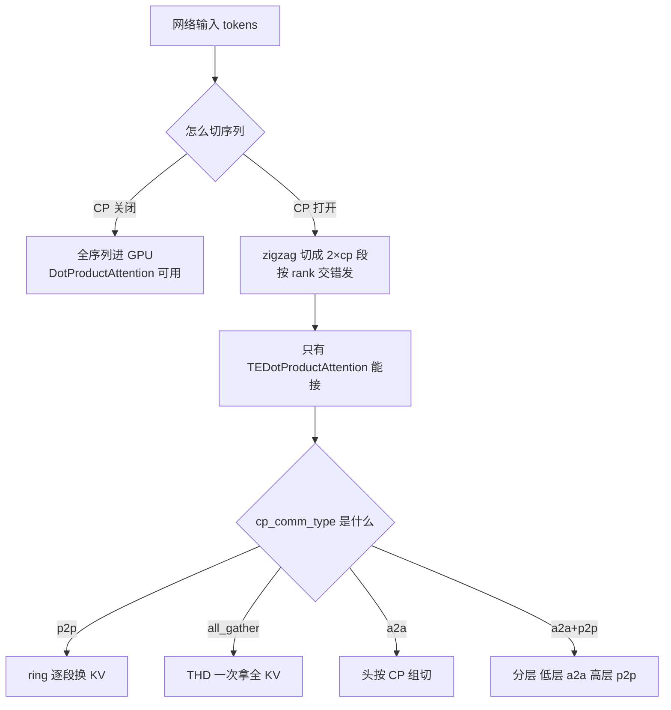
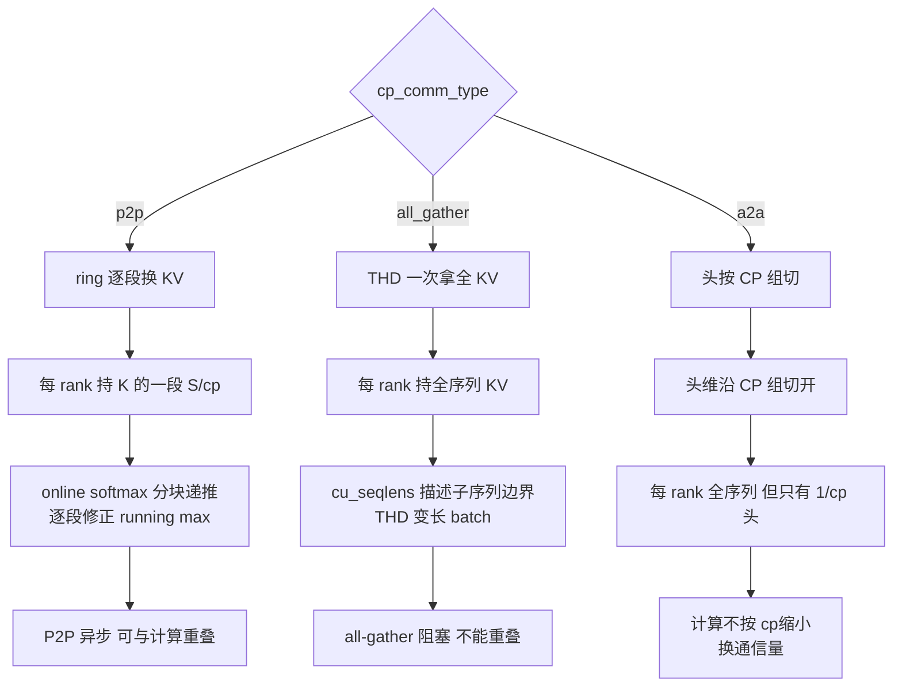
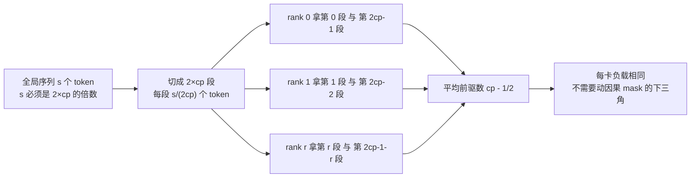

> 源码基准：`megatron-core` **0.20.0**，commit [`60e039626`](https://github.com/NVIDIA/Megatron-LM/tree/60e039626)。本文所有行号均对该 commit 取证。
> 配套实验：[`ipynbs` commit `38f8f4a`](https://github.com/lrypcy/ipynbs/tree/38f8f4a) 的 `experiments/megatron/context_parallel/`。

长序列这一刀怎么切，是 Megatron 系列里最容易被讲错的一件事。

错的讲法是「CP 就是把序列均分成 cp 份，每张卡算自己那份的 attention」。这句话在数学上不成立——causal attention 下第 i 个 token 要看到前 i 个 token，如果按连续块切，最后一块的卡要算 $$O(S^2)$$ 而第一块的卡几乎不干活，负载差 $$cp$$ 倍。

对的讲法分两层。**第一层是切法**：序列被切成 $$2 \times cp$$ 段，按 zig-zag 顺序发给各卡，让每张卡拿到的「前驱 token 数」尽量均衡。**第二层是通信**：切完之后每个 token 的 Q 仍然要跟全局所有 token 的 K/V 算 attention，这部分要么用 ring 一段段换、要么 all-gather 一次拿全、要么把头切开各算各的——**这三条路线的选择权不在 Python 侧，在 Transformer Engine 的构造参数里**。

本文按这两层拆。范围只有 CP 分派内核约 2300 行；MLA（1502 行）、absorbed MLA（953 行）、DSA（2244 行）这三条 attention 变体线索合计 4699 行，属于另一组主题，另立编号。

---

## 1. CP 与 TP / SP / PP 的职责边界

先划清 CP 到底管什么。官方文档给的说法是：SP 只切 Dropout 与 LayerNorm 那部分激活，**CP 切的是网络输入与全部激活的序列维度**，见 [Context Parallel Package](https://docs.nvidia.com/megatron-core/developer-guide/latest/user-guide/features/context_parallel.html)。同一页给的关键事实是：CP 之下**除 attention 外的所有模块（Linear、LayerNorm 等）完全不用改**，因为它们没有跨 token 的运算；只有 attention 需要额外通信。

这条边界的直接后果是：**CP 的全部复杂度集中在 attention 的一个函数里**。别的模块看不到 CP 的存在。

规模关系上，官方文档写的是总卡数 $$= TP \times CP \times PP \times DP$$，见同一页的 Enabling Context Parallelism 段。为什么必须有 CP 而不能只加 TP？同一页给的判断是：单纯加 TP 会让 Linear 层的矩阵变短到「藏不住通信延迟」，而且重计算又带来约 30% 的额外开销——CP 让计算与通信都按 cp 度数缩小，两者的重叠压力同时下降。

03 篇讲的 SP 与 CP 在源码里分属两个模块：SP 的通信原语在 [`core.tensor_parallel`](https://docs.nvidia.com/megatron-core/developer-guide/latest/apidocs/core/core.tensor_parallel.html)，CP 在 `core.distributed` 与 `core.ssm`。

CP 与 SP 的一个易混点：`--context-parallel-size` 的语义与 03 篇讲的 SP 不同。SP 在 Megatron 里是「LayerNorm/Dropout 部分激活按序列切、其余全复制」的混合切法；CP 是**输入就切**，代价是 attention 要通信。两者在同一次训练里可以并存。官方文档对 SP 的定义是「which only splits the sequence of Dropout and LayerNorm activations」，对比 CP 的「partitions the network inputs and all activations along the sequence dimension」，两句在 [Context Parallel Package](https://docs.nvidia.com/megatron-core/developer-guide/latest/user-guide/features/context_parallel.html) 的同一段里。

### 1.1 CP 组是怎么切出来的

CP 组不是随便拉的。它由 `initialize_model_parallel` 的网格顺序决定。[`parallel_state.py` L617](https://github.com/NVIDIA/Megatron-LM/blob/60e039626/megatron/core/parallel_state.py#L617) 的默认参数写死了顺序：

```python
order: str = "tp-cp-ep-dp-pp",
```

**CP 轴紧邻 TP 轴、在 EP 之前。** 这个位置决定了 CP 组与 TP 组的嵌套关系。构造在 [`L1113-L1126`](https://github.com/NVIDIA/Megatron-LM/blob/60e039626/megatron/core/parallel_state.py#L1113-L1126)：

```python
# Build the context-parallel groups.
global _CONTEXT_PARALLEL_GROUP
global _CONTEXT_PARALLEL_GLOBAL_RANKS
assert _CONTEXT_PARALLEL_GROUP is None, 'context parallel group is already initialized'
for ranks in decoder_rank_generator.get_ranks('cp'):
    group = create_group(
        ranks,
        timeout=timeout,
        pg_options=get_nccl_options("cp", nccl_comm_cfgs),
        group_desc="CONTEXT_PARALLEL_GROUP",
    )
    if rank in ranks:
        _CONTEXT_PARALLEL_GROUP = group
    _CONTEXT_PARALLEL_GLOBAL_RANKS = ranks
```

同一段里还有分层 CP 组的构造（[L1127-L1140](https://github.com/NVIDIA/Megatron-LM/blob/60e039626/megatron/core/parallel_state.py#L1127-L1140)），条件是 `hierarchical_context_parallel_sizes` 非空，断言 `np.prod(...) == context_parallel_size`。**这条断言与 §2.3 里 `a2a+p2p` 强制要求 `hcp` 组是同一件事的两端**——分层 CP 的组在初始化时就建好，`a2a+p2p` 只是去用它。

`context_parallel_size` 这个参数自己的 docstring 给了一个具体的 8卡例子（[`L664-L686`](https://github.com/NVIDIA/Megatron-LM/blob/60e039626/megatron/core/parallel_state.py#L664-L686)），把嵌套关系说得很直白：

> For example, assume we have 8 GPUs, if tensor model parallel size is 4 and context parallel size is 2, the network input will be split into two sequence chunks, which are processed by 2 different groups of 4 GPUs. One chunk is processed by GPU0-3, the other chunk is processed by GPU4-7. Four groups are build to do context parallel communications: [GPU0, GPU4], [GPU1, GPU5], [GPU2, GPU6], and [GPU3, GPU7].

**注意「Four groups」这个数。** 8 卡、TP=4、CP=2，CP 通信组有 **4 个**而不是 2 个——因为每张卡要和自己在其他 TP 组里的对应卡通信，而 TP 组本身要同步 q/k/v。§2 说的「KV 通信发生在 GPU 与其他 TP 组里的对应卡之间」就是这个拓扑，官方特性页的原文是「KV communication happens between a GPU and its counterparts in other TP groups」，见 [Context Parallel Package](https://docs.nvidia.com/megatron-core/developer-guide/latest/user-guide/features/context_parallel.html)。

同一段 docstring 还给了一条容易被忽略的事实：

> Context parallelism partitions sequence length, so it has no impact on weights, which means weights are duplicated among GPUs in a context parallel group. Hence, weight gradient all-reduce is required in backward. For simplicity, we piggyback GPUs of context parallelism on data parallel group for weight gradient all-reduce.

**CP 组内权重是复制的，所以权重的梯度归约被搭载在 DP 组上做。** 这是 05 篇那套 `_ParamAndGradBuffer` 与 CP 的接口——`dp_cp_group` 之所以是 05 篇反复出现的那个名字。进程组的 getter 见 [`core.parallel_state`](https://docs.nvidia.com/megatron-core/developer-guide/latest/apidocs/core/core.parallel_state.html)。

### 1.2 一个 271 行文件里的 CP 短路

最能说明「CP 是 attention 的局部改动」的证据，在 [`dot_product_attention.py`](https://github.com/NVIDIA/Megatron-LM/blob/60e039626/megatron/core/transformer/dot_product_attention.py#L57-L59) 的构造里：

```python
assert (
    self.config.context_parallel_size == 1
), "Context parallelism is only supported by TEDotProductAttention!"
```

这个类只有 271 行，官方 API 页对它的描述就是一条「Region where selective activation recomputation is applied」，见 [`core.transformer.dot_product_attention`](https://docs.nvidia.com/megatron-core/developer-guide/latest/apidocs/core/core.transformer.dot_product_attention.html)。它做的事是标准的 `baddbmm` + `scale_mask_softmax` + `bmm`（[L194-L239](https://github.com/NVIDIA/Megatron-LM/blob/60e039626/megatron/core/transformer/dot_product_attention.py#L194-L239)），把整个 $$[b, n/p, s, s]$$ 的 score 矩阵一次性物化。

**这个类被断言挡在 CP 之外。** 一旦 `context_parallel_size > 1`，构造就抛异常。原因很直接：它要的是全序列的 score 矩阵，而 CP 下每个 rank 只有 $$1/cp$$ 的序列——它没有分块的能力，也没有 online softmax 的递推。

于是 Megatron 只有一个 attention 实现能跑 CP：`TEDotProductAttention`，它在 [`transformer_engine.py`](https://github.com/NVIDIA/Megatron-LM/blob/60e039626/megatron/core/extensions/transformer_engine.py#L2028-L2113) 里，第 2 章整章讲它。

顺带一个细节：这个类的 docstring（[L27-L32](https://github.com/NVIDIA/Megatron-LM/blob/60e039626/megatron/core/transformer/dot_product_attention.py#L27-L32)）把 selective 重计算的区域划在这里，并引用 [Korthikanti et al., *Reducing Activation Recomputation in Large Transformer Models*](https://arxiv.org/abs/2205.05198)。该论文提出 selective recompute——只重算 attention 内部的 softmax/dropout 部分、保留线性层的输入，因为「这部分显存占用大但计算量小」。这条与 CP 正交：CP 省的是序列维度的总量，selective recompute 省的是这一块里能省的那部分。该论文的 selective 判据是「attending operations vs MLP operations」，前者重算、后者保留，见 [arXiv:2205.05198](https://arxiv.org/abs/2205.05198)。

`DotProductAttention` 用的是 `FusedScaleMaskSoftmax`（[L100-L109](https://github.com/NVIDIA/Megatron-LM/blob/60e039626/megatron/core/transformer/dot_product_attention.py#L100-L109)），融合的正是 scale + mask + softmax 三步，官方 API 页见 [`core.fusions.fused_softmax`](https://docs.nvidia.com/megatron-core/developer-guide/latest/apidocs/core/core.fusions.fused_softmax.html)。

### 1.3 不进 CP 时，这些代码根本不存在

一个容易被忽略的事实：`DotProductAttention.forward` 的第一条断言就是 `packed_seq_params is None`（[L153-L156](https://github.com/NVIDIA/Megatron-LM/blob/60e039626/megatron/core/transformer/dot_product_attention.py#L153-L156)）：

```python
assert packed_seq_params is None, (
    "Packed sequence is not supported by DotProductAttention."
    "Please use TEDotProductAttention instead."
)
```

打包序列（THD）在 Megatron 里是 CP 的伴生能力——CP 要按序列切，打包序列要按文档切，两者共用同一套 `cu_seqlens` 元数据。这个类两样都不支持。`PackedSeqParams` 的官方 docstring 也印证了这一点：它是「parameters to TEDotProductAttention and fused rope kernels for the `thd` (packed) sequence format」，见 [`core.packed_seq_params`](https://docs.nvidia.com/megatron-core/developer-guide/latest/apidocs/core/core.packed_seq_params.html)——收件人只有 TE 与 fused rope 两个。

注意力接口本身的 `CoreAttentionInterface` 协议把 `cp_comm_type` 列为必填关键字参数（见 [`attention.py` L219-L229](https://github.com/NVIDIA/Megatron-LM/blob/60e039626/megatron/core/transformer/attention.py#L219-L229)），官方 API 页见 [`core.transformer.attention`](https://docs.nvidia.com/megatron-core/developer-guide/latest/apidocs/core/core.transformer.attention.html)——**任何自定义 attention 实现都必须接受这个参数，哪怕它不支持 CP**。

所以本篇有两层「不进 CP 就不存在」的代码：`DotProductAttention` 整个类（271 行），以及 `PackedSeqParams` 里的 `seq_idx` 预计算（[`packed_seq_params.py` L31-L69](https://github.com/NVIDIA/Megatron-LM/blob/60e039626/megatron/core/packed_seq_params.py#L31-L69)）。



*图 1：CP 的分派只有一处，且落在 TE 扩展层的构造参数里。`DotProductAttention` 被断言挡在 CP 之外，所以路由图的分叉终点只有一个实现。数据出处：`context_parallel_size == 1` 的短路断言 [`dot_product_attention.py` L57-L59](https://github.com/NVIDIA/Megatron-LM/blob/60e039626/megatron/core/transformer/dot_product_attention.py#L57-L59)，`cp_comm_type` 的四个取值定义见 [`transformer_config.py` L1023-L1035](https://github.com/NVIDIA/Megatron-LM/blob/60e039626/megatron/core/transformer/transformer_config.py#L1023-L1035)，CP 与其余并行度的规模关系见 [Context Parallel Package](https://docs.nvidia.com/megatron-core/developer-guide/latest/user-guide/features/context_parallel.html)。*

---

## 2. 三条路线：一个构造参数的选择

### 2.1 纠正是论点本身：`cp_comm_type` 曾经被写成 CLI flag

这一章要先纠正一个流传甚广的说法。

`RESEARCH_PLAN.md` 把 CP 的通信方式记成 CLI flag `--cp-comm-type`。这个说法**部分对、部分错**，而错的那部分恰好是本章要讲的论点。

对的部分：[`arguments.py` L3192-L3197](https://github.com/NVIDIA/Megatron-LM/blob/60e039626/megatron/training/arguments.py#L3192-L3197) 确实定义了 `--cp-comm-type`，而且是 `nargs='+'`（可给多个值），默认值 `["p2p"]`，help 里写明「If a single string is provided, all layers will share the same communication type. Users can also specify separated types for each layer like `--cp-comm-type p2p p2p a2a a2a a2a+p2p a2a+p2p`」。

错的部分在**它怎么往下走**。[`argument_utils.py` L343-L344](https://github.com/NVIDIA/Megatron-LM/blob/60e039626/megatron/training/argument_utils.py#L343-L344) 只做一件事：

```python
if len(args.cp_comm_type) == 1:
    kw_args['cp_comm_type'] = args.cp_comm_type[0]
```

**只有长度为 1 时才写进 config**，而且写成的是**字符串**而不是列表。逐层的列表形式不走这条路径。真正做逐层分派的是 [`transformer_layer.py` L377-L385](https://github.com/NVIDIA/Megatron-LM/blob/60e039626/megatron/core/transformer/transformer_layer.py#L377-L385)：

```python
attention_optional_kwargs = {}
if config.context_parallel_size > 1 and config.cp_comm_type is not None:
    if isinstance(config.cp_comm_type, list):
        # layer_number is 1-indexed, so we need to subtract 1 to get the correct index
        attention_optional_kwargs["cp_comm_type"] = config.cp_comm_type[
            self.layer_number - 1
        ]
    else:
        attention_optional_kwargs["cp_comm_type"] = config.cp_comm_type
```

**完整的传递链有五跳**，每一跳都换一次形态：

| 跳 | 位置 | 形态 |
| --- | --- | --- |
| 1 | `arguments.py` L3192 | CLI 列表 `["p2p", ...]`，`nargs='+'` |
| 2 | `argument_utils.py` L343-L344 | 只在长度为 1 时塌缩成**字符串** |
| 3 | `transformer_config.py` L1023 | `Optional[Union[str, List[str]]]` |
| 4 | `transformer_layer.py` L377-L385 | 按 `layer_number - 1` 取出**本层那一个字符串** |
| 5 | `transformer_engine.py` L2118 | `extra_kwargs["cp_comm_type"] = cp_comm_type` |

这条链的终点在第 5 跳：字符串被塞进 `extra_kwargs`，交给 Transformer Engine 的 `DotProductAttention`。**Python 侧没有任何策略逻辑**——没有 if 判断该用哪种通信、没有任何调度代码。选择权完全在 kernel 侧。

这条链上还有一个断言，写在 `transformer_config.py` L3081-L3090：`cp_comm_type` 传列表时长度必须等于 `num_layers`（原文：`Length of cp_comm_type ({}) should equal to the total number of transformer layers ({})!`），否则直接报错。

### 2.2 四个取值的官方定义

[`transformer_config.py` L1023-L1040](https://github.com/NVIDIA/Megatron-LM/blob/60e039626/megatron/core/transformer/transformer_config.py#L1023-L1040) 的 docstring 给出的定义，官方 API 页同文（见 [`core.transformer.transformer_config`](https://docs.nvidia.com/megatron-core/developer-guide/latest/apidocs/core/core.transformer.transformer_config.html)）：

| 取值 | 官方描述 |
| --- | --- |
| `"p2p"` | 用 ring 拓扑做 P2P 交换 KV 块。**P2P 是异步的，可以与 attention 计算重叠** |
| `"all_gather"` | all-gather 拿到全序列 KV 再算 attention。**这个 all-gather 不是异步的，不能重叠** |
| `"a2a"` | 类 DeepSpeed Ulysses，把 attention 头散到 CP 组上，再 gather 拿全序列 QKV |
| `"a2a+p2p"` | 分层实现：低层 CP 组（如 NVLink 内）走 a2a，高层 CP 组（如 IBLink 间）走 p2p |

其中 `"a2a"` 的原始出处是 [DeepSpeed-Ulysses, arXiv:2309.14509](https://arxiv.org/abs/2309.14509)。该文的定位是「System Optimizations for Enabling Training of Extreme Long Sequence Transformer Models」，摘要开篇即指出此前的系统工作只关注 batch size、hidden dimension、number of layers 三个维度（对应 DP / TP / PP），而序列长度这一维没有被并行化方法覆盖。

`"p2p"` 的原始出处是 [Ring Attention with Blockwise Transformers for Near-Infinite Context, arXiv:2310.01889](https://arxiv.org/abs/2310.01889)（Liu, Zaharia, Abbeel）。需要注意的是 Megatron 的 CP **不等于** Ring Attention——官方文档自己写了这层区别：CP「is similar to Ring Attention but targets higher performance by (1) using current open-source and cuDNN flash attention kernels, and (2) avoiding extra work from lower-triangle causal masking while keeping load balanced across GPUs」，见 [Context Parallel Package](https://docs.nvidia.com/megatron-core/developer-guide/latest/user-guide/features/context_parallel.html)。也就是说 Megatron 借了 ring 的通信结构，但用现成的高性能 kernel，并且靠 zigzag 切分避开了因果 mask 造成的负载不均。

Ring Attention 原文的额外贡献是 **blockwise 形式**：把输入序列本身也分块，逐块流过网络，从而在设备数量固定时把序列长度扩展到「近无穷」。这条思路与 CP 的切分同源，但目标不同——CP 是让现有 kernel 吃得下长序列，blockwise 是让模型结构本身支持流式。

两条路线的系统级对比见 [USP: A Unified Sequence Parallelism Approach for Long Context Generative AI, arXiv:2405.07719](https://arxiv.org/abs/2405.07719)，该文把 DeepSpeed-Ulysses 与 Ring-Attention 统称为「the state-of-the-art SP approaches」并比较两者的通信与显存开销，提出统一方案。

### 2.3 分派代码本身

回到第 5 跳。[`transformer_engine.py` L2105-L2118](https://github.com/NVIDIA/Megatron-LM/blob/60e039626/megatron/core/extensions/transformer_engine.py#L2105-L2118)：

```python
if is_te_min_version("1.10.0"):
    if cp_comm_type is None:
        extra_kwargs["cp_comm_type"] = "p2p"
    elif cp_comm_type == "a2a+p2p":
        assert is_te_min_version("1.12.0"), (
            f"Transformer-Engine v{get_te_version()} must be >= 1.12.0 to support"
            "hierarchical cp commucation."
        )
        extra_kwargs["cp_comm_type"] = "a2a+p2p"
    extra_kwargs["cp_group"] = get_hierarchical_context_parallel_groups(
        check_initialized=False
    )
else:
    extra_kwargs["cp_comm_type"] = cp_comm_type
```

四点值得读出来：

1. **`None` 被归一化成 `"p2p"`**，但只在 TE ≥ 1.10.0 的分支里。TE 更老时 `cp_comm_type` 原样透传——不同 TE 版本下 `None` 的含义不同。
2. **`"a2a+p2p"` 有硬版本门**：TE ≥ 1.12.0，且额外要 `cp_group` 换成 `get_hierarchical_context_parallel_groups(...)`（分层 CP 组），不是普通的 `pg_collection.cp`。这个断言在构造函数早期（[L2079-L2082](https://github.com/NVIDIA/Megatron-LM/blob/60e039626/megatron/core/extensions/transformer_engine.py#L2079-L2082)）还有一次 `assert hasattr(pg_collection, "hcp")`。
3. **CP 有独立的 TE 版本下限**：[`L2094-L2097`](https://github.com/NVIDIA/Megatron-LM/blob/60e039626/megatron/core/extensions/transformer_engine.py#L2094-L2097) 写的是 `context_parallel_size > 1` 时必须 TE ≥ 1.0.0，断言文案是「Only Transformer-Engine version >= 1.0.0 supports context parallelism!」。官方特性页给的门槛略宽（Megatron-Core ≥ 0.5.0 且 Transformer Engine ≥ 1.1），见 [Context Parallel Package](https://docs.nvidia.com/megatron-core/developer-guide/latest/user-guide/features/context_parallel.html)。
4. **CP 通信有专用 stream**：[`L2098-L2104`](https://github.com/NVIDIA/Megatron-LM/blob/60e039626/megatron/core/extensions/transformer_engine.py#L2098-L2104) 在 CP 开启时惰性创建一个类级 `cp_stream`，并把它连同 `cp_group`、`cp_global_ranks` 一起塞进 `extra_kwargs`。

第 4 点在 forward 时还会再走一次。[`L2221-L2237`](https://github.com/NVIDIA/Megatron-LM/blob/60e039626/megatron/core/extensions/transformer_engine.py#L2221-L2237)：

```python
if packed_seq_params is not None:
    # If Dynamic CP group is provided, update TE DPA CP group
    if packed_seq_params.cp_group is not None:
        self.cp_group = packed_seq_params.cp_group
        super().set_context_parallel_group(
            self.cp_group,
            torch.distributed.get_process_group_ranks(self.cp_group),
            TEDotProductAttention.cp_stream,
            self.cp_comm_type,
        )
    # If cp_group is None but local_cp_size is provided,
    # Indicates to turn off CP dynamically
    elif packed_seq_params.local_cp_size is not None:
        assert (
            packed_seq_params.local_cp_size == 1
        ), "local_cp_size must be == 1 if provided without cp_group"
        super().set_context_parallel_group(None, None, None, self.cp_comm_type)
```

**CP 组可以每步换。** 传 `cp_group` 就换组；传 `local_cp_size == 1` 就临时关掉 CP。这正是 hybrid CP 的接口——06 篇在讲的 `hybrid_cp_schedule.py` 就是靠每个样本的 `local_cp_size` 不同，让不同长度的样本用不同大小的 CP 组。

一个被这个分支顺手记下的事实：`cp_comm_type` 是**构造函数固定的**，换组时不换通信方式。所以 hybrid CP 只在「同一种通信方式、不同大小的组」之间切换，不能逐样本换路线。

### 2.4 一个反向约束：DSA 只允许 allgather

CP 路线不总是自由的。[`transformer_config.py` L3140-L3155](https://github.com/NVIDIA/Megatron-LM/blob/60e039626/megatron/core/transformer/transformer_config.py#L3140-L3155)：

```python
if self.experimental_attention_variant == "dsa":
    assert not self.apply_rope_fusion, "RoPE fusion is not supported for DSAttention"
    if self.context_parallel_size > 1:
        cp_comm_types = (
            self.cp_comm_type
            if isinstance(self.cp_comm_type, list)
            else [self.cp_comm_type]
        )
        assert all(
            cp_comm_type is not None
            and cp_comm_type.replace("_", "").lower() == "allgather"
            for cp_comm_type in cp_comm_types
        ), (
            "DSAttention context parallelism currently supports "
            "cp_comm_type=allgather only."
        )
```

DSA 变体下 CP **只允许 `allgather`**。注意断言里那个 `.replace("_", "").lower()`——它让 `"all_gather"`、`"AllGather"`、`"ALLGATHER"` 都通过，说明不同代码路径写下的字符串形态并不统一，这个断言在做归一化。

同一段还有一条 batch-invariant 相关的互斥（[L3195-L3199](https://github.com/NVIDIA/Megatron-LM/blob/60e039626/megatron/core/transformer/transformer_config.py#L3195-L3199)）：`batch_invariant_mode` 下 `context_parallel_size` 必须为 1，注释写明原因是「Context parallelism routes through TE's FA2 fwd/bwd kernels directly, which cannot be pinned to another version; dropout is not batch-invariant」。也就是说**要 CP 就放弃 batch-invariant**，反之亦然。

### 2.5 三条路线的通信量对照（A 级解析模型）

下面这张表是**解析值**，不是实测吞吐。口径：单层、全序列长度 $$S$$、单元素 2 字节（bf16）、只算 K 与 V 两个张量，记 $$B = 2 \times 2 = 4$$ 字节。数字来自配套实验 [`gen_stdout.py` §4](https://github.com/lrypcy/ipynbs/blob/38f8f4a/experiments/megatron/context_parallel/gen_stdout.py)。

**每 rank 收到的 KV 字节**

| cp | p2p(ring) | all_gather(THD) | a2a(Ulysses) | AG/p2p |
| --- | --- | --- | --- | --- |
| 2 | 2.00 | 4.00 | 2.00 | 2.000000 |
| 4 | 3.00 | 4.00 | 1.00 | 1.333333 |
| 8 | 3.50 | 4.00 | 0.50 | 1.142857 |
| 16 | 3.75 | 4.00 | 0.25 | 1.066667 |

**全网合计（每 token 折算）**

| cp | p2p(ring) | all_gather(THD) | a2a(Ulysses) | AG/p2p |
| --- | --- | --- | --- | --- |
| 2 | 4.00 | 8.00 | 4.00 | 2.000000 |
| 4 | 12.00 | 16.00 | 4.00 | 1.333333 |
| 8 | 28.00 | 32.00 | 4.00 | 1.142857 |
| 16 | 60.00 | 64.00 | 4.00 | 1.066667 |

三行读法：

- **ring 的全网量是 $$(cp-1) \cdot S$$**，随 cp 线性增长——每多一个 rank 就多一轮 KV 交换。
- **all_gather 的全网量是 $$cp \cdot S$$**，比 ring 多 $$S$$。倍数恰为 $$cp/(cp-1)$$，cp 越大越接近 1：**ring 与 all_gather 的量级差是 $$O(1)$$ 的，不是数量级的差。**
- **a2a 的全网量恒为 $$S$$**，与 cp 无关——每个 KV 元素只过一次网络。**只有 a2a 真正省量。**

a2a 省量的代价官方 docstring 写了一半（`scatter attention heads across the CP group`），另一半在别处：a2a 之后每个 rank 要算**全序列 × 自己那 $$1/cp$$ 的头**，计算量并没有按 cp 缩小，而 ring 下每 rank 只需算 $$1/cp$$ 序列的全头。这条是 a2a 的真实取舍：**用计算局部性换通信量**。同样因为头被切开，cp 必须整除头数——源码侧只看到硬断言（`transformer_config.py` L3088-L3090 要求 `cp_comm_type` 非 `None` 且为 `str`，以及 §2.3 的 TE 版本门），实际会怎么 pad 未验证。

| | p2p (ring) | all_gather (THD) | a2a (Ulysses) |
| --- | --- | --- | --- |
| 通信可否与 attention 重叠 | **可以**（异步 P2P） | **不可以**（阻塞 all-gather） | 一次 a2a，可部分重叠 |
| 每 rank 的 attention 计算量 | $$S/cp$$ 序列 × 全头 | $$S$$ 序列 × 全头 | $$S$$ 序列 × $$1/cp$$ 头 |
| 对 kernel 的要求 | 需要分块递推（online softmax） | 需要接受 THD 的变长 batch | 需要按头维切分的 GEMM |
| 硬约束 | 无 | 需要 `cu_seqlens` 元数据 | **头数须被 cp 整除** |

「通信可否重叠」这一行直接来自 §2.2 引的官方定义（p2p 写「is async and can be overlapped with attention compute」，all_gather 写「is not async, and cannot be overlapped」）。**这是三条路线最实质的差别**——通信量的差距是 $$cp/(cp-1)$$ 倍，重叠与否是「有」与「无」。

### 2.6 三条路线对 kernel 的要求

上表第三行需要展开，因为它是「选择权在 kernel 侧」这句话的具体含义。

PyTorch 侧的对照入口是 [`torch.nn.functional.scaled_dot_product_attention`](https://docs.pytorch.org/docs/2.14/generated/torch.nn.functional.scaled_dot_product_attention.html) 与 [`torch.nn.attention`](https://docs.pytorch.org/docs/2.14/nn.attention.html) 模块——它们对外是**一个函数一个语义**，不带 CP 概念；CP 的分块递推要靠更底层的入口或自定义 kernel。

**ring 要求 kernel 支持分块递推。** 因为每张卡拿到的是 K/V 的一段而不是全部，attention 必须按段递推——这就是 online softmax。这不是可选项：不递推就没法把各段的贡献合并成一个 softmax。

**all_gather（THD）要求 kernel 接受变长 batch。** 拿到全序列 KV 之后，问题是「哪些 token 之间可以互相 attend」不再是一个矩形掩码。THD 格式用 `cu_seqlens`（累积长度）描述每条子序列的边界，kernel 按变长序列处理。`cu_seqlens` 是这条路线能省掉 padding 的原因，见第 3 章。

**a2a 要求 kernel 支持按头切分。** 因为每个 rank 只有 $$1/cp$$ 的头，KV 的 head 维度在 CP 组上是切开的，这要求 GEMM 与 softmax 都能沿 head 维独立处理。



*图 2：三条路线对 kernel 的三种不同要求。分块递推、变长 batch、按头切分——三种能力互不替代，这就是为什么这个选择不能在 Python 侧做。数据出处：三个取值的官方定义见 [`transformer_config.py` L1027-L1040](https://github.com/NVIDIA/Megatron-LM/blob/60e039626/megatron/core/transformer/transformer_config.py#L1027-L1040)（官方 API 页同文：[`core.transformer.transformer_config`](https://docs.nvidia.com/megatron-core/developer-guide/latest/apidocs/core/core.transformer.transformer_config.html)），分块递推的数值验证见 [`gen_stdout.py`](https://github.com/lrypcy/ipynbs/blob/38f8f4a/experiments/megatron/context_parallel/gen_stdout.py) 与固化输出 [`results/stdout.txt`](https://github.com/lrypcy/ipynbs/blob/38f8f4a/experiments/megatron/context_parallel/results/stdout.txt) 的 §2–§5 段。*

---

## 3. online softmax：分块递推为什么与全量等价

这一章是本篇的正确性地基，也是配套实验做的那件事。

### 3.1 递推式

设 attention 的 score 矩阵按 K 的维度分块。对第 $$b$$ 块记

$$m_b = \max_j s_j, \qquad l_b = \sum_j e^{s_j - m_b}, \qquad o_b = \sum_j s_j\, e^{s_j - m_b}$$

其中分母 $$l$$ 留到全部块累加完再统一除。合并两块（记为 $$a$$ 与 $$b$$）的递推是

$$m = \max(m_a, m_b), \qquad l = l_a\, e^{m_a - m} + l_b\, e^{m_b - m}, \qquad o = o_a\, e^{m_a - m} + o_b\, e^{m_b - m}$$

递推到底再除以 $$l$$。**关键在于每一步的指数项都落在 $$[0, 1]$$**——因为 $$m$$ 是 running max，所以每个 $$m_k - m \le 0$$。这意味着递推过程中不会出现「先算出一个巨大的 $$e^{s}$$、再除回去」的抵消。

递推式不依赖自动微分，但**反向**要能穿过「先累加后归一化」的顺序，PyTorch 的 autograd 机制说明见 [`torch.autograd` notes](https://docs.pytorch.org/docs/2.14/notes/autograd.html) 与 [`torch.autograd.grad`](https://docs.pytorch.org/docs/2.14/generated/torch.autograd.grad.html)。

这套递推在 FlashAttention 的 online softmax 里是同一个构造，见 [FlashAttention, arXiv:2205.14135](https://arxiv.org/abs/2205.14135) 及其改进版 [FlashAttention-2, arXiv:2307.08691](https://arxiv.org/abs/2307.08691)。FA2 的核心贡献之一正是并行维度上的工作划分（thread-block 沿序列维切分 + 跨分块归约），这与 ring attention 的「序列切块 + 块间递推」是同构的——**ring attention 用网络切块，FA2 用 SM 切块，递推式是同一个**。

### 3.2 C 级实验：逐位与近逐位验证

配套实验在 `ipynbs` 的 `experiments/megatron/context_parallel/`，纯 numpy float64，固定 `seed=20261017`，规格 `N=64` 个 query、`D=32` 维 head、`M=256` 个 key、`dv=32`。

**第一项：单块递推必须与全量 softmax 逐位相同。** 参考量级 `absmax = 0.412468`。

| 口径 | 最大绝对误差 | 逐位相同 |
| --- | --- | --- |
| vs `(e @ V) / sum(e)` | **0.000e+00** | 是 |
| vs `p /= sum; p @ V` | 4.441e-16 | 否 |

第二行不是错。这两个口径都是「一次性全量 softmax」，差别只在归一化的位置：先归一化再乘 $$V$$，还是先乘 $$V$$ 再归一化。分块递推天然属于后者——分母 $$l$$ 要等所有块累加完才知道。所以逐位基准取后者，两者在 float64 下差约 1 ULP。来源见 [`online_softmax.py`](https://github.com/lrypcy/ipynbs/blob/38f8f4a/experiments/megatron/context_parallel/online_softmax.py) 的 `full_softmax_attention` 与 `full_softmax_attention_denom_last`。

**第二项：扫块数。**

| 块数 | 块长 | 最大绝对误差 | 相对误差 |
| --- | --- | --- | --- |
| 1 | 256 | 0.000e+00 | 0.000e+00 |
| 2 | 128 | 2.776e-16 | 6.729e-16 |
| 4 | 64 | 3.886e-16 | 9.421e-16 |
| 8 | 32 | 4.441e-16 | 1.077e-15 |
| 16 | 16 | 3.608e-16 | 8.748e-16 |
| 32 | 8 | 4.441e-16 | 1.077e-15 |
| 64 | 4 | 4.996e-16 | 1.211e-15 |
| 128 | 2 | 6.661e-16 | 1.615e-15 |
| 256 | 1 | 5.274e-16 | 1.279e-15 |

**这张表的结论与直觉相反，值得单独说。** 从 2 块到 256 块（块长从 128 降到 1），相对误差始终在 1e-15 量级的 float64 舍入底噪里上下浮动，**不随时块数单调增长**——相邻两档的比值在 0.79 到 1.40 之间来回摆，见 [`results/stdout.txt`](https://github.com/lrypcy/ipynbs/blob/38f8f4a/experiments/megatron/context_parallel/results/stdout.txt) 的 §4 段。

所以「切得越碎误差越大」这句话在 float64 下**不成立**。误差规模由求和次序决定，不由块数决定。原因就是 §3.1 那句：递推每步都做了 max 修正，指数项始终在 $$[0, 1]$$，没有抵消。

**第三项：ring 顺序递推。** cp = 8，每段 32 个 token，把序列切成 8 份、按 ring 顺序（0→1→…→7）逐段吃掉 K/V：

| 口径 | 最大绝对误差 | 相对误差 |
| --- | --- | --- |
| 全组 | 4.441e-16 | 1.360e-15 |

逐 rank 的最大绝对误差：

| rank | 0 | 1 | 2 | 3 | 4 | 5 | 6 | 7 |
| --- | --- | --- | --- | --- | --- | --- | --- | --- |
| 误差 | 4.441e-16 | 4.441e-16 | 4.441e-16 | 3.331e-16 | 3.053e-16 | 3.886e-16 | 3.886e-16 | 3.608e-16 |

**8 个 rank 的结果与「全 K/V 一次性 softmax」在 float64 舍入底噪内一致。** 这是 ring attention 正确性的直接证据：K/V 的**分块顺序**（按 rank 而非按连续内存）不影响结果，只要 online softmax 的递推走对。

**本实验没有验证的部分**：全部在 float64 下做。低精度（bf16 / fp16）下「切得越碎误差越大」**可能**成立——递推步数变多、每步都舍入。需要 torch + GPU 才能测，本机不具备条件，标为**待验证**。

### 3.3 ring 与 FlashAttention 的同构性

分块递推不是 ring attention 独有的发明。FlashAttention 的核心机制是同一套 online softmax：把 score 矩阵按块处理，不物化全矩阵，递推维护三个统计量。原文见 [FlashAttention, arXiv:2205.14135](https://arxiv.org/abs/2205.14135)，其摘要开篇即指出「Transformers are slow and memory-hungry on long sequences, since the time and memory complexity of self-attention are quadratic in sequence length」。

两者的切分维度不同，但递推式相同：

| | 切什么 | 块间靠什么通信 | 递推式 |
| --- | --- | --- | --- |
| FlashAttention | Q/K 的序列维（同一张卡内的 SM 之间） | 无（共享显存） | online softmax |
| FlashAttention-2 | 同上，且跨线程块并行 | 无 | 同上 |
| Ring Attention | K/V 的序列维（跨网络） | P2P 交换 KV 块 | 同一个 online softmax |

FA2 的贡献特别值得记（见 [FlashAttention-2, arXiv:2307.08691](https://arxiv.org/abs/2307.08691)）：它把并行维度从只用 SM 内共享内存扩展到**沿序列维切分后再跨分块归约**，并额外做了 warp 间的不规则工作划分。这一步是「序列维切块」从 kernel 内部技巧变成通用构造的关键——**ring attention 正是把 FA2 的「跨分块归约」从 SM 之间换成了网络之间**。

官方文档把 Megatron 的 CP 与 Ring Attention 的关系写得很克制（见 [Context Parallel Package](https://docs.nvidia.com/megatron-core/developer-guide/latest/user-guide/features/context_parallel.html)）：CP「is similar to Ring Attention but targets higher performance by (1) using current open-source and cuDNN flash attention kernels, and (2) avoiding extra work from lower-triangle causal masking while keeping load balanced across GPUs」。也就是说 **Megatron 没有自己实现 ring 的 kernel，它复用了 FA 系列，只在「怎么切序列」这一层做了 zigzag**。

对照物在 PyTorch 侧：官方 [`torch.nn.parallel.DistributedDataParallel` 设计说明](https://docs.pytorch.org/docs/2.14/notes/ddp.html) 标注「This design note is written based on the state as of v1.4」，说明 torch DDP 的行为随版本变动；而 CP 这套分派链五跳全部锁在 commit `60e039626` 上。

这条复用链的实际后果是 §2.4 那条断言：CP 的能力边界由 TE 的 FA kernel 决定。`batch_invariant_mode` 下 CP 与之互斥，正是因为「Context parallelism routes through TE's FA2 fwd/bwd kernels directly, which cannot be pinned to another version」（[`transformer_config.py` L3195-L3196](https://github.com/NVIDIA/Megatron-LM/blob/60e039626/megatron/core/transformer/transformer_config.py#L3195-L3196)）。

两条路线的系统级权衡见 [USP, arXiv:2405.07719](https://arxiv.org/abs/2405.07719)：该文把 Ulysses 与 Ring-Attention 一起称为「the state-of-the-art SP approaches」，比较通信与显存开销后提出统一方案，并指出两者对**网络拓扑**的敏感性不同——ring 依赖相邻 rank 之间的链路带宽，Ulysses 依赖组内全互联。这一条解释了为什么 Megatron 要做 `a2a+p2p` 这种分层方案：**它是在不同的链路层级上同时用上两种协议**。

---

## 4. `PackedSeqParams` 与 THD

### 4.1 69 行的元数据容器

[`packed_seq_params.py`](https://github.com/NVIDIA/Megatron-LM/blob/60e039626/megatron/core/packed_seq_params.py) 全文 69 行，就是一个 dataclass 加一个 `__post_init__`。字段见官方 API 页 [`core.packed_seq_params`](https://docs.nvidia.com/megatron-core/developer-guide/latest/apidocs/core/core.packed_seq_params.html)：

| 字段 | 作用 |
| --- | --- |
| `qkv_format` | `"sbhd"` 或 `"thd"` |
| `cu_seqlens_q` / `cu_seqlens_kv` | 累积长度，描述每条子序列的起止 |
| `cu_seqlens_q_padded` / `cu_seqlens_kv_padded` | padding 后的累积长度 |
| `max_seqlen_q` / `max_seqlen_kv` | 最长子序列长度 |
| `local_cp_size` | 本样本的 CP 组大小（hybrid CP 用） |
| `cp_group` | 动态 CP 组 |
| `total_tokens` | 总 token 数 |
| `seq_idx` | 每个 token 属于第几条子序列（`__post_init__` 预计算） |
| `tokens_per_sample` / `pad_between_seqs` | 样本级元数据 |
| `cp_scatter_cache` | scatter 索引缓存 |

### 4.2 `cu_seqlens` 怎么算

`cu_seqlens` 是累积长度数组，第 $$i$$ 条子序列占 `cu_seqlens[i]` 到 `cu_seqlens[i+1]`。三处构造点各不相同。

**训练侧的 THD 打包**在 [`data_schedule.py`](https://github.com/NVIDIA/Megatron-LM/blob/60e039626/megatron/core/datasets/data_schedule.py#L914-L922)。这段有个值得注意的注释（[L911-L913](https://github.com/NVIDIA/Megatron-LM/blob/60e039626/megatron/core/datasets/data_schedule.py#L911-L913)）：

```python
# Transformer Engine has a bug of cu_seqlens, we must treat cu_seqlens_padded as cu_seqlens to
# get the correct result.
# TODO: Revert this workaround once TE fixes the issue.
packed_seq_params = PackedSeqParams(
    qkv_format="thd",
    cu_seqlens_q=cu_seqlens_padded,
    cu_seqlens_kv=cu_seqlens_padded,
    cu_seqlens_q_padded=cu_seqlens_padded,
    cu_seqlens_kv_padded=cu_seqlens_padded,
    ...
)
```

**四个字段全填同一个张量**，因为 TE 有 bug。同一段注释在 [L814-L817](https://github.com/NVIDIA/Megatron-LM/blob/60e039626/megatron/core/datasets/data_schedule.py#L814-L817) 复现了一次（「Transformer Engine has a bug of cu_seqlens, we must treat cu_seqlens_padded as cu_seqlens to get the correct result」），这次是用来做 CP 切分的索引来源。这是一条**待验证**项——TE 那个 bug 的具体表现与修复状态，本篇无法核实。

**多模态侧的构造**在 [`context_parallel.py` L69-L118](https://github.com/NVIDIA/Megatron-LM/blob/60e039626/megatron/core/models/multimodal/context_parallel.py#L69-L118)。这里有两个版本：`cu_seqlens` 用「有效长度」（`tokens.shape[1] + img_seq_len - padding_needed`），`cu_seqlens_padded` 用「padded 长度」（`tokens.shape[1] + img_seq_len`），两者**真的不同**：

```python
combined_valid_seqlen = tokens.shape[1] + img_seq_len - padding_needed
cu_seqlens = torch.arange(
    0, (batch_size + 1) * (combined_valid_seqlen),
    step=(combined_valid_seqlen), dtype=torch.int32, device=tokens.device,
)
# Calculate the total padded token seq len
combined_padded_seqlen = tokens.shape[1] + img_seq_len
...
if cp_size > 1 and (padding_needed > 0 or use_packed_sequence):
    # Provide cu_seqlens_<q/kv>_padded for CP support
    cu_seqlens_padded = torch.arange(...)
    # CP with padding mask type requires THD format
    qkv_format = 'thd'
```

**注意最后两行的条件**：`qkv_format` 默认是 `'sbhd'`，只有「cp_size > 1 且（有 padding 或用打包序列）」时才切到 `'thd'`。也就是说**多模态 CP 走 THD 是一条条件路径**，不是常态。

**padding 因子由配置决定**（[`L53-L64`](https://github.com/NVIDIA/Megatron-LM/blob/60e039626/megatron/core/models/multimodal/context_parallel.py#L53-L64)）：

| 条件 | `padding_factor` |
| --- | --- |
| SP + TP 通信重叠 | 直接返回 `decoder_seq_len - seq_len` |
| SP 且 cp > 1 | `tp_size * cp_size * 2` |
| cp > 1（无 SP） | `cp_size * 2` |
| 仅 SP | `tp_size` |
| FP8 | `32`（mxfp8）或 `16` |

**那个 `2` 就是 zigzag。** cp > 1 时序列长度必须被 `2 * cp_size` 整除——训练侧有对应断言（[`arguments.py` L1327-L1330](https://github.com/NVIDIA/Megatron-LM/blob/60e039626/megatron/training/arguments.py#L1327-L1330)）：

```python
if args.seq_length is not None and args.context_parallel_size > 1:
    assert args.seq_length % (args.context_parallel_size * 2) == 0, \
    'seq-length should be a multiple of 2 * context-parallel-size ' \
    'if context-parallel-size > 1.'
```

### 4.3 为什么 THD 能省掉 padding

THD 省 padding 的机制很直白：**padding 落在序列之间，而不是序列内部**。

`sbhd` 格式下每个样本是一个 `[b, s, h, d]` 的矩形张量，长短不一的子序列只能补到该 batch 的最大长度。`thd` 格式下所有子序列首尾相接塞进一个一维张量，长度由 `cu_seqlens` 描述——**只有最后一个子序列后面可能有 padding**。

`_build_thd_padding_mask` 给出了 padding 掩码的构造（[`data_schedule.py` L34-L57](https://github.com/NVIDIA/Megatron-LM/blob/60e039626/megatron/core/datasets/data_schedule.py#L34-L57)）：

```python
positions = torch.arange(total_tokens, ...)
seq_indices = torch.searchsorted(cu_seqlens_padded[1:].contiguous(), positions, right=True)
valid_lengths = (cu_seqlens[1:] - cu_seqlens[:-1]).clamp(min=0)
valid_ends = cu_seqlens_padded[:-1] + valid_lengths
return positions >= valid_ends[seq_indices]
```

四行读出三件事：

1. `cu_seqlens` 与 `cu_seqlens_padded` 的差就是每条子序列的 padding 长度（`valid_lengths`）。
2. `valid_ends = cu_seqlens_padded[:-1] + valid_lengths` 是每条子序列「有效区间的结束位置」——padded 起点加上有效长度。
3. `positions >= valid_ends[seq_indices]` 就是 padding 掩码：**落在有效区间之后的位置为 True**。

`searchsorted` 的语义见 [`torch.searchsorted`](https://docs.pytorch.org/docs/2.14/generated/torch.searchsorted.html)——在有序数组里定位插入点，`right=True` 表示取「大于等于」的一侧。

`.clamp(min=0)` 那一步有注释说明原因（[L55-L60](https://github.com/NVIDIA/Megatron-LM/blob/60e039626/megatron/core/datasets/data_schedule.py#L55-L60)）：CP 把序列切到各 rank 之后，`cu_seqlens_q_padded` 可能不再严格单调递增，此时差分可能为负，会让 `torch.repeat_interleave` 失败。

`__post_init__` 里预计算的 `seq_idx` 是同一件事的另一种表示（[`packed_seq_params.py` L31-L69](https://github.com/NVIDIA/Megatron-LM/blob/60e039626/megatron/core/packed_seq_params.py#L31-L69)）。docstring 给的例子：`total_tokens=16`、`cu_seqlens=[0, 5, 7, 11]` → `seq_idx=[0,0,0,0,0,1,1,2,2,2,2,3,3,3,3,3]`，即 `[0]*(5-0) + [1]*(7-5) + [2]*(11-7) + [3]*(16-11)`——**三条子序列，尾部补一个 4 号的虚拟序列把 padding 算进去**。这段的用途注释写得很明确：给 Mamba mixer 的 CUDA graph 兼容用。

这段代码还处理了一个 CP 特有的边界：末尾会追加一个 `total_tokens` 哨兵再求差分，注释写明「cu_seqlens_q_padded may not be strictly monotonic when context parallelism slices sequences across ranks」——**CP 切片会让 `cu_seqlens` 失去单调性**，这是 CP 与 THD 交互时最实在的一个坑。

### 4.4 打包调度器

THD 的序列边界不是凭空来的。[`data_schedule.py` L355-L671](https://github.com/NVIDIA/Megatron-LM/blob/60e039626/megatron/core/datasets/data_schedule.py#L355-L671) 有一整套打包调度器，官方 API 页 [`core.datasets.data_schedule`](https://docs.nvidia.com/megatron-core/developer-guide/latest/apidocs/core/core.datasets.data_schedule.html) 列出了它们的模块结构。

`BasePackingScheduler` 是抽象基类，`run` 方法的返回值包含 `num_micro_batches`、`seqlen_sum_this_global_batch`、`seqlen_squared_sum_this_global_batch`——后两个是 FLOPs 计算需要的量（注意力 FLOPs 与序列长度平方成正比）。

`DpBalancedScheduler` 是目前唯一的实现（[`L419-L424`](https://github.com/NVIDIA/Megatron-LM/blob/60e039626/megatron/core/datasets/data_schedule.py#L419-L424)），docstring 一句话：「Packs sequences in their original order until reaching the max limit of sequence length」。构造函数里 `self.max_seq_len_all_ranks = self.max_seqlen_per_dp_cp_rank * self.cp_size`——**乘回 cp_size 是因为 cp 组内每个 rank 拿到的上限是全局上限的 $$1/cp$$**。

调度器类型的选择在 [`L710-L711`](https://github.com/NVIDIA/Megatron-LM/blob/60e039626/megatron/core/datasets/data_schedule.py#L710-L711)：

```python
scheduler_type = config.sequence_packing_scheduler
scheduler_type = PackingSchedulerEnum[scheduler_type.upper()]
```

`PackingSchedulerEnum` 目前只有 `DP_BALANCED` 一个成员（[L663-L671](https://github.com/NVIDIA/Megatron-LM/blob/60e039626/megatron/core/datasets/data_schedule.py#L663-L671)）。**这是一个「接口先立、实现待补」的结构**——`scheduler_map` 是个 `Dict[Enum, Type]`，加一个调度器只需注册进去。

`run` 的返回值里有两个与 FLOPs 相关的量：`seqlen_sum_this_global_batch` 与 `seqlen_squared_sum_this_global_batch`（见 [`L412-L414`](https://github.com/NVIDIA/Megatron-LM/blob/60e039626/megatron/core/datasets/data_schedule.py#L412-L414) 的 docstring）。**后者是平方项**——因为 attention 的 FLOPs 与序列长度平方成正比，一个 batch 里若混了长短不一的子序列，用平方和才能算准。这条与 §5.4 里 `BalancedCPScheduler` 的工作量估计 `(seq_length * seq_length) / cp_size` 是同一个公式在两个层面的体现。

打包后 microbatch 数会变，所以 `wrap_data_iterator` 要把 `num_micro_batches` 一起返回（[`L674-L679`](https://github.com/NVIDIA/Megatron-LM/blob/60e039626/megatron/core/datasets/data_schedule.py#L674-L679) 的签名）。开 VPP 时还要按 `microbatch_group_size_per_vp_stage` 对齐（[`L717-L720`](https://github.com/NVIDIA/Megatron-LM/blob/60e039626/megatron/core/datasets/data_schedule.py#L717-L720)）。microbatch 数的计算本身在 [`core.num_microbatches_calculator`](https://docs.nvidia.com/megatron-core/developer-guide/latest/apidocs/core/core.num_microbatches_calculator.html)。数据集侧的模块索引见 [`core.datasets`](https://docs.nvidia.com/megatron-core/developer-guide/latest/apidocs/core/core.datasets.html)。

顺带一提，`RESEARCH_PLAN.md` 把 `--sequence-packing-scheduler` 也列在「相关 flag」里，它的读取点确实在 [`L710`](https://github.com/NVIDIA/Megatron-LM/blob/60e039626/megatron/core/datasets/data_schedule.py#L710)。与 `cp_comm_type` 不同，这个 flag 到 config 是**直接对应**的，没有多跳。

### 4.5 THD 与 CP 的索引重建

THD 切分要重建一批索引，这些操作散在三个文件里，是本篇最容易漏读的部分。

**训练路径**上，padding mask 在**切分之前**建好（[`data_schedule.py` L799-L805](https://github.com/NVIDIA/Megatron-LM/blob/60e039626/megatron/core/datasets/data_schedule.py#L799-L805)）：

```python
# Build padding_mask before CP slicing while tensors still have the full
# packed length represented by cu_seqlens_padded[-1].
if is_tp_rank_0:
    batch['padding_mask'] = _build_thd_padding_mask(
        batch['cu_seqlens'], batch['cu_seqlens_padded']
    )
_sanitize_thd_padding_values(batch, batch['padding_mask'])
```

**顺序不能反**——mask 的长度是 `cu_seqlens_padded[-1]`（全局 packed 长度），切完就没法算了。

切分时切哪些键也有讲究（[`L823-L827`](https://github.com/NVIDIA/Megatron-LM/blob/60e039626/megatron/core/datasets/data_schedule.py#L823-L827)）：

```python
cp_slice_keys = ['padding_mask']
if is_first_or_last_stage:
    cp_slice_keys.extend(['tokens', 'position_ids', 'labels', 'loss_mask'])
for key in cp_slice_keys:
    batch[key] = batch[key].index_select(0, index)
```

`padding_mask` **每个 PP stage 都切**（中间 stage 也要知道 padding），而 token 类的张量只在拥有它们的首尾 stage 上切。这与 §4.3 里 `_get_batch_on_this_cp_rank_per_document_balancing` 只切 `('tokens', 'labels', 'loss_mask', 'position_ids')` 形成对照——**通用路径不切 `padding_mask`，训练路径切**。原因是训练路径用的 `index_select(0, ...)` 作用于 padding mask 的一维张量，而通用路径的 `SEQUENCE_KEYS` 是为 `[mbs, s, ...]` 三维张量写的（`index_select(1, index)`）。

还有一步清洗：`_sanitize_thd_padding_values`（[`L60-L62`](https://github.com/NVIDIA/Megatron-LM/blob/60e039626/megatron/core/datasets/data_schedule.py#L60-L62)）把 padding 位置的 token 类张量换成安全值。**光有 mask 不够**——padding 位置的数值会经过 embedding 与后续层，若含 NaN 或哨兵值会污染归约。

最终 `PackedSeqParams` 里的 `seq_idx` 由 `__post_init__` 算（见 §4.3），而它的前置条件是 `total_tokens is not None`（[`packed_seq_params.py` L47](https://github.com/NVIDIA/Megatron-LM/blob/60e039626/megatron/core/packed_seq_params.py#L47)）。注意训练路径构造 `PackedSeqParams` 时（[`data_schedule.py` L914-L922](https://github.com/NVIDIA/Megatron-LM/blob/60e039626/megatron/core/datasets/data_schedule.py#L914-L922)）**没有传 `total_tokens`**，所以那条路径下 `seq_idx` 是 `None`；多模态路径（[`context_parallel.py` L108-L116](https://github.com/NVIDIA/Megatron-LM/blob/60e039626/megatron/core/models/multimodal/context_parallel.py#L108-L116)）同样没传。**`seq_idx` 目前只在 SSM 的 CUDA graph 路径上有用**，这也解释了为什么它写的是「for Mamba mixer CUDA graph compatibility」。

`PackedSeqParams` 的字段在官方 API 页 [`core.packed_seq_params`](https://docs.nvidia.com/megatron-core/developer-guide/latest/apidocs/core/core.packed_seq_params.html) 上一览无余。

---

## 5. zigzag 切分：为什么必须是两段交错

### 5.1 切法本身

CP 的切法在 [`core/utils.py`](https://github.com/NVIDIA/Megatron-LM/blob/60e039626/megatron/core/utils.py#L2501-L2560) 的 `_get_batch_on_this_cp_rank_per_sequence_balancing`。docstring 给的例子很直观（[L2506-L2515](https://github.com/NVIDIA/Megatron-LM/blob/60e039626/megatron/core/utils.py#L2506-L2515)）：

> Applies zigzag load-balanced chunking across the entire sequence. The sequence is split into `2 * cp_size` equal chunks and assigned in a zigzag pattern: for CP=2, the 4 chunks are assigned as (chunk_0, chunk_3) -> GPU 0 and (chunk_1, chunk_2) -> GPU 1, balancing compute for causal attention where later tokens attend to more predecessors.

cp=2 的例子：**GPU 0 拿第 0 段与第 3 段，GPU 1 拿第 1 段与第 2 段**。连续两段配对发给同一张卡。实现只有三行关键逻辑（[L2546-L2557](https://github.com/NVIDIA/Megatron-LM/blob/60e039626/megatron/core/utils.py#L2546-L2557)）：

```python
val = val.view(
    *val.shape[0:seq_dim], 2 * cp_size, val.shape[seq_dim] // (2 * cp_size),
    *val.shape[(seq_dim + 1):],
)
index = torch.zeros(2, dtype=torch.int64, device=val.device)
index[0].fill_(cp_rank)
index[1].fill_(2 * cp_size - cp_rank - 1)
val = val.index_select(seq_dim, index)
val = val.view(*val.shape[0:seq_dim], -1, *val.shape[(seq_dim + 2):])
```

先 reshape 成 `2*cp_size` 段，再只选两段：`index[0] = cp_rank`、`index[1] = 2*cp_size - cp_rank - 1`。**这两行就是 zigzag 的全部**——一个从前往后取，一个从后往前取，镜像配对。

循环里还跳过了元数据键（[L2533-L2544](https://github.com/NVIDIA/Megatron-LM/blob/60e039626/megatron/core/utils.py#L2533-L2544)）：

```python
METADATA_KEYS = ('cu_seqlens', 'cu_seqlens_padded', 'max_seqlen', 'local_cp_size', 'hybrid_cp_group')
...
seq_dim = 2 if key == 'attention_mask' else 1
```

`cu_seqlens` 不切——它描述的是**全局**的序列边界，各 rank 都需要完整的它才能理解自己那段 token 属于哪条子序列。reshape + index_select + 再 view 的三步是标准的切分写法（`torch.split` 的语义见 [`torch.Tensor.split`](https://docs.pytorch.org/docs/2.14/generated/torch.Tensor.split.html)）。`attention_mask` 的序列维在第 2 维（`[b, 1, s, s]`），其余在第 1 维。

### 5.2 为什么两段交错就能均衡

causal attention 下，第 $$i$$ 个 token 要 attend 到前 $$i+1$$ 个 token，所以序列越靠后计算量越大。连续切分下，第 $$k$$ 段（第 0 段编号从 0 起）的每个 token 平均要 attend 到约 $$k \cdot \frac{S}{cp}$$ 个前驱——段与段之间的工作量差 $$cp$$ 倍。

zigzag 把第 $$j$$ 段和第 $$2cp-1-j$$ 段配给同一个 rank。对 rank $$r$$ 拿到的两段做加权平均，每段的工作量权重是段号，于是

$$\text{avg}(r) = \frac{r + (2cp - 1 - r)}{2} = cp - \frac{1}{2}$$

**每个 rank 的平均前驱数完全相同。** 这是 zigzag 的全部数学。

这段与官方文档那段话是对得上的：CP「avoiding extra work from lower-triangle causal masking while keeping load balanced across GPUs」，见 [Context Parallel Package](https://docs.nvidia.com/megatron-core/developer-guide/latest/user-guide/features/context_parallel.html)。官方说的「avoiding extra work from lower-triangle」指的正是：因果 mask 的下三角是空的，不用算；配合 zigzag，每张卡的有效工作量才均衡。

需要注意的是，「下三角不用算」这个前提在**变长打包（THD）下不完全成立**——每条子序列有自己的因果边界，下三角的形状随 `cu_seqlens` 变。所以 §4.3 提到的 CP 切片会破坏 `cu_seqlens` 单调性这件事，正是这个前提的代价。

zigzag 用到的算子本身没有额外要求：`index_select` 按给定索引取列，见 [`torch.Tensor.index_select`](https://docs.pytorch.org/docs/2.14/generated/torch.Tensor.index_select.html)。**索引可以乱序**，`index[1] = 2*cp_size - cp_rank - 1` 正是靠这一点实现镜像。



*图 3：zigzag 的镜像配对。第 $$r$$ 段与第 $$2cp-1-r$$ 段的平均段号恒为 $$cp - \tfrac12$$，所以每张卡的 causal attention 工作量相同。数据出处：配对规则的实现 [`core/utils.py` L2546-L2557](https://github.com/NVIDIA/Megatron-LM/blob/60e039626/megatron/core/utils.py#L2546-L2557)（docstring 里 cp=2 的四段分配例子见 [L2506-L2515](https://github.com/NVIDIA/Megatron-LM/blob/60e039626/megatron/core/utils.py#L2506-L2515)），整除约束见 [`arguments.py` L1327-L1330](https://github.com/NVIDIA/Megatron-LM/blob/60e039626/megatron/training/arguments.py#L1327-L1330)，「避免下三角额外计算」的官方表述见 [Context Parallel Package](https://docs.nvidia.com/megatron-core/developer-guide/latest/user-guide/features/context_parallel.html)。*

### 5.3 两种切法：逐序列 vs 逐文档

[`get_batch_on_this_cp_rank`](https://github.com/NVIDIA/Megatron-LM/blob/60e039626/megatron/core/utils.py#L2657-L2711) 是个三路分派，docstring 列得很清楚：

| 条件 | 走哪条 |
| --- | --- |
| `cu_seqlens is None` 或 `use_per_sequence_balancing=True` | `_get_batch_on_this_cp_rank_per_sequence_balancing`（**逐序列 zigzag**，即 §5.1 那套） |
| `cu_seqlens` 存在且 `is_hybrid_cp=False` | `_get_batch_on_this_cp_rank_per_document_balancing`（**逐文档 zigzag**） |
| `cu_seqlens` 存在且 `is_hybrid_cp=True` | 建一个本地 hybrid CP 组，再走逐序列 zigzag |

逐文档版本（[L2451-L2498](https://github.com/NVIDIA/Megatron-LM/blob/60e039626/megatron/core/utils.py#L2451-L2498)）的差别在于**用 `cu_seqlens` 算出每条文档的切分索引**：

```python
cu_seqlens_for_te = (
    batch["cu_seqlens_padded"]
    if batch["cu_seqlens_padded"] is not None
    else batch["cu_seqlens"]
)[0]
index = tex.thd_get_partitioned_indices(
    cu_seqlens_for_te,
    batch["tokens"].size(1) if batch["tokens"] is not None else batch["labels"].size(1),
    cp_size, cp_rank,
)
SEQUENCE_KEYS = ('tokens', 'labels', 'loss_mask', 'position_ids')
for key in SEQUENCE_KEYS:
    if batch.get(key) is not None:
        batch[key] = batch[key].index_select(1, index)
```

**切分索引由 TE 计算**，不在 Python 侧。两点值得记：函数名带 `per_document` 但实现里的常量叫 `SEQUENCE_KEYS`，命名不完全对齐；`index_select` 的维度是 **1**（不是逐序列版本的 2），因为这一路的张量是 `[mbs, s, ...]` 三维。

docstring 还有一条硬要求：逐文档版本要求**每条文档长度能被 `2 * cp_size` 整除**（原文：Each document length must be divisible by `2 * cp_size`）。这正是 §4.2 那个 `padding_factor = tp_size * cp_size * 2` 里的 `2` 的来源——不整除就得 pad 到整除。

### 5.4 hybrid CP：每个样本一个自己的 CP 组

第三条分支是 hybrid CP。[`hybrid_cp_schedule.py` L543-L558](https://github.com/NVIDIA/Megatron-LM/blob/60e039626/megatron/core/pipeline_parallel/hybrid_cp_schedule.py#L543-L558) 在取 batch 时算出 `partner_cp_size` 并广播：

```python
partner_cp_size = len(...)
sample["local_cp_size"] = torch.tensor(partner_cp_size, dtype=torch.int32)
...
# (`local_cp_size`) used by get_batch_on_this_cp_rank.
partner_cp_size_tensor = torch.tensor(
    [partner_cp_size], dtype=torch.int32, device=torch.cuda.current_device()
)
_broadcast(partner_cp_size_tensor)
return new_data_iterator, int(partner_cp_size_tensor.item())
```

`local_cp_size` 这个字段在 §4.1 出现过一次、在 §2.3 出现过两次。它的语义是「这个样本用多大的 CP 组」，由调度器按样本长度决定，而不是全局固定。

调度器本体是 [`BalancedCPScheduler`](https://github.com/NVIDIA/Megatron-LM/blob/60e039626/megatron/core/pipeline_parallel/hybrid_cp_schedule.py#L28-L41)，官方描述是「form groups of sub-samples such that all DPxCP ranks have a roughly balanced workload in the group」。它的工作量估计函数是：

```python
return (seq_length * seq_length) / cp_size
```

**分子是 $$s^2$$、分母是 cp 度数**——这直接印证了「attention 的计算量与序列长度平方成正比、可按 cp 线性摊薄」。同一函数上还有一句免责：「This is not meant to be an accur...」（估计相对工作量，不是精确预测）。

06 篇在写这个文件的调度细节，本篇只取它暴露给 CP 的接口：`local_cp_size`、`get_batch_on_this_cp_rank` 的第三条分支、以及 §2.3 那个「`local_cp_size == 1` 就临时关 CP」的 forward 分支。官方 API 页 [`core.pipeline_parallel.hybrid_cp_schedule`](https://docs.nvidia.com/megatron-core/developer-guide/latest/apidocs/core/core.pipeline_parallel.hybrid_cp_schedule.html) 把这个模块的两个入口列为 `BalancedCPScheduler` 与 `hybrid_context_parallel_forward_backward`。

---

## 6. SSM 的 CP：为什么不能直接用 ring

这是本篇技术密度最高的一章。回答的问题是：attention 那一套 ring 交换模型，能不能搬到状态空间模型上？

答案是**不能**，原因写在源码注释里。

### 6.1 问题的本质：状态沿序列递推

attention 的分块能成立，是因为每个 token 的输出只依赖它自己与 K/V 的点积——**没有跨 token 的状态传递**。按 K 维分块时，Q 不动、K 分块，块间只需合并 softmax 的三个统计量。

SSM 不同。[`mamba_context_parallel.py` L30-L62](https://github.com/NVIDIA/Megatron-LM/blob/60e039626/megatron/core/ssm/mamba_context_parallel.py#L30-L62) 的 docstring 直接把实现列为四项功能，第 2 项是：

> Collective operations on activations, on each context parallel rank, **before and after the convolution and SSM**

**卷积与 SSM 前后都要做集合通信**——这就是答案的形状。attention 是「分块递推」，SSM 是「先换布局、算完整、再换回去」。

Mamba 本身的构造见 [Mamba: Linear-Time Sequence Modeling with Selective State Spaces, arXiv:2312.00752](https://arxiv.org/abs/2312.00752)，Mamba-2 的结构化状态空间对偶见 [Transformers are SSMs, arXiv:2405.21060](https://arxiv.org/abs/2405.21060)。两篇的核心都是把序列建模写成带选择性参数的递推 $$h_t = \bar{A} h_{t-1} + \bar{B} x_t$$——**状态 $$h_t$$ 依赖前一步的 $$h_{t-1}$$**，这是递推，不是可分块的双线性运算。

### 6.2 Megatron 的解法：all-to-all 换布局

既然不能分块递推，就换布局。[`pre_conv_ssm`](https://github.com/NVIDIA/Megatron-LM/blob/60e039626/megatron/core/ssm/mamba_context_parallel.py#L140-L199) 的做法是**把「序列切分」换成「头切分」**：

```python
# [l_global//cp, b, d_inner] -> [l_global, b, d_inner//cp]
z = _all_to_all_cp2hp(z, self.cp_group)
x = _all_to_all_cp2hp(x, self.cp_group)
```

形状变换写在注释里：`[全局序列/cp, b, 局部隐藏] → [全局序列, b, 局部隐藏/cp]`。**序列维从 $$1/cp$$ 恢复到全长，隐藏维压到 $$1/cp$$**——每个 rank 拿到全序列，但要处理的通道只剩 $$1/cp$$。

于是这个 rank 能独立跑完 conv1d 与 SSM，因为**序列维是完整的**。跑完再换回来（[`post_conv_ssm`](https://github.com/NVIDIA/Megatron-LM/blob/60e039626/megatron/core/ssm/mamba_context_parallel.py#L201-L211)）：

```python
def post_conv_ssm(self, input_, packed_seq_params=None):
    if self.cp_size == 1:
        return input_
    else:
        return _all_to_all_hp2cp(
            _redo_attention_load_balancing(input_, self.cp_size, packed_seq_params),
            self.cp_group,
        )
```

两个方向由两个函数负责，官方 API 页 [`core.ssm.mamba_context_parallel`](https://docs.nvidia.com/megatron-core/developer-guide/latest/apidocs/core/core.ssm.mamba_context_parallel.html) 的 Module Contents 直接列出了它们：

- `_all_to_all_cp2hp`：`[global-seq/cp, batch, local-hidden] → [global-seq, batch, local-hidden/cp]`
- `_all_to_all_hp2cp`：反向

**通信量上这个方案不比 ring 差。** per rank 收发的量是 $$O(1/cp)$$ 的通道数乘全长，与 §2.5 那张表里 a2a 那一行同量级——都是「按 $$1/cp$$ 的通道切、全序列过」。代价是通信次数多：源码里有一句 TODO（[L159](https://github.com/NVIDIA/Megatron-LM/blob/60e039626/megatron/core/ssm/mamba_context_parallel.py#L159)）：

```python
# TODO (duncan): Can the some or all of the all_to_alls be combined?
```

**一共五个张量分别做 all-to-all**（`z`、`x`、`B`、`C`、`dt`，[L162-L193](https://github.com/NVIDIA/Megatron-LM/blob/60e039626/megatron/core/ssm/mamba_context_parallel.py#L162-L193)）。这是明确的优化空间，不是已优化状态。

### 6.3 头与组的切分规则

`__init__` 里的切分规则写得比 attention 那边细致得多（[L105-L133](https://github.com/NVIDIA/Megatron-LM/blob/60e039626/megatron/core/ssm/mamba_context_parallel.py#L105-L133)）：

```python
# Ensure that each CP rank gets at least one head:
assert (
    self.nheads_local_tp % self.cp_size == 0
), "nheads must be evenly divisible by tp_size * cp_size"
# Note that an upper-bound on cp_size is nheads // tp_size
self.nheads_local_tpcp = self.nheads_local_tp // self.cp_size
...
# Ensure that each CP rank gets a positive integer number of groups:
if self.ngroups_local_tp < self.cp_size:
    assert (
        self.cp_size % self.ngroups_local_tp == 0
    ), "cp_size must be evenly divisible by ngroups/tp_size"
    # Need to replicate the group state (shard the heads of each group) across CP ranks:
    self.group_repeat_count = self.cp_size // self.ngroups_local_tp
    self.ngroups_local_tpcp = 1
else:
    assert (
        self.ngroups_local_tp % self.cp_size == 0
    ), "ngroups must be evenly divisible by tp_size * cp_size"
    # Group state is not replicted across CP ranks. All heads for any group are present on
    # one CP rank
    self.group_repeat_count = 1
    self.ngroups_local_tpcp = self.ngroups_local_tp // self.cp_size
```

这段有三个可读点：

1. **cp_size 的上界是 `nheads_local_tp`**（注释原文：`an upper-bound on cp_size is nheads // tp_size`）——因为每个 rank 至少要分到一个头。
2. **组数不够时要复制**（`group_repeat_count`）。`ngroups < cp_size` 时，同一个组的状态要复制到多张卡上。`pre_conv_ssm` 里对应地把每个组的 B/C 沿 `r` 维 repeat（[L171-L184](https://github.com/NVIDIA/Megatron-LM/blob/60e039626/megatron/core/ssm/mamba_context_parallel.py#L171-L184)）：

```python
B = repeat(B, "l b (g n) -> l b (g r n)",
           g=self.ngroups_local_tp, n=self.d_state, r=self.group_repeat_count)
```

`repeat` 来自 einops，包级模块清单见 [`core.ssm`](https://docs.nvidia.com/megatron-core/developer-guide/latest/apidocs/core/core.ssm.html)；`__post_init__` 里生成 `seq_idx` 用的是 `torch.repeat_interleave`，见 [`torch.repeat_interleave`](https://docs.pytorch.org/docs/2.14/generated/torch.repeat_interleave.html)。

注释说明了为什么这样做（[L167-L170](https://github.com/NVIDIA/Megatron-LM/blob/60e039626/megatron/core/ssm/mamba_context_parallel.py#L167-L170)）：「each group state will be repeated before moving to the next group state. This causes replicas of the same group state to land on consecutive context parallel ranks, along with their associated heads. This is consistent with consecutive group states being associated with consecutive groups of heads.」——**复制出来的副本必须落在连续的 rank 上**，否则 head 与 group 的对应关系就乱了。

3. **`d_inner` 不需要额外断言**，注释给了完整推导（[L112-L115](https://github.com/NVIDIA/Megatron-LM/blob/60e039626/megatron/core/ssm/mamba_context_parallel.py#L112-L115)）：`d_inner % headdim == 0` → `nheads = d_inner // headdim` → `nheads % tp_size == 0` → `nheads_local_tp = nheads // tp_size` → `nheads_local_tp % cp_size == 0`。所以 `d_inner_local_tpcp = d_inner_local_tp // cp_size` 一定整除。

### 6.4 参数也要切：正向切片而不是预先分片

[`conv1d`](https://github.com/NVIDIA/Megatron-LM/blob/60e039626/megatron/core/ssm/mamba_context_parallel.py#L213-L231) 用的是**本 rank 该用的那一段权重**：

```python
def conv1d(self, input_):
    return F.conv1d(
        input=input_, weight=self.get_conv1d_weight(),
        bias=self.get_conv1d_bias(), padding=self.conv1d_padding,
        groups=self.conv1d_channels(),  # in_channels == out_channels == groups
    )

def conv1d_channels(self):
    return self.d_inner_local_tpcp + 2 * self.ngroups_local_tpcp * self.d_state
```

`conv1d_channels` 的公式读出输入拼接的顺序：x 的通道 $$d_{inner,c p}$$ + B 与 C 的通道各 $$ngroups_{cp} \cdot d_{state}$$。与 §6.3 那个 `pre_conv_ssm` 里的 `torch.split` 顺序（`z, x, B, C, dt`）对得上。

切片的实现方式值得单独说。[`_slice_conv_param` 的 docstring](https://github.com/NVIDIA/Megatron-LM/blob/60e039626/megatron/core/ssm/mamba_context_parallel.py#L255-L261) 写明：

> Parameter slicing is done in the forward path so that gradients will backpropagate to the cp_size=1 parameters.

**切片在 forward 里做，不是构造时预先分片。** 这样梯度会回传到完整的 `cp_size=1` 参数上——所以这些 CP 类**不参与 checkpoint**，docstring 第一句就声明（[L40-L41](https://github.com/NVIDIA/Megatron-LM/blob/60e039626/megatron/core/ssm/mamba_context_parallel.py#L40-L41)）：

```python
This class is intentionally not a sub-class of MegatronModule. This class does not contain any
trainable variables of its own and should not be involved in any checkpoint loading or saving.
```

切片按参数类型分开做：conv1d 的 weight/bias 沿第 0 维切（`_slice_conv_param`），而 `dt_bias` / `A_log` / `D` 这类逐元素参数走 `_slice_vector_param`（[L290-L303](https://github.com/NVIDIA/Megatron-LM/blob/60e039626/megatron/core/ssm/mamba_context_parallel.py#L290-L303)）。`D` 特殊一点，多一个 `has_hdim` 参数，因为它可能按隐藏维而非逐 head 组织。

### 6.5 zigzag 的撤销与重做

SSM 走的还是 attention 那套 zigzag 切分，但**用完必须还原**。[`_undo_attention_load_balancing`](https://github.com/NVIDIA/Megatron-LM/blob/60e039626/megatron/core/ssm/mamba_context_parallel.py#L359-L394) 的 docstring 给了非打包情况下的例子（[L363-L365](https://github.com/NVIDIA/Megatron-LM/blob/60e039626/megatron/core/ssm/mamba_context_parallel.py#L363-L365)）：

> Undoes the context parallel attention load balancing. For example (non-packed), for cp_size=3, converts 162534 to 123456 for sequential processing by the convolution and SSM.

`162534` → `123456`：序列原切成 `1 6 2 5 3 4` 六段（zigzag），撤销后变回 `1 2 3 4 5 6`（顺序）。实现是把序列切成 `2*cp_size` 段后按镜像顺序重排（[L370-L375](https://github.com/NVIDIA/Megatron-LM/blob/60e039626/megatron/core/ssm/mamba_context_parallel.py#L370-L375)）：

```python
num_chunks_div_2 = cp_size
num_chunks = num_chunks_div_2 * 2
chunks = torch.chunk(input_, chunks=num_chunks, dim=0)
order = [2 * i for i in range(num_chunks_div_2)] + [
    num_chunks - 2 * i - 1 for i in range(num_chunks_div_2)
]
```

`order = [0, 2, 4] + [5, 3, 1]`，正是 §5.1 那个 `index[0]=cp_rank` / `index[1]=2cp-1-cp_rank` 的逆运算。

打包情况（THD）走另一条路，需要 TE ≥ 1.10（[L377-L394](https://github.com/NVIDIA/Megatron-LM/blob/60e039626/megatron/core/ssm/mamba_context_parallel.py#L377-L394)）：

```python
assert tex is not None and is_te_min_version("1.10.0"), (
    "Please update Transformer Engine to >= 1.10 to use "
    "Context Parallel with THD format data"
)
...
index = tex.thd_get_partitioned_indices(cu_seqlens, total_tokens, cp_size, cp_rank)
output[index] = input_[start:end]
```

**同一件事（切分索引）Megatron 内部有三处独立的实现**：训练侧 [`data_schedule.py` L822](https://github.com/NVIDIA/Megatron-LM/blob/60e039626/megatron/core/datasets/data_schedule.py#L822)、通用路径 [`core/utils.py` L2486](https://github.com/NVIDIA/Megatron-LM/blob/60e039626/megatron/core/utils.py#L2486)、SSM 路径 [`mamba_context_parallel.py` L392](https://github.com/NVIDIA/Megatron-LM/blob/60e039626/megatron/core/ssm/mamba_context_parallel.py#L392)。三处都调 TE 的同一个函数，但搬运的对象不同（padding_mask / tokens+labels+loss_mask+position_ids / conv-ssm 输入）。

`_redo_attention_load_balancing`（[L397](https://github.com/NVIDIA/Megatron-LM/blob/60e039626/megatron/core/ssm/mamba_context_parallel.py#L397) 起）是它的逆运算，在 `post_conv_ssm` 里被调用。

### 6.6 GDP：多一个 `num_householder` 因子

[`gdp_context_parallel.py`](https://github.com/NVIDIA/Megatron-LM/blob/60e039626/megatron/core/ssm/gdp_context_parallel.py) 是 Mamba CP 的孪生实现，处理 Gated Delta Product。GDP 的模型侧出处是 [Gated Delta Networks: Improving Mamba2 with Delta Rule, arXiv:2412.06464](https://arxiv.org/abs/2412.06464)，混合 gated linear recurrence 与局部 attention 的架构见 [Griffin, arXiv:2402.19427](https://arxiv.org/abs/2402.19427)。

340 行里大部分与 Mamba CP 相同：类的 docstring 说它 Handles 那条 all-to-all CP strategy——`heads are partitioned across CP ranks and each rank processes the full sequence for its head partition`，切分规则连注释都一样（[L116-L135](https://github.com/NVIDIA/Megatron-LM/blob/60e039626/megatron/core/ssm/gdp_context_parallel.py#L116-L135) 的 `nheads must be evenly divisible by tp_size * cp_size` 与 `Group repeat logic (same as GDNContextParallel)`）。它甚至直接复用了 Mamba CP 的四个模块级函数（[L42-L47](https://github.com/NVIDIA/Megatron-LM/blob/60e039626/megatron/core/ssm/gdp_context_parallel.py#L42-L47)）：

```python
from megatron.core.ssm.mamba_context_parallel import (
    _all_to_all_cp2hp, _all_to_all_hp2cp,
    _redo_attention_load_balancing, _undo_attention_load_balancing,
)
```

差别在**输入张量的结构**。[`pre_conv_ssm` 的 docstring](https://github.com/NVIDIA/Megatron-LM/blob/60e039626/megatron/core/ssm/gdp_context_parallel.py#L137-L155) 列出输入末维是 `[z, V, K, Q, b, a]`，各段大小 `[d_inner, d_inner*M, ngroups*d_state*M, ngroups*d_state, nheads*M, nheads]`（`M = num_householder`），输出则是每段除以 cp。

**`M` 这个乘数是 GDP 特有的复杂度。** 源码的注释说明了处理方式（[L178-L184](https://github.com/NVIDIA/Megatron-LM/blob/60e039626/megatron/core/ssm/gdp_context_parallel.py#L178-L184)）：

```python
# V: [l, b, M * d_inner] -> fold M into batch -> all-to-all -> unfold
# Layout within last dim is (m, h, p). Folding M into batch ensures each
# householder copy is independently split by heads.
V = V.view(l, b, M, self.d_inner_local_tp)
V = V.reshape(l, b * M, self.d_inner_local_tp)
V = _all_to_all_cp2hp(V, self.cp_group)  # (l*cp, b*M, d_inner/cp)
V = V.reshape(l * self.cp_size, b, M * self.d_inner_local_tpcp)
```

**把 `M` 折进 batch 维再 all-to-all，再折回来。** 原因是 `_all_to_all_cp2hp` 假设三维输入 `[seq, batch, hidden]` 且只切 hidden——把 M 折进 batch 才能让每个 householder 副本独立地按头切分。这个函数没有泛化 `M` 的意图，是 GDP 侧的适配层。

这份 docstring 还有一条对本篇很关键的警告（[L152-L154](https://github.com/NVIDIA/Megatron-LM/blob/60e039626/megatron/core/ssm/gdp_context_parallel.py#L152-L154)）：

> `packed_seq_params` must be passed for THD/SFT input — without it the post-all-to-all undo uses the non-packed zigzag pattern, which **scrambles token order across pack boundaries**.

**漏传 `packed_seq_params` 不会报错，只会让 token 顺序跨打包边界错乱。** 这是本篇找到的最隐蔽的一个坑。

### 6.7 与 §2.5 那张表的对应

SSM 走的是 all-to-all 换布局，落在 §2.5 那张表的哪一行？**它不是三种之一**——`cp_comm_type` 的四个取值都是给 attention 用的，SSM 的 CP 由 `MambaContextParallel` / `GDPContextParallel` 这两个类自己实现，`cp_comm_type` 到了它们这里完全不参与。

这是本章最该记住的一条：**§2 那张三条路线的对照表，只覆盖 attention。** SSM 有自己的通信模型，且这个模型不是用户选的——它是写死在类里的。想给 SSM 换路线，没有开关。

不过通信量上它落在 a2a 那一行的量级：per rank 收发的量是 $$O(\text{全长} \times 1/cp)$$，与 §2.5 里 Ulysses 那一列同阶。**代价是通信次数**——五个张量分别 all-to-all，而 attention 的 ring 是把所有 KV 打包成一个消息。换句话说 SSM CP 用「更多次小通信」换「每张卡能独立跑完整条序列」。

| | attention 的 ring（p2p） | SSM 的 all-to-all |
| --- | --- | --- |
| 序列维 | 每卡 $$1/cp$$，不完整 | 每卡**全长**，完整 |
| 隐藏/头维 | 全量 | 每卡 $$1/cp$$ |
| 通信次数 | $$cp-1$$ 轮（每轮打包 KV） | **5 次固定**（`z` `x` `B` `C` `dt`） |
| 能否分块递推 | 能，靠 online softmax | **不能**，状态沿序列递推 |
| 计算局部性 | 好：每卡只算 $$1/cp$$ 序列 | 差：每卡算全长但只 $$1/cp$$ 通道 |

第三行那个「5 次固定」是源码 TODO 明确指出的优化空间（[L159](https://github.com/NVIDIA/Megatron-LM/blob/60e039626/megatron/core/ssm/mamba_context_parallel.py#L159)）。能否合并、以及合并后是否省时间，本篇没有实测，**待验证**。

Mamba 与 Mamba-2 的模型侧描述分别在 [arXiv:2312.00752](https://arxiv.org/abs/2312.00752) 与 [arXiv:2405.21060](https://arxiv.org/abs/2405.21060)；本篇只用到它们「状态沿序列递推」这一条性质，其余不展开。SSM 所在的包级模块清单见 [`core.ssm`](https://docs.nvidia.com/megatron-core/developer-guide/latest/apidocs/core/core.ssm.html)，hybrid CP 调度器在 [`core.pipeline_parallel`](https://docs.nvidia.com/megatron-core/developer-guide/latest/apidocs/core/core.pipeline_parallel.html)。

---

## 7. 多模态 CP

### 7.1 图像 token 与文本 token 的切法差异

[`models/multimodal/context_parallel.py`](https://github.com/NVIDIA/Megatron-LM/blob/60e039626/megatron/core/models/multimodal/context_parallel.py) 536 行，管的是**视觉侧输入**的 CP 切分。官方 API 页 [`core.models.multimodal.context_parallel`](https://docs.nvidia.com/megatron-core/developer-guide/latest/apidocs/core/core.models.multimodal.context_parallel.html) 把它的函数按三组列出：

| 组 | 函数 |
| --- | --- |
| padding 与元数据 | `get_padding` / `get_packed_seq_params` |
| 静态切分与收集 | `split_to_context_parallel_ranks` / `_gather_along_second_dim` / `_reduce_scatter_along_second_dim` / `gather_from_context_parallel_ranks` |
| 动态分辨率 | `gather_from_context_parallel_ranks_dynamic_res` / `_compute_tubelet_aware_split_points` / `_split_num_frames` / `split_to_context_parallel_ranks_dynamic_res` |

「静态 vs 动态分辨率」这条分界是这个模块的骨架。前者每个 rank 的样本数相同，后者每个 rank 的序列长度可以不同。

### 7.2 静态切分：样本维度切，不是序列维度切

[`split_to_context_parallel_ranks`](https://github.com/NVIDIA/Megatron-LM/blob/60e039626/megatron/core/models/multimodal/context_parallel.py#L121-L146) 切的是**第 0 维（样本维）**：

```python
samples_per_rank = (global_t.shape[0] + cp_size - 1) // cp_size
local_t = global_t[cp_rank * samples_per_rank : (cp_rank + 1) * samples_per_rank]
global_pad = samples_per_rank * cp_size - global_t.shape[0]
if local_t.shape[0] < samples_per_rank:
    local_pad = samples_per_rank - local_t.shape[0]
    zeros = torch.full(
        (local_pad, *local_t.shape[1:]), pad_value, device=local_t.device, dtype=local_t.dtype
    )
    local_t = torch.cat([local_t, zeros], dim=0)
```

docstring 说输入是 `[batch, ...]`，输出是 `[samples_per_rank, ...]`。**这是标准的样本维切分，不是 attention 那个序列维 zigzag。** 视觉侧的图像数量少而每张图 token 多，按样本切更均匀。

对应的收集函数 `gather_from_context_parallel_ranks` 做 all-gather 并去掉尾部 padding（[L207-L212](https://github.com/NVIDIA/Megatron-LM/blob/60e039626/megatron/core/models/multimodal/context_parallel.py#L207-L212)）：

```python
def gather_from_context_parallel_ranks(local_t, global_pad):
    global_t = GatherFromContextParallelRanks.apply(local_t)
    if global_pad > 0:
        global_t = global_t[:, :-global_pad]
    return global_t
```

`GatherFromContextParallelRanks` 是个自定义 autograd Function（[L188-L204](https://github.com/NVIDIA/Megatron-LM/blob/60e039626/megatron/core/models/multimodal/context_parallel.py#L188-L204)），forward 是 all-gather、backward 是 reduce-scatter。这个配对语义与 PyTorch 的分布式自动求导约定一致，见 [`torch.distributed`](https://docs.pytorch.org/docs/2.14/distributed.html)。它的 `symbolic` 静态方法说明这个 Function 要支持 `torch.jit` 追踪。

底层两个原语也很直白：[`_gather_along_second_dim`](https://github.com/NVIDIA/Megatron-LM/blob/60e039626/megatron/core/models/multimodal/context_parallel.py#L149-L160) 沿第 1 维 all-gather 后 concat；[`_reduce_scatter_along_second_dim`](https://github.com/NVIDIA/Megatron-LM/blob/60e039626/megatron/core/models/multimodal/context_parallel.py#L163-L185) 先按 rank 切片成列表、再 `torch.distributed.reduce_scatter`。后者断言 `global_t.shape[1] % cp_size == 0`。

### 7.3 动态分辨率：tubelet 边界不能被切开

动态分辨率下每个 rank 的序列长度可以不同，收集方式就得换。[`gather_from_context_parallel_ranks_dynamic_res`](https://github.com/NVIDIA/Megatron-LM/blob/60e039626/megatron/core/models/multimodal/context_parallel.py#L215-L230) 先 all-gather 各 rank 的形状、再用 all-to-all 搬运：

```python
shape = torch.as_tensor(local_t.shape, device=local_t.device)
shapes = [torch.empty_like(shape) for _ in range(cp_size)]
torch.distributed.all_gather(shapes, shape, group=get_context_parallel_group())

inputs = [local_t] * cp_size
outputs = [torch.empty(*s, dtype=local_t.dtype, device=local_t.device) for s in shapes]
torch.distributed.nn.functional.all_to_all(outputs, inputs, group=get_context_parallel_group())

if num_padded_imgs > 0:
    outputs = outputs[:-num_padded_imgs]
return torch.cat(outputs, dim=0)
```

**先问形状再搬数据**——因为各 rank 的张量大小不同，不能用等长的 collective。这是 all-gather + all-to-all 的组合，用 `torch.distributed.nn.functional.all_to_all` 而不是 `torch.distributed.all_to_all`（后者需要等长）。

切分的难点在视频。[`_compute_tubelet_aware_split_points`](https://github.com/NVIDIA/Megatron-LM/blob/60e039626/megatron/core/models/multimodal/context_parallel.py#L233-L287) 的 docstring 给出约束（[L236-L239](https://github.com/NVIDIA/Megatron-LM/blob/60e039626/megatron/core/models/multimodal/context_parallel.py#L236-L239)）：

> 返回 `cp_size + 1` 个切点，单位是**帧**而非 tubelet 下标（因为调用方按帧切 `cu_seqlens` 与 `imgs_sizes`）；切点落在媒体边界或媒体内部的 tubelet 边界上，**任何 rank 都不会拿到半个 tubelet**。

**切点必须落在媒体边界或 tubelet 边界上**，否则某个 rank 会拿到半个 tubelet。实现分两步：目标点 `target_split = int(rank * total_frames / cp_size)` 落在媒体边界上就直接用；否则找到它所在的媒体，往回退到最近的 tubelet 边界（[L277-L281](https://github.com/NVIDIA/Megatron-LM/blob/60e039626/megatron/core/models/multimodal/context_parallel.py#L277-L281)）：

```python
offset_in_media = target_split - media_start
tubelet_idx = round(offset_in_media / T)
tubelet_idx = max(1, min(tubelet_idx, num_tubelets - 1))
split_point = media_start + tubelet_idx * T
split_point = min(split_point, media_end)
```

两个 clamp 分别防越下界与越过媒体末尾。切完还要保证单调（[L283](https://github.com/NVIDIA/Megatron-LM/blob/60e039626/megatron/core/models/multimodal/context_parallel.py#L283)）：`split_point = max(split_point, split_points[-1])`。

**切点可能撞在一起导致某些 rank 拿到空块**，所以有重试循环（[L420-L429](https://github.com/NVIDIA/Megatron-LM/blob/60e039626/megatron/core/models/multimodal/context_parallel.py#L420-L429)）：

```python
for _retry in range(cp_size):
    total_frames = len(global_imgs_sizes)
    split_points = _compute_tubelet_aware_split_points(
        num_frames_list, temporal_patch_size, cp_size, total_frames
    )
    num_empty = sum(1 for k in range(cp_size) if split_points[k] == split_points[k + 1])
    if num_empty == 0:
        break
```

有空的 rank 就补 dummy 图像再切一次，最多试 cp_size 轮。dummy 图像由 `_add_dummies` 构造（[L389-L405](https://github.com/NVIDIA/Megatron-LM/blob/60e039626/megatron/core/models/multimodal/context_parallel.py#L389-L405)），`dummy_seqlen = 1`、`patch_dim` 大小的全零张量。

**补 dummy 的判据是 tubelet 总数**（[L363-L368](https://github.com/NVIDIA/Megatron-LM/blob/60e039626/megatron/core/models/multimodal/context_parallel.py#L363-L368)）：

```python
if use_tubelet_aware_split:
    T = temporal_patch_size
    total_tubelets = sum(math.ceil(nf / T) for nf in num_frames_list)
    num_padded_imgs = max(0, cp_size - total_tubelets)
else:
    num_padded_imgs = max(0, cp_size - num_imgs)
```

**视频按 tubelet 数判、图片按图像数判**——两条判据对应两种「最小不可分单元」。

### 7.4 一条硬布局断言

[`split_to_context_parallel_ranks_dynamic_res` L370-L378](https://github.com/NVIDIA/Megatron-LM/blob/60e039626/megatron/core/models/multimodal/context_parallel.py#L370-L378) 有个容易被忽略的硬约束：

```python
# This function operates on pre-embedder patches, so the hidden dim is
# exactly ``3 * patch_dim * patch_dim``.
expected_hidden = 3 * patch_dim * patch_dim
assert int(global_t.shape[2]) == expected_hidden, (
    f"split_to_context_parallel_ranks_dynamic_res expects pre-embedder patches "
    f"with hidden dim 3*patch_dim*patch_dim={expected_hidden}, got "
    f"{int(global_t.shape[2])} (patch_dim={patch_dim})."
)
```

**这个函数只能在 embedder 之前调用**——输入张量的最后一维必须恰好是 $$3 \cdot p^2$$（RGB 三通道乘 patch 面积）。注释解释了为什么必须这么严（[L370-L372](https://github.com/NVIDIA/Megatron-LM/blob/60e039626/megatron/core/models/multimodal/context_parallel.py#L370-L372)）：dummy padding 图像与 FP8 右填充张量都按这个布局构造，若输入不是这个形状，padding 会静默错位。

这与 §4.2 的 `padding_factor` 表是同一套约束的两端：那一端算「要补多少 token」，这一端断言「每个 token 的形状必须是什么」。

### 7.5 多模态 CP 为什么不能照搬 attention 的 zigzag

把 §5 的 zigzag 与 §7.2 的样本维切分放一起看，能读出一条清晰的分工线。

attention 侧的切分单位是**一个 token**，所以它可以按 token 个数随便切——只要总数能被 `2*cp_size` 整除。视觉侧不行：一个图像 patch 不可分（§7.4 的 $$3p^2$$ 硬断言），一个 tubelet 不可分（§7.3 的切点约束）。

三种「最小不可分单元」对照：

| 侧 | 最小不可分单元 | 切在哪一维 | 整除约束 |
| --- | --- | --- | --- |
| attention | 单个 token | 序列维 | $$2 \times cp_{size}$$ |
| 图像 | 单个图像样本 | **样本维（第 0 维）** | 无（不足则补 dummy） |
| 视频 | 单个 tubelet（$$T$$ 帧） | 帧序列维 | 无（切点自动避让边界） |

补零用的 `torch.zeros` / `torch.full` 语义见 [`torch.zeros`](https://docs.pytorch.org/docs/2.14/generated/torch.zeros.html)；视觉 backbone 侧的 patch 化与 embedder 装配归 16 篇。

**图像那一行「无整除约束」是靠补 dummy 换来的**——[`split_to_context_parallel_ranks`](https://github.com/NVIDIA/Megatron-LM/blob/60e039626/megatron/core/models/multimodal/context_parallel.py#L135-L144) 里 `samples_per_rank` 向上取整，最后一个 rank 不足就用 `pad_value` 补零。视频那一行「无整除约束」是靠**移动切点**换来的——不是补，是把切点挪到最近的 tubelet 边界。

两条路线的对比正好落在 attention 那条的反面：**attention 要凑（整除约束），视觉侧要么补要么挪。** 原因是 token 是人造的等价单位（切了不影响语义），而图像与 tubelet 是有物理结构的单位（切了会改变内容）。

顺带对照 04 篇的 GTP：那条线索切的是**权重**而非序列，见 [Generalized Tensor Parallelism (GTP)](https://docs.nvidia.com/megatron-core/developer-guide/latest/api-guide/core/generalized_tensor_parallel.html)。两条线索在 `tp-cp-ep-dp-pp` 网格里分别占 TP 轴与 CP 轴，互不重叠。

多模态 CP 的开启条件见 §4.2：`qkv_format` 只在「cp_size > 1 且（有 padding 或用打包序列）」时才从 `'sbhd'` 切到 `'thd'`。也就是说**多数多模态训练并不走 THD**——视觉侧切完之后，LM backbone 侧的 attention 仍用普通矩形格式。

官方 API 页对整个模块的定位是一句「Multimodal Sequence Parallel (SP) and Context Parallel (CP) functionality」，见 [`core.models.multimodal.context_parallel`](https://docs.nvidia.com/megatron-core/developer-guide/latest/apidocs/core/core.models.multimodal.context_parallel.html)——**它管的是 SP 与 CP 两种切法，不只是 CP**。

### 7.6 与 §1 的对照：多模态的 CP 边界在哪

§1 引的官方说法是「除 attention 外的所有模块都可以不用改」。多模态是这个说法的一个例外，例外点在**输入侧**而非计算侧：

attention 的 CP 只影响 attention 内部，而视觉侧的切分发生在 **attention 之前**——patch 序列要先被切开、分发到各 rank，attention 才开工。所以多模态 CP 多了一层「attention 之外的模块也要改」：切分与收集由 [`context_parallel.py`](https://github.com/NVIDIA/Megatron-LM/blob/60e039626/megatron/core/models/multimodal/context_parallel.py) 的那几个函数负责，backward 时由 `GatherFromContextParallelRanks` 的 backward 配对还原。

这条「输入侧切分 → 内部通信 → 输出侧还原」的形状，与 §6.2 的 SSM 换布局是同一个模式：**把 CP 的边界推到模块外面去，内部就能当作没有 CP。** 差别在于 attention 是靠 online softmax 在内部消化，SSM 与视觉侧是靠 all-to-all / gather-scatter 在外部换布局。

多模态模型侧的落点在 `models/multimodal/llava_model.py`——它调用 [`get_batch_on_this_cp_rank`](https://github.com/NVIDIA/Megatron-LM/blob/60e039626/megatron/core/utils.py#L2657-L2711) 与 `tex.thd_get_partitioned_indices`（见 [`llava_model.py` L1023-L1033](https://github.com/NVIDIA/Megatron-LM/blob/60e039626/megatron/core/models/multimodal/llava_model.py#L1023-L1033)）。模型的装配视角归 16 篇，本篇只取 CP 的切分接口。

---

## 8. CP 的邻接：哪些东西与它组合、哪些互斥

CP 不是孤立的开关。这一章收一遍它与其它特性的关系，每条都落到具体断言上。

### 8.1 与 MoE 的组合

CP 与 EP（专家并行）在网格上是相邻两轴（`tp-cp-ep-dp-pp`，见 [`parallel_state.py` L617](https://github.com/NVIDIA/Megatron-LM/blob/60e039626/megatron/core/parallel_state.py#L617)），但作用对象完全不同：CP 切序列，EP 切专家。02 篇讲过 EP 的 token dispatcher，本篇只记一条接口事实——**`get_batch_on_this_cp_rank` 切的是 batch 里的 token 类张量，而 EP 的 dispatch 在此之后**。

MoE 侧有个专门的配置字段解释了这个顺序。`moe_hybridep_pad_uneven_dispatch_inputs` 的 docstring 写着（见 [`transformer_config.py` L900-L905](https://github.com/NVIDIA/Megatron-LM/blob/60e039626/megatron/core/transformer/transformer_config.py#L900-L905)）：

> Pad uneven HybridEP dispatch inputs to the group maximum before dispatch. Enable when local HybridEP input token counts can differ across ranks, **for example with dynamically packed THD inputs**. Leave disabled when dispatcher inputs are already padded to equal token counts.

**THD 输入会导致各 rank 的 token 数不等**，所以需要开这个 padding。这条把 §4 的打包与 §6 的 SSM CP 连起来了——三者是同一个「长度不等」问题的三个出口。

MoE 的其余参数见 [MoE 特性页](https://docs.nvidia.com/megatron-core/developer-guide/latest/user-guide/features/moe.html)。

### 8.2 互斥清单

本篇在 `transformer_config.py` 里找到的 CP 互斥有三条：

| 互斥项 | 断言位置 | 原文要点 |
| --- | --- | --- |
| `batch_invariant_mode` × CP | [L3195-L3199](https://github.com/NVIDIA/Megatron-LM/blob/60e039626/megatron/core/transformer/transformer_config.py#L3195-L3199) | CP 直接走 TE 的 FA2 fwd/bwd kernel，无法锁定到别的版本；dropout 也不是 batch-invariant 的 |
| DSA × 非 allgather | [L3140-L3155](https://github.com/NVIDIA/Megatron-LM/blob/60e039626/megatron/core/transformer/transformer_config.py#L3140-L3155) | `cp_comm_type=allgather only` |
| `apply_rope_fusion` × DSA | [L3140-L3141](https://github.com/NVIDIA/Megatron-LM/blob/60e039626/megatron/core/transformer/transformer_config.py#L3140-L3141) | 与 CP 无关，但同一分支里 |

第一条的注释最有信息量——**它把 CP 的能力边界归到了 kernel 版本上**。CP 的正确性依赖某个特定版本的 FA kernel，而 batch-invariant 要求 kernel 版本完全固定，两者不能同时要。这从另一个角度印证了 §2.1 的论点：**CP 的选择权在 kernel 侧，连「能不能用」都取决于 kernel 版本。**

### 8.3 进程组对象的一处细节

CP 的通信组由 `ProcessGroupCollection` 携带。§2.3 提到的三个断言（`tp` / `cp` / `hcp`）就是对这个集合做 `hasattr` 检查：

```python
assert hasattr(
    pg_collection, "tp"
), "TEDotProductAttention pg_collection must have tp pg"
assert hasattr(
    pg_collection, "cp"
), "TEDotProductAttention pg_collection must have cp pg"
if cp_comm_type == "a2a+p2p":
    assert hasattr(
        pg_collection, "hcp"
    ), "TEDotProductAttention pg_collection must have hierarchical cp pg"
```

**`hcp` 只在 `a2a+p2p` 时才要求**（[L2079-L2082](https://github.com/NVIDIA/Megatron-LM/blob/60e039626/megatron/core/extensions/transformer_engine.py#L2079-L2082)）。`ProcessGroupCollection` 的字段定义见 [`core.process_groups_config`](https://docs.nvidia.com/megatron-core/developer-guide/latest/apidocs/core/core.process_groups_config.html)，进程组创建与 getter 见 [`core.parallel_state`](https://docs.nvidia.com/megatron-core/developer-guide/latest/apidocs/core/core.parallel_state.html)（底层是 `torch.distributed.new_group`，见 [`torch.distributed`](https://docs.pytorch.org/docs/2.14/distributed.html)）。

未传 `pg_collection` 时走默认构造（[L2066-L2071](https://github.com/NVIDIA/Megatron-LM/blob/60e039626/megatron/core/extensions/transformer_engine.py#L2066-L2071)）：

```python
if pg_collection is None:
    pg_collection = ProcessGroupCollection(
        tp=get_tensor_model_parallel_group(check_initialized=False),
        cp=get_context_parallel_group(check_initialized=False),
        hcp=get_hierarchical_context_parallel_groups(check_initialized=False),
    )
```

三个 getter 都带 `check_initialized=False`——**允许在组还没建好时构造对象**。这是 hybrid CP 的必要条件：某些样本的 `local_cp_size == 1`（等于不用 CP），此时 `cp` 组可能根本不存在。`check_initialized` 参数的语义见 [`torch.distributed.new_group`](https://docs.pytorch.org/docs/2.14/distributed.html)。

并行度的配置载体是 `ModelParallelConfig`，见 [`core.model_parallel_config`](https://docs.nvidia.com/megatron-core/developer-guide/latest/apidocs/core/core.model_parallel_config.html)。

### 8.4 长上下文的能力边界在哪

CP 让模型「能跑」，不等于模型「跑得对」。长上下文的能力评测是另一件事，本篇只给两条可核的坐标。

一条是长度上限的来源。官方特性页给的门槛是 Megatron-Core ≥ 0.5.0 且 Transformer Engine ≥ 1.1（见 [Context Parallel Package](https://docs.nvidia.com/megatron-core/developer-guide/latest/user-guide/features/context_parallel.html)），而源码侧的硬断言是 TE ≥ 1.0.0（[L2095-L2097](https://github.com/NVIDIA/Megatron-LM/blob/60e039626/megatron/core/extensions/transformer_engine.py#L2095-L2097)）——两者不一致，本篇以源码为准但**不判断哪个是「正确」的**：官方页面与 pinned commit 不同步是常见现象，实际可用版本应以 pip 装的 TE 为准。

另一条是评测方法。$$\infty$$Bench 给的长上下文评测基准是 [arXiv:2402.13718](https://arxiv.org/abs/2402.13718)，摘要开篇即指出「Processing and reasoning over long contexts is crucial for many practical applications of LLMs」，该文把评测长度推到 100K token 以上。Llama 3 的技术报告（[arXiv:2407.21783](https://arxiv.org/abs/2407.21783)）则记录了长上下文能力与 CP 类技术的工程配合。**这两篇本篇只作为「CP 是长上下文工程的一部分」的坐标引用，不展开其结论**——评测方法与 CP 实现是两条线。

显存侧的长上下文账本（激活随序列长度线性增长、重计算的开销）归 08 篇；本篇 §1 引的官方那段「activation memory grows about linearly with sequence length」与「about 30 percent with full recomputation」是这条线索的入口，见 [Context Parallel Package](https://docs.nvidia.com/megatron-core/developer-guide/latest/user-guide/features/context_parallel.html)。

### 8.5 默认行为的一条边界

收尾一条容易漏的：`cp_comm_type` 的**默认行为**在不同代码路径下不同。

CLI 默认是 `["p2p"]`（[L3192](https://github.com/NVIDIA/Megatron-LM/blob/60e039626/megatron/training/arguments.py#L3192)），但 `TransformerConfig.cp_comm_type` 的字段默认值是 `None`（[L1023](https://github.com/NVIDIA/Megatron-LM/blob/60e039626/megatron/core/transformer/transformer_config.py#L1023)）。二者差一次转换——`argument_utils.py` L343 那个 `if len(args.cp_comm_type) == 1` 就是这次转换，而 **Megatron-Core 被当作库直接用时（不经 CLI）这个转换不发生**，此时 `cp_comm_type` 是 `None`。

`None` 的下游行为由 TE 版本决定（§2.3 第 1 点）：TE ≥ 1.10.0 时归一化成 `"p2p"`，更老时原样透传。官方 API 页对字段的描述也是从 `None` 起手（见 [`core.transformer.transformer_config`](https://docs.nvidia.com/megatron-core/developer-guide/latest/apidocs/core/core.transformer.transformer_config.html)）。

**所以「用 CLI 跑」与「当库调」可能得到不同的默认通信方式。** 这条本篇只记录事实，不判断是否合理。

---

## 9. 引用关系网

```mermaid
graphLR
    CLAIM["核心论断<br/>CP 的三种实现选择落在 TE 的构造参数里<br/>不在 Python 侧的策略层"]

    subgraph WHERE["分派链五跳"]
        W1["arguments.py L3192 CLI 列表 nargs+"]
        W2["argument_utils.py L343 只在长度为 1 时塌缩"]
        W3["transformer_config.py L1023 Union str 与 list"]
        W4["transformer_layer.py L381 按 layer_number 取本层"]
        W5["transformer_engine.py L2118 extra_kwargs 交给 TE"]
    end

    subgraph KIND["三条路线的代价"]
        K1["p2p ring 可重叠 但全网量随 cp 线性增"]
        K2["all_gather THD 阻塞 但量只多 S"]
        K3["a2a Ulysses 恒定 S 但头须被 cp 整除"]
    end

    subgraph CUT["切法"]
        C1["zigzag 2×cp 段镜像配对 L2552"]
        C2["逐序列与逐文档两套实现 L2451 L2501"]
        C3["THD 的 cu_seqlens 会被 CP 切片破坏单调性"]
    end

    subgraph EQUIV["正确性地基"]
        E1["online softmax 分块递推 逐位等价"]
        E2["误差不随块数单调增长 float64 下"]
        E3["ring 顺序递推与全量一致 8 rank"]
    end

    subgraph OTHER["不能直接套 ring 的"]
        O1["SSM 状态沿序列递推 改为 all-to-all 换布局"]
        O2["多模态 图像按样本切 视频按 tubelet 切"]
    end

    W1 -->|"支撑 flag 只是入口"| CLAIM
    W2 -->|"支撑 多跳传递 每跳换形态"| CLAIM
    W3 -->|"支撑 config 只存类型"| CLAIM
    W4 -->|"支撑 逐层分派在 layer 里"| CLAIM
    W5 -->|"支撑 终点是 kernel 侧"| CLAIM
    K1 -->|"支撑 通信量与重叠的两难"| CLAIM
    K2 -->|"支撑 变长 batch 的代价"| CLAIM
    K3 -->|"支撑 省量换计算局部性"| CLAIM
    C1 -->|"支撑 负载均衡的数学"| CLAIM
    C2 -->|"支撑 两种元数据粒度"| CLAIM
    C3 -->|"支撑 CP 与打包的冲突点"| CLAIM
    E1 -->|"支撑 递推正确"| CLAIM
    E2 -->|"支撑 误差不累积"| CLAIM
    E3 -->|"支撑 分块顺序无关"| CLAIM
    O1 -->|"支撑 SSM 换布局不是换路线"| CLAIM
    O2 -->|"支撑 视觉侧的最小不可分单元"| CLAIM
```

*图 4：中心论断与四组支撑来源。分派链（W1–W5）证明「选择权在 kernel 侧」；三条路线的代价（K1–K3）、切法（C1–C3）、正确性地基（E1–E3）与反例（O1–O2）分别落在 §2、§4–§5、§3 与 §6–§7。完整 permalink 见各图注与参考节。*

中心论断是「选择权在 kernel 侧」。它的两组支撑是：分派链的**终点形态**（W5 把字符串塞进 `extra_kwargs` 交给 TE，Python 侧无策略代码），以及**三条路线的不可互相替代**（K1–K3 各自要一种不同的 kernel 能力）。切法（C 组）与正确性（E 组）是这个选择的代价与前提，反例（O 组）说明这个分派框架并不覆盖 SSM 与视觉侧。

---

## 10. 小结与下一篇

本篇钉死了六件事：

1. **CP 切的是输入与全部激活的序列维度**，attention 之外的模块完全不用改（[Context Parallel Package](https://docs.nvidia.com/megatron-core/developer-guide/latest/user-guide/features/context_parallel.html)）。
2. **zigzag 必须切 `2 * cp_size` 段并镜像配对**，因为每 rank 拿第 $$j$$ 与第 $$2cp-1-j$$ 段时平均前驱数恒为 $$cp - \tfrac12$$（[`core/utils.py` L2546-L2557](https://github.com/NVIDIA/Megatron-LM/blob/60e039626/megatron/core/utils.py#L2546-L2557)）。
3. **分派链有五跳、每跳换一次形态**，终点是 TE 的 `extra_kwargs`（[`transformer_engine.py` L2118](https://github.com/NVIDIA/Megatron-LM/blob/60e039626/megatron/core/extensions/transformer_engine.py#L2118)）。Python 侧没有一行策略代码。
4. **三条路线的通信量差距是 $$cp/(cp-1)$$ 倍**，不是数量级；真正省量的是 a2a（恒为 $$S$$），代价是头数须被 cp 整除（[实测解析表](https://github.com/lrypcy/ipynbs/blob/38f8f4a/experiments/megatron/context_parallel/results/stdout.txt) §4）。
5. **online softmax 分块递推与全量 softmax 在 float64 下等价，且误差不随块数单调增长**（从 2 块到 256 块始终在 1e-15 底噪里），因为每步都做了 max 修正，指数项始终落在 $$[0,1]$$。
6. **SSM 与视觉侧走自己的通信模型**：`cp_comm_type` 完全不参与，SSM 用 all-to-all 换布局、多模态按样本或 tubelet 切。

三个明确的**待验证**（本篇不编造）：

- **低精度（bf16 / fp16）下的分块误差走向**。§3 的实验全在 float64；低精度下「切得越碎误差越大」可能成立，需 torch + GPU
- **三条路线的实际吞吐与重叠效率**。§2.5 只给解析字节数，ring 的 p2p 可重叠而 all_gather 不可，但幅度依赖 kernel 与网络，本篇不给数字
- **TE 那个 `cu_seqlens` bug 的具体表现与修复状态**（[`data_schedule.py` L911-L913](https://github.com/NVIDIA/Megatron-LM/blob/60e039626/megatron/core/datasets/data_schedule.py#L911-L913) 的注释提到它，但没写表现）

一条容易踩的坑：GDP 的 `pre_conv_ssm` 漏传 `packed_seq_params` **不会报错**，只会让 THD 输入的 token 顺序跨打包边界错乱（[`gdp_context_parallel.py` L152-L154](https://github.com/NVIDIA/Megatron-LM/blob/60e039626/megatron/core/ssm/gdp_context_parallel.py#L152-L154)）。

本篇只写 CP 分派内核。**MLA（1502 行）、absorbed MLA（953 行）、DSA（2244 行）合计 4699 行不在本篇范围**——它们是「attention 变体怎么实现」这条线索，与 CP 的「序列怎么切」不同，编号待定。

下一篇（08 篇已写）讲**显存账本**：重计算、卸载、分布保存三条省显存的路各自能省多少。

---

## 参考

### 论文

1. Liu, Zaharia & Abbeel, *Ring Attention with Blockwise Transformers for Near-Infinite Context*：https://arxiv.org/abs/2310.01889
2. Jacobs et al., *DeepSpeed Ulysses: System Optimizations for Enabling Training of Extreme Long Sequence Transformer Models*：https://arxiv.org/abs/2309.14509
3. Fang & Zhao, *USP: A Unified Sequence Parallelism Approach for Long Context Generative AI*：https://arxiv.org/abs/2405.07719
4. Dao, *FlashAttention: Fast and Memory-Efficient Exact Attention with IO-Awareness*：https://arxiv.org/abs/2205.14135
5. Dao, *FlashAttention-2: Faster Attention with Better Parallelism and Work Partitioning*：https://arxiv.org/abs/2307.08691
6. Korthikanti et al., *Reducing Activation Recomputation in Large Transformer Models*：https://arxiv.org/abs/2205.05198
7. Narayanan et al., *Efficient Large-Scale Language Model Training on GPU Clusters Using Megatron-LM*：https://arxiv.org/abs/2104.04473
8. Gu & Dao, *Mamba: Linear-Time Sequence Modeling with Selective State Spaces*：https://arxiv.org/abs/2312.00752
9. Dao & Gu, *Transformers are SSMs: Generalized Models and Efficient Algorithms Through Structured State Space Duality*：https://arxiv.org/abs/2405.21060
10. Yang, Kautz & Hatamizadeh, *Gated Delta Networks: Improving Mamba2 with Delta Rule*：https://arxiv.org/abs/2412.06464
11. De et al., *Griffin: Mixing Gated Linear Recurrences with Local Attention for Efficient Language Models*：https://arxiv.org/abs/2402.19427

### 官方文档：Megatron-Core

12. Megatron Core 源码：`https://github.com/NVIDIA/Megatron-LM`（本文对应 commit `60e039626`，`megatron-core` 0.20.0）
13. [Context Parallel Package](https://docs.nvidia.com/megatron-core/developer-guide/latest/user-guide/features/context_parallel.html)（CP 的定位、边界与启用条件）
14. [Parallelism Strategies Guide](https://docs.nvidia.com/megatron-core/developer-guide/latest/user-guide/parallelism-guide.html)
15. [`core.transformer.transformer_config`](https://docs.nvidia.com/megatron-core/developer-guide/latest/apidocs/core/core.transformer.transformer_config.html)（`cp_comm_type` 四个取值的官方定义）
16. [`core.transformer.dot_product_attention`](https://docs.nvidia.com/megatron-core/developer-guide/latest/apidocs/core/core.transformer.dot_product_attention.html)
17. [`core.packed_seq_params`](https://docs.nvidia.com/megatron-core/developer-guide/latest/apidocs/core/core.packed_seq_params.html)
18. [`core.models.multimodal.context_parallel`](https://docs.nvidia.com/megatron-core/developer-guide/latest/apidocs/core/core.models.multimodal.context_parallel.html)
19. [`core.ssm.mamba_context_parallel`](https://docs.nvidia.com/megatron-core/developer-guide/latest/apidocs/core/core.ssm.mamba_context_parallel.html)
20. [`core.pipeline_parallel.hybrid_cp_schedule`](https://docs.nvidia.com/megatron-core/developer-guide/latest/apidocs/core/core.pipeline_parallel.hybrid_cp_schedule.html)
21. [`core.datasets.data_schedule`](https://docs.nvidia.com/megatron-core/developer-guide/latest/apidocs/core/core.datasets.data_schedule.html)（打包调度器）
22. [`core.parallel_state`](https://docs.nvidia.com/megatron-core/developer-guide/latest/apidocs/core/core.parallel_state.html)（进程组 getter）
23. [`core.utils`](https://docs.nvidia.com/megatron-core/developer-guide/latest/apidocs/core/core.utils.html)
24. [`core.tensor_parallel`](https://docs.nvidia.com/megatron-core/developer-guide/latest/apidocs/core/core.tensor_parallel.html)（序列并行的对照）
25. [`core.transformer.attention`](https://docs.nvidia.com/megatron-core/developer-guide/latest/apidocs/core/core.transformer.attention.html)
26. [`core.fusions.fused_softmax`](https://docs.nvidia.com/megatron-core/developer-guide/latest/apidocs/core/core.fusions.fused_softmax.html)（非 CP 路径的 softmax 融合）
27. [`core.ssm`](https://docs.nvidia.com/megatron-core/developer-guide/latest/apidocs/core/core.ssm.html)（SSM 模块索引）
28. [`core.pipeline_parallel`](https://docs.nvidia.com/megatron-core/developer-guide/latest/apidocs/core/core.pipeline_parallel.html)（hybrid CP 调度器所在包）
29. [`core.datasets`](https://docs.nvidia.com/megatron-core/developer-guide/latest/apidocs/core/core.datasets.html)
30. [Generalized Tensor Parallelism (GTP)](https://docs.nvidia.com/megatron-core/developer-guide/latest/api-guide/core/generalized_tensor_parallel.html)（04 篇的切法，本篇作对照）

### 官方文档：PyTorch 与 NCCL

31. [`torch.distributed`](https://docs.pytorch.org/docs/2.14/distributed.html)（集合通信语义与自定义 autograd 的分布式约定）
32. [`torch.nn.functional.scaled_dot_product_attention`](https://docs.pytorch.org/docs/2.14/generated/torch.nn.functional.scaled_dot_product_attention.html)
33. [`torch.repeat_interleave`](https://docs.pytorch.org/docs/2.14/generated/torch.repeat_interleave.html)（SSM CP 复制组状态用的算子）
34. [`torch.Tensor.index_select`](https://docs.pytorch.org/docs/2.14/generated/torch.Tensor.index_select.html)（zigzag 切片用的算子）
35. [`torch.nn.RMSNorm`](https://docs.pytorch.org/docs/2.14/generated/torch.nn.RMSNorm.html)（CP 之下无需改动的模块之一）
36. [`torch.nn.attention`](https://docs.pytorch.org/docs/2.14/nn.attention.html)
37. [`torch.cuda`](https://docs.pytorch.org/docs/2.14/cuda.html)（通信流的同步语义）
38. [NCCL 集合通信](https://docs.nvidia.com/deeplearning/nccl/user-guide/docs/usage/collectives.html)（ReduceScatter / AllToAll 语义）
39. [NCCL Overview](https://docs.nvidia.com/deeplearning/nccl/user-guide/docs/overview.html)

### 配套实验

40. 配套实验（ipynbs 仓库，commit `38f8f4a`）：`experiments/megatron/context_parallel/`
   - [`online_softmax.py`](https://github.com/lrypcy/ipynbs/blob/38f8f4a/experiments/megatron/context_parallel/online_softmax.py) 全量 / 分块 / ring 三种 attention 与 `check_e2`…`check_e5`
   - [`gen_stdout.py`](https://github.com/lrypcy/ipynbs/blob/38f8f4a/experiments/megatron/context_parallel/gen_stdout.py) 逐格对账，含三条路线的通信量解析模型
   - [`results/stdout.txt`](https://github.com/lrypcy/ipynbs/blob/38f8f4a/experiments/megatron/context_parallel/results/stdout.txt) 固化输出（78 行，5 项验证全过）
   - [`README.md`](https://github.com/lrypcy/ipynbs/blob/38f8f4a/experiments/megatron/context_parallel/README.md) 对应文章、运行方式与结论
41. [PyTorch `torch.distributed.optim`](https://docs.pytorch.org/docs/2.14/distributed.optim.html)（PyTorch 自带的 DistributedOptimizer，与 Megatron 的 DistOpt 无共享代码）
42. [PyTorch `torch.cuda`](https://docs.pytorch.org/docs/2.14/cuda.html)（通信流的同步语义）
43. [PyTorch `torch.nn.RMSNorm`](https://docs.pytorch.org/docs/2.14/generated/torch.nn.RMSNorm.html)（CP 之下无需改动的模块之一）
44. [PyTorch `torch.nn.attention`](https://docs.pytorch.org/docs/2.14/nn.attention.html)
45. [PyTorch `torch.nn.functional.scaled_dot_product_attention`](https://docs.pytorch.org/docs/2.14/generated/torch.nn.functional.scaled_dot_product_attention.html)
46. [PyTorch `torch.Tensor.index_select`](https://docs.pytorch.org/docs/2.14/generated/torch.Tensor.index_select.html)（zigzag 切片用的算子）
47. [PyTorch `torch.repeat_interleave`](https://docs.pytorch.org/docs/2.14/generated/torch.repeat_interleave.html)（SSM CP 复制组状态用的算子）
48. [PyTorch `torch.Tensor.split`](https://docs.pytorch.org/docs/2.14/generated/torch.Tensor.split.html)
49. [PyTorch `torch.searchsorted`](https://docs.pytorch.org/docs/2.14/generated/torch.searchsorted.html)（THD padding mask 的构造）
50. [PyTorch `torch.zeros`](https://docs.pytorch.org/docs/2.14/generated/torch.zeros.html)（多模态 CP 补 dummy 图像）
51. [PyTorch `torch.autograd` notes](https://docs.pytorch.org/docs/2.14/notes/autograd.html) 与 [`torch.autograd.grad`](https://docs.pytorch.org/docs/2.14/generated/torch.autograd.grad.html)
52. [PyTorch `torch.nn.parallel.DistributedDataParallel` 设计说明](https://docs.pytorch.org/docs/2.14/notes/ddp.html)
53. [Megatron-Core `core.process_groups_config`](https://docs.nvidia.com/megatron-core/developer-guide/latest/apidocs/core/core.process_groups_config.html)
54. [Megatron-Core `core.model_parallel_config`](https://docs.nvidia.com/megatron-core/developer-guide/latest/apidocs/core/core.model_parallel_config.html)
55. [Megatron-Core `core.fusions.fused_softmax`](https://docs.nvidia.com/megatron-core/developer-guide/latest/apidocs/core/core.fusions.fused_softmax.html)
56. [Megatron-Core `core.transformer.attention`](https://docs.nvidia.com/megatron-core/developer-guide/latest/apidocs/core/core.transformer.attention.html)
57. [Megatron-Core `core.num_microbatches_calculator`](https://docs.nvidia.com/megatron-core/developer-guide/latest/apidocs/core/core.num_microbatches_calculator.html)
58. [Megatron-Core `core.ssm`](https://docs.nvidia.com/megatron-core/developer-guide/latest/apidocs/core/core.ssm.html)
59. [Megatron-Core `core.pipeline_parallel`](https://docs.nvidia.com/megatron-core/developer-guide/latest/apidocs/core/core.pipeline_parallel.html)
60. [Megatron-Core `core.datasets`](https://docs.nvidia.com/megatron-core/developer-guide/latest/apidocs/core/core.datasets.html)
61. [MoE 特性页](https://docs.nvidia.com/megatron-core/developer-guide/latest/user-guide/features/moe.html)
62. [NCCL Overview](https://docs.nvidia.com/deeplearning/nccl/user-guide/docs/overview.html)
63. 本系列前作：《（00）代码地图、配置系统与一次迭代的控制流全图》[/2026/09/28/megatron-00-foundation/]、《（01）进程组——网格切分、通信域与计算组织》[/2026/10/08/megatron-01-process-groups-and-comm-overlap/]、《（02）专家并行——进程组、token dispatch 全链路与负载均衡》[/2026/10/08/megatron-02-expert-parallel/]、《（03）张量并行与序列并行——f / g 算子与 RS + AG 的真实实现》[/2026/10/09/megatron-03-tensor-parallel-and-sequence-parallel/]、《（05）数据并行与优化器——三套实现的分野》[/2026/10/10/megatron-05-data-parallel-and-optimizers/]