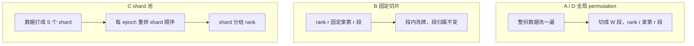

> **系列导航**：数据 pipeline 系列第 01 篇。
> 站内相关：[分布式训练（01）数据并行 DDP](/2026/08/31/dist-train-01-data-parallel/) ·
> [分布式训练（07）集合通信地基](/2026/08/31/dist-train-07-collective-comm/) ·
> [性能剖析（01）训练栈 profiling](/2026/09/29/profiling-01-training/)
>
> **TL;DR**
> 1. 「不重不漏」只能在**单 epoch 内**定义。跨 epoch 累计统计必然趋近 1，会把所有策略的差异抹平。
> 2. 分布式切分真正的病不是重复或遗漏，而是**每个 rank 的类别分布偏斜**。固定切片策略的覆盖率、
>    重复率都是满分，但类别分布的总变差距离是随机分配的 **12 倍** —— 用常规指标查不出这个 bug。
> 3. 偏斜程度由**数据自身的顺序相关性**决定，不是由代码决定：数据已打散时比值为 1.0，
>    严格按类分段时为 10.1。这解释了「同样没用分布式采样器，有人没事有人训崩」。
> 4. shard 是 cluster 不是样本。shard 数等于 rank 数时，每 epoch 重排 shard 也救不回来；
>    本设定下要 shard 数 ≈ 64 倍 rank 数才收敛到随机抽样的噪声基线。
> 5. 加载侧：worker 数的收益在越过 $$L/T_s \ge B/T_g$$ 之后**瞬间归零**，不存在「多加几个更保险」。
> 6. **独立的慢样本几乎不造成等待**（8 个 worker 卡 1 个，其余补得上，损失 0.1%）；
>    **成片的存储抖动直接掉 2.5%**。区别在于慢是独立的还是相关的。
> 7. **prefetch 深度在几乎所有配置下都没影响**。起作用的是生产盈余 $$\alpha$$：
>    从 1.00 提到 1.25，损失就从 2.5% 掉到 0。先配 worker 盈余，prefetch 保持默认。

---

## 0. 符号表

| 符号 | 含义 |
|:---|:---|
| $$N$$ | 数据集样本总数 |
| $$W$$ | 数据并行的 rank 数（world size） |
| $$B$$ | 一个 step 消费的样本数（global batch，已经按 rank 摊过之后是 $$B/W$$） |
| $$L$$ | 数据加载的 worker 进程数（`num_workers`） |
| $$T_s$$ | 单个样本的生产耗时（读盘 + 解码 + 变换） |
| $$T_g$$ | 一个 step 的计算耗时 |
| $$P$$ | prefetch 深度，buffer 容量为 $$P \cdot B$$ |
| $$p$$ | 独立慢样本的发生率（按样本数计） |
| $$k$$ | 慢样本相对正常样本的耗时倍数 |
| $$q$$ | 慢窗口占**时间**的比例（按时间计，与 $$p$$ 不同） |
| $$\alpha$$ | 生产盈余，$$= (L/T_s) \div (B/T_g)$$ |
| $$D_{\rm TV}$$ | 两个离散分布的总变差距离，$$0.5\sum_c \lvert p_c - q_c\rvert$$ |

---

## 1. 为什么这一层长期没人写

分布式训练的公开讨论集中在两件事上：怎么切模型（张量并行、流水并行、专家并行），
以及怎么同步（All-Reduce、ZeRO、通信重叠）。这两件事有漂亮的数学，也有清晰的
性能模型 —— 下标怎么拆、气泡有多大、带宽要多少，都能推导。

数据这一层不一样。它的核心问题是**顺序、缓存和存储**，这三个东西的共同特点是：
没有漂亮的闭式解，而且**行为高度依赖数据集本身的排列方式与集群的瞬时状态**。
于是它通常以口头经验的形式流传：「worker 数设成 CPU 核数」「数据先打散」「用
webdataset 别用小文件」。这些建议大多数时候是对的，但说不清为什么对、什么时候失效。

本文的思路是：把能建模的部分建模，把能测的部分测出来。两个可复算实验（纯 CPU、numpy）
分别回答**切分的正确性**和**加载的吞吐**，所有数字都出自实验，不出自经验。

一个前置判断：这一层值得单独写，是因为**它的失效模式是静默的**。模型切错了会 OOM 或
结果不对，立刻能发现；数据切错了可能只是让每个 rank 在单一分布上训练，loss 照样往下掉，
等到评测时才发现某一类样本全面退化 —— 而那时没人会想到是数据加载的问题。

---

## 2. 一次训练 step 的完整数据路径

先把时间线摆出来，后面每一节的结论都能挂到这条线的某一段上。

一条 step 的时间可以粗略拆成两段：

$$T_{\rm step} = \max(T_{\rm data},\; T_{\rm compute}) \quad\text{当二者不重叠时}$$

其中 $$T_{\rm data} = B \cdot T_s / L$$（$$L$$ 个 worker 并行生产 $$B$$ 个样本），
$$T_{\rm compute} = T_g$$。若加载与计算重叠（生产在 GPU 计算期间继续进行），
则 $$T_{\rm step} \approx \max(B T_s / L,\; T_g)$$ 只在稳态成立，
瞬时的落后要靠 buffer 吸收 —— §7 和 §8 会说明 buffer 什么时候吸得住、什么时候吸不住。

**这条线上有四个独立的失效点**：

1. **分配**（A）：哪个 rank 拿哪些样本 —— §3~§6 的主题。
2. **读盘**（B）：顺序还是随机，本地还是远端 —— §9 会回到这里。
3. **生产速率**（C+D）：worker 够不够 —— §7。
4. **长尾**（B）：偶发的慢 —— §8。

注意 1 和 3/4 是完全不同性质的两个问题：前者是**正确性**，错了不会报错；
后者是**性能**，错了只是慢。把它们分开看，是因为它们的检测手段完全不同。

---

## 3. 分布式切分：「不重不漏」该在哪一层定义

### 3.1 四种切分策略

设数据集 $$N$$ 条、$$W$$ 个 rank。常见的四种做法：

| 代号 | 做法 | 典型出处 |
|:---|:---|:---|
| **A** | 全局 permutation 后按 rank 切片，尾部补齐（padding） | `DistributedSampler(drop_last=False)` |
| **D** | 全局 permutation 后按 rank 切片，尾部丢弃 | `DistributedSampler(drop_last=True)` |
| **B** | 每个 rank 固定拿一段连续切片，切片内 shuffle，归属不随 epoch 变 | 「忘了用 sampler」的典型结果 |
| **C** | shard 池，每 epoch 重排 shard 再分给 rank，shard 内 shuffle | webdataset / 流式数据集 |

### 3.2 「不重不漏」必须在单 epoch 内定义

直觉上，检验一个切分策略对不对，是看「所有样本都被看到了吗」和「有样本被重复看吗」。
但这两个指标的定义粒度必须选对。

**跨 epoch 累计**统计是没有意义的：只要跑够多个 epoch，任何策略的累计覆盖率都会趋近 1，
因为每个 epoch 都会重新洗牌。实测中，把四种策略跑 3 个 epoch 后累计覆盖率**全部是 1.000**，
差异被完全抹平。

正确的粒度是**单 epoch 内**：

- **不漏** = 一个 epoch 内被任一 rank 消费的样本占全集的比例；
- **不重** = 一个 epoch 内被两个及以上 rank 消费的样本占比。

在 $$N=1000$$、$$W=8$$、4 个类别的设定下实测：

| 策略 | 覆盖率 | 重复率 | 跨 epoch 视野重合 |
|:---|:---:|:---:|:---:|
| A 全局 perm + padding | 1.000 | 0.000 | 0.140 |
| D 全局 perm + drop_last | 1.000 | 0.000 | 0.140 |
| B 固定切片 | 1.000 | 0.000 | **1.000** |
| C shard 池（64 个） | 1.000 | 0.000 | 0.129 |

> 本表的 $$N$$ 恰好能被 $$W$$ 整除，所以 A 的 padding 数和 D 的丢弃数都是 0，重复率与覆盖率
> 看不出差异；$$N$$ 不整除时的对比见 §3.3。

**这张表最重要的信息是：四种策略的「不重不漏」全部满分。** 覆盖率 1.000、重复率 0.000，
一个都查不出问题。唯一暴露差异的是最后一列 —— B 的跨 epoch 视野重合是 1.000，
意思是 rank 0 在每个 epoch 看到的都是**同一批样本**，视野完全冻结。

但这仍然只是「不优雅」，看起来不至于让训练崩掉。真正的病在下一节。

### 3.3 padding 与 drop_last：代价不在样本数，在 step 数

当 $$N$$ 不能被 $$W$$ 整除时（余数记作 $$r$$），A 和 D 的做法不同：

| $$N$$ | $$W$$ | 余数 $$r$$ | A 补齐数 | A 的 step 数 | D 丢弃数 | D 的 step 数 | step 数差 |
|---:|---:|---:|---:|---:|---:|---:|---:|
| 1000 | 8 | 0 | 0 | 125 | 0 | 125 | 0 |
| 1001 | 8 | 1 | 7 | 126 | 1 | 125 | 1 |
| 1023 | 8 | 7 | 1 | 128 | 7 | 127 | 1 |
| 1024 | 8 | 0 | 0 | 128 | 0 | 128 | 0 |
| 4097 | 8 | 1 | 7 | 513 | 1 | 512 | 1 |

样本层面的代价都是 $$O(r)$$，而 $$r < W$$，相对 $$N$$ 完全可以忽略。真正被改变的是
**一个 epoch 有多少个 step**：A 比 D 多 $$\lceil r/W\rceil$$ 个。

这件事之所以重要，是因为它**静默地改变总步数**。如果训练配置是按 epoch 数反推
`max_steps`，或者 LR schedule 的总步数是照着某个 epoch 数算的，那么把
`drop_last` 从 False 改成 True（或反过来）会让总步数发生变化，而这类改动通常不会
被当作「改变了训练配置」来看待 —— 它看起来只是个数据整理的细节。

> PyTorch 的 `DistributedSampler` 在 `drop_last=False` 时的补齐行为见
> [官方文档 `torch.utils.data.distributed.DistributedSampler`](https://pytorch.org/docs/stable/data.html#torch.utils.data.distributed.DistributedSampler)。

---

## 4. 分布偏斜：那个常规指标查不出的 bug

### 4.1 换一个指标

既然覆盖率、重复率都查不出问题，就得换一个能查的。考虑一个极其常见的情形：

**数据集是按类别（或按来源、按采集批次）分段排列的。**

这不是假设，是常态。数据往往按来源文件拼接：爬回来的网页按站点分批，图像数据按
采集设备分批，多语种语料按语言分批。于是「连续的 $$m$$ 条样本属于同一类」是默认状态。

在这种数据上，切分策略决定的是**每个 rank 看到的类别分布**。用总变差距离度量：

$$D_{\rm TV}(p^{(r)}, \bar{p}) = \frac{1}{2}\sum_{c} \left\lvert p^{(r)}_c - \bar{p}_c \right\rvert$$

其中 $$\bar{p}$$ 是全局类别分布，$$p^{(r)}$$ 是 rank $$r$$ 看到的分布。

### 4.2 噪声基线：TV 不会是 0

先明确一件事：即使分配是完美随机的，$$D_{\rm TV}$$ 也不为 0。rank $$r$$ 只拿到
$$m = N/W$$ 条样本，抽样本身就有噪声。类别 $$c$$ 的计数 $$X_c \sim {\rm Binomial}(m, \bar{p}_c)$$，
二项分布的平均绝对偏差

$$\mathbb{E}\lvert X - mq\rvert \approx \sqrt{\frac{2mq(1-q)}{\pi}}$$

于是

$$\mathbb{E}[D_{\rm TV}] \approx \frac{1}{2}\sum_c \sqrt{\frac{2\bar{p}_c(1-\bar{p}_c)}{\pi m}}$$

在 $$m = 125$$、4 类均匀分布时，这个基线是 **0.0618**。

**必须先跟基线比，否则会把噪声误读成偏斜。** 后面所有表都给出「TV/噪声」的比值：
1 附近说明纯随机，远大于 1 说明分配真的偏了。

### 4.3 实测：分水岭在这里

$$N=1000$$、4 类、按类别严格分段、$$W=8$$：

| 策略 | TV 均值 | TV 最大 | **TV/噪声** |
|:---|:---:|:---:|:---:|
| A 全局 perm + padding | 0.058 | 0.092 | **1.5** |
| D 全局 perm + drop_last | 0.058 | 0.092 | **1.5** |
| B 固定切片 | 0.750 | 0.750 | **12.1** |
| C shard 池（64 个） | 0.173 | 0.252 | **4.1** |

分水岭出现了。A/D 的比值是 1.5（纯随机，8 个 rank 取最大所以略高于 1），
**B 是 12.1** —— 每个 rank 几乎只在单一类别上训练。

而 B 在 §3.2 那张表里的覆盖率、重复率**全部是满分**。

这就是本文最想说的一点：

> **用「不重不漏」这类指标根本查不出这个 bug。** 必须按类别（或按来源、按任何有
> 语义的分层维度）去测每个 rank 的分布，才看得到。

实践含义很直接：如果你没法确定数据集的排列顺序是否被打散过，就应当在训练启动时
**按分层维度统计每个 rank 的样本分布**，而不是只看总数对不对。这个检查的成本极低，
而它要防的失效模式是静默的。

---

## 5. 偏斜程度由数据决定，不由代码决定

§4 的结论有个隐含前提：数据严格按类别分段。真实数据的顺序相关性有多强？

用「块大小 $$b$$」参数化：每 $$b$$ 条连续样本同属一个类别，块的类别随机。
$$b=1$$ 是完全打散，$$b = N/4$$ 是严格按类分段。

固定切片策略 B 与全局随机策略 A 的对比：

| 块大小 $$b$$ | 含义 | B 的 TV 均值 | **B 的 TV/噪声** | A 的 TV 均值 | A 的 TV/噪声 |
|---:|:---|:---:|:---:|:---:|:---:|
| 1 | 完全随机排列 | 0.061 | **1.0** | 0.052 | 0.8 |
| 8 | 轻度成块 | 0.147 | **2.4** | 0.064 | 1.0 |
| 32 | 中度成块 | 0.327 | **5.3** | 0.064 | 1.0 |
| 128 | 重度成块 | 0.627 | **10.1** | 0.054 | 0.9 |
| 250 | 严格按类分段 | 0.625 | **10.1** | 0.051 | 0.8 |

两条曲线：B 的比值随 $$b$$ 单调上升（1.0 → 10.1），A 始终在 1 附近，**与 $$b$$ 完全无关**。

这解释了一个长期存在的困惑：

> 同样的「忘了用 DistributedSampler」写法，有人跑得好好的，有人训崩了。
> **差别不在代码，在数据集本身的排列顺序。**

如果数据在上游已经被随机打散过（$$b$$ 很小），固定切片是安全的；如果数据按来源
拼接成块（$$b$$ 很大），同样的代码会让每个 rank 只看单一分布。

这也给出了一条比「记得用 DistributedSampler」更本质的判据：

**风险 = 数据的成块程度 × 切片的粒度。** 减小任一项都能降低风险 —— 要么打散数据，
要么用全局采样器。只看代码是否「正确」是不够的。

---

## 6. shard 是 cluster，不是样本

webdataset 这类方案把数据打成若干 shard（tar 包），训练时把 shard 分给 rank，
每个 epoch 重排 shard 顺序。直觉上「每 epoch 重排」就解决了 §4 的问题 —— 实测表明
**只解决了一半**。

关键在于 shard 是**连续打包**的：一个 shard 里是连续一段样本，因此整个 shard 的
类别高度同质。这使 shard 成为一个 **cluster**，分配 shard 属于**整群抽样**，
其方差显著大于逐样本抽样。

shard 数扫描（$$W=8$$，数据严格按类分段，每 rank 拿到 $$k = S/W$$ 个 shard）：

| shard 数 $$S$$ | 每 rank 的 shard 数 | TV 最大 | **TV/噪声** |
|---:|---:|:---:|:---:|
| 8 | 1 | 0.750 | **12.1** |
| 16 | 2 | 0.750 | **12.1** |
| 32 | 4 | 0.500 | **8.1** |
| 64 | 8 | 0.252 | **4.1** |
| 128 | 16 | 0.373 | **6.0** |
| 256 | 32 | 0.199 | **3.2** |
| 512 | 64 | 0.118 | **1.9** |

三个观察：

1. **$$S = W$$ 时完全退化**：每 rank 拿到 1 个 shard，而 shard 是单一类别，于是退化成 §4 的
   固定切片，比值同样是 12.1。**「每 epoch 重排 shard」在这种情况下毫无作用** ——
   重排只是换了哪个 rank 拿哪个类别，每个 rank 内部仍然是单一类别。
2. **收敛需要远超直觉的 shard 数**。本设定下比值降到 2 以内需要 $$S \approx 64W$$。
   注意这依赖「4 类、严格分段」这个相当极端的设定；真实数据的顺序相关性弱于此，
   需要的 shard 数相应更少（见 §5 的 $$b$$ 扫描来折算）。
3. **曲线不单调**（$$S=128$$ 的比值 6.0 高于 $$S=64$$ 的 4.1）。这部分是统计噪声：
   每个 rank 只抽 125 条，类别计数的方差不小。**看趋势，不要按单点数值决策。**

结论的性质和 §5 一致：

> 「把数据切成多少个 tar」**不是存储问题，是统计问题**。切得太少，整群抽样的方差
> 会让每个 rank 的分布偏掉，而重排 shard 掩盖不了这件事。

---

## 7. 加载流水线：稳态上界与 worker 数的收益曲线

切分正确之后，剩下的都是吞吐问题。

### 7.1 稳态解析解

设 $$L$$ 个 worker 并行生产，单样本耗时 $$T_s$$；GPU 每 step 消费 $$B$$ 个样本、耗时 $$T_g$$。
无随机性时：

$$R_{\rm prod} = \frac{L}{T_s}, \qquad R_{\rm cons} = \frac{B}{T_g}$$

$$\text{吞吐} = \min(R_{\rm prod},\; R_{\rm cons}), \qquad \text{GPU 空闲率} = \max\left(0,\; 1 - \frac{R_{\rm prod}}{R_{\rm cons}}\right)$$

离散事件模拟在无抖动时必须与这个解析解吻合 —— 实验里写成了断言（误差 < 1%），
这是对模拟本身正确性的校验。

### 7.2 worker 数的收益是「阶跃」的

固定 $$B = 64$$、$$T_g = 0.5\,\text{s}$$（消费速率 128 样本/秒）、$$T_s = 0.04\,\text{s}$$：

| $$L$$ | 生产速率 | 产/消 | 解析空闲率 | 模拟空闲率 | 瓶颈 |
|---:|---:|---:|---:|---:|:---|
| 1 | 25 | 0.20 | 0.805 | 0.805 | loader |
| 2 | 50 | 0.39 | 0.609 | 0.609 | loader |
| 4 | 100 | 0.78 | 0.219 | 0.219 | loader |
| 8 | 200 | 1.56 | 0.000 | 0.000 | **GPU** |
| 16 | 400 | 3.12 | 0.000 | 0.000 | GPU |
| 32 | 800 | 6.25 | 0.000 | 0.000 | GPU |
| 64 | 1600 | 12.50 | 0.000 | 0.000 | GPU |

收益曲线是**阶跃**的，不是渐进的：

- 在 $$L/T_s < B/T_g$$ 区间，加 worker 的收益接近线性（空闲率 0.805 → 0.609 → 0.219）；
- 越过 $$L/T_s \ge B/T_g$$ 这条线之后，空闲率已经归零，再加 worker **一点用都没有**。

实践含义：

> **不存在「多加几个 worker 更保险」这回事。** 越过临界点之后多配的 worker 只是白占
> CPU 和内存，还增加了进程间通信开销（本模型没有建模这部分，所以真实收益只会更差）。

这也说明 $$L$$ 的正确取值由 $$T_s$$ 和 $$T_g$$ 决定，而 $$T_s$$ 取决于样本大小、
解码复杂度和存储延迟 —— 跟「CPU 核数」没有直接关系。核数是上限约束，不是推荐值。

### 7.3 无随机性时，prefetch 无用

在生产速率恰好等于消费速率（$$\alpha = 1.0$$）且无抖动的设定下，扫描 prefetch 深度：

| $$P$$ | buffer 容量 | 空闲率 |
|---:|---:|---:|
| 1 | 64 | 0.000 |
| 2 | 128 | 0.000 |
| 4 | 256 | 0.000 |
| 8 | 512 | 0.000 |
| 16 | 1024 | 0.000 |

全部为 0，而且本来就是 0 —— 无随机性的系统里没有波动需要吸收，buffer 加大只是把
等待挪到前面，总量不变。**prefetch 的价值完全来自随机性**，下一节开始引入随机性。

---

## 8. 慢，是独立的还是成片的

### 8.1 两种慢法

「偶发的慢」有两种截然不同的形态，区分它们是本节的关键：

| | 独立慢样本 | 成片慢窗口 |
|:---|:---|:---|
| 建模 | 每个样本**各自**以概率 $$p$$ 变慢 $$k$$ 倍 | 占时间比例 $$q$$ 的窗口内，**所有 worker 一起**慢 $$k$$ 倍 |
| 物理来源 | 单条解码异常、单条冷缓存未命中 | 存储抖动、网络重传、对象存储限流、元数据风暴 |
| 配平公式 | 平均耗时 $$T_s(1 + p(k-1))$$ | 平均速率 $$=\frac{L}{T_s}\left(1 - q + \frac{q}{k}\right)$$ |

> **配平公式用错会让整个实验失效。** 慢窗口是**按时间**切的，配平必须走速率的时间加权
> $$(1-q+q/k)$$；若误用按样本数加权的 $$(1+q(k-1))$$，正常窗口的速率会被配成消费速率的
> 1.9 倍，所有抖动都被盈余掩盖，测不出任何饥饿。这个坑踩过一次，记在实验脚本注释里。

### 8.2 实测对照

两种慢法都把 worker 数配平到「按均值刚好够」（$$\alpha = 1.0$$）：

| 慢法 | $$P$$ | 空闲率 | 吞吐 | 吞吐损失 |
|:---|:---:|---:|---:|---:|
| 独立慢样本 $$p=2\%$$, $$k=20$$ | 1 | 0.001 | 127.8 | **0.1%** |
| 独立慢样本 $$p=2\%$$, $$k=20$$ | 4 | 0.001 | 127.8 | **0.1%** |
| 成片慢窗口 $$q=10\%$$, $$k=10$$ | 1 | 0.025 | 124.8 | **2.5%** |
| 成片慢窗口 $$q=10\%$$, $$k=10$$ | 2 | 0.025 | 124.8 | 2.5% |
| 成片慢窗口 $$q=10\%$$, $$k=10$$ | 4 | 0.025 | 124.8 | 2.5% |
| 成片慢窗口 $$q=10\%$$, $$k=10$$ | 8 | 0.025 | 124.8 | 2.5% |
| 成片慢窗口 $$q=10\%$$, $$k=10$$ | 16 | 0.025 | 124.8 | 2.5% |

**性质上的差别：**

- **独立慢样本几乎不造成等待。** 2% 的样本慢 20 倍，一个 batch 有 64 条，「batch 里至少
  有一条慢」的概率是 $$1-(1-0.02)^{64} \approx 72\%$$ —— 看起来很吓人，但实测损失只有 0.1%。
  原因是 **8 个 worker 里卡住 1 个，其余 7 个的生产能力足以补上**。
  多 worker 天然抗单点长尾。
- **成片慢窗口立刻掉 2.5%。** 慢的那一刻所有 worker 一起慢，生产速率掉到 1/10，
  没有谁能补谁，GPU 只能干等。
- **prefetch 对两种慢法都没用**（$$P$$ 从 1 到 16，损失稳定在 2.5%）。原因见 §8.3。

### 8.3 为什么 prefetch 救不了，什么能救

关键在盈余。按均值配平（$$\alpha = 1.0$$）时，正常窗口的生产速率只比消费速率高约 9%
（因为慢窗口吃掉了其余的产能）。这么小的盈余，填满一个深 buffer 需要上百个 step，
而慢窗口平均每 10 个 step 就来一次 —— **buffer 从来没被填满过，加大容量自然没用**。

$$\alpha$$（$$=$$ 正常窗口生产速率 $$\div$$ 消费速率）与 $$P$$ 的联合扫描：

| $$\alpha$$ | $$P{=}1$$ | $$P{=}2$$ | $$P{=}4$$ | $$P{=}8$$ |
|---:|:---|:---|:---|:---|
| 1.00 | 2.5% 空闲 | 2.5% | 2.5% | 2.5% |
| 1.25 | 0.0% 空闲 | 0.0% | 0.0% | 0.0% |
| 1.50 | 0.0% 空闲 | 0.0% | 0.0% | 0.0% |
| 2.00 | 0.0% 空闲 | 0.0% | 0.0% | 0.0% |
| 3.00 | 0.0% 空闲 | 0.0% | 0.0% | 0.0% |

> 这张表推翻了写实验前的预期（原本预期 prefetch 会起主要作用），数据说什么就记什么。

三个结论：

1. **起作用的只有 $$\alpha$$。** 从 1.00 提到 1.25，损失就从 2.5% 掉到 0。再多给
   （$$\alpha = 2, 3$$）没有额外收益 —— 25% 的盈余已经足够吸收这个量级的抖动。
2. **prefetch 深度在所有 $$\alpha$$ 下都没有影响**（每行四个数完全相同）。本模型里
   worker 是连续生产的，GPU 等待期间 prefill 阶段也在生产，buffer 的「额外深度」
   从来没被用上。**瓶颈是生产速率，不是 buffer 容量。**
3. 配置顺序因此是：**先把 worker 数配出 25% 以上的盈余，prefetch 保持默认**。
   反过来 —— buffer 开很大但 worker 不够 —— 是纯浪费内存。

---

## 9. 抖动参数的量级

扫描 $$q$$ 与 $$k$$（$$\alpha = 1.0$$ 按均值配平，$$P = 2$$）：

| $$q$$（时间占比） | $$k$$（倍数） | 空闲率 | 吞吐 | 吞吐损失 |
|---:|---:|---:|---:|---:|
| 0.00 | 1.0 | 0.000 | 128.0 | 0.0% |
| 0.05 | 5.0 | 0.019 | 125.6 | 1.9% |
| 0.05 | 10.0 | 0.024 | 124.9 | 2.4% |
| 0.10 | 5.0 | 0.019 | 125.6 | 1.9% |
| 0.10 | 10.0 | 0.025 | 124.8 | 2.5% |
| 0.20 | 10.0 | 0.016 | 126.0 | 1.6% |
| 0.30 | 10.0 | 0.031 | 124.0 | 3.1% |

**这张表不单调**（$$q=0.20$$ 的损失低于 $$q=0.10$$），本步数下噪声量级约 1 个百分点。
不要按单点数值做配置决策，要看的是量级：

> 只要存在成片的存储抖动，按均值配平的 dataloader 会**稳定损失 2%~3% 的吞吐**。

这个数字值得放在训练成本里算一笔：一个跑两周的千卡任务，3% 的吞吐损失对应的
机时成本是相当可观的 —— 而修它的代价只是把 worker 数提高 25%。

回到 §8.3：对策是配盈余（$$\alpha \ge 1.25$$），不是堆 prefetch。削掉抖动本身
（本地 SSD 缓存、预热、批量拉取、避免海量小文件）当然更好，但那是存储层的事，
不在本文模型的范围内 —— 本文没有对存储层做实验，因此不对其给出量化结论。

---

## 10. 检查单与边界

### 10.1 可执行检查单

按「能查出静默失效」排序：

| # | 检查 | 查的是什么 | 成本 |
|:---|:---|:---|:---|
| 1 | 按语义维度（类别 / 来源 / 语言）统计**每个 rank** 的样本分布，与全局分布比 $$D_{\rm TV}$$ | §4 的分布偏斜 —— 唯一能查出来的手段 | 极低 |
| 2 | 打印每个 rank 每 epoch 的样本集合，看跨 epoch 是否变化 | §3.2 的视野冻结 | 低 |
| 3 | 核对 `drop_last` 的取值与总 step 数的一致性 | §3.3 的 step 数错位 | 低 |
| 4 | 统计 shard 数 $$S$$ 与 rank 数 $$W$$ 的比值，$$S/W$$ 是否 >= 8（越大数据越有序则要求越高） | §6 的整群抽样方差 | 低 |
| 5 | 实测 $$T_s$$ 的分布（不只是均值），估出 $$L$$ 使 $$\alpha \ge 1.25$$ | §8 的长尾 | 中 |

第 1 项是本文最想留下的：它的成本几乎为零，而要防的失效模式是静默的、且用常规指标查不出。

### 10.2 批判与本模型的边界

诚实列出这套结论不能外推到哪里：

1. **§8 的 prefetch 结论限定在本模型内。** 模型里 worker 连续生产、没有 batch 边界、
   没有 IPC（进程间传递张量）开销。真实 DataLoader 的 worker 要跨进程传递 batch 张量，
   prefetch 的作用机制包含「隐藏 IPC 延迟」，本模型没有这一项。所以这里的结论是
   **「在本模型下 prefetch 无用」**，不等于「真实系统的 prefetch 无用」。
2. **§6 的 $$S \approx 64W$$ 依赖「4 类、严格分段」的极端设定。** 真实数据用 §5 的块大小
   $$b$$ 折算：数据越接近随机（$$b$$ 小），需要的 shard 数越少。
3. **§9 的扫描不单调**，噪声约 1 个百分点。只看量级。
4. **没有建模的部分**：page cache 命中率、多机同时读同一份数据的元数据风暴、
   checkpoint 写与数据读的 I/O 争抢、样本大小从 KB 到 MB 后的行为变化。
   这些都需要各自的实验支撑，本文不做无根据的外推。
5. 所有数字来自合成数据的模拟，**不是真实集群的实测**。模拟的价值在于把机制讲清楚、
   把量级定下来；真实系统的绝对值会不同。

---

## 附录：实验复现

两个实验都是纯 CPU、只用 numpy，种子固定，输出已固化：

- `01-distributed-shuffle` —— 四种切分策略的正确性与分布偏斜；shard 数扫描；块大小扫描
- `02-loader-pipeline` —— 稳态解析解校验；worker 数扫描；两种慢法对照；盈余 × prefetch 扫描

代码在 [ipynbs 仓库的 `experiments/data-pipeline/`](https://github.com/lrypcy/ipynbs/tree/main/experiments/data-pipeline)，
`results/stdout.txt` 里是固化输出，直接读即可，不需要自己跑。

每个脚本内置构造真值 ↔ 反算值的自校验，失败直接抛错：

- 01：padding/drop 数量反算、单 step 内跨 rank 不重、shard 视野不越界、$$D_{\rm TV}$$ 上下界断言
- 02：无抖动时模拟与解析解吻合 < 1%、期望耗时公式的蒙特卡洛反算、慢样本发生率反算

---

**上一篇**：[分布式训练（08）组合实战](/2026/08/31/dist-train-08-combined-practice/)
**下一篇**：待定（数据 pipeline 系列第 02 篇：存储层与 I/O 争抢，需要有实验支撑后再动笔）
