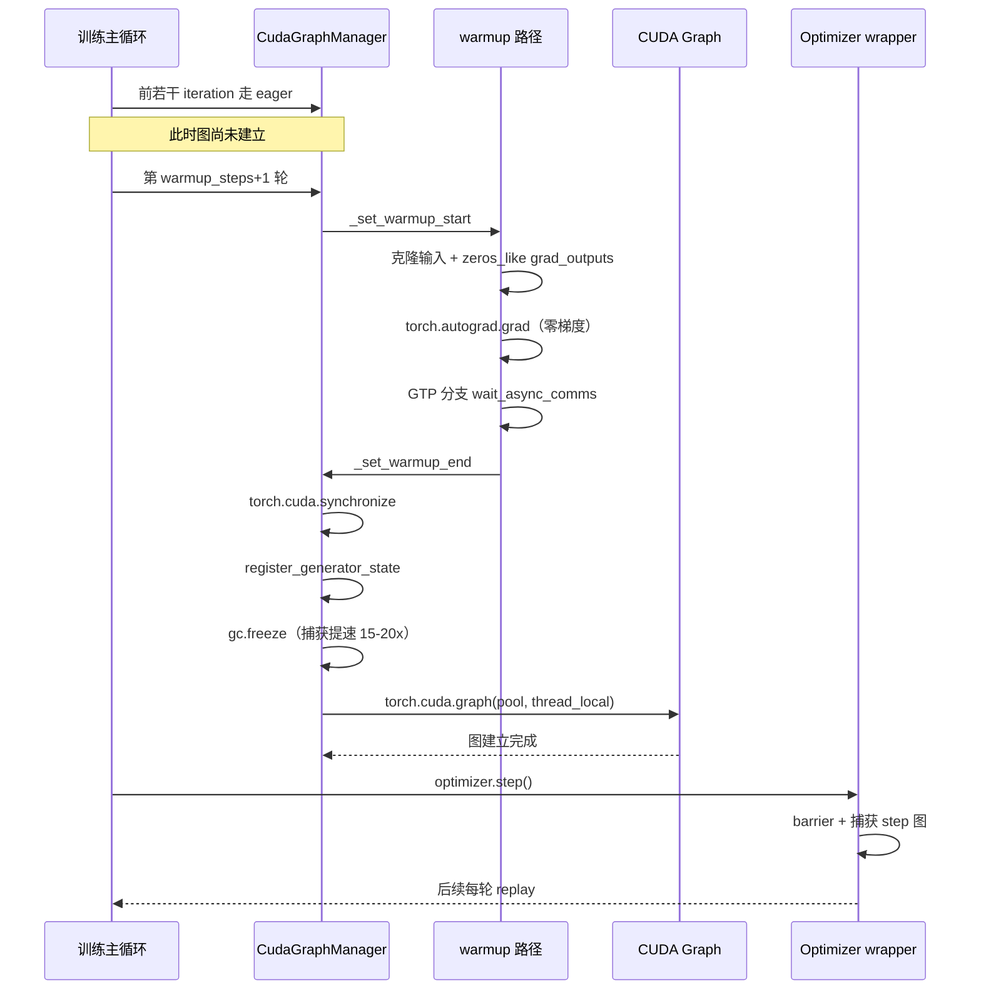

> 源码基准：`megatron-core` **0.20.0**，commit [`60e039626`](https://github.com/NVIDIA/Megatron-LM/tree/60e039626)。本文所有行号均对该 commit 取证。
> 配套实验：[`ipynbs` commit `9d884fa`](https://github.com/lrypcy/ipynbs/tree/9d884fa) 的 `experiments/megatron/cuda_graph/`（A 级解析脚本 + 固化输出）。

CUDA Graph 这个题目，资料里已经有很多。Transformer Engine 有专门一节讲它和 Megatron-LM 的三套实现，PyTorch 官方文档把 stream capture 的语义与限制写得很细，甚至已经有专门讲「PyTorch 里怎么把 CUDA Graph 用对」的编译框架论文。

所以本文不打算再讲一遍「CUDA Graph 是什么」。它要回答的是一个更窄、也更难的问题：

**在 Megatron-LM 0.20.0 这份源码里，一个训练 step 到底能被打包进图，打包到哪一层，剩下的东西靠什么机制活着。**

「剩下的东西」这四个字是重点。CUDA Graph 最容易被写成「把 step 图化」，但 3311 行的 `cuda_graphs.py` 里真正 majority 的篇幅不是关于「怎么捕获」，而是关于「捕获之后那些不能进图的东西怎么和图共存」——共享内存池、静态 buffer、指针稳定性、梯度快照、RNG 状态、side stream 的等待点。这些才是 hang 的来源。

本文要做四件事：

1. 把三档粒度（`local` / `transformer_engine` / `full_iteration`）落到真实的判定入口上，并给出一个**对研究计划书的实质性纠正**：计划书把 `--cuda-graph-scope` 当作训练开关列了出来，但这个名字在这个 commit 上已经是隐藏的弃用别名。
2. 把内存池与 buffer 复用的账算清楚——包括「哪些张量可以弱引用、哪些必须强引用」这条线，它直接对应 replay 时的段错误。
3. 单独写一节 `optimizer_cuda_graph.py` 那 68 行。它不是「给优化器加个图」，而是把整个优化器切到 capturable 模式。
4. 用 A 级解析脚本给出**可复算的 launch 计数**，并严格区分 CPU 侧 launch 数与 device 侧 kernel 执行数。

---

> **TL;DR**
>
> 1. **图化粒度由 `--cuda-graph-impl` 决定，不是 `--cuda-graph-scope`。** 后者在本 commit 上是 `argparse.SUPPRESS` 的隐藏弃用别名，在 `arguments.py` 里被改写成 `cuda_graph_modules`。真正与它名字相近、却分属另一条线的 `--inference-cuda-graph-scope` 才是推理侧的。
> 2. **CUDA Graph 省的是 CPU 侧 launch，不是 device 侧计算。** 按 §1 的算术清单（32 层 × 8 microbatch），CPU 侧从 6656 次 / step 降到 512 次，device 侧 kernel 执行次数**一个不少**。把它写成「kernel 变少」是错的。
> 3. **集合通信不是「不能进图」，而是「进图后 buffer 归谁管」。** GTP 的做法是把 wgrad ring slot **显式排除在共享图池之外**，理由写在源码注释里：留在池内会让独立 replay 的图把在飞的 reduce-scatter 输入当成临时工作区复用。
> 4. **能不能弱引用一个张量，取决于它的地址稳不稳定。** 只有 global mempool 里、地址由驱动固定的张量才做弱引用；其余一律强引用——replay 阶段被释放的张量会导致 use-after-free，这是「图化跑了几十个 step 才崩」的典型来源。
> 5. **`optimizer_cuda_graph` 是可用性开关而非性能开关。** 它的唯一作用是把 `capturable=True` 传进优化器构造，让 Adam 的 `step` 能被 capture；68 行改的是优化器的可用性边界。

---

## §1 图化的边界条件

### §1.1 三档粒度，以及训练侧开关的三次改名

CUDA Graph 在 Megatron-LM 里有三档粒度。官方把三者的对照列在一张表里
（[CUDA Graph Best Practice for PyTorch — TE and Megatron-LM](https://docs.nvidia.com/dl-cuda-graph/torch-cuda-graph/te-megatron-cuda-graphs.html)）：

| 维度 | TE `make_graphed_callables` | `CudaGraphManager` | `FullCudaGraphWrapper` |
| --- | --- | --- | --- |
| 范围 | 单个 callable（手工） | 单层 / 单模块 | 整个 iteration |
| 捕获时机 | AOT（训练前） | JIT（warmup 步之后） | JIT（warmup 步之后） |
| 图数量 | 用户指定 | 每层每 microbatch 一张 | 少量（training + validation） |
| 灵活性 | 最高 | 高 | 低（全有或全无） |

这张表说的是「粒度」，但它没有说**开关叫什么**。而开关这一层，恰恰是容易出错的地方——因为在这个 commit 上，**训练侧图化开关有过三个名字**。

```python
enable_cuda_graph: bool = False
"""DEPRECATED and replaced by cuda_graph_impl.
When set to true, either partial CUDA graph (1/many CUDA graph per layer) or full iteration
CUDA graph (1 CUDA graph for whole iteration excluding optimizer) is enabled. cuda_graph_modules
determines the scope of graph capture."""

cuda_graph_use_single_mempool: bool = True
"""For cuda_graph_impl "local" with cuda_graph_scope "full_iteration" only.

external_cuda_graph: bool = False
"""DEPRECATED and replaced by cuda_graph_impl.

cuda_graph_impl: Literal['none', 'local', 'transformer_engine', 'full_iteration'] = "none"
```

见 [`transformer_config.py` L1042-L1068](https://github.com/NVIDIA/Megatron-LM/blob/60e039626/megatron/core/transformer/transformer_config.py#L1042-L1068)。这段声明里能读出完整的一条迁移链，而**每一条旧名的 docstring 首行都写着 `DEPRECATED and replaced by cuda_graph_impl`**：

| 字段 | 行号 | 迁往 | 状态 |
| --- | --- | --- | --- |
| `enable_cuda_graph` | [L1042](https://github.com/NVIDIA/Megatron-LM/blob/60e039626/megatron/core/transformer/transformer_config.py#L1042) | `cuda_graph_impl="local"` | `DEPRECATED and replaced by cuda_graph_impl` |
| `cuda_graph_use_single_mempool` | [L1048](https://github.com/NVIDIA/Megatron-LM/blob/60e039626/megatron/core/transformer/transformer_config.py#L1048) | 仍是现行字段 | docstring 里却还在用旧名 `cuda_graph_scope` |
| `external_cuda_graph` | [L1064](https://github.com/NVIDIA/Megatron-LM/blob/60e039626/megatron/core/transformer/transformer_config.py#L1064) | `cuda_graph_impl="transformer_engine"` | `DEPRECATED and replaced by cuda_graph_impl` |
| `cuda_graph_impl` | [L1068](https://github.com/NVIDIA/Megatron-LM/blob/60e039626/megatron/core/transformer/transformer_config.py#L1068) | — | 现行字段，四档取值 |
| `cuda_graph_scope` | [L1122](https://github.com/NVIDIA/Megatron-LM/blob/60e039626/megatron/core/transformer/transformer_config.py#L1122) | `cuda_graph_modules` | `Deprecated: renamed to cuda_graph_modules` |

这张表里有两处细节值得单独拎出来。

**第一，`cuda_graph_use_single_mempool` 的 docstring 里，`cuda_graph_scope` 以旧名身份继续出现**（见 [`transformer_config.py` L1049](https://github.com/NVIDIA/Megatron-LM/blob/60e039626/megatron/core/transformer/transformer_config.py#L1049)，原文「For cuda_graph_impl “local” with cuda_graph_scope “full_iteration” only」）。但同一行的谓词已经写成了 `cuda_graph_impl`——新名字。这是弃用迁移留下的**半改痕迹**：字段本身还活着，它描述的那个开关却已经改名。而 `cuda_graph_scope` 真正作为独立字段存在是在 [L1122-L1130](https://github.com/NVIDIA/Megatron-LM/blob/60e039626/megatron/core/transformer/transformer_config.py#L1122-L1130)，docstring 明写 `Deprecated: renamed to cuda_graph_modules. Accepted for backward compatibility and migrated to cuda_graph_modules in __post_init__. Will be removed in a future release.`

**第二，三个旧名的迁移目标各不相同。** `enable_cuda_graph` → `local`（MCore 自研实现），`external_cuda_graph` → `transformer_engine`（走 TE），`cuda_graph_scope` → `cuda_graph_modules`。也就是说旧的两个布尔开关合起来正好是 `cuda_graph_impl` 四档里的中间两档。

迁移的实际代码在 `__post_init__`，而且带了两条互斥断言（[`transformer_config.py` L2676-L2692](https://github.com/NVIDIA/Megatron-LM/blob/60e039626/megatron/core/transformer/transformer_config.py#L2676-L2692)）：

```python
if self.enable_cuda_graph or self.external_cuda_graph:
    assert (
        self.cuda_graph_impl == "none"
    ), "Do not use enable_cuda_graph or external_cuda_graph with cuda_graph_impl."
    assert (
        not self.enable_cuda_graph or not self.external_cuda_graph
    ), "enable_cuda_graph and external_cuda_graph cannot be enabled at the same time."

    if self.enable_cuda_graph:
        warnings.warn('enable_cuda_graph is deprecated, use cuda_graph_impl=local instead.')
        self.cuda_graph_impl = "local"
    if self.external_cuda_graph:
        warnings.warn(
            'external_cuda_graph is deprecated, '
            'use cuda_graph_impl=transformer_engine instead.'
        )
        self.cuda_graph_impl = "transformer_engine"
```

两条断言的用意不同：第一条禁止**新旧混用**（同时设置会互相覆盖 `cuda_graph_impl`），第二条禁止**两个旧名同时设置**（它们映射到 `cuda_graph_impl` 的不同档位，无从决定谁优先）。这类「弃用也要断歧义」的断言，是判断一个弃用是否认真的标志——只 `warnings.warn` 是不够的。

**这就是本篇要写的第一个论点：一个 flag 的弃用要跨三处同步。** 同一个旧名在三个文件里各有一份落点：

| 落点 | 文件 | 做什么 |
| --- | --- | --- |
| 字段声明 | [`transformer_config.py` L1042-L1130](https://github.com/NVIDIA/Megatron-LM/blob/60e039626/megatron/core/transformer/transformer_config.py#L1042-L1130) | 保留字段 + `DEPRECATED` docstring |
| 迁移逻辑 | [`transformer_config.py` L2676-L2692](https://github.com/NVIDIA/Megatron-LM/blob/60e039626/megatron/core/transformer/transformer_config.py#L2676-L2692) | `__post_init__` 里改写 + 互斥断言 |
| CLI 告警 | [`arguments.py` L266-L292](https://github.com/NVIDIA/Megatron-LM/blob/60e039626/megatron/training/arguments.py#L266-L292) | 打印迁移提示并 `setattr` |
| 迁移表 | [`cuda_graph_config.py` L10-L13](https://github.com/NVIDIA/Megatron-LM/blob/60e039626/megatron/core/transformer/cuda_graph_config.py#L10-L13) | `CUDA_GRAPH_MODULES_DEPRECATIONS` |

CLI 那一处的写法值得看：

```python
for scope, attr, value in deprecated_scopes:
    migration = get_deprecated_cuda_graph_modules_migration(
        scope, attr, value, args.cuda_graph_impl
    )
    if migration is None:
        warn_rank_0(
            f"--cuda-graph-modules '{scope}' is deprecated and has no effect when "
            "--cuda-graph-impl=none. Use --cuda-graph-impl=local with "
            "--inference-cuda-graph-scope=block to enable inference CUDA graphs."
        )
        continue
    migration_attr, migration_value = migration
    warn_rank_0(
        f"--cuda-graph-modules '{scope}' is deprecated. "
        f"Setting --{migration_attr.replace('_', '-')}={migration_value} instead."
    )
    setattr(args, migration_attr, migration_value)
```

见 [`arguments.py` L276-L292](https://github.com/NVIDIA/Megatron-LM/blob/60e039626/megatron/training/arguments.py#L276-L292)。注意 `migration is None` 那条分支的措辞——**「has no effect」而不是「请改用 X」**。这对应迁移表里最微妙的一格：

```python
CUDA_GRAPH_MODULES_DEPRECATIONS = {
    'full_iteration': ('cuda_graph_impl', 'full_iteration'),
    'full_iteration_inference': ('inference_cuda_graph_scope', InferenceCudaGraphScope.block),
}
```

见 [`cuda_graph_config.py` L10-L13](https://github.com/NVIDIA/Megatron-LM/blob/60e039626/megatron/core/transformer/cuda_graph_config.py#L10-L13)。

**同一个旧串 `full_iteration`，可能迁往训练侧，也可能迁往推理侧**——`full_iteration` 本身迁 `cuda_graph_impl`，而 `full_iteration_inference` 迁 `inference_cuda_graph_scope`。这正是「弃用要跨三处同步」的实际风险：只改字段声明不改迁移表，旧名就会被静默吞掉。

### §1.1.1 训练与推理是两条正交的轴

`cuda_graph_impl` 的 docstring 把两件事说得很清楚（[`transformer_config.py` L1069-L1073](https://github.com/NVIDIA/Megatron-LM/blob/60e039626/megatron/core/transformer/transformer_config.py#L1069-L1073) 原文）：`"local"` 档下「During training, graphable modules own per-layer CUDA graphs controlled by cuda_graph_modules. During inference, graph ownership is controlled **separately** by inference_cuda_graph_scope.」

于是这里有**两个正交的旋钮**，而不是一个：

- 训练侧：`cuda_graph_modules`，取值是 `CudaGraphModule` 枚举（[`enums.py` L61-L73](https://github.com/NVIDIA/Megatron-LM/blob/60e039626/megatron/core/transformer/enums.py#L61-L73)）——`attn` / `mlp` / `moe` / `moe_router` / `moe_preprocess` / `mamba`。注意该枚举的 docstring 说明「Whole-layer capture is represented outside this enum by an empty scope」——整层捕获靠空 scope 表示，不占枚举值。
- 推理侧：`inference_cuda_graph_scope`，取值是 `InferenceCudaGraphScope`。

**但两轴的允许组合是一张白名单，不是笛卡尔积。** 这张表定义在 [`cuda_graph_config.py` L17-L22](https://github.com/NVIDIA/Megatron-LM/blob/60e039626/megatron/core/transformer/cuda_graph_config.py#L17-L22)：

```python
# Canonical mapping from cuda_graph_impl to the set of allowed inference granularities.
# Shared by transformer_config.__post_init__ and validate_args to avoid duplication.
ALLOWED_INFERENCE_SCOPES: dict[str, Set[InferenceCudaGraphScope]] = {
    "none": {InferenceCudaGraphScope.none},
    "local": {InferenceCudaGraphScope.layer, InferenceCudaGraphScope.block},
    "transformer_engine": {InferenceCudaGraphScope.none},
    "full_iteration": {InferenceCudaGraphScope.none},
}
```

三点值得说。

**第一，注释里的 `Shared by ... to avoid duplication` 是设计说明而非客套。** 同一张表被 `transformer_config.__post_init__` 与 `validate_args` 两处消费——前者管 dataclass 直构，后者管命令行参数。如果这张表在两处各写一份，它们早晚会漂移。

**第二，只有 `local` 档支持推理图化。** `transformer_engine` 与 `full_iteration` 两档都被钉死在 `{none}` 上，这与 `cuda_graph_impl` docstring 里那句「Inference CUDA graphs are not supported; inference_cuda_graph_scope must be “none”」互相印证。

**第三，`cuda_graph_impl="none"` 时推理 scope 也被钉死为 `none`**——尽管「不开图化」时推理 scope 本身也无从谈起，这里写成显式约束是为了让表成为**完备**的：`ALLOWED_INFERENCE_SCOPES[args.cuda_graph_impl]` 可以无分支地查表（见 [`arguments.py` L649-L653](https://github.com/NVIDIA/Megatron-LM/blob/60e039626/megatron/training/arguments.py#L649-L653)）。

顺带把 §1 那张三档对照表与本节对齐：`full_iteration` 档的 docstring 明写它捕获的是「1 CUDA graph for the whole forward-backward path **excluding the optimizer step**」（[`transformer_config.py` L1054-L1056](https://github.com/NVIDIA/Megatron-LM/blob/60e039626/megatron/core/transformer/transformer_config.py#L1054-L1056)）。这一句直接决定了 §6 的结论——optimizer 图化与 full iteration 图化管的是两段不同的代码。

### §1.1.2 与 `--cuda-graph-modules` 名字相近的推理 flag

真正与 `--cuda-graph-modules` 语义正交、却极易被混用的，是 `--inference-cuda-graph-scope`。它走完全独立的路径：`normalize_inference_cuda_graph_scope(args.inference_cuda_graph_scope, args.cuda_graph_impl)` 在 [`arguments.py` L299-L300](https://github.com/NVIDIA/Megatron-LM/blob/60e039626/megatron/training/arguments.py#L299-L300)，落地字段是 `inference_cuda_graph_scope`，消费者全在推理侧——[`dynamic_context.py` L665](https://github.com/NVIDIA/Megatron-LM/blob/60e039626/megatron/core/inference/contexts/dynamic_context.py#L665)、[`dynamic_engine.py` L304](https://github.com/NVIDIA/Megatron-LM/blob/60e039626/megatron/core/inference/engines/dynamic_engine.py#L304) 与 [L520](https://github.com/NVIDIA/Megatron-LM/blob/60e039626/megatron/core/inference/engines/dynamic_engine.py#L520)、[`gpt_model.py` L539](https://github.com/NVIDIA/Megatron-LM/blob/60e039626/megatron/core/models/gpt/gpt_model.py#L539)。

而 `--cuda-graph-modules` 自身在 CLI 上还有一层别名：[`arguments.py` L2024-L2026](https://github.com/NVIDIA/Megatron-LM/blob/60e039626/megatron/training/arguments.py#L2024-L2026) 把 `--cuda-graph-scope` 声明成 `help=argparse.SUPPRESS` + `dest='cuda_graph_scope_deprecated'` 的隐藏别名，并在 [L633-L641](https://github.com/NVIDIA/Megatron-LM/blob/60e039626/megatron/training/arguments.py#L633-L641) 改写后 `del` 掉。`--cuda-graph-modules` 的 help 文本则把角色说得很清楚——**训练**侧的 per-layer 捕获范围：

```python
group.add_argument('--cuda-graph-modules', nargs='+', type=_parse_cuda_graph_modules_arg, default=[],
                   help='Selects training capture coverage within per-layer CUDA graphs '
                   '(local and transformer_engine implementations). '
                   'Valid values are "attn", "mlp", "moe", "moe_router", "moe_preprocess", and "mamba": '
                   '"attn": captures operations in TransformerLayer._forward_attention(). '
                   '"mlp": captures operations in TransformerLayer._forward_mlp() for a dense layer. '
                   'An empty list means capturing the whole Transformer layer. '
                   'This field is meaningless when --cuda-graph-impl=full_iteration and must be empty. '
                   'Backward compatibility: "full" is deprecated but kept for backward compatibility; '
                   'it is transformed to an empty list in validate_args. The deprecated values '
                   '"full_iteration" and "full_iteration_inference" are also accepted and migrated '
                   'to the new API in validate_args.')
```

见 [`arguments.py` L2027-L2043](https://github.com/NVIDIA/Megatron-LM/blob/60e039626/megatron/training/arguments.py#L2027-L2043)。两处措辞值得停一下：

- 「An empty list means capturing the whole Transformer layer.」——**空列表是最激进的档位**，不是「什么都不做」。这也解释了 §1.2 里 `CudaGraphModule` 枚举为何不含「整层」这个值。
- 「`full_iteration` and `full_iteration_inference` are also accepted and migrated」——这两个串正是 §1.1 那张迁移表的两格，**同一个 `--cuda-graph-modules` 参数可以同时承载训练与推理两种迁移**，这是弃用期最容易出错的地方。

> **出处**：本节代码引自 commit `60e039626` 的 [`transformer_config.py` L1042-L1130](https://github.com/NVIDIA/Megatron-LM/blob/60e039626/megatron/core/transformer/transformer_config.py#L1042-L1130) 与 [L2676-L2692](https://github.com/NVIDIA/Megatron-LM/blob/60e039626/megatron/core/transformer/transformer_config.py#L2676-L2692)、[`arguments.py` L2024-L2043](https://github.com/NVIDIA/Megatron-LM/blob/60e039626/megatron/training/arguments.py#L2024-L2043) 与 [L266-L292](https://github.com/NVIDIA/Megatron-LM/blob/60e039626/megatron/training/arguments.py#L266-L292)、[`cuda_graph_config.py` L10-L22](https://github.com/NVIDIA/Megatron-LM/blob/60e039626/megatron/core/transformer/cuda_graph_config.py#L10-L22)、[`enums.py` L61-L73](https://github.com/NVIDIA/Megatron-LM/blob/60e039626/megatron/core/transformer/enums.py#L61-L73)；推理侧落点见 [`dynamic_engine.py` L520](https://github.com/NVIDIA/Megatron-LM/blob/60e039626/megatron/core/inference/engines/dynamic_engine.py#L520)。`cuda_graph_config.py` 全文 136 行，是本篇体量最小却约束最密的模块。

把四条路径并起来看，这个参数空间长这样：

| flag | 角色 | 存活状态 |
| --- | --- | --- |
| `--cuda-graph-impl` | 训练侧总开关（`none` / `local` / `transformer_engine` / `full_iteration`） | 在用 |
| `--cuda-graph-modules` | 训练侧 per-layer 捕获范围（`attn` / `mlp` / `moe` / `moe_router` / `moe_preprocess` / `mamba`） | 在用 |
| `--cuda-graph-scope` | `--cuda-graph-modules` 的旧名 | 隐藏弃用别名，解析后即 `del` |
| `--enable-cuda-graph` / `--external-cuda-graph` | `cuda_graph_impl` 的两个旧布尔名（对应 `local` / `transformer_engine`） | 弃用，与新名互斥 |
| `--inference-cuda-graph-scope` | 推理侧 scope（`none` / `layer` / `block`） | 在用，与训练侧正交 |

一对名字相近、语义正交的 flag 共存在同一个参数空间里，是这类「照着旧文档敲参数敲出静默错误」的温床。写 `--cuda-graph-scope` 不会报错，只会被静默改写成 `--cuda-graph-modules` 的值；而想开推理图化的人敲 `--cuda-graph-scope` 同样不会报错，只是拿到的语义完全不是自己要的。

Megatron Core 的官方文档也确认了这一分层：训练与推理是两条独立的轴，前者由 per-layer 捕获范围控制，后者由 `inference_cuda_graph_scope` 控制（[Megatron Core Overview](https://docs.nvidia.com/megatron-core/developer-guide/nightly/get-started/overview.html)）。工程实操侧的取舍与本文的 §4 呼应；库本身的定位与版本见 [Megatron-Core 项目页](https://developer.nvidia.com/megatron-core) 与 [PyPI 发布页](https://pypi.org/project/megatron-core)（0.19.2），文档总入口见 [Megatron Core Developer Guide](https://docs.nvidia.com/megatron-core/developer-guide/nightly/index.html)——文档在介绍并行策略与组合方式时也强调「组合需按配置逐项确认」，因为允许的组合正是一张白名单（[Megatron Core 用户指南](https://docs.nvidia.com/megatron-core/developer-guide/nightly/user-guide/index.html)）。

### §1.2 哪些层能被图化：`_layer_is_graphable` 的判定

能不能图化的第一个判定点不是「这段代码有没有同步」，而是「**这个模块是不是 Megatron 自己认识的图化单元**」。

[`cuda_graphs.py` L2144-L2184](https://github.com/NVIDIA/Megatron-LM/blob/60e039626/megatron/core/transformer/cuda_graphs.py#L2144-L2184) 的 `_layer_is_graphable` 只接受一种类型——`GraphableMegatronModule`。这是 Megatron 自己的一层薄封装，不是 `torch.nn.Module` 的子类判定。换句话说，一个普通的自定义层**没有接口**接入这套机制；官方文档也明确写了这一点：自定义层或非 Megatron 模块无法直接使用 `CudaGraphManager`。

判定内部按模块类型分派：Mamba 层、attention 子模块、MoE 层、MLP 各自成一路。其中 attention 有一条例外——当 self-attention 与 cross-attention **同时**都是 `IdentityOp` 时，该层被排除。这个例外看起来奇怪，但它恰好说明判定逻辑的设计意图：这套机制预设了「一个 layer 里有值得捕获的 attention」，当 attention 退化成恒等映射时，捕获它没有收益，只增加图的节点数。

配置项 `--cuda-graph-modules` 为空时，`_layer_is_graphable` 对整层返回真——即「捕获整个 Transformer layer」。这就是上面 help 里「空列表是最激进档位」的实现。

### §1.3 真正的边界：CUDA stream capture 禁止什么

到这里都是 Megatron 自己的判定。真正的硬边界来自 CUDA 本身，它在 stream capture 语义里写死了三条：

1. **不允许隐式同步的 API**。`cudaMalloc`、同步 `cudaMemcpy` 以及任何会同步设备的调用都不能出现在捕获区间内。
2. **kernel 参数按值捕获**。replay 时参数地址不变，所以跨 iteration 会变的输入必须显式搬到静态 buffer 里。
3. **不能有依赖 CPU 推进的控制流**。

这三条在 PyTorch 的编译器研究里有更直白的表述：PyGraph 一文指出 CUDA Graph「prohibited from using GPU-synchronizing operations」，并解释了为什么参数拷贝会成为 replay 路径上的负担——在 DALLE2 和 NVIDIA Deep Recommender 上，参数拷贝分别占到端到端执行时间的 24% 和 17%（[arXiv:2503.19779](https://arxiv.org/abs/2503.19779)）。

对照来看，Megatron 的几个设计选择立刻变得可解释：

- 第 2 条（参数按值捕获）解释了 §5 那一整套 buffer 复用账为什么存在：既然 replay 只能读固定地址，那每次 iteration 的新输入就必须先被拷进那个固定地址。
- 第 1 条（禁止隐式同步）解释了 §4 为什么必须把集合通信的 buffer 特殊对待。
- 第 3 条（无 CPU 推进的控制流）解释了为什么整 iteration 图化必须把 optimizer step、梯度裁剪、学习率调度**留在图外**——官方表格里写得很清楚，这些「remain in eager mode outside the graph」。

> **出处**：CUDA stream capture 的语义与限制见 [CUDA C++ Programming Guide](https://docs.nvidia.com/cuda/cuda-c-programming-guide/index.html) 的 Graph 章节；「不能捕获隐式同步 API / 参数按值捕获」的表述取自 [PyGraph, arXiv:2503.19779](https://arxiv.org/abs/2503.19779)。

一个必须先说清的量化前提：CUDA Graph 解决的是 **CPU 侧提交速度跟不上 GPU 侧执行速度** 的问题。NVIDIA 的 CUDA Graphs 入门文章给出的是同一判断的官方表述：图把「反复的 kernel 提交」折叠成一次，从而降低 CPU 开销并提高 GPU 利用率（[Getting Started with CUDA Graphs](https://developer.nvidia.com/blog/cuda-graphs/)）NVIDIA 自己的最佳实践页把每个操作在深度学习应用里的 CPU 侧成本量到 20–200 μs 量级，而整图 launch 降到约 10 μs（[CUDA Graph Best Practice](https://docs.nvidia.com/dl-cuda-graph/latest/cuda-graph-basics/cuda-graph.html)）。但这个收益只在 CPU 确实是瓶颈时兑现。

### §1.4 一份可复算的 launch 账

本机没有 GPU，所以本篇不含真图化实验。但「CPU 侧 launch 从多少次降到多少次」是纯算术，可以精确数出来。

配套实验 [`launch_count.py`](https://github.com/lrypcy/ipynbs/blob/9d884fa/experiments/megatron/cuda_graph/launch_count.py) 给出模型。先把单个 dense transformer layer 的算子拆开：

| 算子 | 类别 | fwd | bwd |
| --- | --- | --- | --- |
| `input_layernorm` | pointwise | 1 | 1 |
| `linear_qkv` | gemm | 1 | 2 |
| `rope` | pointwise | 1 | 1 |
| `attention_core` | gemm_like | 1 | 1 |
| `linear_proj` | gemm | 1 | 2 |
| `bias_drop_add_residual` | pointwise | 1 | 1 |
| `pre_mlp_layernorm` | pointwise | 1 | 1 |
| `linear_fc1` | gemm | 1 | 2 |
| `fused_swiglu` | pointwise | 1 | 1 |
| `linear_fc2` | gemm | 1 | 2 |
| `bias_drop_add_residual_mlp` | pointwise | 1 | 1 |
| **合计 / layer** | | **11** | **15** |

```text
  算子                          类别            fwd   bwd
  ---------------------------------------------------
  input_layernorm             pointwise       1     1
  linear_qkv                  gemm            1     2
  rope                        pointwise       1     1
  attention_core              gemm_like       1     1
  linear_proj                 gemm            1     2
  bias_drop_add_residual      pointwise       1     1
  pre_mlp_layernorm           pointwise       1     1
  linear_fc1                  gemm            1     2
  fused_swiglu                pointwise       1     1
  linear_fc2                  gemm            1     2
  bias_drop_add_residual_mlp  pointwise       1     1
  ---------------------------------------------------
  合计 / layer                                 11    15
```

> **出处**：`ipynbs` [`results/launch_count.txt`](https://github.com/lrypcy/ipynbs/blob/9d884fa/experiments/megatron/cuda_graph/results/launch_count.txt) §1，A 级解析脚本实跑输出；4 个 GEMM 来自 Megatron dense 层模块结构，与 TE 版本无关。

两条来源的性质不同，必须分开看：

- **GEMM 个数（4 个 / layer）**由 Megatron 的 dense 层模块结构决定——`linear_qkv`、`linear_proj`、`linear_fc1`、`linear_fc2`。这与 TE 版本无关，**可靠**。
- **pointwise 算子拆成几个 kernel 是融合粒度假设**，随 TE 版本变化。`megatron/core/fusions/` 那批 `fused_*` 模块（swiglu、softmax、layer_norm 等）正是这件事的所在，属另一编号，本篇只在此处提一句它们是图化的前提，不展开。

反向 launch 数的算法是固定的：每个 GEMM 反向拆成 dgrad 与 wgrad 两次 launch，其余 pointwise 一次。于是每层 11 + 15 = 26 次。

配 `num_layers=32`、`microbatches=8`：

```text
  量                                          图化前         图化后
  ----------------------------------------------------------
  CPU 侧 launch 次数                       6656         512
  device 侧 kernel 执行次数                6656        6656
  ----------------------------------------------------------
  CPU 侧省下：6144 次 / step
```

> **出处**：`ipynbs` [`results/launch_count.txt`](https://github.com/lrypcy/ipynbs/blob/9d884fa/experiments/megatron/cuda_graph/results/launch_count.txt) §2，A 级解析脚本实跑输出（`OK 10/10 断言通过`）。

**这张表最要紧的是第三行。** device 侧 kernel 执行次数图化前后都是 6656，一个不少。图里仍然有 6656 个 kernel node，只是由 driver 一次性提交。图化省掉的是 CPU 反复调用 launch API 的开销，不是让 GPU 少算一遍乘法。

把这件事写错是这类文章最常见的问题。它对应到实践上就是：如果一次 step 的 GPU 计算时间本来就远大于 CPU 提交时间，图化的收益上限就摆在那里——图不会让它变快。

融合粒度假设对绝对值的影响，脚本做了敏感性扫描（pointwise 拆成 k 个 kernel）：

```text
    k   eager launch/step        相对 k=1
  -------------------------------------
    1                6656         1.00x
    2                9728         1.46x
    3               12800         1.92x
```

> **出处**：`ipynbs` [`results/launch_count.txt`](https://github.com/lrypcy/ipynbs/blob/9d884fa/experiments/megatron/cuda_graph/results/launch_count.txt) §3。

k 只改变绝对值，不改变「CPU 侧 N → 1」这个结构性事实。

最后是收益上界的口径。本机无 GPU，因此**任何毫秒数、吞吐数、MFU 数都不许自己编**。官方可引的量级来自 NVIDIA 技术博客对 straight-line 图的实测：在 Ampere 架构上，repeat-launch 的 CPU 侧开销从「2 μs + 每节点 200 ns」降到「近乎恒定的 2.5 μs + 每节点约 1 ns」（节点数 ≥ 10 时），且该博客同时指出 launch 的收益不会完全体现在 time-to-completion 上——graph 可以在 launch 请求处理完所有节点之前就开始执行，因此端到端收益比 CPU 侧数字更保守，直线拓扑上约为每节点 60 ns（[Constant Time Launch for Straight-Line CUDA Graphs](https://developer.nvidia.com/blog/constant-time-launch-for-straight-line-cuda-graphs-and-other-performance-enhancements/)）。

图的大小也有最优值：把迭代 batch 展开成图时存在一个最优规模，过大时图的创建开销与显存开销会吃掉收益——在一个骨架应用上最优 batch 给出超过 1.4 倍加速，而在 Rodinia 的 Hotspot 与一个 FDTD Maxwell 求解器上观察到类似收益（[arXiv:2501.09398](https://arxiv.org/abs/2501.09398)）。

### §1.5 动态 shape 怎么办：给视觉编码器算一个静态上界

§1.3 说过 CUDA Graph 没有 CPU 推进的控制流。但比「控制流」更根本的约束是**形状必须静态**——§8.2 那条 `assert len(inputs) == len(runner.fwd_graph_input_surface)` 只是张量**个数**的检查，形状则必须在捕获时就定死。

顺带一提，上文算术表里那个 `attention_core` 被算成「1 次 launch」是按 fused attention kernel 计的，FlashAttention 一系正是这种单 kernel 实现（[FlashAttention](https://arxiv.org/abs/2205.14135)、[FlashAttention-2](https://arxiv.org/abs/2307.08691)）；换成朴素 attention，那一行会膨胀成 O(S) 个 kernel launch，图化的收益结构随之改变。

对语言模型这件事是免费的：所有 microbatch 的 seq_len 相同，形状天然静态。对视觉编码器不是。patch 序列的长度随图像分辨率变化，而图不接受变化的形状。

Megatron 的做法不是「支持动态形状」，而是**算一个静态上界，然后 pad 到它**：

```python
def get_vision_cuda_graph_seq_length(vision_config, default_seq_length: int = 4096) -> int:
    """Calculate the sequence length for vision encoder CUDA graphs.

    For vision encoders, the sequence length depends on:
    - max_vision_cuda_graph_seq_length: explicit maximum (if set)
    - num_position_embeddings: maximum number of patches
    - spatial_merge_size: pooling factor that reduces sequence length
    ...
        The sequence length to use for CUDA graph capture
    """
    if (
        hasattr(vision_config, 'max_vision_cuda_graph_seq_length')
        and vision_config.max_vision_cuda_graph_seq_length
    ):
        return vision_config.max_vision_cuda_graph_seq_length

    if hasattr(vision_config, 'num_position_embeddings'):
        seq_length = vision_config.num_position_embeddings
        if hasattr(vision_config, 'spatial_merge_size'):
            merge_factor = vision_config.spatial_merge_size**2
            seq_length = seq_length // merge_factor
        return seq_length

    return default_seq_length
```

见 [`cuda_graphs.py` L3107-L3135](https://github.com/NVIDIA/Megatron-LM/blob/60e039626/megatron/core/transformer/cuda_graphs.py#L3107-L3135)。

三级优先级读起来像一条兜底链，但每一级兜的其实不是「算不出来」，而是「算出来的值不对」：

1. **显式上限** `max_vision_cuda_graph_seq_length` 优先。留这个开关的理由很实际——`num_position_embeddings` 是模型结构决定的**理论最大值**，而训练数据里的实际图像通常远小于它。按理论最大值开图，等于为一批永远不会出现的输入预留显存。
2. **否则按 patch 数除以合并因子**：`num_position_embeddings // spatial_merge_size**2`。合并因子是**平方**，因为空间合并在两个维度上各降一次。写成 `**2` 而不是 `* 2` 这件事，在这类代码里经常是 bug 源——它意味着这个配置项本身就是二维的。
3. **否则退回 4096。**

配套的 `VisionTECudaGraphHelper`（[`cuda_graphs.py` L3138](https://github.com/NVIDIA/Megatron-LM/blob/60e039626/megatron/core/transformer/cuda_graphs.py#L3138)）继承自 `TECudaGraphHelper`，专门处理视觉编码器层。

这个设计把 §1.1 那张表里「空列表 = 捕获整个 layer」的激进程度又往前推了一步：**图化一个形状多变的模块，代价是先把它变成形状固定的模块**。多出来的那些位置在 replay 时填的是 padding，而 padding 必须对后续算子无害——「为了规整形状而 pad」在长上下文方向上有完整的一整套代价分析（[Ring Attention with Blockwise Transformers](https://arxiv.org/abs/2310.01889)）。——这一点与 §2.4 里 `PackedSeqParams` 的越界问题是同一族：都是「图外的动态现实」与「图内的静态假设」相遇的地方。

> **出处**：本节代码引自 commit `60e039626` 的 [`cuda_graphs.py` L3107-L3138](https://github.com/NVIDIA/Megatron-LM/blob/60e039626/megatron/core/transformer/cuda_graphs.py#L3107-L3138)；CUDA Graph 要求静态形状/静态缓冲区的表述见 [torch.cuda.CUDAGraph](https://docs.pytorch.org/docs/stable/generated/torch.cuda.CUDAGraph.html) 与 [CUDA Graph Best Practice for PyTorch](https://docs.nvidia.com/dl-cuda-graph/latest/cuda-graph-basics/cuda-graph.html)。

---

## §2 内存池管理

图化之后最容易 hang 的地方不是捕获本身，是捕获**用的那块显存**。这一节讲三件事：共享池为什么必须共享、池内分配怎么发生、以及哪些张量允许被复用。

### §2.1 共享池：两个作用域，一个进程

`full_cuda_graph.py` 开篇 52 行几乎都在处理池与 stream 的作用域问题：

```python
def get_shared_capture_stream():
    """Return one `torch.cuda.Stream` for all full-iter and optimizer graph captures.

    Call after the target CUDA device is selected.
    """
    global _shared_capture_stream
    if _shared_capture_stream is None:
        _shared_capture_stream = torch.cuda.Stream()
    return _shared_capture_stream


def get_shared_graph_pool():
    """Return a process-wide handle so all call sites share one graph memory pool.

    `torch.cuda.graph_pool_handle()` returns a new pool each time; this lazy singleton
    ensures e.g. full-iteration and optimizer captures reuse the same pool.
    """
    global _shared_graph_pool
    if _shared_graph_pool is None:
        _shared_graph_pool = torch.cuda.graph_pool_handle()
    return _shared_graph_pool


def get_graph_pool(use_single_mempool):
    """Return graph pool handle for full-iter/optimizer graph capture.

    When `use_single_mempool` is True, train/eval and optimizer captures reuse one
    process-wide pool. Otherwise, each capture call gets a new pool handle.
    """
    if use_single_mempool:
        return get_shared_graph_pool()
    return torch.cuda.graph_pool_handle()
```

见 [`full_cuda_graph.py` L21-L52](https://github.com/NVIDIA/Megatron-LM/blob/60e039626/megatron/core/full_cuda_graph.py#L21-L52)。

它的 docstring 还带一条前置条件：「Call after the target CUDA device is selected.」——**先选设备，再建 stream**，因为 stream 是绑定在 device 上的（[torch.cuda.set_device](https://docs.pytorch.org/docs/stable/generated/torch.cuda.set_device.html)）。

关键在 `get_graph_pool(use_single_mempool)` 那个布尔参数。它决定这次分配是落进**进程级共享池**还是**新建一个私有池**。

`get_shared_graph_pool` 的 docstring 把理由说得很直白：**`torch.cuda.graph_pool_handle()` 每次调用都返回一个新池**，所以需要这个惰性单例——否则 full-iteration 图与 optimizer 图会各自拿一个新池，两者显存生命周期无法协调（§6.3 会看到 optimizer 那边正是通过 `get_graph_pool` 接进这套机制的）。

而 L14-L16 那段模块级注释解释了共享的**动机**，并且它引到了一个具体工具：

```python
# Process-wide handle so full-iter and optimizer graph captures share one pool and one
# non-default stream (per-stream alloc segments can inflate memory_reserved; see
# tools/debug_cuda_graph_pool_memory*.py).
```

「per-stream alloc segments can inflate `memory_reserved`」——这是 CUDA allocator 的一个已知行为：不同 stream 上的分配不能共享同一块 segment，于是 `torch.cuda.memory_reserved()` 会明显高于真实占用。整 iteration 图化会让大量分配集中在少数几条 stream 上，开关就是为了在「多张图共享一个池」与「每张图独立计账」之间选。

池本身是 `torch.cuda.graph_pool_handle()` 的产物——PyTorch 侧的契约是「返回的 handle 允许若干图共享同一块显存」（[torch.cuda.graph_pool_handle](https://docs.pytorch.org/docs/stable/generated/torch.cuda.graph_pool_handle.html)）。共享的直接后果是：**共享池里的图之间，生命周期不能重叠地复用同一块显存**。这个约束会在 §5 变成一个具体的运行时检查。

### §2.2 池内分配：两个私有 C API 调用

真正把张量分配到图池里的函数只有 12 行：

```python
def alloc_tensor_from_graph_mempool(meta: ArgMetadata):
    """Allocates a tensor specified by a ArgMetadata into the graph mempool."""

    torch._C._cuda_beginAllocateCurrentThreadToPool(
        torch.cuda.current_device(), CudaGraphManager.global_mempool
    )
    out = meta.zeros_like()
    out.is_from_global_mempool = True
    out.requires_grad_(meta.requires_grad)

    torch._C._cuda_endAllocateToPool(torch.cuda.current_device(), CudaGraphManager.global_mempool)
    return out
```

见 [`cuda_graphs.py` L336-L347](https://github.com/NVIDIA/Megatron-LM/blob/60e039626/megatron/core/transformer/cuda_graphs.py#L336-L347)。

三点值得停一下：

1. **它的入参是 `ArgMetadata` 而不是张量。** 调用方传进来的是「张量的形状与类型指纹」（§2.3 那套），函数用 `meta.zeros_like()` 按这份指纹**重建**一块新的池内显存。这也解释了 `ArgMetadata` 为什么必须存在：捕获期需要一个与具体张量对象解耦的描述，才能在分配时凭空造出内存。
2. **分配出来的内容是零。** `zeros_like` 而不是 `empty_like`——图池里的这块内存在捕获期还没有真实数据，零初始化是唯一安全的初值。（`zeros_like` 相对 `empty_like` 的这层区别，正是它选择前者的理由）§2.4 里 `PackedSeqParams` 那个越界 bug，根子正是「捕获期只能看到零」。
3. **它调用的是 `torch._C._cuda_*` 下划线开头的私有 API**，且池是 `CudaGraphManager.global_mempool` 这个**类级全局**——与 §2.1 那个可选的共享池不同，这里没有参数。同样的模式在 GTP 那边也出现了一次（[`gtp_cuda_graphs.py` L238-L249](https://github.com/NVIDIA/Megatron-LM/blob/60e039626/megatron/core/tensor_parallel/gtp_cuda_graphs.py#L238-L249) 的 `cuda_graph_pool_allocation`），两次都是 `beginAllocateCurrentThreadToPool` / `endAllocateToPool` 成对出现。私有意图很明确：把分配行为绑定到**当前线程**并路由到指定池，而公开 API 没有这个粒度。

`out.is_from_global_mempool = True` 这一行是**打标**——它标记这块内存来自全局图池，而 §5.3 的弱引用判定正是以这个标记为准入条件。整个「哪些张量可以弱引用」的机制，源头就是这 11 行里的这一行。

### §2.3 两套元数据：`ArgMetadata` 与 `CudagraphBufferMetadata`

`cuda_graphs.py` 里有两套容易混淆的元数据，服务的目的完全不同。

**`ArgMetadata` 描述「一个参数是什么」**——它是形状与类型的指纹：

```python
class ArgMetadata:
    """Arg meta."""

    def __init__(self, arg):
        self.type = type(arg)
        if isinstance(arg, torch.Tensor):
            self.shape = arg.shape
            self.dtype = arg.dtype
            self.device = arg.device
            self.value = arg.data_ptr()
            self.requires_grad = arg.requires_grad
            if hasattr(arg, "cg_buffer_metadata"):
                # Its important this is a reference copy
                self.cg_buffer_metadata = arg.cg_buffer_metadata
        else:
            self.value = arg

    def zeros_like(self):
        """Reconstruct a tensor with the properties as the meta arg."""

        assert self.type == torch.Tensor
        return torch.zeros(
            *self.shape, dtype=self.dtype, device=self.device, requires_grad=self.requires_grad
        )
```

见 [`cuda_graphs.py` L310-L333](https://github.com/NVIDIA/Megatron-LM/blob/60e039626/megatron/core/transformer/cuda_graphs.py#L310-L333)。

有两点值得注意。

**它不是 dataclass，而是一个手写的普通类**，字段全部在 `__init__` 里赋值。更关键的是 **`self.value` 被复用于两种完全不同的类型**：张量时它是 `data_ptr()`，非张量时它是**原值本身**（`self.value = arg`）。这就是为什么 `_check_supported_type` 的白名单里会有 `int` / `str` / `bool` / `None` 这些标量——它们走同一条路径，只是 `value` 的含义不同。

**`cg_buffer_metadata` 是引用拷贝，不是深拷贝。** 源码注释特意强调了：`# Its important this is a reference copy`。构造一份新的 `ArgMetadata` 不会切断它与原 buffer 元数据的关联——两份元数据会指向同一个 `CudagraphBufferMetadata` 对象。这正是 §2.3 那套复用计数能被跨图共享的前提。

**`CudagraphBufferMetadata` 描述「这块 buffer 归谁管、能被复用几次」**——它是引用计数账。它的 docstring 把字段按生命周期分成了三组（见 [`cuda_graphs.py` L279-L307](https://github.com/NVIDIA/Megatron-LM/blob/60e039626/megatron/core/transformer/cuda_graphs.py#L279-L307)）：

```python
    Set during recording:
      is_cudagraph_input / is_cudagraph_output — which graph boundary this buffer sits on.
      is_saved_for_backward — set by the save_for_backward observer; means the forward
          buffer must outlive the forward graph and stay allocator-owned until backward
          capture.

    Reuse accounting (used during graph creation):
      input_use_count — times this buffer appears as a graph input.
      cudagraph_reuse_ref_count / capture_reuse_count — remaining reuses; drives
          can_skip_replay_copy and when args_to_clear_buffers fires.
      fwd_cudagraph_buffer / bwd_cudagraph_buffer — the shared strong-ref buffer other
          graphs alias for this input/grad.
```

这个分组比字段列表本身更有信息量，因为**它说明了字段在什么阶段被谁写**：

| 字段 | 何时写 | 含义 |
| --- | --- | --- |
| `is_cudagraph_input` / `is_cudagraph_output` | 录制期 | 这块 buffer 落在图的哪个边界上 |
| `is_saved_for_backward` | save_for_backward 观察器 | 前向 buffer 必须**比前向图活得更久**，且保持 allocator 所有权直到反向捕获 |
| `input_use_count` | 复用核算 | 这块 buffer 作为图输入出现了几次 |
| `cudagraph_reuse_ref_count` / `capture_reuse_count` | 建图期 | 剩余复用次数；驱动 `can_skip_replay_copy` 与 `args_to_clear_buffers` 何时触发 |
| `fwd_cudagraph_buffer` / `bwd_cudagraph_buffer` | 建图期 | 其它图为该输入/梯度**共享强引用**的那块 buffer |

`is_saved_for_backward` 那一行的措辞最关键：**「must outlive the forward graph」**。这正是 §5 整节要解决的问题——普通激活的寿命是「本层前向结束」，而 saved tensor 的寿命必须跨到反向。

`capture_reuse_count` 驱动 `can_skip_replay_copy`——这个字段的名字直接印证了 §1.3 那条「参数按值捕获」是**有成本的**：PyGraph 一文量化了参数拷贝的代价（两个真实系统上分别占端到端时间的 24% 与 17%，[arXiv:2503.19779](https://arxiv.org/abs/2503.19779)），而 `can_skip_replay_copy` 是 Megatron 对这份拷贝的规避开关。官方文档也提到 TE 的 `make_graphed_callables` 带一个 `_reuse_graph_input_output_buffers` 参数做同样的事（[TransformerEngine `graph.py`](https://github.com/NVIDIA/TransformerEngine/blob/5f1eaffd/transformer_engine/pytorch/graph.py)）。

**`input_use_count > 1` 是复用的触发条件。** 在 [`cuda_graphs.py` L1320-L1327](https://github.com/NVIDIA/Megatron-LM/blob/60e039626/megatron/core/transformer/cuda_graphs.py#L1320-L1327)：

```python
if clone_inputs:
    # Recorded graph arguments are ArgMetadata, not tensors. Preallocate a shared
    # buffer before resolving each occurrence so later graph inputs can alias it.
    for ten in self.get_arg_metas(args, kwargs):
        metadata = getattr(ten, "cg_buffer_metadata", None)
        if (
            metadata is not None
            and metadata.input_use_count > 1
            and metadata.fwd_cudagraph_buffer is None
        ):
            buf = alloc_tensor_from_graph_mempool(ten)
            buf.cg_buffer_metadata = deepcopy(metadata)
            buf.cg_buffer_metadata.capture_reuse_count = metadata.input_use_count
            metadata.fwd_cudagraph_buffer = buf
            fwd_buffer_reuse_ref_count += 1
```

见 [`cuda_graphs.py` L1313-L1327](https://github.com/NVIDIA/Megatron-LM/blob/60e039626/megatron/core/transformer/cuda_graphs.py#L1313-L1327)。

注意两处细节。

**第一，循环变量叫 `ten`，但它不是张量。** 上面那行注释把话说死了：`# Recorded graph arguments are ArgMetadata, not tensors.` 变量名在这里是**误导性的历史遗留**——`get_arg_metas` 返回的是 `ArgMetadata`，所以传给 `alloc_tensor_from_graph_mempool(ten)` 的 `ten` 正是 §2.2 那个函数期待的入参类型。这类「名字与类型不符」的地方值得标出来：读源码时若按变量名推理，会得出「往池里分配一个张量」的错误结论。

**第二，`metadata is not None` 排在条件链首位。** 因为 `cg_buffer_metadata` 是 §5.2 那个「一块内存一个共享对象」的产物——它可能压根没被创建过。判据的三个条件分别对应：已到达图边界且有元数据、被复用多次、尚未分配共享 buffer。

而这条路径的**代价**在 replay 期才显现：所有读点共享一个地址，意味着它们之间不能再有任何写冲突的假设。Megatron 的选择是走一条中间路线：不每轮重拷参数，而是**在能确认输入没变时跳过拷贝**——`can_skip_replay_copy` 就是这个判断的结果。PyGraph 一文把更激进的版本称为 Parameter Indirection（「replay updates only the corresponding pointers (eight bytes per parameter)」），并指出指针间接化能把某两个工作负载分别提速 23% 与 18%。

> **出处**：本节代码引自 commit `60e039626` 的 [`full_cuda_graph.py` L14-L52](https://github.com/NVIDIA/Megatron-LM/blob/60e039626/megatron/core/full_cuda_graph.py#L14-L52)、[`cuda_graphs.py` L279-L333](https://github.com/NVIDIA/Megatron-LM/blob/60e039626/megatron/core/transformer/cuda_graphs.py#L279-L333) 与 [L1320-L1327](https://github.com/NVIDIA/Megatron-LM/blob/60e039626/megatron/core/transformer/cuda_graphs.py#L1320-L1327)；PyTorch 池语义见 [torch.cuda.graph_pool_handle](https://docs.pytorch.org/docs/stable/generated/torch.cuda.graph_pool_handle.html)。

### §2.4 图的输入表面：`tree_map` 与 `_check_supported_type`

要 capture 一段 `self.func(*args, **kwargs)`，第一件事是把 `args` / `kwargs` 变成一张**扁平的张量表面**。这一步由 `tree_map` 完成，它比 PyTorch 原生版本多了一层能力。

```python
def tree_map(func, tree):
    """
    Wrapper around pytorch's tree_map, but also recurses into dataclasses.
    """

    def wrapper(arg):
        # If it's a dataclass, map over its fields
        if is_dataclass(arg) and not isinstance(arg, type):
            changes = {
                f.name: tree_map_pyt(func, getattr(arg, f.name)) for f in dataclasses.fields(arg)
            }
            mapped_arg = dataclasses.replace(arg, **changes)
            ...
            return mapped_arg

        # Otherwise, apply the user function
        return func(arg)

    return tree_map_pyt(wrapper, tree)
```

见 [`cuda_graphs.py` L350-L378](https://github.com/NVIDIA/Megatron-LM/blob/60e039626/megatron/core/transformer/cuda_graphs.py#L350-L378)。

原生 `pytree` 不认识 dataclass，所以 Megatron 自己递归进去。但真正值得看的是被注释掉的第二段修复：

```python
# 'dataclasses.replace' reruns '__post_init__', which may overwrite a tensor
# field that was explicitly mapped above. In particular, PackedSeqParams rebuilds
# 'seq_idx' from 'cu_seqlens'. CUDA graph input buffers are zero-initialized, so
# that rebuild assigns every token the padded sequence count and can make Mamba
# kernels access out of bounds during graph capture. Preserve the tensor selected by
# the mapping operation; replay will populate that buffer with the real input value.
for name, value in changes.items():
    if torch.is_tensor(value) and getattr(mapped_arg, name) is not value:
        object.__setattr__(mapped_arg, name, value)
```

这是一段**先出错、后修复**的代码，而注释把故障链完整留了下来，值得逐环拆开：

1. `dataclasses.replace(arg, **changes)` 会**重跑 `__post_init__`**。这是 Python 标准库的行为，不是有意为之。
2. `PackedSeqParams.__post_init__` 从 `cu_seqlens` **重建** `seq_idx`。
3. 但图化的输入 buffer 是**零初始化**的——此时还没有真实输入，只有占位。
4. 于是重建出的 `seq_idx` 里，**每个 token 都被赋成了 padded 的序列计数**。
5. Mamba kernel 拿着这个越界的索引去访问显存。

这个链条的每一环都单独看都是正常的，组合起来才出事。而且它的失败时机很特殊——**发生在图捕获期间**，也就是 §3.1 描述的那段 warmup+capture 窗口里。

修复方式也直接：用 `object.__setattr__` 把 `__post_init__` 覆盖掉的值**强行改回**映射选中的那个张量，把重建的机会留给 replay——replay 时 buffer 里已经是真实输入，重建自然正确。

这段代码同时回答了 §5 讲的那个「为什么地址必须稳定」：**零初始化的 buffer 不是「随便填个值」，它是捕获期唯一的存在**。任何在捕获期读 buffer 内容的代码，拿到的都是零。

### §2.5 什么能穿过图边界

扁平化之后，每个元素都要过一次类型检查：

```python
def _check_supported_type(meta):
    """Check if arg meta is a supported type for cudagraph input/outputs."""

    assert isinstance(meta, ArgMetadata)

    # Import inference contexts here to guard against circular import.
    from megatron.core.inference.contexts.dynamic_context import DynamicInferenceContext
    from megatron.core.inference.contexts.static_context import StaticInferenceContext

    _SUPPORTED_TYPES = {
        torch.Tensor,
        torch.distributed.ProcessGroup,
        type(None),
        bool,
        int,
        str,
        float,
        dataclass,
        StaticInferenceContext,
        DynamicInferenceContext,
        ArgMetadata,
    }
    assert meta.type in _SUPPORTED_TYPES or is_dataclass(
        meta.value
    ), f"Cudagraphs received an arg of type {meta.type} which is not supported."
```

见 [`cuda_graphs.py` L381-L405](https://github.com/NVIDIA/Megatron-LM/blob/60e039626/megatron/core/transformer/cuda_graphs.py#L381-L405)。

这张白名单比「Tensor 加几个标量」宽得多，三个条目值得单独说。

**`torch.distributed.ProcessGroup` 在里面。** 这是 §4 那条结论的直接印证：进程组对象**可以**作为图边界上的输入被捕获。通信本身在图内执行，而承载通信的那个 ProcessGroup handle 是一个被捕获的、类型合法的对象。换句话说，「集合通信不能进图」这个说法在类型层面就不成立——进程组正是 NCCL 通信的载体，而 communicator 的分组方式见 [NCCL User Guide — Groups](https://docs.nvidia.com/deeplearning/nccl/user-guide/docs/usage/groups.html)。

**两个 inference context 都在里面。** `StaticInferenceContext` 与 `DynamicInferenceContext` 都被允许穿过边界，这印证了 §1.1 那个「训练图化与推理图化是两套东西共用一套机制」的判断——底层机制确实是共用的，分开的是 flag 与判定逻辑。

**那个延迟 import 值得留意。** 注释写得很直接：`# Import inference contexts here to guard against circular import`。`cuda_graphs.py` 反过来依赖 inference 包里的类，而 inference 包又依赖 transformer 包——这是一处真实的循环依赖，靠把 import 推迟到函数体内绕开。这类 workaround 的存在本身就说明了模块边界的张力。

> **出处**：本节代码引自 commit `60e039626` 的 [`cuda_graphs.py` L350-L405](https://github.com/NVIDIA/Megatron-LM/blob/60e039626/megatron/core/transformer/cuda_graphs.py#L350-L405)。

---

## §3 warmup 与 capture 两阶段

### §3.1 为什么必须先 warmup

CUDA Graph 的捕获不是「录一段执行」。捕获期间发生的每一次 `cudaMalloc` 都会被**记成图里的一个分配节点**，而这个节点在 replay 时会重放同一个地址。于是分配器的行为必须先稳定下来——这就是 warmup 存在的全部理由。

Megatron 的 warmup 不是一个可选项，而是一段有明确职责的代码。[`cuda_graphs.py` L1338-L1375](https://github.com/NVIDIA/Megatron-LM/blob/60e039626/megatron/core/transformer/cuda_graphs.py#L1338-L1375)：

```python
ctx = torch.no_grad() if not self.grad_enabled else nullcontext()
with ctx:
    # warmup again as case graph capture mode may execute a different codepath
    _set_warmup_start()

    # Recompute parameter discovery needs one warmup output: graph warmup bypasses
    # CheckpointWithoutOutput, making parameters hidden by its nested backward reachable
    # from that output's autograd graph. Force this pass even when configured warmup is 0.
    num_warmup_steps = max(self.num_warmup_steps, int(self.needs_recompute_param_discovery))
    for _ in range(num_warmup_steps):
        with self.get_quantization_context():
            def clone_ten(ten):
                if not torch.is_tensor(ten):
                    return ten
                return torch.clone(ten).detach().requires_grad_(ten.requires_grad)

            warmup_args = tree_map(clone_ten, self.fwd_graph_input_args)
            warmup_kwargs = tree_map(clone_ten, self.fwd_graph_input_kwargs)
            warmup_outputs = self.func(*warmup_args, **warmup_kwargs)

        if self.grad_enabled:
            ...
            torch.autograd.grad(
                outputs=warmup_outputs,
                inputs=tuple(i for i in input_tensors if i.requires_grad),
                grad_outputs=tuple(torch.zeros_like(o) for o in warmup_outputs),
                only_inputs=True,
                allow_unused=True,
            )

        if self.gtp_remat:
            wait_async_comms(GTPChain.GRAPHED.value)
            self._sync_against_side_streams(self.bwd_side_streams)

    _set_warmup_end()
```

这段代码有四处设计，每一处都在解决一个具体的失败模式。

**第一，`clone_ten` 把输入全部复制一份**（[torch.clone 语义](https://docs.pytorch.org/docs/stable/generated/torch.clone.html)）。 warmup 会真的执行 `self.func`，如果不克隆，warmup 就会污染那些即将成为静态 buffer 的张量——它会在捕获之前就被写坏。克隆 + `detach()` + 恢复 `requires_grad` 三步，既隔离数据又保留梯度图的形状。

**第二，`grad_outputs` 全是 `zeros_like`**（[torch.zeros_like](https://docs.pytorch.org/docs/stable/generated/torch.zeros_like.html)、[torch.autograd.grad](https://docs.pytorch.org/docs/stable/generated/torch.autograd.grad.html)）。 这是 warmup 里最容易被忽略、也最关键的一行。反向要被执行（因为要触发反向里的分配与 cuDNN workspace 申请），但 warmup 的梯度**不能是真的**。喂零进去，反向照常跑完全程、照常分配照常初始化，而对 `main_grad` 的累加是零。这比「跑完反向再把梯度减回去」干净得多，也避免了浮点误差累积。

**第三，`num_warmup_steps = max(..., needs_recompute_param_discovery)`。** 注释解释得很清楚：图化路径下的 warmup 会绕过 `CheckpointWithoutOutput`，导致被它嵌套反向藏起来的参数无法从输出的 autograd 图里被发现。所以哪怕用户把 warmup 步数配成 0，这里也强制跑一次。这是一条**为重计算路径专门加的兜底**，也解释了为什么 §8 里重计算与图化会互相影响。

激活重计算本身就会重跑前向并丢弃中间激活，因此它与图化的 warmup 是两套会互相踩到对方的重放机制——重计算绕过了 `CheckpointWithoutOutput`，而图化又要在捕获期走完一次完整的前向来稳定分配。这两者的耦合点是本节代码里那行 `max(...)` 兜底。相关语义见 [torch.utils.checkpoint 文档](https://docs.pytorch.org/docs/stable/checkpoint.html)，重计算的整体取舍见 [Reducing Activation Recomputation](https://arxiv.org/abs/2205.05198)。

**第四，GTP 分支要等异步通信。** `wait_async_comms(GTPChain.GRAPHED.value)` 加 `_sync_against_side_streams`——预取链上的通信必须在 warmup 结束前落地，否则捕获期会看到未完成的事件。这一点在 §7 展开。

> warmup 步数的默认值在 TE 侧是 3（`make_graphed_callables` 的 `num_warmup_iters` 默认值，见 [TransformerEngine `graph.py`](https://github.com/NVIDIA/TransformerEngine/blob/5f1eaffd/transformer_engine/pytorch/graph.py)）；官方 CUDA Graph 最佳实践页同样强调 warmup 的作用是「stabilize memory allocations」。

### §3.2 捕获前的四步准备

warmup 结束到真正 capture 之间还有一段，顺序不能乱（[`cuda_graphs.py` L1377-L1399](https://github.com/NVIDIA/Megatron-LM/blob/60e039626/megatron/core/transformer/cuda_graphs.py#L1377-L1399)）：

```python
with self.get_quantization_context():
    torch.cuda.synchronize()
    # Register default CUDA generators ourselves (fixed in-place to have normal tensors)
    # before capture begins, to avoid inference-tensor state issues during capture.
    with torch.inference_mode(mode=False):
        for device_idx in range(torch.cuda.device_count()):
            default_gen = torch.cuda.default_generators[device_idx]
            self.fwd_graph.register_generator_state(
                _ensure_generator_state_is_cudagraph_safe(default_gen)
            )

    # Freeze GC, to speed up capture time ~15-20x.
    if FREEZE_GC:
        gc.freeze()

    capture_comm_context = (
        track_gtp_capture_comms() if self.gtp_remat else nullcontext(None)
    )
    with (
        capture_comm_context as capture_comms,
        torch.cuda.graph(
            self.fwd_graph, pool=self.mempool, capture_error_mode="thread_local"
        ),
    ):
```

四步各自的理由：

1. **`torch.cuda.synchronize()`** —— 捕获前必须把设备排空，否则捕获区间里会混入尚未完成的工作，跨 stream 的依赖会被错误地记录成图内部的边。
2. **注册 RNG 状态**，且在 `torch.inference_mode(mode=False)` 里做。注释点明了原因：避免 capture 期间的 inference-tensor 状态问题。RNG 必须注册进图，否则 dropout 与初始化的随机数在 replay 时会**每次都一样**——这是「确定性丢失」最隐蔽的一种，数值不报错，但不同 microbatch 的随机 mask 完全相同。
3. **`gc.freeze()`**，注释直接给了量级：「to speed up capture time ~15-20x」。GC 在捕获期间如果触发，会去扫描对象图，而扫描会碰内存分配——在捕获期这等于往图里塞进非法的分配节点。冻结 GC 是把这件事挪到捕获窗口之外——`gc.freeze()` 的契约正是「把当前所有对象移出 GC 扫描范围」，与这里的意图完全一致（[Python `gc` 模块文档](https://docs.python.org/3/library/gc.html)）。
4. **`capture_error_mode="thread_local"`** —— 捕获错误只在抛出线程上报，不污染全局。

第 3 条还有一层版本相关的安排。`FREEZE_GC` 由环境变量 `CUDA_GRAPH_CAPTURE_FREEZE_GC` 控制（设成 `0` 即关闭），而源码注释标注了它的退出计划：PyTorch 2.9 起不再需要（见 [`cuda_graphs.py` L231-L241](https://github.com/NVIDIA/Megatron-LM/blob/60e039626/megatron/core/transformer/cuda_graphs.py#L231-L241)）。这类「为绕开上游缺陷而加、并在缺陷修复后计划移除」的代码，在读源码时值得单独标记——它的存在周期通常不长。

> **出处**：本节代码引自 commit `60e039626` 的 [`cuda_graphs.py` L1338-L1399](https://github.com/NVIDIA/Megatron-LM/blob/60e039626/megatron/core/transformer/cuda_graphs.py#L1338-L1399)；RNG 注册在图化中的必要性见 [torch.cuda.CUDAGraph](https://docs.pytorch.org/docs/stable/generated/torch.cuda.CUDAGraph.html) 与 [CUDA C++ Programming Guide](https://docs.nvidia.com/cuda/cuda-c-programming-guide/index.html) 的 Graph 章节。

---

## §4 集合通信为什么必须留在图外

这一节是本篇最值得写深的一节，因为它把 01 篇的 stream 流派、04 篇的 GTP AG/RS stream、05 篇的 overlap 状态机全扣在一起。

先把结论摆前面，因为它的措辞比常见说法精确：

> **集合通信不是「不能进图」，而是「进图之后，在飞的 buffer 归谁管」。**

Megatron 实际上是**把通信捕获进图里**的——通信本身在图内执行。它做的选择是把通信的**输入缓冲**排除在共享图池之外。这一点在源码注释里写得毫不含糊：

```python
# Slots live outside the shared graph pool so independently replayed graphs cannot reuse an
# in-flight reduce-scatter input as temporary workspace.
_GRAPH_WGRAD_RINGS: dict[tuple, list[GraphWgradRingSlot]] = {}
```

见 [`gtp_cuda_graphs.py` L126-L128](https://github.com/NVIDIA/Megatron-LM/blob/60e039626/megatron/core/tensor_parallel/gtp_cuda_graphs.py#L126-L128)。

这句话把因果链说完了。共享图池的性质是「参与共享的图不会重叠地复用同一块显存」——但这个保证的前提是**复用发生在图内**。一旦通信的输入缓冲留在池内，一张独立 replay 的图就可能把一块「上一张图的 reduce-scatter 还在读」的内存当成自己的临时工作区去写。于是正确性的破坏发生在时间维度上，而时间维度恰恰是图化引入的新维度。

### §4.1 CUDA 层面的硬约束

约束有两层，第二层常被忽略。

**第一层是显式的**：CUDA Graph 禁止 GPU 同步操作。这一条在 CUDA 文档与 PyGraph 论文里都有明确表述——PyGraph 一文写的是 CUDA Graph「prohibited from using GPU-synchronizing operations」，并进一步指出 CUDA 不允许捕获同步拷贝（`cudaMemcpy`）、内存分配（`cudaMalloc`）或任何隐式同步设备的 API（[arXiv:2503.19779](https://arxiv.org/abs/2503.19779)）。集合通信里那些带同步语义的变体落在这条线上。

**第二层是隐式的，也是真正麻烦的那层**：即使通信本身没有同步点，**通信的输出在被图内下一个节点读取之前必须已经完成**。这要求一个显式的依赖边。而跨 rank 的事件无法表达成图内的一条边——图只描述单设备上的节点与依赖，跨设备完成状态只能通过 host 侧的等待来建立。

这就是为什么 Megatron 引入了 GTP 自己的 stream 追踪机制。它登记两样东西：

```python
def register_comm(self, param, stream: torch.cuda.Stream, *, reduce_scatter: bool) -> None:
    """Record a parameter and side stream owned by this graph capture."""
    param_id = id(param)
    if param_id not in self._param_ids:
        self._param_ids.add(param_id)
        self.params.append(param)

    stream_id = id(stream)
    streams = self.rs_streams if reduce_scatter else self.ag_streams
    stream_ids = self._rs_stream_ids if reduce_scatter else self._ag_stream_ids
    if stream_id not in stream_ids:
        stream_ids.add(stream_id)
        streams.append(stream)
```

见 [`gtp_cuda_graphs.py` L52-L64](https://github.com/NVIDIA/Megatron-LM/blob/60e039626/megatron/core/tensor_parallel/gtp_cuda_graphs.py#L52-L64)。

注意 `reduce_scatter` 那个关键字参数把 stream 分成了 `rs_streams` 与 `ag_streams` 两组——这正是 04 篇讲过的 GTP 双流结构，在图化语境下的投影。登记的产物是一张「图 → 参数列表 + stream 列表」的表。

### §4.2 运行时拒绝：两个显式的 RuntimeError

Megatron 没有把「ring slot 别撞车」寄托在用户正确配置上，而是做成了两次运行时拒绝。

**第一处：拒绝嵌套追踪。**

```python
@contextmanager
def track_gtp_capture_comms():
    """Track asynchronous GTP work owned by one CUDA-graph capture."""
    global _ACTIVE_CAPTURE_COMM_STATE

    if _ACTIVE_CAPTURE_COMM_STATE is not None:
        raise RuntimeError("Nested GTP CUDA-graph communication tracking is unsupported")
    ...
```

见 [`gtp_cuda_graphs.py` L110-L123](https://github.com/NVIDIA/Megatron-LM/blob/60e039626/megatron/core/tensor_parallel/gtp_cuda_graphs.py#L110-L123)。

用全局单例 `_ACTIVE_CAPTURE_COMM_STATE` 记录「当前正在捕获的那张图的通信状态」，因此嵌套捕获无法表示——两次捕获的状态会互相覆盖。这里选择显式报错而不是静默覆盖。

**第二处：拒绝不安全的 slot 别名，并给出补救参数。**

```python
def register_wgrad_ring_slot(self, slot: GraphWgradRingSlot, param) -> None:
    """Track slots used by this graph and reject unsafe intra-graph aliasing."""
    slot_id = id(slot)
    param_id = id(param)
    prior_param_id = self._wgrad_ring_slot_params.get(slot_id)
    if prior_param_id is not None and prior_param_id != param_id:
        raise RuntimeError(
            "One CUDA graph writes the same GTP wgrad ring slot for multiple "
            "parameters; increase GTP_CONFIG.graph_wgrad_ring_size"
        )
```

见 [`gtp_cuda_graphs.py` L74-L86](https://github.com/NVIDIA/Megatron-LM/blob/60e039626/megatron/core/tensor_parallel/gtp_cuda_graphs.py#L74-L86)。

这条错误消息的写法值得学：它不只说「冲突了」，它直接给出**参数名与建议动作**——`increase GTP_CONFIG.graph_wgrad_ring_size`。环太小导致两个参数的 reduce-scatter 撞进同一个 slot，这是可以通过配置解决的资源问题，不是代码 bug，所以错误消息应该指向配置而不是指向「请修代码」。

### §4.3 一条真实的等待边

登记下来的 stream 最终变成一个真实的等待点。[`cuda_graphs.py` L200-L204](https://github.com/NVIDIA/Megatron-LM/blob/60e039626/megatron/core/transformer/cuda_graphs.py#L200-L204)：

```python
def get_gtp_runner_streams() -> List[torch.cuda.Stream]:
    """Replay streams of all GTP CG runners; finalize_model_grads waits on these
    (tail = captured Phase 2 main_grad.add_) before reading main_grad.
    """
    return _GTP_RUNNER_STREAMS
```

这个函数体只有一行 `return _GTP_RUNNER_STREAMS`——真正的信息全在那两行 docstring 里，它把三件事压缩进了一个分号句：`finalize_model_grads` 是**等待方**；等待目标是这些 runner 的 replay stream；这些 stream 的**尾部**是「捕获期第二阶段的 `main_grad.add_`」，且它必须完成后才能读 `main_grad`。

最后半句是关键，也是整个 §4 的收束点。梯度累积在图内发生，但要等梯度累加完成才能做梯度裁剪和优化器 step——而那两步在图外。梯度缓冲区由 DDP 的 reducer 管理，`main_grad` 的生命周期因此还受通信完成事件约束（[PyTorch DDP 笔记](https://docs.pytorch.org/docs/stable/notes/ddp.html)）。于是必须有一条从「图的尾部」到「图外的 host 代码」的桥。stream 列表就是这座桥的锚点。

回引 04 篇：GTP 的 weight-centric 切分把 reduce-scatter 的粒度从 activation 换成了 weight，于是 wgrad 的通信点从「每 microbatch 一次」变成「每参数一次」。在图化语境下，这个粒度变化直接决定了 ring slot 的数量需求，也决定了 §4.2 那条错误在什么配置下会被触发。

> **出处**：本节代码引自 commit `60e039626` 的 [`gtp_cuda_graphs.py` L52-L64](https://github.com/NVIDIA/Megatron-LM/blob/60e039626/megatron/core/tensor_parallel/gtp_cuda_graphs.py#L52-L64)、[L74-L86](https://github.com/NVIDIA/Megatron-LM/blob/60e039626/megatron/core/tensor_parallel/gtp_cuda_graphs.py#L74-L86)、[L110-L128](https://github.com/NVIDIA/Megatron-LM/blob/60e039626/megatron/core/tensor_parallel/gtp_cuda_graphs.py#L110-L128) 与 [`cuda_graphs.py` L200-L204](https://github.com/NVIDIA/Megatron-LM/blob/60e039626/megatron/core/transformer/cuda_graphs.py#L200-L204)；CUDA Graph 禁止 GPU 同步操作的表述见 [PyGraph, arXiv:2503.19779](https://arxiv.org/abs/2503.19779) 与 [CUDA C++ Programming Guide](https://docs.nvidia.com/cuda/cuda-c-programming-guide/index.html)；集合通信本身的语义见 [NCCL User Guide — Collectives](https://docs.nvidia.com/deeplearning/nccl/user-guide/docs/usage/collectives.html)。

---

## §5 `_apply_cudagraph_buffer_metadata` 与 saved_for_backward

### §5.1 为什么图化后必须给 buffer 打标

§2 讲了 buffer 复用怎么省显存。但复用引出一个反向问题：**这块 buffer 的生命周期由谁决定。**

图外的世界靠引用计数。`x = f(a)` 之后，`a` 的最后一个 Python 引用消失，显存立刻可回收。图内不行——图的拓扑在捕获时冻结，replay 时不会有任何新的 Python 对象诞生，所以「最后一个引用消失」这个信号在图内不存在。CUDA Graph 提供了一套自己的引用机制来处理这件事：图内可以持有指向池内张量的引用，replay 时由图来维持其存活（见 [torch.cuda.CUDAGraph](https://docs.pytorch.org/docs/stable/generated/torch.cuda.CUDAGraph.html) 中关于 keep_alive 的约定）。

但这套机制只在**张量本身在池内**时可靠。Megatron 把这件事做成显式的打标。

### §5.2 saved_for_backward：反向要用的那一类

`_tag_cudagraph_buffer_saved_for_backward`（[`cuda_graphs.py` L185-L194](https://github.com/NVIDIA/Megatron-LM/blob/60e039626/megatron/core/transformer/cuda_graphs.py#L185-L194)）解决的是一个具体问题：**autograd 的 saved tensor 有一套自己的生命周期规则，与普通激活不同。**

反向传播时，`Y = X @ W` 会把 `X` 与 `W` 存进 `ctx`，等 `dgrad` 用完再释放。这套「存起来→用一次→放掉」的模式是 autograd 的核心内存优化手段。但图化之后有两个问题：

1. saved tensor 的释放时机由 autograd 图决定，而这个决定是在**捕获期**做出的。图化把它冻结了。
2. 如果这个 saved tensor 同时是 §2.3 那个「被复用多次的输入」，那么「用一次就放」与「长期复用」直接冲突。

打标的动作本体只有两行：

```python
def _tag_cudagraph_buffer_saved_for_backward(tensor):
    """Tag a CUDA graph input or output observed in a Python 'save_for_backward' call."""
    if not torch.is_tensor(tensor):
        return

    # Views of the same graph buffer share one metadata object. If this tensor has not reached a
    # graph boundary yet, initialize its metadata now so record-time input/output classification
    # can preserve the saved-for-backward lifetime.
    metadata = _apply_cudagraph_buffer_metadata(tensor)
    metadata.is_saved_for_backward = True
```

它做的唯一一件事是**把 `is_saved_for_backward` 置真**。§2.3 那张表里其余七个字段都不在这里写——注释说得很清楚，这是为了让「录制期的输入/输出分类」能**保留**这个已置位的寿命标记。也就是说这个标记必须比分类更早落地。

真正值得注意的是它依赖的那一层：`_apply_cudagraph_buffer_metadata`。

```python
def _apply_cudagraph_buffer_metadata(tensor, *, is_output=False):
    """Attach one shared CUDA graph metadata object to a tensor and its base chain."""
    aliases = _get_tensor_alias_chain(tensor)
    metadata = next(
        (alias.cg_buffer_metadata for alias in aliases if hasattr(alias, "cg_buffer_metadata")),
        None,
    )
    if is_output:
        metadata = CudagraphBufferMetadata(
            is_cudagraph_output=True,
            is_saved_for_backward=bool(metadata and metadata.is_saved_for_backward),
        )
    elif metadata is None:
        metadata = CudagraphBufferMetadata()
    for alias in aliases:
        alias.cg_buffer_metadata = metadata
    return metadata
```

见 [`cuda_graphs.py` L166-L182](https://github.com/NVIDIA/Megatron-LM/blob/60e039626/megatron/core/transformer/cuda_graphs.py#L166-L182)。函数名里的 **one shared** 是重点，逻辑分三步：

1. **沿 alias 链查找已有元数据。** `next((alias.cg_buffer_metadata for alias in aliases if hasattr(...)), None)` 扫一遍整条链，**找到一个就复用**。找不到才新建。
2. **沿 alias 链回填同一个对象。** 最后那个 `for` 循环把**同一个** `metadata` 对象赋给链上每一个 alias。

alias 链由 `_get_tensor_alias_chain` 给出，它顺着 `_base` 一路走到底：

```python
def _get_tensor_alias_chain(tensor):
    """Return a tensor followed by each underlying base tensor."""
    aliases = []
    while torch.is_tensor(tensor):
        aliases.append(tensor)
        base = getattr(tensor, "_base", None)
        if base is None or base is tensor:
            break
        tensor = base
    return aliases
```

见 [`cuda_graphs.py` L154-L163](https://github.com/NVIDIA/Megatron-LM/blob/60e039626/megatron/core/transformer/cuda_graphs.py#L154-L163)。`base is tensor` 那个判断是自引用保护，防止 `_base` 构成环时死循环。

**为什么必须共享同一个对象而不是各存一份？** 因为一个张量的多个 view 在显存上是同一块。如果 view A 被标记为 saved-for-backward、view B 没有，那么反向时按 B 的元数据决定回收，就会把 A 还要用的内存提前交还 allocator——这正是 §5.3 那类 use-after-free 的另一条产生路径。共享对象把「这块内存的寿命」表达为**一个事实**而不是 N 份副本。

这也解释了 §2.3 里那句 `ArgMetadata` 的注释 `# Its important this is a reference copy`：引用拷贝不是偷懒，而是这套「一块内存一个元数据」语义的必要条件。

注意 `is_output=True` 分支里那行 `is_saved_for_backward=bool(metadata and metadata.is_saved_for_backward)`——**新建元数据时必须把旧的那个寿命标记搬过来**。如果不搬，一个视图先以输出身份入图、随后被 save_for_backward 观察器看到，寿命标记就丢了。

### §5.3 弱引用 vs 强引用：这一段对应「跑了几十个 step 才崩」

这是整节里最该单独拿出来讲的一段，因为它对应的是最难查的一类故障。

`make_weakref` 的设计基于一个精确的判据：**这块内存在图外会不会消失。**

```python
def make_weakref(ten, inplace=True):
    """Creates a weak reference to a tensor by creating a tensor that replaces storage with
    raw-pointer wrappers that do not hold a storage reference"""

    # Only graph mempool tensors in the graph mempool (e.g. a previous layer's
    # output reused as this graph's input) are safe to weak-ref since their memory is
    # driver-pinned with stable addresses. Everything else, including, stray tensors
    # from dataclass __post_init__ side-effects (e.g. seq_idx created by
    # PackedSeqParams.__post_init__ during dataclasses.replace inside the tree_map) must
    # retain strong refs, or it will cause a use-after-free on replay that manifests as a
    # segfault under memory pressure.
    if not (
        HAVE_TE_GRAPHS and torch.is_tensor(ten) and getattr(ten, "is_from_global_mempool", False)
    ):
        return ten
    ...
```

见 [`cuda_graphs.py` L453-L485](https://github.com/NVIDIA/Megatron-LM/blob/60e039626/megatron/core/transformer/cuda_graphs.py#L453-L485)。

这里有两处措辞值得单独拎出来。

**第一，注释里有一段被笔误打断的话：「Only graph mempool tensors in the graph mempool」。** 重复的措辞说明原意是「只有图池内的张量」。更重要的是它给出的理由——**driver-pinned with stable addresses**：池内内存的地址由驱动固定，不依赖 Python 侧是否还持有对象。这与 §1.3 那条「参数按值捕获」是同一件事的两面。

**第二，这条注释直接把 §2.4 那个 bug 接上了。** 注释里明确点名了两件事：

> Everything else, including, stray tensors from dataclass `__post_init__` side-effects (e.g. `seq_idx` created by `PackedSeqParams.__post_init__` during `dataclasses.replace` inside the `tree_map`) must retain strong refs

也就是说，§2.4 里那个重建出越界 `seq_idx` 的机制，**产生的张量必须被强引用**。这两处不是碰巧相关：dataclass 重建出来的张量既不在图池里（没有 `is_from_global_mempool` 标记），又是捕获期的副作用产物，恰好落在这条判据的「必须强引用」一侧。

判据本身是三个条件的**合取**：`HAVE_TE_GRAPHS`、`torch.is_tensor(ten)`、`is_from_global_mempool`。任一不满足就 `return ten` ——**原样返回、不做任何包装**，这正是「保持强引用」的实现方式。它不需要显式的 `create_strong_ref`：不弱引用，就自然是强引用。

为什么必须这样区分？注释把后果写得很直接：**use-after-free on replay，表现为内存压力下的段错误。**

弱引用允许对象在图外被回收——这正是 Python `weakref` 的定义语义。跨 stream 复用张量时 PyTorch 要求显式 `record_stream`，正是同一个问题在 eager 模式下的对应机制（[torch.Tensor.record_stream](https://docs.pytorch.org/docs/stable/generated/torch.Tensor.record_stream.html)）：对象存活时解引用得到它，一旦无人强引用即被回收（[Python `weakref` 文档](https://docs.python.org/3/library/weakref.html)）。如果一个地址不稳定的张量只被弱引用，那么某个 iteration 里 Python 侧没人引用它 → 对象析构 → 显存被释放 → 下一张图 replay 时读写已归还给 allocator 的内存。

这类故障的特征是：**前面几十个 iteration 一切正常**，因为那块内存还没被复用；直到某次分配恰好落进来，才段错误。而此时栈上只有一次 `graph.replay()`，与真正的错误现场隔着几十个 step。这类 bug 的排查成本极高，而它的成本全部来自「在不该弱引用的地方弱引用」这一个决策。

`make_weakref` 内部还有一条 `except RuntimeError` 的兜底，注释说明了原因：某些 dtype（例如 `torch.float64`）没有映射到 TE 侧的表示，于是退回保持强引用。**兜底的代价是显存**——注释写的是「keeping strong ref with a potential memory overhead」。换句话说，弱引用在显存吃紧时会被迫退化，而这正是最容易出问题的那种场景。

`_backup_grads_before_capture`（[`cuda_graphs.py` L506](https://github.com/NVIDIA/Megatron-LM/blob/60e039626/megatron/core/transformer/cuda_graphs.py#L506)）是同一条思路的另一个应用：warmup 的 eager 执行会写 `main_grad`，如果梯度缓冲已经被图接管，那次写入就是污染。所以在捕获前把 `main_grad` 快照下来（对应还有 [L530](https://github.com/NVIDIA/Megatron-LM/blob/60e039626/megatron/core/transformer/cuda_graphs.py#L530) 的恢复）。

> **出处**：本节代码引自 commit `60e039626` 的 [`cuda_graphs.py` L166-L185](https://github.com/NVIDIA/Megatron-LM/blob/60e039626/megatron/core/transformer/cuda_graphs.py#L166-L185)、[L453-L485](https://github.com/NVIDIA/Megatron-LM/blob/60e039626/megatron/core/transformer/cuda_graphs.py#L453-L485) 与 [L506-L530](https://github.com/NVIDIA/Megatron-LM/blob/60e039626/megatron/core/transformer/cuda_graphs.py#L506-L530)；图内引用与存活语义见 [torch.cuda.CUDAGraph](https://docs.pytorch.org/docs/stable/generated/torch.cuda.CUDAGraph.html)。

---

## §6 optimizer step 图化：68 行改的是可用性边界

`megatron/core/optimizer/optimizer_cuda_graph.py` 全文 68 行。按系列契约 §2.1，它是分配给本篇的孤儿，必须独立成节。

### §6.1 先说清楚它不是「给优化器加个图」

这一点必须放在最前面，否则整节会被读偏。

这个 wrapper 的作用**不是**「捕获一次 `optimizer.step()` 然后重放」。它是**把整个优化器切换到 capturable 模式**，让优化器的 `step` 变得**可以被捕获**——包括被 `full_cuda_graph.py` 那个更大的整 iteration 图捕获进去。

区别在哪里？如果只是「给 step 加个图」，那么它是一个独立的小优化；如果它是为了让 step 能进整 iteration 图，那么它是一个**前置条件**：不开它，整 iteration 图化在优化器这一段直接失效。

这个区别在源码里能直接看到。`training.py` 的包装点：

```python
if args.optimizer_cuda_graph:
    optimizer.step = OptimizerCudaGraphWrapper(
        optimizer.step,
        cuda_graph_warmup_steps=args.cuda_graph_warmup_steps,
        use_single_mempool=config.cuda_graph_use_single_mempool,
    )
```

见 [`training.py` L4405-L4410](https://github.com/NVIDIA/Megatron-LM/blob/60e039626/megatron/training/training.py#L4405-L4410)。它做的是**猴补丁**——把 `optimizer.step` 这个实例属性替换掉。而它包装的目标 `self.optimizer_step_func` 就是原始的 bound method。

配套实验给出的 launch 计数（每参数组）：

| 实现 | launch 数 |
| --- | --- |
| Adam 逐元素（未融合上界） | 11 |
| Adam foreach（批成 5 类） | 5 |
| `_fused_adam`（单 kernel） | 1 |
| 图化后（`capturable`） | 1 |

> **出处**：`ipynbs` [`results/launch_count.txt`](https://github.com/lrypcy/ipynbs/blob/9d884fa/experiments/megatron/cuda_graph/results/launch_count.txt) §4，A 级解析脚本实跑输出。

这张表说明为什么「图化 step」的收益远小于「图化 layer」：不管用哪种 Adam 实现，每参数组的 launch 数都在个位数，而优化器参数组数量有限。图化 step 省下的是几十次 launch，不是几千次。

### §6.2 调用链：一个 flag 如何变成 capturable

真正的开关语义在更上游。调用链如下：

| 位置 | 内容 |
| --- | --- |
| [`optimizer_config.py` L398](https://github.com/NVIDIA/Megatron-LM/blob/60e039626/megatron/core/optimizer/optimizer_config.py#L398) | `optimizer_cuda_graph: bool = False` |
| [`arguments.py` L2897](https://github.com/NVIDIA/Megatron-LM/blob/60e039626/megatron/training/arguments.py#L2897) | `--optimizer-cuda-graph`，`action='store_true'` |
| [`optimizer/__init__.py` L553](https://github.com/NVIDIA/Megatron-LM/blob/60e039626/megatron/core/optimizer/__init__.py#L553) | `"capturable": config.optimizer_cuda_graph` |

**第三行是整节的关键。** 用户的 flag 不是被翻译成「给 step 加个图」，而是被翻译成优化器构造参数 `capturable`。

`capturable` 在 PyTorch 优化器里是一个真实存在的语义开关。它的作用是把优化器内部那些「同步式的数值操作」改成「不依赖同步、可被捕获的形式」。典型的例子是 `step()` 里的 `denom = (exp_avg_sq.sqrt() / bias_correction2).add_(eps)` 与 `param.addcdiv_(exp_avg, denom, value=-step_size)`——在非 capturable 模式下，Adam 的一些路径会在计算 `denom` 时做 `.item()` 之类的取值，那是一次 host-GPU 同步，而 CUDA Graph 里不允许同步（见 §4.1）。

优化器状态本身的分片与本节无关（那是 ZeZero 一类方案解决的问题，见 [ZeRO](https://arxiv.org/abs/1910.02054)），但「优化器的 `step` 能否被 capture」这件事只影响它**能不能进图**，不影响它**怎么被切**。

所以链条是：

```text
--optimizer-cuda-graph
        ▼  optimizer_config.py:398
optimizer_cuda_graph: bool = True
        ▼  optimizer/__init__.py:553
"capturable": config.optimizer_cuda_graph
        ▼
Adam(..., capturable=True)
        ▼
step() 不再隐式同步 → 可被 stream capture
        ▼  training.py:4405
OptimizerCudaGraphWrapper 捕获 / 重放
```

这条链读下来，「68 行改的是优化器的可用性边界，不是性能选项」这句话就有了确切含义：它改的是**Adam 有哪些实现路径可用**。

### §6.3 68 行里值得注意的四处

全文很短，但有几处值得逐个看。

**第一，图与 stream 都来自 `full_cuda_graph` 的共享状态。**

```python
from megatron.core.full_cuda_graph import get_graph_pool, get_shared_capture_stream
```

见 [L9](https://github.com/NVIDIA/Megatron-LM/blob/60e039626/megatron/core/optimizer/optimizer_cuda_graph.py#L9)。捕获用的 stream 是**共享**的（§2.1 那个进程级 stream），池也是同一套。这不是巧合——optimizer 的图必须和 forward/backward 的图分配在同一个池里，否则两段显存的生命周期无法协调。

**第二，捕获前后各有一次 barrier。**

```python
if curr_iteration == self.cuda_graph_warmup_steps:
    logger.info(f'Capture CUDA graph for optimizer!!!')
    torch.distributed.barrier()
    assert OptimizerCudaGraphWrapper.cuda_graph is None
    OptimizerCudaGraphWrapper.cuda_graph = torch.cuda.CUDAGraph()
    torch.cuda.synchronize()
    capture_stream = get_shared_capture_stream()
    with torch.cuda.graph(
        OptimizerCudaGraphWrapper.cuda_graph,
        stream=capture_stream,
        pool=get_graph_pool(self.use_single_mempool),
    ):
        OptimizerCudaGraphWrapper.result = self.optimizer_step_func()
    torch.cuda.synchronize()
    torch.distributed.barrier()
```

见 [L31-L46](https://github.com/NVIDIA/Megatron-LM/blob/60e039626/megatron/core/optimizer/optimizer_cuda_graph.py#L31-L46)。

分布式训练里捕获必须全局对齐：如果只有部分 rank 进了捕获而另一部分还在 eager，那么捕获方会等一个永远不会到达的事件，直接 hang。这个 barrier 是防这件事的。**图化训练里「hang」的第一大来源就是 rank 间捕获时机不一致**，而这个 barrier 是本仓库里少数几处显式防它的地方之一。

`assert OptimizerCudaGraphWrapper.cuda_graph is None` 紧随其后，作用是防止同一个 wrapper 被捕获两次。

**第三，replay 分支的三态。**

```python
if OptimizerCudaGraphWrapper.cuda_graph is None:
    OptimizerCudaGraphWrapper.result = self.optimizer_step_func()
else:
    OptimizerCudaGraphWrapper.cuda_graph.replay()
OptimizerCudaGraphWrapper.curr_iteration += 1
return OptimizerCudaGraphWrapper.result
```

见 [L47-L52](https://github.com/NVIDIA/Megatron-LM/blob/60e039626/megatron/core/optimizer/optimizer_cuda_graph.py#L47-L52)。

三态是：捕获前 eager、捕获当次 eager（图刚建好，replay 无意义）、捕获后 replay。注意捕获当次走的是 eager 分支——`curr_iteration == warmup_steps` 那一轮先建图，然后**同一轮**又落到 L47 的判断上，此时 `cuda_graph` 已非空，于是这一轮会 replay 一次刚建好的图。而 `result` 是图捕获那一刻的返回值，之后每轮 replay 返回的都是**同一个对象**。

**第四，返回值语义变了，这是使用侧必须知道的约束。**

`result` 是**类属性**（[L19](https://github.com/NVIDIA/Megatron-LM/blob/60e039626/megatron/core/optimizer/optimizer_cuda_graph.py#L19)），在捕获时被赋值，之后只读。这意味着 `optimizer.step()` 的返回值在图化之后**不再逐轮更新**——它就是捕获那一轮算出的那个对象。

对 Megatron 自身的训练循环来说这不构成问题（step 的返回值通常不被读取），但对任何依赖 `optimizer.step()` 返回值的用户代码，这是一个真实的行为变化。

另外三个类属性（`curr_iteration` / `cuda_graph` / `result`，L17-L19）都是**类级**而非实例级，意味着它们在整个进程内共享。一个进程内若有多个 wrapper 实例，它们的捕获状态会互相覆盖。`__del__`（[L62-L68](https://github.com/NVIDIA/Megatron-LM/blob/60e039626/megatron/core/optimizer/optimizer_cuda_graph.py#L62-L68)）会把 `cuda_graph` 与 `result` 置回 `None` 以便下次重新捕获。

### §6.4 与整 iteration 图化的分工

把 §6 与 `full_cuda_graph.py` 放在一起看，会得到一个容易被忽略的结论：**两者的捕获粒度不同，而且官方文档明确说明了分工。**

| | `OptimizerCudaGraphWrapper` | `FullCudaGraphWrapper` |
| --- | --- | --- |
| 捕获对象 | 仅 `optimizer.step()` | 整个 `forward_backward_func` |
| 图数量 | 1 | training + validation 各 1 |
| 图外仍留在 eager | 梯度裁剪、LR 调度、日志 | optimizer step、梯度裁剪、LR 调度、日志 |

> **出处**：对照表基于 [CUDA Graph Best Practice for PyTorch — TE and Megatron-LM](https://docs.nvidia.com/dl-cuda-graph/torch-cuda-graph/te-megatron-cuda-graphs.html)（该页对应 TE v2.2 / Megatron-LM core_v0.14.0，API 细节以本文所引 commit 为准）。表中 TE 一列对应的底层接口是 `torch.cuda.make_graphed_callables`（[PyTorch 文档](https://docs.pytorch.org/docs/stable/generated/torch.cuda.make_graphed_callables.html)），而 TE 在它之上另加了 FP8 状态处理与 `_order` 调度顺序支持；TE 库本身的定位见 [Transformer Engine 文档](https://docs.nvidia.com/deeplearning/transformer-engine/index.html)。

也就是说：**开 `full_iteration` 时，optimizer step 是留在图外的**（官方表格原文：optimizer steps、gradient clipping、LR scheduler updates “remain in eager mode outside the graph”）。此时 `optimizer_cuda_graph` 并不是多余的——它是让 step 在「图外的 eager 阶段」里仍然享受图化收益的独立手段。两档开关管的是两段不同的代码。

这一节的实践含义很直接：把这两件事混为一谈，会得出「我已经开了 full_iteration，optimizer 不用再管」或「optimizer 图化和整 iteration 图化会互相打架」这类错误判断。前者忽略了 eager 段仍可图化，后者忽略了它们的捕获范围不重叠。

> **出处**：本节代码引自 commit `60e039626` 的 [`optimizer_cuda_graph.py` L9-L68](https://github.com/NVIDIA/Megatron-LM/blob/60e039626/megatron/core/optimizer/optimizer_cuda_graph.py#L9-L68)、[`optimizer/__init__.py` L553](https://github.com/NVIDIA/Megatron-LM/blob/60e039626/megatron/core/optimizer/__init__.py#L553) 与 [`training.py` L4405-L4410](https://github.com/NVIDIA/Megatron-LM/blob/60e039626/megatron/training/training.py#L4405-L4410)；`capturable` 语义见 [Mixed Precision Training, arXiv:1710.03740](https://arxiv.org/abs/1710.03740) 与 [torch.optim API](https://pytorch.org/docs/stable/amp.html)。

---

## §7 GTP 与图化：stream 别名是这一层的专属故障

§4 已经处理了 GTP 与图化在**缓冲区**上的关系——wgrad ring slot 必须留在共享池之外。本节处理另一条线：**stream**。

### §7.1 一个 PyTorch 层面的陷阱

`_get_cuda_graph_stream` 的 docstring 第一段就是一个反直觉的事实：

```python
def _get_cuda_graph_stream() -> torch.cuda.Stream:
    """Assign local CUDA-graph runners across a bounded set of distinct streams.

    PyTorch obtains streams from a bounded pool, so repeatedly constructing
    ``torch.cuda.Stream`` objects can eventually return the same underlying CUDA stream.
    Assigning capture and replay streams explicitly makes that sharing intentional.

    ``CUDA_DEVICE_MAX_CONNECTIONS`` controls how CUDA maps logical streams to hardware work
    queues. It does not make PyTorch stream handles unique and cannot prevent stream aliasing.
    """
```

见 [`cuda_graphs.py` L107-L116](https://github.com/NVIDIA/Megatron-LM/blob/60e039626/megatron/core/transformer/cuda_graphs.py#L107-L116)。

这段话否掉了一个很常见的直觉：**你以为创建了 16 个 `torch.cuda.Stream` 对象，就有了 16 条独立的 CUDA stream。** 实际上 PyTorch 的 stream 来自一个**有界池**，反复构造 `Stream` 对象，最终会拿到**同一个底层 CUDA stream**——只是 Python 侧的对象不同。

如果两套图被分配到同一个底层 stream 上，那么它们之间的依赖关系会被 CUDA 的调度器当成「同一条流上的顺序执行」。原本应该重叠的两段工作被强制串行，性能上的损失是静默的：不报错，只是变慢。

### §7.2 假依赖：`CUDA_DEVICE_MAX_CONNECTIONS` 不解决这件事

源码接下来给出了一个很细的告警逻辑：

```python
pool = _CUDA_GRAPH_STREAM_POOLS
if pool is None:
    # CUDA recommends at least as many connections as independently active streams. GTP can
    # concurrently use graph, GTP/EGTP AG and RS, EP, DDP, and activation-offload streams, so
    # CUDA's default of eight connections can introduce false dependencies between them.
    max_connections = os.getenv("CUDA_DEVICE_MAX_CONNECTIONS")
    warning_reason = None
    if max_connections is None:
        warning_reason = "is unset (CUDA defaults to 8)"
    ...
        if max_connections_value < 16:
            warning_reason = f"is {max_connections_value}"

    if warning_reason is not None and GTP_CONFIG.is_active():
        logger.warning(
            "CUDA_DEVICE_MAX_CONNECTIONS %s. For GTP workloads, consider setting it to "
            "16 or 32 before process startup to avoid implicit stream aliasing.",
            warning_reason,
        )

    pool = tuple(torch.cuda.Stream() for _ in range(_CUDA_GRAPH_STREAM_POOL_SIZE))
    if len({stream.cuda_stream for stream in pool}) != len(pool):
        raise RuntimeError("CUDA graph stream pool contains aliased streams")
```

见 [`cuda_graphs.py` L117-L147](https://github.com/NVIDIA/Megatron-LM/blob/60e039626/megatron/core/transformer/cuda_graphs.py#L117-L147)。

这段代码有四个值得拆开看的决定。

**第一，PyTorch 侧的 stream 是从有界池里取的**（[PyTorch CUDA 笔记 — Streams](https://docs.pytorch.org/docs/stable/notes/cuda.html)），而 `torch.cuda.current_stream()` 取的是「当前 device 的默认流」，与「新建一条独立 stream」是两件事，别混（[torch.cuda.current_stream](https://docs.pytorch.org/docs/stable/generated/torch.cuda.current_stream.html)）。

**第二，列出 GTP 并发用到的 stream 类别：graph、GTP/EGTP 的 AG 与 RS、EP、DDP、activation-offload。** 这是 04 篇那张 stream 清单在图化语境下的复述。默认 8 个 hardware connection 显然不够。

**第三，`CUDA_DEVICE_MAX_CONNECTIONS` 的判定是「未设置」或「小于 16」即告警**，且建议 16 或 32。

**第四，告警只在 `GTP_CONFIG.is_active()` 时发出。** 非 GTP 负载不需要这个提示——这是把告警条件与实际风险绑定，而不是无条件刷屏。

**第五，也是最重要的一条：真正兜底的不是告警，而是那个 `raise`。**

```python
if len({stream.cuda_stream for stream in pool}) != len(pool):
    raise RuntimeError("CUDA graph stream pool contains aliased streams")
```

它用 `{stream.cuda_stream for stream in pool}` 这个集合去检查**底层** stream id 是否互不相同——注意是 `stream.cuda_stream`，不是 Python 对象。发现别名就**直接拒绝启动**。

这条设计的价值在于：环境变量是一个用户可配、且配错了也不会立刻报错的旋钮。`CUDA_DEVICE_MAX_CONNECTIONS` 调大只影响 CUDA 如何把逻辑 stream 映射到硬件队列，它**不能**让 PyTorch 返回的 handle 变得唯一（docstring 里专门点明了这一点）。所以真正可靠的保证只能来自对底层 id 的直接校验。告警负责提醒，`raise` 负责兜住。

### §7.3 一处 TE 版本 shim，以及一个持久化标量

`_set_skip_fp8_weight_update_tensor`（[`cuda_graphs.py` L207-L229](https://github.com/NVIDIA/Megatron-LM/blob/60e039626/megatron/core/transformer/cuda_graphs.py#L207-L229)）是这一层里唯一一段与 stream 无关但同样属于「图化专属适配」的代码。它的 docstring 把要兼容的上游变动写得很精确：

```python
def _set_skip_fp8_weight_update_tensor(skip: bool) -> None:
    """Toggle TE's FP8 "skip weight refresh" flag between microbatches.

    TE 2.15 (PR #2759) moved this flag from a classmethod on FP8GlobalStateManager
    to a dataclass field on FP8GlobalStateManager.quantization_state, with no
    shim. This helper handles both layouts.
    """
    if not HAVE_TE_GRAPHS:
        return

    # TE <= 2.14: classmethod setter still exists.
    if hasattr(FP8GlobalStateManager, "set_skip_fp8_weight_update_tensor"):
        FP8GlobalStateManager.set_skip_fp8_weight_update_tensor(skip)
        return

    # TE >= 2.15: write the dataclass field directly. Allocate the persistent
    # 1-element CUDA scalar once so its data pointer stays valid across
    # cudagraph replays, then fill the value in place.
    qstate = FP8GlobalStateManager.quantization_state
    if qstate.skip_fp8_weight_update_tensor is None:
        qstate.skip_fp8_weight_update_tensor = torch.empty(1, dtype=torch.float32, device="cuda")
    qstate.skip_fp8_weight_update_tensor.fill_(skip)
```

三点值得说。

**第一，`with no shim` 三个字是重点。** 上游把 classmethod 挪到 dataclass 字段时**没有提供兼容层**，所以任何同时支持 TE ≤2.14 与 ≥2.15 的下游都得自己写这份分派。Megatron 用 `hasattr` 探测旧接口是否存在来决定走哪条路——这是 duck typing，也是这类 shim 最常见的写法。

**第二，旗标本身叫「skip weight refresh」。** 它的语义是：在 microbatch 之间**跳过权重量化的刷新**。权重是跨 microbatch 复用的（§7.4 讲的 static buffer 是同一类思路），所以量化结果也不必每个 microbatch 重算。这条旗标能存在，本身就说明 FP8 训练与图化在 microbatch 维度上耦合得比看起来深。

**第三，`if qstate.skip_fp8_weight_update_tensor is None:` 这个判断解释了为什么必须持久化。** 这条旗标属于 FP8 训练的状态管理，而 FP8 的格式语义（per-tensor / per-block 缩放）见 [FP8 Formats for Deep Learning](https://arxiv.org/abs/2209.05433)。 第一次调用时分配一个单元素 CUDA 标量，之后每次调用只 `fill_(skip)` **原地改值**。注释写明理由：「so its data pointer stays valid across cudagraph replays」。

这正是 §1.3 那条「kernel 参数按值捕获」的直接后果。图里记的是地址，地址背后的内存必须一直有效，所以这个标量不能在每次 replay 前被重新分配。它也顺带解释了为什么 §5 要区分「池内张量」与「池外张量」——这个标量是**池外**的典型：它没有 `is_from_global_mempool` 标记，因此按 §5.3 的判据它必须保持强引用。

> **出处**：本节代码引自 commit `60e039626` 的 [`cuda_graphs.py` L107-L151](https://github.com/NVIDIA/Megatron-LM/blob/60e039626/megatron/core/transformer/cuda_graphs.py#L107-L151) 与 [L207-L229](https://github.com/NVIDIA/Megatron-LM/blob/60e039626/megatron/core/transformer/cuda_graphs.py#L207-L229)；PyTorch stream 语义见 [CUDA Streams（PyTorch 笔记）](https://docs.pytorch.org/docs/stable/notes/cuda.html) 与 [torch.cuda.Stream 文档](https://docs.pytorch.org/docs/stable/notes/cuda.html#cuda-streams)；`CUDA_DEVICE_MAX_CONNECTIONS` 属 CUDA 运行时行为，见 [CUDA C++ Programming Guide](https://docs.nvidia.com/cuda/cuda-c-programming-guide/index.html)。

### §7.4 replay 顺序：图的编号必须跟 pipeline schedule 对齐

§7.2 处理的是「哪张图跑到哪条 stream 上」。这一节处理另一件同样具体的事：**按什么顺序 replay 它们**。

答案藏在一个纯函数里，它的 docstring 用一个具体算例把整件事讲完了：

```python
def convert_schedule_table_to_order(num_warmup_microbatches, num_model_chunks, schedule_table):
    """Convert a tunable schedule lookup table to the te.make_graphed_callables() accepted
    order format. For example, the tunable schedule table for PP2 N3M5 with VP2 is as below:
    virtual_microbatch_id | 0 1 2 3 4 5 6 7 8 9
    microbatch_id         | 0 1 2 0 1 2 3 4 3 4
    model_chunk_id        | 0 0 0 1 1 1 0 0 1 1

    Then the forward backward separated order is:
    forward               | 1 1 1 2 2 2 1 1 2 2
    backward              | -2 -2 -2 -1 -1 -1 -2 -2 -1 -1

    If num_warmup_microbatches is 5, the output order is:
    1 1 1 2 2 2 -2 1 -2 1 -2 2 -1 2 -1 -1 -2 -2 -1 -1
    """
    _, model_chunk_id_table = zip(*schedule_table)
    forward_order = [chunk_id + 1 for chunk_id in model_chunk_id_table]
    backward_order = [chunk_id - num_model_chunks for chunk_id in model_chunk_id_table]
    order = forward_order[:num_warmup_microbatches]
    for i in range(num_warmup_microbatches, len(forward_order)):
        order.append(forward_order[i])
        order.append(backward_order[i - num_warmup_microbatches])
    if num_warmup_microbatches > 0:
        order.extend(backward_order[-num_warmup_microbatches:])
    return order
```

见 [`cuda_graphs.py` L2901-L2924](https://github.com/NVIDIA/Megatron-LM/blob/60e039626/megatron/core/transformer/cuda_graphs.py#L2901-L2924)。

这段代码是本系列第 06 篇（pipeline 并行调度）与本篇之间的铰链，值得逐条拆。

**编码方式是正负号。** `forward_order = chunk_id + 1`、`backward_order = chunk_id - num_model_chunks`。于是一个整数同时编码了「哪个 chunk」和「前向还是反向」：`2` 是 chunk 1 的前向，`-1` 是 chunk 0 的反向。TE 的 `make_graphed_callables` 接受这个顺序表，Megatron 负责把 pipeline schedule 翻译成它。

**注意输入的那张表是「virtual」维的。** 算例里 `microbatch_id` 是 `0 1 2 0 1 2 3 4 3 4`——出现了回退。这是 interleaved（VP）调度的特征：virtual microbatch 数多于真实 microbatch 数，同一个真实 microbatch 会被多个 virtual 位置以不同 chunk 组合重新访问。**图化的粒度是 virtual microbatch 级的**，而不是真实 microbatch 级。

**前向与反向是分离成两张表再交错的。** 交错的形态由 warmup microbatch 数决定，这是 1F1B 调度的固有参数（1F1B 及其变体的原始提出见 [DeepSpeed](https://arxiv.org/abs/2103.00065)）。 docstring 里的 `forward` 行与 `backward` 行分开给，然后函数按 `num_warmup_microbatches` 把两张表交错起来：warmup 段先连续发前向，之后每个前向配一个反向，最后再补齐 warmup 段攒下的反向。这个交错顺序就是 1F1B 在图化后的执行序。

**它输出的东西直接决定显存峰值。** warmup 段的连续前向意味着要同时持有多份前向激活，warmup 越大显存越高。这就是 §2 那套共享池与 buffer 复用机制存在的原因之一——图化的调度形状会主动推高激活驻留量。

紧挨着它的 `get_overlap_moe_expert_parallel_comm_order`（[`cuda_graphs.py` L2927](https://github.com/NVIDIA/Megatron-LM/blob/60e039626/megatron/core/transformer/cuda_graphs.py#L2927)）把同一套逻辑推到 MoE + expert parallel 的场景。它的 docstring 说明了变换的第一步：「Each chunk is transformed to chunks with only 1 layer」——**先把 chunk 拆到每 chunk 一层**，再重排顺序。

这一步与本系列第 02 篇（expert parallel）扣在一起：EP 的通信在层粒度上与图边界交错，而 overlap 调度要把「通信重叠」这件事翻译成「按什么顺序 replay 哪张图」。Megatron Core 上 EP 与 TP 的折中本身就是一篇论文的主题（[MoE Parallel Folding](https://arxiv.org/abs/2504.14960)），其中「通信不能与计算完全重叠」被列为 FSDP 类方案的固有短板。chunk 拆到单层是让重排成为可能的前提——粒度不统一时，交换顺序就会破坏 chunk 内的连续性。

最后是 replay 时如何选到正确的图：

```python
def set_current_microbatch(model, microbatch_id):
    """Set the current microbatch on all layers that use TE CUDA graph replay.

    current_microbatch is read by _te_cuda_graph_replay to select the
    correct graph index.  This helper is called from the pipeline-parallel
    schedule before each forward step.
    """
```

见 [`cuda_graphs.py` L3036-L3042](https://github.com/NVIDIA/Megatron-LM/blob/60e039626/megatron/core/transformer/cuda_graphs.py#L3036-L3042)。

三个信息点：**由 pipeline 并行调度在每次前向前调用**；它设置的值被 `_te_cuda_graph_replay` 读走**用来选图索引**；也就是说「当前是第几个 microbatch」这个信息必须由 host 侧显式告诉图化运行时，图自己不知道。

这条要求与官方文档里那句警告是同一件事的重述：**replay 顺序必须与 capture 顺序一致**，因为所有图共享同一个内存池，乱序 replay 会破坏中间张量（[CUDA Graph Best Practice — TE and Megatron-LM](https://docs.nvidia.com/dl-cuda-graph/torch-cuda-graph/te-megatron-cuda-graphs.html)）。

> **出处**：本节代码引自 commit `60e039626` 的 [`cuda_graphs.py` L2901-L2924](https://github.com/NVIDIA/Megatron-LM/blob/60e039626/megatron/core/transformer/cuda_graphs.py#L2901-L2924)、[L2927](https://github.com/NVIDIA/Megatron-LM/blob/60e039626/megatron/core/transformer/cuda_graphs.py#L2927) 与 [L3036-L3042](https://github.com/NVIDIA/Megatron-LM/blob/60e039626/megatron/core/transformer/cuda_graphs.py#L3036-L3042)；replay 顺序约束见 [CUDA Graph Best Practice for PyTorch](https://docs.nvidia.com/dl-cuda-graph/torch-cuda-graph/te-megatron-cuda-graphs.html)；TE 顺序表接口见 [TransformerEngine `graph.py`](https://github.com/NVIDIA/TransformerEngine/blob/5f1eaffd/transformer_engine/pytorch/graph.py)。

---

## §8 常见坑、图与引用关系网

### §8.1 五类会真实咬人的故障

按「症状 → 根因」组织，而不是按源码位置。

| 症状 | 根因 | 源码依据 |
| --- | --- | --- |
| 多 rank 训练在第 N 步 hang | 捕获时机 rank 间不一致，一部分 rank 等一个不会到达的事件 | §6.3 的两处 `torch.distributed.barrier()` |
| 不报错但吞吐下降 | 多个图分配到同一底层 CUDA stream，被强制串行 | §7.1 / §7.2 的别名检测 |
| 跑了几十个 step 才段错误 | 池外张量被弱引用，replay 时内存已归还 allocator | §5.3 `make_weakref` |
| loss 曲线可疑但无 NaN | RNG 状态未注册进图，dropout mask 每次 replay 相同 | §3.2 `register_generator_state` |
| 开 `full_iteration` 直接断言失败 | 该档位强制要求关闭 NaN 检查 | [`arguments.py` L1227-L1229](https://github.com/NVIDIA/Megatron-LM/blob/60e039626/megatron/training/arguments.py#L1227-L1229) |

最后一条值得单独说，因为它的错误消息就是一句使用指导：

```python
if args.cuda_graph_impl == "full_iteration":
    assert not args.check_for_nan_in_loss_and_grad, \
        "--no-check-for-nan-in-loss-and-grad should be set with --cuda-graph-impl=full_iteration for training."
```

见 [`arguments.py` L1227-L1229](https://github.com/NVIDIA/Megatron-LM/blob/60e039626/megatron/training/arguments.py#L1227-L1229)。

原因是 NaN 检查需要读回 loss 与梯度的**值**，那是一次 host-GPU 同步，而整 iteration 图化要求整段可捕获。这类「某档位强制关闭某功能」的断言，在源码里通常以 `assert` 形式出现，因为它们属于配置契约而非运行时状态。**它们是配置错误，不是 bug**——遇到时读消息、改配置，而不是改代码。

同样的模式还有推理侧的一组约束：

```python
if args.inference_cuda_graph_scope == InferenceCudaGraphScope.block:
    if args.fp8 is not None:
        assert args.transformer_impl == "inference_optimized", \
            "fp8 with --inference-cuda-graph-scope=block is only supported with " \
            "--transformer-impl=inference_optimized"
        assert args.fp8_recipe == "mxfp8", \
            "Only --fp8-recipe=mxfp8 is supported with --inference-cuda-graph-scope=block"
```

见 [`arguments.py` L1231-L1237](https://github.com/NVIDIA/Megatron-LM/blob/60e039626/megatron/training/arguments.py#L1231-L1237)。推理 block scope + FP8 只支持 `inference_optimized` 且**只支持 mxfp8**。这正是 §1.1 那个「相似命名、不同语义」的实际代价——这条约束挂在推理 flag 上，却约束了 FP8 recipe 的可选范围。

### §8.2 两个断言读出来的状态机

`_GraphStatus` 只有两个取值，但命名方式是「什么已经就绪」而非「现在处于哪一步」：

```python
class _GraphStatus(Enum):
    """An Enum to track if a cudagraph is ready to perform a forward or backward pass."""

    FWD_READY = 0  # Set immediately after a bwd pass
    BWD_READY = 1  # Set immediately after a fwd pass
```

见 [`cuda_graphs.py` L779-L783](https://github.com/NVIDIA/Megatron-LM/blob/60e039626/megatron/core/transformer/cuda_graphs.py#L779-L783)。

读法是：`FWD_READY` 表示「前向可以执行」，它在**一次反向结束后**被置位——因为反向跑完意味着前向图的产物已经被消费，前向的静态 buffer 可以被下一次的输入覆写。这是 §5 那套「谁在什么时候可以覆写这块 buffer」规则的状态化表达。

配套的断言消息把误用点说得很直白。它位于 `_CudagraphRecordNode.forward`——那个「往 autograd 图里插一个 noop 节点、用来登记何时该建反向图」的类：

```python
@staticmethod
def forward(ctx, runner, inputs):
    """Forward pass, does nothing but registers an autograd node."""

    assert (
        runner.status == _GraphStatus.FWD_READY
    ), "Tried calling the fwd cudagraph when the bwd cudagraph was expected to be called next!"

    ctx.runner = runner
    return inputs
```

见 [`cuda_graphs.py` L790-L799](https://github.com/NVIDIA/Megatron-LM/blob/60e039626/megatron/core/transformer/cuda_graphs.py#L790-L799)。

以及 `_CudagraphReplayNode` 里 replay 时的参数个数检查：

```python
assert len(inputs) == len(
    runner.fwd_graph_input_surface
), "Fwd cudagraph received a different number of tensors than what it was graphed with!"
```

见 [`cuda_graphs.py` L832-L834](https://github.com/NVIDIA/Megatron-LM/blob/60e039626/megatron/core/transformer/cuda_graphs.py#L832-L834)。

第二条是图化最直接的代价：**图是在捕获期冻结的，replay 期的输入结构必须与之一致。** 图化不容许「输入个数随 iteration 变化」。这也是 §1.1 里 `--cuda-graph-modules` 只接受有限几个枚举值的根本原因之一——能进图的模块类型必须静态确定。

### §8.3 图化路径的完整时序



> 图 1：图化路径的三段时序——eager 前置、warmup+capture 一次性建图、此后 replay。出处：[`cuda_graphs.py` L1338-L1399](https://github.com/NVIDIA/Megatron-LM/blob/60e039626/megatron/core/transformer/cuda_graphs.py#L1338-L1399)（capture 侧）、[`optimizer_cuda_graph.py` L31-L52](https://github.com/NVIDIA/Megatron-LM/blob/60e039626/megatron/core/optimizer/optimizer_cuda_graph.py#L31-L52)（optimizer 侧），commit `60e039626`。

### §8.4 引用关系网

下图把本篇用到的外部来源按**它们各自约束了哪一个决策**归位。这比按「文档 / 论文」分类更有用——因为工程问题的答案通常不在单一来源里，而在几条约束的交集上。

```mermaid
graph TD
    A["CUDA Graph 省 CPU 侧 launch"] --> A1["NVIDIA 技术博客<br/>straight-line 拓扑实测"]
    A --> A2["CUDA Graph Best Practice<br/>20-200μs → ~10μs"]
    A --> A3["PyGraph arXiv:2503.19779<br/>参数拷贝占 24% / 17%"]

    B["捕获禁止隐式同步"] --> B1["CUDA Programming Guide<br/>Graph 章节"]
    B --> B2["PyGraph arXiv:2503.19779<br/>prohibited GPU-synchronizing"]

    C["参数按值捕获<br/>→ 必须静态 buffer"] --> C1["torch.cuda.CUDAGraph"]
    C --> C2["CUDA Programming Guide"]
    C --> A3

    D["三档粒度与分工"] --> D1["CUDA Graph Best Practice<br/>TE + Megatron-LM 对照表"]

    E["集合通信语义"] --> E1["NCCL User Guide<br/>Collectives"]
    E --> E2["PyTorch Distributed"]
    E --> B1

    F["低精度与图化耦合"] --> F1["MX 格式 arXiv:2310.10537"]
    F --> F2["NVFP4 arXiv:2509.25149"]
    F --> F3["FP8 全链路（本系列 09 篇）"]

    G["规模背景"] --> G1["Megatron-LM arXiv:2104.04473"]
    G --> G2["重计算 arXiv:2205.05198"]
    G --> G3["FlashAttention arXiv:2205.14135"]
    G --> G4["DeepSeek-V3 arXiv:2412.19437"]

    A --> H["图化能省多少 launch<br/>（本篇 A 级实验）"]
    B --> H
    C --> H
```



> 图 2：本篇外部引用按「约束了哪个决策」归位。引用关系网图，按系列规范豁免逐边 permalink；各节点的完整出处与 URL 见 §8.5 引用清单。

### §8.5 引用清单

**CUDA / 驱动**

- [CUDA C++ Programming Guide](https://docs.nvidia.com/cuda/cuda-c-programming-guide/index.html) —— stream capture 的语义与限制，Graph 章节
- [CUDA C++ Best Practices Guide](https://docs.nvidia.com/cuda/cuda-c-best-practices-guide/index.html)
- [CUDA Runtime API](https://docs.nvidia.com/cuda/cuda-runtime-api/index.html)
- [CUDA Driver API](https://docs.nvidia.com/cuda/cuda-driver-api/index.html)
- [Constant Time Launch for Straight-Line CUDA Graphs](https://developer.nvidia.com/blog/constant-time-launch-for-straight-line-cuda-graphs-and-other-performance-enhancements/) —— Ampere 上 repeat-launch 的 CPU 侧量级
- [CUDA Graph Best Practice for PyTorch](https://docs.nvidia.com/dl-cuda-graph/latest/cuda-graph-basics/cuda-graph.html)
- [TE and Megatron-LM CUDA Graph Support](https://docs.nvidia.com/dl-cuda-graph/torch-cuda-graph/te-megatron-cuda-graphs.html) —— 三档粒度对照表

**PyTorch**

- [torch.cuda.CUDAGraph](https://docs.pytorch.org/docs/stable/generated/torch.cuda.CUDAGraph.html)
- [torch.cuda.graph](https://docs.pytorch.org/docs/stable/generated/torch.cuda.graph.html)
- [torch.cuda.graph_pool_handle](https://docs.pytorch.org/docs/stable/generated/torch.cuda.graph_pool_handle.html)
- [torch.cuda.make_graphed_callables](https://docs.pytorch.org/docs/stable/generated/torch.cuda.make_graphed_callables.html)
- [torch.cuda.synchronize](https://docs.pytorch.org/docs/stable/generated/torch.cuda.synchronize.html)
- [torch.cuda.Event](https://docs.pytorch.org/docs/stable/generated/torch.cuda.Event.html)
- [torch.cuda.current_stream](https://docs.pytorch.org/docs/stable/generated/torch.cuda.current_stream.html)
- [torch.cuda.set_device](https://docs.pytorch.org/docs/stable/generated/torch.cuda.set_device.html)
- [torch.Tensor.record_stream](https://docs.pytorch.org/docs/stable/generated/torch.Tensor.record_stream.html)
- [torch.zeros_like](https://docs.pytorch.org/docs/stable/generated/torch.zeros_like.html)
- [torch.clone](https://docs.pytorch.org/docs/stable/generated/torch.clone.html)
- [torch.autograd.grad](https://docs.pytorch.org/docs/stable/generated/torch.autograd.grad.html)
- [torch.autograd](https://docs.pytorch.org/docs/stable/autograd.html) —— saved tensor 生命周期
- [torch.utils.checkpoint](https://docs.pytorch.org/docs/stable/checkpoint.html) —— 激活重计算语义
- [Distributed PyTorch](https://pytorch.org/docs/stable/distributed.html)
- [DistributedDataParallel 笔记](https://docs.pytorch.org/docs/stable/notes/ddp.html) —— reducer 与梯度缓冲区
- [Automatic Mixed Precision](https://pytorch.org/docs/stable/amp.html)
- [PyTorch CUDA 笔记](https://docs.pytorch.org/docs/stable/notes/cuda.html)
- [torch.profiler](https://docs.pytorch.org/docs/stable/profiler.html)
- [PyTorch CUDA 参考](https://docs.pytorch.org/docs/stable/cuda.html)

**Python 标准库**

- [`gc` 模块](https://docs.python.org/3/library/gc.html) —— `gc.freeze()` 的契约
- [`weakref`](https://docs.python.org/3/library/weakref.html) —— 弱引用的回收语义

**Megatron-Core / Transformer Engine**

- [Megatron Core Developer Guide](https://docs.nvidia.com/megatron-core/developer-guide/nightly/index.html)
- [Megatron Core Overview](https://docs.nvidia.com/megatron-core/developer-guide/nightly/get-started/overview.html)
- [Megatron Core User Guide](https://docs.nvidia.com/megatron-core/developer-guide/nightly/user-guide/index.html)
- [Megatron-Core 项目页](https://developer.nvidia.com/megatron-core)
- [megatron-core on PyPI](https://pypi.org/project/megatron-core)
- [Transformer Engine 文档](https://docs.nvidia.com/deeplearning/transformer-engine/index.html)
- [TransformerEngine `graph.py`](https://github.com/NVIDIA/TransformerEngine/blob/5f1eaffd/transformer_engine/pytorch/graph.py) —— `make_graphed_callables` 与 warmup 默认值

**集合通信与并行**

- [NCCL User Guide — Collectives](https://docs.nvidia.com/deeplearning/nccl/user-guide/docs/usage/collectives.html)
- [NCCL User Guide — Groups](https://docs.nvidia.com/deeplearning/nccl/user-guide/docs/usage/groups.html)
- [NCCL Overview](https://docs.nvidia.com/deeplearning/nccl/user-guide/docs/overview.html)
- [Megatron-LM, arXiv:2104.04473](https://arxiv.org/abs/2104.04473)
- [Megatron-LM（原始论文）, arXiv:1909.08053](https://arxiv.org/abs/1909.08053)
- [Reducing Activation Recomputation, arXiv:2205.05198](https://arxiv.org/abs/2205.05198)
- [MoE Parallel Folding, arXiv:2504.14960](https://arxiv.org/abs/2504.14960)
- [DeepSpeed, arXiv:2103.00065](https://arxiv.org/abs/2103.00065)
- [ZeRO, arXiv:1910.02054](https://arxiv.org/abs/1910.02054)

**CUDA Graph 相关研究**

- [PyGraph: Robust Compiler Support for CUDA Graphs in PyTorch, arXiv:2503.19779](https://arxiv.org/abs/2503.19779) —— 禁止同步操作、参数按值捕获、参数拷贝占比
- [Kernel Batching with CUDA Graphs, arXiv:2501.09398](https://arxiv.org/abs/2501.09398) —— 图规模的最优值与创建开销

**低精度（与图化的耦合）**

- [Microscaling Data Formats, arXiv:2310.10537](https://arxiv.org/abs/2310.10537)
- [FP8 Formats for Deep Learning, arXiv:2209.05433](https://arxiv.org/abs/2209.05433)
- [NVFP4 预训练, arXiv:2509.25149](https://arxiv.org/abs/2509.25149)
- [Mixed Precision Training, arXiv:1710.03740](https://arxiv.org/abs/1710.03740)

**模型与注意力**

- [FlashAttention, arXiv:2205.14135](https://arxiv.org/abs/2205.14135)
- [FlashAttention-2, arXiv:2307.08691](https://arxiv.org/abs/2307.08691)
- [Ring Attention, arXiv:2310.01889](https://arxiv.org/abs/2310.01889)
- [DeepSeek-V3, arXiv:2412.19437](https://arxiv.org/abs/2412.19437)

---

## 结语

CUDA Graph 在 Megatron-LM 里的复杂度不在「怎么捕获」，3311 行的篇幅分配已经说明了这一点：绝大部分代码在处理**捕获之后那些不能进图的东西怎么和图共存**。

把本篇的结论收成三句：

**第一，图化的收益是 CPU 侧的，不是 device 侧的。** 按 §1.4 的算术，CPU 侧 launch 从 6656 次 / step 降到 512 次，而 device 侧 kernel 执行次数一个不少。它能不能兑现成 wall-clock，取决于 CPU 提交原本是不是瓶颈。

**第二，图化引入的新维度是时间。** 池内共享显存的前提是「复用发生在图内」，所以通信在飞的 buffer 必须被排除在池外；replay 期内没有对象诞生，所以池外张量必须被强引用。这两条约束不是保守，是共享池性质本身的要求。

**第三，那 68 行的孤儿改的是可用性边界。** `optimizer_cuda_graph` 不给优化器加速，它让优化器**能被图捕获**。把它和 `full_iteration` 混为一谈，会同时得出两个错误结论。

下一编号处理 `megatron/core/fusions/` 那 11 个模块（约 3100 行）——那是另一条主线：图化决定「提交几次」，融合决定「GPU 上真正算什么」。

