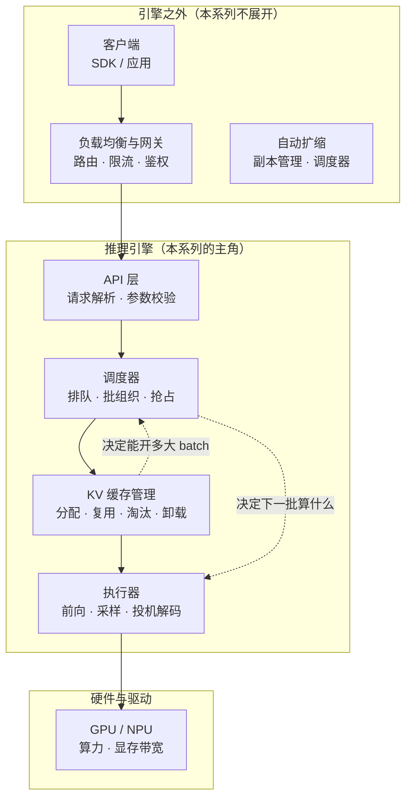
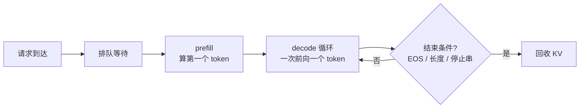
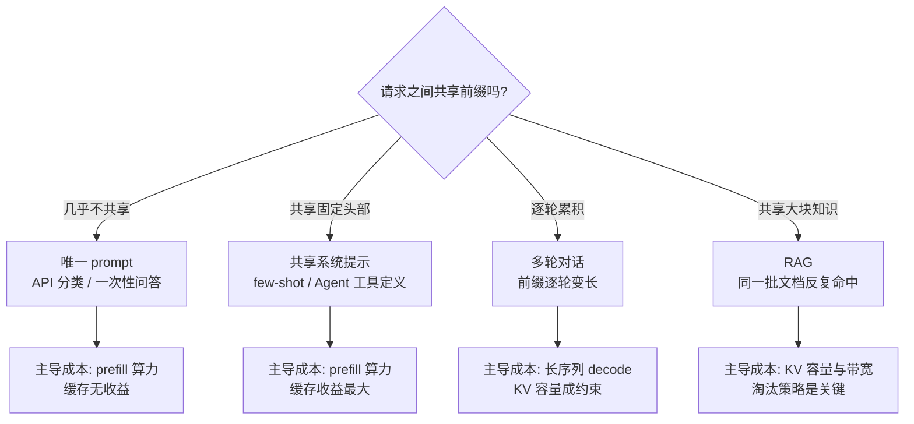

> **推理引擎系列 · 第 00 篇**
>
> 本系列面向**已经能把模型跑起来、但还没读过任何一个推理引擎源码**的工程师：把 vLLM 与
> SGLang 的功能差异、性能差异、选型结论，全部还原到**源码里可点开核验的那一行**。
>
> 取证基准：**vLLM `v0.31.0`**（commit `db9527a4`）／ **SGLang `v0.5.21`**（commit `e00930c5`）。
> 本文所有行号均锁在这两个 commit 上。
>
> - 00 引擎在栈里的位置（本文）→ 01 架构分歧的根 → 02 调度与批处理 → 03/04 支持矩阵 →
>   05 PD 分离 → 06 benchmark 交叉验证 → 07 选型手册 → 08 前缀命中率
>
> 指标口径（TTFT / TPOT / 吞吐 / goodput 的分子分母）见
> [《性能分析（02）》](/2026/09/29/profiling-02-inference/)，本文不重复定义。

> **TL;DR**
>
> * **推理引擎的职责边界是「一次请求进来到最后一个 token 出去」**：排队、管 KV 缓存、
>   决定谁先算、执行前向、采样、回收。它**不负责**负载均衡、自动扩缩、模型加载之外的权重转换。
>   把引擎和它上层的网关混在一起谈，是大部分对比失真
>   的来源。
> * **一次请求的成本分两段，且两段的主导因素完全不同**：TTFT 由排队与 prefill 决定
>   （前缀命中率是最大变量），TPOT 由 decode 步长决定（batch 与显存带宽是最大变量）。
>   任何只报一个数字的对比都在隐藏这个结构。
> * **「谁更快」问错了，有三个层面的原因**：口径不同（指标分母不一样）、
>   负载形状不同（前缀复用率能翻转结论符号）、默认值不同（两边的开关默认状态几乎相反）。
> * **负载形状是比引擎更早的决策变量**：唯一 prompt、共享系统提示、多轮对话、RAG
>   四种负载的主导成本不同，选型顺序应该是**先刻画自己的负载，再选引擎**。
> * **本系列的立场**：性能选型不能靠公开 benchmark（第 06 篇会逐个数追，
>   流传最广的「+29%」是 2024 年的数字），只能靠**机制推理 + 自测**；
>   而自测的第一个自变量是前缀命中率——它可以离线从请求日志算出来，不需要 GPU（第 08 篇）。

---

## 0. 本系列不讲什么

先把边界划清楚，后面八篇都守这条线。

| 讲 | 不讲 |
|:---|:---|
| 请求在引擎内部的完整生命周期 | 模型本身的结构与训练 |
| KV 缓存的分配、复用、淘汰、卸载 | 量化算法（见[量化系列](/2026/08/23/llm-quant-00-quantizer-fundamentals-rtn/)） |
| 调度与批处理策略 | 并行训练策略（见 [Megatron 系列](/2026/09/28/megatron-00-foundation/)） |
| 引擎的功能矩阵与选型 | 硬件选型与集群搭建 |
| 性能数字的可信度与自测方法 | 特定模型的调参手册 |

判据很简单：**这段知识换成在 CPU 上讲还成不成立？** 成立就写，不成立就是硬件向内容，
不属于本系列。全系列不跑性能 benchmark——本机没有 GPU——所有性能数字都是**引用**，
并且带可信度分级（A / B / C 三级，定义见第 06 篇 §1）。

---

## 1. 引擎在栈里的位置

一次 LLM 推理服务，从客户端到 GPU，中间的层可以这样切：

三条边值得先说清楚，因为它们决定了「引擎的锅」和「不是引擎的锅」：

1. **LB → API**：路由决策（比如 cache-aware 路由）在引擎外还是引擎内，两个引擎答案不同。
   SGLang 的 Rust 网关（`sgl-model-gateway/`）自带 cache-aware routing，
   vLLM 侧没有对等物——但 vLLM 也不阻止你在外面套一个。这属于**部署形态差异**，
   不是引擎能力差异，选型时不能混算。
2. **SCH → EXEC**：调度器决定下一批装什么请求、批多大。这是引擎最核心的自主权，
   也是两个引擎分歧最大的地方之一（第 02 篇）。
3. **KV → SCH**：缓存里还能放下多少新请求的 KV，直接约束调度器能开多大的 batch。
   **显存不是「模型占完之后剩下的都能开 batch」，而是缓存管理器逐块分配、逐块回收的结果**
   （第 01 篇讲两种组织方式）。

> **一句话**：推理引擎是一个**资源分配器**——它在「算力、显存、延迟 SLO」三个约束下，
> 决定每一步前向算谁的 token。所有功能差异最终都能归约到这一个职能上。

---

## 2. 一次请求的完整生命周期

把一次请求拆开，时间线是这样的：

各阶段的成本结构（记 $$L_{\rm in}$$ 为输入长度、$$L_{\rm out}$$ 为输出长度）：

| 阶段 | 成本 | 主导因素 |
|:---|:---|:---|
| 排队 $$t_q$$ | 等待调度 | 当前 batch 有多满、优先级策略 |
| prefill $$t_p$$ | 一次前向算 $$L_{\rm in}$$ 个 token 的注意力 | 输入长度、**前缀命中率**、算力 |
| decode $$t_d$$（每步） | 一次前向算 1 个 token | batch 大小、显存带宽、模型规模 |
| 采样 $$t_s$$ | 每步一次 | 词表大小、是否投机解码 |

由此读出一条本系列反复用的恒等式：

$$
\mathrm{TTFT} \;\approx\; t_q + t_p(L_{\rm in},\,h),\qquad
\mathrm{TPOT} \;\approx\; t_d(b), \qquad
t_{\rm total} \;\approx\; \mathrm{TTFT} + L_{\rm out}\cdot \mathrm{TPOT}
$$

其中 $$h$$ 是前缀命中率、$$b$$ 是并发 batch 大小。**这两个自变量分属不同阶段、
由不同机制决定、优化手段几乎不重叠**：

- 压低 TTFT → 提高 $$h$$（缓存复用，第 01 / 08 篇）或减小 $$t_q$$（调度，第 02 篇）；
- 压低 TPOT → 增大有效 batch（调度，第 02 篇）或减少 decode 步数（投机解码，
  见[投机解码系列](/2026/10/18/specdec-02-acceptance-and-speedup-model/)）。

> **这个分解是后面所有选型讨论的骨架**。当一个对比数字只给「吞吐」时，
> 它把 $$t_q$$、$$t_p$$、$$t_d$$ 三项压成了一个数，无法回答「我的负载会怎样」。

---

## 3. 「谁更快」为什么问错了

三层原因，层层递深。

### 3.1 口径不同：指标的分母不一样

同一个「吞吐」，可以指：

- **输出 tokens/s**（只数生成的 token）；
- **总 tokens/s**（输入 + 输出，长输入负载下这个数会虚高）；
- **goodput**（满足 SLO 的请求速率，见
  [《性能分析（02）》](/2026/09/29/profiling-02-inference/)对分子分母的拆解）；
- **挂钟时间倒数**（受请求长度分布影响，与上面三个都不可比）。

再加上 TTFT 的统计口径（p50 还是 p99、是否含排队）、TPOT 是否含采样时间——
**两个引擎自带的 bench 工具在这些细节上并不一致**。第 06 篇 §8.3 会给出核对清单。
不核对口径，5% 以内的差距没有意义。

### 3.2 负载形状不同：前缀复用率能翻转结论符号

这是最根本的一层。考虑两个极端负载：

| 负载 | 前缀命中率 $$h$$ | prefill 成本 | 谁的结构性优势能发挥 |
|:---|:---|:---|:---|
| 全部唯一 prompt | $$\approx 0$$ | 每次全量 | **谁都不发挥**，缓存维护是纯开销 |
| 共享系统提示 + 少量变化 | 高 | 大部分被缓存吃掉 | **token 级前缀匹配**的一方 |

已有公开数据里质量最高的一条量化证据（SGLang v0.5.20 release，厂商自报、条件清晰）：
共享系统提示场景下把 token 命中率从 43.8% 提到 60.8%，平均 TTFT 从 1.57s 降到 1.07s。
**命中率是主变量，引擎是次变量**——同一个引擎，不同负载下的表现能差出整个对比的量级。

所以本系列的选型顺序是：**先算自己的前缀命中率（第 08 篇，纯 CPU、不需要 GPU），
再决定要不要测性能**。

### 3.3 默认值不同：两边的开关几乎相反

这是最容易被忽略的一层。两个引擎的默认配置并不是「同一个设计的两种取值」，
而是多处**语义相反**：

| 特性 | vLLM `v0.31.0` | SGLang `v0.5.21` |
|:---|:---|:---|
| CPU/GPU overlap | **默认关**（`async_scheduling=None`） | **默认开**（`disable_overlap_schedule=False`） |
| prefix-aware 调度 | 无此维度 | 有，但**默认关**（`schedule_policy="fcfs"`） |
| Prometheus 指标 | 常开 | **默认关**（`--enable-metrics`） |
| 长 prefill 公平性阈值 | **默认关**（`long_prefill_token_threshold=0`） | 不适用 |

（出处与完整表见第 04 篇 §12。）含义很直接：**「开箱即用的对比」比的首先是默认值，
不是架构**。而默认值是每个版本都在动的——v0.31.0 移除了 8 个配置项，
v0.5.21 移除了一批废弃别名。「谁更快」如果不带版本号，答案的有效期大概是半年。

---

## 4. 负载形状：比引擎更早的决策变量

四种典型负载，主导成本各不相同：

对应到引擎能力：

| 负载 | 该看的引擎能力 | 篇目 |
|:---|:---|:---|
| 唯一 prompt | 批调度效率、overlap 的实际收益 | 第 02 篇 |
| 共享系统提示 | 前缀复用的**粒度**与淘汰策略 | 第 01 / 08 篇 |
| 多轮对话 | KV 容量管理、chunked prefill 的长输入公平性 | 第 02 篇 |
| RAG / 长文档 | 分层缓存、KV 卸载与传输 | 第 05 篇 |

> **多数团队的负载是混合的**，而且随时间变（Agent 负载的 system prompt 会随工具数增长）。
> 这就是为什么第 08 篇要把前缀命中率做成一个**可复算的指标**而不是一次性判断——
> 负载形状变了，选型结论就该重算。

---

## 5. 本系列的取证方法

所有结论都按同一套方法产出，读者可以逐条复核：

1. **锁 commit**。两个仓库都 checkout 到指定 tag，行号一律用 permalink 引用。
   工作树 HEAD 不等于锁定 commit，读源码用 `git show "<sha>:<path>"`。
2. **计数给口径**。凡「支持 N 个模型」这类数字，必须说明数的是哪个文件、什么规则
   （唯一架构字符串还是注册条目），并明确「不能直接相减」。
3. **性能数字分级**。A（第三方同配置复现）/ B（项目方自测或单一来源）/
   C（无法溯源），B 级不与 A 级混排。
4. **明确「未找到」**。搜不到就说搜不到，并给出搜索范围——这比含混的「不支持」有价值。
5. **不跑 benchmark**。本机 macOS 无 GPU，全系列不产出实测性能数字；
   可自己算的数字（前缀命中率、接受率、成本比）用配套实验算，并做构造真值自校验。

配套实验放在 [`lrypcy/ipynbs`](https://github.com/lrypcy/ipynbs) 的
`experiments/serving-engine/` 下，纯 CPU / numpy，读者不必自己跑也能看到固化的输出。

---

## 6. 两个引擎的一句话画像

在进入细节之前，先给两个引擎各一句话（第 07 篇会展开成决策树）：

> **vLLM**：用「静态注册 + 枚举 + 进程隔离」换确定性与覆盖面——模型架构、
> attention backend、KV 传输 connector 的数量都是两边更多的一方，
> 且有 EngineCore 进程级故障隔离；代价是扩展新东西要改代码，且部分默认值偏保守。
>
> **SGLang**：用「运行期发现 + 插件注册表 + overlap 调度」换灵活性与部分场景的延迟——
> radix tree 前缀复用、cache-aware 调度、多 LoRA 并发、PD 分离生态是强项；
> 代价是计数口径更松散、部分能力默认关闭、单模型单卡小规模场景有已知回退。

注意这两个画像里**没有「更快」**。第 01 篇会说明为什么这不构成遗漏：
两者的差异集中在三个互相独立的设计选择上，不存在一条把它们排成一维优劣的轴线。

---

## 7. 系列地图

| 篇 | 回答的问题 | 核心结论（一句话） |
|:---|:---|:---|
| 01 | 两者的差异到底在哪个层次？ | 三个独立设计选择的交叉优势，不是单维优劣 |
| 02 | 吞吐是怎么被调度挤出来的？ | 收益来自把 prefill 切碎塞进 decode 空隙，代价是 TTFT 抖动 |
| 03 | 「200+ 模型」为什么不可比？ | 静态注册 387 vs 运行期发现 282，口径不同；该看扩展机制 |
| 04 | 迁移的真实成本在哪？ | 不在端点数量，在同名参数的语义差与默认开关 |
| 05 | PD 分离什么时候值得做？ | 16 个 connector vs 5 个后差，但拓扑与 auxiliary data 有硬约束 |
| 06 | 流传的 benchmark 数字能信吗？ | 大半不能；「+29%」是 2024 年数字的三次转载 |
| 07 | 到底该选谁？ | 默认 vLLM；四条明确理由才偏 SGLang |
| 08 | 第一个该测的变量是什么？ | 前缀命中率——纯 CPU 可算，且能翻转结论符号 |

---

**上一篇**：本篇为推理引擎系列开篇

**下一篇**：[推理引擎（01）：架构分歧的根——三条独立的设计路线](/2026/10/18/serving-01-architecture-divergence/)

**站内承接**：指标口径见[《性能分析（02）：推理》](/2026/09/29/profiling-02-inference/)；
投机解码的收益模型见[《投机解码（02）》](/2026/10/18/specdec-02-acceptance-and-speedup-model/)；
KV 量化的显存与带宽账见[《LLM 量化（24）：KV Cache》](/2026/08/29/llm-quant-24-kv-cache/)。

## 参考

1. vLLM `v0.31.0`（commit `db9527a4`）— <https://github.com/vllm-project/vllm/tree/db9527a46873454610df6dbedf79a36d6bf1a7f6>
2. SGLang `v0.5.21`（commit `e00930c5`）— <https://github.com/sgl-project/sglang/tree/e00930c5489053f26d86b179cee0d087f846acbb>
3. vLLM `v0.31.0` release notes — <https://github.com/vllm-project/vllm/releases/tag/v0.31.0>
4. SGLang `v0.5.21` release notes — <https://github.com/sgl-project/sglang/releases/tag/v0.5.21>
5. SGLang `v0.5.20` release notes（前缀命中率 43.8% → 60.8% 的厂商自报数据）— <https://github.com/sgl-project/sglang/releases/tag/v0.5.20>
6. 本系列配套实验（纯 CPU / numpy）— <https://github.com/lrypcy/ipynbs/tree/main/experiments/serving-engine>
