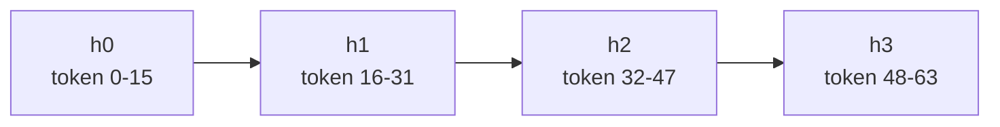
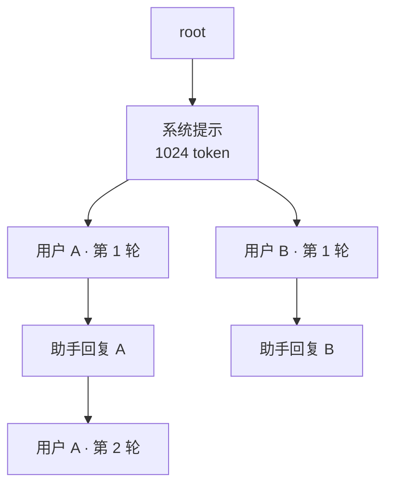

> **推理引擎系列 · 第 01 篇**
>
> 本系列面向**已经能把模型跑起来、但还没读过任何一个推理引擎源码**的工程师：把 vLLM 与
> SGLang 的功能差异、性能差异、选型结论，全部还原到**源码里可点开核验的那一行**。
>
> 取证基准：**vLLM `v0.31.0`**（commit `db9527a4`）／ **SGLang `v0.5.21`**（commit `e00930c5`）。
> 本文所有行号均锁在这两个 commit 上。
>
> - 01 架构分歧的根（本文）→ 02 调度与批处理 → 03/04 支持矩阵 → 05 PD 分离 →
>   06 benchmark 交叉验证 → 07 选型手册 → 08 前缀命中率
>
> 指标口径（TTFT / TPOT / 吞吐 / goodput 的分子分母）见
> [《性能分析（02）》](/2026/09/29/profiling-02-inference/)，本文不重复定义。

**TL;DR**

> * **「vLLM 和 SGLang 谁更强」这个问题问错了。** 它们不是同一条路线的两个实现，而是
>   **三个互相独立的设计选择**各自演化的结果：KV 缓存怎么组织、CPU 调度与 GPU 计算重不重叠、
>   进程与语言边界划在哪。这三个选择**可以各自单独选**，所以两者的能力是「交叉优势」而非单边碾压。
> * **前缀复用的粒度差没那么值钱。** 块对齐损失就是 $$L \bmod B$$，上限恒为 $$B-1=15$$ token，
>   是一笔**固定额税**不是比例税：长前缀负载上不到 1%，只有短对话（$$E[L]$$ 几十 token）
>   才放大到 10.34%。「16 对齐让 vLLM 大幅落后」只在短前缀负载上成立（§3 实测）。
> * **真正的差异在抽象层次**：vLLM 的缓存淘汰没有策略注册表（隐式 LRU），
>   SGLang 有 **8 种可插拔策略**；vLLM 有 EngineCore 进程级故障隔离，SGLang 没有；
>   SGLang 有一整套调度策略（含 cache-aware 的 `lpm`），vLLM 侧没有这个维度。
> * **「默认开启」不等于「总是更快」**：SGLang 的 overlap 默认开，但小模型单卡上
>   [关掉反而更快](#6-overlap-不是无条件赢)（有 issue 证据）；vLLM 的 async scheduling
>   默认关。两边都留了开关，因为**都不是无条件赢**。
> * **两处必须纠正的流传说法**：SGLang 默认调度策略是 `fcfs` **不是** `lpm`；
>   v0.5.21 的 Rust 目录叫 `sgl-model-gateway/` **不是** `sgl-router`。

---

## 0. 符号表

| 符号 | 含义 |
|:---|:---|
| $$B$$ | KV 缓存的块大小（vLLM 默认 16 token） |
| $$L$$ | 两条请求之间的公共前缀长度（token） |
| $$R_{\rm block}(L)$$ | 定长块组织下可复用的 token 数，$$= \lfloor L/B \rfloor \cdot B$$ |
| $$R_{\rm token}(L)$$ | token 级组织下可复用的 token 数，$$= L$$ |
| $$\Delta(L)$$ | 对齐损失，$$= L - R_{\rm block}(L) = L \bmod B$$ |
| $$\eta$$ | 加权复用率，$$= \sum R_{\rm block}(L_i) / \sum L_i$$ |
| $$\phi$$ | 内部碎片率，$$= (\lceil L/B\rceil B - L) / (\lceil L/B\rceil B)$$ |

---

## 1. 三个独立的设计选择：为什么「谁更强」问错了

把两个引擎的差异摊开，会发现它们集中在三个**互不依赖**的选择上：

| # | 设计选择 | vLLM 的答案 | SGLang 的答案 |
|---|---|---|---|
| 1 | KV 缓存怎么组织 | 固定 block + 逐块链式哈希，内容寻址 | radix tree over token 序列 |
| 2 | CPU 调度与 GPU 计算怎么重叠 | 默认**不**重叠（`async_scheduling` 需显式开） | 默认**重叠**（overlap scheduler） |
| 3 | 进程与语言边界 | Python 引擎 + 每个 DP rank 一个 EngineCore 进程 | Python 引擎 + Tokio + 内嵌 Rust 网关／缓存 |

「互相独立」这个词是有实证的，不是修辞：三个选择各自的开关都存在于对方的代码库里
（vLLM 有 `async_scheduling`，SGLang 有 `page_size` 对齐），
只是**默认值不同**。既然能各自单独翻转，就不存在一条把两者排成一维优劣的轴线。

下面逐条拆开。

---

## 2. KV 缓存组织：链式哈希 vs radix tree

这是最容易被讲成「A 比 B 好」、实际上最不适合这么讲的一处。

### 2.1 vLLM：固定 block + 逐块链式哈希

vLLM 把 KV cache 切成固定大小的 block（默认 **16 token**），每个 block 算一个哈希，
哈希**把父块的哈希也算进去**，形成一条链：

$$
h_i = H\!\left(h_{i-1},\; \mathrm{tokens}[i],\; \mathrm{extra\_keys}\right)
$$

实现是 `hash_block_tokens()` —— [`kv_cache_utils.py:684`](https://github.com/vllm-project/vllm/blob/db9527a46873454610df6dbedf79a36d6bf1a7f6/vllm/v1/core/kv_cache_utils.py#L684)，
哈希输入的三元组 `(parent_block_hash, curr_block_token_ids_tuple, extra_keys)` 在
[`kv_cache_utils.py:712-714`](https://github.com/vllm-project/vllm/blob/db9527a46873454610df6dbedf79a36d6bf1a7f6/vllm/v1/core/kv_cache_utils.py#L712-L714)。



`extra_keys` 由 `generate_block_hash_extra_keys()` 拼装（[`kv_cache_utils.py:614`](https://github.com/vllm-project/vllm/blob/db9527a46873454610df6dbedf79a36d6bf1a7f6/vllm/v1/core/kv_cache_utils.py#L614)），
拼接顺序固定为（[`kv_cache_utils.py:645-647`](https://github.com/vllm-project/vllm/blob/db9527a46873454610df6dbedf79a36d6bf1a7f6/vllm/v1/core/kv_cache_utils.py#L645-L647)）：

```python
extra_keys = lora_extra_keys + mm_extra_keys + cache_salt_keys + prompt_embeds_keys
```

逐项落点（都带行号，可点开验证）：

| 字段 | 行号 | 备注 |
|:---|:---|:---|
| LoRA 名 **与 adapter 路径** | [`kv_cache_utils.py:567`](https://github.com/vllm-project/vllm/blob/db9527a46873454610df6dbedf79a36d6bf1a7f6/vllm/v1/core/kv_cache_utils.py#L567)（函数）、[`:584`](https://github.com/vllm-project/vllm/blob/db9527a46873454610df6dbedf79a36d6bf1a7f6/vllm/v1/core/kv_cache_utils.py#L584)（返回 `[("lora", name, path)]`） | 两项都在哈希里 |
| `cache_salt` | [`kv_cache_utils.py:636-640`](https://github.com/vllm-project/vllm/blob/db9527a46873454610df6dbedf79a36d6bf1a7f6/vllm/v1/core/kv_cache_utils.py#L636-L640) | **只对第一个 block 生效**（`start_token_idx == 0` 才加） |
| 多模态输入 | [`kv_cache_utils.py:499`](https://github.com/vllm-project/vllm/blob/db9527a46873454610df6dbedf79a36d6bf1a7f6/vllm/v1/core/kv_cache_utils.py#L499) | |
| prompt embeddings | [`kv_cache_utils.py:587`](https://github.com/vllm-project/vllm/blob/db9527a46873454610df6dbedf79a36d6bf1a7f6/vllm/v1/core/kv_cache_utils.py#L587) | |

默认块大小定义在 `DEFAULT_BLOCK_SIZE: ClassVar[int] = 16` —— [`vllm/config/cache.py:71`](https://github.com/vllm-project/vllm/blob/db9527a46873454610df6dbedf79a36d6bf1a7f6/vllm/config/cache.py#L71)。

**这个设计的直接后果**：前缀复用的最小单位是 16 token，且必须**逐块对齐**。
两条请求的公共前缀长 100 token，能复用的只有 96 token（6 个完整块），
剩下 4 token 的 KV 存不下、也用不上。

### 2.2 SGLang：radix tree over token 序列

SGLang 把所有历史 KV 放进一棵 radix tree（压缩前缀树），新请求进来时沿树下降，
匹配**任意 token 位置**的最长公共前缀，只为分叉后的后缀做 attention。



核心类 `RadixCache` —— [`radix_cache.py:280`](https://github.com/sgl-project/sglang/blob/e00930c5489053f26d86b179cee0d087f846acbb/python/sglang/srt/mem_cache/radix_cache.py#L280)，
`match_prefix()` 在 [`radix_cache.py:354`](https://github.com/sgl-project/sglang/blob/e00930c5489053f26d86b179cee0d087f846acbb/python/sglang/srt/mem_cache/radix_cache.py#L354)，
真正的匹配循环在 `_match_prefix_helper()` [`radix_cache.py:639`](https://github.com/sgl-project/sglang/blob/e00930c5489053f26d86b179cee0d087f846acbb/python/sglang/srt/mem_cache/radix_cache.py#L639)。

匹配用的是**数组前缀比较**（`RadixKey.match()` → `match_at()`，[`radix_cache.py:177`](https://github.com/sgl-project/sglang/blob/e00930c5489053f26d86b179cee0d087f846acbb/python/sglang/srt/mem_cache/radix_cache.py#L177) / [`:181`](https://github.com/sgl-project/sglang/blob/e00930c5489053f26d86b179cee0d087f846acbb/python/sglang/srt/mem_cache/radix_cache.py#L181)），
不是查哈希表。`match_at` 内部做了指数搜索 + 二分来找首个分歧 token，
注释写明是「避免长公共前缀上的 per-token Python 循环」（[`radix_cache.py:192-210`](https://github.com/sgl-project/sglang/blob/e00930c5489053f26d86b179cee0d087f846acbb/python/sglang/srt/mem_cache/radix_cache.py#L192-L210)）。

**节点切分规则** —— 这是理解 SGLang 缓存行为的关键，原文在 `_match_prefix_helper`：

```python
prefix_len = child.key.match(key, page_size=self.page_size)
if prefix_len < len(child.key):
    new_node = self._split_node(child.key, child, prefix_len)
    value.append(new_node.value)
    node = new_node
    break
else:
    value.append(child.value)
    node = child
    key = key[prefix_len:]
```

—— [`radix_cache.py:649-658`](https://github.com/sgl-project/sglang/blob/e00930c5489053f26d86b179cee0d087f846acbb/python/sglang/srt/mem_cache/radix_cache.py#L649-L658)
（插入路径的等价判断在 [`radix_cache.py:727-734`](https://github.com/sgl-project/sglang/blob/e00930c5489053f26d86b179cee0d087f846acbb/python/sglang/srt/mem_cache/radix_cache.py#L727-L734)，
`_split_node()` 实现在 [`radix_cache.py:665`](https://github.com/sgl-project/sglang/blob/e00930c5489053f26d86b179cee0d087f846acbb/python/sglang/srt/mem_cache/radix_cache.py#L665)）

读法很直接：**匹配长度小于该节点存储的 key 长度时，就把节点切成两级**，
新节点继承 child 的 `priority`（[`:668`](https://github.com/sgl-project/sglang/blob/e00930c5489053f26d86b179cee0d087f846acbb/python/sglang/srt/mem_cache/radix_cache.py#L668)）、
`hit_count`（[`:669`](https://github.com/sgl-project/sglang/blob/e00930c5489053f26d86b179cee0d087f846acbb/python/sglang/srt/mem_cache/radix_cache.py#L669)）、
`lock_ref`（[`:672`](https://github.com/sgl-project/sglang/blob/e00930c5489053f26d86b179cee0d087f846acbb/python/sglang/srt/mem_cache/radix_cache.py#L672)），
底层 KV 数据不复制，只切引用（[`:673-677`](https://github.com/sgl-project/sglang/blob/e00930c5489053f26d86b179cee0d087f846acbb/python/sglang/srt/mem_cache/radix_cache.py#L673-L677)）。

`page_size` 的默认值是 **`None`**（[`fields/schedule.py:139-141`](https://github.com/sgl-project/sglang/blob/e00930c5489053f26d86b179cee0d087f846acbb/python/sglang/srt/arg_groups/fields/schedule.py#L139-L141)），
`match_prefix` 匹配前会做 `key.page_aligned(self.page_size)`（[`radix_cache.py:397`](https://github.com/sgl-project/sglang/blob/e00930c5489053f26d86b179cee0d087f846acbb/python/sglang/srt/mem_cache/radix_cache.py#L397)），
而 `match_at` 在 `page_size=1` 时不向下取整（[`radix_cache.py:177-179`](https://github.com/sgl-project/sglang/blob/e00930c5489053f26d86b179cee0d087f846acbb/python/sglang/srt/mem_cache/radix_cache.py#L177-L179)）。

> ⚠️ **一处常见误解要纠正**：SGLang 默认既不是「1 token 一块」也不是「按 16 对齐」，
> 而是「节点边界完全由实际公共前缀终点决定，只受可选的 `page_size` 对齐约束」。

### 2.3 精确对照

| | vLLM | SGLang |
|:---|:---|:---|
| 复用粒度 | 固定 16 token | 最长公共前缀（任意 token 位置） |
| 匹配方式 | 逐块链式哈希查表 | 数组前缀比较 + 二分找分歧点 |
| 100 token 公共前缀可复用 | 96 token | 100 token |
| 键隔离字段 | lora(name+path) / mm / cache_salt / prompt_embeds | `extra_key` / `cache_salt`（语义见下） |
| 淘汰策略 | 隐式 LRU（`FreeKVCacheBlockQueue`，[`kv_cache_utils.py:246`](https://github.com/vllm-project/vllm/blob/db9527a46873454610df6dbedf79a36d6bf1a7f6/vllm/v1/core/kv_cache_utils.py#L246)） | **8 种可插拔策略** |
| 默认开关 | 开（`enable_prefix_caching: bool = True`，[`config/cache.py:142`](https://github.com/vllm-project/vllm/blob/db9527a46873454610df6dbedf79a36d6bf1a7f6/vllm/config/cache.py#L142)） | 开（`disable_radix_cache = False`，[`fields/memory.py:64-70`](https://github.com/sgl-project/sglang/blob/e00930c5489053f26d86b179cee0d087f846acbb/python/sglang/srt/arg_groups/fields/memory.py#L64-L70)） |

SGLang 的 `extra_key` 与 `cache_salt` 语义**不同**，源码注释写得很清楚（[`radix_cache.py:73-76`](https://github.com/sgl-project/sglang/blob/e00930c5489053f26d86b179cee0d087f846acbb/python/sglang/srt/mem_cache/radix_cache.py#L73-L76)）：
`extra_key` 只 namespace 树与存储、**从 KV events 中排除**；
`cache_salt` 同时 namespace 树、存储**和 KV events**。

---

## 3. 粒度差到底值多少 token

上一节的对照表容易读出「token 级复用显著优于块级」这个结论。把它摆到数字上会发现
**这个结论被高估了**。

配套实验（纯 numpy / CPU，固定 `seed = 20261017`）：
[`experiments/serving-engine/prefix-reuse-granularity`](https://github.com/lrypcy/ipynbs/blob/ac9f51cf81bfe10e882df9dc32b52d5628816fb0/experiments/serving-engine/prefix-reuse-granularity/run.py)。

三组检查，每组都做「解析真值 ↔ 数值反算」自校验。

**组 1 · 对齐损失的闭式与蒙特卡洛对拍。** $$L$$ 在 $$[1, 4096]$$ 上均匀时，区间正好是
256 个完整的 $$\bmod\,16$$ 周期，所以 $$\mathbb{E}[L \bmod B] = (0+1+\cdots+15)/16 = 7.5$$ 精确可算：

```text
  L ~ 离散均匀 U[1, 4096]，样本 N = 400000

  量                                      蒙特卡洛           解析真值
  ----------------------------------------------------------
  E[L mod B]  (平均损失)                 7.503692       7.500000
  E[L]                            2047.894652    2048.500000
  相对损失率                              0.366410%      0.366122%
```

关键不在 7.5 这个数，而在**它与 $$L$$ 的绝对大小无关**：$$\Delta(L) = L \bmod B$$ 的上限恒为
$$B-1 = 15$$ token。这是一笔**固定额税，不是比例税**。

**组 2 · 四种负载分布下的加权复用率。** 税负固定，那么决定它显不显眼的就是分母：

```text
  负载                                       E[L]        块式复用率          损失率
  --------------------------------------------------------------------
  均匀前缀 U[64, 2048]                      1055.18     99.2894%      0.7106%
  共享长系统提示 1024 + U[0,128]               1088.09     99.3166%      0.6834%
  多轮对话 256 * U[1,8] + U[0,64]           1183.68     99.3761%      0.6239%
  短对话 U[16, 128]                          71.95     89.6613%     10.3387%
```

损失率随 $$E[L]$$ 增大**单调下降**：长前缀负载上不到 1%，
只有在短对话（$$E[L] = 71.95$$）上才放大到 10.34%。

**组 3 · 内部碎片。** 定长块还带来分配侧的碎片——复用粒度不等于分配粒度：

```text
  L ~ 离散均匀 U[64, 2048]，样本 N = 200000

  量                                           值
  ----------------------------------------------
  E[L]                                1057.4197
  E[占用]（块对齐后）                         1064.9214
  平均内部碎片率                                1.2602%
  同容量驻留请求数比（块/token）                   0.992956
```

**这一组只主张结构**：碎片来自「分配粒度 ≠ 复用粒度」，具体倍数由真实请求长度分布决定，
不主张任何实测显存数字。

### 这段数字该怎么用

它纠正的是**一句具体的话**：「radix tree 因为 token 粒度，前缀复用显著高于 vLLM 的 16-token 块」。

- 在**长系统提示 / 多轮对话**这类典型共享前缀负载上，粒度差贡献的损失 **不到 1%**，
  不可能是两者端到端差距的主因；
- 在**短对话**负载上，粒度差确实能到 10%，这时候它才值得进决策；
- 无论哪种负载，粒度差都是**单向可补的**：把公共前缀长度做到 $$B$$ 的整数倍
  （比如系统提示末尾补对齐）就能消掉，不需要换引擎。

真正决定端到端差距的是**负载里到底有多少前缀可复用**——那是本系列第 08 篇
（前缀命中率：唯一能离线算出来的自变量）的主题。

---

## 4. 淘汰策略：抽象层次最大的差异

比粒度更值得写进选型表的是**淘汰策略**，因为这一项的差异不是程度差，是有无之差。

vLLM 的 `BlockPool` **没有策略注册表**，`_maybe_evict_cached_block`
（[`block_pool.py:732-753`](https://github.com/vllm-project/vllm/blob/db9527a46873454610df6dbedf79a36d6bf1a7f6/vllm/v1/core/block_pool.py#L732-L753)）
只处理「有没有 hash」「有没有引用计数」，LRU 由队列隐式承担。

SGLang 的 `RadixCache.evict()` 在 [`radix_cache.py:553`](https://github.com/sgl-project/sglang/blob/e00930c5489053f26d86b179cee0d087f846acbb/python/sglang/srt/mem_cache/radix_cache.py#L553)，
用最小堆 + 从叶子向上蔓延，父节点变无子且 `lock_ref == 0` 时级联压回堆（[`:574-576`](https://github.com/sgl-project/sglang/blob/e00930c5489053f26d86b179cee0d087f846acbb/python/sglang/srt/mem_cache/radix_cache.py#L574-L576)）。
策略工厂在 [`mem_cache/utils.py:60-69`](https://github.com/sgl-project/sglang/blob/e00930c5489053f26d86b179cee0d087f846acbb/python/sglang/srt/mem_cache/utils.py#L60-L69)，共 **8 种**：

| 名称 | 类 | 行号 |
|:---|:---|:---|
| `lru` | `LRUStrategy` | [`evict_policy.py:16`](https://github.com/sgl-project/sglang/blob/e00930c5489053f26d86b179cee0d087f846acbb/python/sglang/srt/mem_cache/evict_policy.py#L16) |
| `lfu` | `LFUStrategy` | [`evict_policy.py:21`](https://github.com/sgl-project/sglang/blob/e00930c5489053f26d86b179cee0d087f846acbb/python/sglang/srt/mem_cache/evict_policy.py#L21) |
| `fifo` | `FIFOStrategy` | [`evict_policy.py:26`](https://github.com/sgl-project/sglang/blob/e00930c5489053f26d86b179cee0d087f846acbb/python/sglang/srt/mem_cache/evict_policy.py#L26) |
| `mru` | `MRUStrategy` | [`evict_policy.py:31`](https://github.com/sgl-project/sglang/blob/e00930c5489053f26d86b179cee0d087f846acbb/python/sglang/srt/mem_cache/evict_policy.py#L31) |
| `filo` | `FILOStrategy` | [`evict_policy.py:36`](https://github.com/sgl-project/sglang/blob/e00930c5489053f26d86b179cee0d087f846acbb/python/sglang/srt/mem_cache/evict_policy.py#L36) |
| `priority` | `PriorityStrategy` | [`evict_policy.py:41`](https://github.com/sgl-project/sglang/blob/e00930c5489053f26d86b179cee0d087f846acbb/python/sglang/srt/mem_cache/evict_policy.py#L41) |
| `slru` | `SLRUStrategy` | [`evict_policy.py:84`](https://github.com/sgl-project/sglang/blob/e00930c5489053f26d86b179cee0d087f846acbb/python/sglang/srt/mem_cache/evict_policy.py#L84) |
| `tlru` | `TLRUStrategy` | [`evict_policy.py:49`](https://github.com/sgl-project/sglang/blob/e00930c5489053f26d86b179cee0d087f846acbb/python/sglang/srt/mem_cache/evict_policy.py#L49) |

> **选型含义**：如果负载里不同请求的价值差异很大（付费用户 vs 免费用户、
> 带 SLA 的请求 vs 可重试的批处理），SGLang 的 `priority` / `slru` 是现成的；
> vLLM 侧要自己改 `BlockPool`。

---

## 5. 调度器：默认重叠 vs 默认不重叠

### 5.1 vLLM：调度器里没有 prefill / decode 之分

`Scheduler.schedule()` 起于 [`scheduler.py:562`](https://github.com/vllm-project/vllm/blob/db9527a46873454610df6dbedf79a36d6bf1a7f6/vllm/v1/core/sched/scheduler.py#L562)，
是约 950 行的单体函数。源码注释写得很明确：**调度器里没有 prefill 阶段和 decode 阶段之分**，
只有 `num_computed_tokens` 追赶 `num_tokens_with_spec`
（[`scheduler.py:564-573`](https://github.com/vllm-project/vllm/blob/db9527a46873454610df6dbedf79a36d6bf1a7f6/vllm/v1/core/sched/scheduler.py#L564-L573)）。

准入路径（`waiting` → `running`）：

| 步骤 | 行号 |
|:---|:---|
| 两个队列定义（`waiting` / `running`） | [`scheduler.py:212`](https://github.com/vllm-project/vllm/blob/db9527a46873454610df6dbedf79a36d6bf1a7f6/vllm/v1/core/sched/scheduler.py#L212) / [`:220`](https://github.com/vllm-project/vllm/blob/db9527a46873454610df6dbedf79a36d6bf1a7f6/vllm/v1/core/sched/scheduler.py#L220) |
| 准入主循环 | [`scheduler.py:885`](https://github.com/vllm-project/vllm/blob/db9527a46873454610df6dbedf79a36d6bf1a7f6/vllm/v1/core/sched/scheduler.py#L885) |
| **持 KV 的请求永远优先**：`request_queue = self.kv_holding_waiting or self.waiting` | [`scheduler.py:887`](https://github.com/vllm-project/vllm/blob/db9527a46873454610df6dbedf79a36d6bf1a7f6/vllm/v1/core/sched/scheduler.py#L887) |
| 硬闸门 `if num_running >= self.max_num_active_reqs: break` | [`scheduler.py:893`](https://github.com/vllm-project/vllm/blob/db9527a46873454610df6dbedf79a36d6bf1a7f6/vllm/v1/core/sched/scheduler.py#L893) |
| 实际迁移 `pop_request()` → `self.running.append()` | [`scheduler.py:1290-1292`](https://github.com/vllm-project/vllm/blob/db9527a46873454610df6dbedf79a36d6bf1a7f6/vllm/v1/core/sched/scheduler.py#L1290-L1292) |
| LoRA 超限则跳过 | [`scheduler.py:911-922`](https://github.com/vllm-project/vllm/blob/db9527a46873454610df6dbedf79a36d6bf1a7f6/vllm/v1/core/sched/scheduler.py#L911-L922) |
| 本地 prefix cache 命中查询 | [`scheduler.py:930-937`](https://github.com/vllm-project/vllm/blob/db9527a46873454610df6dbedf79a36d6bf1a7f6/vllm/v1/core/sched/scheduler.py#L930-L937) |

值得单独指出的是 [`scheduler.py:887`](https://github.com/vllm-project/vllm/blob/db9527a46873454610df6dbedf79a36d6bf1a7f6/vllm/v1/core/sched/scheduler.py#L887)：
**已经持有 KV block 的请求在准入时优先于 waiting 队列里的新请求**。这行是 v0.31.0 新增的
（release notes 对应「waiting queue logic revamped so that requests already holding KV blocks
are scheduled preferentially」，目的是「suppress throughput drops and deadlocks in
resource-constrained situations」）。

chunked prefill 的实际截断在
[`scheduler.py:679-680`](https://github.com/vllm-project/vllm/blob/db9527a46873454610df6dbedf79a36d6bf1a7f6/vllm/v1/core/sched/scheduler.py#L679-L680)：

```python
if 0 < long_prefill_token_threshold < num_new_tokens:
    num_new_tokens = long_prefill_token_threshold
```

阈值 `long_prefill_token_threshold` 默认 **0（不启用）** ——
[`vllm/config/scheduler.py:80`](https://github.com/vllm-project/vllm/blob/db9527a46873454610df6dbedf79a36d6bf1a7f6/vllm/config/scheduler.py#L80)。

### 5.2 SGLang：overlap 默认开

开关字段 `disable_overlap_schedule: bool`，默认 `False`（即**默认开启**）——
[`fields/schedule.py:187-193`](https://github.com/sgl-project/sglang/blob/e00930c5489053f26d86b179cee0d087f846acbb/python/sglang/srt/arg_groups/fields/schedule.py#L187-L193)，
help 文本 “Disable the overlap scheduler, which overlaps the CPU scheduler with GPU model worker.”

运行时读取在 [`scheduler.py:489-491`](https://github.com/sgl-project/sglang/blob/e00930c5489053f26d86b179cee0d087f846acbb/python/sglang/srt/managers/scheduler.py#L489-L491)，
`init_overlap()` 定义在 [`scheduler.py:1615`](https://github.com/sgl-project/sglang/blob/e00930c5489053f26d86b179cee0d087f846acbb/python/sglang/srt/managers/scheduler.py#L1615)。

「CPU 跑在 GPU 前面一个 batch」的具体实现是 `event_loop_overlap()` ——
[`scheduler.py:1941`](https://github.com/sgl-project/sglang/blob/e00930c5489053f26d86b179cee0d087f846acbb/python/sglang/srt/managers/scheduler.py#L1941)。
机制是一个双端队列 `self.result_queue`（[`:1943-1945`](https://github.com/sgl-project/sglang/blob/e00930c5489053f26d86b179cee0d087f846acbb/python/sglang/srt/managers/scheduler.py#L1943-L1945)）缓存上一批结果：
先 `pop_and_process()` 处理上一批结果（[`:1947-1950`](https://github.com/sgl-project/sglang/blob/e00930c5489053f26d86b179cee0d087f846acbb/python/sglang/srt/managers/scheduler.py#L1947-L1950)），
**再 launch 当前批**（[`:1988`](https://github.com/sgl-project/sglang/blob/e00930c5489053f26d86b179cee0d087f846acbb/python/sglang/srt/managers/scheduler.py#L1988)），
并立刻把 `(batch, batch_result)` 压回队列（[`:1991`](https://github.com/sgl-project/sglang/blob/e00930c5489053f26d86b179cee0d087f846acbb/python/sglang/srt/managers/scheduler.py#L1991)）。

一个容易被忽略的细节：**连续两个 prefill 批次会主动关闭 overlap 以改善 TTFT**，
判定在 `is_disable_overlap_for_batch()` ——
[`scheduler.py:2015`](https://github.com/sgl-project/sglang/blob/e00930c5489053f26d86b179cee0d087f846acbb/python/sglang/srt/managers/scheduler.py#L2015)，
条件在 [`:2031-2035`](https://github.com/sgl-project/sglang/blob/e00930c5489053f26d86b179cee0d087f846acbb/python/sglang/srt/managers/scheduler.py#L2031-L2035)，
由环境变量 `SGLANG_DISABLE_CONSECUTIVE_PREFILL_OVERLAP` 控制。
采样也参与 overlap（`launch_batch_sample_if_needed()`，[`scheduler.py:2007`](https://github.com/sgl-project/sglang/blob/e00930c5489053f26d86b179cee0d087f846acbb/python/sglang/srt/managers/scheduler.py#L2007)），
因为采样依赖上一批结果，必须排在其后。

---

## 6. overlap 不是无条件赢

这一节是本篇唯一带反例证据的地方，也是选型时最容易踩的一处。

SGLang issue [#2558](https://github.com/sgl-project/sglang/issues/2558) 报告：
Qwen2.5-0.5B-Instruct 在单张 A100 上跑 `bench_serving` 随机负载（4096 in / 2048 out），
**关掉 overlap 反而更快**（22,025 → 25,555 total tok/s）。社区已复现。

这与 v0.4 官方博客的措辞并不矛盾 —— 那里的限定条件是
「gains most significant on **small models and large tensor parallelism sizes**」。
把两句话合起来读：

> 小模型 + 单卡 + 低并发时，overlap 引入的 bookkeeping 开销可能超过它隐藏的调度开销。
> **「overlap 默认开启」不等于「always faster」。**

vLLM 侧的对应物是 `AsyncScheduler`
（[`async_scheduler.py:14`](https://github.com/vllm-project/vllm/blob/db9527a46873454610df6dbedf79a36d6bf1a7f6/vllm/v1/core/sched/async_scheduler.py#L14)，共 78 行），
开关 `async_scheduling: bool | None = None` ——
[`config/scheduler.py:209`](https://github.com/vllm-project/vllm/blob/db9527a46873454610df6dbedf79a36d6bf1a7f6/vllm/config/scheduler.py#L209)，
选择逻辑 `get_scheduler_cls()` 在 [`:229-237`](https://github.com/vllm-project/vllm/blob/db9527a46873454610df6dbedf79a36d6bf1a7f6/vllm/config/scheduler.py#L229-L237)。
**默认 `None` = 关闭。**

vLLM 自己的收益也有 PR 级数据：PR [#32618](https://github.com/vllm-project/vllm/pull/32618)
自测 async scheduling + PP 在 Qwen3-30B-A3B-Thinking-2507-FP8 / PP4 上带来
E2E 吞吐 +30.8%、TPOT +31.8%（**项目方自测，无第三方复现**）。

> **可信度标注**：本节两个数字都标 **B 级**（项目方自测或单一 issue 报告，无第三方复现）。
> 本系列对性能数字的分级方法见第 06 篇（benchmark 交叉验证）。

---

## 7. 进程与语言边界

### 7.1 vLLM：EngineCore 进程隔离与故障隔离

vLLM V1 把 EngineCore 拆到独立进程（每个 DP rank 一个），好处之一是
**故障可以被兜住而不带崩整个 server**。

[`engine_core_sentinel.py`](https://github.com/vllm-project/vllm/blob/db9527a46873454610df6dbedf79a36d6bf1a7f6/vllm/v1/fault_tolerance/engine_core_sentinel.py)（197 行）
把每个 engine core 的 busy loop 包起来：

```python
def fault_tolerant_wrapper(busy_loop_func: Callable):
    def run_with_fault_tolerance(self: "EngineCoreProc"):
        while True:
            try:
                busy_loop_func(self)
            except SystemExit:
                raise
            except Exception as exc:
                if not self.enable_fault_tolerance:
                    raise
                self.ft_sentinel.on_fault(exc)
                recovered = self.ft_sentinel.resumed.wait(
                    timeout=self.ft_sentinel.engine_recovery_timeout_sec
                )
                if recovered:
                    continue
                raise
    return run_with_fault_tolerance
```

—— [`engine_core_sentinel.py:173`](https://github.com/vllm-project/vllm/blob/db9527a46873454610df6dbedf79a36d6bf1a7f6/vllm/v1/fault_tolerance/engine_core_sentinel.py#L173)（返回的闭包在 [`:176`](https://github.com/vllm-project/vllm/blob/db9527a46873454610df6dbedf79a36d6bf1a7f6/vllm/v1/fault_tolerance/engine_core_sentinel.py#L176)）

`on_fault()` 在 [`engine_core_sentinel.py:80`](https://github.com/vllm-project/vllm/blob/db9527a46873454610df6dbedf79a36d6bf1a7f6/vllm/v1/fault_tolerance/engine_core_sentinel.py#L80)，函数体 `:80-106`，按顺序做四件事：

1. 清 `resumed` 事件（[`:82`](https://github.com/vllm-project/vllm/blob/db9527a46873454610df6dbedf79a36d6bf1a7f6/vllm/v1/fault_tolerance/engine_core_sentinel.py#L82)）
2. 用 `finish_requests(None, FINISHED_ABORTED)` 中止所有在飞请求并 `_send_abort_outputs()`（[`:88-89`](https://github.com/vllm-project/vllm/blob/db9527a46873454610df6dbedf79a36d6bf1a7f6/vllm/v1/fault_tolerance/engine_core_sentinel.py#L88-L89)）
3. `batch_queue.clear()`（[`:90-91`](https://github.com/vllm-project/vllm/blob/db9527a46873454610df6dbedf79a36d6bf1a7f6/vllm/v1/fault_tolerance/engine_core_sentinel.py#L90-L91)）
4. `model_executor.is_failed` 则置 `DEAD`，否则置 `UNHEALTHY`（[`:92-98`](https://github.com/vllm-project/vllm/blob/db9527a46873454610df6dbedf79a36d6bf1a7f6/vllm/v1/fault_tolerance/engine_core_sentinel.py#L92-L98)）

状态作为 utility output 推给前端，让上层能**立刻**绕开降级的 engine，而不是等超时。

**必须说清楚的两点**：

- 恢复指令**当前只实现了 `retry` 一个**。`handle_command()` 用
  `run_method(self, ft_request.instruction, (ft_request,), {})`（[`:67`](https://github.com/vllm-project/vllm/blob/db9527a46873454610df6dbedf79a36d6bf1a7f6/vllm/v1/fault_tolerance/engine_core_sentinel.py#L67)）动态派发，
  sentinel 上唯一可被外部驱动的恢复方法是 `retry()`（[`:122-137`](https://github.com/vllm-project/vllm/blob/db9527a46873454610df6dbedf79a36d6bf1a7f6/vllm/v1/fault_tolerance/engine_core_sentinel.py#L122-L137)）。
- **没有 instruction 白名单**。`FaultToleranceRequest.instruction` 是裸 `str`
  （[`fault_tolerance/utils.py:15`](https://github.com/vllm-project/vllm/blob/db9527a46873454610df6dbedf79a36d6bf1a7f6/vllm/v1/fault_tolerance/utils.py#L15)），
  [`api_router.py:30`](https://github.com/vllm-project/vllm/blob/db9527a46873454610df6dbedf79a36d6bf1a7f6/vllm/v1/fault_tolerance/api_router.py#L30) 只校验类型不做枚举校验。
  派发是通用机制，但目前没有更多恢复策略（部分重启、drain-and-replace）落地。

超时默认 `engine_recovery_timeout_sec: int = 120` ——
[`config/fault_tolerance.py:12`](https://github.com/vllm-project/vllm/blob/db9527a46873454610df6dbedf79a36d6bf1a7f6/vllm/config/fault_tolerance.py#L12)。

### 7.2 SGLang：Python + Tokio + 内嵌 Rust

SGLang 的仓库里有一整套 Rust 组件：

| 目录 | 内容 |
|:---|:---|
| `sgl-model-gateway/` | Rust 网关（在主仓里，不是独立仓库） |
| `rust/` | `sglang-server`、`sglang-radix-tree`、`sglang-grpc`、`sglang-mm`、`sglang-renderer` |

> **纠正一个常见说法**：v0.5.21 的 Rust router **不叫 `sgl-router`**，
> 该目录在此 commit 中不存在；实际目录名是 **`sgl-model-gateway/`**。
> 历史上确实有过 `sgl-router` 独立仓库（v0.4 博客提到「Rust router」），后来并入主仓并改名。

cache-aware routing 的实现在
[`sgl-model-gateway/src/policies/cache_aware.rs`](https://github.com/sgl-project/sglang/blob/e00930c5489053f26d86b179cee0d087f846acbb/sgl-model-gateway/src/policies/cache_aware.rs)（1641 行）：
`pub struct CacheAwarePolicy` 在 [`:112`](https://github.com/sgl-project/sglang/blob/e00930c5489053f26d86b179cee0d087f846acbb/sgl-model-gateway/src/policies/cache_aware.rs#L112)，
`impl LoadBalancingPolicy for CacheAwarePolicy` 在 [`:386`](https://github.com/sgl-project/sglang/blob/e00930c5489053f26d86b179cee0d087f846acbb/sgl-model-gateway/src/policies/cache_aware.rs#L386)。
底层 radix tree 在 [`tree.rs`](https://github.com/sgl-project/sglang/blob/e00930c5489053f26d86b179cee0d087f846acbb/sgl-model-gateway/src/policies/tree.rs)（2310 行），
`pub struct Tree` 在 [`:246`](https://github.com/sgl-project/sglang/blob/e00930c5489053f26d86b179cee0d087f846acbb/sgl-model-gateway/src/policies/tree.rs#L246)，
含自定义 `Hasher for CharHasher`（[`:58`](https://github.com/sgl-project/sglang/blob/e00930c5489053f26d86b179cee0d087f846acbb/sgl-model-gateway/src/policies/tree.rs#L58)）。
router 策略共 12 个文件（`cache_aware` / `tree` / `prefix_hash` / `consistent_hashing` /
`power_of_two` / `round_robin` / `random` / `manual` / `bucket` / `factory` / `registry` / `mod`）。

---

## 8. 调度策略：一个 vLLM 侧没有的维度

SGLang 的 [`schedule_policy.py`](https://github.com/sgl-project/sglang/blob/e00930c5489053f26d86b179cee0d087f846acbb/python/sglang/srt/managers/schedule_policy.py)（1640 行），主类 `SchedulePolicy` 在
[`:238`](https://github.com/sgl-project/sglang/blob/e00930c5489053f26d86b179cee0d087f846acbb/python/sglang/srt/managers/schedule_policy.py#L238)，
策略被显式二分：

| 类别 | 策略 | 行号 |
|:---|:---|:---|
| **CacheAware** | `lpm`（longest prefix match） | [`:223`](https://github.com/sgl-project/sglang/blob/e00930c5489053f26d86b179cee0d087f846acbb/python/sglang/srt/managers/schedule_policy.py#L223) |
| | `dfs-weight` | [`:224`](https://github.com/sgl-project/sglang/blob/e00930c5489053f26d86b179cee0d087f846acbb/python/sglang/srt/managers/schedule_policy.py#L224) |
| | `hrrn`（highest response ratio next，token-based aging） | [`:225`](https://github.com/sgl-project/sglang/blob/e00930c5489053f26d86b179cee0d087f846acbb/python/sglang/srt/managers/schedule_policy.py#L225) |
| | `shortest-prefill-first` | [`:226`](https://github.com/sgl-project/sglang/blob/e00930c5489053f26d86b179cee0d087f846acbb/python/sglang/srt/managers/schedule_policy.py#L226) |
| **CacheAgnostic** | `fcfs` | [`:232`](https://github.com/sgl-project/sglang/blob/e00930c5489053f26d86b179cee0d087f846acbb/python/sglang/srt/managers/schedule_policy.py#L232) |
| | `lof`（longest output first） | [`:233`](https://github.com/sgl-project/sglang/blob/e00930c5489053f26d86b179cee0d087f846acbb/python/sglang/srt/managers/schedule_policy.py#L233) |
| | `random` | [`:234`](https://github.com/sgl-project/sglang/blob/e00930c5489053f26d86b179cee0d087f846acbb/python/sglang/srt/managers/schedule_policy.py#L234) |
| | `routing-key` | [`:235`](https://github.com/sgl-project/sglang/blob/e00930c5489053f26d86b179cee0d087f846acbb/python/sglang/srt/managers/schedule_policy.py#L235) |

枚举定义 `CacheAwarePolicy` 在
[`schedule_policy.py:220-226`](https://github.com/sgl-project/sglang/blob/e00930c5489053f26d86b179cee0d087f846acbb/python/sglang/srt/managers/schedule_policy.py#L220-L226)，
`CacheAgnosticPolicy` 在 [`:229-235`](https://github.com/sgl-project/sglang/blob/e00930c5489053f26d86b179cee0d087f846acbb/python/sglang/srt/managers/schedule_policy.py#L229-L235)，
CLI choices 与之一致（[`fields/schedule.py:86-96`](https://github.com/sgl-project/sglang/blob/e00930c5489053f26d86b179cee0d087f846acbb/python/sglang/srt/arg_groups/fields/schedule.py#L86-L96)）。

> ⚠️ **又一处常见误解要纠正**：**SGLang 默认不是 `lpm`，是 `fcfs`**
> —— [`fields/schedule.py:98`](https://github.com/sgl-project/sglang/blob/e00930c5489053f26d86b179cee0d087f846acbb/python/sglang/srt/arg_groups/fields/schedule.py#L98) 的默认值就是 `"fcfs"`（cache-agnostic 类）。
> 「SGLang 默认用 longest prefix match 调度」是错的，想用 `lpm` 必须显式传 `--schedule-policy lpm`。

这一点有直接的选型后果：**「SGLang 默认会把同前缀请求聚到一起」并不成立**。
真正让同前缀请求聚到一起的是 Rust 网关侧的 `cache_aware` 路由策略（§7.2），
不是 scheduler 的 `--schedule-policy`。两者是不同层，名字又相近，极易混。

### 8.1 仓库规模

用 `git ls-tree -r <sha>` 统计：

| 指标 | vLLM | SGLang |
|:---|---:|---:|
| 总文件数 | 7431 | 9912 |
| 主语言目录文件数（`vllm/` vs `python/`） | 3183 | 5247 |
| `.py` 文件数 | 4880 | 7024 |
| 测试文件数 | 2282（`tests/`） | 2495（`test/`） |
| `.rs` 文件数 | — | 567 |

> ⚠️ 注意：`scheduler.py` 的行数对比是**同向**的（SGLang 6125 行 vs vLLM 3359 行），
> 但这不说明 SGLang 的调度器「更复杂」—— 两者职责范围不同。
> vLLM 把 KV 管理拆到 `kv_cache_manager.py`（962 行）+ `block_pool.py`（904 行），
> SGLang 大量逻辑在 radix cache 侧（`radix_cache.py` 823 行 + `schedule_policy.py` 1640 行）。
> **单看 `scheduler.py` 行数会得出错误结论。**

---

## 9. 三条路线的代价总账

| 选择 | 换来什么 | 付出什么 |
|:---|:---|:---|
| 链式哈希 block | 显存账本可预测；块是分配回收的原子单位，实现简单 | 前缀复用受 16 对齐约束；缓存策略不可插拔 |
| radix tree token 级 | 任意位置复用；缓存策略可插拔；原生支持分支前缀 | 树结构维护有开销（无复用时是净负担）；碎片化更复杂 |
| 默认 overlap | 隐藏 CPU 调度开销 | 小模型单卡可能反而变慢（issue #2558 证据，B 级） |
| 默认不 overlap | 行为可预测 | 调度开销裸露 |
| EngineCore 进程隔离 | 单 rank 崩溃不带崩 server | IPC 开销；当前只支持 `retry` 一种恢复 |
| 内嵌 Rust 网关 | 路由与前缀匹配不吃 GIL | 编译链与 Python 侧分离，调试链路更长 |

这三组取舍**互相独立**，所以两个框架在能力上呈现「交叉优势」而非单边碾压：
SGLang 有 vLLM 没有的可插拔缓存策略与 cache-aware 路由，
vLLM 有 SGLang 没有的 EngineCore 故障隔离与更广的 attention backend 矩阵
（44 vs 24，见第 03 篇：支持矩阵）。

---

## 10. 批判与展望

**本篇没有主张什么。** 全文没有给出任何「谁更快」的结论 ——
在 `v0.31.0` / `v0.5.21` 上不存在同配置的第三方 head-to-head，
两个项目的官方 release notes 也都没给出互相的对比数字。
本系列第 06 篇（benchmark 交叉验证）会把流传数字逐个分级，
本篇只做可核验的结构性取证。

**取证边界。** 除 §3 的实验外，本篇所有结论都是**源码结构**：
「这里有 8 种淘汰策略」「这个开关默认是 False」这类命题可以通过点开 permalink 直接验证。
但「因此吞吐更高」这一步本篇不做 —— 它需要控制变量后的实测，
而本机无 GPU，本系列不跑性能 benchmark。

**几处值得继续追的地方**：

- `page_size` 这条线值得单独跑一组实验：它把 SGLang 的 token 级粒度退化成可调的块对齐，
  与 vLLM 的 $$B=16$$ 形成连续谱。§3 的实验只覆盖了 $$B=16$$ 一端。
- 故障隔离目前只有 `retry` 一种恢复指令，且 instruction 无白名单。
  这在多 DP rank 上意味着「一次故障 = 整批在飞请求被 abort」，
  值得单独评估对长尾延迟的影响。
- overlap 的反例（issue #2558）目前只有一个社区复现。
  「什么规模以下该关掉」这个阈值，本系列给不出，需要控制变量的并发扫描。

---

**上一篇**：本篇为推理引擎系列开篇

**下一篇**：推理引擎（02）：调度与批处理 —— 把 prefill 切碎塞进 decode 的空隙（待发布）

**站内承接**：指标口径（TTFT / TPOT / 吞吐 / goodput 的分子分母与并发扫描）见
[《性能分析（02）：推理》](/2026/09/29/profiling-02-inference/)；
采样层的正确性视角见 [《PyTorch 采样实现深读》](/2026/09/30/pytorch-sampling-internals/)；
KV cache 的显存与带宽账单见 [《LLM 量化（24）：KV cache》](/2026/08/29/llm-quant-24-kv-cache/)。

## 参考

**源码基准**（所有行号锁在这两个 commit 上）：

- vLLM `v0.31.0` — commit [`db9527a46873454610df6dbedf79a36d6bf1a7f6`](https://github.com/vllm-project/vllm/tree/db9527a46873454610df6dbedf79a36d6bf1a7f6)
- SGLang `v0.5.21` — commit [`e00930c5489053f26d86b179cee0d087f846acbb`](https://github.com/sgl-project/sglang/tree/e00930c5489053f26d86b179cee0d087f846acbb)

**配套实验**（纯 numpy / CPU，`seed = 20261017`）：

- [前缀复用粒度：16-token 块对齐 vs token 级匹配](https://github.com/lrypcy/ipynbs/blob/ac9f51cf81bfe10e882df9dc32b52d5628816fb0/experiments/serving-engine/prefix-reuse-granularity/run.py)
  —— `ipynbs` 仓库 `experiments/serving-engine/prefix-reuse-granularity/`，commit `ac9f51c`

**论文与一手来源**：

- SGLang 论文（RadixAttention）：[arXiv:2312.07104](https://arxiv.org/abs/2312.07104)
- SGLang v0.4 overlap scheduler 与 cache-aware LB：<https://openlm.ai/sglang-v0.4/>
- vLLM async scheduling PR：[#32618](https://github.com/vllm-project/vllm/pull/32618)
- SGLang issue #2558（overlap 在小模型上反而慢）：<https://github.com/sgl-project/sglang/issues/2558>
