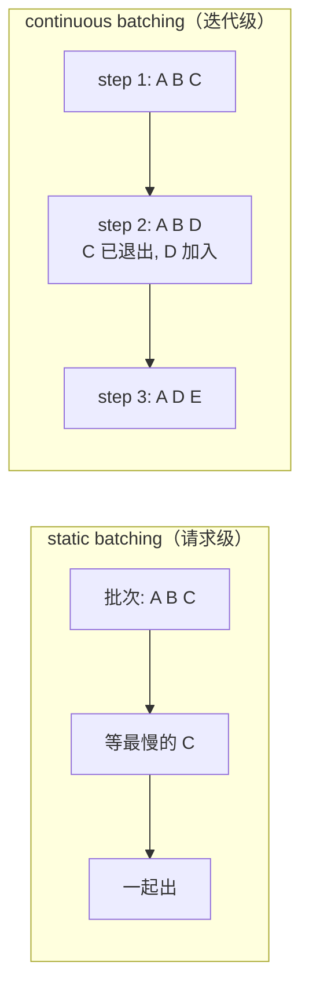

> **推理引擎系列 · 第 02 篇**
>
> 本系列面向**已经能把模型跑起来、但还没读过任何一个推理引擎源码**的工程师：把 vLLM 与
> SGLang 的功能差异、性能差异、选型结论，全部还原到**源码里可点开核验的那一行**。
>
> 取证基准：**vLLM `v0.31.0`**（commit `db9527a4`）／ **SGLang `v0.5.21`**（commit `e00930c5`）。
> 本文所有行号均锁在这两个 commit 上。
>
> - 00 引擎在栈里的位置 → 01 架构分歧的根 → **02 调度与批处理（本文）** → 03/04 支持矩阵 →
>   05 PD 分离 → 06 benchmark 交叉验证 → 07 选型手册 → 08 前缀命中率
>
> 指标口径（TTFT / TPOT / 吞吐）见[《性能分析（02）》](/2026/09/29/profiling-02-inference/)。

**TL;DR**

> * **continuous batching 的全部收益来自一件事：decode 阶段每步都要把全部权重读一遍，
>   这个成本被 batch 内所有请求摊薄。** 每请求每步成本从「一次权重读取」降到
>   「一次权重读取 / batch + 自己的 KV」，所以 decode 阶段天然希望 batch 越大越好。
> * **prefill 不吃这个红利**（它是 compute-bound 的），于是「把 prefill 切碎、塞进 decode
>   之间的空隙」成了提高利用率的标准手段——这就是 chunked prefill。
>   配套仿真给出的结论和流传的说法**不一样**：收益主要在**短请求的尾延迟**
>   （中载下 p99 降 59%），吞吐基本不变；代价是**长请求 TTFT 单调恶化**（$$\tau$$ 越小越差，
>   中载下 16 倍）。
> * **vLLM 的调度器没有「decode 阶段」和「prefill 阶段」之分**：每个请求只有
>   `num_computed_tokens` 与 `num_tokens_with_spec` 两个数，调度器的任务是让前者追上后者
>   （`scheduler.py:564-571`）。chunked prefill、前缀缓存、投机解码在这个模型里是同一件事。
> * **公平性是调出来的，不是免费的**：vLLM 用 `long_prefill_token_threshold` 防止长 prefill
>   挤占别人（`:611-625`），用优先级抢占回收 KV（`:764-789`）；
>   SGLang 把这件事做成了 9 种可插拔调度策略（默认 `fcfs`，`fields/schedule.py:98`）。
> * **「默认开启」不等于「总是更快」**：SGLang 的 overlap 默认开，但小模型单卡上
>   关掉反而更快（有 issue 证据，B 级）；vLLM 的 async scheduling 默认关。两边都留了开关，
>   因为**都不是无条件赢**。

---

## 0. 符号表

| 符号 | 含义 |
|:---|:---|
| $$b$$ | 一个 batch 内的请求数 |
| $$W$$ | 一次前向需要读取的权重字节数（与 batch 无关） |
| $$K_i$$ | 请求 $$i$$ 每步需要读取的 KV 字节数 |
| $$t_{\rm step}(b)$$ | batch 为 $$b$$ 时一步前向的耗时 |
| $$L_{\rm in}$$ | 输入长度（token） |
| $$\tau$$ | chunked prefill 的 chunk 大小（token） |
| $$h$$ | 前缀命中率 |

---

## 1. 从 static batching 到 continuous batching

最早的推理服务是**请求级批处理**（static batching）：攒够一批请求一起进、一起出。
问题很直白——一批里最早结束的请求要等着最晚的，等待期间 GPU 为它空转。

**continuous batching**（迭代级调度）把「进出」改成每步都可：



但 continuous batching 本身只解决了「进出」，没解决「**一批里装什么**」。
一个 batch 里同时有正在 prefill 的请求和正在 decode 的请求时，收益最大——
原因值得单独算一笔账，这就是下一节。

---

## 2. 为什么 decode 阶段希望 batch 越大越好

这一步推导是整篇的地基，而且**不依赖任何硬件细节**——判据是：换成 CPU 上讲也成立。

一次 decode 前向，GPU 要做两件事：

1. **读一遍全部权重**（每个 decode 步骤都要读，与 batch 里有多少请求无关）；
2. **读每个请求自己的 KV cache**（batch 内 $$b$$ 个请求各读各的）。

于是步耗时可以写成：

$$
t_{\rm step}(b) \;\approx\; t_W \;+\; \sum_{i=1}^{b} t_{K_i} \;=\; t_W \;+\; b\cdot \bar{t}_K
$$

其中 $$t_W$$ 是读一遍权重的时间、$$\bar{t}_K$$ 是单请求 KV 读取的平均时间。
**摊到每个请求头上**：

$$
\frac{t_{\rm step}(b)}{b} \;=\; \frac{t_W}{b} \;+\; \bar{t}_K
\;\;\xrightarrow{\;b \to \infty\;}\;\; \bar{t}_K
$$

结论：$$b$$ 越大，每请求每步成本越低，极限是「只付自己的 KV」。
**decode 是一个可以被 batch 摊薄的阶段**——这是 continuous batching 收益的根本来源。

把这个函数画成数（取 $$t_W = 100$$、$$\bar{t}_K = 2$$，单位任意，比例才是关键）：

| $$b$$ | 步耗时 $$t_{\rm step}(b)$$ | 每请求每步 $$t_{\rm step}(b)/b$$ | 相对 $$b=1$$ 的降幅 |
|---:|---:|---:|---:|
| 1 | 102 | 102.00 | — |
| 2 | 104 | 52.00 | −49% |
| 4 | 108 | 27.00 | −74% |
| 16 | 132 | 8.25 | −92% |
| 64 | 228 | 3.56 | −96.5% |
| 256 | 612 | 2.39 | −97.7% |
| 1024 | 2148 | 2.10 | −97.9% |

两张结论可以直接从表里读出来：

1. **前几档的收益最大**：$$b$$ 从 1 到 4，每请求成本降 74%；从 64 到 1024 只再降 41%
   （相对值）。所以「把 batch 做起来」的优先级远高于「把 batch 做到极大」。
2. **曲线在 $$b \approx t_W/\bar{t}_K$$ 附近弯掉**：本例是 $$100/2 = 50$$。
   $$b$$ 远小于这个数时权重读取主导，远大于它时 KV 读取主导——
   **后者已经是带宽问题，不是调度能解决的了**（见第 08 篇的显存账）。

prefill 完全相反：算 $$L_{\rm in}$$ 个 token 的注意力，计算量与输入长度成正比，
**已经是 compute-bound，加进 batch 里不产生摊薄**（权重读取被更大的计算量淹没）。
所以：

> **提高利用率的办法是把 compute-bound 的 prefill 和 memory-bound 的 decode
> 放进同一个 batch**，让每一步前向同时喂饱两类硬件单元。
> 而长输入的 prefill 会独占好几步，所以要先**切碎**——这就是 chunked prefill。

---

## 3. vLLM 的调度器：一个统一的 token 预算

vLLM V1 调度器最值得注意的设计，是它**取消了阶段划分**。
源码里的注释把这件事说得很明白（`vllm/v1/core/sched/scheduler.py:564-571`）：

> There's no “decoding phase” nor “prefill phase” in the scheduler.
> Each request just has the `num_computed_tokens` and `num_tokens_with_spec`.
> At each step, the scheduler tries to assign tokens to the requests
> so that each request's `num_computed_tokens` can catch up its `num_tokens_with_spec`.

翻译成调度语言：每个请求只有「还算了多少」和「总共有多少」两个计数，
调度器每步做的是**在 token 预算内把能算的 token 分下去**。一个刚到的新请求
（要算 $$L_{\rm in}$$ 个）和一个正在 decode 的请求（要算 1 个），
在这个模型里是同一件事，只是数量不同。

预算有两个（`scheduler.py:585` 起）：

| 预算 | 变量 | 默认值 | 约束什么 |
|:---|:---|:---|:---|
| 输入预算 | `max_num_batched_tokens` | **2048**（`config/scheduler.py:42`） | 一步里最多算多少 token |
| 总预算 | `max_num_scheduled_tokens` | 由模型上下文长度推导 | 一步里调度的 token 总数 |

新请求能拿到多少 token，是被这两个预算和**长 prefill 阈值**一起夹出来的
（`scheduler.py:679-686`）：

```python
num_new_tokens = (request.num_tokens_with_spec
                  + request.num_output_placeholders
                  - request.num_computed_tokens)
if 0 < long_prefill_token_threshold < num_new_tokens:
    num_new_tokens = long_prefill_token_threshold
num_new_tokens = min(num_new_tokens, token_budget, input_budget - draft_slots)
```

三行代码里藏着三个可调量：

1. **`long_prefill_token_threshold`**：单个请求一步最多算多少新 token。
   默认 **0 即关闭**（`config/scheduler.py:80`），打开时还有自适应版
   （`:87`）按请求数动态调整（`scheduler.py:621-625`：阈值不低于
   `input_budget // num_eligible_reqs`）。
2. **`token_budget`**：这一步的总预算，decode 请求先占、prefill 用剩下的。
3. **`input_budget - draft_slots`**：见 §7，投机解码的草稿 token 也占预算。

> ** chunked prefill 在 vLLM 里不是独立功能，而是这个预算模型的自然结果**：
> 一个 32K 输入的请求在 `max_num_batched_tokens = 2048` 下，
> 本来就不可能一步算完——它会被自动切成多步，每步 2048 个 token。
> 「chunked prefill 默认开启」说的就是这件事：不需要开关，因为关不掉
> （能关的只是「是否允许 prefill 与 decode 混批」的旧语义）。

### 3.1 一个具体的步：预算怎么分

把上面的模型跑一遍算术。假设当前状态：

- 在飞 decode 请求 3 个（各还需 1 个 token）；
- 等待队列里排着 2 个新请求：A（输入 8192 token）、B（输入 256 token）；
- 一步预算 2048，`long_prefill_token_threshold = 0`（默认关闭）。

调度顺序（`scheduler.py:585` 起）：

1. **decode 先占**：3 个在飞请求各 1 token，`token_budget` 与 `input_budget` 各扣 3；
2. **A 入场**：`num_new_tokens = 8192`，被 `input_budget - draft_slots` 夹到 2045；
3. **B 排队**：预算已用尽（2045 + 3 = 2048），B 这一步拿不到 token，继续等。

于是一个 8192 输入的请求要 **4 步**才算完 prefill（8192 / 2045 向上取整），
每步都带着 3 个 decode 请求。如果打开 `long_prefill_token_threshold = 512`，
同样状态变成：A 每步只算 512，需要 16 步，但 B 在第 2 步就能拿到 2048 − 3 − 512 = 1531 个 token、
**一步完成 prefill**。

同一个预算、两种切法，差别全在「长请求被允许一次占多少」。这就是 §5 公平性讨论的起点：
阈值不是性能参数，是**请求间分配策略**。

---

## 4. chunked prefill 的收益与代价

### 4.1 收益：填满 decode 的空隙

一批 decode 请求每步只读 1 个 token 的 KV，算力大量闲置。把 prefill 的 chunk
塞进去，相当于**用闲置的计算单元去算长输入**。定性的收益结构：

- 不混批：prefill 独占若干步（算力吃饱、带宽闲置），decode 独占若干步（带宽吃饱、算力闲置）；
- 混批：两类负载互补，整体吞吐接近两者之和而非较慢的那个。

### 4.2 代价一：TTFT 抖动

一个长输入请求被切成 $$\lceil L_{\rm in}/\tau \rceil$$ 个 chunk，
每个 chunk 都要和其它请求排队。**它的第一个 token 出现时间被拉长，
且随并发波动**——这就是 chunked prefill 的直接代价。
对延迟敏感的服务，这是必须和吞吐一起看的数（口径见
[《性能分析（02）》](/2026/09/29/profiling-02-inference/)）。

### 4.3 代价二：chunk 边界的重算

切碎不是零成本。注意力要跨 chunk 边界可见，两种处理方式：

- 每个 chunk 重算前一个 chunk 的尾部（浪费，但实现简单）；
- 维护跨 chunk 的 KV 累加状态（省算力，但状态管理复杂）。

vLLM 走的是前一条路的变体（chunk 内算完即写入 KV cache，下一步直接用），
SGLang 的 mixed chunk 则是另一条思路（见 §8）。

### 4.4 代价三：调度复杂度与可观测性

混批之后，「这个 batch 里有多少 prefill 多少 decode」成了运行时状态，
排查延迟问题的中间变量变多。两个引擎都给 prefill 相关的指标留了位置
（SGLang 甚至有 `prefill_delayer_*` 一族指标，见第 04 篇 §9）。

### 4.4 仿真：收益与代价的定量形状

上面的机制争论可以用一个纯 CPU 的离散事件仿真定下来。配套实验
[`experiments/serving-engine/chunked-prefill-mixing`](https://github.com/lrypcy/ipynbs/blob/ed7b73ff2320ccb9f1088ccc7ce56813fd124506/experiments/serving-engine/chunked-prefill-mixing/run.py)
把 §2 的成本模型直接实现为调度器，对比两种模式：

- **分相**（关闭 chunked prefill 的引擎行为）：一步要么全是 prefill、要么全是 decode，
  prefill 优先；
- **混批**：一步内 decode 各拿 1 token，剩余预算按 chunk 大小 $$\tau$$ 切给等待中的 prefill。

负载：15% 的请求是 8192 token 长输入、其余 256 token，输出固定 128 token，
一步预算 2048 token。三档负载 × 四种 $$\tau$$。

**中载**（平均并发约 3）是信息量最大的一档：

| 模式 | $$\tau$$ | makespan | 短请求 p50 | 短请求 p99 | 长请求 p50 |
|:---|---:|---:|---:|---:|---:|
| 分相 | — | 664,521 | 170.4 | **565.5** | 888.6 |
| 混批 | 64 | 669,029 | 485.4 | 574.2 | 13,917.5 |
| 混批 | 256 | 664,621 | 172.2 | **233.5** | 3,819.3 |
| 混批 | 1024 | 664,521 | 167.6 | 301.8 | 1,311.3 |
| 混批 | 2048 | 664,521 | 168.5 | 561.6 | 999.3 |

三件事同时成立：

1. **吞吐（makespan）几乎不动**：四种配置差异小于 0.1%。在这个 prefill 主导的负载里，
   「混批提高吞吐」没有出现——功是守恒的，混批改变的是**工作发生的时机**。
2. **短请求尾延迟大幅改善**：$$\tau=256$$ 把 p99 从 565.5 压到 233.5（**−59%**），
   而 makespan 不变。机制就是队首阻塞的消失：分相模式下，一个短请求必须等
   排在它前面的长 prefill **整个算完**；混批下它只需等当前这一个 chunk。
3. **长请求延迟单调恶化**：$$\tau$$ 从 2048 降到 64，长请求 p50 从 999 涨到 13,917
   （**16 倍**）——它的 prefill 被摊到越来越多步，每一步都要和其它请求排队。

另外两档负载给出边界：

- **轻载**（并发小于 1）：makespan 完全由到达率决定，各配置相同；
  $$\tau$$ 此时是**纯延迟权衡**（长请求 16.5×、短请求 p99 从 215 退化到 527）。
- **重载**（饱和）：排队主导一切，延迟全部以万步计，调度模式差异被淹没；
  分相的 makespan 反而比混批快 2–7%，小 $$\tau$$ 对长请求的伤害仍有 2.2×。

> **可操作的结论**：chunk 大小调的是**延迟分布**，不是吞吐；它存在一个中间最优
> （本负载约 256，即一步预算的 1/8），且最优位置随负载形状移动。
> 「把 chunk 调到最小以最大化吞吐」是没有仿真支持的说法——本实验里它同时恶化
> 长请求 p50（16×）和短请求 p99。

实验的两种成本口径（计算与带宽串行 / 并行）只改变绝对耗时，不改变上述任何结论的方向。
延迟数字是**构造负载下的仿真值**，不是任何真实引擎的实测；引用时请连同负载参数一起引。

---

## 5. 公平性：长 prefill 与优先级

混批引入一个新问题：**一个 32K 的请求会连续占用多步预算，把小请求的 TTFT 推高**。
两个引擎给了不同的答案。

### 5.1 vLLM：阈值 + 优先级 + 抢占

三件事各自可调：

1. **长 prefill 阈值**（`scheduler.py:611-625`、`:679-680`）：把单请求单步的
   新 token 数夹住，长请求被强制切小。自适应模式还会按当前请求数动态抬高下限
   （`:624-625`），避免请求少时白白切碎。
2. **优先级**（`scheduler.py:740`、`:768`）：抢占时按
   `(r.priority, r.arrival_time)` 选牺牲者——**先抢低优先级、同级抢最晚到的**。
3. **抢占与恢复**（`scheduler.py:764-789`）：KV 不够时把某个在飞请求踢出 batch，
   释放的块回收；被抢请求后续重新排队（代价是已算的 token 可能重算，取决于配置）。

### 5.2 SGLang：把公平性做成策略维度

SGLang 没有把「公平」写死成一个阈值，而是给了 **9 种调度策略**可插拔，
由 `schedule_policy` 选择（`fields/schedule.py:98`，**默认 `fcfs`**）：

| 策略族 | 治什么 |
|:---|:---|
| `fcfs`（默认） | 先来先服务，不区分长度 |
| 优先级 /  deadline 类 | 延迟敏感请求插队 |
| **cache-aware（`lpm`）** | 前缀命中率高的请求优先——**要显式开才吃到** |
| 随机 / 加权轮转 | 避免队首阻塞 |

> **一个必须记住的默认值**：SGLang 的 prefix-aware 调度（`lpm`）**默认关闭**。
> 不传 `--schedule-policy lpm`，吃到的只是 radix cache 本身的自动复用，
> 没有「优先调度高命中请求」这一层。这是选型时最容易漏的一个开关
> （第 07 篇决策树会再回到它）。

### 5.3 prefill delayer：按显存水位推迟 prefill

SGLang 还有一个 vLLM 侧没有对等物的机制：`get_new_batch_prefill()`
（`scheduler.py:3804`）外面包了一层 **PrefillDelayer**（`:3806-3826`）——
按当前显存池的最大使用率决定这一批 prefill 是否推迟。思路是把 prefill
的时机也变成受控量：显存紧就少放 prefill 进来，保护已在飞的请求。

---

## 6. overlap：把调度延迟藏进 GPU 时间里

上一章的两个引擎分歧（[第 01 篇](/2026/10/18/serving-01-architecture-divergence/)）
在这里显出后果：**CPU 调度与 GPU 执行是否重叠，决定了调度本身花的时间要不要算进 TPOT**。

- **SGLang**：overlap scheduler **默认开**（`disable_overlap_schedule=False`）。
  调度在 GPU 算上一步时跑，理想情况下调度延迟被完全隐藏。
- **vLLM**：`async_scheduling` **默认关**（`config/scheduler.py:209`），
  调度在两步之间串行发生；打开后同样的隐藏效应出现
  （PR #32618 自报 PP4 场景 E2E 吞吐 +30.8%，B 级）。

两个已知边界：

1. **小模型单卡上 overlap 可能变慢**——SGLang issue #2558（A 级，社区已复现）：
   Qwen2.5-0.5B 单卡随机负载下 `--disable-overlap-schedule` 反而
   22,025 → 25,555 tok/s。机制解释：小模型的调度 bookkeeping 相对收益变小。
2. **SGLang 自己会在特定条件下主动关 overlap**：连续两个 prefill 批次时
   （`scheduler.py:2032`，环境变量
   `SGLANG_DISABLE_CONSECUTIVE_PREFILL_OVERLAP` 控制），为的是改善 TTFT——
   **官方代码承认 overlap 不是无条件赢**。

> **实践含义**：overlap 的默认值两边相反，迁移或对比时**必须核对这一项**，
> 否则测的是「默认值差异」不是「架构差异」。第 04 篇 §12 有完整默认开关对照表。

---

## 7. 与投机解码的接口：草稿 token 也占预算

投机解码看起来是「算法层」的事，但它对调度有一个直接后果：**草稿 token 占 token 预算**。
vLLM 调度器在每步开头就为此预留（`scheduler.py:583-584`）：

```python
spec = self.vllm_config.speculative_config
draft_slots = spec.max_num_new_slots_for_drafting if spec is not None else 0
```

随后所有新请求的 `num_new_tokens` 都要扣掉这份预留（`:685`：
`input_budget - draft_slots`）。含义很实际：

- 开投机解码后，**一个 batch 能装的 prefill token 变少了**——草稿位是硬预留；
- 在 $$\gamma$$ 草稿 + 1 验证的配置下，每一步多算 $$\gamma$$ 个 token，
  预算压力直接传导到 chunked prefill 的粒度；
- 所以「投机解码开多大 $$\gamma$$」和「chunked prefill 切多细」不是两个独立调参，
  它们抢同一份预算。

收益与失效区的完整模型见
[《投机解码（02）：收益模型》](/2026/10/18/specdec-02-acceptance-and-speedup-model/)；
什么负载下不值得开见
[《投机解码（07）》](/2026/10/18/specdec-07-benchmarks-and-tradeoffs/)。

### 7.1 一笔账：$$\gamma=4$$ 时预算被切走多少

沿用 §3.1 的例子，把投机解码开起来算一遍。取 $$\gamma = 4$$（草稿 4 token + 验证 1 个），
vLLM 的预留 `draft_slots` 会随配置上升（`scheduler.py:583-584`）：

| 配置 | decode 预留 | 可用于 prefill 的预算 | 8192 输入的 prefill 步数 |
|:---|---:|---:|---:|
| 不开投机 | 0 | 2048 − 3 = 2045 | 4 |
| $$\gamma=4$$，3 个在飞 | 3 × 5 = 15 | 2048 − 3 − 15 = 2030 | 5 |
| $$\gamma=4$$，16 个在飞 | 16 × 5 = 80 | 2048 − 16 − 80 = 1952 | 5 |

三个读数：

1. **预留随并发线性增长**：$$\gamma$$ 固定时，在飞请求越多，被草稿位切走的预算越多。
   高并发 + 大 $$\gamma$$ 的组合会明显压缩 prefill 的空间。
2. **代价体现在步数上**：本例里 8192 输入的 prefill 从 4 步变成 5 步——TTFT 变差，
   换来的是 decode 步数降到约 $$1/\mathbb{E}[T]$$（收益模型见
   [第 02 篇投机解码](/2026/10/18/specdec-02-acceptance-and-speedup-model/)）。
3. **这是一笔可以事前算的账**：$$\gamma$$、并发、输入长度都已知，代进去就能比较
   「多几步 prefill」和「少几步 decode」哪个划算——不需要先上线再试。

> **实践含义**：调 $$\gamma$$ 时不要只看 accept length。把 $$\gamma$$ 代进预算算式，
> 看它把长输入的 prefill 推后了几步；负载里长输入占比高时，这个代价会吃掉相当一部分收益。

---

## 8. SGLang 侧的相关机制

把 SGLang 在这块的对应物集中列一遍，便于对照：

| 机制 | vLLM | SGLang |
|:---|:---|:---|
| chunk 大小 | `max_num_batched_tokens`（一步总预算） | `chunked_prefill_size`（默认 `None` = 动态；`-1` 才禁，`fields/schedule.py:52-55`） |
| prefill/decode 混批 | 预算模型的自然结果 | **mixed chunk**（`scheduler.py:1328`，需 `enable_mixed_chunk`） |
| PP 下的动态 chunk | 无 | **dynamic chunking**（`scheduler.py:1336` 起，按 PP 各stage 延迟模型定 chunk 大小） |
| prefill 时机控制 | 无 | **PrefillDelayer**（`scheduler.py:3806-3826`，按显存水位推迟） |
| 多模态 + Transformers 后端 | — | chunked prefill **被主动关闭**（`scheduler.py:1313-1322`，避免部分多模态 chunk 错配） |

两条值得注意的差异：

1. **vLLM 的 chunk 是「一步算多少」的总量约束，SGLang 的 chunk 是「一个请求切多大」**
   ——同一个词，约束的对象不同，数字不可直接比。
2. **SGLang 对多模态模型主动放弃 chunked prefill**（`scheduler.py:1317-1322`，
    warning 原文 “Chunked prefill is disabled for multimodal models with the
   Transformers backend”）——这是「默认开启」的又一个例外，
   迁移到多模态负载时要重新核对。

### 8.2 与 PD 分离的分工

PD 分离（第 05 篇的主题）把 prefill 和 decode 放到不同实例之后，
本篇讨论的「混批」在两个角色上的含义完全不同：

- **P 实例**：只做 prefill，chunked prefill 退化成「P 侧如何把多个请求的
  prefill 拼批、按什么粒度向 D 侧移交 KV」。此时 chunk 大小同时决定
  **KV 传输的粒度**——切得越细，D 侧越早能开始 decode，但传输的固定开销
  （建连、校验、元数据）被摊薄得越少。
- **D 实例**：只做 decode，混批失去了一半的意义（没有 prefill 可混），
  批调度回到「纯 decode 的 batch 能开多大」。

所以 PD 分离不是「把混批拆到两台机器上」：它换掉了混批要解决的那个问题
（prefill 阻塞 decode），代价是引入了 KV 传输这个新的调度变量。
第 05 篇会回到传输粒度的账。

---

## 9. 本章小结：调度层的可观测清单

把调优能碰的旋钮和它们的观测点列成一张表，作为本篇的收尾：

| 旋钮 | 引擎 | 观测指标 | 篇目 |
|:---|:---|:---|:---|
| 一步 token 预算 / chunk 大小 | 两者 | 输入长度分布、TTFT p99 | 本篇 §3 |
| 长 prefill 阈值 / 调度策略 | vLLM / SGLang | 长请求 TTFT 与小请求 TTFT 的差 | 本篇 §5 |
| overlap 开关 | 两者 | TPOT 与调度耗时的占比 | 本篇 §6 |
| 投机解码 $$\gamma$$ | 两者 | accept length、草稿位占用 | 本篇 §7 |
| 前缀命中率 | 两者 | cache 命中率（**可离线算**） | 第 08 篇 |

> **最后一句话**：调度器是推理引擎真正的「大脑」，而它的全部工作可以概括成
> **在一个 token 预算内决定下一步算谁的哪些 token**。continuous batching、
> chunked prefill、优先级、抢占、投机解码的预算预留，都是这同一个决定的不同侧面。
> 理解了预算模型，就能自己判断一个新开关会碰到哪根弦。

### 9.1 三个真正值得盯的运行时信号

上面的旋钮表是静态的；上线之后该看的是三个动态信号，它们分别对应预算模型的三个约束：

| 信号 | 对应约束 | 异常说明什么 |
|:---|:---|:---|
| **等待队列深度** | 到达率超过服务率 | 负载进入饱和区，此时调 $$\tau$$ 基本无效（§4.4 重载档） |
| **批组成（prefill/decode 比）** | 一步预算被谁占满 | prefill 占比持续高 → 长输入负载，检查阈值与 $$\tau$$ |
| **抢占次数** | KV 容量约束 | 频繁抢占说明 `mem-fraction-static` 或 batch 上限需要重估 |

第三个信号最容易被忽略：抢占是** KV 容量**触发的，不是算力触发的——
它的解法在显存一侧（更小的缓存块、更激进的量化、更短的上下文），
旋调度旋钮只会把问题搬来搬去。

---

**上一篇**：[推理引擎（01）：架构分歧的根——三条独立的设计路线](/2026/10/18/serving-01-architecture-divergence/)

**下一篇**：[推理引擎（03）：支持矩阵（上）——「200+ 模型」为什么不可比](/2026/10/18/serving-03-support-matrix-models/)

**站内承接**：三条独立设计路线见
[《推理引擎（01）》](/2026/10/18/serving-01-architecture-divergence/)；
指标口径见[《性能分析（02）：推理》](/2026/09/29/profiling-02-inference/)；
投机解码收益模型见[《投机解码（02）》](/2026/10/18/specdec-02-acceptance-and-speedup-model/)。

## 参考

1. vLLM `v0.31.0`，`vllm/v1/core/sched/scheduler.py` — <https://github.com/vllm-project/vllm/blob/db9527a46873454610df6dbedf79a36d6bf1a7f6/vllm/v1/core/sched/scheduler.py>
2. vLLM `v0.31.0`，`vllm/config/scheduler.py` — <https://github.com/vllm-project/vllm/blob/db9527a46873454610df6dbedf79a36d6bf1a7f6/vllm/config/scheduler.py>
3. SGLang `v0.5.21`，`python/sglang/srt/managers/scheduler.py` — <https://github.com/sgl-project/sglang/blob/e00930c5489053f26d86b179cee0d087f846acbb/python/sglang/srt/managers/scheduler.py>
4. SGLang `v0.5.21`，`python/sglang/srt/arg_groups/fields/schedule.py` — <https://github.com/sgl-project/sglang/blob/e00930c5489053f26d86b179cee0d087f846acbb/python/sglang/srt/arg_groups/fields/schedule.py>
5. vLLM async scheduling + PP 实测（PR #32618，B 级）— <https://github.com/vllm-project/vllm/pull/32618>
6. SGLang issue #2558（overlap 在小模型单卡上回退，A 级）— <https://github.com/sgl-project/sglang/issues/2558>
