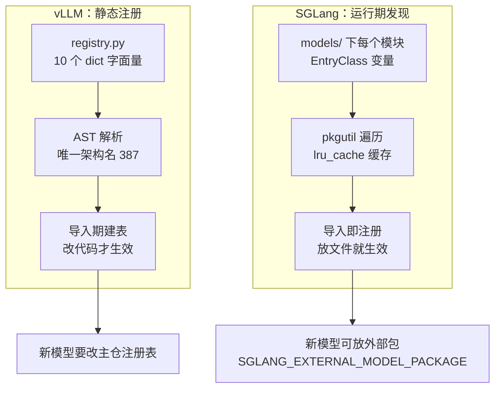

> **推理引擎系列 · 第 03 篇**
>
> 本系列面向**已经能把模型跑起来、但还没读过任何一个推理引擎源码**的工程师：把 vLLM 与
> SGLang 的功能差异、性能差异、选型结论，全部还原到**源码里可点开核验的那一行**。
>
> 取证基准：**vLLM `v0.31.0`**（commit `db9527a4`）／ **SGLang `v0.5.21`**（commit `e00930c5`）。
> 本文所有行号均锁在这两个 commit 上。
>
> - 00 引擎在栈里的位置 → 01 架构分歧的根 → 02 调度与批处理 → **03 支持矩阵（上）（本文）** →
>   04 支持矩阵（下）→ 05 PD 分离 → 06 benchmark 交叉验证 → 07 选型手册 → 08 前缀命中率

**TL;DR**

> * **「支持 200+ 模型架构」这句话两边都属实，但两个数字的口径不同，不能相减**：
>   vLLM 数的是**唯一架构名字符串**（387 个，静态显式注册），SGLang 数的是
>   **`EntryClass` 注册条目**（282 个，运行期动态发现）。差 105 不等于「多支持 105 个模型」。
> * **真正该看的不是数量，是扩展机制**：vLLM 加一个新模型要改 `registry.py` 的字典字面量；
>   SGLang 只要在新模块里赋一个 `EntryClass` 变量，运行期自动发现。
>   对「想用自己的模型结构」的团队，这一条比 387 vs 282 重要得多。
> * **Attention backend 44 vs 24 同理**：vLLM 用 `Enum` + 自定义 metaclass，
>   SGLang 用装饰器注册表。数字差异的方向明确（vLLM 更多），幅度不可量化。
> * **一处必须纠正的流传说法**：TokenSpeed MLA **两边都有**（vLLM `:75`、SGLang `:96`），
>   不是 SGLang 独有；差异只在 SGLang 版加了 MLA 模型的守卫。
> * **本系列对「支持数」的纪律**：任何计数都必须附口径（数的是哪个文件、什么规则），
>   并且明确「不能直接相减」的部分。本篇 §5 给出完整的取证边界。

---

## 0. 速览：数量对照

先给一张表，然后逐行拆开。**每一行的口径都不一样**，这正是本篇的主题：

| 维度 | vLLM | SGLang | 口径说明 |
|:---|---:|---:|:---|
| 模型架构 | **387** | **282** | ⚠️ 口径不同，见 §1 |
| Attention backend | **44** | **24** | vLLM 用 Enum，SGLang 用装饰器 |
| 投机解码算法 | 8 类别名 | **9** 枚举 | SGLang 有插件注册机制 |
| 结构化输出后端 | 4 | 4 | 命名与能力档位都不同 |
| 量化方法 | **30** | 25 base + 平台追加 | 机制不同，见第 04 篇 |
| 默认多 LoRA 并发 | **1** | **8** | 参数名也不同 |

（完整矩阵含 API 面、可观测性、硬件平台，见第 04 篇。）

这张表里**没有一行是可以直接相减的**。下面先解释为什么，再给出正确的读法。

还有一个读表前的提醒：**注册层的支持只是第一轮筛选**。一个模型要真正跑起来，
至少还要过两关——量化格式在不在第 04 篇的那张表里，以及它需要的 attention 类型
在 §3 的注册表里有没有对应后端。三层都过，才值得拿真实权重试跑。

---

## 1. 模型架构支持：「200+」这个数字

### 1.1 vLLM：静态显式注册，387 个唯一架构名

vLLM 的注册表 `vllm/model_executor/models/registry.py` 是
**10 个模块级 dict 字面量**加一个 `**` 合并字典。AST 精确解析得**唯一架构名 387 个**：

| 字典 | 行号区间 | 条目数 |
|:---|:---|---:|
| `_TEXT_GENERATION_MODELS` | L71–217 | 125 |
| `_EMBEDDING_MODELS` | L219–270 | 33 |
| `_LATE_INTERACTION_MODELS` | L272–286 | 11 |
| `_REWARD_MODELS` | L288–292 | 3 |
| `_TOKEN_CLASSIFICATION_MODELS` | L294–313 | 6 |
| `_SEQUENCE_CLASSIFICATION_MODELS` | L315–342 | 10 |
| `_MULTIMODAL_MODELS` | L344–624 | 121 |
| `_SPECULATIVE_DECODING_MODELS` | L626–708 | 63 |
| `_TRANSFORMERS_SUPPORTED_MODELS` | L710–736 | 14 |
| `_TRANSFORMERS_BACKEND_MODELS` | L738–771 | 10 |
| `_VLLM_MODELS`（`**` 合并 10 个） | L773–784 | — |
| `_PREVIOUSLY_SUPPORTED_MODELS`（已移除，附移除版本） | L792–846 | 50 |
| `_OOT_SUPPORTED_MODELS`（转插件） | L848–853 | 4 |

条目简单相加为 400，差 13 是跨字典重名。

核心类 `_ModelRegistry` 在 `registry.py:1115`，`register_model()` 在 `:1122`，
未支持架构的报错 `_raise_for_unsupported()` 在 `:1164`——
这个函数会区分「旧版本支持过」与「已转 OOT 插件」两种情况，
**这个区分对排查问题很有用**：报错会告诉你该装哪个版本、还是该走插件路径。

「seamlessly supports 200+ model architectures」这句话的出处在
`docs/README.md:66`。**387 > 200，属实且保守。**

### 1.2 SGLang：运行期动态发现，282 个注册条目

SGLang **没有** vLLM 式显式列表。`registry.py` 只有 159 行，
靠 `pkgutil.iter_modules` 遍历 `python/sglang/srt/models/` 下每个模块的
**`EntryClass`** 变量动态注册（读取逻辑 `registry.py:134-147`，
支持 list 多类形式 `:137-143`）。

几个值得注意的实现细节：

- `import_model_classes()` 在 `:115`（带 `@lru_cache`，`:114`）——**导入结果被缓存**，
  运行期不会重复扫描；
- 重复实现断言 `:141`、`:145`；
- **导入失败仅 warn 不致命**（`:129-132`）——一个坏模块不会让整个注册表挂掉，
  代价是「支持列表」在运行期可能因环境而略有出入；
- 可禁用架构的环境变量 `SGLANG_DISABLED_MODEL_ARCHS`（`:124`）；
- 外部模型包 `SGLANG_EXTERNAL_MODEL_PACKAGE` 分支（`:152-157`）——
  **这是官方留的扩展位**：把模型放到外部包里，不用动主仓库。

AST 遍历全部 282 个模型文件、解析每个 `EntryClass` 赋值，
得 **282 个注册条目，分布 221 个模块**。
一个模块可注册多个类（例：`transformers.py:1673` 注册 12 个、
`llama.py:928` 注册 4 个、`deepseek_v2.py:3472` 注册 DeepseekV2 / V3 / V32）。

### 1.3 ⚠️ 这两个数字不能直接相减

- vLLM 的 387 是**唯一架构名字符串**；
- SGLang 的 282 是**`EntryClass` 条目数**。

两者口径不同：vLLM 一个 arch 字符串对应一个类文件；
SGLang 一个模块可注册多类。**不能得出「vLLM 多支持 105 个架构」**。

可以确证的是：两者都在数百级，vLLM 明确更大，但差距不可直接量化。
目录规模佐证：vLLM `models/` 有 306 个 `.py`，SGLang 有 282 个。

> **方法论**：跨项目比「支持数」之前，先问三个问题——数的是文件名、类名还是注册条目？
> 多对一的映射怎么算？已移除的算不算？三个答案里有两个不同，数字就不能相减。

### 1.4 多模态是最大的单一字典

387 个 arch 里，`_MULTIMODAL_MODELS`（`registry.py:344-624`）一个字典就占 121 个，
是文本生成（125）之外最大的一族。这个分布本身是信息：

- **多模态的架构churn 最快**——视觉塔、连接器、分辨率处理的组合在爆炸，
  注册表的增长主要来自这里；
- 121 个 arch 不等于 121 种能力：很多是同一家族的不同尺寸/配置，
  真正的差异在视觉编码器与投影层的实现；
- SGLang 侧的对应数字没有单独统计（其 282 个条目混在 221 个模块里），
  但多模态相关模块同样在快速增加，且它对 chunked prefill 有一个特殊处理
  （多模态 + Transformers 后端时主动关闭，见
  [第 02 篇](/2026/10/18/serving-02-scheduling-and-batching/) §8）。

> **实践含义**：如果你的负载是多模态，比 arch 数更有用的是查
> **你的具体视觉塔 + LLM 组合**在两边的实现状态，而不是看总数。

---

## 2. 扩展机制：比数量更重要的差异

数量是存量，机制是增量。对要上新模型的团队，机制决定成本。



### 2.1 代价与收益的对照

| | vLLM | SGLang |
|:---|:---|:---|
| 加新模型的改动 | 改 `registry.py` 字典 + 提 PR | 在 `models/` 放模块（或外部包） |
| 生效时机 | 下次安装 / 升级 | 下次启动 |
| 上游依赖 | 合并进主仓 | 可先外部包，后进主仓 |
| 失败隔离 | 注册表是字面量，坏条目直接报错 | 导入失败仅 warn（`:129-132`） |
| 可禁用 | 无对应机制 | `SGLANG_DISABLED_MODEL_ARCHS`（`:124`） |

vLLM 用「显式」换来了**可审计性**：`git diff registry.py` 就是一份完整的架构变更史。
SGLang 用「隐式」换来了**低摩擦**：加模型不用碰任何中心文件。

> **没有哪一边绝对更好**。但选型时要问自己一个问题：
> 你要支持的模型，是在上游已经合并了（那 vLLM 的显式列表更可靠），
> 还是需要你自己改结构（那 SGLang 的外部包路径成本更低）？

### 2.2 投机解码的注册机制：同一个分歧的缩影

这个分歧在投机解码上更明显，因为草稿器的种类比模型架构变得更快。

**vLLM**：权威清单是 config 里的 `Literal`
（`SpeculativeMethod = Literal[...]`，`vllm/config/speculative.py:74-85`），
实际 dispatch 在 `vllm/v1/worker/gpu_model_runner.py:617-676` 的 **if-elif 链**：

| method | 类 | 行号 |
|:---|:---|:---:|
| `custom_class` | `create_custom_proposer` | `:618` |
| `ngram` | `NgramProposer` | `:624` |
| 用 draft model | `DraftModelProposer` | `:626` |
| n-gram GPU | `NgramProposerGPU` | `:632` |
| Gemma4 MTP | `Gemma4Proposer` | `:649` |
| Step3.5 MTP | `Step3p5MTPProposer` | `:651` |
| DFlash | `DFlashProposer` | `:653` |
| `suffix` | `SuffixDecodingProposer` | `:656` |
| Eagle | `EagleProposer` | `:658` |
| `medusa` | `MedusaProposer` | `:664` |
| `extract_hidden_states` | `ExtractHiddenStatesProposer` | `:668` |

其中 `MTPModelTypes` 独占 `:39-67`，**共 27 个值**——各家 MTP 变体
（`deepseek_mtp`、`glm4_moe_mtp`、`kimi_k3_mtp`、`qwen3_next_mtp` …）
在这个版本已经被枚举成一等公民。

**SGLang**：`class SpeculativeAlgorithm(Enum)` 在
`python/sglang/srt/speculative/spec_info.py:32`，9 个内置成员（`:39-47`），
字符串解析 `from_string()`（`:50`）带**三级回退**（`:57` / `:60-61` / `:62-64`）：
枚举 → 保留别名 → **插件注册表**，否则抛 `ValueError`。
保留别名表只有一个：`NEXTN` → EAGLE（`spec_registry.py:183`）。

插件入口是装饰器
`SpeculativeAlgorithm.register(name, *, supports_overlap, validate_server_args, spec_class)`
（`spec_info.py:67-91`），插件以 `class CustomSpecAlgo`（`spec_registry.py:26`）存在，
duck-type 同一套接口。

> **选型含义**：要接一个自研 drafter，SGLang 有正式插件位（写个类 + 一行装饰器）；
> vLLM 需要走 `custom_class`，但要自己在 `gpu_model_runner.py` 的 if-elif 链里加分支。
> 前者是配置，后者是改源码。

vLLM 侧投机解码的实现目录 `vllm/v1/spec_decode/` 有 22 个文件，
基类 `SpecDecodeBaseProposer` 在 `llm_base_proposer.py`；
SGLang 侧的 spec V1 worker 路径已移除（`spec_registry.py:38-41` 的注释），
`supports_overlap=False` 的插件会走 V2 schema 且关闭 overlap——
**插件能不能和 overlap 共存，是注册时就要声明的属性**（`spec_info.py:67-91` 的签名里就有它）。

### 2.4 两边算法清单的并排对照

把两边的投机解码清单并排放（方法级的完整矩阵见
[《投机解码（04）：引擎支持矩阵》](/2026/10/18/specdec-04-engine-support-matrix/)）：

| 方法族 | vLLM（config Literal + dispatch） | SGLang（Enum + 插件） |
|:---|:---|:---|
| 无模型 n-gram | `ngram` / `ngram_gpu` / `suffix` | `NGRAM` |
| 独立草稿模型 | `draft_model` | `STANDALONE` |
| Medusa 类多头 | `medusa` | — （走 `EAGLE` 或插件） |
| EAGLE 系 | `eagle` / `eagle3` | `EAGLE` / `EAGLE3` |
| MTP（各家变体） | `MTPModelTypes` **27 个值**（`:39-67`） | 经 `EAGLE`/`FROZEN_KV_MTP` 及插件 |
| 其它自投机 | `extract_hidden_states` / `dspark` / `dflash` | `DSPARK` / `DFLASH` / `UNO` |
| 自定义 | `custom_class` | 插件注册表（duck-type 接口） |

两个结构性差异值得记住：

1. **vLLM 把 MTP 枚举成了 27 个具名值**——对「用 DeepSeek / GLM / Kimi 的 MTP」
   这种具体需求，vLLM 的配置写法更直接（一个字符串搞定）；
2. **SGLang 把自定义路径做成了正式插件位**——对「我有自己的草稿器」，
   SGLang 不用改引擎源码。

> 这就是同一个分歧在第三个地方的再现：**具名枚举 vs 插件注册表**。
   模型架构、attention backend、投机解码，三处的选择逻辑完全一致。

### 2.3 你的模型不在表里怎么办

这是支持矩阵真正落地的一问。两条路径的成本结构完全不同：

**vLLM：OOT 插件或改注册表。**

- 报错路径 `_raise_for_unsupported()`（`registry.py:1164`）会先查
  `_PREVIOUSLY_SUPPORTED_MODELS`（`:792-846`，50 个已移除架构，**附移除版本**）——
  如果你的模型在里面，报错会直接告诉你「哪个版本还支持，升级/降级即可」；
- 不在里面的，走 `_OOT_SUPPORTED_MODELS`（`:848-853`，4 个已转插件的架构）；
- 都不中的，自己实现模型类 + 调 `register_model()`（`:1122`）——
  对 fork 来说是改一个字典，对上游来说是提 PR 等合并。

**SGLang：放个文件，或放个外部包。**

- 在 `python/sglang/srt/models/` 下加一个模块、赋 `EntryClass`，
  下次启动 `pkgutil` 遍历自动发现（`registry.py:134-147`）；
- 不想动主仓的，设 `SGLANG_EXTERNAL_MODEL_PACKAGE`（`:152-157`）
  指向自己的包——**这是官方扩展位，不是 hack**；
- 运行期可以用 `SGLANG_DISABLED_MODEL_ARCHS`（`:124`）禁用个别架构，
  排查「某个模型偶发导入失败」时有用。

> **一句话对比**：vLLM 的未支持路径是「查表 → 报错 → 自己实现」，
> SGLang 的是「放文件 → 自动发现」。前者每次都要人肉判断，后者是机制化的。
> 但 vLLM 的报错信息更有诊断价值（区分「移除过」与「转插件」）——
> 这是显式注册表的红利。

---

## 3. Attention backend：44 vs 24

### 3.1 vLLM：Enum，44 个成员

`class AttentionBackendEnum(Enum, metaclass=_AttentionBackendEnumMeta)` 在
`vllm/v1/attention/backends/registry.py:34-200`。自定义 metaclass（`:18-31`）
把 `KeyError` 转成含全部合法取值的友好报错（`:28-31`）——
**拼错后端名时的报错会把 44 个合法值全列出来**，这是个实用的工程细节。

按族分组（行号在同一文件）：

| 族 | 成员与行号 |
|:---|:---|
| FlashAttention | `FLASH_ATTN`(L44)、`FLASH_ATTN_DIFFKV`(L45)、`FLASH_ATTN_MLA`(L121)、`FLASH_ATTN_MLA_SPARSE`(L122) |
| Triton | `TRITON_ATTN`(L48)、`TRITON_ATTN_DIFFKV`(L49)、`TRITON_FLASH_ATTN`(L52)、`TRITON_MLA`(L90)、`TRITON_MSA`(L132) |
| FlashInfer | `FLASHINFER`(L68)、`TRITON_FLASHINFER`(L69)、`FLASHINFER_MLA`(L72)、+ SPARSE 系列(L78/82/86) |
| FlashMLA | `FLASHMLA`(L92)、`FLASHMLA_SPARSE`(L93)、+ DSV4/DSV41 变体(L97/100/104/110/113/117) |
| ROCm / AITER | `ROCM_ATTN`(L55)、`ROCM_AITER_MLA`(L56)、`ROCM_AITER_TRITON_MLA`(L57)、`ROCM_AITER_FA`(L60)、`ROCM_AITER_MLA_SPARSE`(L63)、`ROCM_FLASHMLA_SPARSE_DSV4`(L104)、`ROCM_AITER_UNIFIED_ATTN`(L144) |
| CPU / XPU | `XPU_MLA_SPARSE`(L66)、`TORCH_SDPA`(L67, 仅 ViT)、`CPU_ATTN`(L148)、`CPU_MLA`(L149)、`AMX_MLA`(L150)、`HPC_ATTN`(L143) |
| CUTLASS | `CUTLASS_MLA`(L91)、`CUTLASS_MSA`(L128) |
| 特殊 | `NO_ATTENTION`(L136)、`FLEX_ATTENTION`(L137)、`CUSTOM`(L154)、`B12X`(L120)、`MINIMAX_M3_SPARSE`(L125)、`TURBOQUANT`(L151)、`TOKENSPEED_MLA`(L75) |

**`xformers` 未找到**（`vllm/v1/attention/backends/` 下无实现；
`flex_attention.py` 是 PyTorch `torch.nn.attention.flex_attention` 的封装——
FlexAttention 的可编程边界见本站
[FlexAttention 系列](/2026/10/18/flex-attention-02-blockmask-engineering-long-context/)）。

### 3.2 SGLang：装饰器注册，24 个

`ATTENTION_BACKENDS = {}`（`attention_registry.py:40`）+
`register_attention_backend(name)`（`:43-48`），逐个 `@register_attention_backend("...")`：

| 名称 | 行号 | | 名称 | 行号 |
|:---|:---|:---|:---|:---:|
| `flashinfer` | L51 | | `fa3` | L227 |
| `trtllm_mla` | L78 | | `fa4` | L253 |
| **`tokenspeed_mla`** | **L96** | | `ascend` | L130 |
| `cutedsl_mla` | L107 | | `intel_xpu` | L550 |
| `aiter` | L116 | | `hpc_ops` | L271 |
| `wave` | L123 | | `intel_amx` | L288 |
| `triton` | L195 | | `minicpm_flashattn` | L326 |
| `torch_native` | L206 | | `minicpm_flashinfer` | L333 |
| `flex_attention` | L213 | | `dsv4` | L166 |
| `flashmla` | L220 | | `dsa` | L139 |
| `nsa` | L155 | | `qsa` | L146 |
| | | | `trtllm_mha` | L262 |

SGLang 独有值得注意的：`dsv4` / `dsa` / `qsa` / `nsa`（DeepSeek 稀疏注意力系列）、
`cutedsl_mla`、`fa3` / `fa4`、`wave`、`ascend`、`minicpm_*`。

vLLM 有而 SGLang 注册名里没有的：`FLASH_ATTN_DIFFKV`、`TRITON_ATTN_DIFFKV`、
`ROCM_AITER_UNIFIED_ATTN`、`CUTLASS_MSA`、`TRITON_MSA`、`MINIMAX_M3_SPARSE`、
`TURBOQUANT`、`B12X`。

### 3.3 ⚠️ 纠正：TokenSpeed MLA 两边都有

不是 SGLang 独有。vLLM 是 `TOKENSPEED_MLA`（`registry.py:75`），
指向 `vllm/v1/attention/backends/mla/tokenspeed_mla.py`；
SGLang 是 `tokenspeed_mla`（`attention_registry.py:96`），
指向 `python/sglang/srt/layers/attention/tokenspeed_mla_backend.py`。

但有一处**可用性差异**：SGLang 版仅限 MLA 模型，否则抛错
`"tokenspeed_mla backend can only be used with MLA models."`（`:99`）；
vLLM 的枚举无此守卫。

> 这类「两边都有、行为略有不同」的条目是支持矩阵里最容易出错的地方：
> 它同时反驳「只有 SGLang 有」和「两边完全一样」两种说法。

### 3.4 数量差异的实际后果

44 vs 24 的差距集中在三类，每一类的选型含义不同：

| 差异类型 | 例子 | 谁受影响 |
|:---|:---|:---|
| **平台变体** | vLLM 的 ROCm/AITER 系 7 个、CPU/XPU 系 6 个 | 用 AMD / Intel / CPU 部署的团队——vLLM 的选择面明显更宽 |
| **同一 kernel 的稀疏/DiffKV 变体** | `FLASH_ATTN_DIFFKV`、`*_MLA_SPARSE`、`MINIMAX_M3_SPARSE` | 用差异 KV / 稀疏注意力的模型——这类变体 vLLM 成体系，SGLang 只有 DeepSeek 系 |
| **新 kernel 的首发** | SGLang 的 `fa4`、`dsv4`、`cutedsl_mla` | 追新硬件/新模型的团队——SGLang 的注册表里新成员出现更快 |

读法：**44 不是 24 的「1.8 倍好用」，而是「在你要的那个格子里有没有」**。
部署 DeepSeek 系 MLA 模型时两边都有专门后端；部署 ROCm 时 vLLM 的枚举里
有整族 AITER 变体而 SGLang 只有 `aiter` 一个名字；
追 FA4 时 SGLang 已经有注册项而 vLLM 的枚举里还没有。

> **一个可操作的核对方法**：先确定你的模型需要哪一类后端
> （dense / MLA / 稀疏 / DiffKV），再在两边的注册表里 grep 对应前缀。
> 这比数总数更接近「我的模型能不能跑好」。

### 3.5 FlexAttention：两边都有的那条退路

44 和 24 里都有一个共同的成员：vLLM 的 `FLEX_ATTENTION`（`registry.py:137`）与
SGLang 的 `flex_attention`（`attention_registry.py:213`），
两者都指向 PyTorch 的 `torch.nn.attention.flex_attention`。

它的存在有一层特殊意义：**当专用 kernel 都不覆盖你的注意力变体时，
FlexAttention 是唯一「写几行 Python 就能用」的退路**——代价是性能不可与专用 kernel 同日而语。
哪些变体值得走这条路、BlockMask 的两笔账怎么算，见本站
[《FlexAttention（02）：BlockMask 的工程与长上下文》](/2026/10/18/flex-attention-02-blockmask-engineering-long-context/)。

> 选型时的一个判断：如果你的模型需要非标准注意力（ALiBi 变体、自定义 mask、
> 稀疏模式），先查两边有没有具名后端；没有的话，**「有 FlexAttention 退路」
> 两边都成立，不构成差异**——差异在专用 kernel 的覆盖上。

---

## 4. 「支持 N 个」该怎么读

把上面的观察收敛成一套可复用的读法。拿到任何一个「支持 N 个 X」的说法，按顺序问：

1. **数的是什么？** 文件、类、注册条目、还是枚举成员？四者的基数都不同。
2. **谁数的？** 项目方自数（可能含未完成条目）还是第三方 AST 解析？
   本篇的数字是后者：对两个仓库的锁定 commit 做 AST 解析得出。
3. **多对一怎么算？** 一个模块注册多个类时，vLLM 按 arch 字符串去重，SGLang 按条目计。
4. **移除的算不算？** vLLM 单列了 `_PREVIOUSLY_SUPPORTED_MODELS`（50 个，附移除版本）；
   SGLang 的废弃别名走另一套机制（见第 04 篇 §12）。
5. **「支持」到什么程度？** 能加载权重？能跑通前向？性能可用？
   三者的门槛不同，而官方说法通常不区分。

五个问题问完，大部分流传的对比数字会现形。**本篇的立场是：
数量给方向，机制给结论**——数量告诉你「哪边更可能已经有你要的」，
机制告诉你「没有的时候谁补起来更便宜」。

### 4.1 一次完整的走查：以一个新架构为例

假设 2026 年要部署一个刚发布的 MoE 架构，按五个问题走一遍：

| 步骤 | vLLM 侧的动作 | SGLang 侧的动作 |
|:---|:---|:---|
| 1. 数的是什么 | 在 `registry.py` 的 10 个 dict 里 grep 架构名 | 在 `models/` 下 grep `EntryClass` 赋值 |
| 2. 谁数的 | 两边都自己 AST 解析，不依赖官方说法 | 同左 |
| 3. 多对一 | 该 arch 若同时进文本与多模态字典，去重后算 1 | 若一个模块注册多类，按条目计 |
| 4. 移除的算不算 | 查 `_PREVIOUSLY_SUPPORTED_MODELS` 是否出现过 | 查废弃别名表（第 04 篇 §12） |
| 5. 支持到什么程度 | 找对应的 `*ForCausalLM` 实现 + 测试 | 找 `EntryClass` 指向的模块 + 测试 |

真正会卡住的通常是第 5 步：**注册了不等于跑得动**。MoE 架构的常见卡点是
专家并行的路由实现（EP / EPLB），这在注册表里完全看不出来——
所以「支持列表」从来只是第一轮筛选，第二轮永远是拿真实权重跑一次前向。

> **这也是本篇不给「支持度评分」的原因**：注册层面的支持是二值的（在/不在），
> 而工程层面的支持是连续的（能跑 / 能跑对 / 能跑快），后者只能实测。

---

## 5. 取证边界

本篇明确「未找到」与「口径存疑」的项，读者引用时可以避开：

| 项 | 状态 |
|:---|:---|
| vLLM `xformers` attention backend | **未找到**（`backends/` 下无实现） |
| SGLang 侧的 `FLASH_ATTN_DIFFKV` 等价物 | **未找到**（注册名中无） |
| 两个架构数的可比换算 | **不存在**（口径不同，见 §1.3） |
| vLLM 387 个 arch 的「实际可用」子集 | **未测**（能注册不等于能跑通） |
| SGLang 外部模型包的完整清单 | **未取证**（`SGLANG_EXTERNAL_MODEL_PACKAGE` 分支存在，内容不在两仓内） |

### 5.1 这些数字的有效期

最后一件事：**本篇所有计数都是快照**，而且两边的版本节奏都在快速变化：

- vLLM 侧，v0.29.0 把 Model Runner V2 设为所有模型默认、v0.31.0 移除 8 个配置项；
  注册表本身随每个版本增长，`_PREVIOUSLY_SUPPORTED_MODELS` 就是增长的另一面
  （有进有出，出的时候会记录版本）。
- SGLang 侧，v0.5.21 把 `SWARadixCache` / `HiRadixCache` 并入 `UnifiedRadixCache`、
  移除所有废弃 2+ 版本的别名——**注册项的合并与清理同样在发生**。

所以引用规则只有一条：**「vLLM 支持 387 个架构」必须带版本号**。
半年前后的同一句话，数字和含义可能都变了（第 04 篇 §12 有完整的 breaking change 清单）。

---

## 6. 复现：这些数字是怎么数出来的

本篇所有计数都对锁定 commit 做 **AST 解析**得出，不依赖官方说法、不依赖 grep 行数。
方法本身可以复现，两步：

**第一步，取锁定 commit 的源码**（两个仓库都 checkout 到指定 tag，
读源码一律用 `git show "<sha>:<path>"`，不让工作树状态干扰）：

```bash
git show db9527a4:vllm/model_executor/models/registry.py > vllm_registry.py
git show e00930c5:python/sglang/srt/models/registry.py > sgl_registry.py
```

**第二步，AST 解析而不是正则**。vLLM 侧数的是 10 个 dict 字面量的**键**
（架构名字符串），跨字典去重；SGLang 侧数的是每个模型模块里 `EntryClass` 赋值的
**条目数**（一个模块可赋多个类）：

```python
import ast

# vLLM：解析模块级 dict 字面量的键，跨字典去重
tree = ast.parse(open("vllm_registry.py", encoding="utf-8").read())
names = set()
for node in tree.body:
    if isinstance(node, ast.Assign) and isinstance(node.value, ast.Dict):
        for k in node.value.keys:
            if isinstance(k, ast.Constant) and isinstance(k.value, str):
                names.add(k.value)
print(len(names))   # 387
```

```python
# SGLang：遍历 models/ 下每个模块的 EntryClass 赋值（支持 list 多类形式）
import pathlib, ast

total = 0
for f in pathlib.Path("models").glob("*.py"):
    tree = ast.parse(f.read_text(encoding="utf-8"))
    for node in ast.walk(tree):
        if isinstance(node, ast.Assign):
            tgt = node.targets[0]
            if isinstance(tgt, ast.Name) and tgt.id == "EntryClass":
                total += (len(node.value.elts)
                          if isinstance(node.value, ast.List) else 1)
print(total)        # 282
```

三条实践教训：

1. **不要用 grep 数字面量**：`EntryClass` 有 list 形式（`registry.py:137-143`），
   grep 会少数；dict 合并用 `**`，grep 会把跨字典重名算重。
2. **去重规则要和口径一起写**：vLLM 的「唯一架构名」与 SGLang 的「注册条目」
   是两个不同的数，报告里必须分开陈述——本篇 §1.3 的全部内容就是这件事。
3. **把「未找到」也当结果**：AST 扫不到 `xformers` 与扫到 387 个 arch 一样是结论，
   而且要记录搜索范围（哪个目录、哪个 commit），否则半年后无法复核。

> **这条方法论适用于本系列所有计数**：第 04 篇的指标数（38 vs 156）、
> 后端数、connector 数，都是同一套流程的产物。读者拿到任何一篇，
> 都应该能用自己的 AST 脚本复算出同样的数字。

---

**上一篇**：[推理引擎（02）：调度与批处理——把 prefill 切碎塞进 decode 的空隙](/2026/10/18/serving-02-scheduling-and-batching/)

**下一篇**：[推理引擎（04）：支持矩阵（下）——API、可观测与迁移的真实成本](/2026/10/18/serving-04-support-matrix-api/)

**站内承接**：三条独立设计路线见
[《推理引擎（01）》](/2026/10/18/serving-01-architecture-divergence/)；
投机解码的引擎支持矩阵见
[《投机解码（04）：引擎支持矩阵》](/2026/10/18/specdec-04-engine-support-matrix/)；
FlexAttention 的可编程边界见
[《FlexAttention（02）：BlockMask 的工程与长上下文》](/2026/10/18/flex-attention-02-blockmask-engineering-long-context/)。

## 参考

1. vLLM `v0.31.0`，`vllm/model_executor/models/registry.py` — <https://github.com/vllm-project/vllm/blob/db9527a46873454610df6dbedf79a36d6bf1a7f6/vllm/model_executor/models/registry.py>
2. vLLM `v0.31.0`，`vllm/config/speculative.py` — <https://github.com/vllm-project/vllm/blob/db9527a46873454610df6dbedf79a36d6bf1a7f6/vllm/config/speculative.py>
3. vLLM `v0.31.0`，`vllm/v1/attention/backends/registry.py` — <https://github.com/vllm-project/vllm/blob/db9527a46873454610df6dbedf79a36d6bf1a7f6/vllm/v1/attention/backends/registry.py>
4. SGLang `v0.5.21`，`python/sglang/srt/models/registry.py` — <https://github.com/sgl-project/sglang/blob/e00930c5489053f26d86b179cee0d087f846acbb/python/sglang/srt/models/registry.py>
5. SGLang `v0.5.21`，`python/sglang/srt/speculative/spec_info.py` — <https://github.com/sgl-project/sglang/blob/e00930c5489053f26d86b179cee0d087f846acbb/python/sglang/srt/speculative/spec_info.py>
6. SGLang `v0.5.21`，`python/sglang/srt/layers/attention/attention_registry.py` — <https://github.com/sgl-project/sglang/blob/e00930c5489053f26d86b179cee0d087f846acbb/python/sglang/srt/layers/attention/attention_registry.py>
