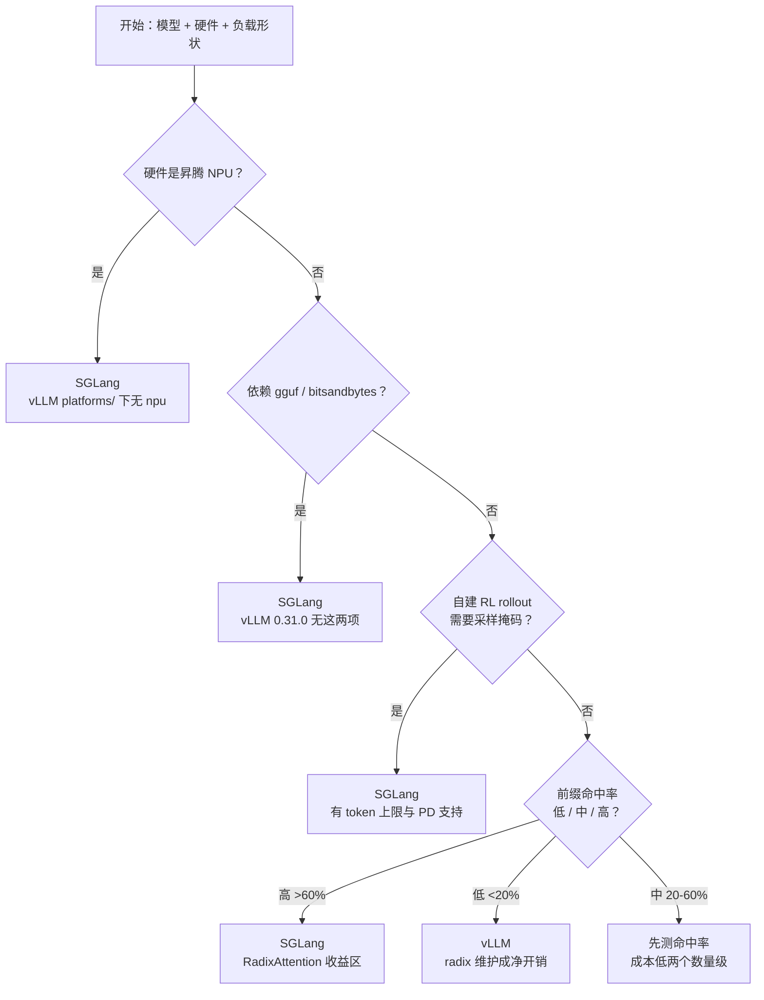

> **推理引擎系列 · 第 07 篇**
>
> 本系列面向**已经能把模型跑起来、但还没读过任何一个推理引擎源码**的工程师：把 vLLM 与
> SGLang 的功能差异、性能差异、选型结论，全部还原到**源码里可点开核验的那一行**。
>
> 取证基准：**vLLM `v0.31.0`**（commit `db9527a4`）／ **SGLang `v0.5.21`**（commit `e00930c5`）。
> 本文所有行号均锁在这这两个 commit 上。
>
> - 00 引擎在栈里的位置 → 01 架构分歧的根 → 02 调度与批处理 → 03 支持矩阵（上）→
>   04 支持矩阵（下）→ 05 PD 分离与 KV 传输 → 06 benchmark 交叉验证 →
>   **07 选型手册（本文）** → 08 前缀命中率

**TL;DR**

> * **默认选 vLLM**。理由不是「vLLM 更快」——06 篇已经证明这个问题在锁定版本上
>   没有公开答案——而是三项可核验的不对称：**模型与硬件覆盖更广**（03 篇）、
>   **引擎级故障隔离已成体系**（§3.2）、**大模型默认配置更可靠**（06 篇 §5.2）。
> * **偏离默认的理由只有四条，全部是硬约束或可量化指标**：前缀命中率 >60%、
>   自建 RL rollout 需要采样掩码、硬件在 vLLM 支持列表外（NPU）、
>   依赖 gguf / bitsandbytes 量化。四条之外的理由（「听说更快」「社区热」）
>   都不构成偏离依据。
> * **迁移的暗礁不在 API 兼容层，在参数极性**：`enable_prefix_caching`（vLLM）
>   与 `disable_radix_cache`（SGLang）名字一正一反、默认行为相同；
>   `async_scheduling` 与 `disable_overlap_schedule` 同理。照抄参数名会得到
>   **语义相反的配置**，而且不报错。
> * **两处常见误传要在选型前纠正**：SGLang 的 LoRA 缓存淘汰策略是
>   **2 种**（`lru`/`fifo`）不是 8 种；它的默认调度策略是 `fcfs`，
>   prefix-aware 调度要显式开 `lpm`——**默认配置吃不到 RadixAttention 的调度红利**。

---

## 0. 速览：一页决策

判断顺序即优先级：**硬约束（硬件、量化格式）> 能力约束（RL rollout）>
负载形状（命中率）> 默认值（vLLM）**。前三条命中即基本定案，第四条是兜底。

---

## 1. 默认为什么是 vLLM

三条理由都可在本系列前文找到出处，这里只做汇总。

**覆盖面**（03 篇）：模型架构 387 个唯一架构名 vs 282 个 `EntryClass` 条目
（口径不同不能相减，但方向一致）；attention backend 44 vs 24；
KV 传输 connector **17** vs 5（05 篇 §2，含 push/pull 双向）。

**故障隔离**（§3.2）：vLLM 有引擎进程级的 sentinel 机制，
SGLang 侧没有对等物。

**默认配置可靠性**（06 篇 §5.2，A 级但单一来源）：GPT-OSS-120B、
2×H100、ShareGPT 默认配置下 vLLM 6,095 tok/s vs SGLang 1,814 tok/s。
注意这不是「vLLM 更快」的证明，而是「**开箱即用**的期望值更稳」的证明。

---

## 2. 四条明确的「选 SGLang」理由

### 2.1 前缀复用率高 —— 最主要理由

**判定方法**：tokenize 一天真实请求，统计两两请求的公共前缀 token 数，
估算理论命中率（08 篇会给出完整方法；成本比性能 benchmark 低两个数量级）。

| 命中率 | 建议 | 依据 |
|:---|:---|:---|
| > 60% | **SGLang** | token 级最长前缀匹配 + cache-aware 路由收益最大；06 篇 §4 的因果链在此区间 |
| 20% – 60% | 先测 | 灰色地带，核心变量就是命中率 |
| < 20% | **vLLM** | radix 树维护成为净开销（01 篇 §9 的代价总账：无复用时树结构维护是净负担） |

> ⚠️ **一个必须知道的默认值陷阱**：SGLang 的默认调度策略是 **`fcfs`**
> （`arg_groups/fields/schedule.py:98`），**不是** prefix-aware 的 `lpm`。
> 九种可选策略（`lpm` / `random` / `fcfs` / `dfs-weight` / `lof` /
> `priority` / `routing-key` / `hrrn` / `shortest-prefill-first`，`:82-98`）里，
> 想吃 cache-aware 调度的红利必须显式传 `--schedule-policy lpm`。
> **默认配置只吃到 radix cache 本身的自动复用，吃不到「把同前缀请求排到一起」**
> ——后者才是高并发下差距的主要来源。

### 2.2 自建 RL rollout

需要把采样过程精确复现（`return_sampling_mask`）时，SGLang 有两处额外能力：

- **`--sampling-mask-max-tokens`**（默认 4096，v0.5.20 release notes 确认）
  给 mask 加上限，防宽采样分布下 token 数爆炸；vLLM 侧无对应参数；
- **PD 分离下完整支持**（`disaggregation/prefill.py`、`decode.py` 均有 mask 路径）。

代价：SGLang 要求**同时开 `return_meta_info`**，且 PD 两侧必须用同一个
token 上限值。vLLM 侧也有 `return_sampling_mask`（04 篇 §8），
但开启后会关闭 sampler 快速路径，且与 batch-sharded gather 不兼容。

### 2.3 硬件不在 vLLM 支持列表里

| 硬件 | vLLM `v0.31.0` | SGLang `v0.5.21` |
|:---|:---|:---|
| **昇腾 NPU** | ❌ `vllm/platforms/` 下只有 cpu / cuda / rocm / tpu / xpu / zen_cpu，**无 npu** | ✅ `srt/platforms/npu.py` + `disaggregation/ascend/` + 文档树 `docs/docs/hardware-platforms/ascend-npus/` |
| **TPU** | ⚠️ `platforms/tpu.py` 全文 **20 行**，实际能力委托给 PyPI 包 `tpu_inference` | ⚠️ 主仓无 TPU 平台代码，实现在**独立仓库** `sgl-project/sglang-jax` |

TPU 上两者是**两个不同项目的竞争关系**，不是同一项目的两条后端路径。
「vLLM 支持 TPU」的准确含义是「依赖 `tpu_inference` 这个包」。

### 2.4 量化格式与多 LoRA 租户

| 需求 | vLLM `v0.31.0` | SGLang `v0.5.21` |
|:---|:---|:---|
| **gguf** | ❌ 确认不存在（04 篇 §6） | ✅ |
| **bitsandbytes** | ❌ 确认不存在（04 篇 §6） | ✅ |
| 同 batch LoRA 数 | `max_loras` 默认 **1**（`config/lora.py:37`） | `max_loras_per_batch` 默认 **8**（`fields/lora.py:66`） |
| LoRA rank 上限 | `max_lora_rank` 固定 **16**（`config/lora.py:35`） | `max_lora_rank` 默认 `None`，**从 adapter 自动推断**（`fields/lora.py:42`） |
| LoRA kernel 后端 | 配置面无选项 | `--lora-backend` 四选一：`triton`/`csgmv`/`ascend`/`torch_native`，默认 `csgmv`（`fields/lora.py:76-83`） |
| LoRA 缓存淘汰策略 | — | **2 种**：`lru`（默认）/ `fifo`（`fields/lora.py:70-78`） |

> ⚠️ 流传的「SGLang 有 8 种 LoRA 淘汰策略」在本 commit 上**不成立**——
> `lora_eviction_policy` 的 choices 只有 `lru` 与 `fifo`。选型时以代码为准。

**结构性结论**：一个基座 + 几十个业务 adapter 的多租户服务，
SGLang 的默认值（每 batch 8 个、rank 自动推断）开箱即用性明显更好；
vLLM 要显式调 `max_loras` 与 `max_lora_rank`。

---

## 3. 五条明确的「选 vLLM」理由

### 3.1 覆盖面

见 §1 与 03 篇。冷门模型、奇怪架构、特定 attention kernel 的场景，
vLLM 的选择面更大。**「vLLM 支持某模型」这句话必须带版本号**——
两边的架构注册表都在高速变动（03 篇 §5 的取证边界）。

### 3.2 引擎级故障隔离已成体系

vLLM `v1/fault_tolerance/engine_core_sentinel.py`（197 行）把每个
EngineCore 的 busy loop 包进 `fault_tolerant_wrapper`（`:173-179`），
崩溃时的动作链：

1. 中止在飞请求并发送 abort 输出（`:88-89`）；
2. 按严重程度置 `DEAD`（`:96`）或 `UNHEALTHY`（`:98`）；
3. `UNHEALTHY` 状态下等待上层指令，收到后按方法名分派执行
   （`handle_command`，`:52-67`）；
4. 已实现的恢复指令只有 `retry` 一种（`:122`）。

限制也要知道：`instruction` 是裸 `str`、无白名单
（`v1/fault_tolerance/utils.py:15`），等指令的超时默认
**120s**（`config/fault_tolerance.py:12`，`engine_recovery_timeout_sec`）。
SGLang 侧没有对应的引擎进程级故障隔离；PD role switch 的失败对实例
是致命的（05 篇 §9 引过的 “no in-place rollback”）。

### 3.3 大模型默认配置更可靠

GPT-OSS-120B / 2×H100 / 默认配置：vLLM 6,095 vs SGLang 1,814 tok/s
（06 篇 §5.2，版本 v0.10.2 / v0.5.3rc0）。三条注脚必须跟着念：
默认配置、单一来源（GPUStack 以 vLLM 为默认引擎）、SGLang 的
mean TTFT 132.6s 说明参数明显没调开。**结论限于「开箱即用」**。

### 3.4 观测面：38 vs 156 的正确读法

vLLM 38+ 指标覆盖核心请求 / 缓存 / 抢占；SGLang 156 指标多出的整类
（KV 传输分段耗时、grammar 编译耗时、encoder、路由）主要是
**PD 分离与结构化输出场景**的需要（04 篇 §4）。
**只做单模型服务的话 vLLM 的指标够用**——这不是劣势，是聚焦。

### 3.5 周边生态与代码组织

- vLLM `entrypoints/` 已按域拆成 **30 个 `api_router.py`**，每个域有独立文档位置；
- SGLang 是单文件 **2,936 行**的 `http_server.py`（55 路由），
  混入 Ollama / Vertex / Anthropic 兼容层——找路由要 grep，不好读但集中；
- 反过来：SGLang 的 Rust 网关（`sgl-model-gateway/`）有 **cache-aware routing**，
  vLLM 无对等物。做大规模 PD 集群 + 前缀感知路由时这是 SGLang 的实在优势。

---

## 4. 灰色地带

| 场景 | 建议 | 理由 |
|:---|:---|:---|
| 结构化输出为主（大量 JSON） | 先试 vLLM | 两边后端都是 4 个，同名参数的支持集合不一致（04 篇 §2），需实测 |
| 单模型单卡小规模服务 | vLLM | SGLang 的 overlap 在这个规模可能变慢（06 篇 §5.1，A 级） |
| 模型 70B+ 且高并发 | vLLM | 优势反转区（06 篇 §5.3，多源一致） |
| 混合负载（部分前缀密集） | 测命中率 | 核心变量就是命中率，不是引擎 |
| A/B 迁移期 | 两个都跑 | 见 §5 的迁移成本清单 |

---

## 5. 迁移成本：OpenAI 兼容 ≠ 零成本

「都兼容 OpenAI API，改配置就行」是错的。真正会卡住的地方按危险程度排序。

### 5.1 参数极性相反（最危险：不报错，行为反了）

| vLLM | SGLang | 默认行为 |
|:---|:---|:---|
| `enable_prefix_caching`（`config/cache.py:142`，默认 `True`） | `disable_radix_cache`（`fields/memory.py:64`，默认 `False`） | **都是「前缀缓存开」** |
| `async_scheduling`（`config/scheduler.py:209`，默认 `None` 按平台自动判定） | `disable_overlap_schedule`（`fields/schedule.py:187`，默认 `False`） | **都是「调度重叠开」** |

两对参数**名字一正一反、默认行为相同**。迁移时照抄参数名会得到
相反的行为，而且两边都不会报错。第一对的极性差异还有历史原因：
vLLM 从「默认关」走过来，SGLang 从「默认开」走过来。

### 5.2 同名不同义

| 参数 | 坑 |
|:---|:---|
| `max_loras` vs `max_loras_per_batch` | 名字不同，默认值差 8 倍 |
| `max_lora_rank` | vLLM 固定 16；SGLang 默认自动推断 |
| `schedule_policy` | SGLang 独有，9 种，默认 `fcfs` |
| `disable_any_whitespace` 等 structured output 参数 | 同名参数在两边支持的后端集合不同（04 篇 §2）——**静默不生效比报错更难查** |

### 5.3 行为差异（非参数）

| 项 | 差异 |
|:---|:---|
| 前缀复用粒度 | 16 token 块对齐 vs 任意 token 位置（01 篇 companion 实验：对齐税 ≤15 token，绝对额固定）→ **命中率数字不可直接比较** |
| structured output 后端名 | `guidance` vs `llguidance`（同名不同物） |
| `/v1/responses` 存储 | SGLang `enable_response_store` **默认关闭**，且 help 文本自承「unsupported with prefill-decode disaggregation」「no TTL or size limit」（`fields/serving.py:26`） |
| 可用端点 | vLLM 有 `/v1/rerank`、`/v1/pooling`；SGLang 有 `/v1/decisions` 与 Ollama 兼容层 |
| Tokenizer 路径 | SGLang 同时提供 `/v1/tokenize` 与 `/tokenize` 两条 |

### 5.4 迁移 checklist

- [ ] 各开一轮 metrics，**对比 prefix cache 命中率**（不是吞吐——口径见上）
- [ ] 核对所有在用的 `extra_body` 私有参数在另一边是否存在
- [ ] structured output 的 grammar 后端**显式指定**，不依赖默认值
- [ ] 逐对核对 §5.1 的极性相反参数（这是唯一会「静默反着跑」的一类）
- [ ] 长 prompt 场景按**真实最长长度**调 `--mem-fraction-static` / `--chunked-prefill-size`
- [ ] 用真实流量回放，**不是**随机负载 benchmark（06 篇 §5.1 的反直觉结果就出自随机负载）
- [ ] 小模型单卡场景单独测一次关掉 overlap（SGLang）
- [ ] PD 场景确认 KV 传输后端两侧都装（NIXL / Mooncake / MORI / ASCEND）
- [ ] SGLang + PD：确认 auxiliary data 走 TCP（NVLink 不覆盖它，05 篇 §10）
- [ ] 权重量化路径：确认没有依赖 gguf / bitsandbytes（vLLM 侧无）
- [ ] Canary：**锁 commit 后再放量**（两边 breaking change 都很频繁）

---

## 6. 「先 vLLM 起步，需要时再切」的成立条件

这是最常被推荐的默认策略。它成立的条件：

- ✅ 前缀复用率 < 60%（不是重度 Agent / RAG 负载）；
- ✅ 硬件是 NVIDIA / AMD / Intel / CPU（不是 NPU）；
- ✅ 不自建 RL rollout；
- ✅ 不依赖 gguf / bitsandbytes；
- ✅ 团队已有 vLLM 生产运维经验——**这一条权重最大**。

**不成立的情况**：负载形状本身 prefix-heavy（多轮 / RAG / Agent）。
那从一开始就选 SGLang 更省事——因为 prefix cache 是**数据布局层面的差异**，
从 vLLM 迁过去后命中率指标要重新建立，而 §5.3 说明两边的命中率数字
本来就不可直接比较，「先跑起来再迁」会把建立基线的成本拖到第二次。

---

## 7. 推荐的决策顺序

1. **先算前缀命中率**（成本最低、信息量最大；方法见 08 篇）；
2. **核对硬约束**：硬件、量化格式、RL 需求——任一命中即基本定案；
3. **选定后用真实流量回放**，不是 benchmark；
4. **锁 commit**。两边 breaking change 都很频繁：vLLM 的 V1 演进
   （Model Runner V2 在 v0.25.0 成为 dense 模型默认，据 deepinfra 梳理）
   与 SGLang v0.5.x 的缓存体系重构（05 篇 §9 的 12 个 HiCache 后端）
   都改过行为默认值；
5. 「vLLM / SGLang 支持某模型 / 某特性」这句话**必须带版本号**——
   本文所有行号都锁在 `db9527a4` / `e00930c5`，换一个 commit 就可能不成立。

---

## 8. 取证边界

- 本文所有默认值与 choices 核自 `db9527a4`（vLLM v0.31.0）与
  `e00930c5`（SGLang v0.5.21）的配置字段定义；**换版本必须重核**。
- 「8 种 LoRA 淘汰策略」的纠正基于 `lora_eviction_policy` 的 choices
  （`fields/lora.py:70-78`）——只覆盖本 commit 的**内置**策略，
  不排除插件式扩展。
- §3.2 的故障隔离机制核自 `vllm/v1/fault_tolerance/`（注意路径：
  不是仓库根的 `engine_core_sentinel.py`）；「SGLang 无对等物」是
  **未找到**的表述，不等于确认不存在。
- §3.3 的数字来自 06 篇 §5.2 的 GPUStack 基准（A 级、单一来源、
  默认配置、旧版本），**不外推**到调优后或锁定版本。
- 「sampling-mask-max-tokens 默认 4096」核自 SGLang v0.5.20 release notes
  （PR #36631），v0.5.21 未重新核对该默认值。
- 本文不给「谁更快」的结论；06 篇的结论是在锁定版本上这个问题
  **没有公开答案**，选型的依据是硬约束、机制与自测。

## 上一篇 / 下一篇

[《推理引擎（06）：benchmark 交叉验证》](/2026/10/18/serving-06-benchmark-cross-validation/)；
模型与 attention backend 的支持矩阵见
[《推理引擎（03）：支持矩阵（上）》](/2026/10/18/serving-03-support-matrix-models/)；
结构化输出与 LoRA 的同名参数陷阱见
[《推理引擎（04）：支持矩阵（下）》](/2026/10/18/serving-04-support-matrix-api/)；
前缀命中率的测量方法见
[《推理引擎（08）：前缀命中率》](/2026/10/18/serving-08-prefix-hit-rate/)。

## 参考

1. vLLM `v0.31.0`，`vllm/config/cache.py` — <https://github.com/vllm-project/vllm/blob/db9527a46873454610df6dbedf79a36d6bf1a7f6/vllm/config/cache.py>
2. vLLM `v0.31.0`，`vllm/config/scheduler.py` — <https://github.com/vllm-project/vllm/blob/db9527a46873454610df6dbedf79a36d6bf1a7f6/vllm/config/scheduler.py>
3. vLLM `v0.31.0`，`vllm/config/lora.py` — <https://github.com/vllm-project/vllm/blob/db9527a46873454610df6dbedf79a36d6bf1a7f6/vllm/config/lora.py>
4. vLLM `v0.31.0`，`vllm/config/fault_tolerance.py` — <https://github.com/vllm-project/vllm/blob/db9527a46873454610df6dbedf79a36d6bf1a7f6/vllm/config/fault_tolerance.py>
5. vLLM `v0.31.0`，`vllm/v1/fault_tolerance/engine_core_sentinel.py` — <https://github.com/vllm-project/vllm/blob/db9527a46873454610df6dbedf79a36d6bf1a7f6/vllm/v1/fault_tolerance/engine_core_sentinel.py>
6. vLLM `v0.31.0`，`vllm/v1/fault_tolerance/utils.py` — <https://github.com/vllm-project/vllm/blob/db9527a46873454610df6dbedf79a36d6bf1a7f6/vllm/v1/fault_tolerance/utils.py>
7. vLLM `v0.31.0`，`vllm/platforms/`（目录清单，无 npu）— <https://github.com/vllm-project/vllm/tree/db9527a46873454610df6dbedf79a36d6bf1a7f6/vllm/platforms>
8. SGLang `v0.5.21`，`python/sglang/srt/arg_groups/fields/schedule.py` — <https://github.com/sgl-project/sglang/blob/e00930c5489053f26d86b179cee0d087f846acbb/python/sglang/srt/arg_groups/fields/schedule.py>
9. SGLang `v0.5.21`，`python/sglang/srt/arg_groups/fields/lora.py` — <https://github.com/sgl-project/sglang/blob/e00930c5489053f26d86b179cee0d087f846acbb/python/sglang/srt/arg_groups/fields/lora.py>
10. SGLang `v0.5.21`，`python/sglang/srt/arg_groups/fields/memory.py` — <https://github.com/sgl-project/sglang/blob/e00930c5489053f26d86b179cee0d087f846acbb/python/sglang/srt/arg_groups/fields/memory.py>
11. SGLang `v0.5.21`，`python/sglang/srt/arg_groups/fields/serving.py` — <https://github.com/sgl-project/sglang/blob/e00930c5489053f26d86b179cee0d087f846acbb/python/sglang/srt/arg_groups/fields/serving.py>
12. SGLang `v0.5.21`，`python/sglang/srt/platforms/npu.py` — <https://github.com/sgl-project/sglang/blob/e00930c5489053f26d86b179cee0d087f846acbb/python/sglang/srt/platforms/npu.py>
13. SGLang Ascend NPU 文档树 — <https://docs.sglang.io/hardware_platforms/ascend-npus/>
14. SGLang TPU（独立仓库说明）— <https://docs.sglang.io/hardware_platforms/tpu/>
15. SGLang v0.5.20 release notes（sampling mask 默认 4096）— <https://github.com/sgl-project/sglang/releases/tag/v0.5.20>
16. GPUStack 性能实验室：GPT-OSS-120B on H100 — <https://docs.gpustack.ai/latest/performance-lab/gpt-oss-120b/h100/>
17. deepinfra：vLLM vs SGLang（Model Runner V2 默认化梳理）— <https://deepinfra.com/blog/vllm-vs-sglang>
