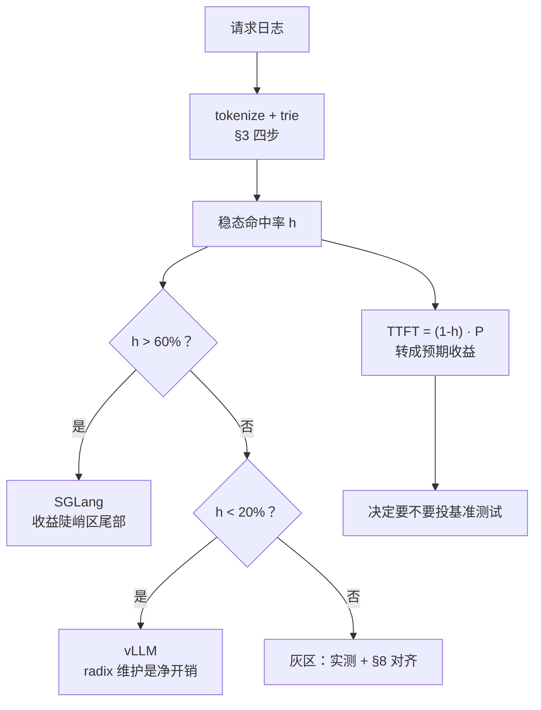

> **推理引擎系列 · 第 08 篇**
>
> 本系列面向**已经能把模型跑起来、但还没读过任何一个推理引擎源码**的工程师：把 vLLM 与
> SGLang 的功能差异、性能差异、选型结论，全部还原到**源码里可点开核验的那一行**。
>
> 取证基准：**vLLM `v0.31.0`**（commit `db9527a4`）／ **SGLang `v0.5.21`**（commit `e00930c5`）。
> 本文所有行号均锁在这两个 commit 上。
>
> - 00 引擎在栈里的位置 → 01 架构分歧的根 → 02 调度与批处理 → 03 支持矩阵（上）→
>   04 支持矩阵（下）→ 05 PD 分离与 KV 传输 → 06 benchmark 交叉验证 →
>   07 选型手册 → **08 前缀命中率（本文）**

> **TL;DR**
>
> * **选型决策树里权重最大的那个自变量——前缀命中率——是唯一能完全离线算出来的**：
>   拿一天的请求日志，用同一个 tokenizer 过一遍 trie，几分钟就有答案，成本比任何
>   性能 benchmark 低两个数量级。07 篇把它放在决策顺序第一位，本篇给完整方法。
> * **命中率不是一个数，是一族数**。分子分母至少有三个自由度：token 加权还是请求加权、
>   按请求数开窗还是按时间开窗、分不分层。两个引擎报出的同名 `cache_hit_rate`
>   **默认就不可比**：vLLM 聚合最近 **1000 个请求**（`stats.py:43`），
>   SGLang 按 **15 秒**时间窗（`environ.py:604`）。
> * **三种典型负载的合成实测**（companion 实验，固定 seed）：多轮对话 **86.3%**、
>   RAG **91.6%**、Agent 循环 **94.4%**（token 级）。命中率首先由**负载形状**决定，
>   引擎是次要变量。RAG 还有闭式上界 $$1272/1333 = 95.4\%$$ 可以对拍。
> * **容量不到 working set 时测到的是淘汰曲线，不是负载曲线**：同一份 RAG 负载，
>   缓存 64 块（1,024 token）时命中率 2.8%，给够 1,933 块才回到 87.2%。
>   **小显存副本上测出的命中率没有代表性。**
> * **跨引擎对比前先对齐口径**：vLLM 的命中是 16 token 块对齐的，SGLang 是 token 级的，
>   同一流量下 vLLM 的数字系统性偏低（差 ≤15 token/请求，01 篇结论），
>   再加上窗口与分层差异，直接对比数字会同时犯三个错。

---

## 0. 符号表

| 符号 | 含义 |
|:---|:---|
| $$h$$ | 命中率，token 加权，$$= H/Q$$ |
| $$h_{\rm req}$$ | 命中率，请求加权，$$= \frac{1}{N}\sum_i \rho_i$$ |
| $$Q$$ | 查询 token 总数（各请求 prompt 长度之和） |
| $$H$$ | 命中 token 总数（最长公共前缀长度之和） |
| $$\rho_i$$ | 第 $$i$$ 个请求的命中比例（该请求命中 token 数 / 该请求 prompt 长度） |
| $$P$$ | 未命中部分的 prefill 成本（06 篇一阶模型） |
| $$B$$ | KV 缓存块大小，vLLM 默认 16 token |
| $$W$$ | working set：负载的全集去重后 token 数 |
| $$C$$ | 缓存容量（块） |

---

## 1. 为什么先算命中率：成本差两个数量级

07 篇的决策顺序把「算前缀命中率」放在第一位，理由是成本：一次性能 benchmark 要
**占卡、搭环境、锁版本、控变量**（06 篇整篇都在讲这件事为什么难），而算命中率只要
**请求日志 + CPU**。两者的信息量也不对称——06 篇 §4 证明，全部公开 benchmark 数字里
**唯一条件清晰的因果链**就是命中率 → TTFT；而吞吐类对比不是版本过期就是指标混用。
先花十分钟算一个数，可能直接省掉一整轮基准测试。

具体差多少，看两边各自要准备什么：

| | 算命中率 | 跑性能 benchmark |
|:---|:---|:---|
| 输入 | 一天请求日志（prompt 全文） | 同上 + GPU 机器 + 引擎部署 |
| 计算资源 | CPU，分钟级 | GPU，小时级 |
| 需要锁版本吗 | 不需要（与引擎无关） | 必须（06 篇的全部结论都锁版本） |
| 结果可复现吗 | 完全确定（固定 seed 重放同一日志） | 受时钟、温度、并发影响 |
| 回答什么 | 「这个负载值不值得为前缀优化」 | 「这个版本在这个硬件上多快」 |

注意第一行和最后一行的因果关系：**命中率是负载的属性，不是引擎的属性**。
同一份流量在两个引擎上的「命中率数字」可以不同（§8 会列全差异来源），但
**负载形状本身**——system prompt 多长、多少请求共享文档、平均几轮——
换个引擎一个字都不会变。选型要判断的正是前者。

---

## 2. 命中率不是一个数：分子分母的三个自由度

「前缀命中率」这个词默认了一整套定义，而两个引擎的实现各选各的。把差异摊开，
是三个正交的自由度，加上一条排除规则。

### 2.1 自由度一：token 加权还是请求加权

两种都合理，数值接近但不等：

$$
h \;=\; \frac{H}{Q} \;=\; \frac{\sum_i \ell_i}{\sum_i L_i},
\qquad
h_{\rm req} \;=\; \frac{1}{N}\sum_i \frac{\ell_i}{L_i}
$$

companion 实验组 3 在同一份多轮负载上同时算了两个：**86.1% vs 85.1%**，
差 1.0 个百分点。差距的方向取决于负载：长 prompt 请求占比高时 token 加权更高
（它天然给长请求更大权重），两边都是自己领域的合理选择，但**摆在一张表里就是错的**。

两个引擎的默认都是 token 加权——vLLM 的 `queries` 字段注释写的是
「the number of tokens that were queried」（`stats.py:120-121`），
SGLang 的分子分母也都是 token 数（`metrics_reporter.py:789-791`）。
所以「两个引擎都报 token 加权」这件事本身不构成它们可比的理由，
另外两个自由度还没对上。

### 2.2 自由度二：按请求数开窗还是按时间开窗

**vLLM 按请求数**。`CachingMetrics` 的类注释第一句就是
「Metrics for caching with a hit rate of the most recent N requests」
（`stats.py:35-36`），默认窗口 **1000 个请求**（`stats.py:43`），
用一个 deque 滑出最旧的统计块（`stats.py:88-95`），
`hit_rate` 就是窗口内的
$$H_{\rm win}/Q_{\rm win}$$（`stats.py:109-113`）。

**SGLang 按时间**。`_CacheHitRateWindow`（`metrics_reporter.py:65`）
存 `(now, hit_tokens, total_tokens)` 样本，每次上报把早于
`now - CACHE_HIT_RATE_WINDOW_SECONDS` 的样本弹掉（`:79-84`），
窗口默认 **15 秒**（`environ.py:604`）。

两个窗口在稳态下都给「近期命中率」，但行为在负载波动时系统性不同：

- 请求率突增时，vLLM 的窗口跨过更长的真实时间（1000 个请求来得更快之前 vs 之后），
  SGLang 的窗口仍钉死 15 秒——**后者对突发更敏感，前者对慢周期更敏感**；
- 低峰期 SGLang 的 15 秒窗口可能只装进几个请求，数值跳变明显；
  vLLM 的 1000 请求窗在低峰期会往回看更久，天然更稳。

没有哪个更「对」，但**把 A 引擎的 15 秒窗数字和 B 引擎的 1000 请求窗数字
直接相减，差出来的东西没有物理意义**。

### 2.3 自由度三：分不分层、按哪层算

**SGLang 分层报**。`sglang:prefill_effective_tokens_total` 这个 counter 带
`mode` 标签，取值为 `input` / `device_hit` / `host_hit` / `storage_hit`
（`metrics_collector.py:913-927`、`:1315-1329`）——
命中发生在**哪一层存储**是分开记的四本账。指标自己的 documentation 就把算法写明了：

> Windowed prefix cache hit rate = rate(sum of *_hit) / rate(sum of all modes);
> per-tier rate uses a single *_hit mode in the numerator.

即：总命中率要三层相加，单层命中率只用一层。HiCache 场景下
`storage_hit` 那一层走的是 05 篇 §9 列的 12 个存储后端之一，
和 GPU 上的命中不是一个成本量级——**不分层就会把「从 SSD 捞回 KV」
和「显存里现成」记成同一笔收益**。

**vLLM 分「本地 APC」与「connector」两本账**。`PrometheusLogger` 里
建了两个独立的 `CachingMetrics` 实例（`loggers.py:116-117`），
日志行也是两条：`Prefix cache hit rate`（`:306-308`）与
`External prefix cache hit rate`（`:313-315`）；
Prometheus 侧对应两对 counter：`vllm:prefix_cache_queries/hits`（`:599-615`）
与 `vllm:external_prefix_cache_queries/hits`（`:625-641`）。
PD 分离场景下，从 prefill 实例传来的 KV 记在 external 那本账上
（05 篇 §2 的三层抽象），**和本地 APC 命中相加才是用户感知的复用**，
但两个 counter 是分开的——只抓一个都会低估。

### 2.4 附带差异：谁的请求不算进来

- vLLM：跳过 cache 查找的请求不计入（`kv_cache_manager.py:249-262`：
  `record_prefix_cache_stats` 第一行就是
  `if not self.log_stats or not self.prefix_cache_lookup_enabled(request): return`，
  而 `prefix_cache_lookup_enabled` = `enable_caching and not skip_reading_prefix_cache`）；
  被抢占过的请求单独记在 `preempted_*` 字段里（`stats.py:123-130`）。
- SGLang：被撤回重算的请求从「effective」口径里扣掉
  （`metrics_reporter.py:784-789`：
  `effective_input_tokens = log_input_tokens - reprocessed_log_input_tokens`，
  hit 同理）——重算的请求不计命中也不计查询。

两边都在做正确的事，但**排除的请求集合不同**。高抢占率（preemption）或
高撤回率的负载上，这又是一处系统性偏差。

---

## 3. 测量方法：四步，全部离线

方法本身不新——trie 前缀匹配是 radix cache 的离线镜像。写成可复现的流程是四步。

**第 1 步 · 落日志。** 每条请求记：prompt 全文（或 token id 序列）+ 到达时间戳。
**不需要输出**——命中率只由 prompt 决定。敏感场景可以先哈希，但那样会丢掉
「两请求是否共享前缀」的信息，所以要么落原文要么落 token id。

**第 2 步 · 用线上同一个 tokenizer。** 两个坑：chat template 必须与线上一致
（同一段对话套不同 template，前缀结构完全不同）；BOS / 特殊 token 的拼法要一致。
tokenize 之后每条请求是一个 token id 列表，后面的算法与词表无关。

**第 3 步 · 按到达顺序过 trie。** 对每条请求：沿 trie 匹配最长公共前缀，
记 $$\ell_i$$；然后把整条路径插进去（已存在的部分复用）。
总复杂度 $$O(\text{全部 prompt token 数})$$，百万 token 级秒出。
这就是 [`prefix-hit-rate-workload-lab`](https://github.com/lrypcy/ipynbs/blob/d984022/experiments/serving-engine/prefix-hit-rate-workload-lab/run.py)
组 1 的实现（`_TrieNode` / `simulate_trie`，固定 seed `20261018`）。
注意 trie 模型假设缓存无限——它测的是**负载的理论命中率**，
真实系统还有容量约束，见 §5。

**第 4 步 · 出三条曲线，不是一个数。**

| 曲线 | 怎么画 | 用来看什么 |
|:---|:---|:---|
| 累计命中率 vs 请求数 | 每 100 个请求一个点 | 冷启动有多长、稳态在哪 |
| 稳态命中率 | 跳过前若干请求后的累计值 | 选型判据（>60% / <20%）的那一个数 |
| working set $$W$$ | trie 的独占 token 总数 | 缓存容量下限（§5） |

**闭式上界对拍。** 负载结构已知时，命中率上界可以手算，用来抓仿真 bug。
RAG 负载：system 250 token + 文档 1022 token 可共享、query 61 token 每次唯一，
稳态上界就是 $$1272/1333 = 95.4\%$$。实验组 1b 的仿真值 91.6% 稳稳落在界内
（Zipf 流行度不均匀 + 冷启动压掉几个点）——**上界对不上比下界对不上更值得查**。

---

## 4. 三种负载能到多少：合成实测

组 1 用构造参数跑了三种典型负载（参数见表下注），token 级与 16 块对齐两种粒度：

| 负载 | 请求数 | 平均 prompt | 全 token | 块对齐 | 税 |
|:---|---:|---:|---:|---:|---:|
| 多轮对话（system 510 + 6 轮 × 130） | 240 | 965 | **86.3%** | 85.7% | 0.58pp |
| RAG（system 250 + doc 1022 + query 61） | 600 | 1,333 | **91.6%** | 91.0% | 0.61pp |
| Agent 循环（system+tools 1020 + 15 步 × 98） | 300 | 1,804 | **94.4%** | 94.0% | 0.37pp |

三个可以直接拿去用的结论：

1. **共享结构越长，命中率越高**。三种负载的差别全在「可共享前缀 / 请求总长」：
   Agent 的 head 占比最高（1020/1804 起步、15 步累积），多轮最低。
   **负载形状决定量级，引擎只决定小数点后一位**。
2. **块对齐税是小头**。税的上界是 $$15/E[L]$$（每个请求最多亏一个不完整块，
   01 篇 §3 的闭式）：三种负载分别 1.55 / 1.13 / 0.83pp，实测 0.37–0.61pp，
   全部落在界内。**prompt 越短税越重**——短对话场景才值得为粒度换引擎（01 篇实测
   10.34% 的那档）。
3. **闭式上界是免费的自检**。任何「实测 > 上界」的结果都是 bug，不是优化。

> 注：参数是构造的，用来展示形状 → 命中率的单调关系与量级；上线前用真实日志复算。
> 合成序列用均匀随机 token id：命中率只依赖序列相等关系，与词表无关。

反过来，**单轮问答、无共享 system 的流量，命中率接近 0**——那就是 07 篇说的
「<20% 选 vLLM」那一端：radix 树的维护开销（低命中率时它是净负担，
06 篇 §5.1 的回退证据）省不下来，块对齐税也省不下来。
20%–60% 的灰区典型长相是：短 system + 部分请求共享文档。这种负载
**必须实测**，闭式和合成都给不出答案。

---

## 5. 容量曲线：你测到的是淘汰曲线还是负载曲线

§3 的 trie 假设缓存无限。真实系统的命中率还要过容量这一关，而**容量不够时
测出来的数字描述的是淘汰策略，不是负载**。

组 2 拿 RAG 负载（working set $$W = 250 + 30 \times 1022 = 30{,}910$$ token
≈ 1,932 块）扫了一遍容量：

| 容量（块） | 容量（token） | 占 $$W$$ | 命中率（块对齐） |
|---:|---:|---:|---:|
| 64 | 1,024 | 3% | 2.8% |
| 128 | 2,048 | 7% | 29.2% |
| 256 | 4,096 | 13% | 40.0% |
| 512 | 8,192 | 27% | 59.4% |
| 1,933 | 30,928 | 100% | **87.2%** |
| ∞ | — | — | 89.4% |

容量曲线是条 S 形：远小于 $$W$$ 时命中率被淘汰压住，超过 $$W$$ 后饱和
（87.2% vs 89.4%，差的 2.2pp 是块尾与 LRU 颠簸）。两个常见误测都出在这张图上：

- **小显存副本上测命中率**。拿一张 8GB 卡测出来的 40%，和 80GB 卡上的 87%
  描述的不是同一个负载。**测命中率必须让容量 ≥ working set**，
  而 $$W$$ 从日志里免费算得出来（§3 第 4 步）——先算 $$W$$ 再决定测试配置，
  顺序不能反。
- **短窗口开场**。前 20 个请求的命中率 59.4%，全窗口稳态 89.4%：
  冷缓存期任何窗口口径都会系统性低估。SGLang 的 15 秒窗在每次流量低谷后
  都在重放这个低估；vLLM 的 1000 请求窗至少保证样本量。

> 注：块对齐仿真用 LRU 按块淘汰，是 vLLM 实际策略（引用计数 + FIFO/LRU 混合、
> hash 冲突处理）的近似。曲线形状可信，具体数值会有偏差。

---

## 6. 引擎自报口径核验：vLLM 篇

自己测之外，线上还在跑的时候要看引擎自己报的数。vLLM 侧全部事实核自
`db9527a4`：

| 事实 | 位置 |
|:---|:---|
| `CachingMetrics`：最近 $$N$$ 个请求的命中率 | `v1/metrics/stats.py:35-36` |
| 窗口默认 **1000 请求** | `stats.py:43` |
| deque 滑出最旧统计块，**最新一批永不弹出** | `stats.py:88-95` |
| `hit_rate` = 窗口内 $$H/Q$$ | `stats.py:109-113` |
| `PrefixCacheStats.queries` 是 **token 数**（注释原话） | `stats.py:117-121` |
| 每请求记账：`num_tokens=request.num_tokens`、`num_hits`（token）、抢占请求单列 | `v1/core/kv_cache_manager.py:253-262` |
| 跳过 cache 查找的请求**不计入** | `kv_cache_manager.py:249-251` |
| 本地 APC 与 connector 两个 `CachingMetrics` 实例 | `v1/metrics/loggers.py:116-117` |
| 日志行：`Prefix cache hit rate: %.1f%%` | `loggers.py:306-308` |
| 日志行：`External prefix cache hit rate: %.1f%%` | `loggers.py:313-315` |
| Prometheus counter `vllm:prefix_cache_queries`（queried tokens） | `loggers.py:599-606` |
| Prometheus counter `vllm:prefix_cache_hits`（cached tokens） | `loggers.py:610-615` |
| Prometheus counter `vllm:external_prefix_cache_queries/hits` | `loggers.py:625-641` |

三个使用上的注意：

1. **日志行是窗口值，counter 是累计值**。`vllm:prefix_cache_queries/hits`
   是单调递增的 Prometheus counter，要自己 `rate()` 再相除；
   日志里那行 `Prefix cache hit rate` 才是 1000 请求窗的瞬时值。
   两者都对，但**混着用会得出「命中率随时间漂移」的假象**（其实是累计平均在收敛）。
2. **counter 的口径是 token**：`queries` 计 queried tokens、`hits` 计 cached tokens
   （documentation 原话），所以 `rate(hits)/rate(queries)` 就是 token 加权命中率——
   这正好和 §3 的离线方法同口径，是唯一一对可以互相验证的数。
3. **PD 场景要两对 counter 相加**：`external_*` 那对记的是 KV connector
   从 prefill 实例搬过来的量（05 篇 §2），本地 APC 那对记不到它。

---

## 7. 引擎自报口径核验：SGLang 篇

| 事实 | 位置 |
|:---|:---|
| `_CacheHitRateWindow`：`(now, hit, total)` 样本 + 时间窗淘汰 | `metrics_reporter.py:65-84` |
| 窗口默认 **15 秒**（env `SGLANG_CACHE_HIT_RATE_WINDOW_SECONDS`） | `environ.py:604` |
| 分子分母 = effective tokens（**扣除 reprocessed**） | `metrics_reporter.py:784-791` |
| 窗口命中率 = `cache_hit_rate_window.add(...)` 的返回值 | `metrics_reporter.py:793-798` |
| gauge `sglang:cache_hit_rate` | `observability/metrics_collector.py:305-309` |
| counter `sglang:prefill_effective_tokens_total{mode=input/device_hit/host_hit/storage_hit}` | `metrics_collector.py:913-927`、`:1315-1329` |

注意最后一行的 documentation 把口径算法写在了指标定义里：
总命中率 = `rate(sum of *_hit) / rate(sum of all modes)`，
单层命中率分子只取一层。所以：

- **`sglang:cache_hit_rate` 这个 gauge 本身已经是三层合并后的 15 秒窗值**，
  但它是 gauge 不是 counter——抓下来做平均时要按时间加权，
  直接对 gauge 求算术平均等于假设采样间隔均匀；
- **要分层自己算**，就用 `prefill_effective_tokens_total` 的 `mode` 标签：
  `rate{mode=device_hit}) / rate(mode=~"device_hit|host_hit|storage_hit|input")`。
  这个 counter 还顺手排除了 reprocessed，与 gauge 同口径；
- **与 vLLM 对比时**，SGLang 侧的分母是「有效 prefill token」，
  vLLM 侧的分母是「查过 cache 的请求的 prompt token 数」——
  被撤回重算 / 跳过查找的请求在两边的进出不同（§2.4）。

---

## 8. 跨引擎对比前：先对齐，再比较

把 §2 的三个自由度、§6/§7 的两本账、01 篇的粒度差汇总成一张对齐清单。
**六项全部对齐之前，两个引擎的命中率数字不可相减。**

| # | 差异 | vLLM | SGLang | 对齐方法 |
|:---|:---|:---|:---|:---|
| 1 | 加权方式 | token | token | 已一致（罕见地没有分歧） |
| 2 | 窗口 | 1000 请求 | 15 秒 | 回原始 counter 用同一窗口重算 |
| 3 | 分层 | 本地 / connector 两本 | device / host / storage 三本 | 明确报哪一层；PD 场景 vLLM 要两对相加 |
| 4 | 匹配粒度 | **16 token 块对齐** | **token 级** | 同流量下 vLLM 系统性 ≤ SGLang，差 ≤ 15 token/请求 |
| 5 | 容量与 $$W$$ | 必须 ≥ $$W$$ | 必须 ≥ $$W$$ | 先从日志算 $$W$$，两边容量取同一比例 |
| 6 | 排除规则 | 跳过查找不计；preempted 单列 | reprocessed 从 effective 扣除 | 高抢占 / 高撤回负载上先各查一本 |

第 4 项值得单独说，因为它最反直觉：**同一份流量，vLLM 报出的命中率天生比
SGLang 低一点，这不是差距，是口径**。01 篇的 companion 实验
（[`prefix-reuse-granularity`](https://github.com/lrypcy/ipynbs/blob/ac9f51cf81bfe10e882df9dc32b52d5628816fb0/experiments/serving-engine/prefix-reuse-granularity/run.py)，
commit `ac9f51c`）与本文组 1 都量到了它：三种负载上 0.37–0.61pp，
上界 $$15/E[L]$$。**所以「SGLang 命中率比 vLLM 高 3 个点」这句话，
在没对齐前六项之前什么都不说明。**

---

## 9. 从命中率到预期：一阶模型怎么用

测出稳态命中率之后，它直接映射成 TTFT 预期。06 篇 §4 已经核验过模型与数字，
这里只说怎么用：

$$
\mathrm{TTFT}(h) \;=\; (1-h)\,P
$$

$$P$$ 是未命中部分的 prefill 成本，**用你自己负载上的一个全 miss 请求实测**
（或从引擎的 TTFT 直方图取低命中率时段的分位数）。两个锚点：

- $$P = 2.76\,s$$（06 篇从 SGLang v0.5.20 上报两点反解的平均值，
  DeepSeek-V4-Flash + 共享 system prompt）下：
  $$h = 20\% \Rightarrow \mathrm{TTFT} = 2.21\,s$$；
  $$h = 60\% \Rightarrow 1.11\,s$$；
  $$h = 90\% \Rightarrow 0.28\,s$$。
- **绝对值上每 +10pp 恒定省 $$0.1P$$**：20%→60% 省 $$0.4P$$（约 1.10s），
  60%→100% 也省 $$0.4P$$——绝对值相同，但**前者只把 TTFT 砍半，后者直接清零**。
  相对值上每 +10pp 省 $$0.1/(1-h)$$，随命中率增大（20% 处 12.5%、60% 处 25.0%、
  80% 处 50.0%）：流传的「19%」在低命中率区高估收益、在高命中率区低估。
- 07 篇的 >60% / <20% 阈值**不是一阶模型的分区，而是引擎侧成本结构的分区**：
  低命中率时 radix 树维护是净负担（01 篇 §9 的代价总账），
  高命中率时 cache-aware 路由才吃得满（07 篇 §2.1 的默认值陷阱）。
  一阶模型给 TTFT 预期，阈值给选型方向，**两件事叠加才是完整判断**——
  这也是「先测命中率再决定投不投基准」的完整理由。

于是整个选型流程闭合成一个环：

两个不要：**不要**把命中率当吞吐代理（06 篇 §4.2：聚合吞吐斜率量纲不同，
不能从 TTFT 模型推导）；**不要**跨引擎比命中率数字而不做 §8 的对齐
——先确认两边报的是同一层、同一窗、同一粒度，再谈谁高谁低。

---

## 10. 测量清单与取证边界

### 10.1 清单

- [ ] 用**线上同一个 tokenizer + chat template**（第 2 步的两个坑）
- [ ] 至少覆盖一个完整周期（含峰谷）的请求日志
- [ ] 三条曲线都出：累计、稳态、working set $$W$$
- [ ] 分负载形状统计（多轮 / RAG / Agent / 单轮），不只看总体
- [ ] token 加权与请求加权都报（差 1pp 级，但要知道差在哪）
- [ ] 确认测试/生产配置的缓存容量 $$C \geq W$$
- [ ] 结构已知的负载算闭式上界对拍
- [ ] 跨引擎对比前过 §8 的六项对齐
- [ ] 用 $$P$$ 把 $$h$$ 转成 TTFT 预期，再决定投不投基准测试

### 10.2 取证边界

- 本文所有行号核自 **vLLM `v0.31.0` = `db9527a4`** 与
  **SGLang `v0.5.21` = `e00930c5`**；两边的指标窗口默认值、mode 标签集合
  **换版本必须重核**。
- §4 的三种负载是**合成参数**，展示形状 → 命中率的单调关系与量级，
  不外推到任何真实业务；tokenize 用均匀随机 id，与词表无关但与 chat template 有关。
- §5 的容量曲线用 LRU 近似，**形状可信、数值有偏**；
  working set 的算法（trie 独占 token 数）与引擎的显存记账不是同一件事。
- §2.4 / §6 / §7 的口径事实全部有行号；「SGLang 无对等物」这类表述本文没有使用，
  未找到 ≠ 不存在。
- 本文不给「谁更快」的结论：06 篇已证明该问题在锁定版本上没有公开答案，
  命中率回答的是「值不值得为前缀投入」，不是「选谁」。

## 小结

前缀命中率是选型决策树里唯一能完全离线算出来的自变量：日志进、trie 过、
三条曲线出，分钟级、确定性、与引擎版本无关。它首先由负载形状决定
（合成实测：多轮 86.3% / RAG 91.6% / Agent 94.4%），容量必须覆盖 working set
否则测到的是淘汰曲线，而两个引擎自报的同名指标在窗口、分层、粒度、
排除规则上处处不同——**先对齐口径，再比较数字，最后才轮到跑 benchmark**。
07 篇的决策顺序因此成立：先定性（本文），再定量（06 篇的方法论），
最后才是锁版本放量。

## 上一篇 / 下一篇

选型决策树与阈值表见
[《推理引擎（07）：选型手册》](/2026/10/18/serving-07-selection-playbook/)；
benchmark 数字的可信度分级与命中率 → TTFT 的一阶模型见
[《推理引擎（06）：benchmark 交叉验证》](/2026/10/18/serving-06-benchmark-cross-validation/)；
块对齐税与 radix 树的机制分析见
[《推理引擎（01）：架构分歧的根》](/2026/10/18/serving-01-architecture-divergence/)；
PD 分离下 KV 传输的另一本账见
[《推理引擎（05）：PD 分离与 KV 传输》](/2026/10/18/serving-05-pd-disaggregation-kv-transfer/)。

## 参考

1. vLLM `v0.31.0`，`vllm/v1/metrics/stats.py`（`CachingMetrics:35`、`max_recent_requests:43`、`hit_rate:109-113`、`PrefixCacheStats:117-121`）— <https://github.com/vllm-project/vllm/blob/db9527a46873454610df6dbedf79a36d6bf1a7f6/vllm/v1/metrics/stats.py>
2. vLLM `v0.31.0`，`vllm/v1/metrics/loggers.py`（两个 `CachingMetrics` 实例 `:116-117`、日志行 `:306-315`、counter `:599-615`、external counter `:625-641`）— <https://github.com/vllm-project/vllm/blob/db9527a46873454610df6dbedf79a36d6bf1a7f6/vllm/v1/metrics/loggers.py>
3. vLLM `v0.31.0`，`vllm/v1/core/kv_cache_manager.py`（`prefix_cache_lookup_enabled:249-251`、`record_prefix_cache_stats:253-262`）— <https://github.com/vllm-project/vllm/blob/db9527a46873454610df6dbedf79a36d6bf1a7f6/vllm/v1/core/kv_cache_manager.py>
4. SGLang `v0.5.21`，`python/sglang/srt/managers/scheduler_components/metrics_reporter.py`（`_CacheHitRateWindow:65-84`、effective tokens `:784-798`）— <https://github.com/sgl-project/sglang/blob/e00930c5489053f26d86b179cee0d087f846acbb/python/sglang/srt/managers/scheduler_components/metrics_reporter.py>
5. SGLang `v0.5.21`，`python/sglang/srt/environ.py`（`SGLANG_CACHE_HIT_RATE_WINDOW_SECONDS:604`）— <https://github.com/sgl-project/sglang/blob/e00930c5489053f26d86b179cee0d087f846acbb/python/sglang/srt/environ.py>
6. SGLang `v0.5.21`，`python/sglang/srt/observability/metrics_collector.py`（`sglang:cache_hit_rate:305-309`、`prefill_effective_tokens_total:913-927`、`increment_effective_prefill_tokens:1315-1329`）— <https://github.com/sgl-project/sglang/blob/e00930c5489053f26d86b179cee0d087f846acbb/python/sglang/srt/observability/metrics_collector.py>
7. SGLang v0.5.20 release notes（命中率 43.8%→60.8%，PR #34565）— <https://github.com/sgl-project/sglang/releases/tag/v0.5.20>
8. companion 实验 `prefix-hit-rate-workload-lab`（三组：负载形状 / 容量曲线 / 口径陷阱）— <https://github.com/lrypcy/ipynbs/blob/d984022/experiments/serving-engine/prefix-hit-rate-workload-lab/run.py>
9. companion 实验 `prefix-reuse-granularity`（01 篇，块对齐税闭式 + 四种负载分布）— <https://github.com/lrypcy/ipynbs/blob/ac9f51cf81bfe10e882df9dc32b52d5628816fb0/experiments/serving-engine/prefix-reuse-granularity/run.py>
10. companion 实验 `prefix-hitrate-ttft-model`（06 篇，一阶模型两点反解）— <https://github.com/lrypcy/ipynbs/blob/9a091b5/experiments/serving-engine/prefix-hitrate-ttft-model/run.py>
