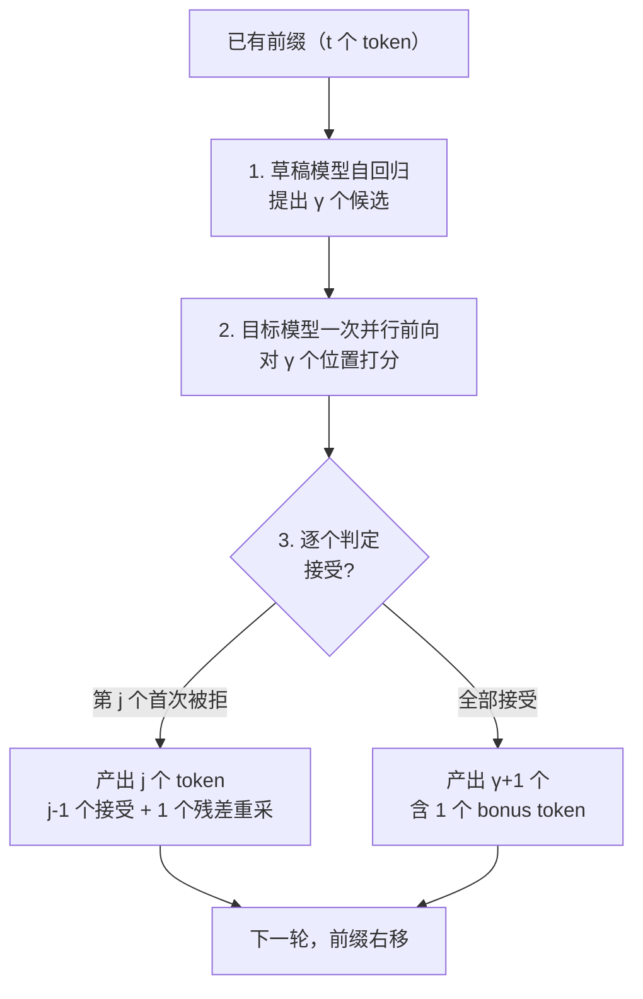
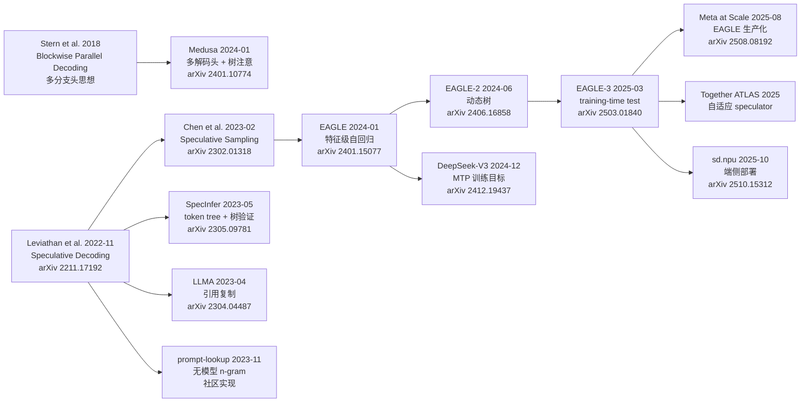

> **投机解码系列 · 第 01 篇**
>
> 本系列把投机解码从「一个加速技巧」拆成可核验的几层：综述与演化（本文）→ 收益模型 → 草稿从哪来 →
> 引擎支持 → 生产陷阱 → 评测数字怎么读。
> 它挂在[推理引擎主线](/2026/10/18/serving-01-architecture-divergence/)之下——
> 投机解码是推理引擎的一个子系统，脱离引擎谈它没有意义。
>
> - **01 综述与演化（本文）** → 02 收益模型 → 03 EAGLE 家族 → 04 引擎支持矩阵 →
>   05 生产部署陷阱 → 06 业界实践 → 07 评测数字怎么读 → 08 未来方向

**TL;DR**

> * **慢在带宽不在算力**。自回归每一步都要把全部可学习参数从参数存储读入计算单元，而单 token 触发的前向计算量相对很小；单步耗时由「参数读取」主导，算力在等数据。这是投机解码成立的全部地基。
> * **所有投机方法本质上都是在买「一次前向换多个 token」的赔率**。赔率由两件事定价：草稿被接受的概率 $$\alpha$$、以及草稿相对目标的成本 $$c$$；收益模型（加速比闭式、最优草稿长度、硬天花板）在[第 02 篇](/2026/10/18/specdec-02-acceptance-and-speedup-model/)给出。
> * **方法谱系沿两条轴分类**：① 生成轴——草稿从哪来（独立小模型 / 层跳过 / FFN 头 / 多 token 头 / 无模型检索 / 训练目标级）；② 验证轴——草稿怎么被确认（单遍 / 树验证 / 迭代）。survey 2502.19732 称之为 **generation–refinement** 框架。
> * **三股源头汇成两条主线**。2018 多分支头思想、2022–2023 独立 draft 模型、2023 无模型方案，在 2024 年后收敛为「自投机（EAGLE / Medusa）」与「训练目标级（DeepSeek-V3 MTP）」两条主线。
> * **树验证是贯穿主线的基础设施**，而 MTP 与 training-time test 是 2024–2025 的关键跃迁。本文只立框架与演化，数学推导与闭式交给后续篇目。

---

## 0. 符号约定

本文与系列后续篇目统一采用 Leviathan et al. 的记号（也是 vLLM / SGLang 代码里的写法）：目标模型记为 $$p$$、草稿模型记为 $$q$$；DeepSeek-MTP 等训练目标级方法不引入单独的草稿分布，其记号在第 03 篇单独说明。

| 符号 | 含义 |
|:---|:---|
| $$M_T$$、$$p(x_t \mid x_{<t})$$ | **目标模型**及其在词表上的条件分布 |
| $$M_D$$、$$q(x_t \mid x_{<t})$$ | **草稿模型**及其在词表上的条件分布 |
| $$\gamma$$ | 草稿长度（每轮提出的候选 token 数） |
| $$\alpha$$ | 单步接受概率（独立接受假设下为常数） |
| $$c = t_D / t_T$$ | 单次草稿前向与单次目标前向的耗时比 |
| $$\mathbb{E}[T]$$ | 每轮验证后产出的 token 数期望（含 bonus token） |
| $$V$$ | 词表大小 |
| $$I$$ | 算术强度（arithmetic intensity），每次读取字节对应的浮点运算数 |
| $$B_{\mathrm{mem}}$$、$$B_{\mathrm{comp}}$$ | 存储带宽与算力吞吐（通用量，不特指任何设备） |

$$\alpha$$ 有一个贯穿全系列的等价写法，先在这里立住：

$$
\alpha = \mathbb{E}_{x \sim q}\!\left[\min\!\left(1, \tfrac{p(x)}{q(x)}\right)\right] = \sum_x \min\big(p(x), q(x)\big) = 1 - \tfrac{1}{2}\mathrm{TV}(p, q)
$$

即 $$\alpha$$ 就是目标与草稿两分布的**重叠质量**，等于 $$1$$ 减去二分之一的总变差距离。这条式子把「接受率」与「草稿和目标有多像」直接焊死——后面所有分类与演化结论，本质上都是在回答「怎么让这个重叠更大、让一次前向换到的 token 更多」。

---

## 1. 自回归瓶颈：慢在带宽，不在算力

投机解码的全部动机，都来自自回归解码的一个结构性事实：**生成 $$K$$ 个 token 需要 $$K$$ 次串行的前向，而每一次前向的瓶颈通常不是计算量，而是把参数读进来的带宽。**

### 1.1 朴素自回归的时间账

自回归解码下，生成 $$K$$ 个 token 的时间近似为

$$
\mathrm{time}(K\ \text{tokens}) = K \times t_{\mathrm{forward}}
$$

其中 $$t_{\mathrm{forward}}$$ 是「给定前缀、算出一个 token」的单步耗时。这一步没法并行：第 $$t+1$$ 个 token 的分布依赖第 $$t$$ 个 token 的取值，串行链上没有任何一步能提前算。所以「大模型慢」在解码阶段的第一直觉是「步数多」，但更深的瓶颈是「每一步本身被什么卡住」。

### 1.2 为什么是带宽：参数读取 vs 单 token 计算

把一次前向拆成两项：

$$
\mathrm{cost}(\text{1 token}) = \underbrace{T_{\mathrm{weights}}}_{\text{把全部参数读一遍}} \;+\; \underbrace{T_{\mathrm{compute}}}_{\text{一次前向的计算}}
$$

关键在于这两项的比例。当 batch 较小、模型较大时，每一步都要把整个模型的参数从参数存储搬到计算单元，而这一步实际要算的量（一个 token 的前向）相对很小，于是

$$
T_{\mathrm{weights}} \gg T_{\mathrm{compute}}
$$

时间被「参数读取」主导，计算单元在等数据。这一区间通常被称为 **memory-bound（带宽受限）**。它不是一个只在某类设备上才出现的现象——任何把大量参数与较小单次计算量放在一起的架构都会落入这个区间；在 CPU 上读权重、在专用加速器上读权重，机理相同。

### 1.3 用算术强度把「带宽受限」说准

上面的「远大于」可以量化成一个干净的判据。记

$$
I = \frac{\text{单次前向的浮点运算数}}{\text{单次前向读取的参数字节数}}
$$

为算术强度（arithmetic intensity）。模型处于带宽受限区间，当且仅当

$$
I \;<\; \frac{B_{\mathrm{comp}}}{B_{\mathrm{mem}}}
$$

其中 $$B_{\mathrm{comp}}$$ 是算力吞吐（单位时间能做的浮点运算），$$B_{\mathrm{mem}}$$ 是存储带宽（单位时间能搬的字节）。右端 $$\rho = B_{\mathrm{comp}}/B_{\mathrm{mem}}$$ 是架构的「拐点算术强度」：低于它，系统被存储搬运输送线卡住；高于它，系统被算力卡住。

对一个参数量为 $$W$$、单次前向做 $$F$$ 次浮点运算的模型，单 token 解码的算术强度约为 $$I \approx F / W$$（每个参数被读一次，参与约常数次运算）。大模型 $$W$$ 极大而单 token 的 $$F$$ 极小，于是 $$I$$ 远低于拐点——这正是「慢在带宽不在算力」的定量表达。这一步判断不依赖任何具体设备，只依赖「参数规模远大于单步计算量」这一结构。

### 1.4 这一事实如何决定投机解码的形态

带宽受限区间有一个直接推论：**把「算 1 个位置」换成「算 $$\gamma$$ 个位置」，多出来的计算可以塞进同一次参数读取的空隙。** 权重反正已经读进来了，多算几个位置几乎不加时间。Leviathan et al. 与 Chen et al. 的原始观察都建立在这条上：并行评分一个短延续序列的延迟，与评分单个 token 的延迟相当 [1](https://arxiv.org/abs/2211.17192)[2](https://arxiv.org/abs/2302.01318)。

这条观察是投机解码**成立的前提**，而不是它的某个优化技巧。它同时划出了失效边界：一旦进入算力受限区间（大 batch、或模型相对小到让 $$T_{\mathrm{compute}}$$ 占主导），「验证 $$\gamma$$ 个位置的代价」会随 $$\gamma$$ 线性增长，加速比会系统性低于模型预测值。[第 02 篇](/2026/10/18/specdec-02-acceptance-and-speedup-model/)把这条边界写进了收益模型，第 07 篇会给出「大 batch 下收益衰减」的更细结论（MagicDec [7](https://arxiv.org/abs/2408.11049)）。

读到这里应当记住一句话：**投机解码不是在「算得更快」上做文章，而是在「一次参数读取里多吐几个 token」上做文章。** 后面所有方法，都可以翻译成「怎么让这一次读取换到的 token 尽可能多、且尽可能便宜」。

---

## 2. draft → verify：投机解码的两阶段范式

投机解码（speculative decoding）的范式是两阶段：**draft（草稿）→ verify（验证）**。核心做法是：用一个成本更低的猜测器先提出一段候选 token，再用目标模型一次并行前向把这段候选整体验证掉；验证通过就一次接受多个 token，通不过则用拒绝采样从残差分布重采，保证最终输出分布与目标模型单独采样严格一致。

### 2.1 一个回合在做什么

单轮流程：草稿模型自回归提出 $$\gamma$$ 个候选，目标模型**一次并行前向**对这 $$\gamma$$ 个位置打分，再逐个位置判定接受与否。

关键的结构性事实：**每一轮目标模型都保底产出 1 个 token。** 即使第一个草稿就被拒，也会从残差分布重采出一个。因此串行目标前向的次数**永远不会多于**朴素自回归 [1](https://arxiv.org/abs/2211.17192)。这是「最坏不亏、最好大赚」的来源。

### 2.2 为什么「并行验证」近乎免费（地基）

回到 §1.3 的带宽受限判据。在 $$I < B_{\mathrm{comp}}/B_{\mathrm{mem}}$$ 区间，单步耗时由 $$T_{\mathrm{weights}}$$ 主导。把「验证 1 个位置」换成「验证 $$\gamma$$ 个位置」，多出的计算落在同一次参数读取的空隙里，于是

$$
t_{\mathrm{verify}}(\gamma\ \text{位置}) \approx t_{\mathrm{verify}}(1\ \text{位置})
$$

这正是收益模型里「验证几乎不增加延迟」假设的物理基础。[第 02 篇](/2026/10/18/specdec-02-acceptance-and-speedup-model/) §2.2 把这个假设拆成 $$t_{\mathrm{round}} \approx t_T(1+\gamma c)$$ 的形式，并指出进入算力受限区间后这个前提会失效。本文到此为止——地基说清即可，定量交给后续篇目。

### 2.3 无损性：分布严格不变（只立结论，不证）

投机解码最被低估的性质是**无损**：在独立接受假设下，draft–verify 产出的序列，其边缘分布严格等于目标模型自回归采样的分布。保证手段是拒绝采样（接受概率取 $$\min(1, p(x)/q(x))$$，被拒时从残差分布 $$\propto (p(x)-q(x))_{+}$$ 重采）。

这是一道需要独立证明的定理，不在本文范围内。本站[《PyTorch 采样实现深读》§4](/2026/09/30/pytorch-sampling-internals/)把「输出分布为什么仍严格等于目标分布」这一道门完整证过；系列边界也明确要求 specdec 不重复无偏性证明，只回答「值不值得做、参数怎么设」。所以本文到此只立结论：**正确性是「无损」的，收益却「高度有条件」——某些参数组合下加速比会低于 1。** 这两件事必须分开，后面 §3 起的所有分类都是在「正确性已守住」的前提下谈收益。

### 2.4 最坏不亏、最好大赚

把 §2.1 的结构写成期望：设前 $$k$$ 个草稿都被接受的概率为 $$\alpha^k$$，本轮产出 token 数 $$T$$ 满足

$$
\Pr[T > k] = \alpha^k \quad (k = 0, 1, \dots, \gamma)
$$

由尾概率求和

$$
\mathbb{E}[T] = \sum_{k=0}^{\gamma} \alpha^k = \frac{1 - \alpha^{\gamma+1}}{1 - \alpha}
$$

这是全系列的母公式。[第 02 篇](/2026/10/18/specdec-02-acceptance-and-speedup-model/)从它推出加速比闭式与硬天花板；本文先把它放在这里，方便后面分类时随时引用：**任何一类草稿方法的价值，最终都折算成这个 $$\mathbb{E}[T]$$ 能抬多高、而代价 $$c$$ 能压多低。**

---

## 3. 方法谱系的两条分类轴

「投机解码」今天已经不是一种方法，而是一族方法。把它们理清，最干净的方式是沿**两条互相独立的轴**展开：草稿从哪来（生成），以及草稿怎么被确认（验证）。一条方法可以由「生成轴上的一个点到验证轴上的一个点」唯一确定。

### 3.1 为什么需要两套坐标轴

只沿时间线排方法会糊。例如 EAGLE 与 Medusa 同在 2024-01、都用树验证，但草稿来源完全不同（特征级预测 vs 多解码头）；又例如经典投机解码与 SpecInfer 都用「独立或近似的草稿分布」，但验证方式天差地别（单链 vs 树）。把「来源」与「确认方式」拆开，才能看清哪些是同一思路的不同包装、哪些是真正独立的创新。

### 3.2 生成轴：草稿从哪来

生成轴回答一个问题：那 $$\gamma$$ 个候选 token 是怎么被提出来的？它决定了 $$\alpha$$ 的上限和 $$c$$ 的量级，是收益模型里两个不可配置变量的根本来源。本文 §4 把它拆成六类。

### 3.3 验证轴：草稿怎么被确认

验证轴回答另一个问题：目标模型拿到这 $$\gamma$$ 个候选后，如何判定接受、如何把被拒的损失控制住？它决定了 $$\mathbb{E}[T]$$ 是按单链几何分布增长，还是被树结构显著放大。本文 §5 把它拆成三类。

### 3.4 survey 2502.19732 的 generation–refinement 框架

这一「两阶段、两轴」的视角并非本站独撰。Hu et al. 的 *Speculative Decoding and Beyond: An In-Depth Survey of Techniques*（2025-02）把整个领域统一在 **generation–refinement（生成–精炼）** 框架下：generation 对应本文的生成轴，refinement 对应验证轴 [14](https://arxiv.org/abs/2502.19732)。该 survey 的系统化价值在于，它把散落多年的方法（从 2018 的 Blockwise 到 2025 的 EAGLE-3）收进同一张坐标系，使「这一类方法的创新究竟落在哪一轴」一目了然。后面两节就按这个框架铺开。

---

## 4. 生成轴（草稿从哪来）：六类来源

按 survey 2502.19732 的生成策略族，草稿来源可以归为六类。每一类的本质差异，都体现在它如何影响 $$\alpha$$ 与 $$c$$ 这两个收益模型的输入量上。

### 4.1 独立小模型 draft model

最直觉的来源：另训一个明显更小的模型 $$M_D$$（例如 7B 目标配 1B 草稿），让它自回归提出候选，目标模型验证 [1](https://arxiv.org/abs/2211.17192)[2](https://arxiv.org/abs/2302.01318)。

- **$$\alpha$$ 上限**：由小模型与目标的能力差距决定，通常中等；
- **$$c$$ 量级**：约 0.1–0.5（小模型前向虽便宜，但仍是一个独立模型，要额外占部署与存储）；
- **代价**：要额外部署、额外显存，且草稿与目标必须同词表（硬约束，见第 05 篇）。

这是奠基论文的原型，优点是干净、与引擎解耦；缺点是「多养一个模型」在工程上并不轻松。

### 4.2 层跳过 / 共享主干（LayerSkip、Kangaroo、Draft&Verify）

不引入独立模型，而是让目标模型自己的一部分子模块充当草稿：跳过若干层、用浅层输出近似深层输出 [14](https://arxiv.org/abs/2502.19732)。

- **$$\alpha$$ 上限**：受限于「浅层近似深层」的误差，通常低于特征级方法；
- **$$c$$ 量级**：低（共享主干，几乎没有额外模型）；
- **代价**：草稿质量有限，且需要小心处理层间依赖，避免近似误差在长草稿链上累积。

这一类是「自投机」的最朴素形态，介于独立小模型与多解码头之间。

### 4.3 FFN 头特征级预测（EAGLE 系）

EAGLE 把自回归从 token 空间搬到**特征空间**：草稿模型的输入复用目标模型顶层特征，输出经目标模型的 LM head 得到 token 分布 [9](https://arxiv.org/abs/2401.15077)。特征级对齐使接受率显著高于独立 draft 模型，且草稿网络极小（单层解码器）。

- **$$\alpha$$ 上限**：高（特征级预测比 token 级近似更贴近目标）；
- **$$c$$ 量级**：明显低于 0.1（复用目标 hidden state，几乎只多算一层）；
- **代价**：需要为目标模型额外训练一个轻量草稿网络，且训练数据质量敏感。

EAGLE-2（动态草稿树 [10](https://arxiv.org/abs/2406.16858)）、EAGLE-3（直接预测 token + training-time test [11](https://arxiv.org/abs/2503.01840)）都在此轴上迭代。它是当前工程主流，第 03 篇专讲。

### 4.4 多 token 头（Medusa）

Medusa 在 LLM 顶部挂多个轻量解码头，直接预测后续 $$K$$ 个位置 [3](https://arxiv.org/abs/2401.10774)。它不追求「逐个位置自回归」，而是并行产出多个候选位置的分布，再配合树注意与 typical acceptance（一种放宽拒绝采样的权衡）提速。

- **$$\alpha$$ 上限**：接近特征级方法，但预测目标仍是 token 级；
- **$$c$$ 量级**：低（共享主干的多头）；
- **代价**：多头训练与目标模型联合微调（Medusa-2）才能拿到更好收益，冻结主干（Medusa-1）收益有限。

Medusa 是 2018 Blockwise Parallel Decoding 多分支头思想的直接继承者 [3](https://arxiv.org/abs/2401.10774)。

### 4.5 无模型 n-gram / 检索（prompt-lookup、REST、LLMA）

彻底摆脱「准备一个草稿模型」的负担：直接在已生成前缀里做 n-gram 最长匹配、或从参考文本 / 检索库中复制片段，零训练零额外模型 [7](https://github.com/apoorvumang/prompt-lookup-decoding)[8](https://arxiv.org/abs/2311.08252)[5](https://arxiv.org/abs/2304.04487)。

- **$$\alpha$$ 上限**：高度依赖文本复用度（摘要、代码、多轮对话、RAG 场景高，开放生成低）；
- **$$c$$ 量级**：极低（只是前缀查找，几乎不花前向）；
- **代价**：只在「强复用」语料上有效，开放域接受率会塌。

LLMA 利用输出与参考文本的高度重叠，贪婪解码下输出与基准完全相同，报告 2–3× 加速 [5](https://arxiv.org/abs/2304.04487)；prompt-lookup 在摘要 / 代码场景常见约 2.8× 的论文值（详见[第 05 / 07 篇](/2026/10/18/specdec-02-acceptance-and-speedup-model/)）。这一类是「零成本路线」的代表。

### 4.6 训练目标级（DeepSeek-V3 MTP）

把「预测未来多个 token」直接写进训练目标：DeepSeek-V3 引入 Multi-Token Prediction（MTP），每个位置按顺序预测后续 $$D$$ 个 token，保持因果链路完整 [6](https://arxiv.org/abs/2412.19437)。推理期这个 MTP 模块可直接复用作投机解码。

- **$$\alpha$$ 上限**：高（模块在训练时就按「多步预测」优化，与目标分布高度一致）；
- **$$c$$ 量级**：低（复用主干的浅层扩展，不是独立模型）；
- **代价**：需要模型在训练阶段就内建该目标，无法后装到任意已发布模型。

这一类代表「投机能力内建进训练目标」的范式跃迁，下文 §8 专讲。

---

## 5. 验证轴（草稿怎么被确认）：三种验证

草稿提出来之后，目标模型如何确认，是第二条独立的坐标轴。它不改变草稿的来源，却直接决定 $$\mathbb{E}[T]$$ 的增长方式。

### 5.1 单遍线性验证

最朴素的验证：把草稿当成一条链，目标模型一次前向给分，逐位置判定接受，押错一处整段作废 [1](https://arxiv.org/abs/2211.17192)。接受长度受限于**最长全对前缀**，即 §2.4 的几何分布 $$\mathbb{E}[T] = (1-\alpha^{\gamma+1})/(1-\alpha)$$。

它的优点是实现简单、正确性容易守住；缺点是 $$\alpha$$ 不够高时，单链接受长度上不去，多提出的候选大量被浪费。

### 5.2 树验证（tree-based）：SpecInfer / Medusa / EAGLE

把多条候选组织成 token 树，用 **tree attention** 单次前向并行验证整棵树 [4](https://arxiv.org/abs/2305.09781)。SpecInfer 把猜测从「单条序列」升级为「token 树」，并提出 multi-step speculative sampling（MSS）保证随机解码无损。

树验证改变了 §2.4 的前提：单链下「押错一处分支整段作废」，树结构下多条候选并行押注，只要目标沿任一支路径落子，该支后续 token 均可被接住。SpecInfer 报告随机解码下 token 验证成功率从 52–57% 提升到 96–97% [4](https://arxiv.org/abs/2305.09781)。这一结构被 Medusa / EAGLE(-2/-3) / Sequoia 全系沿用。

### 5.3 树注意力的实现要点（正确性约束）

树验证不是「把多条序列拼成一个 batch」。难点在注意力：

- 分支之间**共享前缀**，但不同分支的 token 之间**不应互相看见**（它们代表互斥的候选延续）；
- 直接用标准因果掩码会把兄弟分支错误地暴露给彼此；
- 用朴素「每条路径单独算」又会把共享前缀重复计算 $$\lvert\text{branches}\rvert$$ 次，把并行验证的收益吃回去。

SpecInfer 的做法是**分组 kernel + 修正注意力分数**：把父到子的链按组划分，用每组末尾 token 的 KV 参与计算，再修复违反因果关系的注意力对，最终得到与增量解码**完全一致**的注意力输出 [4](https://arxiv.org/abs/2305.09781)。「完全一致」是硬要求：任何一处掩码或位置编码处理错了，输出分布就会偏离目标分布，§2.3 那道「正确性」的门就守不住。这也是树验证在引擎里实现复杂度显著高于单遍验证的原因。

值得强调：树结构的收益**不是靠减少计算量**，而是靠提高**每轮期望接受长度**。计算上它甚至更贵（一棵树的总 token 数通常大于单条链），但只要单次前向能装下这棵树，多出的计算就落在 §1.3 说的「带宽受限空隙」里。[第 02 篇](/2026/10/18/specdec-02-acceptance-and-speedup-model/) §8 进一步说明，树验证下 $$\mathbb{E}[T]$$ 不再由单链几何分布决定，本文给出的加速比是保守下界。

### 5.4 迭代验证（CLLM 等）

第三类是迭代精炼：不一次押注整段，而是多轮修正，质量优先、成本更高（如 CLLM 类、并行投机解码）[14](https://arxiv.org/abs/2502.19732)。它牺牲每轮吞吐换更稳的草稿质量，适用场景与单遍 / 树验证不同，本文不展开，仅列入坐标轴的第三点以保持框架完整。

---

## 6. 演化史：三股源头 → 两条主线

把 §3 的两轴放回时间线，演化脉络就清楚了。下面这张图把关键节点按年份连起来；注意三股源头在 2024 年后汇合。

### 6.1 源头：Blockwise（2018）与奠基（2022–2023）

- **2018，Blockwise Parallel Decoding**（Stern et al.）：用多个解码头同时预测多个位置，在机器翻译与图像超分上验证「多 token 并行预测」的可行性 [3](https://arxiv.org/abs/2401.10774)（Medusa 论文内明确引用）。这是多分支头思想的源头。
- **2022-11，Speculative Decoding**（Leviathan et al.，ICML 2023）：正式提出 draft–verify 两阶段，并给出核心证明——通过 speculative sampling（接受概率 $$\min(1, p(x)/q(x))$$，拒绝后从残差分布重采），输出分布与目标模型单独采样**完全一致**（无损、无偏）[1](https://arxiv.org/abs/2211.17192)。
- **2023-02，Speculative Sampling**（Chen et al.，DeepMind）：在同一范式上，于 70B Chinchilla 分布式设置拿到 2–2.5× 解码加速，并完整给出接受率与预期每步 token 数的理论 [2](https://arxiv.org/abs/2302.01318)。

三者共同奠定了「draft → verify」范式。注意 §0 的记号分歧：Leviathan 用 $$p$$ 指目标、$$q$$ 指草稿，Chen 用 $$q$$ 指目标、$$p$$ 指草稿 [1](https://arxiv.org/abs/2211.17192)[2](https://arxiv.org/abs/2302.01318)；本文统一用前者。

### 6.2 系统化：SpecInfer 与树验证（2023-05）

上海交大 / CMU 的 Miao 等人提出 SpecInfer，把猜测从「单条序列」升级为 token 树，用 tree attention 单次前向并行验证整棵树，并提出 MSS 保证随机解码无损 [4](https://arxiv.org/abs/2305.09781)（ASPLOS 2024，开源于 FlexFlow 仓库）。树验证成为此后 Medusa / EAGLE 系的标准基础设施——这是验证轴上的一次关键跃迁。

### 6.3 零成本路线：无模型与引用复制（2023）

为摆脱「必须准备一个高质量 draft 模型」的负担，出现两条无独立模型的路线：

- **LLMA（2023-04）**：利用输出与上下文参考文本的高度重叠（检索增强、多轮对话、缓存会话），直接从参考中复制文本片段批量送入验证，贪婪解码下输出与基准完全相同，报告 2–3× 加速 [5](https://arxiv.org/abs/2304.04487)。
- **prompt-lookup / n-gram（2023-11）**：直接在已生成前缀中查找并复制后续 token（本质是 n-gram 最长公共前缀匹配），零训练零额外模型 [7](https://github.com/apoorvumang/prompt-lookup-decoding)。REST 进一步用检索（datastore）生成草稿 [8](https://arxiv.org/abs/2311.08252)。

### 6.4 自投机兴起：Medusa 与 EAGLE（2024）

- **Medusa（2024-01，ICML 2024）**：去掉外部 draft 模型，在 LLM 顶部加多个轻量解码头直接预测后续 $$K$$ 个 token，配合树注意与 typical acceptance（放宽拒绝采样，可权衡质量与速度）。报告 Medusa-1（冻结主干）超 2.2×、Medusa-2（联合微调）达 2.3–2.8× [3](https://arxiv.org/abs/2401.10774)。
- **EAGLE（2024-01，ICML 2024）**：把自回归搬到特征空间，草稿输入复用目标顶层特征，输出经 LM head 得 token 分布；特征级对齐使接受率显著高于独立 draft 模型，且草稿网络极小（单层解码器）[9](https://arxiv.org/abs/2401.15077)。EAGLE-2（2024-06，EMNLP 2024）引入动态草稿树进一步提速 [10](https://arxiv.org/abs/2406.16858)。

### 6.5 训练目标级：DeepSeek-V3 MTP（2024-12）

DeepSeek-V3（671B 总参 / 37B 激活的 MoE）在训练阶段引入 MTP：每个位置按顺序预测后续 $$D$$ 个 token，保持因果链路完整 [6](https://arxiv.org/abs/2412.19437)。它既是辅助训练目标（提升主模型基准表现），又能让推理期 MTP 模块直接复用作投机解码。这是「投机能力内建进训练目标」的代表性工程实践，详见 §8。

### 6.6 当前主流与规模化（2025–2026）

- **EAGLE-3（2025-03，NeurIPS 2025）**：放弃特征预测约束，改为直接预测 token，并用 training-time test 消除训练–推理分布失配；输入从「仅顶层特征」换成低 / 中 / 高层特征融合。论文报告最高 6.5× 加速、相对 EAGLE-2 约 1.4× 提升；在 SGLang 中 bs=64 时吞吐提升约 38%（1.38×）[11](https://arxiv.org/abs/2503.01840)。代码开源于 SafeAILab/EAGLE，并官方推荐 SpecForge 用于 SGLang 生态训练。
- **Meta（2025-08）**：*Efficient Speculative Decoding for Llama at Scale*，基于 EAGLE 的亿级生产化部署，报告 Llama4 Maverick 在 bs=1 下约 4ms/token [12](https://arxiv.org/abs/2508.08192)。
- **Together AI**：ATLAS 自适应 speculator + Together Turbo，报告 DeepSeek-V3.1 达 500 TPS、Kimi-K2 460 TPS（约 2.65×）。
- **端侧**：sd.npu 把投机调度到受存储与功耗约束的端侧设备，报告 3.8× 速度 / 4.7× 能效提升（论文值）[13](https://arxiv.org/abs/2510.15312)。

### 6.7 里程碑速查表

| 时间 | 方法 | 归属谱系 | 标志性结果（论文 / 报告值） |
|---|---|---|---|
| 2018 | Blockwise Parallel Decoding | 多分支头发源 | MT / 超分任务验证多 token 并行预测 |
| 2022-11 | Speculative Decoding | draft+verify 奠基 | 2–3×，无损 |
| 2023-02 | Speculative Sampling | draft+verify 奠基 | 70B Chinchilla 2–2.5× |
| 2023-04 | LLMA | 引用复制 | 2–3×（RAG 等） |
| 2023-05 | SpecInfer | 树验证发源 | 树验证成功率 96–97% |
| 2023-11 | prompt-lookup / n-gram | 零模型 | 摘要 / 代码常见约 2.8× |
| 2024-01 | Medusa | 多 token 头 | Medusa-1 ≥2.2×，Medusa-2 2.3–2.8× |
| 2024-01 | EAGLE | 特征级自回归 | 接受率显著优于独立 draft |
| 2024-06 | EAGLE-2 | 动态草稿树 | 相对 EAGLE 提升 |
| 2024-12 | DeepSeek-V3 MTP | 训练目标级 | MTP 既是训练目标又可做投机 |
| 2025-03 | EAGLE-3 | 自投机 + 规模化 | 最高 6.5×；SGLang bs=64 吞吐 1.38× |
| 2025-08 | Llama at Scale | 生产化 EAGLE | Maverick 约 4ms/token |
| 2025-10 | sd.npu | 端侧部署 | 3.8× 速度 / 4.7× 能效（论文值） |

表中所有倍数均为对应论文或官方报告给出的数值，站点的「生产实测」口径在[第 05 / 07 篇](/2026/10/18/specdec-02-acceptance-and-speedup-model/)按可信度分级处理；本文作为综述只负责把谱系与来源标定清楚。

---

## 7. 为什么树验证成为主线的基础设施

§5 已经把树验证列为验证轴的主流，这里单独解释它为什么能成为「贯穿 SpecInfer / Medusa / EAGLE 系的基础设施」，而不是某个方法的私有技巧。

### 7.1 单链接受长度的几何衰减

回到 §2.4 的母公式。单链下，接受长度由「最长全对前缀」决定，期望为

$$
\mathbb{E}[T] = \frac{1 - \alpha^{\gamma+1}}{1 - \alpha}
$$

当 $$\alpha$$ 不够高，$$\alpha^{\gamma+1}$$ 随 $$\gamma$$ 迅速衰减到 0，$$\mathbb{E}[T]$$ 很快饱和——多提出的候选大多被第一个错位置截断，白白浪费。这是单遍线性验证的结构性天花板。

### 7.2 树把「每层投注」池化

树验证的直觉是：把「每一层只押一条路径」改成「每一层押多条候选」，再让它们共享前缀。只要目标模型沿**任一条**分支路径落子，该分支的后续 token 都能被接住。等价地，它把「每层投注」池化——单链赌一条线，树赌一个扇出，命中概率因此大幅提升。SpecInfer 报告验证成功率从 52–57% 升到 96–97% [4](https://arxiv.org/abs/2305.09781)，就是这个池化效应的直接证据。

### 7.3 收益来自接受长度，不是计算量

注意树验证**没有减少计算量**——一棵树的总 token 数通常大于单条链。它的收益全部来自「每轮期望接受长度更长」，而多出的计算落在 §1.3 的带宽受限空隙里。这恰好说明：**方法谱系里「验证轴」的创新，价值折算点就是 §2.4 的 $$\mathbb{E}[T]$$。** 任何能抬高 $$\mathbb{E}[T]$$ 的验证结构，都直接在加速比分子上做功，与草稿来源无关。这是把「生成轴」与「验证轴」拆开的最大好处——两条轴的收益可以独立分析、再相乘。

---

## 8. 训练目标级投机与 training-time test

2024–2025 的两条主线里，「训练目标级」是相对「自投机」更深层的一次跃迁。它不再满足于「推理期想办法猜得准」，而是回到达训练目标，让模型天生就擅长多步预测。

### 8.1 MTP：把投机写进训练目标

DeepSeek-V3 的 MTP 在训练阶段就让每个位置预测后续 $$D$$ 个 token [6](https://arxiv.org/abs/2412.19437)。这与「事后挂一个草稿网络」有本质区别：草稿分布不再是「对目标的近似」，而是「目标本身在训练时就被优化过的一部分」。因此推理期复用 MTP 模块做投机时，$$\alpha$$ 的上限天然更高，且不需要为投机单独准备训练数据与网络结构。

它的工程意义是「投机从后装件变成预装件」：模型发布时就已经内建了投机能力，推理引擎只要能识别并调度这个模块即可。llama.cpp 在 2026 把 `--spec-type` 列为 CLI 一等公民，正是这一趋势在生态侧的反映。

### 8.2 training-time test：消除训练–推理分布失配

EAGLE-3 的关键改进是 **training-time test**[11](https://arxiv.org/abs/2503.01840)：训练时把上一刻的模型输出（而不是 ground-truth token）反馈回输入，模拟自回归推理路径，从而消除「训练路径 ≠ 推理路径」的分布失配。同时，EAGLE-3 放弃特征预测约束、改为直接预测 token，并把输入从「仅顶层特征」换成低 / 中 / 高层特征融合。论文报告训练数据扩大约 8 倍后仍持续受益（此前 EAGLE 系列随数据扩大会收益递减）。

这一改动的方法论意义大于单点提速：**它直指自投机的一个根因——草稿网络在训练时看见的是 teacher-forcing 的干净前缀，推理时看见的是自己刚猜出来的、可能带错的 token。** 训练–推理失配会让草稿的 $$\alpha$$ 在长链上系统性偏低；training-time test 把这条链在训练期就摊开，使草稿网络提前适应自己的错误。

### 8.3 这一跃迁的方法论意义

把 §4 与本节对照：独立小模型（§4.1）是「另养一个近似器」，层跳过（§4.2）/ 多解码头（§4.4）/ 特征头（§4.3）是「从目标里抠子模块当近似器」，而 MTP（§4.6）+ training-time test 是「让目标自己就擅长多步预测」。越靠后，草稿与目标的一致性越高、$$\alpha$$ 上限越高、额外成本越低——这正是方法谱系沿生成轴演化的清晰方向。它也从侧面解释了[第 02 篇](/2026/10/18/specdec-02-acceptance-and-speedup-model/)的核心结论：硬天花板 $$1/(1-\alpha)$$ 只由 $$\alpha$$ 决定，所以业界把精力押在「更好的草稿（更高 $$\alpha$$）」而非「更长的 $$\gamma$$」上。

---

## 9. 生产化与端侧：论文数字 vs 落地现实

综述不能停在论文倍数上。本节只做定位：把头部团队的公开报告摆出来作为数据，并点明「实验室 vs 生产」的系统性差距是怎么回事；具体成因与可信度分级留给[第 05 / 07 篇](/2026/10/18/specdec-02-acceptance-and-speedup-model/)。

### 9.1 头部团队的生产报告（数据，论文 / 报告值）

- **Meta（2025-08）**：基于 EAGLE 的亿级生产化部署，Llama4 Maverick 在 bs=1 下报告约 4ms/token [12](https://arxiv.org/abs/2508.08192)。这是「自投机 EAGLE 系」首次被放到亿级流量上验证。
- **Together AI**：ATLAS 自适应 speculator + Together Turbo，报告 DeepSeek-V3.1 达 500 TPS、Kimi-K2 460 TPS（约 2.65×）。自适应 speculator 的意义在于：不再用固定 $$\gamma$$，而是按实时接受率动态调节（与[第 02 篇](/2026/10/18/specdec-02-acceptance-and-speedup-model/)「$$\gamma^*$$ 随 $$\alpha,c$$ 变化」的结论吻合）。
- **DeepSeek-V3 MTP**：作为训练目标级方法的代表，其推理期复用 MTP 做投机的收益在官方技术报告给出 [6](https://arxiv.org/abs/2412.19437)。

这些数字的共同特征是：**生产 / 报告值普遍低于论文里的最高加速比**。原因不是方法失效，而是 §1.3 的带宽受限前提在高并发下被侵蚀——batch 一大，目标前向从「被参数读取主导」滑向「被计算主导」，验证 $$\gamma$$ 个位置的代价开始实打实显现。

### 9.2 端侧约束下的投机（数据，论文值）

sd.npu 把投机调度到受存储与功耗约束的端侧设备，报告 3.8× 速度 / 4.7× 能效提升 [13](https://arxiv.org/abs/2510.15312)。端侧的特殊性在于：参数存储与算力之间的带宽比（§1.3 的 $$B_{\mathrm{comp}}/B_{\mathrm{mem}}$$）与数据中心设备不同，且功耗预算直接限制并行度。这恰好反证了本文开头的核心论点——**投机解码的收益形态由「带宽 vs 算力」的相对关系决定，换一种设备只是换一组 $$\alpha, c$$ 的取值，分类框架不变。**

### 9.3 实验室与生产的系统性差距（定位）

多篇生产报告与工程复盘指出，论文最高 3–6× 与生产实测普遍收敛在 1.4–2.5× 之间，差距来源是 batch / 并发 / 验证开销，部分可通过调度与动态策略缓解。这一差距不是本文要证的结论，而是后续篇目的议题：

- 第 05 篇：词汇表一致性等硬约束、收益折损清单；
- 第 07 篇：论文数字横向对比、失效区与「何时别用」清单，按可信度分级读数。

本文作为综述，职责是「把谱系与坐标标定清楚」，而不是替后续篇目下性能结论。

---

## 10. 系列地图与本文定位

### 10.1 八篇地图

本系列共八篇，沿「综述 → 收益模型 → 草稿来源 → 引擎支持 → 生产陷阱 → 业界实践 → 评测读数 → 未来方向」展开：

- **01 综述与演化（本文）**：自回归瓶颈、两轴分类框架、演化史；
- 02 收益模型：$$\alpha,\gamma,c$$ 三角、加速比闭式、$$\gamma^*$$、硬天花板（已发布，[见此](/2026/10/18/specdec-02-acceptance-and-speedup-model/)）；
- 03 EAGLE 家族：Medusa → EAGLE-1/2/3 → DeepSeek-V3 MTP 的逐代差异；
- 04 引擎支持矩阵：vLLM / SGLang / TensorRT-LLM / llama.cpp / HF 的算法支持与配置项；
- 05 生产部署陷阱：硬约束、收益折损、红绿灯规则；
- 06 业界实践：DeepSeek / Meta / Together / 端侧的真实案例；
- 07 评测数字怎么读：论文数字横向对比、失效区、可信度分级；
- 08 未来方向：训练–推理协同、动态 / 多草稿、投机缩放定律、开放问题。

### 10.2 本文覆盖与边界

本文只做三件事：**立核心论点**（慢在带宽不在算力，所有方法都在买「一次前向换多个 token」的赔率）、**铺两轴分类框架**（生成轴六类 + 验证轴三类）、**梳演化史**（三股源头到两条主线）。三道边界本文严格遵守：

1. **不重复无偏性证明**——输出分布为何等于目标分布，归[《PyTorch 采样实现深读》§4](/2026/09/30/pytorch-sampling-internals/)；
2. **不跑实验**——本文是综述，不出现任何「实测输出」表格，所有倍数均为论文 / 报告值并标注来源；
3. **不替后续篇目下性能结论**——收益模型、引擎配置、生产陷阱、数字读数分别在 02 / 04 / 05 / 07。

### 10.3 后续篇目预览

读完本文应建立的直觉是：**任何一类投机方法，都能在「生成轴 × 验证轴」上定位，且其价值最终折算成 §2.4 的 $$\mathbb{E}[T]$$ 与收益模型的 $$c$$。** 带着这个直觉进[第 02 篇](/2026/10/18/specdec-02-acceptance-and-speedup-model/)，会更容易看清为什么 $$\gamma^*$$ 对 $$c$$ 的敏感度远高于 $$\alpha$$、为什么天花板 $$1/(1-\alpha)$$ 与 $$\gamma$$ 无关；进第 03 篇则会看清 EAGLE 系为什么能把 $$\alpha$$ 抬到足以撑起高加速比。

---

**上一篇**：（本系列首篇，无）

**下一篇**：[投机解码（03）：EAGLE 家族 —— 草稿从哪来的收敛史](/2026/10/18/specdec-03-eagle-family/)

**站内承接**：采样正确性与拒绝采样的实现细节见
[《PyTorch 采样实现深读》](/2026/09/30/pytorch-sampling-internals/)；
收益模型的闭式、$$\gamma^*$$ 与硬天花板见
[《投机解码（02）：收益模型》](/2026/10/18/specdec-02-acceptance-and-speedup-model/)；
推理引擎侧的架构分歧（本系列挂载的主线）见
[《推理引擎（01）：三条独立的设计路线》](/2026/10/18/serving-01-architecture-divergence/)。

## 参考

**奠基与核心论文**：

1. Leviathan, Kalman, Matias，*Fast Inference from Transformers via Speculative Decoding*（ICML 2023，PMLR 202:19274–19286）— [arXiv:2211.17192](https://arxiv.org/abs/2211.17192)
2. Chen, Borgeaud, Irving, Lespiau, Sifre, Jumper，*Accelerating Large Language Model Decoding with Speculative Sampling* — [arXiv:2302.01318](https://arxiv.org/abs/2302.01318)
3. Cai, Li, Geng, Peng, Lee, Chen, Dao，*Medusa: Simple LLM Inference Acceleration Framework with Multiple Decoding Heads*（ICML 2024）— [arXiv:2401.10774](https://arxiv.org/abs/2401.10774)
4. Miao, Oliaro, Zhang et al.，*SpecInfer: Accelerating Generative LLM Serving with Tree-based Speculative Inference and Verification*（ASPLOS 2024）— [arXiv:2305.09781](https://arxiv.org/abs/2305.09781)
5. Yang, Ge, Wang et al.，*Inference with Reference: Lossless Acceleration of Large Language Models*（LLMA）— [arXiv:2304.04487](https://arxiv.org/abs/2304.04487)
6. DeepSeek-AI，*DeepSeek-V3 Technical Report*（MTP）— [arXiv:2412.19437](https://arxiv.org/abs/2412.19437)
7. Su et al.，*MagicDec: Breaking the Latency-Throughput Tradeoff of Long Context Generation with Speculative Decoding* — [arXiv:2408.11049](https://arxiv.org/abs/2408.11049)
8. He et al.，*REST: Retrieval-Based Speculative Decoding* — [arXiv:2311.08252](https://arxiv.org/abs/2311.08252)
9. Li et al.，*EAGLE: Lossless Acceleration of LLM Decoding by Feature-based Drafting*（ICML 2024）— [arXiv:2401.15077](https://arxiv.org/abs/2401.15077)
10. Li et al.，*EAGLE-2: Faster Inference of Language Models with Dynamic Draft Trees*（EMNLP 2024）— [arXiv:2406.16858](https://arxiv.org/abs/2406.16858)
11. Li, Wei, Zhang, Zhang，*EAGLE-3: Scaling up Inference Acceleration of Large Language Models via Training-Time Test*（NeurIPS 2025）— [arXiv:2503.01840](https://arxiv.org/abs/2503.01840)
12. Meta / Agarwal et al.，*Efficient Speculative Decoding for Llama at Scale* — [arXiv:2508.08192](https://arxiv.org/abs/2508.08192)
13. *sd.npu: Accelerating Speculative Decoding on Mobile NPUs* — [arXiv:2510.15312](https://arxiv.org/abs/2510.15312)
14. Hu, Liu, Dong, Peng, McDanel, Zhang，*Speculative Decoding and Beyond: An In-Depth Survey of Techniques*（generation–refinement 框架）— [arXiv:2502.19732](https://arxiv.org/abs/2502.19732)

**无模型方案的社区实现**：

- Saxena，*Prompt Lookup Decoding*（社区实现，vLLM 文档亦收录）— [GitHub](https://github.com/apoorvumang/prompt-lookup-decoding)

**本站前置（正确性之门）**：

- [《PyTorch 采样实现深读》§4](/2026/09/30/pytorch-sampling-internals/) —— 输出分布为何仍严格等于目标分布（拒绝采样无偏性）
- [《推理引擎（01）：三条独立的设计路线》](/2026/10/18/serving-01-architecture-divergence/) —— 本系列挂载的推理引擎主线
