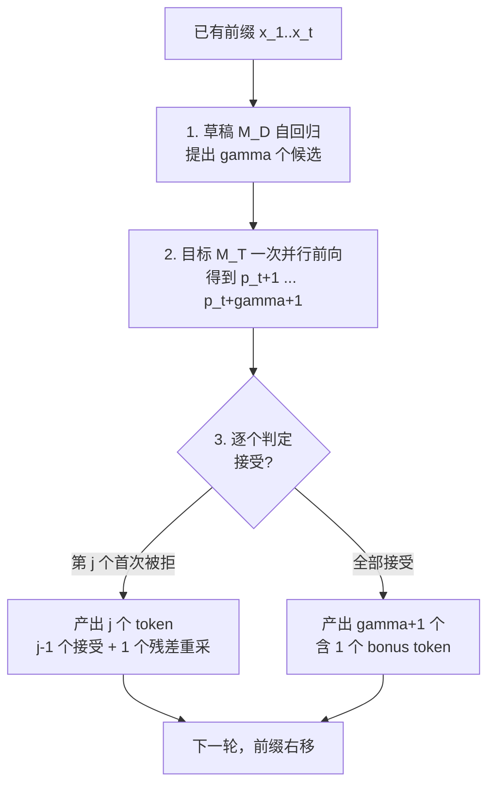
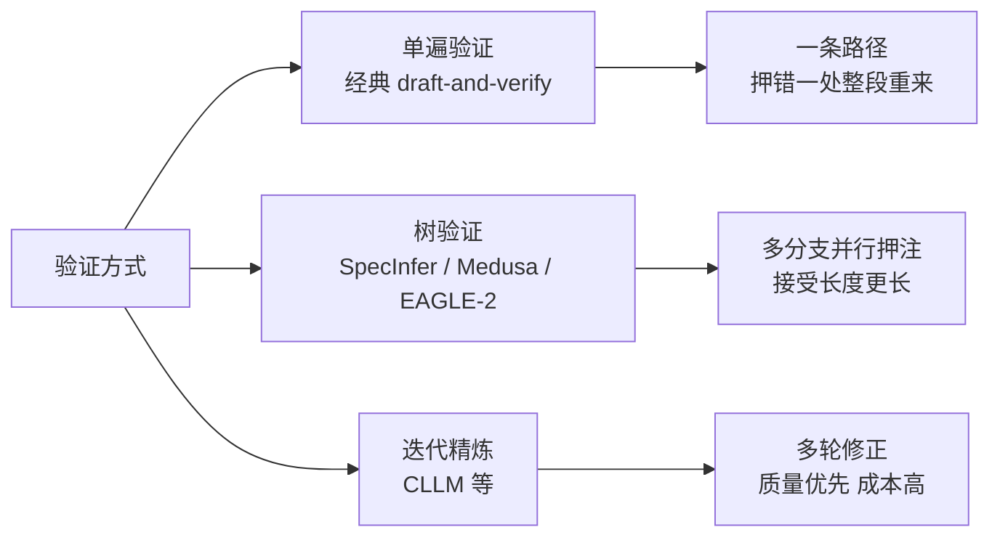

> **投机解码系列 · 第 02 篇**
>
> 本系列把投机解码从「一个加速技巧」拆成可核验的几层：收益模型（本文）→ 草稿从哪来 →
> 引擎支持 → 生产陷阱 → 评测数字怎么读。
> 它挂在[推理引擎主线](/2026/10/18/serving-01-architecture-divergence/)之下——
> 投机解码是推理引擎的一个子系统，脱离引擎谈它没有意义。
>
> - 01 综述与演化 → **02 收益模型（本文）** → 03 EAGLE 家族 → 04 引擎支持矩阵 →
>   05 生产部署陷阱 → 06 业界实践 → 07 评测数字怎么读 → 08 未来方向

**TL;DR**

> * **收益只由三个数决定**：单步接受概率 $$\alpha$$、草稿长度 $$\gamma$$、
>   草稿与目标单次前向的耗时比 $$c$$。加速比就是
>   $$S(\alpha,\gamma,c) = \dfrac{1-\alpha^{\gamma+1}}{(1-\alpha)(1+\gamma c)}$$。
> * **$$\gamma^*$$ 没有普适答案**。同一个 $$\alpha=0.9$$ 下，$$c$$ 从 0.01 涨到 0.50，
>   $$\gamma^*$$ 从 24 掉到 3 —— **压掉一个量级**。问「$$\gamma$$ 该设多大」之前必须先知道 $$c$$。
> * **加速比有硬天花板 $$1/(1-\alpha)$$，与 $$\gamma$$ 无关**。$$\alpha=0.9$$ 时天花板就是 10，
>   草稿再长、再便宜也过不去。这是「把 $$\alpha$$ 从 0.8 提到 0.9 比把 $$\gamma$$ 从 8 加到 16 更值」的量化依据。
> * **$$\alpha$$ 低到一定程度就该关掉**。$$\alpha=0.4$$ 且 $$c=0.5$$ 时，枚举出的最优是
>   $$\gamma^*=0$$、$$S=1.00$$ —— 即**不做投机**（§5 实测）。
> * **本篇不重复无偏性证明**。输出分布为什么仍然严格等于目标分布，见
>   [《PyTorch 采样实现深读》§4](/2026/09/30/pytorch-sampling-internals/)；
>   本篇只回答「值不值得做、参数怎么设」。

---

## 0. 符号约定

两篇奠基论文的记号是**相反**的：Leviathan et al. 用 $$p$$ 指目标、$$q$$ 指草稿
[1](https://arxiv.org/abs/2211.17192)；Chen et al. 用 $$q$$ 指目标、$$p$$ 指草稿
[2](https://arxiv.org/abs/2302.01318)。本文统一采用前者（也是 vLLM / SGLang 代码里的写法）：

| 符号 | 含义 |
|:---|:---|
| $$M_T$$、$$p(x_t \mid x_{<t})$$ | **目标模型**及其词表分布 |
| $$M_D$$、$$q(x_t \mid x_{<t})$$ | **草稿模型**及其词表分布 |
| $$\gamma$$ | 草稿长度（每轮提出的候选 token 数） |
| $$\alpha$$ | 单步接受概率 |
| $$c = t_D / t_T$$ | 单次草稿前向与单次目标前向的耗时比 |
| $$\mathbb{E}[T]$$ | 每轮验证后产出的 token 数期望（含 bonus token） |
| $$V$$ | 词表大小 |

$$\alpha$$ 有一个等价写法值得记住：

$$
\alpha = \mathbb{E}_{x \sim q}\!\left[\min\!\left(1, \tfrac{p(x)}{q(x)}\right)\right] = \sum_x \min\big(p(x), q(x)\big) = 1 - \tfrac{1}{2}\mathrm{TV}(p, q)
$$

即 $$\alpha$$ 就是两分布的**重叠质量**，等价于 $$1$$ 减去二分之一的总变差距离。
这个写法把「接受率」和「草稿与目标有多像」直接连起来了 —— 后面所有结论都从这里长出来。

---

## 1. 本篇站在哪里：正确性与收益是两件事

投机解码有两道独立的门：

| | 问什么 | 结论形态 | 本站位置 |
|:---|:---|:---|:---|
| **正确性** | 输出分布是否仍严格等于目标分布 | 无偏性定理；拒绝采样 + 残差分布重采 | [《PyTorch 采样实现深读》§4](/2026/09/30/pytorch-sampling-internals/) |
| **收益** | 到底快了多少，参数怎么设 | $$S(\alpha,\gamma,c)$$；存在天花板与最优 $$\gamma$$ | **本文** |

正确性是**无损**的（在独立接受假设下分布严格不变），收益却**高度有条件**——
某些参数组合下加速比会低于 1。这两件事常被混为一谈：有人因为「无损」就默认「一定更快」，
有人因为「实测没快」就怀疑「是不是有损」。两者没关系。

本篇全部内容建立在**独立接受假设**上：每个草稿 token 以固定概率 $$\alpha$$ 独立被接受。
这个假设在真实系统上**不成立**——$$\alpha$$ 随位置、上下文、batch 变化，
EAGLE-2 的核心观察正是这一点（见第 03 篇）。所以本文的所有数字是**上界参考**，不是实测加速比。

---

## 2. draft → verify：每轮产出的几何结构

单轮流程：草稿模型自回归提出 $$\gamma$$ 个候选，目标模型**一次并行前向**验证这 $$\gamma$$ 个位置。



关键的结构性事实：**每轮目标模型都保底产出 1 个 token**。
即使第一个草稿就被拒，也会从残差分布重采出一个。因此串行目标前向次数**永远不会多于**朴素自回归
[1](https://arxiv.org/abs/2211.17192)。这是投机解码「最坏不亏、最好大赚」的来源。

### 2.1 每轮产出的期望

设前 $$k$$ 个都被接受的概率为 $$\alpha^k$$。记 $$T$$ 为本轮产出 token 数，则

$$
\Pr[T > k] = \alpha^k \quad (k = 0, 1, \dots, \gamma)
$$

对 $$k = \gamma$$ 这一项：$$T > \gamma$$ 就是 $$T = \gamma+1$$（全接受 + bonus），概率 $$\alpha^\gamma$$。
由尾概率求和公式：

$$
\mathbb{E}[T] = \sum_{k=0}^{\gamma} \Pr[T > k] = \sum_{k=0}^{\gamma} \alpha^k = \frac{1 - \alpha^{\gamma+1}}{1 - \alpha}
$$

这是本文第一个要记住的闭式。两个退化检查：$$\gamma=1$$ 时 $$\mathbb{E}[T] = 1 + \alpha$$；
$$\gamma=0$$（不做投机）时 $$\mathbb{E}[T] = 1$$。

### 2.2 验证为什么几乎是免费的

§3 的耗时模型有一条看起来很可疑的假设：**验证 $$\gamma$$ 个位置的耗时约等于验证 1 个位置**。
凭什么？这是整个收益模型的地基，值得单独拆开。

自回归解码每一步的开销可以拆成两项：

$$
\mathrm{cost}(\text{1 token}) = \underbrace{T_{\rm weights}}_{\text{把全部权重读一遍}} \;+\; \underbrace{T_{\rm compute}}_{\text{一次前向的计算}}
$$

关键在于这两项的比例。小 batch、大模型时，每一步都要把整个模型的权重从显存搬到计算单元，
而实际要算的量（一个 token）很小，于是 $$T_{\rm weights} \gg T_{\rm compute}$$：
**时间被权重搬运主导，算力在等数据**。这就是常说的 memory-bound 区间。

在这个区间里，把「算 1 个位置」换成「算 $$\gamma$$ 个位置」，
多出来的计算可以**塞进同一次权重搬运的空隙**——权重反正已经读进来了，
多算几个位置几乎不加时间。Chen et al. 的原始观察就是：
对大规模分布式模型，**并行评分一个短延续序列的延迟与采样单个 token 的延迟相当**
[2](https://arxiv.org/abs/2302.01318)。Leviathan et al. 的论述同理
[1](https://arxiv.org/abs/2211.17192)。

这个洞察是投机解码**成立的前提**，而不是它的优化技巧。它同时也划出了失效边界：

| 区间 | $$T_{\rm weights}$$ vs $$T_{\rm compute}$$ | 验证 $$\gamma$$ 个位置的代价 | 投机解码 |
|:---|:---|:---|:---|
| 小 batch、大模型 | $$T_{\rm weights} \gg T_{\rm compute}$$ | 与验证 1 个相当 | 收益来自「白送的并行度」 |
| 大 batch、或模型相对小 | $$T_{\rm compute}$$ 占主导 | 随 $$\gamma$$ 线性增长 | 收益快速衰减甚至消失 |

进入第二行后，$$t_{\rm round} \approx t_T(1+\gamma c)$$ 这个式子里的 $$1$$ 不再成立——
验证本身也变贵了，加速比会比本文模型算出的更低。
这是「大 batch 下投机解码失效」这个经典说法的真正机制，
第 07 篇会讲 MagicDec 对这条边界给出的更细结论 [7](https://arxiv.org/abs/2408.11049)。

> **读法提醒**：本文所有数字都默认处在第一行区间。
> 把 §5 的表用在一个已经饱和的、大 batch 的服务上时，会**高估**收益。

---

## 3. 加速比：唯一重要的那个公式

设目标模型单次前向耗时 $$t_T$$，草稿单次前向 $$t_D$$，$$c = t_D/t_T$$。
草稿生成 $$\gamma$$ 步耗时 $$\gamma t_D$$，目标验证一次前向约 $$t_T$$
（批量验证不显著增加延迟——因为延迟被权重搬运主导
[2](https://arxiv.org/abs/2302.01318)）。单轮总耗时：

$$
t_{\rm round} \approx \gamma t_D + t_T = t_T(1 + \gamma c)
$$

产出 $$\mathbb{E}[T]$$ 个 token。以朴素自回归「每 $$t_T$$ 产 1 个 token」为基准，加速比：

$$
\boxed{\; S(\alpha, \gamma, c) \;=\; \frac{\mathbb{E}[T] \cdot t_T}{t_T(1 + \gamma c)} \;=\; \frac{1 - \alpha^{\gamma+1}}{(1 - \alpha)(1 + \gamma c)} \;}
$$

分子是「接受率带来的产出增益」，分母是「草稿的时间代价」。
**收益的全部博弈就在这两句话之间**：$$\gamma$$ 增大让分子趋于饱和、分母线性增长，
所以必然存在一个最优 $$\gamma$$。

---

## 4. 每轮产出：蒙特卡洛与闭式的对拍

配套实验（纯 numpy / CPU，固定 `seed = 20261018`）：
[`experiments/speculative-decoding/acceptance-model`](https://github.com/lrypcy/ipynbs/blob/79a07f1e68ff23612838da5d7821b32021ca2b76/experiments/speculative-decoding/acceptance-model/run.py)。

第一组直接模拟 draft-verify 过程（每格 40 万轮），与闭式
$$\mathbb{E}[T] = (1-\alpha^{\gamma+1})/(1-\alpha)$$ 对拍：

```text
  alpha     gamma           蒙特卡洛             闭式       相对误差
  ------------------------------------------------------------
  0.50          1       1.499720       1.500000    0.0187%
  0.50          4       1.935075       1.937500    0.1252%
  0.50         16       2.000662       1.999985    0.0339%
  0.70          1       1.699820       1.700000    0.0106%
  0.70          4       2.772960       2.773100    0.0050%
  0.70         16       3.324207       3.325579    0.0412%
  0.90          1       1.900597       1.900000    0.0314%
  0.90          4       4.094120       4.095100    0.0239%
  0.90         16       8.328440       8.332282    0.0461%

  最大相对误差 0.1252%（15 格全部 < 1%）
```

闭式成立。读这张表要注意**饱和现象**：

- $$\alpha=0.5$$ 时，$$\gamma$$ 从 4 加到 16，$$\mathbb{E}[T]$$ 只从 1.94 涨到 2.00 —— **几乎不再增长**；
- $$\alpha=0.9$$ 时，同样从 4 加到 16，$$\mathbb{E}[T]$$ 从 4.09 涨到 8.33 —— 仍在显著增长。

原因是 $$\alpha^\gamma$$ 这一项：$$\alpha$$ 越低，$$\gamma$$ 的边际收益衰减越快
（$$\alpha=0.5, \gamma=16$$ 时 $$\alpha^{17} \approx 7.6\times10^{-6}$$，早就饱和了）。
**$$\gamma$$ 该加多大，取决于 $$\alpha$$** —— 这是第一个反直觉点。

---

## 5. 最优草稿长度 $$\gamma^*$$：没有普适答案

对连续化的 $$S$$ 取一阶导数，最优条件为

$$
\alpha^{\gamma+1}\big(c - (1 + \gamma c)\ln\alpha\big) = c
$$

数值上直接枚举更稳。实验第二组扫了 $$5 \times 5$$ 网格，$$\gamma$$ 枚举上界 64：

```text
  alpha \ c             c=0.01          c=0.05          c=0.10          c=0.20          c=0.50
  --------------------------------------------------------------------------------------------
  alpha=0.40      g*=4, S=1.59    g*=2, S=1.42    g*=2, S=1.30    g*=1, S=1.17    g*=0, S=1.00
  alpha=0.60      g*=7, S=2.30    g*=4, S=1.92    g*=3, S=1.67    g*=2, S=1.40    g*=1, S=1.07
  alpha=0.80     g*=14, S=4.23    g*=8, S=3.09    g*=6, S=2.47    g*=4, S=1.87    g*=2, S=1.22
  alpha=0.90     g*=24, S=7.49   g*=13, S=4.67   g*=10, S=3.43    g*=7, S=2.37    g*=3, S=1.38
  alpha=0.95    g*=40, S=12.54   g*=21, S=6.60   g*=15, S=4.48   g*=10, S=2.87    g*=5, S=1.51

  交叉验证一：24 个内部解处，一阶条件 R(γ*-1) > 0 > R(γ*+1)
  交叉验证二：γ* 随 c 单调不增、随 α 单调不减（25 格全部成立）
  交叉验证三：最优加速比恒 >= 1（25 格全部成立）
```

三条交叉验证说明这张表不是「枚举出来的孤证」：连续一阶条件的根落在每个 $$\gamma^*$$ 的 $$\pm 1$$ 之内，
且单调性（$$c$$ 越大 $$\gamma^*$$ 越小、$$\alpha$$ 越大 $$\gamma^*$$ 越大）在 25 格上全部成立。

### 5.1 三个能直接拿走的结论

**一、$$\gamma^*$$ 对 $$c$$ 的敏感度远高于对 $$\alpha$$。**
固定 $$\alpha=0.9$$：$$c$$ 从 0.01 到 0.50（50 倍），$$\gamma^*$$ 从 24 掉到 3（8 倍）；
固定 $$c=0.05$$：$$\alpha$$ 从 0.6 到 0.95，$$\gamma^*$$ 从 4 涨到 21。
**决定 $$\gamma$$ 的主要是草稿有多贵，不是草稿有多准。**

**二、存在「不该开投机」的区域。**
$$\alpha=0.40, c=0.50$$ 那格的最优是 $$\gamma^*=0$$、$$S=1.00$$ ——
枚举发现任何 $$\gamma \ge 1$$ 都让 $$S < 1$$。这是一个**负收益区**：
草稿器又慢又不准，付了 $$\gamma c$$ 的账却几乎收不回接受率。

**三、$$c$$ 的量级由草稿器形态决定，不是常数。**
按草稿器的结构可以给出量级估计（**量级估计，非实测**）：

| 草稿器形态 | $$c = t_D/t_T$$ 的量级 | 对应 $$\gamma^*$$ 区间 |
|:---|:---|:---|
| 特征级单层草稿器（EAGLE 类，复用目标模型 hidden state） | 明显低于 0.1 | $$\gamma$$ 可以放大到 10 以上 |
| 独立小模型（如 7B 目标配 1B 草稿） | 约 0.1–0.5 | $$\gamma$$ 压到 1–5 |
| 无模型检索式（n-gram / prompt lookup） | 极低 | $$\gamma$$ 由命中率而非成本决定 |

真实系统的 $$c$$ 随 batch、序列长、硬件、实现而变，**不能照抄上表的数字**，
但它解释了为什么「EAGLE 用 $$\gamma=6$$ 以上、独立小模型用 $$\gamma=2$$–$$5$$」是常见配置。

### 5.2 $$c$$ 必须实测，且要在目标条件下测

$$c$$ 是三个变量里唯一**没有配置项**、也**无法从模型规格推出**的一个。
它同时依赖草稿器的结构、batch、序列长度与硬件，任何一个变了它都会变。
所以在引用 §5 那张表之前，$$c$$ 必须测，且要控制下面几个条件：

| 要控制的量 | 为什么 | 不控制会怎样 |
|:---|:---|:---|
| batch size | 目标模型前向的摊薄程度随 batch 变化，草稿是自回归串行的，两者摊薄速度不同 | 拿小 batch 测出的 $$c$$ 去调大 batch 的配置，$$\gamma^*$$ 会偏大 |
| 序列长度 | 两者都要读上下文，但 attention 的代价占比不同 | 短序列测出的 $$c$$ 不能直接用于长上下文场景 |
| 是否在 compute-bound | 决定 §2.2 那条「验证免费」的前提还成不成立 | 前提失效时本文模型整体高估收益 |
| draft / target 是否同机 | 跨机部署会把通信时间算进 $$t_D$$ | 测出的 $$c$$ 偏大，$$\gamma^*$$ 被压得过小 |

最小可行的测法：在**目标部署的 batch 与序列长**下，分别测目标模型单次前向的墙钟时间
与草稿模型单步自回归的墙钟时间，取比值。测的是比值，所以对绝对计时精度要求不高，
但**两组必须在同一条件下测**——这一点比精度重要得多。

---

## 6. 硬天花板 $$1/(1-\alpha)$$

实验第三组验证两条极限边界。

**边界一 · $$c \to 0$$（草稿几乎免费）**：

$$
S \;\to\; \frac{1 - \alpha^{\gamma+1}}{1 - \alpha}
$$

```text
  alpha     gamma      S(c=1e-6)        E[T] 上界       相对误差
  ------------------------------------------------------------
  0.60          4       2.305591       2.500000  0.000400%
  0.60         16       2.499537       2.500000  0.001600%
  0.80          4       3.361587       5.000000  0.000400%
  0.80         16       4.887332       5.000000  0.001600%
  0.90          4       4.095084      10.000000  0.000400%
  0.90         16       8.332149      10.000000  0.001600%
```

有限 $$\gamma$$ 的 $$S$$ **严格小于** $$1/(1-\alpha)$$，且随着 $$\gamma$$ 增大从下方逼近。

**边界二 · $$\alpha \to 1$$（草稿几乎全对）**：

$$
S \;\to\; \frac{\gamma + 1}{1 + \gamma c}
$$

```text
  alpha     gamma        c              S            极限值       相对误差
  ----------------------------------------------------------------
  0.999999      4     0.05       4.166658       4.166667  0.000200%
  0.999999      4     0.20       2.777772       2.777778  0.000200%
  0.999999     16     0.05       9.444369       9.444444  0.000800%
  0.999999     16     0.20       4.047587       4.047619  0.000800%
```

两条边界的相对误差均小于 $$10^{-4}$$。

### 6.1 天花板意味着什么

$$\gamma \to \infty$$ 时 $$\alpha^{\gamma+1} \to 0$$，于是

$$
S_{\max} = \frac{1}{1 - \alpha}
$$

**这个上界与 $$\gamma$$ 无关，也与 $$c$$ 无关**。代入几个值：

| $$\alpha$$ | 天花板 $$1/(1-\alpha)$$ |
|---:|---:|
| 0.5 | 2.00 |
| 0.7 | 3.33 |
| 0.8 | 5.00 |
| 0.9 | 10.00 |
| 0.95 | 20.00 |

$$\alpha=0.9$$ 时天花板就是 10 —— 无论草稿多长、多便宜都过不去。
这是本篇最该记住的一条结论，它把优化方向钉死了：

> **把 $$\alpha$$ 从 0.8 提到 0.9，天花板从 5 抬到 10（翻倍）；
> 把 $$\gamma$$ 从 8 加到 16，只是在既有的天花板下从 3.09 挪到更靠近它的位置。**

这解释了为什么业界全力投入更好的**草稿器**（EAGLE 系列的特征级预测、
DeepSeek-V3 把 MTP 写进训练目标），而不是把 $$\gamma$$ 一味调大。
第 03 篇会沿着这条线展开。

---

## 7. 三个变量怎么落到引擎配置上

数学符号与真实配置项之间有一层映射，这层映射是调参的入口。以 SGLang 为例
（vLLM 侧字段名不同，见第 04 篇）：

| 数学符号 | 配置项 / 观测量 | 说明 |
|:---|:---|:---|
| $$\gamma$$ | `--speculative-draft-length` | 直接可调，整数 |
| $$\alpha$$ | 观测 `accept_length`（日志/指标） | **不可直接配置**，是草稿与目标匹配度的结果 |
| $$c$$ | 无对应配置项 | 由草稿器结构与硬件决定，**只能实测** |
| $$V$$ | `--tokenizer` 词表 | 草稿与目标必须同词表，这是硬约束（见第 05 篇） |

注意这张表里最关键的一点：$$\alpha$$ 和 $$c$$ **都不是配置项**。
你能直接拧的旋钮只有 $$\gamma$$，而 $$\gamma$$ 的最优值又由那两个不可配置的量决定。

**所以调参的正确顺序是**：

1. 先选定草稿器形态（这决定了 $$c$$ 的量级，也决定了 $$\alpha$$ 的上限）；
2. 跑一轮，**测出实际的 $$\alpha$$**（引擎日志里通常有 accept length 指标）；
3. 用实测 $$\alpha$$ 与估计的 $$c$$ 查 §5 的表，定 $$\gamma$$；
4. 扫 $$\gamma$$ 做验证 —— 收益曲线在 $$\gamma^*$$ 附近很平，
   所以不必追求精确最优，取邻近值即可。

---

## 8. 树验证改变了什么

前面全部推导都建立在「一条草稿序列、逐个独立接受」上。
树验证（SpecInfer [3](https://arxiv.org/abs/2305.09781)、Medusa [4](https://arxiv.org/abs/2401.10774)、
EAGLE-2 [6](https://arxiv.org/abs/2406.16858)）改掉了这个前提。



单遍验证下，「押错一处分支」整段作废，接受长度受限于**最长全对前缀**。
树验证把多条候选合并成 token 树，用 tree attention 单次前向并行验证整棵树，
期望接受长度因此不再由单条链的几何分布决定。

SpecInfer 报告的直观证据：随机解码下 token 验证成功率从 52–57% 提升到 96–97%
[3](https://arxiv.org/abs/2305.09781)。

**这对本文模型的影响**：$$\mathbb{E}[T] = (1-\alpha^{\gamma+1})/(1-\alpha)$$ 是**单链**的结果，
树结构下会更大。因此本文给出的 $$S$$ 是**保守下界**，不是树验证系统的加速比。
第 03 篇讲 EAGLE-2 的动态草稿树时会回到这一点。

### 8.1 tree attention 的实现要点

树验证不是「把多条序列拼成一个 batch」那么简单，难点在注意力：

- **分支之间共享前缀**，但不同分支的 token 之间**不应互相看见**（它们代表互斥的候选延续）；
- 直接用标准因果掩码会把兄弟分支错误地暴露给彼此；
- 用朴素的「每条路径单独算」又会把共享前缀重复计算 $$\lvert\text{branches}\rvert$$ 次，
  把并行验证的收益吃回去。

SpecInfer 的做法是**分组 kernel + 修正注意力分数**：
把父到子的链按组划分，用每组末尾 token 的 KV 参与计算，
再修复那些违反因果关系的注意力对，最终得到与增量解码**完全一致**的注意力输出
[3](https://arxiv.org/abs/2305.09781)。

「完全一致」这四个字是硬要求，不是优化目标。它意味着 tree attention 是一个
**实现正确性问题**：任何一处掩码或位置编码处理错了，输出分布就会偏离目标分布，
§1 那道「正确性」的门就守不住了。这也是树验证在引擎里实现复杂度显著高于单遍验证的原因。

值得注意的一点：树结构的收益**不是靠减少计算量**，而是靠提高**每轮的期望接受长度**。
计算上它甚至更贵（一棵树的总 token 数通常大于单条链），
但只要单次前向能装下这棵树，多出的计算就落在 §2.2 说的「白送的并行度」里。

---

## 9. 什么时候不该开投机

把前面的结论收成一张检查表：

| 检查项 | 判据 | 依据 |
|:---|:---|:---|
| 草稿器与目标不匹配 | $$\alpha$$ 实测低于约 0.6，且 $$c$$ 高于 0.2 | §5 表中该区域 $$S$$ 已跌到 1.4 以下 |
| 草稿器太贵 | $$c$$ 到 0.5 量级（独立小模型） | $$\gamma^*$$ 被压到 1–3，收益接近消失 |
| 词表不一致 | 草稿与目标词表不同 | 硬约束，不是收益问题（第 05 篇） |
| 高并发 compute-bound | 目标模型已不在 memory-bound 区间 | 「并行验证 ≈ 单次前向」这个前提失效 |
| 结构化输出场景 | 需要 grammar-constrained decoding | 拒绝采样与 grammar 掩码的交互有陷阱（第 05 篇） |

其中第四条值得单独说。§3 的耗时模型有一个隐含前提：
**批量验证 $$\gamma$$ 个位置与验证 1 个位置的延迟相当**。
这在 memory-bound（小 batch、大模型）时成立，因为延迟被权重搬运主导；
进入 compute-bound（大 batch）后这个前提失效，$$\gamma c$$ 项的代价会实打实地显现。
MagicDec 的工作对「大 batch 收益衰减」这个经典认知给出了更细的结论
[7](https://arxiv.org/abs/2408.11049)，第 07 篇会展开。

---

## 10. 批判与展望

**本篇的适用范围。** 全部结论建立在独立接受假设 + 单链验证上。
真实系统里 $$\alpha$$ 随位置与上下文变化（EAGLE-2 的出发点），
且多数生产引擎用树验证。所以本文的数字是**保守下界与量级参考**，不是性能承诺。

**本篇没有主张什么。** 全篇没有跑过一次真实的 draft-verify 推理，
所有数字来自闭式推导与 numpy 模拟。任何「某模型上加速 N 倍」的陈述都不在这篇里，
那些数字在第 07 篇按可信度分级处理。

**几个值得继续追的问题**：

- **$$c$$ 怎么测准。** 它是三个变量里唯一没有配置项的，也是决定 $$\gamma^*$$ 的主因。
  一个可复现的 $$c$$ 测量方法（在固定 batch 与序列长下分别测 $$t_D$$ 与 $$t_T$$）
  比继续推公式更有工程价值。
- **$$\alpha$$ 的位置依赖。** 本文假设单步 $$\alpha$$ 恒定，
  但草稿链越往后 $$\alpha$$ 通常越低（误差累积）。把 $$\alpha$$ 建模成位置的函数
  $$\alpha_k$$ 后，$$\mathbb{E}[T]$$ 会变成逐位置乘积的和，$$\gamma^*$$ 也会变小。
- **树验证下的闭式。** SpecInfer 的接受长度没有本文这么干净的闭式，
  它依赖树结构与分支概率。这一块值得单独做一组模拟实验。
- **与结构化输出的交互。** 拒绝采样与 grammar 掩码在 draft token 上如何叠加，
  是生产部署里最容易踩的坑之一（第 05 篇）。

---

**上一篇**：投机解码（01）：综述与演化史（待发布）

**下一篇**：投机解码（03）：EAGLE 家族 —— 草稿从哪来的收敛史（待发布）

**站内承接**：采样正确性与拒绝采样的实现细节见
[《PyTorch 采样实现深读》](/2026/09/30/pytorch-sampling-internals/)；
引擎侧的架构分歧见
[《推理引擎（01）：三条独立的设计路线》](/2026/10/18/serving-01-architecture-divergence/)。

## 参考

**配套实验**（纯 numpy / CPU，`seed = 20261018`）：

- [投机解码收益模型：接受率、最优草稿长度与加速比上界](https://github.com/lrypcy/ipynbs/blob/79a07f1e68ff23612838da5d7821b32021ca2b76/experiments/speculative-decoding/acceptance-model/run.py)
  —— `ipynbs` 仓库 `experiments/speculative-decoding/acceptance-model/`，commit `79a07f1`

**奠基与核心论文**：

1. Leviathan et al.，*Fast Inference from Transformers via Speculative Decoding*（ICML 2023）— [arXiv:2211.17192](https://arxiv.org/abs/2211.17192)
2. Chen et al.，*Accelerating Large Language Model Decoding with Speculative Sampling* — [arXiv:2302.01318](https://arxiv.org/abs/2302.01318)
3. Miao et al.，*SpecInfer: Accelerating Generative LLM Serving with Speculative Inference and Token Tree Verification* — [arXiv:2305.09781](https://arxiv.org/abs/2305.09781)
4. Cai et al.，*Medusa: Simple LLM Inference Acceleration Framework with Multiple Decoding Heads*（ICML 2024）— [arXiv:2401.10774](https://arxiv.org/abs/2401.10774)
5. Li et al.，*EAGLE: Speculative Sampling Requires Rethinking Feature Uncertainty*（ICML 2024）— [arXiv:2401.15077](https://arxiv.org/abs/2401.15077)
6. Li et al.，*EAGLE-2: Faster Inference of Language Models with Dynamic Draft Trees*（EMNLP 2024）— [arXiv:2406.16858](https://arxiv.org/abs/2406.16858)
7. Su et al.，*MagicDec: Breaking the Latency-Throughput Tradeoff of Long Context Generation with Speculative Decoding* — [arXiv:2408.11049](https://arxiv.org/abs/2408.11049)
8. Li et al.，*EAGLE-3: Scaling up Inference Acceleration of Large Language Models via Training-Time Test*（NeurIPS 2025）— [arXiv:2503.01840](https://arxiv.org/abs/2503.01840)
