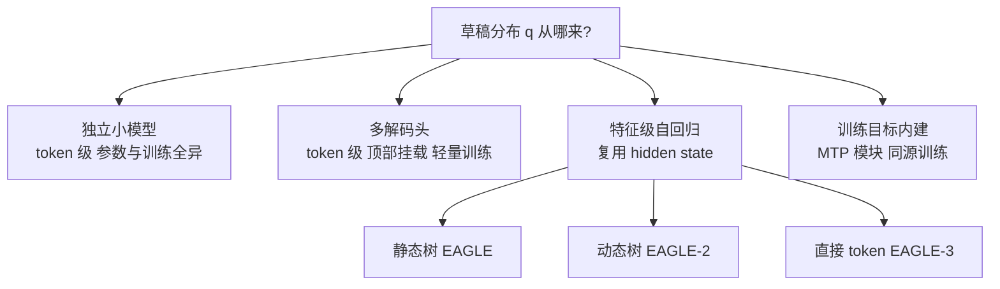
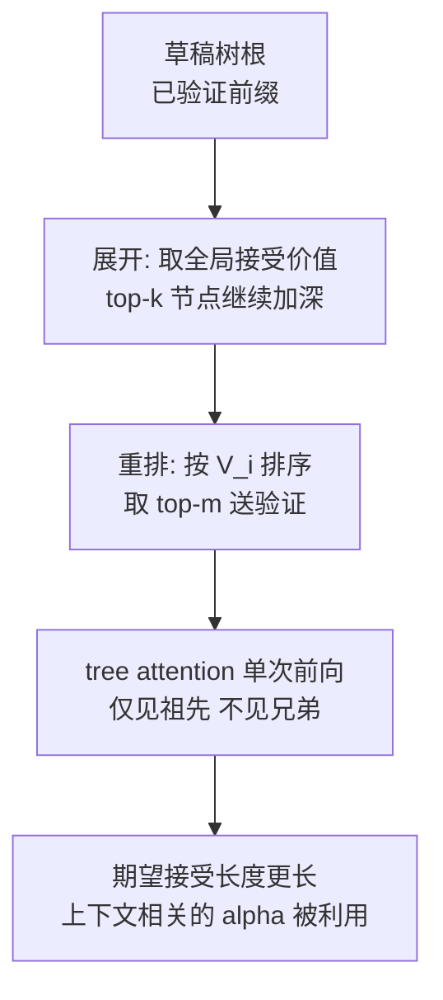

> **投机解码系列 · 第 03 篇**
>
> 本系列把投机解码从「一个加速技巧」拆成可核验的几层：收益模型（02）→ 草稿从哪来（本文）→
> 引擎支持 → 生产陷阱 → 评测数字怎么读。
> 它挂在[推理引擎主线](/2026/10/18/serving-01-architecture-divergence/)之下——
> 投机解码是推理引擎的一个子系统，脱离引擎谈它没有意义。
>
> - 01 综述与演化 → 02 收益模型 → **03 EAGLE 家族（本文）** → 04 引擎支持矩阵 →
>   05 生产部署陷阱 → 06 业界实践 → 07 评测数字怎么读 → 08 未来方向

**TL;DR**

> * **加速比的硬天花板是 $$1/(1-\alpha)$$（第 02 篇已证），与 $$\gamma$$、$$c$$ 无关**。本篇的全部内容都服务于一个目标：把单步接受率 $$\alpha$$ 抬上去——因为抬 $$\alpha$$ 是唯一能同时突破收益上限的操作。
> * **Medusa 把 token 级自回归「摊平」成 $$K$$ 个解码头**，免去外部草稿模型，但用 typical acceptance 取代严格拒绝采样，**放弃严格无偏**，论文报 $$\alpha \approx 0.6$$。
> * **EAGLE 把自回归搬到特征空间**（second-to-top-layer），特征序列比 token 序列更规律，论文报 $$\alpha \approx 0.8$$，且只用 2–4B tokens 训练（引论文数字）。
> * **EAGLE-2 利用「草稿模型置信度 ≈ 真实接受率」的标定，构造上下文相关的动态草稿树**，无需重训即把加速比推到 3.05–4.26×；它点破了第 02 篇独立接受假设的破绽。
> * **EAGLE-3 去掉特征预测约束、改用 training-time test；DeepSeek-V3 把投机写进 MTP 训练目标**——草稿来源从「后装头」一路收敛到「模型自带的目标」。这是本篇的核心论点。
* **抬 $$\alpha$$ 与压 $$c$$ 是两件事**：EAGLE 家族不仅把 $$\alpha$$ 从约 0.6 抬到接近 1，还因草稿器只含一个 FC 层 + 一个解码器层而把成本比 $$c$$ 压在 0.1 以下，于是既抬高天花板、又在天花板下放得更长 $$\gamma$$（第 02 篇 §5.1）。

---

## 0. 符号约定

本篇承接第 02 篇的记号：用 $$p$$ 指目标模型、$$q$$ 指草稿模型（与 vLLM / SGLang 代码一致，也与 Leviathan et al. 一致 [6](https://arxiv.org/abs/2211.17192)）。第 02 篇已给出

$$
\alpha = \mathbb{E}_{x \sim q}\!\left[\min\!\left(1, \tfrac{p(x)}{q(x)}\right)\right] = \sum_x \min\big(p(x), q(x)\big) = 1 - \tfrac{1}{2}\mathrm{TV}(p, q)
$$

即 $$\alpha$$ 是草稿分布与目标分布的重叠质量，等于 $$1$$ 减去二分之一总变差距离。本篇新增的记号如下：

| 符号 | 含义 |
|:---|:---|
| $$\mathbf{f}_i$$ | 目标模型 second-to-top-layer 隐藏状态（EAGLE 称「特征」） |
| $$t_{i+1}$$ | 提前一个时间步注入的采样 token（shifted token） |
| $$c_u$$ | 草稿树节点 $$u$$ 的草稿模型置信度（校准后近似接受率） |
| $$V_i$$ | 节点 $$t_i$$ 的全局接受价值，路径上各节点置信度之积 |
| $$L_{\mathrm{fea}}$$、$$L_{\mathrm{token}}$$ | EAGLE-3 之前草稿模型的「特征预测损失」与「token 预测损失」 |
| $$\mathbf{h}_i^{k}$$ | DeepSeek-V3 第 $$k$$ 层 MTP 模块在位置 $$i$$ 的表示 |
| $$D$$ | MTP 的预测深度（每位置顺预测后续 $$D$$ 个 token） |

所有加速比数字均为论文自报，标记为「引论文数字」；本篇不跑任何 draft-verify 实验，结论来自论文公式、图表与第 02 篇的闭式。

---

## 1. 本篇站在哪里：从「收益模型」到「草稿从哪来」

第 02 篇把加速比拆成三个变量的函数

$$
S(\alpha, \gamma, c) = \frac{1 - \alpha^{\gamma+1}}{(1 - \alpha)(1 + \gamma c)}
$$

并证明了两条边界：

$$
\lim_{\gamma \to \infty} S = \frac{1}{1 - \alpha}, \qquad \lim_{c \to 0} S = \frac{1 - \alpha^{\gamma+1}}{1 - \alpha}
$$

第一条是**硬天花板**：无论草稿多长、多便宜，加速比都过不去 $$1/(1-\alpha)$$。$$\alpha=0.9$$ 时天花板是 $$10$$，$$\alpha=0.8$$ 时是 $$5$$——把 $$\alpha$$ 从 $$0.8$$ 提到 $$0.9$$，天花板直接翻倍；而把 $$\gamma$$ 从 $$8$$ 加到 $$16$$，只是在既定天花板下从 $$3.09$$ 向它挪近一点 [参考第 02 篇 §6]。

这条结论把优化方向钉死了：**首要目标是抬 $$\alpha$$，不是堆 $$\gamma$$**。本篇要回答的就是「业界怎么把 $$\alpha$$ 抬上去」。答案是一条非常清晰的演化线——

| 世代 | 草稿从哪来 | 抬 $$\alpha$$ 的手段 |
|:---|:---|:---|
| Medusa | 目标模型顶部挂 $$K$$ 个解码头（token 级） | 多解码头并行押注，树验证摊薄错误 |
| EAGLE | 特征级自回归（second-to-top-layer） | 在更规律的表示上做预测 |
| EAGLE-2 | 同 EAGLE，但改成动态草稿树 | 把上下文相关的接受率显式利用 |
| EAGLE-3 | 直接预测 token + 多层特征融合 | 去掉特征预测的容量约束 |
| DeepSeek-V3 MTP | 训练目标内建的模块 | 让草稿分布与目标分布同源训练 |

**核心论点**：EAGLE 家族的演化，是一条「草稿从哪来」的收敛史——草稿分布 $$q$$ 的来路，从「独立小模型 / token 级头」一步步收束到「目标模型自己训练出来的多 token 预测」，最终让 $$q$$ 在构造上逼近 $$p$$。本文余下各节逐代拆解这条线，并给出每一代抬 $$\alpha$$ 的数学机制。

---

## 2. 草稿从哪来：一个统一视角

所有投机解码方法都可以统一成同一个问题：**如何构造一个草稿分布 $$q$$，使它与目标分布 $$p$$ 的重叠质量 $$\alpha$$ 尽量高**。

$$q$$ 的可能来源有四类，按「与目标模型共享多少参数 / 训练」排序：

为什么「共享得越多，$$\alpha$$ 越高」在机制上成立？token 分布是特征（LM head 输入）的确定性函数：

$$
p(x_t \mid x_{<t}) = \mathrm{softmax}\!\big(W_{\mathrm{out}} \, \mathbf{f}_t\big)
$$

其中 $$\mathbf{f}_t$$ 是 second-to-top-layer 的隐藏状态、$$W_{\mathrm{out}}$$ 是目标模型自带的输出投影。两点推论：

1. **token 是特征的「有损压缩」**。给定历史，目标模型先算出确定性的 $$\mathbf{f}_t$$，再从中采样出一个 $$x_t$$。$$\mathbf{f}_t$$ 携带了整个分布的形状（语义轨迹、风格、格式），而采样出的 $$x_t$$ 只保留了一个点。在特征空间做自回归，等于在信息更丰富的表示上做预测。
2. **特征序列比 token 序列更规律**。token 序列是离散自然语言，自带采样随机性；特征序列是连续高维量，对「下一步是什么」的编码更平滑。EAGLE 论文的原话是特征序列比 token 序列「更具规律性」，并给出同一草稿器在特征层自回归比在 token 层自回归更快（1.9× vs 1.5×）的对照 [2](https://arxiv.org/abs/2401.15077)。

把这两点代回 $$\alpha$$ 的定义：草稿在特征空间预测得到 $$\hat{\mathbf{f}}_{t+1}$$，再经同一 $$W_{\mathrm{out}}$$ 得到

$$
q(x_{t+1}) = \mathrm{softmax}\!\big(W_{\mathrm{out}} \, \hat{\mathbf{f}}_{t+1}\big)
$$

于是 $$\alpha$$ 的差距由 $$\lVert \hat{\mathbf{f}}_{t+1} - \mathbf{f}_{t+1}\rVert$$ 经 softmax 映射后的分布距离决定。特征预测越准，$$q$$ 越贴近 $$p$$，$$\alpha$$ 越高。这就是「特征级自回归抬 $$\alpha$$」的统一解释，也是后面 EAGLE / EAGLE-2 / EAGLE-3 全部改进的共同地基。

> **读法提醒**：本节把 $$\alpha$$ 写成了特征预测误差的单调函数，是为了看清机制。真实系统里 $$\alpha$$ 还随位置、上下文、batch 变化（第 5 节 EAGLE-2 正是此观察），并不只是单一误差项。

### 2.1 特征预测误差如何映射到 α

设草稿模型预测特征 $$\hat{\mathbf{f}}_{t+1}$$，目标真实特征 $$\mathbf{f}_{t+1}$$。两分布为

$$
q = \mathrm{softmax}(W_{\mathrm{out}}\hat{\mathbf{f}}), \qquad p = \mathrm{softmax}(W_{\mathrm{out}}\mathbf{f})
$$

softmax 在合适范数下是 $$1$$-Lipschitz，于是

$$
\lVert q - p \rVert_1 \le \lVert W_{\mathrm{out}}(\hat{\mathbf{f}} - \mathbf{f}) \rVert_1
$$

再由第 02 篇的恒等式 $$\alpha = 1 - \tfrac{1}{2}\mathrm{TV}(p,q) = 1 - \tfrac{1}{2}\lVert p - q \rVert_1$$，得

$$
\alpha \ge 1 - \tfrac{1}{2}\lVert W_{\mathrm{out}}(\hat{\mathbf{f}} - \mathbf{f}) \rVert_1
$$

即 $$\alpha$$ 的下界随特征预测误差单调下降。这说明「在特征空间把 $$\hat{\mathbf{f}}$$ 预测准」与「抬 $$\alpha$$」是同一件事的两端——也预告了 EAGLE-3 为什么要在特征预测上做文章（第 6 节）：当 $$L_{\mathrm{fea}}$$ 约束把 $$\lVert \hat{\mathbf{f}} - \mathbf{f} \rVert$$ 钉在一个不随数据下降的残差上时，$$\alpha$$ 也就被钉死。

这个下界是定性的（Lipschitz 常数取 $$W_{\mathrm{out}}$$ 的算子范数，此处未显式估计），但方向性结论足以支撑本文主线：**任何让特征预测更准、或绕开特征预测的改动，都会抬 $$\alpha$$**。

---

## 3. Medusa：用多解码头把 token 级自回归「摊平」

Medusa 的目标很朴素：绕开「准备并部署一个外部草稿模型」这一最重的工程负担 [1](https://arxiv.org/abs/2401.10774)。办法是在目标模型顶部直接挂 $$K$$ 个**解码头**（decoding head），分别预测第 $$t+1, \dots, t+K+1$$ 位的 token，再用树注意并行验证多条候选。

### 3.1 解码头结构

每个头是一个**带残差连接的单层 FFN + 输出投影**，参数规模与一个 LM head 同级（远小于一整个 transformer 草稿模型）：

$$
p_t^{(k)} = \mathrm{softmax}\!\big( h_t \, W_k^{(\mathrm{out})} \big), \qquad
h_t' = h_t + \mathrm{GeLU}\!\big( h_t \, W_k^{(1)} \big) \, W_k^{(2)}
$$

其中 $$h_t \in \mathbb{R}^{d}$$ 是主干最后一层隐藏状态，$$W_k^{(1)}\in\mathbb{R}^{d\times d_{\mathrm{ff}}}$$、$$W_k^{(2)}\in\mathbb{R}^{d_{\mathrm{ff}}\times d}$$、$$W_k^{(\mathrm{out})}\in\mathbb{R}^{d\times V}$$。注意 $$K$$ 个头各自独立预测一个**固定位置偏移**的 token，因此它本质是把「一条 token 级自回归链」摊平成 $$K$$ 个并行的、位置特异的预测头——这就是「摊平」二字的含义。

### 3.2 typical acceptance：用偏差换接受率

严格投机解码要求草稿给出可用的 $$q$$ 分布，才能算 $$\min(1, p/q)$$ 做拒绝采样（无偏性见第 02 篇与 [《PyTorch 采样实现深读》](/2026/09/30/pytorch-sampling-internals/)）。Medusa 头产出的是 $$p^{(k)}$$ 而非一个可与目标比对的 $$q$$，于是它改用 **typical acceptance**：不要求严格比值，只要目标模型对该候选 token 的概率落在「典型性」阈值内就接受 [1](https://arxiv.org/abs/2401.10774)。

这是本文谱系里第一个明确的「无损 vs 够快」取舍样本：

| 判定方式 | 是否需要 $$q$$ | 是否严格无偏 | 对 $$\alpha$$ 的影响 |
|:---|:---:|:---:|:---|
| 严格拒绝采样 $$\min(1, p/q)$$ | 是 | 是 | 受 $$q$$ 与 $$p$$ 的真实差距限制 |
| typical acceptance | 否 | **否** | 接受率更高、方差更低，但分布有偏 |

典型性接受以**可控的质量损失**换取更稳的加速。它把 $$\alpha$$ 抬上台阶（论文报 Medusa 的接受准确率约 $$0.6$$，高于更早的 Lookahead），代价是放弃了第 02 篇那道「正确性」门。生产环境是否接受这点偏差，是第 05 篇的主题。

### 3.3 训练两档与位置

Medusa 给出两档训练配方 [1](https://arxiv.org/abs/2401.10774)：

| 方案 | 是否冻结主干 | 论文加速 | 数据需求 |
|:---|:---:|:---:|:---|
| Medusa-1 | 冻结主干 | > 2.2× | 需训练数据；无数据时用 self-distillation（以主干生成数据训头） |
| Medusa-2 | 联合微调 | 2.3–2.8× | 需特殊配方保护主干能力 |

Medusa-1 的价值在工程侧：不碰目标模型权重，只训轻量头，接入成本最低。代价是它仍停留在 token 级预测，$$\alpha$$ 上限受 token 序列随机性制约——这正是 EAGLE 要解决的。

### 3.4 树验证：Medusa 为什么需要它

Medusa 的 $$K$$ 个头各预测一个固定位置偏移的 token，单条候选链很短（$$K+1$$ 步）。但 $$K$$ 个头乘每层多候选会组合成大量候选延续；若只用单条链验证，会浪费接受长度（第 02 篇 §8：押错一处分支整段作废）。Medusa 用**树注意**把多条候选合并成 token 树，单次前向并行验证整棵 [1](https://arxiv.org/abs/2401.10774)。其注意力掩码与 SpecInfer 同理：分支间共享前缀、兄弟分支互不看见、与增量解码输出一致（守第 02 篇那道「正确性」门）。这是「token 级头 → 仍需树验证」的第一次印证，也是 EAGLE-2 把树结构做成动态的前提。

---

## 4. EAGLE：把自回归搬到特征空间

EAGLE（Extrapolation Algorithm for Greater Language-model Efficiency）的两个观察被后续工作反复引用 [2](https://arxiv.org/abs/2401.15077)：

1. **特征层自回归比 token 层自回归更简单**（第 2 节已从 $$p = \mathrm{softmax}(W_{\mathrm{out}}\mathbf{f})$$ 解释了机制）。
2. **特征自回归受采样随机性制约**。特征是高维连续量，无法像 token 那样「从分布里采样」。若只拿特征 $$\mathbf{f}_i$$ 预测下一特征，当历史走向分叉（例如「am」还是「always」）时，模型无法区分该走哪条特征路径。

### 4.1 shifted token：把采样结果提前一步喂回

EAGLE 的解法是把**采样结果提前一个时间步**注入草稿模型（feature & shifted-token）。预测「always」时，输入不只是目标特征 $$\mathbf{f}_i$$，还包括它对应的采样 token $$t_{i+1}$$。这样分叉被显式标记，草稿模型能沿着正确语义轨迹走。

草稿模型仅三块，全部复用目标模型参数、不训练 Embedding 与 LM Head：

1. **Embedding 层**（复用目标模型，不训练）；
2. **LM Head**（复用目标模型，不训练）——草稿特征经它得 token 分布；
3. **自回归头（Autoregression Head）**：一个 FC 层 + 一个解码器层。

### 4.2 前向数学与张量形状

设 batch $$B$$、序列长 $$L$$、隐藏维 $$d$$，前向为

$$
\mathbf{z}_i = \mathrm{FC}\!\big(\,[\, \mathbf{f}_i \,;\, \mathrm{Emb}(t_{i+1}) \,]\,\big), \qquad
\hat{\mathbf{f}}_{i+1} = \mathrm{DecoderLayer}\!\big(\mathbf{z}_{\le i}\big)
$$

其中 $$[\,\cdot\,;\,\cdot\,]$$ 是拼接、$$t_{i+1}$$ 是提前一位的 token。形状流动如下：

| 张量 | Shape | 说明 |
|:---:|:---:|:---|
| $$\mathbf{f}_i$$（second-to-top-layer 特征） | $$(B, L, d)$$ | 目标模型逐层提取 |
| $$t_{i+1}$$（移位 token） | $$(B, L)$$ | 采样结果显式注入 |
| $$\mathrm{Emb}$$ 输出 | $$(B, L, d)$$ | 与特征拼接 |
| 拼接后 | $$(B, L, 2d)$$ | 特征-语义融合 |
| $$\mathrm{FC}$$ 后 | $$(B, L, d)$$ | 降维回 $$d$$ |
| $$\hat{\mathbf{f}}$$（预测特征） | $$(B, L+1, d)$$ | 解码器输出 |
| LM Head 后 logits | $$(B, V)$$ | 草稿 token 分布 |

预测特征 $$\hat{\mathbf{f}}_{i+1}$$ 经复用的 LM Head 得草稿分布

$$
q(x_{i+1}) = \mathrm{softmax}\!\big(W_{\mathrm{out}} \, \hat{\mathbf{f}}_{i+1}\big)
$$

回到第 2 节的框架：EAGLE 预测的是特征而非 token，因此 $$\hat{\mathbf{f}}$$ 的预测误差在更平滑的空间里收敛，$$q$$ 更贴近 $$p$$。论文报 EAGLE 加入 shifted token 后，加速从 1.9× 升到 2.8×——这一跳正来自「注入采样结果、消解特征路径歧义」。

### 4.3 训练成本与收益（引论文数字）

- 训练数据仅 **2–4B tokens**，比独立草稿模型 TinyLLaMA 的 3000B tokens 低两个数量级，且**不修改目标模型** [2](https://arxiv.org/abs/2401.15077)。
- 结果（示例，引论文数字）：MT-bench 上比 baseline 快 2.1–3.8×、比 Lookahead 快 1.7–2.1×、比 Medusa 快 1.5–1.6×；LLaMA2-Chat 70B 上延迟加速 2.7–3.5×、吞吐翻倍。
- 关键对照：EAGLE 草稿接受准确率约 **0.8**，Medusa 约 **0.6**，Lookahead 更低 [2](https://arxiv.org/abs/2401.15077)。这就是第 1 节「抬 $$\alpha$$」的直接证据——特征级自回归把 $$\alpha$$ 从 Medusa 的 0.6 抬到 0.8，距天花板 $$1/(1-\alpha)$$ 从 2.5 抬到 5。
- **完全无损**：验证阶段保证输出分布与目标模型一致 [2](https://arxiv.org/abs/2401.15077)。

### 4.4 shifted token 为何必要：条件熵视角

不注入采样 token 时，草稿模型只看到特征 $$\mathbf{f}_i$$，预测 $$\hat{\mathbf{f}}_{i+1}$$。但给定 $$\mathbf{f}_i$$，下一步真实特征 $$\mathbf{f}_{i+1}$$ 的条件分布未必单峰——历史「am」与「always」在 $$\mathbf{f}_i$$ 处可能分叉，模型无法判定该生成哪条特征轨迹。注入 $$t_{i+1}$$ 后，条件变为 $$\Pr[\hat{\mathbf{f}}_{i+1}\mid \mathbf{f}_i, t_{i+1}]$$，把「下一步是哪个 token」这一已被采样确定的信息显式提供给草稿模型，消歧。

论文报这一改动把加速从 1.9× 抬到 2.8×，正是消歧后特征预测误差下降的定量体现 [2](https://arxiv.org/abs/2401.15077)。注意 $$t_{i+1}$$ 是「提前一位」：预测 $$\hat{\mathbf{f}}_{i+1}$$ 时喂的是**真实采样出的** $$t_{i+1}$$，而非待预测的 $$t_{i+1}$$ 本身——这是 EAGLE 与朴素 token 自回归最关键的错位：草稿模型的输入比目标模型「早一步知道 token」，从而绕开了特征路径歧义。

### 4.5 特征级草稿器的成本比 $$c$$

特征级草稿器的另一优势落在第 02 篇的 $$c = t_D/t_T$$ 上。EAGLE 草稿模型只含一个 FC 层 + 一个解码器层，且复用目标模型的 Embedding 与 LM Head，**不训练、也不增加目标模型权重的读取量**——草稿前向多半在目标模型已经搬进计算单元的权重上完成。因此 $$c$$ 明显低于 0.1（量级参考，非本篇实测），对应第 02 篇 §5.1「特征级单层草稿器」那一档：$$\gamma^*$$ 可被放大到 10 以上而不被 $$c$$ 拖垮。这是 EAGLE 家族「既抬 $$\alpha$$ 又保持低 $$c$$」的双保险——$$\alpha$$ 决定天花板、$$c$$ 决定在天花板下能放多长 $$\gamma$$，两者共同把加速比推高。

---

## 5. EAGLE-2：动态草稿树，把上下文相关的 $$\alpha$$ 显式利用

EAGLE-1 与 Medusa 都用**静态草稿树**：每层固定展开 $$k$$ 个候选，隐含假设「接受率只与树中位置有关」。EAGLE-2 的系统测量推翻了这个假设 [3](https://arxiv.org/abs/2406.16858)。

### 5.1 两个观察：上下文依赖 + 置信度可标定

**观察一 · 接受率是上下文相关的。** 论文 Fig.5 显示同一位置上接受率方差极大：位置本身只决定均值趋势（P1 最高、P6 最低），但同位置的方差揭示了接受率还强烈依赖上下文。这正好对应第 02 篇「独立接受假设不成立」的判断——$$\alpha$$ 不是常数。

**观察二 · 草稿模型是「校准良好」的。** 论文 Fig.6 给出：草稿模型输出的置信度（confidence score）可以近似真实接受率，误差很小（置信度 < 0.05 的 token 接受率约 0.04；置信度 > 0.95 的 token 接受率约 0.98）[3](https://arxiv.org/abs/2406.16858)。这意味着**不调用目标模型**，就能估算每个草稿 token 的真实被接受概率。这是动态树可行的地基：若置信度与接受率脱钩，动态调度就无从谈起。

### 5.2 动态草稿树：展开 + 重排

定义草稿树中节点 $$t_i$$ 的**全局接受价值**为其到根路径上所有节点置信度的乘积：

$$
V_i = \prod_{u \in \mathrm{path}(\mathrm{root} \to t_i)} c_u
$$

这里 $$c_u$$ 是节点 $$u$$ 的草稿模型置信度，乘积对应「整条路径都被接受」的概率（独立接受近似）。两阶段调度：

- **展开阶段**：只选当前层全局接受价值 top-$$k$$ 的节点继续加深，避免每层指数爆炸。
- **重排阶段**：由于实际被接受需要整条路径接受，不能只看局部置信度——所有候选按 $$V_i$$ 重排，取 top-$$m$$ 作为验证输入（$$m$$ 是单次前向能装的 token 预算）。
- **注意力掩码**：按树结构调整，保证每个 token 只能看到其祖先节点、不能看到兄弟分支，与朴素自回归完全一致 [3](https://arxiv.org/abs/2406.16858)。

### 5.3 为什么动态树抬了 $$\alpha$$（期望视角）

静态树在每层均匀展开，验证预算被平均分配给「高接受率」和「低接受率」分支，期望接受长度受限于最长全对前缀。动态树把预算集中在 $$V_i$$ 高的路径上。在「独立接受近似」下，一条路径 $$P$$ 被整条接受的概率是 $$V_P = \prod_{u\in P} c_u$$，它贡献 $$\lvert P\rvert$$ 个 token；整棵待验证树的期望接受长度近似

$$
\mathbb{E}[\text{accepted}] \;\approx\; \sum_{P} V_P \cdot \lvert P\rvert
$$

动态树在固定 $$m$$ 预算下最大化这个量——等价于把第 02 篇那条「单链几何分布」换成了「按置信度加权的树几何」。这与第 02 篇 §8 的结论一致：树验证的期望接受长度大于单链，因此静态/动态树下的加速比是第 02 篇闭式的**上界**，不是下界。

### 5.4 收益与代价（引论文数字）

EAGLE-2 **不需要额外训练**（草稿模型完全不变，只改树结构调度）[3](https://arxiv.org/abs/2406.16858)。结果（引论文数字）：加速比 3.05–4.26×，比 EAGLE-1 快 20–40%（约 1.3×），MT-bench 上约为 Medusa 的 2 倍速。它点破的是第 02 篇独立接受假设的破绽，并用一个可被草稿模型自身估计的置信度把破绽补成了收益。

### 5.5 动态树的预算-收益：一个最小模型

设每轮验证预算为 $$m$$ 个 token（单次前向能装的节点数）。静态树在每层均匀展开 $$b$$ 个分支，验证 $$L$$ 层需 $$b^L$$ 节点，很快超过 $$m$$；动态树按 $$V_i$$ 排序取 top-$$m$$，把预算集中在高价值路径。在独立接受近似下，预算内一棵树的期望接受长度为

$$
\mathbb{E}_m[\text{accepted}] = \sum_{P \in \mathcal{T}_m} V_P \cdot \lvert P \rvert
$$

其中 $$\mathcal{T}_m$$ 是按 $$V_i$$ 选出的 top-$$m$$ 节点集合、$$P$$ 是其下完整路径。动态树相对静态树的增益来自：把原本摊在低 $$V_i$$ 分支上的预算，转移给高 $$V_i$$ 分支的更深节点——后者单位预算的边际接受长度更高。

这与第 02 篇单链闭式 $$\mathbb{E}[T] = (1-\alpha^{\gamma+1})/(1-\alpha)$$ 的关系可这样对接：把树看成「多条并行星座」，每星座有各自的有效 $$\alpha$$（由路径置信度积决定），动态树做的是在这些异质 $$\alpha$$ 间做预算分配，而非对一个固定 $$\alpha$$ 堆 $$\gamma$$。这正是第 02 篇 §5「$$\gamma^*$$ 由 $$\alpha$$ 与 $$c$$ 共同决定」在树结构下的自然推广。

---

## 6. EAGLE-3：放弃特征预测，直接预测 token

### 6.1 动机：特征预测是容量约束

Li et al. 发现：扩大训练数据对 EAGLE 的收益有限，根因是 **feature prediction 约束** [4](https://arxiv.org/abs/2503.01840)。EAGLE 草稿模型的训练损失同时含特征预测损失 $$L_{\mathrm{fea}}$$ 与 token 预测损失 $$L_{\mathrm{token}}$$：

$$
\mathcal{L} = L_{\mathrm{fea}} + L_{\mathrm{token}}
$$

特征回归项强迫草稿模型的隐藏状态贴近真实特征，反而**限制了草稿模型的表达能力**——它必须把容量花在「拟合特征」上，无法把更多信息用于「预测下一步对不对」。结果是：喂更多训练数据，收益很快饱和（论文 Fig.8 显示 EAGLE-2 / HASS 在该数据规模下陷入平台期）。

### 6.2 两处改动

**一、弃用特征预测，直接预测 token。** 草稿模型输出直接是 token 分布（经 LM Head），去掉 $$L_{\mathrm{fea}}$$。副作用是：训练时草稿模型输出 $$\hat{\mathbf{a}}_{t+1}$$ 与真实特征 $$\mathbf{f}_{t+1}$$ 偏差增大；推理时把 $$\hat{\mathbf{a}}$$ 反馈回输入，会造成**训练-推理分布失配**——第二个草稿 token 的接受率骤降。

**二、training-time test 技术。** 训练时就把上一时刻的**模型自身输出**（而非真实特征）反馈回输入，模拟自回归推理路径。它类似 RNN 时代的 scheduled sampling，但配合树注意掩码使用，让模型在训练阶段就「见过」自己的错误轨迹，从而消除失配 [4](https://arxiv.org/abs/2503.01840)。

**三、多层特征融合。** 输入从「仅顶层特征」变为**低 / 中 / 高层特征的融合**——顶层特征天然偏向 next-token 预测，不适合多步草稿；中层融合提供更丰富的语义信息 [4](https://arxiv.org/abs/2503.01840)。

### 6.3 收益（引论文数字）

- 最高加速 **6.5×**，相对 EAGLE-2 提升约 **1.4×** [4](https://arxiv.org/abs/2503.01840)。
- 训练数据扩大约 **8×** 后仍持续受益（EAGLE-2 / HASS 在该规模已平台期，见图 Fig.8）——说明去掉 $$L_{\mathrm{fea}}$$ 后容量约束解除。
- 打破「大 batch 下投机无用」的常识：SGLang 中 bs=64 时吞吐提升 **1.38×（+38%）** [4](https://arxiv.org/abs/2503.01840)；第 02 篇 §9 与 MagicDec 对大 batch 失效边界有更细的讨论 [9](https://arxiv.org/abs/2408.11049)。
- 训练成本：约 2 卡天级别即可为 Llama-3 系列训练；代码见 `SafeAILab/EAGLE`，官方推荐 `sgl-project/SpecForge` 在 SGLang 生态开箱训练。

> **引用勘误**：EAGLE-3 的 arXiv 编号是 **2503.01840**（2025-03-03 提交，NeurIPS 2025 录用）。早期社区流传的 2412.xxxx 编号有误，以官方 GitHub 引用的 abspdf 链接为准。

### 6.4 training-time test 与 scheduled sampling 的同与异

training-time test 在形式上接近 RNN 时代的 scheduled sampling：训练时以一定概率用模型自身上一时刻输出、而非 ground-truth，喂回输入，使训练分布匹配推理分布。两点区别决定它在这里有效 [4](https://arxiv.org/abs/2503.01840)：

- **失配来源不同**。scheduled sampling 修补的是「teacher forcing 训练 / 自回归推理」的错位；EAGLE-3 修补的是「训练用真实特征 $$\mathbf{f}$$ / 推理用模型输出 $$\hat{\mathbf{a}}$$」的错位——后者因去掉 $$L_{\mathrm{fea}}$$ 而放大。
- **与树注意协同**。EAGLE-3 在 training-time test 中配合树注意掩码，使模型在训练阶段就沿树结构见过自己的错误轨迹，推理时动态树的重排不再因分布失配而失效。

把失配形式化：设推理分布为 $$q_{\mathrm{inf}} = \mathrm{softmax}(W_{\mathrm{out}} \hat{\mathbf{a}})$$。去掉 $$L_{\mathrm{fea}}$$ 后训练目标变为仅 $$L_{\mathrm{token}}$$（喂真实 token），而推理仍喂 $$\hat{\mathbf{a}}$$，两分布之差即失配项。training-time test 把训练时的输入分布从「真实特征」改成「模型输出」，使 $$L_{\mathrm{token}}$$ 直接在推理分布上被优化，失配项归零。这是 EAGLE-3 能在「弃用特征预测」后仍保持高 $$\alpha$$ 的关键。

---

## 7. DeepSeek-V3 MTP：把投机能力写进训练目标

前四代的共同点是「后装」：在目标模型之外加一个草稿器（头、树或训练好的模块）。DeepSeek-V3 走的是相反方向——在**预训练目标**里直接引入多 token 预测，让投机能力成为模型自带的能力 [5](https://arxiv.org/abs/2412.19437)。

### 7.1 MTP 是什么

DeepSeek-V3 在每个位置顺序预测后续 $$D$$ 个 token，保持完整因果链。与 Gloeckle et al.（2024，多 token 并行独立头）不同，DeepSeek 的 MTP **按深度顺序预测**，与 EAGLE 的「eagerness principle」同源 [5](https://arxiv.org/abs/2412.19437) [10](https://arxiv.org/abs/2404.19737)。

### 7.2 MTP 模块的数学结构

第 $$k$$ 个 MTP 模块由共享 Embedding $$\mathrm{Emb}(\cdot)$$、共享输出头 $$\mathrm{OutHead}(\cdot)$$、一个 Transformer 块 $$\mathrm{TRM}(\cdot)$$、投影矩阵 $$M_k \in \mathbb{R}^{d\times 2d}$$ 组成 [5](https://arxiv.org/abs/2412.19437)。第 $$k$$ 深度、位置 $$i$$ 的表示：

$$
\mathbf{h}_i^{'(k)} = M_k\big[\, \mathrm{RMSNorm}(\mathbf{h}_i^{k-1}) \,;\, \mathrm{Emb}(t_{i+k}) \,\big]
$$

$$
\mathbf{h}_i^{k} = \mathrm{TRM}(\mathbf{h}_i^{'(k)}) \;\xrightarrow{\text{共享 }\mathrm{OutHead}}\; p_i^{k} = \mathrm{Softmax}\!\big(\mathrm{OutHead}(\mathbf{h}_i^{k})\big)
$$

**MTP 训练损失**（按深度加权平均）：

$$
\mathcal{L}_{\mathrm{MTP}} = \frac{\lambda}{D}\sum_{k=1}^{D} \mathcal{L}_{\mathrm{MTP}}^{k}, \qquad
\mathcal{L}_{\mathrm{MTP}}^{k} = -\frac{1}{T}\sum_{i=2+k}^{T+1} \log P_i^{k}[\,t_i\,]
$$

### 7.3 双用途设计：训练 + 推理

- **训练期**：辅助目标增强主模型在基准上的表现（MTP 密集化训练信号、帮助表征预规划）。
- **推理期**：可直接丢弃 MTP 模块使主模型独立工作，也可**复用作投机解码**进一步降低延迟 [5](https://arxiv.org/abs/2412.19437)。

回到本篇主线：MTP 模块与主模型**共享表示与主干**，且以「预测后续 token」为训练目标被联合优化。因此它的草稿分布 $$q$$ 在构造上就是主模型分布 $$p$$ 在同一主干上的延伸——这是谱系终点：草稿来源不再是「后装头」，而是「目标模型自己训练出来的多步预测」。

> **生态信号**：DeepSeek-V3 权重约 685B = 主模型 671B + MTP 模块 14B；HuggingFace `transformers` 已支持 `num_mtp_layers` 配置与 `generate(..., use_mtp=True)` [11](https://huggingface.co/docs/transformers/main/model_doc/deepseek_v3)。这是「投机能力内建训练目标」从论文走向落地的标志。

### 7.4 MTP 与 Gloeckle 式多 token 预测的区别

多 token 预测并非 DeepSeek 首创。Gloeckle et al.（2024）提出并行独立头，每个头独立预测第 $$k$$ 个后续 token，头之间不共享因果链 [10](https://arxiv.org/abs/2404.19737)。DeepSeek-V3 的 MTP 按**深度顺序**预测：第 $$k$$ 层模块的输入依赖第 $$k-1$$ 层模块的输出（见 §7.2 的 $$\mathbf{h}_i^{k-1}$$），保持完整因果链 [5](https://arxiv.org/abs/2412.19437)。这与 EAGLE 的「eagerness principle」（草稿依赖上一步草稿特征）同源——差别只是 EAGLE 是后装头、MTP 是训练目标内建。

顺序预测也更适配投机解码：第 $$k$$ 个 MTP 模块的输出天然就是「顺延 $$k$$ 步的草稿」，可直接作为 depth-$$k$$ 候选送入验证，无需额外草稿模型。并行独立头则缺少层间因果依赖，作为投机草稿时多步一致性更弱。这一点把 MTP 与第 4 节的 EAGLE「特征级自回归」在机制上连了起来：两者都是「用上一步的草稿状态预测下一步」，只是 MTP 让这一步发生在训练目标里。

---

## 8. 家族横向对比：$$\alpha$$ 是怎么一级级抬上去的

把五代放进同一张表，焦点放在「草稿来源」与「抬 $$\alpha$$ 的手段」上（加速比均为论文自报，标记为引论文数字）：

| 方法 | 草稿来源 | 额外训练 | 动态树 | 无偏 | 峰值加速（引论文数字） | 抬 $$\alpha$$ 的关键 |
|:---|:---|:---:|:---:|:---:|:---:|:---|
| 经典 SD [6](https://arxiv.org/abs/2211.17192) | 独立小模型 | 否 | 否 | 是 | 2–3× | 范式开创 |
| Medusa [1](https://arxiv.org/abs/2401.10774) | 多解码头（token 级） | 是（轻量） | 否 | typical 可选 | 2.3–2.8× | 多解码头并行 + typical acceptance |
| EAGLE [2](https://arxiv.org/abs/2401.15077) | 特征级单层解码器 | 是（2–4B tokens） | 否 | 是 | 3.8× (MT-bench) | 特征空间自回归 |
| EAGLE-2 [3](https://arxiv.org/abs/2406.16858) | 同 EAGLE | 否（复用） | **是** | 是 | 3.05–4.26× | 置信度标定的动态树 |
| EAGLE-3 [4](https://arxiv.org/abs/2503.01840) | 直接 token + 多层特征 | 是（约 8× 数据） | 续用 | 是 | **6.5×**；bs64 吞吐 1.38× | 去特征约束 + training-time test |
| DeepSeek-V3 MTP [5](https://arxiv.org/abs/2412.19437) | 训练目标模块 | 预训练已含 | 否（模块级） | 是 | 提升主模型 + 投机 | 草稿分布与目标同源训练 |

### 8.1 从 α 阶梯看天花板

把各代自报的接受准确率代入第 02 篇天花板 $$1/(1-\alpha)$$（这是确定性公式、非实验，仅作量级读数），可见每代抬 $$\alpha$$ 对上限的拉动：

| 方法 | 自报接受准确率（引论文数字） | 天花板 $$1/(1-\alpha)$$ |
|:---|---:|---:|
| Medusa | ≈ 0.6 | ≈ 2.5 |
| EAGLE | ≈ 0.8 | 5.0 |
| EAGLE-2 | 上下文相关（动态树榨干） | 高于 EAGLE 静态树 |
| EAGLE-3 | 最高（去容量约束） | 高于 EAGLE-2 |
| DeepSeek-V3 MTP | 同源训练，理论上 → 1 | 理论上 → ∞ |

数字含义：Medusa 把上限锁在 2.5 附近，EAGLE 抬到 5，而 MTP 让上限在构造上可被训练持续推开。这把第 1 节「抬 $$\alpha$$ 是唯一突破上限的操作」坐实成可逐代读出的台阶——注意此表是「上限」而非「实测加速比」，实测仍受 $$c$$、batch、树开销的拖累（第 02 篇 §9、第 07 篇）。

串起 $$\alpha$$ 的台阶（数字取自各论文自报的接受准确率 / 加速比反推，量级参考）：

- Medusa 用 typical acceptance 把接受准确率推到约 **0.6**；
- EAGLE 用特征级自回归推到约 **0.8**，天花板 $$1/(1-\alpha)$$ 从 2.5 抬到 5；
- EAGLE-2 不改草稿器，靠动态树把「上下文相关」从负担变成收益，加速比 3.05–4.26×；
- EAGLE-3 解除特征预测的容量约束，峰值 6.5×；
- MTP 让草稿分布与目标分布同源，把「抬 $$\alpha$$」从「训一个更好的头」变成「改训练目标」。

每一步都不是在堆 $$\gamma$$，而是在把第 02 篇那条天花板 $$1/(1-\alpha)$$ 的分母往小推。

### 8.2 选型结论：按约束挑草稿来源

把「抬 $$\alpha$$」的工程代价摊开，可给出不选错的粗略指南（细节与实测在第 04 / 05 / 06 篇）：

| 约束条件 | 首选草稿来源 | 理由 |
|:---|:---|:---|
| 已有独立小模型、不介意部署成本 | 经典 SD | 接入成本最低，$$\alpha$$ 受分布漂移限制但够用 |
| 单卡本地 / bs=1、想免外部模型 | Medusa | 头轻量、免部署；代价是 typical acceptance 非严格无偏 |
| 生产服务追求最高 $$\alpha$$ | EAGLE-3 + SGLang | 去容量约束后数据收益不饱，当前公认组合 |
| 希望投机能力「免费」内建 | MTP 系模型（DeepSeek-V3 / R1 生态） | 草稿分布与目标同源，无需额外草稿器 |

这条指南的排序依据正是本文主线：越往右，草稿来源越贴近目标模型训练，$$\alpha$$ 上限越高。它不主张「MTP 永远最好」——MTP 的可得性取决于目标模型是否原生带该模块，而 EAGLE-3 是对任意已有模型「后装抬 $$\alpha$$」的通用解。

---

## 9. 为什么「草稿从哪来」最终收敛到训练目标

把第 1–8 节的机制收成一条因果链：

1. **token 级头（Medusa）的 $$\alpha$$ 受 token 序列随机性制约** → 想抬 $$\alpha$$ 就得换表示。
2. **特征比 token 更规律（EAGLE）** → 在 second-to-top-layer 自回归，$$\alpha$$ 上台阶；但特征是连续量、有路径歧义，要靠 shifted token 消解。
3. **接受率上下文相关（EAGLE-2）** → 静态树浪费预算，于是用草稿模型自带的置信度标定出动态树，把上下文相关的 $$\alpha$$ 显式榨干。
4. **特征预测约束限制容量（EAGLE-3）** → 去掉 $$L_{\mathrm{fea}}$$，直接预测 token，用 training-time test 修补训练-推理失配，容量释放后数据收益不再饱和。
5. **后装头始终是与目标模型分离的 $$q$$（Medusa→EAGLE-3）** → 要彻底让 $$q\to p$$，最干净的办法是让草稿分布来自**与目标同一主干、同一训练目标**的模块——MTP 就是这个终点。

收敛的终点不是「更聪明的头」，而是**草稿分布与目标分布在构造上同源**。从信息论看，第 2 节已说明 $$q$$ 越贴近 $$p$$、$$\alpha$$ 越高；当 $$q$$ 由共享主干、共享目标产生时，两者差距在训练中被持续压缩，$$\alpha$$ 理论上可无限逼近 $$1$$，天花板 $$1/(1-\alpha)$$ 也随之被推开。这正是第 02 篇钉死的那条优化方向——**抬 $$\alpha$$ 是唯一能突破收益上限的操作**——在工程上的落地路径。

这条收敛线也解释了为什么业界重心从「调 $$\gamma$$」转向「训更好的草稿器 / 改训练目标」：$$\gamma$$ 只决定在既定天花板下挪多近（第 02 篇 §5），而草稿来源决定天花板本身。

### 9.1 收束的定性定理

把全文机制收成一句话。设草稿分布 $$q_\theta$$ 由参数为 $$\theta$$ 的草稿器给出，目标分布 $$p$$ 固定，则

$$
\alpha(\theta) = 1 - \tfrac{1}{2}\mathrm{TV}(p, q_\theta)
$$

草稿器的演化方向（Medusa → EAGLE → EAGLE-2 → EAGLE-3 → MTP）使得 $$q_\theta$$ 与 $$p$$ 的「构造性同源度」单调上升：从独立小模型（零同源）到 MTP（同主干同目标，同源度最高）。同源度上升 ⇒ $$\mathrm{TV}(p, q_\theta)$$ 下降 ⇒ $$\alpha$$ 上升 ⇒ 天花板 $$1/(1-\alpha)$$ 上升。这是本文核心论点的闭式表述。

它不声称「MTP 必然优于一切」，只声称**在抬 $$\alpha$$ 这一维度上，草稿来源越贴近目标模型训练，上限越高**。其余维度（训练成本、树验证开销、与小 batch 的耦合）仍是独立工程变量，须在第 04 / 05 / 07 篇按场景权衡。

---

## 10. 批判与展望

**本篇的适用范围。** 全部收益数字取自各论文自报，标记为「引论文数字」；本文不跑任何 draft-verify 推理，也未复现任何加速比。第 02 篇已指出真实系统里 $$\alpha$$ 随位置、上下文、batch 变化，且大 batch / compute-bound 下「并行验证 ≈ 单次前向」前提失效，会压低所有数字。因此本篇的 6.5×、4.26× 等是**论文上界参考**，不是生产承诺。

**本篇没有主张什么。** 没有主张「某模型上必加速 N 倍」，也没有替任何方法背书为「最优」。典型性接受（Medusa）的有偏性、特征预测约束（EAGLE-3 已弃用）的取舍、动态树在树规模上的开销，都是真实代价，不是免费午餐。

**几个值得继续追的问题**：

- **特征预测 vs token 预测的tradeoff**。EAGLE-3 证明特征预测是容量约束，但 shifted token 本是靠「特征 + 采样 token」消解路径歧义；去掉特征预测后，training-time test 是否在所有模型族上都等价有效，仍待更多消融。
- **动态树的预算-收益模型**。第 5 节给出期望接受长度的加权求和近似，但 $$m$$（验证预算）与期望接受长度的精确关系、以及它和第 02 篇闭式 $$1/(1-\alpha)$$ 之间的定量桥接，值得一组模拟实验。
- **MTP 的泛化性**。DeepSeek-V3 的 MTP 在自家主干上收益明确，但是否对所有架构、所有任务都「免费内建即无损提升」，取决于训练目标与主干的耦合方式，不能默认推广。
- **大 batch 下的失效边界**。EAGLE-3 报 bs=64 仍 +38% 吞吐，MagicDec 对「大 batch 收益衰减」给出了更细的拐点结论 [9](https://arxiv.org/abs/2408.11049)，第 07 篇按可信度分级处理这类数字。
- **与结构化输出的交互**。typical acceptance、tree attention 与 grammar-constrained decoding 在草稿 token 上的叠加，是生产部署最容易踩的坑之一（第 05 篇）。

### 10.1 无损性在谱系里的位置

把「正确性」这道门（第 02 篇）放回谱系，可看出本篇五代为抬 $$\alpha$$ 付出的无偏性代价并不一致：

| 方法 | 是否严格无偏 | 代价落在哪 |
|:---|:---:|:---|
| 经典 SD | 是 | 无，但 $$\alpha$$ 受分布漂移限制 |
| Medusa（typical acceptance） | **否** | 用偏差换接受率，质量损失可控 |
| EAGLE | 是 | 无，靠特征级自回归抬 $$\alpha$$ |
| EAGLE-2 | 是 | 无，仅改树调度 |
| EAGLE-3 | 是 | 无，靠 training-time test 补失配 |
| DeepSeek-V3 MTP | 是 | 无，草稿来自同源训练 |

只有 Medusa 在「无损 vs 够快」之间做了显式取舍；其余四代都把 $$\alpha$$ 抬了上去却**没有牺牲严格无偏**——这反过来说明「抬 $$\alpha$$」与「保持无偏」在本谱系里基本是两件事：前者靠表示 / 训练，后者靠拒绝采样那道门。EAGLE 家族能一边加速一边保持无偏，正是因为它的草稿器始终通过标准验证（拒绝采样）接入，而非像 typical acceptance 那样绕过比值计算。

---

**上一篇**：[投机解码（02）：收益模型——α、γ、c 三个数决定一切](/2026/10/18/specdec-02-acceptance-and-speedup-model/)

**下一篇**：[投机解码（04）：引擎支持矩阵](/2026/10/18/specdec-04-engine-support-matrix/)

**站内承接**：收益模型与硬天花板的闭式推导见 [《投机解码（02）：收益模型》](/2026/10/18/specdec-02-acceptance-and-speedup-model/)；拒绝采样与输出分布无偏性的实现细节见 [《PyTorch 采样实现深读》](/2026/09/30/pytorch-sampling-internals/)；系列总览与演化史见 [《投机解码（01）：综述与演化史》](/2026/10/18/specdec-01-overview-and-evolution/)。

## 参考

**EAGLE 家族与谱系论文**：

1. Cai et al.，*Medusa: Simple LLM Inference Acceleration Framework with Multiple Decoding Heads*（ICML 2024）— [arXiv:2401.10774](https://arxiv.org/abs/2401.10774)
2. Li et al.，*EAGLE: Speculative Sampling Requires Rethinking Feature Uncertainty*（ICML 2024）— [arXiv:2401.15077](https://arxiv.org/abs/2401.15077)
3. Li et al.，*EAGLE-2: Faster Inference of Language Models with Dynamic Draft Trees*（EMNLP 2024）— [arXiv:2406.16858](https://arxiv.org/abs/2406.16858)
4. Li et al.，*EAGLE-3: Scaling up Inference Acceleration of Large Language Models via Training-Time Test*（NeurIPS 2025）— [arXiv:2503.01840](https://arxiv.org/abs/2503.01840)
5. DeepSeek-AI，*DeepSeek-V3 Technical Report* — [arXiv:2412.19437](https://arxiv.org/abs/2412.19437)
6. Leviathan et al.，*Fast Inference from Transformers via Speculative Decoding*（ICML 2023）— [arXiv:2211.17192](https://arxiv.org/abs/2211.17192)
7. Chen et al.，*Accelerating Large Language Model Decoding with Speculative Sampling* — [arXiv:2302.01318](https://arxiv.org/abs/2302.01318)
8. Miao et al.，*SpecInfer: Accelerating Generative LLM Serving with Speculative Inference and Token Tree Verification* — [arXiv:2305.09781](https://arxiv.org/abs/2305.09781)
9. Su et al.，*MagicDec: Breaking the Latency-Throughput Tradeoff of Long Context Generation with Speculative Decoding* — [arXiv:2408.11049](https://arxiv.org/abs/2408.11049)
10. Gloeckle et al.，*Better & Faster Large Language Models via Multi-token Prediction* — [arXiv:2404.19737](https://arxiv.org/abs/2404.19737)
11. HuggingFace Transformers，*DeepSeek-V3* 文档（`num_mtp_layers` / `use_mtp`）— [链接](https://huggingface.co/docs/transformers/main/model_doc/deepseek_v3)

**代码与生态**（非 permalink，仅列仓库名，版本以官方 release 为准）：

- `SafeAILab/EAGLE`：EAGLE / EAGLE-2 / EAGLE-3 训练与推理实现
- `sgl-project/SpecForge`：SGLang 生态下的开箱训练流程

> **版本说明**：上述仓库与文档均随官方 release 演进，本文未锁 commit；引用时以各仓库最新 release 与论文 abspdf 为准。
