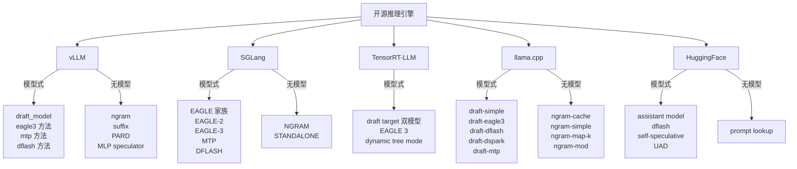

> **投机解码系列 · 第 04 篇**
>
> 本系列把投机解码从「一个加速技巧」拆成可核验的几层：收益模型（02）→ 草稿从哪来（03）→
> 引擎支持（本文）→ 生产陷阱 → 评测数字怎么读。
> 它挂在[推理引擎主线](/2026/10/18/serving-01-architecture-divergence/)之下——
> 投机解码是推理引擎的一个子系统，脱离引擎谈它没有意义。
>
> - 01 综述与演化 → 02 收益模型 → 03 EAGLE 家族 → **04 引擎支持矩阵（本文）** →
>   05 生产部署陷阱 → 06 业界实践 → 07 评测数字怎么读 → 08 未来方向

> **TL;DR**
>
> * **核心论点：引擎支持决定你实际能用哪一种投机解码方法**。第 02 篇给出收益模型（$$\alpha$$ / $$\gamma$$ / $$c$$），第 03 篇给出草稿器谱系，本篇回答「谱系里的东西在你的引擎里到底能不能开」——算法能力与引擎落地之间有一层落差，这一层才是选型的真实约束。
> * **无模型 n-gram 方案零成本可用**：vLLM / SGLang / llama.cpp / HuggingFace 全线支持，不需要任何额外权重文件，但 $$\alpha$$ 受限于强复用文本（摘要、代码延续），天花板只在特定负载下才够高。
> * **EAGLE-3 已成事实标准，但要额外权重文件**：五家引擎全部支持，草稿头权重大多可从官方或社区 HF 仓库获取；落地成本从「零」变成「要有一份与目标模型配对的草稿头」。
> * **TensorRT-LLM 有明确硬约束**：官方文档明示投机解码收益仅在低 batch 场景显著，且 draft / target 双模型路线对词表与模板有配套要求——选型前必须先把约束读进收益模型。
> * **能开 ≠ 值得开**：引擎支持矩阵只回答「能不能开」；「开了值不值」取决于 batch、并发、序列长度与草稿质量，这一层落差留给后续篇章。

---

## 0. 符号约定

本篇承接第 02 篇与第 03 篇的记号：用 $$p$$ 指目标模型、$$q$$ 指草稿模型（与 vLLM / SGLang 代码一致，也与 Leviathan et al. 一致 [6](https://arxiv.org/abs/2211.17192)）。第 02 篇给出的收益模型是全文的标尺：

$$
S(\alpha, \gamma, c) = \frac{1 - \alpha^{\gamma+1}}{(1 - \alpha)(1 + \gamma c)}
$$

其中 $$\alpha$$ 是草稿分布与目标分布的重叠质量（接受率期望值），$$\gamma$$ 是单次验证最多投机的 token 数，$$c = t_D / t_T$$ 是草稿单步成本与目标单步成本之比。两条边界已在第 02 篇证出：

$$
\lim_{\gamma \to \infty} S = \frac{1}{1 - \alpha}, \qquad \lim_{c \to 0} S = \frac{1 - \alpha^{\gamma+1}}{1 - \alpha}
$$

第一条是**硬天花板**：无论草稿多长、多便宜，加速比都过不去 $$1/(1-\alpha)$$。$$\alpha$$ 从 $$0.8$$ 提到 $$0.9$$，天花板从 $$5$$ 翻到 $$10$$；而把 $$\gamma$$ 从 $$8$$ 加到 $$16$$，只是在既定天花板下挪近一点。第 02 篇据此把优化方向钉死：**首要目标是抬 $$\alpha$$，不是堆 $$\gamma$$**。

第 03 篇把「抬 $$\alpha$$」的工程路径收敛成一条草稿来源谱系：

| 世代 | 草稿从哪来 | 抬 $$\alpha$$ 的手段 |
|:---|:---|:---|
| 经典 SD | 独立小模型 | 范式开创，$$\alpha$$ 受分布漂移限制 |
| Medusa | 多解码头（token 级） | 多解码头并行 + typical acceptance |
| EAGLE | 特征级单层解码器 | 特征空间自回归 |
| EAGLE-2 | 同 EAGLE，动态草稿树 | 置信度标定的动态树 |
| EAGLE-3 | 直接 token + 多层特征 | 去特征约束 + training-time test |
| DeepSeek-V3 MTP | 训练目标模块 | 草稿分布与目标同源训练 |

本篇在第 03 篇谱系右侧加一列「落地要件」：

| 方法 | 额外权重文件 | 训练 / 获取成本 | 引擎实现的复杂度 |
|:---|:---:|:---|:---|
| 无模型 n-gram | 否 | 零 | 低（仅需缓存 / 模板匹配） |
| 独立 draft model | 是（一个小模型） | 需另训或另取 | 中（双模型调度） |
| EAGLE-3 | 是（草稿头） | 需配对权重，或自训 | 中（读 hidden state） |
| MTP | 否（主模型自带） | 已含在预训练 | 中（模块复用） |
| TensorRT-LLM draft/target | 是（双模型） | 需配对 checkpoint | 高（图优化绑定） |

这张表是本文的主线：谱系里的每一代方法，落到引擎里都要先过「额外权重 / 硬约束」这一关。算法能力与引擎落地之间的落差，就发生在这张表与引擎实现之间。

如果把第 02 篇的收益模型、第 03 篇的谱系、本篇的引擎矩阵排成一条因果链，顺序是清晰的：**收益模型给出理论天花板 $$1/(1-\alpha)$$ → 谱系给出抬 $$\alpha$$ 的工程路径 → 引擎矩阵给出这条路径在你能用的工具里到底开不开得起来**。前两层回答「方法有多好」，第三层回答「方法你能不能用」——而生产里真正卡住人的，往往是第三层。所以本文不重述谱系本身，而是把谱系逐项翻译成引擎坐标：每一项方法在五家引擎里分别落到「覆盖度 × 额外成本 × 硬约束」的哪个点。

所有加速比数字若非特别注明，均为各引擎官方文档或论文自报，标记为「引官方文档 / 引论文数字」；本篇不跑任何 draft-verify 实验，结论来自各引擎文档、源码配置项与第 02 / 03 篇的闭式。

---

## 1. 为什么需要引擎支持矩阵

前面三篇回答的是「**有什么方法、原理如何**」；本文回答的是「**方法落在哪个引擎里、怎么打开开关**」。决定一个投机解码方案能否落地，往往不取决于论文多漂亮，而取决于四个更朴素的工程事实：

1. **推理引擎是否实现了**你选定的算法——EAGLE-3、MTP、n-gram、独立 draft model 在五家主流开源引擎里的覆盖度并不一致。第 03 篇谱系里的 EAGLE-2，在引擎层面的支持就明显窄于 EAGLE-3。
2. **配置入口是否顺手**——是命令行 flag、JSON 配置，还是 Python API。入口形式决定了你能不能在十分钟内部署，也决定了你能不能动态调参。
3. **draft 模型从哪来**——官方预训练权重、外部 HF 仓库，还是引擎自带训练脚本。这是「零成本可用」与「要额外权重」的分界线。
4. **运行时约束是什么**——是否支持 batch、支持哪些采样模式、对词表与模板有何要求。约束直接改写第 02 篇的收益模型：低 batch 下 $$c$$ 才划算，高 batch 下并行验证开销反超（第 02 篇 §9 与 MagicDec 对失效边界有更细讨论 [9](https://arxiv.org/abs/2408.11049)）。

这四个事实共同构成「算法能力 → 引擎落地」之间的一层落差。第 03 篇把谱系收敛到「草稿来源越贴近目标模型训练，$$\alpha$$ 上限越高」；但这句话在落地时会被引擎实现重新切一刀：

- **谱系里最便宜的 n-gram**，引擎支持最齐，却因为 $$\alpha$$ 受限于强复用文本，只在摘要、代码延续这类负载上把天花板抬得动；
- **谱系里 $$\alpha$$ 最高的 EAGLE-3 / MTP**，要额外权重或原生模块，引擎覆盖度虽高，但「覆盖」不等于「默认开」——往往要显式指定草稿头路径、显式配对版本；
- **最容易被论文忽略的硬约束**（词表、模板、batch 档位），恰恰是生产里最先撞上的墙。

因此本文的立场不是「列一个支持清单」，而是把第 03 篇的谱系逐项翻译成「在你的引擎里能不能开、开了要付什么代价」。把第 02 篇的收益模型作为统一标尺，每一项引擎能力都能映射回 $$\alpha$$ / $$\gamma$$ / $$c$$ 三个数：引擎决定你能用哪一种 $$q$$（决定 $$\alpha$$ 上限），引擎的调度与验证开销决定 $$c$$，引擎的批处理与树验证上限决定 $$\gamma$$ 的有效取值。

下文盘点 2026 年中期的五家主流开源引擎：**vLLM、SGLang、TensorRT-LLM、llama.cpp、HuggingFace Transformers**。所有命令行参数与配置字段名，除非特别说明，均对照 vLLM `v0.31.0`（commit `db9527a4`）与 SGLang `v0.5.21`（commit `e00930c5`）的官方文档与源码；其余引擎以各自官方文档为准。版本与 commit 锁定见文末「参考」。

本文给支持矩阵一个统一的读法：把每个引擎能力翻译成第 02 篇收益模型的三个数。**$$\alpha$$ 由 `method` / `algorithm` 决定**——选 EAGLE-3 / MTP 把天花板抬到 5 以上，选 n-gram 则受负载复用度约束；**$$c$$ 由草稿器体量与运行时约束决定**——EAGLE 系草稿头仅单层 FC + 解码器层（第 03 篇 §4.5），$$c$$ 明显低于 0.1，但高 batch 会把它抬回去；**$$\gamma$$ 由 `num_speculative_tokens` / `max_draft_len` / `n-max` 等上限与动态调度共同决定**。这样读，引擎文档里那些彼此不通的 flag 名，就归一到同一把尺子上：你比较的不是「vLLM 支持 eagle3 而 TRT-LLM 叫 EAGLE 3」这种命名差异，而是「同一代方法在不同引擎里，$$\alpha$$ / $$c$$ / $$\gamma$$ 各能取到什么值、被什么约束卡住」。命名差异是表象，收益模型的三个数才是选型的内核。

---

## 2. 全景对比表

先把五家引擎放在同一张表里，焦点放在「草稿来源」与「落地要件」上（字段名对照上文锁版本）：

| 引擎 | 定位 | 草稿来源 | 核心算法支持 | 配置入口 | 运行时约束 |
|:---|:---|:---|:---|:---|:---|
| **vLLM** | 生产级服务化推理 | draft model / 自投机 / 无模型 | draft_model、mtp、eagle3、dflash、ngram、suffix、PARD、MLP speculator、自定义 proposer | `--speculative-config` （JSON） | 支持动态投机与自适应验证 |
| **SGLang** | 生产级服务化推理 | draft model / 自投机 / 无模型 | EAGLE-2 / EAGLE-3、MTP、DFLASH、STANDALONE、NGRAM | `--speculative-algorithm` 等 flag | 官方文档推荐 EAGLE-3；FR-Spec 等 token map 微调 |
| **TensorRT-LLM** | NVIDIA 平台推理 | draft model（EAGLE 系） | draft / target 双模型、EAGLE 3、dynamic tree mode | `DraftTargetDecodingConfig` | 明确注明仅低 batch 有加速 |
| **llama.cpp** | 本地 / 边缘推理 | draft model / 自投机 / 无模型 | draft-simple、draft-eagle3、draft-dflash、draft-dspark、draft-mtp、ngram 系列 | `--spec-type` + `--spec-draft-*` | CPU / Metal / CUDA 通用，量化友好 |
| **HuggingFace** | 研究与实验 | assistant model / 自投机 / 无模型 | assisted decoding、prompt lookup、self-speculative、dflash、UAD | `generate()` 命名参数 | 不支持 batch 输入；需同一 tokenizer |

这张表把第 1 节的四个工程事实一次性摊开。可以读出三条横向规律：

1. **EAGLE-3 已成事实标准**——五家引擎全部支持（vLLM `eagle3` / SGLang `EAGLE3` / TRT-LLM EAGLE 3 / llama.cpp `draft-eagle3` / HF 经 EAGLE 权重），草稿头权重大多可从官方或社区 HF 仓库获取。这是谱系收敛在引擎层最直观的体现：第 03 篇说「EAGLE-3 是当前公认组合」，引擎侧用「全覆盖」回应了它。
2. **MTP 随主模型分发**——vLLM 与 llama.cpp 已支持 `mtp` 方法，加上 HF 的 `use_mtp=True`，DeepSeek-V3 开创的「内建投机」路线生态逐渐齐备。它对应第 03 篇谱系终点：草稿分布与目标同源训练，落地时「零额外权重」。
3. **n-gram 无模型方案全线普及**——vLLM / SGLang / llama.cpp / HF prompt-lookup 都支持，代价是仅适用强复用文本。它把第 2 节那张「落地要件」表里的「额外权重 = 否」一栏坐实成「开箱即用」。

最关键的判读：**选引擎先选场景，选场景先读约束**。HF 不支持 batch、TRT-LLM 明示低 batch 才有收益、llama.cpp 针对量化与本地——这些约束不是附录，而是直接改写第 02 篇收益模型的变量取值。下面逐家展开。

读这张表时，建议把它和第 0 节「落地要件」表并排：横向看同一个方法在不同引擎里的命名与入口差异，纵向看同一个引擎里「模型式 / 无模型」两类各自覆盖到谱系哪一代。两条观察会自然浮现：其一，模型式方法（EAGLE-3 / MTP / draft model）在五家引擎里几乎都被收了，但入口从无模型的「一行 flag」变成「要配对权重 + 显式路径」，落地成本随方法代际上升；其二，无模型方法（n-gram / prompt lookup）入口最轻，但覆盖的 $$\alpha$$ 上限被负载锁死，适用面最窄。这两条合起来就是本文主线的表格形态：算法能力沿着第 03 篇谱系收敛，但引擎落地沿着「成本 × 约束」重新分层。

最后说明本矩阵的性质：它是一张**静态快照**，锚在 2026 年中期与锁版本源码（vLLM `v0.31.0`、SGLang `v0.5.21`）。引擎的投机解码实现迭代极快，今天标「支持」的项，下个大版本可能改名、合并或拆分；今天标「约束」的红线，也可能被新的动态调度或图优化放宽。因此本矩阵的真正价值不在「某单元格的勾叉」，而在它展示的**结构**——「方法代际 × 引擎能力 × 运行时约束」三维关系。读懂这个结构，你就能在引擎升级后自行更新每个单元格，而不必等一篇新文章。这也是为什么本文把版本与 commit 锁在文末参考：让每一个字段名都可被你回到对应 commit 复核。

---

## 3. vLLM

vLLM 是「服务化大模型推理」的主战场之一，也是 EAGLE 系落地最充分的引擎。其投机解码文档 [1](https://docs.vllm.ai/en/latest/features/speculative_decoding.html) 覆盖了业界主要方案类别。

### 3.1 算法支持

vLLM 的投机解码文档 [1](https://docs.vllm.ai/en/latest/features/speculative_decoding.html) 把方案分成「模型式」与「无模型」两类：

- **独立 draft model**（`draft_model`）：用一个小模型做草稿，最通用，对应谱系里的经典 SD；
- **EAGLE-3**（`eagle3`）：读取目标模型 hidden state 的草稿头（见 [《投机解码（03）：EAGLE 家族》](/2026/10/18/specdec-03-eagle-family/) §4）；
- **MTP**（`mtp`）：主模型自带 multi-token prediction 头（DeepSeek-V3 路线，见 [《投机解码（03）：EAGLE 家族》](/2026/10/18/specdec-03-eagle-family/) §7）；
- **DFlash**（`dflash`）：块级扩散草稿（block diffusion）；
- **无模型方案**：n-gram、suffix 匹配；

在「无模型」一侧，vLLM 的 `ngram` 与 `suffix` 值得区分：`ngram` 从已生成序列与 prompt 里匹配 n-gram 续写，等价于把「强复用文本」当成零成本草稿；`suffix` 则专门从 prompt 的 suffix（用户输入末尾片段）里复用，适合 prompt 很长且后续要重复其句式的负载。两者都把第 02 篇收益模型里的 $$c$$ 压到接近 0（无额外前向），但 $$\alpha$$ 上限由负载自身的复用度决定——复用度越高，匹配到的候选越接近目标分布，$$\alpha$$ 越接近 1。这解释了为什么 n-gram / suffix 在代码补全、模板生成上能接近 EAGLE-3 的天花板，而在开放式对话上几乎无效。把这一观察与第 2 节「落地要件」表合看：n-gram 的「额外权重 = 否」与「$$\alpha$$ 受负载锁死」是一体两面——零成本来自不引入新分布，上限也源于不引入新分布。
- **其他**：PARD（并行联想解码）、MLP speculator、自定义 proposer。

这里的 `MLP speculator` 与 `PARD` 属于谱系之外、但引擎已实现的方案：`MLP speculator` 用一个轻量 MLP 直接预测后续若干 token 的分布，等价于第 03 篇「特征级单层草稿器」的更激进形态——把草稿器压到一层 MLP，进一步压低 $$c$$；`PARD`（并行联想解码）则用多个草稿提议并行竞争，思路接近第 03 篇 §5 的树验证，但把竞争放到草稿侧。它们的存在说明：引擎的算法覆盖并不严格等于第 03 篇那条收敛主线，引擎会因为工程便利多收一些「旁支」。对选型的意义是——不要被引擎支持清单的长度迷惑，真正决定收益的是清单里与你的负载匹配的那些项。

把这套清单映射回第 03 篇谱系：vLLM 在「模型式」一侧同时收了 EAGLE-3（后装头）与 MTP（训练目标内建）两条收敛线的终点，在「无模型」一侧收了 n-gram / suffix。它对第 02 篇收益模型的覆盖是完整的——你既能用 EAGLE-3 把 $$\alpha$$ 抬到接近 1，也能用 n-gram 把 $$c$$ 压到接近 0（只是 $$\alpha$$ 受限）。

把 vLLM 的 `method` 枚举与第 03 篇谱系对齐，可以验证「引擎覆盖 ≠ 谱系收敛」这条观察：vLLM 既收了收敛线终点的 `mtp` / `eagle3`，也收了收敛线起点的 `draft_model`，还收了谱系之外的 `dflash` / `PARD` / `MLP speculator` / `suffix`。换句话说，引擎的算法清单是「用户要什么就接什么」的累积结果，而非沿着第 03 篇那条「$$\alpha$$ 单调上升」主线裁剪。这对选型是好事——你几乎总能在 vLLM 里找到对应方法；也是陷阱——清单长会让人误以为「都支持就都能用」，而忽略了第 2 节「落地要件」表里每一项的额外权重与约束。vLLM 的覆盖广度，最终要回到收益模型的三个数，才能判断哪个 `method` 对你的负载是真选项。

vLLM 还支持**动态投机解码（dynamic speculative decoding）**与**自适应验证（adaptive verification）**，在运行期根据草稿质量动态调整投机长度。这对应第 02 篇「$$\gamma^*$$ 由 $$\alpha$$ 与 $$c$$ 共同决定」的在线版本：把固定的 $$\gamma$$ 换成随草稿质量浮动的有效 $$\gamma$$，相当于在既定 $$\alpha$$ 下把收益模型里的分母 $$(1+\gamma c)$$ 动态最小化。

### 3.2 配置方式

vLLM 的投机解码配置统一收敛到 `--speculative-config`（JSON 字符串），核心键为 `method`、`model`、`num_speculative_tokens` [1](https://docs.vllm.ai/en/latest/features/speculative_decoding.html)。对照锁版本 vLLM `v0.31.0`（commit `db9527a4`），这些键名是该版本文档与配置结构的稳定入口。

值得强调「锁版本」的必要性：vLLM 的投机解码配置键名演进很快，早期版本曾用 `--speculative-model` / `--num-speculative-tokens` 这类独立 flag，后来才收敛到 `--speculative-config` 这一个 JSON 入口。若不锁版本照搬旧文档的 flag 名，在新版会直接报未知参数。这正是本文把 vLLM 锁在 `v0.31.0` / commit `db9527a4`、SGLang 锁在 `v0.5.21` / commit `e00930c5` 的原因——配置字段名这类「会漂移的事实」必须锚到具体 commit，否则引用会在几个月内失真。下文所有字段名都按这两个锁版本给出，跨版本迁移请以对应版本的 `--help` 与官方文档为准。

用单一 JSON 入口而非一堆独立 flag，对投机解码这类「多方法 × 多参数」的场景有个实际好处：切换方法时只需改 JSON 里的 `method` 字段，其余参数（如 `num_speculative_tokens`）大多可沿用，不易因 flag 拼写差异踩坑。代价是 JSON 字符串在 shell 里需要小心引号转义——这也是为什么下面的最小示例一律用单引号包住整个 JSON。把这一细节和第 03 篇的「方法切换」合看：在 vLLM 里换方法几乎零成本，真正的成本在「有没有配对权重」与「负载是否匹配」，不在配置本身。

> 版本提示：vLLM 的 flag 与 JSON 键名随版本演进较快。下文键名依据 `v0.31.0` 官方文档与源码；落地前请以 `vllm serve --help` 在该版本下的输出为准，避免跨大版本照搬键名。

### 3.3 最小示例

```bash
# 独立 draft model 方案
vllm serve {目标模型} \
  --speculative-config '{"method": "draft_model", "model": "{draft模型HF名或路径}", "num_speculative_tokens": 5}'

# EAGLE-3 方案（model 指向对应 HF 仓库的草稿头）
vllm serve {目标模型} \
  --speculative-config '{"method": "eagle3", "model": "{eagle3草稿头HF名}", "num_speculative_tokens": 5}'

# 无模型 n-gram 方案（零额外权重）
vllm serve {目标模型} \
  --speculative-config '{"method": "ngram", "num_speculative_tokens": 5}'
```

注意 `method` 的取值直接决定了第 2 节「落地要件」表的哪一栏生效：`draft_model` / `eagle3` 需要额外权重文件，`ngram` 不需要。`num_speculative_tokens` 对应第 02 篇的 $$\gamma$$——它只是上限，实际接受长度受 $$\alpha$$ 与验证开销限制（第 02 篇 §8 树验证）。一个常见的误读是「把 `num_speculative_tokens` 调大就更快」：在第 02 篇闭式里，当 $$\gamma$$ 超过接受长度的有效区间，多投机的 token 在验证阶段被整段拒绝，既不增加接受长度，又白白付出草稿前向成本，等价于把 $$c$$ 抬高而 $$\alpha$$ 不变。因此这个值更该由负载的接受率分布反推，而非拍一个上限。vLLM 的动态投机与自适应验证正是把这一反推自动化：不再依赖你手填一个固定的 $$\gamma$$，而是让运行时按草稿质量浮动到接近最优的有效 $$\gamma$$。

### 3.4 与收益模型的对应

vLLM 这一栏可以读作第 02 篇收益模型的一个「高自由度高调度」实现：

- $$\alpha$$ 上限由 `method` 决定：选 `eagle3` / `mtp` 把天花板抬到 5 以上，选 `ngram` 则受负载复用度约束；
- $$c$$ 由草稿器体量决定：EAGLE-3 草稿头仅含单层 FC + 解码器层（第 03 篇 §4.5），$$c$$ 明显低于 0.1；
- $$\gamma$$ 由 `num_speculative_tokens` 与动态投机共同决定，后者把固定 $$\gamma$$ 变成随草稿质量自适应的有效长度。

vLLM 的价值在于：它把谱系里从「零成本 n-gram」到「高 $$\alpha$$ EAGLE-3 / MTP」的全谱方法，收进同一个 `--speculative-config` 开关。代价是你需要自己判断 `method` 与负载的匹配——这正是第 1 节说的「引擎支持 ≠ 值得开」。

vLLM 的动态投机与自适应验证发生在单请求级，与 SGLang 的动态树（结构级）、HF 的 schedule（请求级）是同一思想的两种调度粒度。它们的共同前提是第 02 篇「$$\alpha$$ 随位置 / 上下文变化」——正因为 $$\alpha$$ 不是常数，固定 $$\gamma$$ 才会时而浪费、时而不足，动态调整才有收益。这也解释了为什么第 03 篇 EAGLE-2 的「置信度标定动态树」能在三个引擎里各自落地：动态调度的内核都是「用草稿模型自带的置信度估计当前 $$\alpha$$，再决定下一步投多长」，只是接口形态不同。把 vLLM 的 `--speculative-config` 与这套动态调度合看，它的优势不只是「方法多」，更是「方法多 + 调度可自适应」，这对第 02 篇收益模型里 $$(1+\gamma c)$$ 分母的最小化是直接利好。

---

## 4. SGLang

SGLang 是另一处服务化主战场，与 vLLM 的取舍正好互补：vLLM 用统一 JSON 配置，SGLang 用命令行 flag 注入，且在 EAGLE 系上官方文档明确推荐 EAGLE-3。

### 4.1 算法支持

SGLang 投机解码支持 [2](https://docs.sglang.ai/advanced_features/speculative_decoding) 几类：

- **EAGLE 家族**：EAGLE、EAGLE-2、EAGLE-3（官方文档推荐 EAGLE-3）；
- **MTP**：主模型自带多 token 预测头；
- **DFLASH**：块扩散草稿；
- **NGRAM**：无模型 n-gram 方案；
- **STANDALONE**：独立 draft model 方案。

对照第 03 篇谱系，SGLang 的特殊之处在于它**同时收了 EAGLE-2 与 EAGLE-3**——而 vLLM 的 `eagle3` 方法在命名上更聚焦第三代。这意味着第 03 篇 §5「动态草稿树」那条线，在 SGLang 里是原生可调的：EAGLE-2 的置信度标定动态树不需要重训即可启用。把这一事实代回第 02 篇收益模型，动态树提升的是「在固定 $$\gamma$$ 预算下被接受的期望长度」（第 03 篇 §5.3），等价于把有效 $$\alpha$$ 抬上去而不改草稿器本身。

SGLang 同时保留 EAGLE-2 与 EAGLE-3 这点，对选型有实际含义：第 03 篇 §6 指出 EAGLE-3 通过「去特征预测约束 + training-time test」把峰值加速推到 6.5×，但需要按目标模型配对训练；若你没有对应目标模型的 EAGLE-3 权重、又想用动态树榨干上下文相关的 $$\alpha$$，SGLang 的 EAGLE-2 是「免重训」的折中——它复用现成 EAGLE 草稿头、只改树结构调度，就能拿到第 03 篇 §5.4 报的 3.05–4.26×。换言之，在同一个引擎里，EAGLE-2 与 EAGLE-3 不是「旧 vs 新」的替代关系，而是「免重训 vs 最高 $$\alpha$$」的取舍关系，引擎把它们并排列进 `--speculative-algorithm` 供你按权重可得性挑选。

### 4.2 配置方式

SGLang 以命令行 flag 注入，常用项 [2](https://docs.sglang.ai/advanced_features/speculative_decoding)（对照锁版本 `v0.5.21`，commit `e00930c5`）：

```bash
--speculative-algorithm          投机算法（EAGLE / EAGLE-2 / EAGLE-3 / MTP / DFLASH / NGRAM / STANDALONE）
--speculative-draft-model-path   外部 draft 模型路径（EAGLE 系与 STANDALONE 使用，支持 HF 仓库名）
--speculative-eagle-topk         EAGLE 系候选 top-k
--speculative-token-map          自定义 token map（如 FR-Spec 等对 token 分组的改进）
```

`--speculative-algorithm` 的取值决定第 2 节「落地要件」的生效栏：`EAGLE-3` / `STANDALONE` 需额外权重，`NGRAM` 不需。`--speculative-token-map` 是 SGLang 相对 vLLM 多出的一个旋钮：它允许对词表做分组微调（FR-Spec 思路），本质是在不换草稿器的前提下，对 $$\alpha$$ 做词表层面的二次校准。

`--speculative-token-map` 背后的 FR-Spec 思路值得单列：它在词表维度对 token 做分组，使草稿器在「组」粒度上做预测、验证阶段再细化到具体 token。把这一改动代回第 02 篇收益模型，它不改变 $$\alpha$$ 的天花板 $$1/(1-\alpha)$$，但降低了草稿器在长尾 token 上的预测负担，相当于在固定 $$c$$ 下把有效 $$\alpha$$ 抬了一档。这是「不换草稿器、只在词表层面二次校准」的典型工程手段，也解释了为什么 SGLang 文档在推荐 EAGLE-3 之外，仍保留 token map 这个旋钮。

注意这个旋钮只在「草稿器已就绪、但词表层面还有长尾偏差」时才有意义——若你根本没有 EAGLE-3 草稿头，token map 无从谈起。它再次印证本文主线：引擎支持的每一层能力，最终都要落到「你是否有对应的模型资产」这一事实上。

> 版本提示：SGLang 的 flag 名称随版本演进。下文依据 `v0.5.21`（commit `e00930c5`）官方文档；跨版本落地前请以 `python -m sglang.launch_server --help` 在该版本下的输出核对。

### 4.3 最小示例

```bash
# EAGLE-3 方案
python -m sglang.launch_server --model {目标模型} \
  --speculative-algorithm EAGLE3 \
  --speculative-draft-model-path {EAGLE3 草稿头 HF 仓库名}

# 无模型方案：n-gram（零额外权重）
python -m sglang.launch_server --model {目标模型} \
  --speculative-algorithm NGRAM
```

SGLang 的 flag 命名与 vLLM 的 JSON 键名是同一代方法的两套「方言」：`EAGLE3` 对应 vLLM 的 `eagle3`，`NGRAM` 对应 `ngram`，`MTP` 对应 `mtp`。选型时不应被命名差异干扰，而应认准第 03 篇谱系里的那一代方法——引擎文档用不同名字指代同一件事，本质是各引擎在「算法收敛线」上对齐了，只是配置入口没有统一。这也回到第 1 节的读法：用收益模型的三个数归一化后，跨引擎比较才成立。

### 4.4 与收益模型的对应

SGLang 这一栏读作「EAGLE-3 优先 + 动态树可选 + token map 微调」的实现：

- $$\alpha$$ 上限：`EAGLE3` / `MTP` 把天花板抬到 5 以上；`NGRAM` 受负载复用度约束；`EAGLE-2` 还能用动态树把上下文相关的 $$\alpha$$ 显式榨干（第 03 篇 §5）。
- $$c$$：EAGLE 系草稿头与 vLLM 同理，单层 FC + 解码器层，$$c$$ 低于 0.1。
- $$\gamma$$：`--speculative-eagle-topk` 与算法内部树展开共同决定有效草稿长度。

SGLang 的选型建议很直接：官方文档推荐 EAGLE-3，因为它在「高 $$\alpha$$」与「低额外成本」之间最平衡（第 03 篇 §8.2）。但「推荐」是文档立场，不是你的负载承诺——第 07 篇按可信度分级处理这类数字，本篇只确认「它能被开起来」。

顺带一提，SGLang 的 `EAGLE3` flag 与 vLLM 的 `eagle3` 方法在内部都要求目标模型导出 second-to-top-layer 的 hidden state 供草稿头读取（第 03 篇 §4.1）；若你的目标模型权重来自一个未暴露该中间表示的导出路径，EAGLE-3 即便标着「支持」也会在加载阶段报错。这是「引擎支持」与「权重可加载」之间的又一道缝——矩阵里的勾，最终要落到具体权重的接口兼容性上才算数。这条缝在 llama.cpp 的 GGUF 路径与 HF 的 EAGLE 权重上同样存在：能开 EAGLE-3 的前提，永远是你手上的目标模型确实吐出了草稿头要读的那个 hidden state。

---

## 5. TensorRT-LLM

TensorRT-LLM 绑定 NVIDIA 生态，定位是「图优化极致 + 官方配套 checkpoint」。它的投机解码实现最「重」，也最「有硬约束」——这正是第 1 节说的「最容易被论文忽略、却最先撞上的墙」。

### 5.1 算法支持

TensorRT-LLM 的投机解码文档 [3](https://nvidia.github.io/TensorRT-LLM/latest/features/speculative-decoding.html) 聚焦 NVIDIA 平台：

- **draft / target 双模型**：任意小模型作草稿 + 大模型验证，对应谱系里的经典 SD；
- **EAGLE 3**：官方支持，且为 **Llama 3.1 / 4 系提供预构建 EAGLE-3 checkpoint**（如 `yuhuili/EAGLE3-LLaMA3.1-Instruct-8B`）；
- **Llama4 Maverick 官方方案**：NVIDIA 发布 Maverick 专用投机解码 checkpoint；
- **dynamic tree mode**：动态树状草稿路径，提升接受率。

TRT-LLM 对 EAGLE 3 的官方支持有一个细节值得单列：它不为任意模型提供草稿头，而是为 **Llama 3.1 / 4 系提供预构建 EAGLE-3 checkpoint**（如 `yuhuili/EAGLE3-LLaMA3.1-Instruct-8B`），并为 Llama4 Maverick 发布专用投机解码 checkpoint。这意味着 TRT-LLM 的 EAGLE-3 落地是「模型族绑定」的——你只能在 NVIDIA 已配好权重的那几个模型族上开 EAGLE-3，模型族之外的目标模型在该引擎里没有现成草稿头可加载。把这一事实代回第 2 节「落地要件」表，TRT-LLM 的「额外权重 = 是，且由官方配好」一栏，代价是「模型族白名单」这道隐形约束。这是它相对 vLLM（允许任意 HF 草稿头路径）最硬的边界：vLLM 的灵活换来你自己负责配对正确，TRT-LLM 的安全换来你只能用在白名单上。对选型而言，先确认你的目标模型是否在 TRT-LLM 的 EAGLE-3 白名单内，比纠结参数更重要。

对照第 03 篇谱系，TRT-LLM 把收敛线停在 EAGLE-3，并提供「官方预构建 checkpoint」——这是第 2 节「落地要件」表里「额外权重 = 是，但由官方配好」的一档。它的价值在于省去自训草稿头的工程，代价是绑定 NVIDIA 与特定模型族。

### 5.2 配置方式

Python 侧通过 `DraftTargetDecodingConfig` 注入，核心参数 [3](https://nvidia.github.io/TensorRT-LLM/latest/features/speculative-decoding.html)：

```python
DraftTargetDecodingConfig(
    max_draft_len=3,                            # 每次验证最多投机 token 数（对应 gamma）
    speculative_model="yuhuili/EAGLE3-LLaMA3.1-Instruct-8B",  # draft 模型
)
```

`max_draft_len` 的默认值（上文示例取 3）对应第 02 篇的 $$\gamma$$ 上限；TRT-LLM 在 dynamic tree mode 下会把这 $$\gamma$$ 个 token 展开成树而非单链，等价于第 03 篇 §5 的「动态草稿树」——在固定草稿预算内按置信度加权分配，把期望接受长度抬高。把 dynamic tree mode 代回第 02 篇收益模型，它不改变 $$\alpha$$ 的天花板，但把「单链几何分布」换成「树几何」（第 03 篇 §5.3），在既定 $$\gamma$$ 下把有效接受长度推上去。注意 TRT-LLM 的 dynamic tree mode 要求 draft 模型自身输出置信度（即 EAGLE 系草稿头），这再次把「硬约束」与「方法代际」绑在一起：想用动态树，就得用带置信度的草稿头，也就回到第 2 节「额外权重」那一栏。

`max_draft_len` 对应第 02 篇的 $$\gamma$$；`speculative_model` 对应第 2 节「额外权重」栏——在 TRT-LLM 里它必须是一个与 target 配对的 checkpoint。注意 TRT-LLM 的 draft / target 双模型路线，对**词表一致**与**模板一致**有配套要求：draft 与 target 必须共享 tokenizer 与对话模板，否则验证阶段分布对不齐，拒绝采样那道「正确性」门（第 02 篇）会失效。这是它相对 vLLM / SGLang 更显式的硬约束。

### 5.3 明确的约束

官方文档明示：**投机解码的收益仅在低 batch 场景显著**；batch 增大后验证开销反超。把这句话代回第 02 篇收益模型：高 batch 下目标模型单次前向的「并行验证 ≈ 单次前向」前提失效（MagicDec 对拐点的讨论见 [9](https://arxiv.org/abs/2408.11049)），$$c$$ 的有效取值被抬升，收益模型的分母 $$(1+\gamma c)$$ 膨胀，加速比被压回 1 附近。

draft / target 双模型对词表一致的要求，根源在第 02 篇拒绝采样那道门：验证阶段要计算 $$\min(1, p(x)/q(x))$$，要求 $$p$$ 与 $$q$$ 定义在同一个词表上。若 draft 与 target 词表不同（例如 target 做了词表扩展而 draft 没有），比值在 OOV token 上无定义，无偏性直接崩塌。TRT-LLM 把这一约束显式收紧为「配套 checkpoint」——它提供的 `yuhuili/EAGLE3-LLaMA3.1-Instruct-8B` 这类预构建权重，本质是「已验证词表 / 模板配对」的草稿头，省去用户自己配对的踩坑。这是它相对 vLLM `eagle3`（允许任意 HF 草稿头路径）多一道保险，也多一道限制。

因此 TRT-LLM 这一栏的读法不是「支持 EAGLE-3 吗」而是「在你的 batch 档位下 EAGLE-3 还划算吗」。它把第 1 节的核心论点坐实：算法能力（EAGLE-3 高 $$\alpha$$）与引擎落地（低 batch 约束）之间，确有落差，且落差由官方文档明文写下。

### 5.4 与收益模型的对应

- $$\alpha$$ 上限：EAGLE-3 把天花板抬到 5 以上；但 dynamic tree mode 还能用树验证把有效接受长度再抬（第 03 篇 §5.3）。
- $$c$$：TRT-LLM 的图优化能把草稿前向压得很低，但仅当 batch 足够小、验证开销不反超时 $$c$$ 才划算。
- $$\gamma$$：`max_draft_len` 给上限，实际由低 batch 约束与验证开销共同裁剪。

TRT-LLM 的选型关键词是「封闭式 NVIDIA 部署 + 官方 checkpoint + 低 batch」。它不适合高并发场景，但在这条窄道上是最省心的 EAGLE-3 落地路径。

把 TRT-LLM 的硬约束收进第 02 篇收益模型，可以写成三条可操作的红线：其一，batch 一旦越过文档明示的拐点，并行验证开销反超，$$c$$ 被抬到让加速比回到 1 附近，此时投机应当直接关闭而非硬开；其二，draft / target 必须词表与模板配对，否则拒绝采样那道「正确性」门失效，无偏性不再成立——这是比「加速多少」更优先的前提；其三，EAGLE-3 仅限官方白名单模型族，超出白名单没有现成草稿头可加载。这三条红线都不是「方法支不支持」的问题，而是「你的负载与部署是否落在方法成立区」的问题，正好对应本文反复强调的核心论点：引擎支持决定你能用哪种方法，但约束决定你用不用得对。

---

## 6. llama.cpp

llama.cpp 是本地单机 / 边缘场景的事实标准，量化友好、CPU / Metal / CUDA 通用。它在「支持的算法谱系」上意外地最广——甚至覆盖了 DFlash / DSpark 这类块扩散方案。

### 6.1 算法支持（2026-04 重构后）

llama.cpp 的投机解码文档 [4](https://github.com/ggml-org/llama.cpp/blob/master/docs/speculative.md) 覆盖了业界主要方案。2026-04 的 CLI 重构（PR #22397 / #22539，由 ggerganov 完成）引入了统一开关 `--spec-type`（逗号分隔可混合多种方案），支持的方案：

| `--spec-type` 取值 | 方案类型 | 草稿来源 |
|:---|:---|:---|
| `draft-simple` | 独立小模型 | 外部 gguf 草稿模型 |
| `draft-eagle3` | EAGLE-3 | 读取目标模型 hidden state |
| `draft-dflash` | DFlash | 块级扩散，一次产出整块 token |
| `draft-dspark` | DSpark | DFlash 骨干 + 半自回归 Markov 头 |
| `draft-mtp` | MTP | 主模型自带的 multi-token prediction 头 |
| `ngram-cache` / `ngram-simple` / `ngram-map-k` / `ngram-map-k4v` / `ngram-mod` | 无模型 | 基于缓存或 n-gram 匹配 |

对照第 03 篇谱系，llama.cpp 把「模型式」与「无模型」两类几乎收全，且因为是本地引擎，对量化（GGUF 量化）天然友好——这是 vLLM / SGLang 这类服务化引擎不强调的维度。值得注意的是 `draft-dspark`：DSpark 是 DFlash 骨干 + 半自回归 Markov 头，属于第 03 篇谱系之外、但引擎侧已实现的块扩散草稿，说明 llama.cpp 的覆盖超出了「经典 SD → EAGLE → MTP」这条主线。

ngram 各变体的差异值得拆开：`ngram-simple` 是最朴素的「从历史 n-gram 里找最长匹配续写」；`ngram-cache` 额外利用 KV-cache 里已生成 token 做匹配，适合长上下文中重复片段多的负载；`ngram-map-k` / `ngram-map-k4v` 引入 n-gram 到 token 的映射表，把「匹配到的 n-gram」映射到可能的续写候选集，等价于给无模型方案加了一层轻量「树展开」，与第 03 篇 §3.4 的树验证思路在引擎层汇合；`ngram-mod` 则是带修正项的变体。把这套差异映射回第 02 篇收益模型：它们都是 $$c \approx 0$$ 的方案（无额外前向），但 $$\alpha$$ 上限随「匹配策略越精细」而微升——代价是工程复杂度与缓存占用。这也解释了 llama.cpp 为何在本地场景把 n-gram 做得最细：本地负载（代码、文档）复用度高，精细匹配直接把有效 $$\alpha$$ 抬上去。

llama.cpp 的另一个独门点是 **GGUF 量化下的投机一致性**：草稿模型与目标模型都走 GGUF 量化，且量化方案可不同——草稿头可用更激进的量化，因为它的预测误差经 softmax 后被第 02 篇拒绝采样那道门吸收。这意味着本地部署可以在「草稿头用低位宽、目标模型用较高位宽」这类非对称配置下仍保持无偏：只要验证阶段用目标分布做拒绝采样，草稿端的量化误差不影响最终输出分布。这是服务化引擎（vLLM / SGLang 默认全精度或单一量化策略）较少强调的维度，却是边缘设备「在有限显存里跑大模型级投机」的关键。把这一点代回第 2 节「落地要件」表，llama.cpp 的「量化友好」不是附属特性，而是它能在本地场景把 $$c$$ 压到极致、同时不牺牲第 02 篇那道「正确性」门的真实原因。

> 迁移提示：旧版参数 `--draft-max` / `--draft-min` 在 2026-04 重构中更名为 `--spec-draft-n-max` / `--spec-draft-n-min`；通用 `--spec-ngram-size-n/m` 拆分为各 ngram 方案的独立参数 [5](https://github.com/ggml-org/llama.cpp/pull/22539)。

### 6.2 关键参数

| 参数 | 说明 | 默认值 |
|:---|:---|---:|
| `--spec-draft-model, -md, --model-draft FNAME` | 草稿模型本地路径 | unused |
| `--spec-draft-hf, -hfd, -hfrd, --hf-repo-draft <user>/<model>[:quant]` | 直接按 HF 仓库拉取草稿模型 | — |
| `--spec-draft-n-max N` | 每次最多草稿 token 数（对应 $$\gamma$$） | 3 |
| `--spec-draft-n-min N` | 最少草稿 token 数 | 0 |
| `--spec-draft-p-split P` | 投机解码拆分概率 | 0.10 |
| `--spec-draft-p-min P` | 贪婪模式下最低投机概率 | 0.00 |

`--spec-draft-n-min 0` 的默认值值得注意：它允许草稿长度在每轮动态降到 0，即「本轮不投机、直接贪心走一步」。把这个默认值代回第 02 篇收益模型，它等价于把 $$\gamma$$ 的下界放开到 0——当草稿置信度低于 `p-min` 阈值时，与其投出大概率被拒的 token（白付 $$c$$），不如退回贪心。这是 llama.cpp 在本地低延迟场景下的默认自我保护：草稿成本虽低，但无谓草稿仍会拖长首 token 延迟。对比 vLLM / SGLang 的服务化默认（通常给一个正的 `num_speculative_tokens`），llama.cpp 的 `n-min = 0` 体现的是本地引擎「宁可不投机也不投错」的取向，与第 02 篇「$$\gamma$$ 超过有效区间反而抬高 $$c$$」的闭式结论一致。

默认值把 $$\gamma$$ 上限设在 $$3$$（低于服务化引擎常见的 $$5$$），这是本地引擎在「草稿成本敏感」与「验证预算有限」之间的默认取舍。对照第 02 篇收益模型：本地单请求场景下 $$c$$ 虽低，但计算总量小，$$\gamma$$ 过大反而被验证开销拖垮，所以默认偏保守。

### 6.3 最小示例

```bash
# 独立小模型草稿
llama-server -m {目标模型}.gguf \
  --spec-type draft-simple \
  --spec-draft-model {草稿模型}.gguf \
  --spec-draft-n-max 5

# EAGLE-3：直接从 HF 拉权重 + 目标 gguf
llama-server -m {目标模型}.gguf \
  --spec-type draft-eagle3 \
  --spec-draft-hf {EAGLE3 草稿头 HF 仓库}:{quant}

# 零模型 n-gram
llama-server -m {目标模型}.gguf \
  --spec-type ngram-simple
```

llama.cpp 支持将「模型式」与「无模型」方案**混合**（`--spec-type draft-eagle3,ngram-simple`），这是其他引擎少有的自由度：同一请求里既用 EAGLE-3 草稿头抬 $$\alpha$$，又用 n-gram 兜底强复用片段，等于在收益模型里同时优化分子（$$\alpha$$）与分母（$$c$$ 的一部分）。

混合模式 `draft-eagle3,ngram-simple` 的工程含义值得展开：EAGLE-3 草稿头负责把「语义轨迹规律」那段 $$\alpha$$ 抬上去（第 03 篇 §2 的特征级自回归），n-gram 负责把「强复用片段」（代码、文档模板）那段 $$\alpha$$ 兜住。两者在收益模型里作用在不同区间——EAGLE-3 覆盖长尾语义预测，n-gram 覆盖高频重复模式——混合后等于把有效 $$\alpha$$ 在两类负载上分别取优，而不必为某一类负载单独换引擎。这是 llama.cpp 在本地场景的独门优势：本地负载往往同时含「自由生成」与「模板续写」，单一方法难以两全，混合恰好补上。代价是配置与调试复杂度上升，且 n-gram 兜底会引入额外的缓存管理。

混合模式也带来一个值得注意的收益模型副作用：当 EAGLE-3 草稿头与 n-gram 同时给出候选，验证阶段实际是在「模型式 $$\alpha$$」与「无模型 $$\alpha$$」的并集上做拒绝采样，等价于把草稿分布 $$q$$ 拓宽到覆盖两类来源。第 02 篇的接受率公式 $$\alpha = 1 - \tfrac12 \mathrm{TV}(p,q)$$ 里，$$q$$ 越接近 $$p$$ 则 $$\alpha$$ 越高；混合让 $$q$$ 在「语义规律」与「模板复用」两个子分布上都贴近 $$p$$，于是整体 $$\alpha$$ 比任一单一方法更高。这是 llama.cpp 在本地混合场景能把有效接受长度推过单一方法上限的机理，也是它相对服务化引擎（普遍不支持模型式 / 无模型混合）的独特卖点：别的引擎要你在「高 $$\alpha$$ 但需权重」与「零权重但低 $$\alpha$$」之间二选一，llama.cpp 允许你两个都要。

### 6.4 与收益模型的对应

- $$\alpha$$ 上限：`draft-eagle3` / `draft-mtp` 把天花板抬到 5 以上；`ngram-*` 受负载复用度约束；混合模式取两者交集的更优解。
- $$c$$：本地量化场景下草稿前向极轻，但计算总量小，$$\gamma$$ 的边际收益拐点更早到来（故默认 `n-max = 3`）。
- $$\gamma$$：`--spec-draft-n-max/min` 给窗口，动态由 `p-split` / `p-min` 调节。

llama.cpp 的选型关键词是「本地 / 边缘 / 量化 + 最广算法谱系 + 可混合」。它把第 2 节「落地要件」表里几乎所有方法都变成了开箱选项，代价是服务化能力（batch、调度）不在它的设计目标内。

llama.cpp 的边界同样清晰：它不解决高并发服务化问题——没有持续批处理、没有跨请求调度，batch 维度收益（第 02 篇 §9）在它这里不成立。所以一旦需求滑向「多用户并发服务」，就应回到 vLLM / SGLang。把 llama.cpp 与 TRT-LLM 对照：两者都「窄场景做到极致」，只是窄的方向不同——TRT-LLM 窄在 NVIDIA 低 batch，llama.cpp 窄在本地量化。这种「窄而深」是引擎定位的必然结果，也再次印证第 1 节：选引擎先选场景，引擎的宽窄直接决定了你能在收益模型里动哪几个变量。

---

## 7. HuggingFace Transformers

Transformers 的 assisted decoding 文档 [6](https://huggingface.co/docs/transformers/en/assisted_decoding) 定位是「研究友好、API 最简」：不追求服务化吞吐，而是在 `generate()` 上一行开启。

### 7.1 定位与硬约束

注意约束：**不支持 batch 输入**，仅支持 greedy 与采样；且草稿模型必须与主模型**使用完全相同的 tokenizer**。把第一条代回第 02 篇收益模型：无 batch 意味着它天然落在「低并发、单请求」档位，正好是 $$c$$ 划算的区间；但「不支持 batch」同时意味着它无法验证高并发下的收益衰减（第 07 篇主题），只适合研究与快速原型。tokenizer 一致要求是「正确性」门（第 02 篇拒绝采样）的前置条件——分布对不齐则无偏性无从保证。

HF 的「研究友好」具体落在三处：其一，所有开关都是 `generate()` 的命名参数，无需独立服务进程，改一行即可对比不同方法；其二，不支持 batch 反而让单请求行为干净可控，方便做第 02 篇收益模型里「单链接受长度」「动态 $$\gamma$$」的受控测量；其三，`assistant_model` / `prompt_lookup` / `assistant_ensemble_weight` 三种形态可在同一段代码里快速切换，适合在落地前先摸清「你的模型 $$\alpha$$ 有多高」。代价是它完全不触碰服务化问题——并发、调度、KV-cache 共享一概没有，所以任何从 HF 得到的加速比都只能作为「方法可行性」证据，不能作为「生产收益」承诺。这恰好是本文核心论点的反面注脚：HF 让你最快验证「方法能不能开」，但回答不了「在生产引擎里值不值得开」。

### 7.2 三种基础形态

```python
from transformers import AutoModelForCausalLM, AutoTokenizer

tokenizer = AutoTokenizer.from_pretrained("{目标模型}")
model = AutoModelForCausalLM.from_pretrained("{目标模型}")
assistant_model = AutoModelForCausalLM.from_pretrained("{远小于目标的草稿模型}")

inputs = tokenizer("Hugging Face is an open-source company", return_tensors="pt")

# 1) 投机解码：独立 assistant model
outputs = model.generate(**inputs, assistant_model=assistant_model)

# 2) prompt lookup：无模型，从 prompt 中复制重叠 n-gram
outputs = model.generate(**inputs, prompt_lookup_num_tokens=5)

# 3) 静态集成验证：以混合分布验证，接受率更高（牺牲严格无损）
outputs = model.generate(**inputs, assistant_model=assistant_model,
                        assistant_ensemble_weight=0.7, do_sample=True)
```

三种形态正好对应第 2 节「落地要件」的三栏：`assistant_model` 需额外小模型，`prompt_lookup` 零额外权重，`assistant_ensemble_weight` 是「以严格无损换速度」的取舍（混合分布 $$w \cdot p_{\mathrm{target}} + (1-w) \cdot q_{\mathrm{draft}}$$ 验证，放弃输出分布与 target 严格一致）。这一取舍与第 03 篇 §10.1 的「无损性在谱系里的位置」同源：Medusa 用 typical acceptance 换接受率，HF 用静态集成验证换接受率，都属于谱系里对「正确性」门的显式放松。

`assistant_tokenizer` 启用的 UAD（Unsupervised Assisted Decoding）是第 2 节「落地要件」里「额外权重 = 是，但免去词表对齐」的一档：它允许 draft 与 target 使用不同 tokenizer，在验证阶段做 token 级对齐而非词表级对齐。把这一机制代回第 02 篇拒绝采样，UAD 把「词表必须一致」这个硬约束软化为「token 序列可对齐」，从而让任意小模型都能当 assistant 而不必重训 tokenizer。这是 HF 相对 TRT-LLM「强制配套 checkpoint」在约束哲学上的另一端：一个用硬约束换安全，一个用动态对齐换灵活。

### 7.3 进阶参数与机制

| 参数 | 机制 | 说明 |
|:---|:---|:---|
| `num_assistant_tokens` | 每轮草稿长度（对应 $$\gamma$$） | 默认 5；越大越投机 |
| `num_assistant_tokens_schedule` | 动态调整草稿长度 | `"heuristic"`：全部命中 +2、否则 -1；`"heuristic_transient"` 每轮重置；`"constant"` 固定 |
| `assistant_confidence_threshold` | 置信度早停 | 草稿对当前 token 置信度低于阈值即提前结束本轮——即 Dynamic Speculation Lookahead 的无监督版本 |
| `assistant_ensemble_weight` | 静态集成验证 | 以 $$w \cdot p_{\mathrm{target}} + (1-w) \cdot q_{\mathrm{draft}}$$ 混合分布验证；推荐起始 0.7；需草稿返回 logits |
| `assistant_tokenizer` | UAD | 与 `tokenizer` / `assistant_model` 搭配启用 UAD（Unsupervised Assisted Decoding），**免去词汇表对齐** |
| `assistant_early_exit` | 自投机 | 使用主模型中间层输出做草稿（self-speculative / LayerSkip 路线） |
| `speculation_type` | 草稿算法 | 接受值含 `dflash`（块扩散草稿） |

`num_assistant_tokens_schedule` 是 HF 对第 02 篇「$$\gamma^*$$ 由 $$\alpha$$ 与 $$c$$ 决定」的在线估计：命中多则加长 $$\gamma$$，命中少则缩短，等价于把收益模型里的 $$\gamma$$ 动态收敛到当前上下文的有效值。`assistant_confidence_threshold` 则是把第 03 篇 EAGLE-2「置信度标定」思路下沉到单请求级的早停。

`num_assistant_tokens_schedule` 的 `"heuristic"` 模式把第 02 篇「$$\gamma^*$$ 由 $$\alpha$$ 与 $$c$$ 决定」做成在线估计：连续命中说明当前上下文 $$\alpha$$ 高，于是把 $$\gamma$$ 加长以逼近天花板；一旦命中中断说明 $$\alpha$$ 掉档，立即把 $$\gamma$$ 缩短以压低 $$c$$ 浪费。这是收益模型在单请求级的实时投影，与 vLLM 动态投机、SGLang 动态树是同一思想的三种入口形态——区别只在调度发生的层级（请求级 vs 树结构级 vs 批处理级）。HF 把它做成 `generate()` 的命名参数，是三者里最容易做 ablation 的一个，也最适合在落地前先摸清「你的负载 $$\alpha$$ 到底多高、该配多长的 $$\gamma$$」。这恰恰印证本文主线：引擎支持决定你能用哪种方法，但「用多长、配多重」仍要回到收益模型的三个数去回答。

> 静态集成验证的放松无损性取舍，与 [《投机解码（03）：EAGLE 家族》](/2026/10/18/specdec-03-eagle-family/) §10.1「无损性在谱系里的位置」一致：它用分布偏差换更高接受率，是否可接受取决于下游任务对采样分布严格的程度。

### 7.4 与 DeepSeek-V3 MTP 的联动

除通用 assisted decoding 外，Transformers 还原生支持 DeepSeek-V3 的 `num_mtp_layers` 与 `generate(..., use_mtp=True)`——主模型自带 MTP 头，无需外部草稿模型，也天然免去词汇表对齐 [9-doc](https://huggingface.co/docs/transformers/main/model_doc/deepseek_v3)。这把第 03 篇谱系终点「草稿分布与目标同源训练」在 HF 上变成一行 `use_mtp=True`：第 2 节「落地要件」里 `MTP` 的「额外权重 = 否」一栏，在此得到最干净的落地。

把 `use_mtp=True` 与第 2 节「落地要件」表对齐，它是唯一同时满足「额外权重 = 否」「硬约束最少」「$$\alpha$$ 上限最高」三栏的方法：草稿分布与目标同源训练（第 03 篇 §7），无需外部权重、无需词表对齐、无 batch 限制。代价是它**仅当目标模型原生带 MTP 模块时可用**——你不能用 MTP 投机一个没有 MTP 头的模型，这正是「算法能力 → 引擎落地」落差在 HF 上最窄的一例：方法完美，但可得性完全绑定模型本身。这与 EAGLE-3 形成对照：EAGLE-3 可对任意已有模型后装草稿头（需训练），MTP 则要求模型出厂即带该能力。两者代表「后装抬 $$\alpha$$」与「原生内建」两条路线在落地侧的可得性差异，也把第 03 篇谱系终点「收敛到训练目标」在工程上翻译成一句大白话：谁训练时写了这一笔，谁落地时免这一份权重。

### 7.5 与收益模型的对应

- $$\alpha$$ 上限：`assistant_model`（经典 SD）受分布漂移限制；`use_mtp=True` 把天花板推到理论最高；`prompt_lookup` 受负载复用度约束。
- $$c$$：单请求、无 batch，草稿前向成本相对划算；但 `assistant_ensemble_weight` 用偏差换 $$\alpha$$，是在分子上做文章而非分母。
- $$\gamma$$：`num_assistant_tokens` + 动态 schedule 共同决定，逻辑与第 02 篇 §5 闭式一致。

HF 的选型关键词是「研究 / 快速原型 / 一行开启」，代价是不支持 batch、需 tokenizer 一致。它回答不了生产收益问题，但最适合在落地前先验证「这个方法在你的模型上 $$\alpha$$ 到底多高」。

---

## 8. 支持矩阵全景图与跨引擎规律

把五家引擎的算法覆盖画成一张图，焦点放在「模型式 / 无模型」两类（节点含 `()` 已加引号，换行用 `<br>`）：



**跨引擎规律**（均对照第 03 篇谱系与第 02 篇收益模型读）：

1. **EAGLE-3 已事实标准**：五家引擎全部支持，draft 权重大多可从官方或社区 HF 仓库获取。这是谱系收敛在引擎层最直观的体现——第 03 篇说「EAGLE-3 是当前公认组合」，引擎侧用全覆盖回应。
2. **MTP 随主模型分发**：vLLM 与 llama.cpp 已支持 `mtp` 方法，加上 HF 的 `use_mtp=True`，DeepSeek-V3 开创的内建投机路线生态逐渐齐备；它对应第 2 节「额外权重 = 否」一栏。
3. **n-gram 无模型方案全线普及**：vLLM / SGLang / llama.cpp / HF prompt-lookup，代价是仅适用强复用文本（摘要、代码延续），$$\alpha$$ 上限受负载复用度约束。
4. **运行时约束因定位而异**：HF 不支持 batch、TRT-LLM 明示低 batch 才有收益、llama.cpp 针对量化与本地——选引擎先选场景，约束直接改写第 02 篇收益模型的变量取值。

把「方法代际」与「引擎覆盖」叠成一张矩阵，可以看清落地的真实形状：第 03 篇谱系按 $$\alpha$$ 上限从高到低排成一条线（MTP ≈ EAGLE-3 > EAGLE-2 > EAGLE > Medusa > 经典 SD），但引擎支持矩阵并不沿这条线整齐对齐。EAGLE-3 / MTP 在五家引擎里几乎全线覆盖，是收敛线终点被引擎侧最广泛接纳；而 EAGLE-2（动态树）只在 SGLang 与 TRT-LLM 的 dynamic tree mode 里显式可见，vLLM 与 llama.cpp 通过「动态投机 / 自适应验证 / 混合」等邻近机制间接覆盖——也就是说，谱系里某一代方法在引擎侧可能被「改名」或「合并」成另一种接口，不一定一一对应。这正是第 1 节说的落差：算法谱系是连续的收敛线，引擎实现是离散的能力点，两者之间的映射不是单射。选型时按「引擎能力点」对照，比按「谱系代际」对照更不容易踩空。

把这张图与第 2 节「落地要件」表叠在一起，可以读出本文核心论点的完整形态：**谱系里的每一代方法，在引擎侧都有一个「覆盖度 × 额外成本 × 硬约束」的三维坐标**。n-gram 覆盖最广、成本最低、约束最少，但 $$\alpha$$ 上限被负载锁死；EAGLE-3 覆盖最广、成本中等（要草稿头）、约束轻，$$\alpha$$ 上限高；TRT-LLM 的 EAGLE-3 覆盖窄（仅 NVIDIA + 低 batch）、成本中等、约束最硬，但在这条窄道上最省心。

图里还有一个没画出来的维度：**支持 ≠ 默认开**。五家引擎默认都不启用投机解码，EAGLE-3 / MTP 往往需要显式指定草稿头路径或模块层数，n-gram 也常要显式打开。这意味着「引擎支持矩阵」回答的是「开得了开关」，而「开关后面连着的是不是你负载想要的 $$\alpha$$」是另一个问题。把图与第 2 节「落地要件」表叠看，落地的真实坐标 = （方法是否被引擎实现）×（你是否有配对权重）×（你的负载是否在该方法的 $$\alpha$$ 生效区）×（你的 batch 是否在该方法的 $$c$$ 划算区）。四个因子少一个，方法就只在纸面上可用。

这张全景图因此既是「能力清单」，也是「免责声明」：它告诉你每个引擎能开什么，但不保证开了有收益。把图折起来，下一节用「场景 → 引擎 → 方法」把它翻译成可执行的选型，再点明这张图与本文核心论点的关系。

---

## 9. 选型与落差：能开 ≠ 值得开

把前两节的事实收成一张「场景 → 引擎 → 方法」的选型表，再点出它和第 02 / 03 篇的衔接：

本文反复说的「落差」，可以精确定义为：第 03 篇谱系给出「方法在理论上能抬多高的 $$\alpha$$」，引擎支持矩阵给出「方法在你的引擎里能不能加载」，运行时约束给出「加载后在你负载上 $$\alpha$$ / $$c$$ / $$\gamma$$ 实际取到什么值」。三者之积才是你最终观测到的加速比。任何一篇单独看都会高估收益：谱系看上限、矩阵看开关、约束看档位——只有把三层叠起来，才得到真实的「能开 ≠ 值得开」。下面这张选型表只是第一层（能不能开 + 大致对不对）的入口，后两层要回到收益模型的三个数上补齐。

| 你的场景 | 首选引擎 | 首选方案 | 理由（对照收益模型） |
|:---|:---|:---|:---|
| 大规模服务化、高并发 | vLLM 或 SGLang | EAGLE-3 / MTP | 生产级调度、成熟 batch / 动态投机；EAGLE-3 抬 $$\alpha$$ 到 5 以上 |
| NVIDIA 集群、封闭式部署 | TensorRT-LLM | EAGLE-3（官方 checkpoint） | 官方 Llama 权重配套、图优化极致；但仅低 batch 划算 |
| 本地笔记本 / 边缘设备 | llama.cpp | draft-simple 或 ngram | 量化 + CPU / Metal 兼容、配置最全、可混合方案 |
| 研究与快速原型 | HuggingFace | assistant_model / prompt_lookup | 一行开启、无需服务化；不支持 batch |
| 代码 / 文档续写类强复用负载 | 任意（vLLM / SGLang / llama.cpp） | n-gram / prompt lookup | 零额外模型成本，$$\alpha$$ 在复用文本上够高 |

这张表只是「能不能开 + 大致对不对」的入口。要落到第 02 篇收益模型的三个数上，还差两层：

**第一层：方法决定 $$\alpha$$ 上限，引擎决定 $$\alpha$$ 能否兑现。** 第 03 篇说 EAGLE-3 把 $$\alpha$$ 抬到接近 1，但这是在「草稿头与目标模型配对、训练充分」的前提下。引擎侧只负责「把配对的草稿头加载进来」；若你手上的目标模型没有官方 EAGLE-3 权重，就得自训（第 03 篇 §6.3：约 2 卡天级别可为 Llama-3 系列训练），否则方法在谱系里存在、在你的引擎里开不起来。这就是「算法能力 → 引擎落地」落差的第一道缝。

**第二层：约束改写 $$c$$ 与 $$\gamma$$。** 第 02 篇收益模型里，加速比对 $$c$$ 与 $$\gamma$$ 同样敏感。TRT-LLM 的低 batch 约束、HF 的无 batch、llama.cpp 的默认 `n-max = 3`，都不是「方法不支持」，而是「方法在该档位下不划算」。把第 02 篇天花板 $$1/(1-\alpha)$$ 与收益模型 $$S$$ 合起来看：引擎约束先锁住 $$\alpha$$ 的有效取值区间，再用 batch / 量化 / 验证开销改写 $$c$$ 与 $$\gamma$$，最后才得到你实际能观测的加速比。

因此本文的收尾命题与开头呼应：**引擎支持决定你实际能用哪一种方法**。第 02 篇的收益模型给出「理论上界」，第 03 篇的谱系给出「抬 $$\alpha$$ 的工程路径」，本篇给出「路径在引擎侧的落地坐标」。三者之间的落差——算法能力、引擎实现、运行时约束——才是选型的真实约束，也是后续篇章（生产部署陷阱、业界实践、评测数字怎么读）要逐一拆解的对象。

举一个具体的落差例子：某服务日峰值 batch = 64、负载是开放式对话。按选型表，首选 vLLM + EAGLE-3。但 EAGLE-3 的高 $$\alpha$$ 假设「草稿头与目标模型配对且训练充分」，若目标模型没有官方 EAGLE-3 权重，就得自训（第 03 篇 §6.3：约 2 卡天级别）；同时高 batch 下 TRT-LLM 文档明示收益消失，vLLM 虽支持高并发，但 MagicDec 指出大 batch 下「并行验证 ≈ 单次前向」前提失效（见 [《投机解码（02）：收益模型》](/2026/10/18/specdec-02-acceptance-and-speedup-model/) 引 [9](https://arxiv.org/abs/2408.11049)），$$c$$ 被抬升。于是「能开 EAGLE-3」与「在 batch = 64 上值得开」之间隔了一层：自训权重成本 + 大 batch 收益衰减。这个例子把本文核心论点坐实成可操作的提问清单——选型时不要问「引擎支持不支持」，而要问「在我的负载、我的 batch、我的权重可得性下，它还能不能把第 02 篇收益模型的三个数都答对」。

> **读法提醒**：本篇所有「支持 / 不支持」判断以 2026 年中期的各引擎官方文档与锁版本源码为准（见文末参考）；引擎迭代很快，落地前请以你所用版本的实际 `--help` 与文档输出核对，不要跨大版本照搬字段名。

把本篇放回系列主线，它的位置是「谱系 → 矩阵」的转折点：前一篇把草稿来源收敛成谱系，本篇把谱系翻译成引擎坐标，后续篇章要处理的就是坐标确定之后的真实生产问题——草稿头怎么训、动态树怎么调、结构化输出与投机如何共存、batch 拐点怎么测。本篇刻意只回答「能不能开」，因为一旦越界去谈「开了值不值」，就必须引入真实负载、真实 batch、真实采样分布，那是生产部署陷阱与评测数字两篇的领地。本文的截止线就画在「开关已确认可拨动」处：能拨动，不代表该拨动；该不该拨、拨多长、配多重，留给后续篇章用可核验的数字去回答。

---

**上一篇**：[投机解码（03）：EAGLE 家族——草稿从哪来的收敛史](/2026/10/18/specdec-03-eagle-family/)

**下一篇**：[投机解码（05）：生产部署陷阱](/2026/10/18/specdec-05-production-traps/)

**站内承接**：收益模型与硬天花板的闭式推导见 [《投机解码（02）：收益模型》](/2026/10/18/specdec-02-acceptance-and-speedup-model/)；草稿器谱系与 EAGLE 家族演化见 [《投机解码（03）：EAGLE 家族》](/2026/10/18/specdec-03-eagle-family/)；系列总览与演化史见 [《投机解码（01）：综述与演化史》](/2026/10/18/specdec-01-overview-and-evolution/)；投机解码作为推理引擎子系统的定位见 [《推理引擎（01）：三条独立的设计路线》](/2026/10/18/serving-01-architecture-divergence/)。

## 参考

**引擎官方文档（配置字段名以各文档为准，检索于 2026-08-30）**：

1. vLLM. *Speculative Decoding — vLLM Documentation*. https://docs.vllm.ai/en/latest/features/speculative_decoding.html
2. SGLang. *Speculative Decoding — SGLang Documentation*. https://docs.sglang.ai/advanced_features/speculative_decoding
3. NVIDIA. *Speculative Decoding — TensorRT-LLM Documentation*. https://nvidia.github.io/TensorRT-LLM/latest/features/speculative-decoding.html
4. ggml-org. *llama.cpp docs/speculative.md*（`--spec-type` / `--spec-draft-*` 参数表）. https://github.com/ggml-org/llama.cpp/blob/master/docs/speculative.md
5. ggerganov et al. *docs: update speculative decoding parameters after refactor (PR #22539)*. https://github.com/ggml-org/llama.cpp/pull/22539
6. HuggingFace. *Assisted decoding — Transformers Documentation*. https://huggingface.co/docs/transformers/en/assisted_decoding
7. HuggingFace. *Generation — Transformers Documentation*（`num_assistant_tokens` / `assistant_confidence_threshold` / `assistant_ensemble_weight` 等参数）. https://huggingface.co/docs/transformers/en/main_classes/text_generation
8. HuggingFace. *DeepSeek-V3 — Transformers Documentation*（`num_mtp_layers` / `use_mtp`）. https://huggingface.co/docs/transformers/main/model_doc/deepseek_v3

**锁版本说明（配置字段名 / 默认值以此为准）**：

- vLLM **`v0.31.0`** = commit **`db9527a4`**。下文 `--speculative-config` 及其键名（`method` / `model` / `num_speculative_tokens`）对照该版本文档与源码。
- SGLang **`v0.5.21`** = commit **`e00930c5`**。下文 `--speculative-algorithm` / `--speculative-draft-model-path` 等 flag 对照该版本文档与源码。
- 其余引擎（TensorRT-LLM / llama.cpp / HuggingFace Transformers）以各自官方文档的当前条目为准；版本演进较快，落地前请以所用版本的 `--help` 与实际文档输出核对。

**系列与谱系论文（方法与收益模型的来源）**：

9. Leviathan et al.，*Fast Inference from Transformers via Speculative Decoding*（ICML 2023）— [arXiv:2211.17192](https://arxiv.org/abs/2211.17192)
10. Li et al.，*EAGLE: Speculative Sampling Requires Rethinking Feature Uncertainty*（ICML 2024）— [arXiv:2401.15077](https://arxiv.org/abs/2401.15077)
11. Li et al.，*EAGLE-2: Faster Inference of Language Models with Dynamic Draft Trees*（EMNLP 2024）— [arXiv:2406.16858](https://arxiv.org/abs/2406.16858)
12. Li et al.，*EAGLE-3: Scaling up Inference Acceleration of Large Language Models via Training-Time Test*（NeurIPS 2025）— [arXiv:2503.01840](https://arxiv.org/abs/2503.01840)
13. DeepSeek-AI，*DeepSeek-V3 Technical Report* — [arXiv:2412.19437](https://arxiv.org/abs/2412.19437)
14. Su et al.，*MagicDec: Breaking the Latency-Throughput Tradeoff of Long Context Generation with Speculative Decoding* — [arXiv:2408.11049](https://arxiv.org/abs/2408.11049)

> **版本说明**：本文所有加速比 / 接受率数字若未特别注明，均引自上述引擎官方文档或对应论文，标记为「引官方文档 / 引论文数字」；本文不跑任何 draft-verify 推理，也未复现任何加速比。配置字段名已锁定 vLLM `v0.31.0`（commit `db9527a4`）与 SGLang `v0.5.21`（commit `e00930c5`），其余以各仓库官方文档为准。
