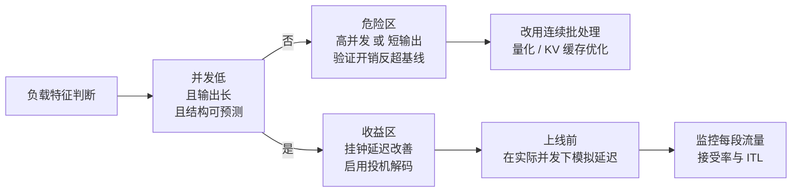
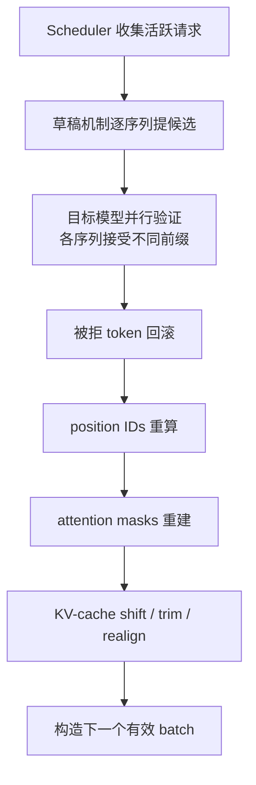

> **投机解码系列 · 第 05 篇**
>
> 本系列把投机解码从「一个加速技巧」拆成可核验的几层：收益模型（02）→ 草稿从哪来（03）→
> 引擎支持矩阵（04）→ 生产陷阱（本文）→ 业界实践 → 评测数字怎么读 → 未来方向。
> 它挂在[推理引擎主线](/2026/10/18/serving-01-architecture-divergence/)之下——
> 投机解码是推理引擎的一个子系统，脱离引擎谈它没有意义。
>
> - 01 综述与演化 → 02 收益模型 → 03 EAGLE 家族 → 04 引擎支持矩阵 →
>   **05 生产部署陷阱（本文）** → 06 业界实践 → 07 评测数字怎么读 → 08 未来方向

**TL;DR**

> * **第 02 篇的加速比是上界，不是承诺**。实验室里 2–3× 的数字，落到生产负载上常被吃掉一大半；第三方生产工程博文报告实际只剩约 **40–60%** 的净收益（据 Tian Pan 生产部署博文，单源观察，待第三方复现）。
> * **落差来自工作负载本身的迁移**：更大的并发、更短的输出、更严的输出约束——这三条每一条都在侵蚀第 02 篇闭式里的 $$\alpha$$、$$\gamma$$、$$c$$。
> * **三个会悄悄出错的陷阱**：① 结构化输出被损坏（拒绝采样与 grammar 掩码没有在同一步被一致地施加）② 参差张量错位（ragged tensor misalignment，batch 内各序列接受长度不同导致 position / mask / KV 错位）③ MoE 路由崩溃（草稿与目标把同一 token 路由到不同专家，接受率数学失效）。
> * **两个隐性成本**：草稿模型带来可观的额外显存/内存占用与双模型运维负担；以及「不能只看 tokens/s」的评估盲区——ITL、TTFT、KV-cache 碎片、状态同步开销才是生产真正该盯的。
> * **验收铁律**：先证明 *正确*（bs>1 输出等价 + 完整状态同步链），再证明 *更快*（综合 ITL / TTFT / 吞吐 / 缓存碎片 / 对齐开销）。

---

## 0. 符号约定

本篇承接第 02 篇与第 03 篇的记号：用 $$p$$ 指目标模型、$$q$$ 指草稿模型（与 vLLM / SGLang 代码及 Leviathan et al. 一致 [6](https://arxiv.org/abs/2211.17192)）。第 02 篇已给出收益模型

$$
S(\alpha, \gamma, c) = \frac{1 - \alpha^{\gamma+1}}{(1 - \alpha)(1 + \gamma c)}, \qquad
\lim_{\gamma\to\infty} S = \frac{1}{1 - \alpha}
$$

其中 $$\alpha$$ 是单步接受率、$$\gamma$$ 是草稿长度、$$c$$ 是草稿单步成本与目标单步成本之比。本篇新增的记号如下：

| 符号 | 含义 |
|:---|:---|
| $$M \subseteq V$$ | grammar / 约束生成下「当前位置合法」的 token 集合（valid-next set） |
| $$p_M$$、$$q_M$$ | 把分布截断到 $$M$$ 后的目标分布与草稿分布（$$\cdot_M(x)=\frac{\cdot(x)}{Z_M}\mathbf{1}[x\in M]$$） |
| $$B$$ | 并发请求数 / 批量大小 |
| $$\kappa(B)$$ | ragged tensor 对齐开销因子，随 $$B$$ 超线性增长 |
| $$a$$ | 每轮验证平均接受的草稿 token 数（acceptance length），$$a=\mathbb{E}[X]$$ |
| $$r$$ | MoE 路由函数，把 token 映射到专家子集 |

所有加速比数字若未另注，均来自第三方生产工程博文（Tian Pan 系列、AGI Explorer 的 batch 投机解码分析）或各论文自报；单源生产观察标注「待验证」，论文自报标注「引论文数字」。本篇**不跑任何 draft-verify 实验**，结论来自机制推导、引擎文档与已发表数字的交叉比对。

---

## 1. 站在哪里：从「收益上界」到「上界怎么被吃掉」

第 02 篇把加速比拆成三个变量的函数，并证明了一条硬天花板：无论草稿多长、多便宜，加速比都过不去 $$1/(1-\alpha)$$。那篇文章的任务是「给定一组 $$\alpha,\gamma,c$$，收益上界是多少」。本文的任务是它的反面：**当工作负载从实验室切到生产，这三个数各自怎么变，以及有哪些因素让「收益上界」根本不成立**。

把第 02 篇闭式里的三个变量逐一对照生产现实：

| 变量 | 实验室默认 | 生产现实 | 对加速比的作用 |
|:---|:---|:---|:---|
| $$\alpha$$（接受率） | 长输出、可预测文本、低温度，$$\alpha\approx 0.8$$ | 短输出、结构化约束、高温度创意，$$\alpha$$ 大幅下探 | 分母 $$1-\alpha$$ 变大，天花板塌缩 |
| $$\gamma$$（草稿长度） | 取较大 $$K$$（5–7） | 短输出里根本没那么多 token 可押；约束路径下 $$\gamma$$ 被迫缩小 | 分子中 $$1-\alpha^{\gamma+1}$$ 离 1 更远 |
| $$c$$（成本比） | 草稿远小于目标，$$c\ll 1$$ | 双模型驻留、状态同步、对齐开销，有效 $$c$$ 被隐性抬高 | 分母 $$1+\gamma c$$ 变大 |

一句话：**第 02 篇给的是「最优条件下的上界」，而生产恰好不在这组条件下**。本文的脊柱是两条线：其一是「三个会悄悄出错的陷阱」（第 5–7 节），它们破坏的是第 02 篇那道正确性门，使分布一致性静默失效；其二是「两个隐性成本」（第 8–9 节），它们不让你输出错，却把净收益偷偷吃掉。前者是 bug，后者是账——两者共同把实验室的上界推落成生产的 40–60%。

本文余下的 9 节，就是把这个「偏离」拆成可核验的几类：第 2–3 节讲机制与指标层面的落差，第 4 节讲部署前置条件，第 5–7 节讲三个会「悄悄出错」的陷阱，第 8–9 节讲两个隐性成本，第 10 节给决策清单并收束到系列主线。

### 1.1 一个量级的直觉：上界如何被吃成 40–60%

把第 02 篇的闭式代入一组对照数字，可以直接看到「上界读数」与「生产净收益」之间的数量级差（数字为机制演示，非实测）：

- 实验室基准：$$\alpha=0.8$$、$$\gamma=5$$、$$c=0.1$$。
  $$S = \frac{1-0.8^{6}}{(1-0.8)(1+5\times 0.1)} = \frac{1-0.262}{0.2\times 1.5} \approx \frac{0.738}{0.3} \approx 2.46$$。
- 生产现实：$$\alpha$$ 因结构化约束掉到 $$0.6$$、$$\gamma$$ 因短输出缩到 $$3$$、有效 $$c$$ 因双模型与对齐升到 $$0.25$$。
  $$S = \frac{1-0.6^{4}}{(1-0.6)(1+3\times 0.25)} = \frac{1-0.130}{0.4\times 1.75} \approx \frac{0.870}{0.7} \approx 1.24$$。

从 2.46 掉到 1.24，净收益约为实验室的 **50%**——恰好落在第三方博文报告的 40–60% 区间（单源观察，待验证）。注意这里没有引入任何「看不见的错误」：仅仅是 $$\alpha,\gamma,c$$ 三个数按生产现实移动，上界本身就塌了一半。第 5–7 节讲的三个陷阱，则是让「上界」连这个塌掉后的数都达不到的额外破坏力——它们直接破坏正确性，而不是只压低变量。

> **读法提醒**：本文的「40–60%」不是某个模型的实测加速比，而是第三方生产工程博文对「净收益相对实验室数字被吃掉多少」的概括性观察（Tian Pan，2026）。它应当被读成「量级警告」而非「可复现基准」。真要落地，请见第 10 节的验收铁律与第 06 篇（业界实践）的具体数字。

---

## 2. 机制回顾：为什么「验证整段 ≈ 验证一个」

草稿模型一次提出 $$K$$ 个候选 token（典型 $$K=5\sim 7$$），目标模型在**单次前向**里并行验证整条候选链。验证逐位进行：若草稿 token $$i$$ 与目标模型本应选的一致就接受并继续；在首次不匹配处 $$j$$，目标模型给出位置 $$j$$ 的正确 token，草稿循环重启。任何被接受的前缀——哪怕只是部分前缀——都比逐 token 顺序生成便宜。

### 2.1 访存受限是机制成立的命门

这个机制成立的前提是**逐 token 自回归生成受「每步都要把权重从内存搬进计算单元」主导**。生成单个 token 的成本几乎全部花在把模型参数从存储层取出来这一次搬运上，而「处理 $$K$$ 个 token 的一次前向」相对「处理 1 个 token 的一次前向」只多了计算量、没多几次权重搬运——当搬运是主导成本时，验证 $$K$$ 个 token 的成本就近似等于验证 1 个。这是投机解码能在「访存受限」区间起效的根本原因，也是一个与具体硬件无关的定性判据：只要「单次前向的搬运成本 $$ \gg $$ 单步追加计算成本」，批量验证就近似免费。

设单次前向需把权重 $$W$$ 从存储层搬出一次、耗时 $$t_{\mathrm{load}}$$；处理 $$K$$ 个 token 的计算耗时为 $$t_{\mathrm{compute}}(K)$$。当 $$t_{\mathrm{load}} \gg t_{\mathrm{compute}}(K)$$ 时，验证 $$K$$ 个 token 与验证 1 个的成本差约为 $$t_{\mathrm{compute}}(K)$$，可忽略——这就是「免费验证」的定量写法。注意 $$t_{\mathrm{load}}$$ 只取决于「权重总量 ÷ 存储带宽」这一比值，不绑定任何具体实现。

这个判据之所以与硬件无关，是因为它刻画的是**算术强度**（arithmetic intensity）：自回归每生成一个 token，要做的乘加运算量固定，而要搬的权重固定；当系统处于「搬运比算贵」这一端时，多算 $$K$$ 个 token 几乎不增加主导成本。一旦并发 $$B$$ 把每步的算术量推高到「算」也开始主导，免费的前提就消失——这正是第 3 节指标分歧的底层机制。

### 2.2 拒绝采样循环长什么样

把单序列、无约束的验证写成显式循环（伪代码，非实验）：

```text
验证循环（单序列，无约束）：
  for i in 0 .. K-1:
      x      = draft[i]                  # 草稿第 i 位
      u      = uniform(0, 1)
      if u <= p(x) / q(x):               # 接受概率 = min(1, p/q)
          emit x; accept_count += 1
      else:                              # 拒绝
          x_star = sample(p)             # 从目标分布重抽
          emit x_star; break
```

这个循环的无偏性来自两点：**接受概率正比于 $$p(x)/q(x)$$**，且**拒绝后从 $$p$$ 重抽**。二者合起来，边际分布恰好是 $$p$$。第 5 节的全部陷阱，都可以归结为「这个循环在生产现实里被悄悄改坏，而改坏后没有报错」。

### 2.3 预期接受长度

沿用第 02 篇的记号，单轮验证预期接受的草稿 token 数为

$$
\mathbb{E}[X] = \frac{1-\alpha^{\gamma+1}}{1-\alpha}
$$

当 $$\alpha=0.8$$、$$\gamma=5$$ 时，每轮平均接受约 $$4.5$$ 个 token——昂贵的「逐 token 前向」次数被摊薄约 4.5 倍。

**正确性保证约束的是「离开推理引擎的字节」**：数学上可证，最终 token 序列与目标模型单独生成的结果**分布完全一致**（无偏性，见第 02 篇与 [《PyTorch 采样实现深读》](/2026/09/30/pytorch-sampling-internals/)）。但这个保证有两个容易被忽略的边界：

1. 它要求验证阶段严格走拒绝采样那道门。一旦把草稿分布 $$q$$ 与约束 / 路由 / 对齐中任意一环耦合错（第 5–7 节），分布一致性就不再成立——而且**不会报错，只会静默地输出分布偏移的结果**。
2. 它约束的是「最终定稿的字节」，不是「用户屏幕上先出现又被撤回的字节」。流式协议下被撤回的 token 会带来额外的、与正确性无关的体验成本（第 9 节，完整讨论见第 08 篇）。

把这两点记住，下面三节讲的陷阱就都是「哪一步让那道正确性门失效」的具体形态。

顺着这个框架，三个陷阱可以各自定位到验证循环里的一个具体失效点：结构化输出对应「比值 / 重抽没套同一掩码」，ragged tensor 对应「回滚与重算没跑完状态同步链」，MoE 路由对应「$$q$$ 与 $$p$$ 来自两套不一致的计算路径」。后文每一节都先给出该失效点的精确位置，再给可核验的工程判据——这也是本文「源码级取证」的落脚点：不堆形容词，只把「门在哪、怎么被撬开」说清楚。

---

## 3. 收益为何打折扣：吞吐与挂钟延迟的分歧

### 3.1 已发布数字都测在什么条件上

先摆一组真实存在的生产级吞吐数字，但必须同时摆出它们的测量条件：

| 来源 | 任务 | 观测到的加速 | 测量条件（据来源） |
|:---|:---|:---:|:---|
| vLLM + prompt-lookup（无辅助模型） | CNN/DailyMail 摘要 | **2.8×** | 小批量、长输出、高接受率 |
| TensorRT-LLM | 吞吐量 | 最高 **3.6×** | 特定硬件、指定 batch |
| AWS Trainium | 解码密集负载吞吐 | 最高 **3×** | 指定负载画像 |
| EAGLE-3 草稿 | 相对朴素自回归 | **3.0–6.5×**（引论文数字） | 引论文数字，非生产负载 |

这些数字真实，但**它们都是在 batch size 1–4、长输出、高接受率、低温度的条件下测得的**——正好是投机解码设计发挥的场景。把它们直接外推到生产，就是最常见的失败起点。

接受率 $$\alpha$$ 是核心变量。第三方生产观察给出粗判（单源，待验证）：$$\alpha=0.6$$ 时 5 个投机 token 约得 **2.4×**；$$\alpha=0.8$$ 时约 **3.7×**；$$\alpha$$ 低于约 **0.5** 时，验证开销开始超过收益，速度反慢于基线。更保守的工程经验把「该关掉投机」的阈值放在 **0.55–0.60** 附近。对照第 02 篇天花板 $$1/(1-\alpha)$$：$$\alpha$$ 从 0.8 掉到 0.6，天花板从 5 塌到 2.5，正好是一半。

这些数字之所以「好看」，还因为它们大多测在摘要这类**高 n-gram 重叠、低不确定性**的任务上——正是 $$\alpha$$ 天然高的场景。把同一组数字套到代码补全或开放问答上，接受率会明显更低。所以读任何「加速 ××」的公开数字时，第一反应应是追问它的任务分布与 batch 条件，而不是记下一个裸的倍数。这也是第 07 篇（评测数字怎么读）存在的理由：把数字按可信度分级，而不是按标题里的倍数排序。

### 3.2 指标分歧：吞吐量 ≠ 挂钟延迟

绝大多数投机解码评估报的是 **token 吞吐量**（跨批次每秒生成的 token 数）；用户真正感知的是 **挂钟延迟**（从请求到最后一个 token 的时间）。**这两个指标在并发上升时必然分叉**——因为加速比的分母里那项「验证 $$K$$ 个 token ≈ 验证 1 个」只在「权重搬运主导」时成立。

机制上，随着并发 $$B$$ 增大，单次前向要同时处理 $$B\times K$$ 个投机 token，每请求的算术量上升。当 $$B$$ 小到「搬运仍主导」时，多处理 $$K$$ 个 token 几乎不增加搬运次数，收益在；当 $$B$$ 大到「计算开始主导」时，多处理的 $$K$$ 个 token 是实打实的计算增量，验证的开销被放大，单请求延迟反而可能上升。第三方生产观察把这条曲线粗分为（单源，待验证）：

| 并发 / 批量区间 | 主导瓶颈 | 投机解码表现（第三方观察，待验证） |
|:---|:---|:---|
| $$B \lesssim 10$$ | 访存受限（权重搬运主导） | **2–3×**，最佳区间 |
| $$10 \lesssim B \lesssim 30$$ | 过渡 | 收益递减，通常 **1.3–1.8×** |
| $$B \gtrsim 32$$ | 计算受限 | **通常比标准解码更慢** |

### 3.3 把收益侵蚀写成关于 B 的函数

把第 2.1 节的判据形式化：定义每步「主导成本」在搬运与计算之间的切换由 $$B$$ 决定。当 $$B$$ 小，单次前向的边际成本近似不随 $$K$$ 增长（免费区）；当 $$B$$ 大，每多验证一个草稿 token 都带来真实计算成本，有效成本比从 $$c$$ 抬升到约 $$c + \lambda(B)$$，其中 $$\lambda(B)$$ 随 $$B$$ 单调上升、在越过算术强度拐点后显著。代入第 02 篇闭式：

$$
S_{\mathrm{eff}}(B) = \frac{1 - \alpha^{\gamma+1}}{(1 - \alpha)\bigl(1 + \gamma\,(c + \lambda(B))\bigr)}
$$

这条式子把第 3.2 节的曲线说清楚了：$$\lambda(B)$$ 在 $$B$$ 越过拐点后拉高分母，加速比从「上界附近」一路被压到小于 1。它同时也解释了第 8.1 节的「额外显存挤掉 batch 空间」如何与 $$\lambda(B)$$ 正反馈——可用 $$B$$ 越小，越难待在免费区。MagicDec 对「长上下文下大 batch 收益衰减」给出了更细的拐点结论 [10](https://arxiv.org/abs/2408.11049)，第 07 篇按可信度分级处理这类数字。

### 3.4 并发红绿灯

转折点随模型规模与硬件实现而变，但粗判成立（单源，待验证）：**当并发请求数低于约 4–8 时，投机解码有助于压低挂钟延迟；超过这个数，规模化的验证开销开始抵消收益**。这解释了一种高频失败模式：团队在开发期以 batch 1 测出 2.5×，上线后在 p50 并发 16 的生产流量里观察到约 5% 的回归——技术完全按描述运行，只是工作负载变了。

落到工程上，这条红绿灯可以写成一道发布前检查：先测出本服务在目标并发下的「免费区上界」$$B^*$$（即 $$\lambda(B)$$ 开始抬升的拐点），再把生产 p50 / p99 并发与它比对。若 p99 远高于 $$B^*$$，投机解码对尾部请求实质亏本，应当按流量段分流——交互式低并发走投机、高并发走连续批处理，而不是全量一刀切。



---

## 4. 硬性前置条件与草稿选型

在谈陷阱之前，先把「能正确跑起来」的两条硬约束摆清——它们本身就会淘汰一大批朴素部署。

### 4.1 词汇表一致性：不可妥协的硬约束

**草稿模型必须与目标模型共享完全相同的分词器与词汇表**。这是硬性约束。词汇表不匹配时，草稿提出的 token 在目标词表里的语义错位，接受率会**崩到接近零**，使投机解码比基线更慢，且几乎没有任何显眼告警——只有性能指标悄悄变差。任何目标模型的分词器变更，都意味着**必须重训草稿模型**。同族模型（例如小型号给同族大型号起草）共享 tokenization 与训练分布，接受率显著高于任意同规模但异源的独立小模型，根因就在这条约束上。

工程上可在 CI 里加一道廉价闸门：比对目标与草稿的词表文件（tokenizer.json / vocab 哈希），不一致直接阻断发布。这比「上线后发现接受率崩到零」便宜几个数量级——而后者没有任何告警会主动告诉你「是词表漂移」，只会表现为一条缓慢下滑的吞吐曲线。

### 4.2 草稿选型的反直觉结论

把生产草稿选型的几条经验摆开（据 Tian Pan 系列博文与 EAGLE 论文，部分为单源观察，待验证）：

- **延迟 > 精确度**。大规模基准显示，草稿模型的语言建模准确度（困惑度）与其对端到端吞吐的贡献**几乎不相关**。草稿模型的**延迟**才是更强决定因素——一个稍不精确但快几倍的草稿会胜出，因为验证步骤本来就会捕获错误。这反过来说明：挑草稿时不必追它的建模质量，要追它的「快」。
- **面积建议**：草稿规模应为目标的 **1/10 到 1/50**（单源观察，待验证）。1.5B 草稿配 13B 目标是常见起点；7B 草稿配 70B 目标。最优规模取决于**任务分布**而非参数量本身。
- **领域特异性 > 规模**：现成草稿模型在特定领域或超长上下文上往往掉队。在**自有生产查询分布**上微调草稿，接受率可提升 **20–40%**（单源观察，待验证）；对话 / 指令 / 代码平衡的数据混合，比单纯扩大数据集对草稿质量影响更大。
- **EAGLE 系 > 独立小模型**：专门训练为「基于目标隐藏状态预测」的草稿（EAGLE / EAGLE-2 / EAGLE-3）在相同词表下**始终优于**独立训练的小模型。EAGLE-3 在所有生成位置维持 **70–80%** 的接受率，而朴素草稿因误差累积在更长位置处接受率下降（引论文数字 / 第三方观察）。

把这几条经验收成一句选型口诀：**挑草稿先挑「快」与「同源」，再谈「准」**。同源自家隐藏状态的草稿（EAGLE 系）同时占了「快」（单层头）与「同源」（复用主干），所以生产里公认是首选；独立小模型除非别无选择（没有同族、无法训练草稿头），否则不值得——它既慢又异源，$$\alpha$$ 与运维两头吃亏。这也解释了为什么第 04 篇（引擎支持矩阵）里 EAGLE 系草稿的引擎支持度普遍高于独立小模型：不是巧合，是工程权衡使然。

### 4.3 配对示例与选型代价

把上面几条经验落成一组配对示例（规模比为经验量级，待验证）：

| 目标模型 | 候选草稿 | 词表一致性 | 预期接受率（量级，待验证） | 备注 |
|:---|:---|:---:|:---:|:---|
| 70B 稠密 | 同族 7B | 是 | 高（0.7–0.8） | 经典「小型号给大型号起草」 |
| 70B 稠密 | 异源 7B | **否** | 接近 0 | 词表不匹配，直接崩 |
| Llama 系 | EAGLE-3 头 | 是（复用主干） | 0.7–0.8 | 特征级，延迟低 |
| MoE 目标 | 外部稠密草稿 | 是 | **低** | 路由失配，见第 7 节 |
| DeepSeek-V3（MoE） | 自带 MTP | 是（同源） | 高 | 自投机绕开路由问题 |

这张表同时预告了第 7 节的 MoE 陷阱与第 03 篇的 MTP 自投机路线：外部草稿 + MoE 目标的组合天然风险高，而同源自投机是它的解药。

> **与第 03 篇的衔接**：第 03 篇论证了「草稿分布 $$q$$ 越贴近目标分布 $$p$$，$$\alpha$$ 越高」。这里的选型经验正是那条结论的工程翻版——同族、同隐藏状态、同分布的草稿，本质上就是在把 $$q$$ 往 $$p$$ 上贴。

### 4.4 一个生产趋势：自投机消弭两类硬约束

值得单独点出的工程方向是 **self-drafting（自投机）**：让目标模型自己给自己起草，而不是外接一个独立草稿模型。LayerSkip、Speculative Streaming 等方案利用目标模型浅层或早停机制产出草稿，天然规避了第 4.1 节的**词汇表一致性**约束与第 8.2 节的**双模型运维**负担。它们的代价是草稿质量通常不如专门训练的 EAGLE 系，$$\alpha$$ 上限更低；但在「不想承担草稿模型全生命周期」的部署里，自投机用更低的运维复杂度换更稳的正确性。这一路线与第 7.4 节的「MoE + 自投机」例外同源——都是用「草稿与目标同源」来消除外部耦合。第 06 篇（业界实践）会给出具体的取舍数字。

---

## 5. 陷阱一：结构化输出被损坏——拒绝采样与 grammar 掩码的交互

### 5.1 故障现象

把投机解码与结构化输出约束（**JSON schema、正则文法、知识图谱三元组**等）叠加时，批量验证过程中 token 可能**被悄然丢弃**，约束执行无法正确完成。这是 vLLM 文档中有记载的行为，影响所有把投机解码与约束生成结合的 workflow。缓解手段简单但代价大：**对约束生成路径直接禁用投机解码**。

问题的本质不在「哪个引擎有 bug」，而在「拒绝采样那道正确性门，与 grammar 掩码必须在同一步被一致地施加」这一要求，在批量树验证里极易被破坏。

举个具体的坏例：要求模型输出一个 JSON 对象，草稿在位置 $$j$$ 提出了键名 `"price"`，但 grammar 此刻要求的是冒号 `":"`——`"price"` 不在合法集 $$M$$ 内。若验证器用未截断的 $$q$$ 计算比值，可能出现「比值碰巧 ≥$$u$$ 于是接受 `"price"`」的情况；随后重抽又漏了掩码，续上了一个不合法的 token。最终这条链的输出是 `{ "price" ...` 缺了冒号的一段——单次请求里的小概率事件，在批量里变成「偶尔不合法的响应」，且无法从吞吐指标里被察觉。

### 5.2 拒绝采样本该怎么做

标准拒绝采样（Leviathan et al. [6](https://arxiv.org/abs/2211.17192)）对草稿提出的每个 token $$x$$ 做：抽 $$u\sim\mathrm{Uniform}(0,1)$$，以概率 $$\min\!\big(1,\,p(x)/q(x)\big)$$ 接受；若拒绝于位置 $$j$$，则从目标分布 $$p$$ 重新抽一个 $$x^*$$ 续上。它之所以无偏，是因为「接受概率正比于 $$p(x)/q(x)$$」与「拒绝后从 $$p$$ 重抽」这两条合起来，使边际分布恰好是 $$p$$。

当存在 grammar 约束时，合法 token 被限制在集合 $$M$$ 内。正确的约束拒绝采样必须把**同一个截断**同时施加到目标与草稿上：

$$
p_M(x)=\frac{p(x)}{Z_p}\mathbf{1}[x\in M], \qquad
q_M(x)=\frac{q(x)}{Z_q}\mathbf{1}[x\in M]
$$

接受概率改为 $$\min\!\big(1,\,p_M(x)/q_M(x)\big)$$，拒绝后从 $$p_M$$ 重抽。这样边际仍是 $$p_M$$，既无偏又保证输出落在 $$M$$ 内。

### 5.3 交互失效的两种具体形态

引擎若**只把掩码施加到目标 $$p$$、却用未掩码的 $$q$$ 算比值**，或者**在树验证的 $$K$$ 个位置上没有把掩码一致地贯穿**，就会出现两类偏差：

1. **分布偏差（静默）**。比值变成 $$\min(1,\,p_M(x)/q(x))$$。由于 $$q$$ 未截断，对 $$x\notin M$$ 有 $$p_M(x)=0$$ 直接拒绝（这一侧碰巧没事），但对 $$x\in M$$ 有 $$q_M(x)=q(x)/Z_q \neq q(x)$$，于是比值 $$p_M/q$$ 与正确的 $$p_M/q_M$$ 不相等。整条接受链的边际分布既不是 $$p_M$$ 也不是 $$p$$——一个**无偏保证被悄悄打破却无任何报错**的结果。
2. **约束失效（可见但难定位）**。当拒绝发生、需要从「约束后的目标」重抽时，若重抽用的采样分布没有套用同一套 grammar 掩码，续上的 token 可能越出 $$M$$，最终输出一段不合法的结构（例如 JSON 少一个括号）。在批量执行里，这条坏链混在好链之间，表现为「偶尔出现的不合法响应」，极难回溯到投机解码这一层。

把正确版与错误版的循环并排，差异一眼可见（伪代码，非实验）：

```text
正确版（约束贯穿 p 与 q，重抽也套 M）：
  for i in 0 .. K-1:
      x = draft[i]
      if x not in M:
          x_star = sample(p_M); emit x_star; break
      u = uniform(0, 1)
      if u <= p_M(x) / q_M(x):        # 同一截断
          emit x; accept_count += 1
      else:
          x_star = sample(p_M); emit x_star; break

错误版（只掩 p，q 用未截断；重抽漏 M）：
  for i in 0 .. K-1:
      x = draft[i]
      u = uniform(0, 1)
      if u <= p_M(x) / q(x):          # 比值分母错，且 x not in M 时仍可能误接受
          emit x; accept_count += 1
      else:
          x_star = sample(p)          # 重抽未套 M，可能越界
          emit x_star; break
```

### 5.4 结论与可核验判据

可核验的工程判据：**任何开启结构化输出 + 投机解码的组合，必须能在单元测试里证明「约束后的拒绝采样边际等于 $$p_M$$」**。做不到这一点，就不要在生产开这个组合。退路有两条——要么按 vLLM 文档建议对约束路径禁用投机（牺牲这部分流量的加速），要么切换到「原生支持约束投机」的实现（把掩码作为一等公民贯穿验证全程，而非事后补丁）。在把第 06 篇的业界实践与第 04 篇的引擎支持矩阵对照时，是否「约束生成与投机可共存」应作为选型的一票。

操作上，「对约束路径禁用投机」意味着引擎要能**按请求粒度**识别「本请求是否带 grammar / JSON 约束」并切回标准解码。这要求路由层在调度时就把约束标志透传到采样器，而不是在验证器内部才发现掩码冲突——后者正是多数早期实现踩坑的位置：约束标志只在前向里出现，调度器无从得知，于是验证器在不知情下用未截断的 $$q$$ 算了比值。把约束标志前置到调度层，是规避陷阱一的关键工程动作。

---

## 6. 陷阱二：参差张量错位（ragged tensor misalignment）

### 6.1 故障来源

在批量推理里，同一 batch 内不同序列接受的投机 token 数量**彼此不同**：序列 A 本轮接受 5 个、序列 B 只接受 2 个、序列 C 第 1 位就被拒。于是「下一个要喂给目标模型前向的有效序列集合」长度参差，形成 GPU 并行处理效率很差的**错位张量形状（ragged tensor）**。朴素实现会以不可忽视的概率**静默产出错误输出**；较新的实现（2025 年）修复了对齐，代价是引入降低加速效果的性能惩罚（据 AGI Explorer 的 batch 投机解码分析）。

### 6.2 错位发生在哪几处

症状清单（这些错误在 batch 1 未必暴露，batch>1 后迅速放大，据 AGI Explorer）：

- **position IDs 错位**：接受长度不同的序列被拼进同一张量时，token 被标到错误的位置编号。
- **attention mask 覆盖错误**：某序列的 padding / 前缀边界算错，本该看不见的 token 被看见，或反之。
- **KV-cache 中 token 与位置不匹配**：缓存里存的是哪个位置算错，导致后续注意力读到错误的历史。
- **被拒绝 token 未正确 rollback**：拒绝位置之后的草稿 token 没有被干净丢弃，污染了续写。
- **输出出现重复 token、乱码或分布偏移**：上述任一项的最终表现。

需要强调的是：上述所有症状在 **batch 1** 下几乎不会暴露——单序列时「接受长度」就是它自己的长度，不存在「把不同长度序列拼进同一张量」的问题，position / mask / KV 自然对齐。它们只在生产真实并发（$$B>1$$）后才出现，这也是为什么「开发期 batch 1 验证通过」不足以证明生产正确，必须按第 6.5 节的判据在多个 $$B$$ 上复核。

### 6.3 一次错位是怎么发生的（追踪示例）

设想 batch 内两条序列经过同一轮目标前向验证：

```text
序列 A：草稿 [x1, x2, x3, x4, x5]，目标在 x3 处拒绝 → 接受 [x1, x2]，改 x3*
序列 B：草稿 [y1, y2, y3, y4, y5]，目标在 y1 处拒绝 → 接受 []，改 y1*

朴素拼接下一步输入时若不做对齐：
  A 的有效序列为 [..., x1, x2, x3*]
  B 的有效序列为 [..., y1*]
若把 B 的 y1* 直接堆在 A 的 x3* 之后、且复用同一段 position ID 计数，
  B 的 y1* 会被标成「位置 = A 的长度」，attention 也会把它和 A 的历史混算
  → 两条序列在张量里互相污染，输出即乱码
```

正确实现必须为每条序列独立重算 position ID、独立重建 attention mask、独立对 KV-cache 做 shift / trim / realign，再拼成下一轮 batch。这一步的成本就是第 0 节的 $$\kappa(B)$$。

### 6.4 完整状态同步链

一个接近生产可用的 batch 投机流程，必须在每轮验证后跑完一整条状态同步链：



第 3–7 步是正确性核心。跳过它们的系统可能吞吐很高，但那个吞吐**不再代表有效推理能力**——它只是更快地吐出错误字节。对齐本身要付代价：把 ragged 长度 pad / pack / 重排成规则张量，需要额外的拷贝与重算，这个开销记为第 0 节的 $$\kappa(B)$$，它随 $$B$$ 超线性增长，正是第 3.3 节「高并发收益衰减」的底层机制之一。

现代实现常用的对齐手段有两类，本质都是在「批量收益」与「对齐正确性」之间做取舍。其一是 **variable-length / 逐序列独立前向**，彻底避免把不同长度序列拼进同一张量，代价是失去批量并行的收益；其二是 **paged KV + 统一位置重排**，把 ragged 长度按页对齐到规则块，保留批量但引入额外的拷贝与 mask 重建。$$\kappa(B)$$ 正是这条取舍的代价量化：选第一类，批量收益小、$$\kappa$$ 近乎零但加速比本就有限；选第二类，批量收益大、$$\kappa(B)$$ 随 $$B$$ 爬升，高并发时把加速比重新压回 1 附近。两类都不是免费午餐。

### 6.5 结论与可核验判据

可核验的工程判据：**在 $$B\in\{1,2,4,8,16,32\}$$ 上，分别跑 baseline 与投机解码，断言二者输出逐字节等价（或分布一致）**。任何一档出现不等价，说明状态同步链有缺口，必须先修正确性再谈加速。把这条写进 CI 而不是上线后靠监控发现，是避免 ragged tensor 静默错误的最低成本防线。

---

## 7. 陷阱三：MoE 路由崩溃

### 7.1 故障来源

混合专家（MoE）模型把每个 token 路由到 top-$$k$$ 个专家子网络。投机解码接受率的正确性，依赖「草稿分布 $$q$$ 与目标分布 $$p$$ 在同一前缀下对下一个 token 的预测一致」。当目标模型本身是 MoE 时，token $$x$$ 的隐藏状态取决于**哪些专家处理了它的前缀**；而草稿模型（无论稠密还是另一套路由）把这些 token 路由到了不同的专家，于是 $$q$$ 与 $$p$$ 的分歧不再来自「建模误差」，而来自「路由决策根本不同」。

### 7.2 一次路由失配是怎么破坏接受的（追踪示例）

```text
真实前缀 "...cat sat on the" → 下一 token 应为 "mat"
目标 MoE 路由："mat" 经专家 {E2, E7} 计算，给出高概率
草稿模型（稠密）预测："mat" 但草稿内部表示来自自己的参数，
  其 q("mat") 是在「未走 E2/E7 路径」下算出的分布

验证时目标前向把草稿提出的 "mat" 送入 {E2, E7} 计算 p("mat")，
  而 q("mat") 来自草稿的另一条计算路径
  → p 与 q 的「同一 token」对应着不同的专家上下文
  → 比值 p/q 不再反映真实重叠，接受率数学前提被破坏
```

更糟的是批量验证里：目标模型的路由器可能把 $$K$$ 个草稿 token 送进与「真实续写本该走的专家」不同的专家，于是验证得到的 logits 与贪心 / 真实解码本应得到的 logits 对不上——接受率那套数学的前提（$$q$$ 是 $$p$$ 的一个可比对版本）被破坏。结果是 **MoE 架构上的投机解码经常比基线还慢**。

路由失配对接受率的破坏还随**生成深度**放大：前几位 token 的路由差异可能被后续注意力稀释，但越靠后，草稿与目标走的专家路径分歧越大，$$q$$ 与 $$p$$ 的重叠被结构性拉低。这正是外部草稿配 MoE 目标时「接受率随位置衰减」的底层原因，与第 03 篇指出的稠密草稿「误差累积」是两种不同机制——前者是路由路径错配，后者是特征预测误差累积。两者叠加时，MoE 目标 + 外部稠密草稿的组合会同时吃亏，接受率塌得最狠。

### 7.3 可核验判据

可核验的工程判据：**在把 MoE 模型接入投机解码之前，先在代表性生产流量上实测接受率**。若接受率掉到约 0.5 以下，按第 3.1 节的阈值它已经亏本，不应上线。不要凭「MoE 也能投机」的传闻默认开启——路由一致性不是默认成立的。

### 7.4 例外：自投机绕开了路由一致性

注意一个关键例外。第 03 篇讲的 **DeepSeek-V3 MTP** 是「基于特征的自投机」，其 MTP 模块与主干**联合训练、共享同一套路由**——草稿与目标来自同一个模型、走同一套专家路由，根本不存在「两个模型把同一 token 路由到不同专家」的问题。同理，LayerSkip、Speculative Streaming 这类**自投机（self-drafting）**方案也绕开了外部草稿模型的路由一致性约束。所以「MoE + 投机必崩」是一个过度概括：**崩的是「外部草稿模型 + MoE 目标」这一组合，自投机路线在 MoE 上反而可能是更稳的选择**。这一点在选型时一票否决外部草稿、保留自投机，是生产里的常见取舍（具体引擎支持见第 04 篇）。

实操上给一条可落地的建议：在 MoE 目标上，优先评估自投机（MTP / LayerSkip 一类同源方案）；若业务必须用外部草稿，先按第 7.3 节的判据在代表性流量上实测接受率，并准备一套「接受率掉到阈值下时自动回退标准解码」的开关——让路由失配从「静默变慢」变成「可观测、可降级」的事件，而不是在生产流量里悄悄吃掉延迟。

---

## 8. 隐性成本一：内存与运维

前两节讲的是「正确性」层面的隐性成本。还有一类「资源」层面的隐性成本，它们不让你输出错，但会悄悄把净收益吃掉。

### 8.1 额外显存 / 内存占用

草稿模型权重带来可观的额外驻留占用（第三方生产经验给出约 **10–20 GB** 量级，随草稿规模与并行度变化，单源观察，待验证）。这还不是全部——草稿与目标模型各自维护独立的 KV 状态，二者必须在请求的生命周期内保持同步，KV-cache 的管理复杂度显著上升。对本来就已显存紧张的部署，这部分占用可能直接挤掉本可用于更大 batch 的空间，反而把第 3.3 节那条「高并发收益衰减」曲线推得更早到来。

把这部分占用拆开看（量级为第三方观察，待验证）：

| 占用组件 | 量级（待验证） | 说明 |
|:---|:---:|:---|
| 草稿模型权重 | 数十 GB 级（第三方观察 10–20 GB） | 随草稿规模与并行度 |
| 草稿 KV-cache | 与草稿序列总长成正比 | 须与目标 KV 同步 |
| 验证张量 / 对齐缓冲 | 随 $$B$$ 超线性 | 即第 0 节的 $$\kappa(B)$$ |

### 8.2 双模型运维

草稿模型不是「部署一次就忘」。它带来三类运维负担：

- **版本管理**：目标模型的任何分词器变更 / 权重更新，都要求草稿模型同步——要么重训、要么重新校准接受率。两个模型要作为一对来测试与发布。
- **KV-cache 同步**：草稿与目标各自的 KV 状态在拒绝回滚、位置重算时必须一致地更新，否则会退化成第 6 节的 ragged tensor 错位。
- **持续监控**：需要按流量段监控接受率——当新出现的请求分布让 $$\alpha$$ 掉到阈值以下，性能会静默退化，必须有告警把它抓出来。一个实用的告警基线（量级，待验证）是：当某流量段的 $$a$$（acceptance length）连续下降超过约 20%，或掉到 1.5 以下时触发复盘——前者预示请求分布漂移，后者说明该段已接近亏本线（见第 3.1 节阈值）。

> **与第 02 篇的呼应**：第 8.1 节的额外占用本质上是在抬高第 02 篇闭式里的有效 $$c$$——草稿不再「几乎免费」，分母 $$1+\gamma c$$ 变大，加速比被压。第 8.2 节的运维成本则是把「省下的延迟」偷偷换成「多出的工程人力」，在总成本账上未必划算。

---

## 9. 隐性成本二：评估盲区——不能只看 tokens/s

### 9.1 为什么单看吞吐会骗人

第 3.2 节已经点出吞吐量 ≠ 挂钟延迟。但「评估盲区」远不止这一条。批量投机解码至少需要同时盯 **7 类指标**，而非单个 tokens/s（据 AGI Explorer 的 batch 投机解码分析）：

| 类别 | 指标 | 作用 |
|:---|:---|:---|
| 接受质量 | 每轮平均接受草稿 token 数（acceptance length $$a$$） | 接受越多，目标前向次数越少 |
| 草稿成本 | 草稿计算 / 延迟 | 草稿太慢则整体未必变快 |
| 用户体验 | **ITL（inter-token latency）**、TTFT | 交互感核心；投机**无法改善 TTFT** |
| 系统开销 | 对齐开销 $$\kappa(B)$$（随 $$B$$ 超线性增长） | 理解高并发下的收益侵蚀 |
| 缓存健康 | **KV-cache 碎片率**（投机产生大量短候选序列，page 过大造成内部碎片） | 影响实际可用缓存容量 |
| 正确性 | 输出等价性（$$B>1$$ 时分布一致） | 先证正确，再证更快 |

一个反直觉的坑：在流式场景里，**吞吐可能上升、用户感知却变差**。原因是投机把生成切成更密的「小步」——有时连发数个接受的 token、有时卡在一次验证上——ITL 的抖动变大，而用户感知的是「出字是否平滑」而非「总 token 数多少」。所以「吞吐 +X%」与「体验变好」不是一回事，这也是 ITL 与 churn 必须单列、不能被吞吐数字代表的根本原因。评估时若只盯吞吐，很可能上线一个「更快但更卡」的系统还不自知。

之所以要同时盯这 7 类而不是一个吞吐，是因为它们分别卡住「加速比」的不同分母。接受质量与草稿成本决定第 02 篇闭式里的 $$\alpha$$ 与 $$c$$；对齐开销与 KV-cache 碎片决定第 3.3 节的 $$\lambda(B)$$ 与可用 batch；ITL / TTFT 决定用户**实际感知**的加速（第 9.2 节已说明 TTFT 不被改善）；正确性则是前提交代。任何一类漏看，都会让你把「某一项好看」误读成「整体更快」——而生产恰恰是用「整体」在付账。

KV-cache 碎片值得单独解释：投机每轮产生 $$K$$ 条短候选序列（每条往往只续写 1 个 token），分页式 KV-cache 若按固定 page 大小分配，大量只占半页的短序列会留下**内部碎片**，实际可用缓存容量被虚高占用。这部分损失不体现在 tokens/s 里，却是「为什么开了投机后更大 batch 反而 OOM」的常见原因——它把第 3.3 节曲线里「可用 $$B$$ 变小」的机制又补了一刀。

### 9.2 两条最容易被忽视的指标

- **TTFT（首 token 时间）不被投机改善**。投机解码优化的是「生成阶段」的每步成本，对「处理完 prompt 才出第一个 token」这一段没有帮助。若业务痛点是 TTFT，投机解码不是对症药——这是第 10 节「何时不该用」的第一条。
- **用户可见 token 抖动（user-visible token churn）**。即使分布严格无偏，流式协议下被拒绝的后缀必须撤回（「回退到位置 $$N$$」控制帧），客户端文本组件会实时重写。新指标定义为：流向客户端的总 token 数 ÷ 响应最终 token 数。纯逐 token 推送 + 70% 接受率下，这个比值轻松达到 **1.3–1.5**——约三分之一的网络字节在定稿前被回撤。对 TTS 等不可回滚的消费端，这直接决定协议选型（accept-then-flush 还是句边界缓冲）。这是第 08 篇（未来方向与开放问题）的主题，此处只点出其作为「评估盲区」地位：它不体现在任何 tokens/s 数字里，却真实消耗带宽与体验。

把延迟拆开看，更能看清投机解码的边界。一次完成的请求，挂钟时间近似为

$$
T_{\mathrm{wall}} \approx \mathrm{TTFT} + (n-1)\cdot\mathrm{ITL}
$$

其中 $$n$$ 是输出 token 数。投机解码缩短的是 $$\mathrm{ITL}$$ 这一段（每步更便宜），对 $$\mathrm{TTFT}$$ 无能为力。当 $$n$$ 很大时，$$\mathrm{ITL}$$ 项占主导，加速体现在挂钟上；当 $$n$$ 很小（短输出）时，$$\mathrm{TTFT}$$ 占比高，投机解码的挂钟收益被稀释——这正是第 10.2 节「短输出不该用」的量化依据，也解释了为何吞吐数字（只看总 token 数）会高估短输出场景的真实体验收益。

把用户可见抖动形式化：设单轮接受率为 $$\alpha$$、步长为 $$s$$，长回复中「某窗口被拒」的概率接近 1，故被撤回 token 的期望占比约为 $$1-\alpha$$（量级演示，非实测）；总流量与定稿流量之比即 churn，随 $$\alpha$$ 下降而上升。

### 9.3 监控该记什么

落地监控建议记录：accepted token count / rollback count、KV-cache block move / trim 次数、page fragmentation ratio、cache hit rate、attention mask rebuild cost、position ID recompute cost。前两项直接反映第 5–7 节的陷阱是否正在发生；后几项量化第 8.1 节的对齐开销 $$\kappa(B)$$。

把这些指标接到同一块面板上，按流量段（而非全局平均）观察，比「全局吞吐一条曲线」有用得多：全局平均会把「低并发交互流量跑得很快、高并发流量悄悄亏本」相互抵消掉，让你以为系统健康。真正该告警的是**单段退化**——某段 ITL 抬升、某段 rollback 暴涨、某段碎片率破阈值，每一条都对应一个前面讲过的陷阱正在发生，且都早于吞吐曲线的可见变化。

---

## 10. 决策清单与系列收束

### 10.1 何时该用

投机解码在一组特定但重要的条件下才是正确工具（据 Tian Pan 系列博文）：

- [ ] 负载**延迟敏感**且主要**交互式**（批量 1–4）；
- [ ] 输出序列**较长**（$$>500$$ token）——生成越长，投机的数学越有利；
- [ ] 任务**结构可预测**（摘要、代码补全、高 n-gram 重叠的续写）；
- [ ] 跑在**访存受限**的区间，权重搬运而非计算是瓶颈；
- [ ] 能承受维护草稿模型的工程成本。

### 10.2 何时不该用

若以下任一条成立，投机解码很可能不值得投入（据 Tian Pan 系列博文与第 3 节机制）：

- 目标是**最大化批量吞吐**且已用大 batch 饱和——此时它在第 3.3 节曲线里位于「亏本区」；
- 目标是**改善 TTFT**——投机解码对此无效（第 9.2 节）；
- 典型输出 **$$<20$$ token**——没有足够生成量摊销草稿开销；
- **高温度创意生成**——分布难预测，$$\alpha$$ 暴跌；
- **显存 / 内存受限**部署——草稿权重 + KV-cache + 验证张量挤占资源（第 8.1 节）；
- **最小化运维复杂度**是首要目标——双模型同步与监控成本不合算（第 8.2 节）。

对吞吐 / 延迟 / 运维那几个目标，量化、连续批处理、高效 KV-cache 管理通常带来更可靠、更可预测的收益。

这份清单的本质是**过滤器而非打分器**：任何一条命中「不该用」，就足以否决投机解码，不需要前面几条也满足。生产里最常见的误用，是把「延迟敏感」这一条单独成立就当成了「该用」——忽略了「短输出」「高温度」「显存受限」任意一条都能让加速归零甚至转负。正确的读法是先过第 10.2 节的否决项，再谈第 10.1 节的启用条件。

### 10.3 部署验收铁律

> **先证明它是 *正确* 的投机解码（$$B>1$$ 输出等价 + 完整状态同步链，第 6 节），再证明它是 *更快* 的投机解码（ITL / TTFT / 吞吐 / 缓存碎片 / 对齐开销综合评估，第 9 节）。**

伪测试骨架：

```text
for B in [1, 2, 4, 8, 16, 32]:
    baseline(B)  vs  speculative(B)
    assert 输出逐字节等价 或 分布一致
```

正确性不过，加速比毫无意义——因为「更快的错误」比「更慢的正确」危害更大，而且它**不会自己报错**。

### 10.4 收束到系列主线

回到本文开篇的判据：第 02 篇给的是**上界**，本文讲的是**上界怎么被现实吃掉**。把全文的侵蚀源收成一张表，正好对应第 02 篇闭式里的三个变量：

| 侵蚀源 | 吃掉的是 | 对应变量 |
|:---|:---|:---|
| 结构化输出损坏（第 5 节） | 正确性门，分布一致性静默失效 | 让「$$1/(1-\alpha)$$ 上界」根本不成立 |
| 参差张量错位（第 6 节） | 状态同步，高并发静默错误 | 抬高有效 $$c$$、引入 $$\kappa(B)$$ |
| MoE 路由崩溃（第 7 节） | 接受率前提，$$q$$ 与 $$p$$ 失配 | 直接砸低 $$\alpha$$ |
| 内存与运维（第 8 节） | 可用 batch 与工程带宽 | 抬高有效 $$c$$ |
| 评估盲区（第 9 节） | 你看到的加速数字 | 让「看似 2–3×」实为 40–60% |

三个陷阱的危险程度并不相同。结构化输出损坏（第 5 节）最隐蔽：它静默地破坏无偏性，没有任何报错，且只在带约束的请求上偶发，极易被当成「模型偶尔抽风」。ragged tensor 错位（第 6 节）最容易被测出：只要按第 6.5 节在多个 $$B$$ 上做等价断言，它会在高并发档暴露。MoE 路由崩溃（第 7 节）最易预判：上生产前实测一次接受率即可下结论。所以「先修哪条」的优先级其实与「哪条最致命」相反——最该提前写进 CI 的，偏偏是那个不报错的结构化输出陷阱。

实验室的 2–3× 是「三个变量都取最优」时的上界读数；生产的 40–60% 是「工作负载迁移 + 三个陷阱 + 两个隐性成本」叠加后的净收益。两者不矛盾，只是测量平面不同。第 02 篇的闭式是刻度尺，本文量的是那把尺子本身够不着的现实。

把第 02 篇的加速比闭式与本文的侵蚀表并排看，会得到一句对工程师最有用、却最不性感的话：投机解码不是「开了就快」，而是「在正确的负载、正确的引擎、正确的约束处理下才快」。把这句话钉在部署评审的第一行，比任何加速倍数都更能避免生产翻车。第 06 篇（业界实践）会给具体模型与引擎的真实生产数字，第 07 篇（评测数字怎么读）会讲如何把这类数字按其可信度分级，第 08 篇（未来方向与开放问题）会回到流式协议层的 token 抖动这一开放问题。

---

**上一篇**：[投机解码（04）：引擎支持矩阵](/2026/10/18/specdec-04-engine-support-matrix/)

**下一篇**：[投机解码（06）：业界实践](/2026/10/18/specdec-06-industry-practice/)

**站内承接**：收益模型与硬天花板的闭式推导见 [《投机解码（02）：收益模型》](/2026/10/18/specdec-02-acceptance-and-speedup-model/)；草稿从哪来的演化史与 MTP 自投机路线见 [《投机解码（03）：EAGLE 家族》](/2026/10/18/specdec-03-eagle-family/)；各引擎对结构化输出、MoE、自投机的支持差异见 [《投机解码（04）：引擎支持矩阵》](/2026/10/18/specdec-04-engine-support-matrix/)；拒绝采样与输出分布无偏性的实现细节见 [《PyTorch 采样实现深读》](/2026/09/30/pytorch-sampling-internals/)。

## 参考

**系列论文与经典文献**：

1. Leviathan et al.，*Fast Inference from Transformers via Speculative Decoding*（ICML 2023）— [arXiv:2211.17192](https://arxiv.org/abs/2211.17192)
2. Chen et al.，*Accelerating Large Language Model Decoding with Speculative Sampling* — [arXiv:2302.01318](https://arxiv.org/abs/2302.01318)
3. Li et al.，*EAGLE: Speculative Sampling Requires Rethinking Feature Uncertainty*（ICML 2024）— [arXiv:2401.15077](https://arxiv.org/abs/2401.15077)
4. Li et al.，*EAGLE-3: Scaling up Inference Acceleration of Large Language Models via Training-Time Test*（NeurIPS 2025）— [arXiv:2503.01840](https://arxiv.org/abs/2503.01840)
5. DeepSeek-AI，*DeepSeek-V3 Technical Report* — [arXiv:2412.19437](https://arxiv.org/abs/2412.19437)
6. Miao et al.，*SpecInfer: Accelerating Generative LLM Serving with Speculative Inference and Token Tree Verification* — [arXiv:2305.09781](https://arxiv.org/abs/2305.09781)
7. Su et al.，*MagicDec: Breaking the Latency-Throughput Tradeoff of Long Context Generation with Speculative Decoding* — [arXiv:2408.11049](https://arxiv.org/abs/2408.11049)

**生产部署工程博文（第三方观察，非论文实测；部分为单源，标注「待验证」）**：

8. Tian Pan，*投机解码在生产环境中的应用：免费 Token 与隐藏陷阱* — [链接](https://tianpan.co/zh/blog/2026-04-17-speculative-decoding-production-hidden-traps)（检索于 2026-08-30）。本文「40–60% 净收益落差」「batch 区间粗判」「额外显存量级」等生产观察均引自此处，单源，待第三方复现。
9. Tian Pan，*投机解码实战：那顿并非免费的午餐* — [链接](https://tianpan.co/zh/blog/2026-04-12-speculative-decoding-in-practice-the-free-lunch-that-isnt-free)（检索于 2026-08-30）。草稿选型「延迟 > 精确度」「面积 1/10–1/50」「领域微调 +20–40% 接受率」等经验引自此处，单源，待验证。
10. Tian Pan，*投机采样（Speculative Decoding）是一项流式传输协议决策* — [链接](https://tianpan.co/zh/blog/2026-04-27-speculative-decoding-streaming-protocol-decision)（检索于 2026-08-30）。user-visible token churn（用户可见 token 抖动）概念与「约 1/3 网络字节被回撤」引自此处。
11. AGI Explorer，*Batch Speculative Decoding：生产级 LLM 推理加速不能只看吞吐量* — [链接](https://oh-bug.com/zh/posts/batch-speculative-decoding-production-llm-inference/)（2026-06-25，检索于 2026-08-30）。ragged tensor misalignment 症状清单、完整状态同步链、7 类评估指标引自此处。

**引擎文档（约束生成与投机的解耦行为）**：

- vLLM 文档：结构化输出（guided / grammar decoding）与 speculative decoding 并用时的已知限制，建议对约束生成路径禁用投机解码。具体条目以各版本官方文档为准。

> **版本与可信度说明**：第 8–11 条为工程博文，属单源生产经验，文中已逐处标注「待验证」；其作用是给出量级警告与可核验的工程判据，不构成可复现基准。论文自报加速比（EAGLE / EAGLE-3 / DeepSeek-V3 MTP）标注「引论文数字」，与本文核心论点相互独立。所有具体数字请结合第 06 篇的业界实践与第 07 篇的可信度分级一起读。
