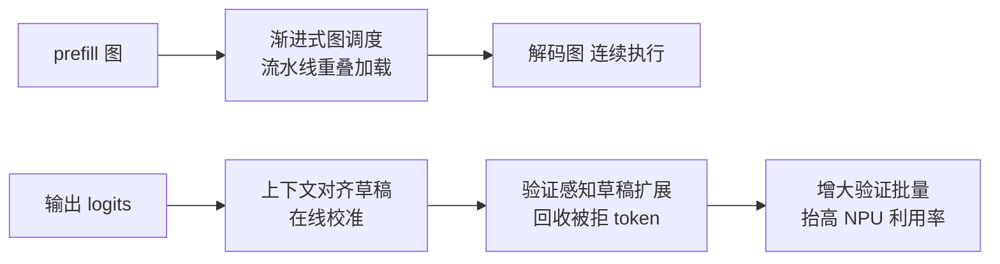
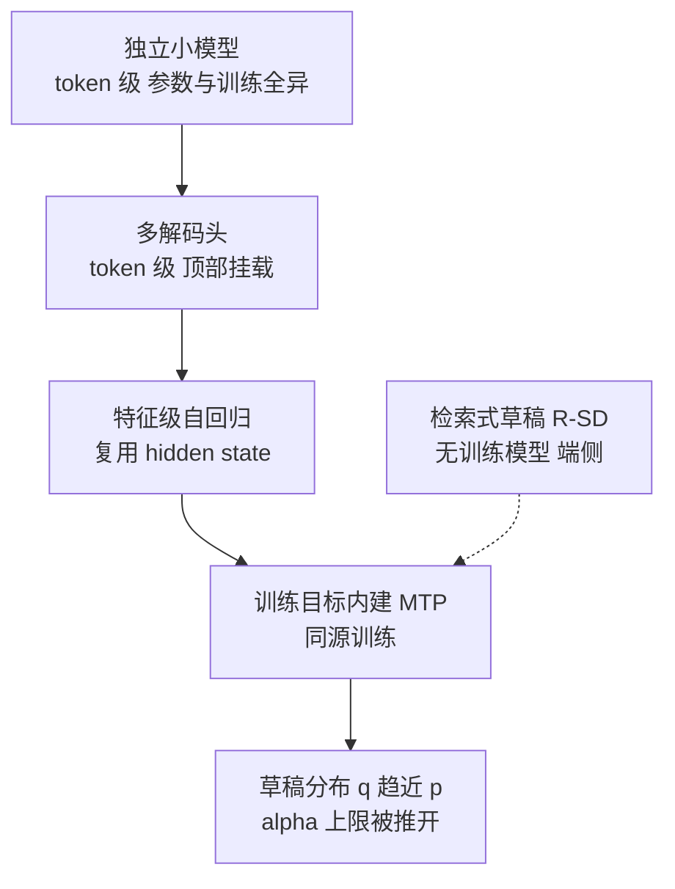
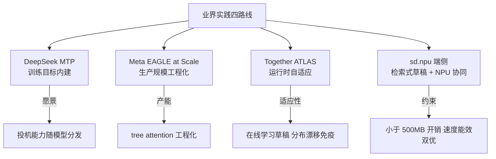
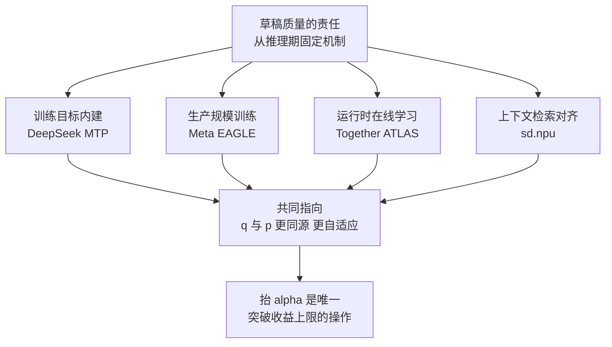

> **投机解码系列 · 第 06 篇**
>
> 本系列把投机解码从「一个加速技巧」拆成可核验的几层：综述演化（01）→ 收益模型（02）→
> 草稿从哪来（03）→ 引擎支持矩阵（04）→ 生产部署陷阱（05）→ **业界实践（本文）** →
> 评测数字怎么读（07）→ 未来方向（08）。
> 它挂在[推理引擎主线](/2026/10/18/serving-01-architecture-divergence/)之下——
> 投机解码是推理引擎的一个子系统，脱离引擎谈它没有意义。
>
> - 01 综述与演化 → 02 收益模型 → 03 EAGLE 家族 → 04 引擎支持矩阵 → 05 生产部署陷阱 →
>   **06 业界实践（本文）** → 07 评测数字怎么读 → 08 未来方向

**TL;DR**

> * **四路业界实践指向同一条收敛线**：DeepSeek 把多 token 预测（MTP）写进预训练目标、Meta 把 EAGLE 推到亿级用户的生产规模、Together AI 用运行时自适应的 ATLAS、端侧 sd.npu 让投机解码跑上手机 NPU。四条路的共性不是「谁的草稿器更快」，而是**草稿质量正从推理期的问题，前移到训练目标与运行时学习**。
> * **DeepSeek-V3 的 MTP 是这条线的终点形态**：草稿分布 $$q$$ 与目标分布 $$p$$ 由同一主干、同一训练目标产生，在构造上同源——这是第 03 篇谱系（独立小模型 → 多解码头 → 特征级 → 训练目标内建）收束到的位置。
> * **Meta 的生产数据推翻了「大 batch 下投机必然失效」的常识**：在同一篇论文里，Llama3.1-8B 的大 batch 加速比反而更高，Llama4 Maverick（约 400B）才随 batch 增大而下降；是否失效取决于模型规模、序列长度与负载，不存在通用法则。
> * **Together ATLAS 把竞争维度推进到「运行时自适应」**：静态 speculator 在请求分布漂移时收益衰减，ATLAS 让草稿器在线持续学习、实时拉长 lookahead，峰值在官方博客自报的 B200 实测下达到 500 TPS（引官方博客，待第三方复现）。
> * **端侧给出「模型式草稿未必最优」的反例**：sd.npu 用检索式草稿 + NPU 协同，在论文自报数据里不仅快于 vanilla，还在小模型上快于 EAGLE，且 EAGLE 在 Qwen2.5-0.5B 上因额外 drafter 计算反而增加能耗——说明「草稿来源」必须按约束挑，而非一味堆模型。

---

## 0. 符号与口径约定

本篇承接第 02、03 篇的记号：用 $$p$$ 指目标模型分布、$$q$$ 指草稿模型分布（与 vLLM / SGLang 代码及 Leviathan et al. 一致）。第 02 篇已给出接受重叠质量

$$
\alpha = \mathbb{E}_{x \sim q}\!\left[\min\!\left(1, \tfrac{p(x)}{q(x)}\right)\right] = 1 - \tfrac{1}{2}\mathrm{TV}(p, q)
$$

以及加速比闭式

$$
S(\alpha, \gamma, c) = \frac{1 - \alpha^{\gamma+1}}{(1 - \alpha)(1 + \gamma c)}, \qquad
\lim_{\gamma \to \infty} S = \frac{1}{1 - \alpha}
$$

其中 $$\gamma$$ 是草稿长度、$$c = t_D/t_T$$ 是草稿单步与目标单步的时间比。第 02 篇已证明：硬天花板 $$1/(1-\alpha)$$ 只由 $$\alpha$$ 决定，**抬 $$\alpha$$ 是唯一能突破上限的操作**；本篇把这条结论拿到工业界去对照，看业界如何把 $$\alpha$$ 的来源从「推理期机制」改到「训练 / 运行时学习」。

本篇新增与复用的记号如下：

| 符号 | 含义 |
|:---|:---|
| $$D$$ | MTP 的预测深度（每位置顺预测后续 $$D$$ 个 token） |
| $$\mathbf{h}_i^{k}$$ | DeepSeek-V3 第 $$k$$ 层 MTP 模块在位置 $$i$$ 的表示 |
| $$\mathcal{L}_{\mathrm{MTP}}$$ | MTP 训练损失（按深度加权平均） |
| $$q'$$ | 检索式草稿（sd.npu）给出的草稿分布，由历史 token 缓存构造，而非训练得到的草稿器 |
| $$\mathrm{TPC}$$ | tokens per compute，单位计算量产出的 token 数（Meta 论文口径） |
| $$\mathrm{TPS}$$ | tokens per second，每秒产出 token 数（Together / 端侧论文口径） |

**数据口径（重要）**：本篇所有加速比、延迟、吞吐、能效数字，均来自对应论文自报或厂商官方博客自报，已在文中逐条标注「引论文数字 / 引官方博客 / 引文档」。本篇**不跑任何 draft-verify 实验，也不复现任何加速比**；正文不出现「实测输出」表格，所有数字均为引用。未标注来源、且无法从公开材料核验的数字一律写作「待验证」。

---

## 1. 为什么看业界实践：核心论点

第 05 篇（生产部署的陷阱）说明了一个冷事实：投机解码从论文到生产，收益会打折，坑不少。但「能不能落地」与「谁在真正部署、怎么部署、拿到了什么数据」是两件事。判断一项技术是否真的成熟，最强信号不是 benchmark 数字，而是**有多少工程力量把它推进到真实负载**。

2025 年的一个关键事实是：投机解码已经不再是研究论文的自留地。四件相互独立的事在同一年发生——

- **DeepSeek** 把投机能力写进预训练目标（MTP），让草稿分布与目标分布同源；
- **Meta** 把 EAGLE 式投机解码推到 Llama 的生产规模，并系统性解决了 tree attention 与多轮投机的工程难题；
- **Together AI** 让 speculator 具备运行时自适应，在请求分布漂移时仍能自我特化；
- **学术团队（北大 / 北邮）** 把投机解码搬上手机 NPU，用检索式草稿绕开「第二个可训练模型」的硬件约束。

这四件事来自完全不同的工程哲学，却共同回答同一个问题：**草稿的质量，到底该由谁来负责？** 本篇的核心论点是——

> **投机能力正从「后装件」变成训练目标的一部分。** 草稿质量不再只是推理期的问题：它要么被写进训练目标（DeepSeek），要么被生产规模地训练与优化（Meta），要么被运行时持续学习（Together），要么被检索与硬件协同地在线构造（sd.npu）。四条路的共同指向，是草稿来源一路向「与目标模型更同源 / 更自适应」收敛。

把这四件事先摊成一张表，便于后文逐条对照：

| 路线 | 这一年发生的事 | 草稿质量的负责人 | 在本篇 |
|:---|:---|:---|:---|
| DeepSeek MTP | 投机能力写进预训练目标 | 训练目标 | §2 |
| Meta EAGLE at Scale | EAGLE 推到亿级用户生产规模 | 生产级训练 + 工程 | §3 |
| Together ATLAS | speculator 运行时自适应 | 运行时在线学习 | §4 |
| sd.npu | 投机解码上手机 NPU | 检索 + NPU 协同 | §5 |

这张表不是「四种加速方案」的并列，而是「草稿质量的责任方」在一年里的四次迁移。后续 §6 会把这四次迁移重新映射回第 03 篇的草稿来源谱系。

这条收敛线，恰好是第 03 篇「草稿从哪来」谱系的工业界回声。第 03 篇把谱系收束到 MTP（训练目标内建），本篇则证明：工业界正分头朝这个终点走，而且不止一条路。

---

## 2. DeepSeek-V3 MTP：把投机能力写进训练目标

### 2.1 思路：让投机成为「免费」的训练副产品

DeepSeek-V3（671B 总参 / 37B 激活的 MoE）在预训练阶段引入 **Multi-Token Prediction（MTP）** 目标：每个位置按深度顺序预测后续 $$D$$ 个 token，保持完整因果链 [1](https://arxiv.org/abs/2412.19437)。MTP 模块的完整数学结构（第 $$k$$ 深度表示、投影矩阵 $$M_k$$、损失 $$\mathcal{L}_{\mathrm{MTP}} = \frac{\lambda}{D}\sum_{k=1}^{D}\mathcal{L}_{\mathrm{MTP}}^{k}$$）已在第 03 篇 §7 详细推导，此处只复述与「训练目标」直接相关的两点。

第 $$k$$ 个 MTP 模块由共享 Embedding、共享输出头、一个 Transformer 块、投影矩阵 $$M_k \in \mathbb{R}^{d\times 2d}$$ 组成，位置 $$i$$ 的表示为

$$
\mathbf{h}_i^{'(k)} = M_k\big[\, \mathrm{RMSNorm}(\mathbf{h}_i^{k-1}) \,;\, \mathrm{Emb}(t_{i+k}) \,\big], \qquad
\mathbf{h}_i^{k} = \mathrm{TRM}(\mathbf{h}_i^{'(k)}) \xrightarrow{\text{共享 OutHead}} p_i^{k}
$$

训练损失按深度加权平均：

$$
\mathcal{L}_{\mathrm{MTP}} = \frac{\lambda}{D}\sum_{k=1}^{D} \mathcal{L}_{\mathrm{MTP}}^{k}, \qquad
\mathcal{L}_{\mathrm{MTP}}^{k} = -\frac{1}{T}\sum_{i=2+k}^{T+1} \log P_i^{k}[\,t_i\,]
$$

### 2.2 双用途设计：训练辅助目标 + 推理投机

MTP 的核心工程贡献是「一个模块，两种用途」[1](https://arxiv.org/abs/2412.19437)：

| 阶段 | MTP 模块的用途 | 备注 |
|:---|:---|:---|
| **训练期** | 辅助训练目标：密集化训练信号、帮助表征预规划，提升主模型在基准上的表现 | 约 14B 额外模块参数参与训练（引论文数字） |
| **推理期** | 可丢弃 MTP 模块使主模型独立工作，也可**复用作投机解码**，进一步降低生成延迟 | 草稿分布与主模型同源，天然共享分词器与词表 |

据报告，DeepSeek-V3 权重约 685B = 主模型 671B + MTP 模块 14B（引论文数字）。这一数字的意义不在大小，而在「投机能力是训练出来的，不是部署时后挂的」。

### 2.3 从论文到生态落地的信号

一个最直接的「内建投机」落地信号：HuggingFace `transformers` 已原生支持 DeepSeek-V3 的 `num_mtp_layers` 配置与 `generate(..., use_mtp=True)` [2](https://huggingface.co/docs/transformers/main/model_doc/deepseek_v3)。这意味着**任意用户在标准库里即可开启投机解码**——不需要自己准备 EAGLE 草稿模型，也不需要处理词汇表对齐问题，因为 MTP 模块与主干天然共享分词器与词表。

> **对生态的启示**
> MTP 方案把投机解码的**后勤成本（draft 训练、词汇表对齐、双模型版本管理）从「部署后」前移到「训练前」**。对开源界而言，凡是带 MTP 训练的模型族（DeepSeek-V3 / R1 系），其后裔模型推出时天然附带投机能力——这正是第 08 篇（未来方向）中「训练-推理协同」范式的第一个量产案例。

这一步把第 03 篇谱系的终点坐实成了可分发的能力：草稿来源从「后装头」收敛到「目标模型自己训练出来的多步预测」，$$q$$ 在构造上逼近 $$p$$，$$\alpha$$ 的天花板 $$1/(1-\alpha)$$ 在理论上可被训练持续推开。

### 2.4 MTP 复用作投机的解码期前提

把 MTP 写进训练目标只是第一步；要让它真正在推理期充当草稿器，引擎侧仍需做三件事 [1](https://arxiv.org/abs/2412.19437)：

| 解码期前提 | 含义 | 与第 02 / 03 篇的对接 |
|:---|:---|:---|
| 复用 MTP 模块作草稿器 | 第 $$k$$ 个 MTP 模块的输出天然是「顺延 $$k$$ 步的草稿」，可直接作为 depth-$$k$$ 候选送验证 | 对应第 03 篇 §7.2：顺序预测天然适配投机验证 |
| 标准拒绝采样接入口 | 验证阶段仍走 $$\min(1, p/q)$$ 拒绝采样，保证输出分布与目标模型一致 | 对应第 02 篇「正确性」那道门，严格无偏 |
| 可丢弃开关 | 不需要投机时丢弃 MTP 模块，主模型独立工作 | 双用途设计的「训练期 / 推理期」解耦 |

这一点把 MTP 与 EAGLE 在机制上连了起来：两者都是「用上一步的草稿状态预测下一步」，只是 MTP 让这一步发生在训练目标里，而 EAGLE 是后装头。差别决定了 MTP 的草稿分布 $$q$$ 在构造上就是主模型分布 $$p$$ 在同一主干上的延伸，无需像 EAGLE 那样再解决词汇表对齐。

### 2.5 MTP 与 Gloeckle 式多 token 预测的产业区分

多 token 预测并非 DeepSeek 首创。Gloeckle et al.（2024）提出并行独立头，每个头独立预测第 $$k$$ 个后续 token，头之间不共享因果链 [7](https://arxiv.org/abs/2404.19737)。DeepSeek-V3 的 MTP 按**深度顺序**预测：第 $$k$$ 层模块的输入依赖第 $$k-1$$ 层模块的输出，保持完整因果链 [1](https://arxiv.org/abs/2412.19437)。

这一区分在产业上有直接后果：顺序预测的第 $$k$$ 个 MTP 模块输出天然就是「顺延 $$k$$ 步的草稿」，可直接送验证；并行独立头缺少层间因果依赖，作为投机草稿时多步一致性更弱。这也是为什么 MTP 能「免费」复用作投机，而并行头方案需要额外的对齐与组装逻辑。

### 2.6 MTP 的可得性约束

MTP 路线有一个前提约束：投机能力取决于目标模型是否原生带该模块。并非所有开源模型都以 MTP 目标训练，因此「训练-推理协同」范式对模型供给侧有要求——它惠及的是 DeepSeek-V3 / R1 及其后裔模型，而非任意存量模型。对存量模型，「后装 EAGLE-3」仍是抬 $$\alpha$$ 的通用解（第 03 篇 §8.2）。这与第 08 篇（未来方向）讨论的「训练-推理协同何时可推广」直接相关。

---

## 3. Meta：把 EAGLE 推到生产规模

### 3.1 论文定位

《Efficient Speculative Decoding for Llama at Scale: Challenges and Solutions》（Meta，2025-08-11）系统阐述了把 **EAGLE 式投机解码**推到生产规模必须解决的工程挑战——尤其是 **tree attention** 与 **multi-round speculative decoding** 的高效实现 [3](https://arxiv.org/abs/2508.08192)。它讨论的硬件环境（论文自报的 8×NVIDIA H100 测量条件）只作为该工作的实验设置出现，本文不展开任何具体硬件特性。

### 3.2 关键数字（引 Meta 论文）

| 指标 | 数值 | 测量条件（论文自报） |
|:---|:---|:---|
| Llama4 Maverick 解码速度 | **约 4 ms/token** | bs=1，8×H100，比此前已知最优方法快 **10%** |
| 相对 vLLM（bs=1） | 解码速度提升 **10–30%** | Llama 各模型 + EAGLE，8×H100 |
| 大 batch 加速比 | **1.4×–2.0×** | EAGLE 投机解码，大 batch |
| MT-Bench TPC（chain-like draft，temp=0，top-p=0.9，投机长度 3） | Llama4-Maverick：**2.75@3**；Llama4-Scout：**2.87@3**；Llama3.3-70B：**2.94@3**；Llama3.1-8B：**2.78@3** | 投机长度 3 |

> 表格解读：$$\mathrm{TPC}$$ 是 tokens per compute（单位计算 token 数）。注意 Meta 用投机长度 3 就追平甚至超过了 EAGLE / EAGLE-3 在投机长度 7 下的表现——**训练侧优化的收益显著**。论文指出，改进后的 EAGLE（投机长度 3）即超过原版 EAGLE 在投机长度 7 的 TPC [3](https://arxiv.org/abs/2508.08192)。这与第 03 篇「抬 $$\alpha$$ 比堆 $$\gamma$$ 更重要」的结论一致：更短的草稿长度、更高的单步接受质量，反而胜过长草稿。

### 3.3 反直觉发现：batch 影响因模型而异

论文挑战了「投机加速比一定随 batch 增大而下降」的流行假设（此前 Su et al. 2023、Miao et al. 2024、Liu et al. 2024 均持此论）。关键洞见 [3](https://arxiv.org/abs/2508.08192)：

- **Llama3.1-8B**：大 batch 下反而获得**更大**的投机加速比；
- **Llama4 Maverick（约 400B 参数）**：加速比**随 batch 增大而下降**；
- **成因（论文表述）**：小 batch 时解码受内存带宽限制，草稿 + 验证的额外 FLOPs 在带宽瓶颈下近似「免费」；大 batch 时解码转 compute-bound，额外计算不再被掩盖。但**长上下文（large context）时，attention 主导计算，即使大 batch 也保持 memory-bound**（Sadhukhan et al., 2025）——因此 batch 与加速比的关系取决于模型规模与序列长度。

| 模型 | 参数规模（论文口径） | batch 增大时的加速比走势 | 主导瓶颈 |
|:---|:---|:---|:---|
| Llama3.1-8B | 8B | 上升 | 小 batch 内存带宽受限 |
| Llama4 Maverick | 约 400B | 下降 | 大 batch 转 compute-bound |
| 长上下文负载 | — | 保持（memory-bound） | attention 主导计算 |

> **与第 05 篇的呼应**
> 第 05 篇的「bs 1–10 收益区 / bs≥32 反超」是**粗粒度经验法则**；Meta 的数据说明**针对你的具体模型（规模、激活架构、典型序列长度）实测 batch-加速比曲线**才是唯一可靠依据——尤其对 100B+ 级参数与长上下文负载，不存在「大 batch 必然失效」的通用结论。

### 3.4 工程要点

- **草稿模型量化几乎无损**：对 draft 的 FFN 做 BF16 / FP8 / INT4 量化，TPC 变化极小（Llama4-Maverick INT4 下 TPC 2.78 vs BF16 2.81），而草稿延迟随量化下降（如 Llama3.3-70B INT4：0.83 ms vs BF16 1.00 ms）[3](https://arxiv.org/abs/2508.08192)。这把第 02 篇的 $$c = t_D/t_T$$ 进一步压低，使更长的 $$\gamma$$ 在天花板下仍可放。
- **与开源库互补**：论文明确表示其优化是 vLLM / SGLang 的**补充**而非替代，可被集成以进一步提升已支持的投机解码方法 [3](https://arxiv.org/abs/2508.08192)。

Meta 一线的位置是「推理侧工程化」：它不重训一个全新的草稿范式，而是把 EAGLE 这条已在第 03 篇谱系里的路线，在生产规模上做扎实。其贡献在于证明——**草稿来源即便仍是后装的 EAGLE，只要训练与工程足够到位，$$\alpha$$ 的提升可以靠「更短的草稿长度 + 更好的训练」拿到，不必靠堆 $$\gamma$$**。

### 3.5 tree attention 与多轮投机：生产落地的两个工程支点

Meta 论文把 EAGLE 推到生产规模的关键，不在新算法，而在两个工程支点 [3](https://arxiv.org/abs/2508.08192)：

- **tree attention 的高效实现**。EAGLE-2 的动态草稿树（第 03 篇 §5）要求单次前向并行验证一整棵 token 树，其注意力掩码须保证每个 token 仅见其祖先、不见兄弟分支。Meta 的贡献是把这种掩码在真实生产 batch（多请求、变长、变树形）下高效实现，使树验证的开销不随树规模爆炸。
- **multi-round speculative decoding（多轮投机）**。传统单次投机验证若在某位置被拒，整段剩余作废（第 02 篇 §8：押错一处分支整段作废）。多轮投机在被拒后不回退整段，而是以更小的步长再发起一轮验证，用「多轮小步」摊薄单次长草稿被拒的浪费。

| 工程支点 | 解决的生产问题 | 对加速比的作用 |
|:---|:---|:---|
| tree attention 高效实现 | 动态树在变长变树形 batch 下的掩码开销 | 让 EAGLE-2 动态树的预算集中优势在生产中可用 |
| 多轮投机 | 长草稿中段被拒导致整段作废 | 把期望接受长度从「单链几何」拉回，逼近第 02 篇树验证上界 |

这两个支点都属于「把第 03 篇已证的动态树优势，落到真实负载」的工程工作，本身不改变 $$\alpha$$ 的上限，但决定了上限在生产线上的可达程度。

### 3.6 草稿量化近乎无损的机制

Meta 报告对 draft FFN 做 BF16 / FP8 / INT4 量化，TPC 几乎不变（Maverick INT4 下 2.78 vs BF16 2.81）[3](https://arxiv.org/abs/2508.08192)。机制上，草稿模型只决定「候选 token 与顺序」，其输出经目标模型**严格验证**——草稿的轻微数值误差只改变候选排序的边界，极少改变「哪个候选最终被接受」。因此量化压低了 $$c = t_D/t_T$$（草稿更便宜）却不显著拉低 $$\alpha$$（接受质量几乎不变），对应第 02 篇 §5.1「特征级单层草稿器」那一档：$$\gamma^*$$ 可在更低 $$c$$ 下放大，而天花板 $$1/(1-\alpha)$$ 几乎不受损。

---

## 4. Together AI：运行时自适应的 ATLAS

### 4.1 问题：静态 speculator 跟不上工作负载

Together AI 指出标准 speculator 的固有缺陷：**为通用工作负载训练，一旦线上请求分布漂移，收益就衰减**。其解法是 **ATLAS（AdapTive-LeArning Speculator System）**——号称首款「无手工调参、运行时自动变好」的 speculator 系统，叠加在 Together Turbo 已有的 MoreSpeed 系（Turbo Speculator、Custom Speculators）之上 [4](https://www.together.ai/blog/adaptive-learning-speculator-system-atlas)。

这里的「自适应」指：speculator 不再是一个训好就固定的工件，而是一个在推理期持续观察请求分布、并据以调整自身草稿策略的在线系统。

### 4.2 关键数字（引 Together 官方博客，B200 实测）

| 模型 | 完全自适应后 TPS | 对比（官方博客自报） |
|:---|:---|:---|
| DeepSeek-V3.1 | **最高 500 TPS** | 相对标准解码 **2.65×**（bs=1，4×B200，TP=4）；相对 FP8 基线 105 TPS 约 **4×（400%）** |
| Kimi-K2-0905 | **最高 460 TPS** | 相对标准解码 2.65×（TP=8） |

- **Kimi 案例**：Kimi 发布时不带现成 speculator，Together 的训练流水线快速训练并部署后，将 Kimi 从开箱约 **150 TPS** 提升到 **270+ TPS**（同硬件同 batch），且保持目标模型质量不变 [4](https://www.together.ai/blog/adaptive-learning-speculator-system-atlas)。
- **自适应机制**：控制器实时观察请求分布——当输入分布窄、输出高度重复历史 token 时，系统快速特化并**拉长 lookahead**，超越静态 / 一次性 custom speculator 能维持的 TPS。峰值效率场景下 DeepSeek 达 500 TPS（Arena-Hard 流量完全自适应）[4](https://www.together.ai/blog/adaptive-learning-speculator-system-atlas)。
- **叠加效应**：Together Turbo 优化套件按层叠加——FP4 / FP8 量化约 +80% → 静态 Turbo Speculator 再 +80–100% → 自适应系统继续叠加，形成最高 400% 的累计提升 [5](https://venturebeat.com/data/together-ais-atlas-adaptive-speculator-delivers-400-inference-speedup-by)。

> **数字口径提示**
> 上述 TPS 与倍率均来自 Together 官方博客与 VentureBeat 报道，属**厂商自报**，标注「引官方博客」。B200 仅作为该博客自报的测量设备出现，本文不展开任何具体硬件特性。这些数字代表厂商在其特定负载与配置下观测到的上限，是否可第三方复现、在其他模型上是否成立，本篇标注为「待验证」。

### 4.3 对选型的启示

ATLAS 证明了一件事：**「动态学习」正在成为 speculator 的下一个竞争维度**。静态草稿（即使是定制训练的）在请求分布漂移面前会衰减；把 speculator 训练变成**持续的在线过程**，是服务商级方案与自建方案的分水岭。这恰好呼应本篇核心论点——草稿质量不再只是「训一个草稿器然后部署」的推理期问题，而是**在运行时持续学习**的问题。它也为第 08 篇（未来方向）的「自适应 / 在线 speculator」方向提供了首个量产参考。

### 4.4 自适应控制器的观察量与动作空间

ATLAS 的「自适应」具体落在控制器的两个量上（引官方博客）[4](https://www.together.ai/blog/adaptive-learning-speculator-system-atlas)：

- **观察量**：实时统计当前请求分布的「宽度」与输出 token 的「重复度」。当输入分布窄、输出高度重复历史 token 时，草稿的可预测性高。
- **动作**：据此动态**拉长 lookahead**（增大草稿长度 $$\gamma$$）或切换特化的 speculator 权重，使草稿分布始终贴合当前流量。

这意味着 ATLAS 把第 02 篇闭式里的 $$\gamma$$ 与 $$q$$ 同时变成了运行时变量：不仅草稿长度随负载调，草稿器本身也在随分布漂移而再训练。它对应的正是本篇核心论点中「草稿质量前移到运行时学习」那一段——静态 speculator 在分布漂移前 decay，ATLAS 用在线学习把 decay 抵消。其代价是控制器自身的开销与可能的质量回退风险（第 09 篇边界讨论已标注「待验证」）。

### 4.5 ATLAS 的生态位置

ATLAS 是叠加在 Together Turbo 既有 MoreSpeed 系（Turbo Speculator、Custom Speculators）之上的运行时层，而非替代底座量化或静态 speculator [4](https://www.together.ai/blog/adaptive-learning-speculator-system-atlas)。它的累计 400% 来自「量化 + 静态 speculator + 自适应」多层叠加，因此解读其数字时须区分「各层各自贡献」与「叠加上限」——这也提醒选型者：自适应 speculator 是已有加速栈的增量，不是从零起步的替代。

---

## 5. 端侧 sd.npu：检索式草稿与 NPU 协同

### 5.1 场景与核心矛盾

移动端上下文增强生成（CAG / RAG）——语音助手、UI agent、本地文档问答——是隐私敏感场景的刚需。sd.npu 论文（北大 / 北邮，arXiv:2510.15312）报告：其**解码阶段占总延迟 67–74%**（OnePlus 13 实测，summary 基准）[6](https://arxiv.org/abs/2510.15312)。移动 NPU（论文所面向的端侧加速器，仅作为该工作的目标设备出现，本文不展开其微架构）已大幅加速 prefill，但 token-by-token 解码仍受两个硬约束掣肘：**NPU 计算图切换开销**（prefill 图 ↔ 解码图的静态图约束）与**解码期 memory-bound 导致的 NPU 利用率低下**。

### 5.2 sd.npu 的三个协同组件

sd.npu（运行于开源移动推理框架 mllm 之上）用**检索式投机解码（R-SD）**而非模型式草稿 [6](https://arxiv.org/abs/2510.15312)：

| 组件 | 作用（算法层面，论文自报） |
|:---|:---|
| **渐进式计算图调度** | chunked prefill 与解码图加载**流水线重叠**，掩蔽 prefill→decode 图切换开销，保证执行连续 |
| **上下文对齐草稿**（context-aligned drafting） | 基于输出 logits 做**轻量在线校准**，增强草稿与当前任务的分布对齐，提升投机效率 |
| **硬件高效草稿扩展** | 验证感知的草稿扩展：约 **38.5%** 的被拒 token 在后续解码步骤中会变为有效，据此回收被拒草稿中可复用片段并追加到新草稿，增大验证批量、推高 NPU 利用率 |

值得强调的是：这三个组件都是**算法 / 调度**层面的贡献，不依赖对具体硬件特性的了解——这正是端侧路线与数据中心路线的分野。

逐个组件看其机制：

- **渐进式计算图调度**针对的是「prefill 图 ↔ 解码图」的静态图约束。移动 NPU 通常以整张计算图为单位调度，图切换本身有固定开销；该组件把 chunked prefill 与下一步解码图的加载**流水线重叠**，使切换开销被后续计算掩蔽，执行链不再因图边界而停顿。
- **上下文对齐草稿**针对的是「通用草稿器与当前任务分布脱节」。它基于上一步输出 logits 做**轻量在线校准**，把检索出的候选向当前任务的真实分布偏移，等价于在推理期动态修正 $$q'$$ 与 $$p$$ 的偏差，从而抬升接受率。
- **硬件高效草稿扩展**针对的是「被拒 token 的浪费」。论文报告约 **38.5%** 的被拒 token 在后续解码步骤中会变为有效——这些 token 并非全错，只是时序上早了一步；回收其可复用片段追加到新草稿，等于增大了单次验证批量，把更多计算压进同一前向，抬高 NPU 利用率。

### 5.3 数据与对比（引 arXiv 论文）

| 指标 | 数值（论文自报） |
|:---|:---|
| 端到端加速 | **1.06–3.81×**（相对 vanilla 框架；相对已集成 SD 的框架 1.09–2.53×） |
| 解码阶段加速 | **5.25–8.15×**（解码延迟单独核算） |
| 能效 | **1.07–4.71×** 能耗下降（相对 NPU vanilla 1.35–4.18×） |
| 内存开销 | **< 500 MB**（测试设备：Redmi K60 Pro / Redmi K70 Pro / OnePlus 13；模型：Qwen2.5-0.5B / 1.5B、Llama3.2-3B） |

**有意思的对比**：在移动端，sd.npu 优于 SAM（1.11–2.53×）与 **EAGLE（1.09–1.80×）**，且 EAGLE 在 Qwen2.5-0.5B 上**反而增加能耗**（额外的 drafter 计算放大能量开销，EAGLE 需 0.84–1.22 GB 额外内存）[6](https://arxiv.org/abs/2510.15312)。缩放规律：模型越小（memory-bound 越明显）收益越大（如 0.5B / 1.5B 显著优于 3B）；上下文相似度高的任务（摘要 1.41–3.80×）优于多样化问答。

> **数据中心 vs 端侧的架构分水岭**
> 云端方案（EAGLE / MTP / 独立 draft）依赖「第二个可训练模型」并付出额外显存 / 内存；端侧受内存与算力上限约束，**检索式 / NPU 原生草稿成为更优解**——这与第 02 篇「草稿成本必须打进加速比」的框架完全一致，只是约束更硬。sd.npu 用检索式 $$q'$$（由历史 token 缓存构造）替代训练出的 $$q$$，在「无额外模型、无词汇表问题、能效更优」三个维度上同时占优。

### 5.4 为何小模型收益更大：memory-bound 视角的定性解释

sd.npu 报告「模型越小、收益越大」（0.5B / 1.5B 显著优于 3B），可用第 02 篇的 $$c = t_D/t_T$$ 做定性解释：小模型解码高度受内存带宽限制（memory-bound），单步目标前向的耗时主要来自权重搬运而非计算；此时草稿 + 验证的额外 FLOPs 在带宽瓶颈下近似「免费」，于是压低 $$c$$ 的检索式草稿能显著抬升加速比。大模型转 compute-bound 后，额外计算不再被掩盖，检索式草稿的相对收益收窄。

| 模型规模（论文口径） | 主导瓶颈 | 检索式草稿收益 |
|:---|:---|:---|
| 0.5B / 1.5B | memory-bound | 大（解码加速 5.25–8.15×） |
| 3B | 趋向 compute-bound | 收窄 |

这一规律与 Meta 在数据中心观察到的「小 batch 内存带宽受限、大 batch compute-bound」是同一物理约束的两端：凡 memory-bound 占优的区间，投机解码（无论模型式还是检索式）都更易拿到收益；凡 compute-bound 占优的区间，额外计算会吃掉收益。它再次说明——**草稿来源的选型必须按目标部署的瓶颈画像决定**，不存在跨规模通用的「最优草稿」。

---

## 6. 四路实践的统一视角：草稿来源谱系

把四路实践放回第 03 篇的「草稿从哪来」谱系，可以清楚看到它们占据的不是四个孤立点，而是同一条收敛线上的四段：

| 世代 / 路线 | 草稿从哪来 | 抬草稿质量的手段 | 在本篇的位置 |
|:---|:---|:---|:---|
| 经典 SD | 独立小模型 | 训练一个异源 $$q$$ | 第 03 篇 |
| Medusa | 多解码头（token 级） | 多解码头并行 + typical acceptance | 第 03 篇 |
| EAGLE / EAGLE-2 / EAGLE-3 | 特征级单层解码器 | 特征空间自回归 / 动态树 / 去容量约束 | 第 03 篇 |
| **DeepSeek MTP** | **训练目标模块** | 让 $$q$$ 与 $$p$$ 同源训练 | 本文 §2 |
| **Meta EAGLE at Scale** | EAGLE（训练优化） | 生产规模训练 + tree attention 工程化 | 本文 §3 |
| **Together ATLAS** | 训练 + 在线自适应 | 运行时持续学习、拉长 lookahead | 本文 §4 |
| **sd.npu** | 检索式草稿（无训练模型） | 上下文对齐 + 被拒 token 回收 | 本文 §5 |

这条谱系的方向性在第 03 篇 §9.1 已收成一个定性定理：设草稿分布 $$q_\theta$$ 由参数 $$\theta$$ 的草稿器给出、目标分布 $$p$$ 固定，则

$$
\alpha(\theta) = 1 - \tfrac{1}{2}\mathrm{TV}(p, q_\theta)
$$

草稿器的演化方向（独立小模型 → 多解码头 → 特征级 → MTP）使 $$q_\theta$$ 与 $$p$$ 的「构造性同源度」单调上升，于是 $$\mathrm{TV}(p, q_\theta)$$ 下降、$$\alpha$$ 上升、天花板 $$1/(1-\alpha)$$ 上升。

本篇四路实践正是这条定理在工业界的四种实例化：

1. **DeepSeek** 把同源度推到最高——$$q$$ 与 $$p$$ 同主干、同训练目标，是定理的终点形态；
2. **Meta** 在「后装 EAGLE」这一格上，用生产级训练把单步接受质量（即 $$\alpha$$ 的代理）做到极短草稿长度即追平长草稿，证明同源度不一定要靠改训练目标，训练与工程到位也能显著抬 $$\alpha$$；
3. **Together** 把同源度的提升从「一次性训练」改成「运行时持续学习」，使 $$q_\theta$$ 随线上分布漂移而始终贴近 $$p$$；
4. **sd.npu** 干脆绕开训练，用检索式 $$q'$$ 在端侧约束下逼近同源效果——它不走「更聪明的模型」，而走「更贴合当前上下文的检索」。

四条路看似分歧（训练目标 / 生产工程 / 在线学习 / 端侧检索），底层却指向同一件事：**草稿质量的责任，正从「推理期部署一个固定机制」前移**。这正是本篇标题的含义。

### 6.1 四路实践与 α 定理的逐项对接

把第 03 篇 §9.1 的定性定理 $$\alpha(\theta) = 1 - \tfrac{1}{2}\mathrm{TV}(p, q_\theta)$$ 与四路实践逐项对接，可见每条路都在「抬同源度 / 压 TV」上做功，只是手段不同：

| 路线 | 对 $$q_\theta$$ 做了什么 | 与 $$p$$ 的同源度变化 | 抬 $$\alpha$$ 的手段 |
|:---|:---|:---|:---|
| DeepSeek MTP | 让 $$q$$ 与 $$p$$ 同主干同目标训练 | 最高（构造性同源） | 训练目标内建 |
| Meta EAGLE at Scale | 生产级训练 + tree attention 工程化 | 后装但训练到位 | 短草稿长度即高单步接受 |
| Together ATLAS | 运行时持续学习，$$q_\theta$$ 随分布漂移 | 在线维持高同源 | 自适应 lookahead |
| sd.npu | 检索式 $$q'$$ 替代训练式 $$q$$ | 上下文对齐（非训练同源） | 在线校准 + 被拒回收 |

这张表把「四路实践」与「第 03 篇谱系」对齐到同一个 $$\alpha$$ 语言下：MTP 是同源度的终点，Meta 在后装格上逼近它，Together 用在线学习维持它，sd.npu 用检索在端侧约束下近似它。

### 6.2 检索式草稿与模型式草稿的本质区别

sd.npu 用检索式 $$q'$$ 而非训练式 $$q$$，这条分叉值得单独点明：

| 维度 | 模型式草稿（EAGLE / MTP） | 检索式草稿（sd.npu R-SD） |
|:---|:---|:---|
| 草稿分布来源 | 训练出的草稿器 / 训练目标模块 | 历史 token 缓存检索 |
| 额外参数 | 有（drafter / MTP 模块） | 无 |
| 词汇表对齐 | 需对齐（EAGLE）或天然无（MTP） | 天然无 |
| 适用约束 | 数据中心、显存充裕 | 端侧、内存算力硬约束 |
| 质量上限 | 由训练同源度决定 | 由上下文重复度决定 |

它不构成「谁更好」的结论，而是说明：当约束是内存 / 算力硬上限时，检索式草稿把第 02 篇的 $$c$$ 压到极低（无训练模型、无额外内存），以「放弃训练同源度、改用上下文对齐」换取端侧可行性。这与本篇核心论点不矛盾——sd.npu 仍把「草稿质量」交给了「与当前上下文的对齐」，只是这个对齐由检索而非训练完成。

---

## 7. 横向对比与选型信号

把四路实践放进同一张对比表，焦点放在「草稿来源」「立场」「代表数字」「关键工程点」上（数字均为对应来源自报，已逐条标注）：

| 维度 | DeepSeek MTP | Meta at Scale | Together ATLAS | sd.npu |
|:---|:---|:---|:---|:---|
| 草稿来源 | 训练目标模块 | EAGLE（训练优化） | 训练 + 在线自适应 | 检索（无训练模型） |
| 立场 | 训练侧内建 | 推理侧工程化 | 服务侧商业化 | 端侧 NPU 原生 |
| 代表数字 | MTP ≈ 14B 模块（引论文） | Maverick ~4ms/token；大 batch 1.4–2.0×（引论文） | 500 / 460 TPS；2.65×（引官方博客） | 3.81× 速度 / 4.71× 能效；< 500MB（引论文） |
| 关键工程点 | 双用途（训练 + 推理） | tree attention、多轮投机、量化草稿 | 请求分布感知、自适应 lookahead | 图切换流水线、在线校准、被拒 token 回收 |
| 词汇表约束 | 天然无（同源） | 需对齐（EAGLE） | 需对齐（speculator 训练） | 无（检索式） |

从选型角度，可抽出四条不冲突的信号：

- **想要「免费内建」的投机能力**：选原生带 MTP 的模型族（DeepSeek-V3 / R1 系），草稿分布与目标同源，无需额外草稿器，且 `transformers` 已原生支持 `use_mtp=True` [2](https://huggingface.co/docs/transformers/main/model_doc/deepseek_v3)。
- **已有 Llama 且要上生产**：Meta 的工作表明 EAGLE 系可在真实规模运行，且草稿量化近乎无损；其优化可作为 vLLM / SGLang 的补充集成 [3](https://arxiv.org/abs/2508.08192)。
- **服务商是动态负载**：ATLAS 类运行时自适应方案能对抗分布漂移，但当前数字来自厂商自报，选型时按自身流量实测为上 [4](https://www.together.ai/blog/adaptive-learning-speculator-system-atlas)。
- **端侧 / 内存算力硬约束**：检索式草稿 + NPU 协同（sd.npu 路线）可能优于模型式草稿，尤其在小模型上；但这依赖具体框架与设备，需按目标机型和模型实测 [6](https://arxiv.org/abs/2510.15312)。

这四条信号的共同前提是第 02 篇的闭式：**草稿来源的取舍，本质上是在 $$c$$（草稿成本比）与 $$\alpha$$（接受重叠）之间做约束下的权衡**。MTP 把 $$c$$ 与 $$\alpha$$ 同时优化（同源、共享权重）；sd.npu 用检索把 $$c$$ 压到极低（无训练模型）以换取端侧可行性；ATLAS 用在线学习把 $$\alpha$$ 维持在分布漂移下不塌。

### 7.1 按约束挑草稿来源：一张速查表

把上面四条信号压成速查表，并标注每类约束下优先验证什么（验证结论来自第 04 / 05 篇，数字来自第 07 篇按可信度分级处理）：

| 约束条件 | 首选草稿来源 | 优先验证项 | 关键风险 |
|:---|:---|:---|:---|
| 自有模型、不介意训练 / 选型 MTP 系 | 训练目标内建（MTP 系） | 引擎是否支持 `use_mtp` 复用 | 可得性受模型供给侧限制（§2.6） |
| 已有 Llama、要上生产 | EAGLE 系 + tree attention | 大 batch 下的 batch-加速比曲线 | 词汇表对齐；非 MTP 同源 |
| 服务级、流量漂移大 | 运行时自适应（ATLAS 类） | 分布漂移下的质量回退 | 数字多为厂商自报，待第三方复现 |
| 端侧 / 内存算力硬约束 | 检索式 + NPU 协同（sd.npu 类） | 目标机型与模型上的真实能效 | 质量上限受上下文重复度制约 |

这张表的排序依据正是本篇主线：越往左，草稿来源越贴近目标模型训练，$$\alpha$$ 上限越高；越往右，约束越硬，越要靠检索 / 协同把 $$c$$ 压下来。它不主张「MTP 永远最好」——MTP 的可得性取决于目标模型是否原生带该模块（§2.6），而 EAGLE-3 是对任意已有模型「后装抬 $$\alpha$$」的通用解。

---

## 8. 核心论点回到主线：从「后装件」到「训练目标」

把第 1–7 节收成一条因果链，正好是第 03 篇谱系在工业界的投影：

1. **token 级头（Medusa）的 $$\alpha$$ 受 token 序列随机性制约** → 想抬 $$\alpha$$ 就得换表示（第 03 篇）。
2. **特征比 token 更规律（EAGLE）** → 在 second-to-top-layer 自回归，$$\alpha$$ 上台阶；但特征是连续量、有路径歧义，要靠 shifted token 消解（第 03 篇）。
3. **接受率上下文相关（EAGLE-2）** → 静态树浪费预算，于是用草稿模型自带的置信度标定出动态树，把上下文相关的 $$\alpha$$ 显式榨干（第 03 篇）。
4. **特征预测约束限制容量（EAGLE-3）** → 去掉 $$L_{\mathrm{fea}}$$，直接预测 token，用 training-time test 修补训练-推理失配（第 03 篇）。
5. **后装头始终是与目标模型分离的 $$q$$（Medusa→EAGLE-3）** → 要彻底让 $$q\to p$$，最干净的办法是让草稿分布来自**与目标同一主干、同一训练目标**的模块——MTP 是终点（第 03 篇）。

而工业界用四种独立实践呼应了这条线：

- **DeepSeek** 直接站到终点：MTP 让 $$q$$ 与 $$p$$ 同源训练，草稿质量在训练期就被锁定；
- **Meta** 在「后装 EAGLE」这一格上做到极致，证明即便不碰训练目标，生产级训练与工程也能把 $$\alpha$$ 抬到短草稿即够用；
- **Together** 把「抬 $$\alpha$$」从一次性训练改成运行时持续学习，让 $$q_\theta$$ 随线上分布始终贴近 $$p$$；
- **sd.npu** 在端侧约束下用检索式 $$q'$$ 替代训练式 $$q$$，把「草稿质量」重新定义为「与当前上下文的对齐度」。

收敛的终点不是「更聪明的头」，而是**草稿分布与目标分布在构造上越来越同源 / 越来越自适应**。从第 02 篇的信息论视角看，$$q$$ 越贴近 $$p$$、$$\alpha$$ 越高；当 $$q$$ 由共享主干、共享目标产生，或随运行时分布持续校准，两者差距被持续压缩，$$\alpha$$ 的天花板 $$1/(1-\alpha)$$ 随之被推开。这正是第 02 篇钉死的那条优化方向——**抬 $$\alpha$$ 是唯一能突破收益上限的操作**——在工程与产品上的落地路径。

> 本篇不主张「MTP 永远最优」。MTP 的可得性取决于目标模型是否原生带该模块；EAGLE-3 是对任意已有模型「后装抬 $$\alpha$$」的通用解；ATLAS 是服务级动态负载的解；sd.npu 是端侧硬约束的解。四条路解决的是**不同约束下的同一命题**：草稿质量不应只由推理期的一个固定机制负责。

---

## 9. 批判与边界：数字可信度与适用前提

**本篇的适用范围。** 全部收益数字取自各论文自报或厂商官方博客自报，已在文中逐条标注「引论文数字 / 引官方博客 / 引文档」。本篇不跑任何 draft-verify 推理，也未复现任何加速比。第 02 篇已指出真实系统里 $$\alpha$$ 随位置、上下文、batch 变化，且大 batch / compute-bound 下「并行验证 ≈ 单次前向」前提失效，会压低所有数字。因此本篇的 500 TPS、3.81×、4.71× 等是**来源自报的上界参考**，不是生产承诺。

**可信度分级（重要）。** 不同来源的数字，可核验程度不同：

| 来源 | 类型 | 可信度提示 |
|:---|:---|:---|
| DeepSeek-V3 技术报告 [1] | 学术论文（arXiv） | 结构、双用途设计为论文内容，可核验 |
| HuggingFace 文档 [2] | 官方文档 | `num_mtp_layers` / `use_mtp` 配置为文档事实，可核验 |
| Meta at Scale [3] | 学术论文（arXiv） | 数字为论文自报，方法可复核；具体 batch-加速比曲线需按自身模型实测 |
| Together ATLAS [4][5] | 厂商官方博客 + 媒体报道 | **厂商自报**，属上限参考；跨模型可复现性标注「待验证」 |
| sd.npu [6] | 学术论文（arXiv） | 数字为论文自报，端侧设备与模型规格明确，可复核 |

**几个必须抵制的过度推断：**

- **「大 batch 下投机必然失效」是错的**。Meta 数据表明该结论因模型而异：Llama3.1-8B 大 batch 反而更高，Llama4 Maverick 才下降，长上下文下即便大 batch 仍 memory-bound [3](https://arxiv.org/abs/2508.08192)。任何「一律失效 / 一律有效」的说法都过拟合了某一类模型。
- **「模型式草稿永远优于检索式」是错的**。sd.npu 在端侧小模型上不仅快于 vanilla，还快于 EAGLE，且 EAGLE 在 Qwen2.5-0.5B 上因额外 drafter 计算反而增加能耗 [6](https://arxiv.org/abs/2510.15312)。草稿来源必须按约束挑，而非一味堆模型。
- **「MTP = 自动加速」是错的**。MTP 把投机能力写进训练目标，是架构与训练上的设计；真实加速比仍取决于推理引擎是否支持 MTP 复用、verify 实现是否高效（见第 04 篇引擎支持矩阵）。训练目标内建只是消除了「后装草稿器」的后勤成本，不保证任意部署都加速。
- **ATLAS 的 400% 是累计叠加上限**。它来自 FP4/FP8 量化 + 静态 speculator + 自适应系统的多层叠加 [5](https://venturebeat.com/data/together-ais-atlas-adaptive-speculator-delivers-400-inference-speedup-by)，不应理解为「投机解码单独贡献 400%」。

**几个值得继续追的问题：**

- **MTP 的泛化性**。DeepSeek-V3 的 MTP 在自家主干上收益明确，但是否对所有架构、所有任务都「免费内建即无损提升」，取决于训练目标与主干的耦合方式，不能默认推广。
- **自适应 speculator 的稳态行为**。ATLAS 在分布剧烈漂移、或目标模型本身被热更新的场景下，草稿器的在线学习是否会引入质量回退，仍待更多消融（标注「待验证」）。
- **端侧检索式草稿的质量上限**。sd.npu 的 $$q'$$ 由历史缓存构造，其 $$\alpha$$ 理论上受上下文重复度制约——高相似度任务收益大、多样化问答收益小，这一缩放规律是否在所有端侧模型上成立需进一步验证。
- **与结构化输出的交互**。tree attention、typical acceptance 与 grammar-constrained decoding 在草稿 token 上的叠加，是生产部署最容易踩的坑之一（第 05 篇）。

---

## 10. 小结与衔接：通向第 07 / 08 篇

- **DeepSeek** 用 MTP 把投机成本并入训练目标，让投机能力**随模型分发**（`transformers` 原生 `use_mtp=True`）——训练-推理协同范式的量产先例。
- **Meta** 证明 EAGLE 系可在真实生产规模运行，且**大 batch 衰退不是铁律**：模型规模、序列长度与作业负载共同决定 batch-加速比曲线；草稿量化近乎无损。
- **Together ATLAS** 把竞争维度推进到**运行时自适应**——分布漂移是静态 speculator 的隐形杀手，在线学习是最新解法（数字为厂商自报，待第三方复现）。
- **sd.npu** 在端侧证明：内存 / 算力硬约束下**检索式草稿 + NPU 协同**优于模型式草稿（无额外模型、无词汇表问题、能效更优）。

四路实践共同把第 03 篇的谱系终点（MTP = 训练目标内建）变成了工业现实，并从四个方向补充了它：**训练侧内建（DeepSeek）、生产侧工程化（Meta）、服务侧自适应（Together）、端侧检索式（sd.npu）**。它们一起把「草稿质量该由谁负责」的答案，从「推理期的一个固定机制」推进到了「训练目标 / 运行时学习 / 上下文检索」。

各类数字的横向拼盘与「何时不要用」的完整权衡，见第 07 篇（评测数字怎么读）——该篇将按可信度分级处理本文引用的论文自报与厂商自报数字。而「训练-推理协同」「自适应 speculator」「端侧 / 检索式草稿」三条趋势的后续演化，见第 08 篇（未来方向）。

### 10.1 三条趋势与未发布篇目的承接

本篇的四路实践可收成三条正在成形的趋势，分别与系列后续篇目对接（第 07 / 08 篇尚未发布，此处仅列篇名，不链）：

- **训练-推理协同**（DeepSeek MTP）：把草稿质量锁进训练目标，是「草稿来源谱系」的终点形态；其泛化边界在第 08 篇讨论。
- **自适应 speculator**（Together ATLAS）：把草稿质量交给运行时在线学习；其稳态行为与质量回退风险待更多消融（第 09 篇已标注「待验证」）。
- **端侧 / 检索式草稿**（sd.npu）：把草稿质量交给上下文检索与硬件协同；其质量上限由上下文重复度决定，缩放规律待跨模型验证。

这三条趋势的共同母体，就是本篇标题那句话——**投机能力正从「后装件」变成训练目标的一部分**，而即便不走训练目标那条路，工业界也在用生产工程、在线学习、检索协同把同一命题推进到底。

**上一篇**：[投机解码（05）：生产部署的陷阱](/2026/10/18/specdec-05-production-traps/)

**下一篇**：[投机解码（07）：评测数字怎么读](/2026/10/18/specdec-07-benchmarks-and-tradeoffs/)

**站内承接**：收益模型与硬天花板的闭式推导见 [《投机解码（02）：收益模型》](/2026/10/18/specdec-02-acceptance-and-speedup-model/)；草稿从哪来的谱系（Medusa → EAGLE → EAGLE-2 → EAGLE-3 → MTP）见 [《投机解码（03）：EAGLE 家族》](/2026/10/18/specdec-03-eagle-family/)；各推理引擎对投机解码的支持情况见 [《投机解码（04）：引擎支持矩阵》](/2026/10/18/specdec-04-engine-support-matrix/)；生产部署的真实陷阱与经验法则见 [《投机解码（05）：生产部署的陷阱》](/2026/10/18/specdec-05-production-traps/)。

## 参考

**业界实践四路线的一手来源**：

1. DeepSeek-AI，*DeepSeek-V3 Technical Report* — [arXiv:2412.19437](https://arxiv.org/abs/2412.19437)（MTP 数学结构与双用途设计；权重 685B = 671B + 14B 为论文数字）
2. HuggingFace Transformers，*DeepSeek-V3* 文档（`num_mtp_layers` / `use_mtp`）— [链接](https://huggingface.co/docs/transformers/main/model_doc/deepseek_v3)（检索于 2026-08-30）
3. Tang, Fu, Kou, Sizov, Zhang, Park, et al. (Meta)，*Efficient Speculative Decoding for Llama at Scale: Challenges and Solutions* — [arXiv:2508.08192](https://arxiv.org/abs/2508.08192)（2025-08-11；HTML 版 https://arxiv.org/html/2508.08192v1 ）
4. Wang, Wu, Shao, et al. (Together AI)，*AdapTive-LeArning Speculator System (ATLAS)* — [Together 官方博客](https://www.together.ai/blog/adaptive-learning-speculator-system-atlas)（2025-10-10，检索于 2026-08-30；数字为厂商自报）
5. VentureBeat (S. M. Kerner)，*Together AI's ATLAS adaptive speculator delivers 400% inference speedup...* — [链接](https://venturebeat.com/data/together-ais-atlas-adaptive-speculator-delivers-400-inference-speedup-by)（2025-10-10，检索于 2026-08-30）
6. Chen, Xu, Shen, Xu, Wang, Ma (北京大学 / 北邮)，*Accelerating Mobile Language Model via Speculative Decoding and NPU-Coordinated Execution* (sd.npu) — [arXiv:2510.15312](https://arxiv.org/abs/2510.15312)（2025-10；HTML 版 https://arxiv.org/html/2510.15312v3 ）

**系列内承接（已发布，可链）**：

- [《投机解码（02）：收益模型》](/2026/10/18/specdec-02-acceptance-and-speedup-model/)：$$\alpha$$、$$\gamma$$、$$c$$ 三变量与硬天花板 $$1/(1-\alpha)$$ 的闭式推导
- [《投机解码（03）：EAGLE 家族》](/2026/10/18/specdec-03-eagle-family/)：草稿来源谱系与「从后装头收敛到训练目标内建」的主线
- [《投机解码（04）：引擎支持矩阵》](/2026/10/18/specdec-04-engine-support-matrix/)：各推理引擎对 MTP / EAGLE / 检索式草稿的支持情况
- [《投机解码（05）：生产部署的陷阱》](/2026/10/18/specdec-05-production-traps/)：草稿量化、batch-加速比、与结构化输出的交互等实战坑

**延伸阅读（谱系与基础）**：

- Leviathan et al.，*Fast Inference from Transformers via Speculative Decoding* — [arXiv:2211.17192](https://arxiv.org/abs/2211.17192)
- Li et al.，*EAGLE* / *EAGLE-2* / *EAGLE-3* — [arXiv:2401.15077](https://arxiv.org/abs/2401.15077) / [arXiv:2406.16858](https://arxiv.org/abs/2406.16858) / [arXiv:2503.01840](https://arxiv.org/abs/2503.01840)
- Gloeckle et al.，*Better & Faster Large Language Models via Multi-token Prediction* — [arXiv:2404.19737](https://arxiv.org/abs/2404.19737)

> **版本说明**：论文与文档均随官方 release 演进；本文数字以各论文 abspdf / 官方博客自报为准，引用时已逐条标注来源类型。Meta 与 sd.npu 为 arXiv 论文，可复核；Together ATLAS 为厂商自报，跨模型可复现性标注「待验证」。
