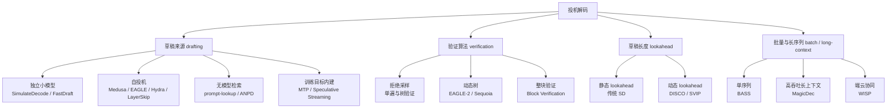

> **投机解码系列 · 第 07 篇**
>
> 本系列把投机解码从「一个加速技巧」拆成可核验的几层：综述与演化 → 收益模型 → 草稿从哪来 →
> 引擎支持 → 生产陷阱 → 业界实践 → **评测数字怎么读（本文）** → 未来方向。
>
> - 01 综述与演化 → 02 收益模型 → 03 EAGLE 家族 → 04 引擎支持矩阵 → 05 生产部署陷阱 →
>   06 业界实践 → **07 评测数字怎么读（本文）** → 08 未来方向

**TL;DR**

> * **论文里的「6×」是加速比上限的热身数字，生产实测普遍落在 1.4–2.5×**。落差不全是论文注水——
>   batch、并发、序列长度、硬件带宽共同决定了真实收益，而论文多数报的是 $$bs=1$$、短序列的**最佳值**。
> * **「大 batch 下投机解码必然失效」这个经典认知被高估了**。MagicDec 的结论是：失效区取决于
>   **瓶颈类型**而非 batch 本身——短序列 + 大 batch 落在 compute-bound 才是净负收益；
>   中长序列 + 大 batch 反而回到 memory-bound（KV 主导），验证与解码共享 KV 加载成本，
>   SD 随 batch 增大**更有效**（LLaMA-3.1-8B、bs 32–256 下最高 2.51×）。
> * **读数字先做五件事**：看测量场景（batch / 序列长 / 硬件）、看加速比的**分母**（相对 vanilla 还是
>   相对另一个 SD 方法）、看是吞吐还是挂钟延迟、看 greedy 还是采样、看硬件带宽比。
>   EAGLE 的 3× 与 Hydra 的 1.31× **分母不同，不能跨表直接比**。
> * **存在六种「不要用」的情形**，每条都能指到具体机制：短序列 + 大 batch、$$\alpha<0.5$$、
>   词表不一致、MoE 路由崩溃、低并发且延迟敏感、端侧小模型。
> * **本系列所有性能数字按 A / B / C 三级标注可信度**，本篇集中处理这件事。
>   本机无 GPU，本系列不跑性能 benchmark。

---

## 0. 符号约定

沿用第 02 篇的记号（Leviathan et al. 的写法，也是 vLLM / SGLang 代码里的写法）：

| 符号 | 含义 |
|:---|:---|
| $$M_T$$、$$p(x_t \mid x_{<t})$$ | **目标模型**及其词表分布 |
| $$M_D$$、$$q(x_t \mid x_{<t})$$ | **草稿模型**及其词表分布 |
| $$\gamma$$ | 草稿长度（每轮提出的候选 token 数） |
| $$\alpha$$ | 单步接受概率 |
| $$c = t_D / t_T$$ | 单次草稿前向与单次目标前向的耗时比 |
| $$bs$$ | batch size |
| $$S_{\rm infl}$$ | MagicDec 定义的**临界序列长度**：超过它，大 batch 下 SD 才有正收益 |

本文新增的两条约定，因为它们决定了怎么读表：

| 符号 | 含义 |
|:---|:---|
| **A 级** | 第三方同配置复现，或多源一致 |
| **B 级** | 项目方自测 / 单一来源，无第三方复现 |
| **C 级** | 无法追溯到原始测试配置（无 batch、无序列长、无硬件） |

A / B / C 与论文自报数字的对应关系：**项目方自报、有明确测量条件**记为 B 级；
**能追溯到完整配置且被独立复现**记为 A 级；**转述来源缺失**记为 C 级。
「高」「中」这类词在本系列里一律换成这套分级，因为它把「可信」落到可核查的条件上。

---

## 1. 先看结论：一张导读表

把本系列引过的关键加速数字集中放一起，逐条标可信度：

| 方法 | 论文 / 报告数字 | 测量条件 | 可信度 |
|:---|:---|:---|:---|
| SimulateDecode（Leviathan et al.） | 2–3× | 独立草稿模型，T5 类小模型，$$bs=1$$ | A（方法论奠基，大规模验证） |
| Speculative Sampling（Chen et al.） | 2–3× | $$bs=1$$，T5 / Chinchilla 类小模型 | A（方法论奠基） |
| Medusa | >2.2×（Medusa-1）/ 2.3–2.8×（joint） | $$bs=1$$，Vicuna-7B / 13B / 33B | B（项目方自报） |
| EAGLE-1 | 2.1–3.8×（MT-bench） | $$bs=1$$，LLaMA2-Chat | B（项目方自报） |
| EAGLE-2 | 3.05–4.26× | $$bs=1$$，LLaMA2 / Vicuna | B（项目方自报） |
| EAGLE-3 | 4–6.5× | $$bs=1$$，超参敏感 | B（项目方自报） |
| Meta at Scale（生产） | 约 4 ms/token；相对 vLLM $$bs=1$$ 快 10–30%；大 batch 1.4–2.0× | 8×H100，Llama4 | A（生产实测） |
| Together ATLAS（生产） | 500 / 460 TPS，2.65× | B200，运行时动态 | B（官方博客自报，待第三方复现） |
| MagicDec | 最高 2.51× | LLaMA-3.1-8B，bs 32–256 | A（论文 + 有拐点分析） |

> **核心教训**：论文的「6×」是**加速比上限的热身数字**；生产实测普遍落在 **1.4–2.5×**。
> 落差不全是论文注水——batch、并发、序列长度、硬件带宽共同决定真实收益（§6）。

这张表本身就在演示本篇的方法论：**同一个「2.5×」，在 A 级和 C 级来源里的意义完全不同**。
A 级的 1.4–2.0× 可以拿去做容量规划，C 级的「4×」只能当方向性参考。

---

## 2. 方法谱系全景：四个维度，每篇论文只动一个变量

第 02 篇给出了框架：$$\mathbb{E}[T] = \dfrac{1-\alpha^{\gamma+1}}{1-\alpha}$$、
$$S = \dfrac{1-\alpha^{\gamma+1}}{(1-\alpha)(1+\gamma c)}$$。
2023–2026 的论文从四个维度持续改进，**每篇基本只动一个变量**——这是读文献时最快的归类方式。



四个维度与第 02 篇公式的对应关系值得写清楚，因为它解释了为什么「四维度」是四个而不是更多：

| 维度 | 动了公式里的哪一项 |
|:---|:---|
| 草稿来源 | $$\alpha$$（草稿与目标分布的重叠质量）与 $$c$$（草稿成本） |
| 验证算法 | $$\mathbb{E}[T]$$ 的**几何结构**（单链 vs 树，公式是单链的保守下界） |
| 草稿长度 | $$\gamma$$，以及 $$\gamma^*$$ 是静态还是运行时求 |
| 批量与长序列 | 前提本身——「验证 $$\gamma$$ 个位置 ≈ 验证 1 个」还成不成立 |

最后一行是第 02 篇 §2.2 埋的伏笔，本篇 §6 正式引爆。

---

## 3. 草稿来源的四条路线

### 3.1 独立小模型 draft

- **FastDraft**（Intel，[arXiv:2411.11055](https://arxiv.org/abs/2411.11055)）解决「草稿稀缺」：
  24 小时内在 8×Gaudi 2 上训练出约 50M（配 Phi-3-mini）/ 150M（配 Llama-3.1-8B）的草稿模型
  （约 100 亿 token），接受率最高 67%，memory-bound 理论加速最高 3×，
  Intel Core Ultra AI-PC 上实测最高 2×。**B 级**（项目方自测，测量条件明确）。
- **DistillSpec**（Google，[arXiv:2310.08461](https://arxiv.org/abs/2310.08461)）走**蒸馏对齐**：
  用 on-policy 数据 + 针对性散度函数把草稿蒸馏得与目标分布更近，比标准 SD 再快 10–45%。
  「先蒸馏主模型再蒸馏草稿」的两段式管线，比不蒸馏的同样大小主模型快 6–10×（**含主模型性能提升**，
  不能全记在投机解码账上）。**B 级**。

独立模型路线的代价（第 03 篇已展开）：双模型显存、词汇表对齐、部署复杂度。
这正是「自投机」路线要规避的东西。

### 3.2 自投机（self-speculative）

不引入第二个独立模型，用目标模型自己的子结构做草稿：

- **Hydra**（[arXiv:2402.05109](https://arxiv.org/abs/2402.05109)）指出 Medusa 的多个解码头
  **相互独立**（只依赖已验证前缀的隐藏态），而真实语言 token 间强相关。把草稿头改成
  **序贯依赖**（每头输入包含前一个头采样的 token embedding），接受长度 +0.46 以上，
  Hydra++ 相对自回归 2.70×、相对 Medusa 1.31×。**B 级**。
- **LayerSkip**（Meta，[arXiv:2404.16710](https://arxiv.org/abs/2404.16710)）：训练期做
  深层「层丢弃 + 共享退出损失」，推理期用前 1/3 层提前退出自回归草稿、剩余层并行验证。
  CNN/DM 摘要 2.16×、代码 1.82×、TOPv2 2.0×；内存足迹小于双模型方案（单一 KV cache）。
  **B 级**。
- **Kangaroo**（[arXiv:2404.18911](https://arxiv.org/abs/2404.18911)）：固定浅层子网络作草稿 +
  轻量 adapter（1 个 attention + 2 个 norm，仅 Medusa 头参数量 11.3%）桥接表示差距，
  Spec-Bench 上 1.68×，比 Medusa-1 少 88.7% 额外参数且更快。**B 级**。

> **读这三篇的正确方式**：它们的数字都在 $$bs=1$$ 上取得，属于「上限热身」。
> 价值不在 2.70× 这个数，而在它们共同验证的机制——**草稿头的序贯依赖 > 并行多头**。

### 3.3 无模型 / 检索式

- **ANPD**（NAACL 2024 工业轨，[arXiv:2404.08698](https://arxiv.org/abs/2404.08698)）：
  自适应 n-gram 模块 + 多级粒度，**无需重训、零额外显存**，LLaMA 系最高 3.67×。**B 级**。
- **prompt-lookup / REST**：强复用文本（摘要、代码续写）的零成本方案，四家引擎全支持
  （见[第 04 篇](/2026/10/18/specdec-04-engine-support-matrix/)）。
- **TriForce**（[arXiv:2404.11912](https://arxiv.org/abs/2404.11912)）：长序列场景，
  用**检索式稀疏 KV cache（仅 3% KV）**作草稿「中间层」，再套小模型压草稿延迟——
  LLaMA2-7B-128K 单 A100 2.31×。**B 级**。它是 §6.3 的主角。

### 3.4 训练目标内建

- **DeepSeek-V3 MTP**：投机能力随模型权重免费分发（transformers `use_mtp=True`），
  **无词汇表 / 双模型问题**。见[第 03 篇](/2026/10/18/specdec-03-eagle-family/)。
- **Speculative Streaming**（[arXiv:2402.11131](https://arxiv.org/abs/2402.11131)）：
  把 fine-tune 目标从 next-token 改成 **n-gram 预测**，多流注意力在单模型内同时「投机 + 验证」，
  1.8–3.1×，额外参数比 Medusa 少约 10000×。**B 级**。

四条路线的成本—收益形态完全不同，这也是第 02 篇里 $$c$$ 的量级估计的来源：

| 路线 | 额外显存 | 词表约束 | $$c$$ 的量级 | 运维面 |
|:---|:---|:---|:---|:---|
| 独立小模型 | 高（双模型） | 有 | 约 0.1–0.5 | 双模型版本管理 |
| 自投机 | 低（共享权重） | 无 | 明显低于 0.1 | 需配套草稿头权重 |
| 无模型 / 检索 | 零 | 无 | 极低 | 几乎为零 |
| 训练目标内建 | 零（权重自带） | 无 | 极低 | 跟着模型走 |

> 表中 $$c$$ 是**量级估计而非实测**（第 02 篇 §5.2 已说明：$$c$$ 必须在目标部署条件下实测）。
> 表的用途是解释「为什么同样 $$\alpha$$ 下不同路线的 $$\gamma^*$$ 差一个量级」。

### 3.5 四条路线怎么选

上面的成本—收益表加上「你能改到哪一层」，基本就定了路线：

| 你的处境 | 首选路线 | 理由 |
|:---|:---|:---|
| 已有 HF 权重，想零成本先测出 $$\alpha$$ 的量级 | 无模型 n-gram / prompt-lookup | 零显存、四家引擎全支持（[第 04 篇](/2026/10/18/specdec-04-engine-support-matrix/)），开关一开就能看到接受率 |
| 追求上限，能接受双模型显存 | 独立小模型 + 蒸馏对齐 | $$c$$ 高（约 0.1–0.5）但 $$\alpha$$ 上限高；FastDraft 证明草稿可在 24 小时内训出来 |
| 显存紧张，能换部署配置 | 自投机（EAGLE / Medusa 系） | 共享权重，$$c$$ 明显低于 0.1，于是 $$\gamma^*$$ 可以放到 10 以上（第 02 篇 §5 表） |
| 有训练资源，能改预训练或微调 | MTP / 多流（训练目标内建） | 运维面最小：无词汇表问题、无双模型，生态跟着权重走 |
| 长上下文，且已确认 KV 加载占主导 | 检索式 KV 草稿（TriForce 类） | 把 KV 淘汰当作草稿，绕开加载瓶颈（§6.3） |

**一条排序原则**：先做零成本的那一档。原因是 $$\alpha$$ 是未知的，
而无模型方案是**唯一能在几小时内测出真实 $$\alpha$$ 量级**的路径——
第 02 篇说过 $$\alpha$$ 决定天花板 $$1/(1-\alpha)$$，在知道 $$\alpha$$ 之前，
任何「换更贵的草稿器」的决定都是盲目的。

---

## 4. 验证算法：树、批、块

草稿质量决定上界，**验证算法决定能兑现多少**。三篇代表性工作：

- **Sequoia**（NeurIPS 2024，[arXiv:2402.12374](https://arxiv.org/abs/2402.12374)）：
  指出 static tree（SpecInfer / Medusa）在大树规模下收益饱和；用**动态规划求最优树结构**
  + **无放回采样**避免重复提案。LLaMA2-7B / 13B、Vicuna-33B 单 A100 上最高
  4.04× / 3.73× / 2.27×。**B 级**。
- **Block Verification**（[arXiv:2403.10444](https://arxiv.org/abs/2403.10444)）：
  证明逐 token 验证并非最优，「整块联合验证」在维持相同分布保证下严格不差，
  且有 5–8% 额外墙钟收益。**B 级**，但「严格不差」这条有理论证明，可信度高于纯自报数字。
- **BASS**（[arXiv:2404.15778](https://arxiv.org/abs/2404.15778)）：把工作尺度从单序列推向
  batch——用自定义 CUDA kernel 处理 **ragged（参差）tensor**、动态调整每步草稿长度，
  7.8B 模型单 A100、$$bs=8$$ 时每 token 5.8 ms、吞吐 1.1K token/s（2.15×）。
  **B 级**。它正是[第 05 篇](/2026/10/18/specdec-05-production-traps/)
  「参差张量错位陷阱」的解法雏形。

### 4.1 树验证为什么值得单独说

第 02 篇 §8 讲过 tree attention 的实现难点。这里补一条**评测视角**：

树验证改变的是 $$\mathbb{E}[T]$$ 的**几何结构**，而第 02 篇的
$$\mathbb{E}[T] = (1-\alpha^{\gamma+1})/(1-\alpha)$$ 是**单链**结果。
所以：**用单链闭式去预测一个树验证系统的加速比，会系统性低估**。

这也是为什么读表时要问一句「测的是单链还是树」——同一个 $$\alpha$$ 下，
树验证的 $$\mathbb{E}[T]$$ 严格大于单链，两者的加速比数字不可直接比较。
SpecInfer 报告的随机解码下 token 验证成功率从 52–57% 提升到 96–97%
（[arXiv:2305.09781](https://arxiv.org/abs/2305.09781)），就是这个结构性差异的量化体现。

---

## 5. 草稿长度：静态 vs 动态

第 02 篇证明了 $$\gamma^*$$ 存在且对 $$c$$ 极度敏感。工程上的下一步自然是：
**让 $$\gamma$$ 在运行时求**，而不是钉死一个配置。

- **DISCO**（IBM Research，[arXiv:2405.04304](https://arxiv.org/abs/2405.04304)）：
  用打分器逐 token 决定「继续草稿 or 交目标验证」，相对最优静态 lookahead 平均快约 10%，
  **输出分布不变**。论文另给出 oracle 上界分析：静态方案在上限情形可持续损失潜在加速。
  **B 级**。
- **SVIP**（[arXiv:2411.18462](https://arxiv.org/abs/2411.18462)）：基于「draft token 熵与
  接受率强负相关」，推导接受率下界并用草稿熵在线近似——**训练无关**，
  可直接套在任何自回归草稿上（包括 EAGLE-2）。SpecBench 最高 +20%、MT-Bench 长文 +60%。
  **B 级**。
- **生产化实现**：HF Transformers 的 `assistant_confidence_threshold` /
  `num_assistant_tokens_schedule` 就是 DISCO / SVIP 思路的落地
  （[第 04 篇](/2026/10/18/specdec-04-engine-support-matrix/)）；
  llama.cpp 的 `--spec-draft-n-min/max` 也允许运行时边界。

> **一条可直接用的判断**：如果引擎支持动态 lookahead，优先开它再调静态 $$\gamma$$。
> 原因在第 02 篇：$$\gamma^*$$ 附近的收益曲线很平，取邻近值即可，
> 但「静态值在负载变化后失配」这件事没有自动补偿。

### 5.1 动态 lookahead 的三个代价

「动态比静态好」不是无条件的，三笔账要算：

**一、判定本身的开销。** DISCO 的打分器、SVIP 的草稿熵近似都要额外计算。
好消息是这笔账很小——它们落在第 02 篇 §2.2 说的「白送区」里：
在 memory-bound 区间，多算一点几乎不加时间。**坏消息是进入 compute-bound 后它就不再免费**，
而 compute-bound 恰恰是 §6 讨论的大 batch 场景。两件事叠加时，动态 lookahead 的净收益会缩水。

**二、控制流不规则。** 静态 $$\gamma$$ 下每轮的计算图形状固定，动态下每轮的草稿长度都不同。
这直接影响引擎侧两件事：CUDA graph 的捕获范围（图形化要求形状稳定），
以及 kernel launch 的批处理。BASS 用自定义 ragged-tensor kernel 处理的就是这一类问题
（[arXiv:2404.15778](https://arxiv.org/abs/2404.15778)）。

**三、与严格无偏的关系。** DISCO / SVIP 都声称分布不变，Block Verification 也声称
「维持相同分布保证下严格不差」。但典型性接受（Medusa 的 typical acceptance）是**明确放弃**
严格无偏换速度的——见[第 03 篇](/2026/10/18/specdec-03-eagle-family/)。
所以读「动态」类工作时，要先分清它属于哪一类：**保分布的动态**还是**换质量的动态**。
这两者在生产上的可接受度完全不同。

> **一条判据**：如果引擎的默认配置已经把动态 lookahead 打开了，那就用它；
> 如果需要自己接，先确认上面第三笔账——保分布与换质量是两条不同的路。

---

## 6. batch 与长序列：「失效区」的重新定义

这一节是全篇最重要的纠正。

### 6.1 经典认知：大 batch 收益衰减

[第 05 篇](/2026/10/18/specdec-05-production-traps/)给过生产事实：
$$bs$$ 在 1–10 是收益区，$$bs \ge 32$$ 验证开销反超。机制被解释为
「compute-bound 竞争」——大 batch 下线性层算力已饱和，投机解码的并行验证要抢计算资源，
于是**验证 : 解码 = 逐 token 成本比上升**。

这个解释在大 batch + 短序列上是对的。但它被过度推广成了一条普适规律。

### 6.2 MagicDec 的反直觉结论

**MagicDec**（[arXiv:2408.11049](https://arxiv.org/abs/2408.11049)）把「batch」这一个变量拆成了
**batch × 序列长度**的二维问题：

- **瓶颈类型随组合变化，不随 batch 单独变化**。
- **短序列 + 大 batch** → compute-bound，SD 净负收益。
- **中长序列 + 大 batch** → memory-bound（KV 主导），此时**验证与解码共享 KV 加载成本**，
  成本比回落到约 1，SD 反而**随 batch 增大而更有效**。
- 存在临界序列长度 $$S_{\rm infl}$$：超过它，大 batch 下 SD 才有正收益，且收益随 batch 增长。
  LLaMA-3.1-8B、$$bs$$ 32–256 下最高 **2.51×**。

这与 Meta 的生产观察互为印证：**模型规模、序列长度、batch 三者的组合决定失效区**，
不存在普适的「$$bs=16$$ 以上就别用」。**A 级**（论文有拐点分析，且与独立的生产观测一致）。

#### 6.2.1 成本比为什么会回落到 1

MagicDec 的结论初看反直觉——同样的 batch 增大，为什么有时有害有时有利？
把 decode 单步的成本拆开就清楚了：

$$
\mathrm{cost}_{\rm step} \;\approx\; \underbrace{T_{\rm W}}_{\text{读一遍权重}} \;+\; \underbrace{T_{\rm KV}}_{\text{读一遍 KV cache}} \;+\; \underbrace{T_{\rm C}}_{\text{计算}}
$$

两个因素决定 $$T_{\rm KV} / T_{\rm W}$$ 的比例：**序列长度**与**batch**。
序列越长、batch 越小，KV 占比越高。于是：

- **短序列 + 大 batch**：$$T_{\rm KV}$$ 可忽略，$$T_{\rm W}$$ 被 batch 内所有请求摊薄，
  剩下 $$T_{\rm C}$$ 主导。此时验证 $$\gamma$$ 个位置多出来的**纯计算**直接与 decode 抢算力，
  验证 : 解码的成本比远大于 1，净负收益。
- **中长序列 + 大 batch**：$$T_{\rm KV}$$ 占主导。关键在于验证 $$\gamma$$ 个位置时，
  这些位置**共享同一段前缀 KV**——KV 只读一遍，多出的主要是计算。
  于是验证 : 解码的成本比回落到约 1，SD 的收益不再被 batch 吃掉，甚至随 batch 增长
  （batch 摊薄了固定开销）。

> 这段是**定性解释**，用来建立直觉；$$S_{\rm infl}$$ 的具体位置由模型规模、硬件与
> 草稿器形态共同决定，必须实测，本系列不给数值。

这也让第 02 篇 §2.2 的失效边界更完整：那里说「compute-bound 时验证不再免费」，
这里补上「**compute-bound 本身是有条件的**，它由 batch × 序列长度决定，不是 batch 单独决定」。

> **这一条的实践后果**：如果你的服务是长上下文（RAG、代码库问答、长文档摘要），
> 那么「大 batch 不能开投机」很可能是个错误结论——**应该实测而不是默认关掉**。

### 6.3 长序列专用：把 KV 淘汰当作草稿

长序列下所有 SD 系统的最后一个瓶颈是 **KV cache 加载**。
TriForce 用检索式稀疏 KV 做「草稿中间层」，本质是**把 KV 淘汰当作草稿**
（替代 StreamingLLM / H2O 等有损压缩，[arXiv:2404.11912](https://arxiv.org/abs/2404.11912)）。
端侧的 sd.npu（见[第 06 篇](/2026/10/18/specdec-06-industry-practice/)）是同一思路的移动端版。

这两条路线共同指向一个范式转变：

> **草稿从「下一个 token 写什么」退化到「去哪里查」**。
> 当 KV 加载成为主导成本时，最优的草稿不是「猜内容」而是「猜该读哪一段」。

这也是本篇与[推理引擎系列](/2026/10/18/serving-01-architecture-divergence/)的接口：
KV 缓存组织（前缀复用粒度）与 KV 淘汰策略，直接决定这类方法的收益上限。

---

## 7. 何时**不要**用投机解码

综合[第 05 篇](/2026/10/18/specdec-05-production-traps/)的生产证据与本篇的论文数据，
给一张负向清单——每一条都指到具体机制，不是「感觉」：

| 情形 | 机制 | 替代方案 |
|:---|:---|:---|
| $$bs \ge 32$$ 且**短序列**（KV 不占主导） | compute-bound，验证代价高 → 净负收益 | 提高 batch 填满算力；连续 batching |
| 草稿—目标分布漂移大（$$\alpha < 0.5$$） | 加速比为负（第 02 篇曲线） | 重新蒸馏草稿；改用动态 lookahead |
| 词汇表不一致 / 无法对齐 | 验证机制直接失效（硬约束） | 同 tokenizer 的草稿；MTP / n-gram / 检索 |
| MoE 路由崩溃 / 结构化输出强约束 | 草稿在 expert 边界与约束下接受率崩塌 | 拆解输出；不用 SD |
| 延迟敏感且并发低于 4–8 | 收益被调度与排队吃掉 | 量化 + 图优化优先 |
| 端侧小模型（如 Qwen2.5-0.5B 量级） | EAGLE 在移动端反而增能耗 | 检索式 / NPU 原生方案 |

**决策口诀**（三段，任一红灯就停）：

```
batch × 序列长度 → 瓶颈类型 → 是否 memory-bound
α                → 草稿是否值得
词表 / 并发 / 约束 → 能否上生产
```

第一段是全篇的核心纠正：**先判断瓶颈类型，再决定 batch 阈值**，
跳过这一步直接套「$$bs \ge 16$$ 就别用」会误判长上下文场景。

---

## 8. 把「数字」读准的五个检查点

这一节是可直接复用的操作清单。

**① 看测量场景。** $$bs=1$$ 的论文数字不等于生产数字。优先找同硬件、同 batch 的实测。
看到「up to 4×」时，第一反应应该是：**这是 $$bs=1$$ 还是 $$bs=32$$？**

**② 看加速比的分母。** 相对 vanilla 解码，还是相对「另一个 SD 方法」？
EAGLE 的 3× 是相对 vanilla，Hydra 的 1.31× 是相对 Medusa——
**分母不同的两个数字放在同一张表里比较毫无意义**。这是本系列最常被违反的一条。

**③ 看是吞吐还是挂钟延迟。** tokens/s 吞吐容易在长 prefill 下虚高；
报告 s/token（解码延迟）才公平。第 02 篇 §2.2 说过，验证代价随 batch 的变化是非线性的，
这决定了同一方法在两个指标上可以给出相反的结论。

**④ 看温度 / 采样设置。** greedy 下接受率系统性高于采样（greedy 下草稿更容易与目标一致）。
Meta 的生产数据已证明这类差异的量级不可忽略（见[第 06 篇](/2026/10/18/specdec-06-industry-practice/)）。
**如果论文没写采样设置，这个数字的可用范围要打折扣。**

**⑤ 看硬件带宽比。** 同一种方法换一张卡，数字可以全变——因为「验证几乎免费」这个前提
依赖 memory-bound 区间，而它由算力带宽比决定（第 02 篇 §2.2）。

> **补一条元规则**：如果一篇报告里五个检查点一个都没交代，无论数字多漂亮，
> 按 **C 级**处理——不是「它错了」，而是「它不可用于决策」。

---

## 9. 小结：四个维度各自的当前最优组合

- **草稿路线**：四选一，成本—收益形态决定选型，不是「哪个最快」。
  独立小模型上限高但对齐贵；自投机免双模型；无模型 / 检索零成本但局限大；
  训练目标内建（MTP / 多流）运维最少，且生态跟着权重走。
- **验证与 lookahead** 是「兑现层」：**动态树（EAGLE-2 / Sequoia）+ 整块验证
  + 动态 lookahead（DISCO / SVIP）** 是当前的标准组合，每一件都在不改变分布保证下再省 5–30%。
- **失效区**是 (batch, 序列长度, 模型规模, 硬件) 的四元函数，**必须实测**，
  不存在普适的 batch 阈值。
- **生产收益预期收敛在 1.4–2.5×**。看到超过 3× 的数字，先走一遍 §8 的五个检查点。

---

## 10. 本篇没有主张什么

- **全篇没有跑过一次真实的 draft-verify 推理。** 本机无 GPU，所有数字都是引用，
  按 A / B / C 标注来源。A 级的数字可以用于容量规划，B 级看测量条件，C 级只作方向参考。
- **没有给出「哪个方法最好」的结论。** 第 02 篇的模型说明这取决于 $$c$$ 与负载，
  而 $$c$$ 只能实测。本篇能给的只是「在什么条件下哪个机制更可能赢」。
- **$$S_{\rm infl}$$ 的具体值没有测。** MagicDec 给出了临界序列长度的存在性与依赖因素，
  但没有给出可跨模型复用的数值——它必然依赖模型规模、硬件与草稿器形态。
- **草稿里几条生产数字（Together ATLAS 的 500 TPS 等）目前只有单一来源**，
  已标 B 级或「待第三方复现」，本系列不会把它们写成既成事实。

---

**上一篇**：[投机解码（06）：业界实践——投机正在变成训练目标的一部分](/2026/10/18/specdec-06-industry-practice/)

**下一篇**：[投机解码（08）：未来方向与开放问题](/2026/10/18/specdec-08-future-directions/)

**站内承接**：收益模型与天花板见
[《投机解码（02）：收益模型》](/2026/10/18/specdec-02-acceptance-and-speedup-model/)；
生产陷阱与落差见
[《投机解码（05）：生产部署的陷阱》](/2026/10/18/specdec-05-production-traps/)；
指标口径见
[《性能分析（02）：推理》](/2026/09/29/profiling-02-inference/)；
引擎侧架构分歧见
[《推理引擎（01）：三条独立的设计路线》](/2026/10/18/serving-01-architecture-divergence/)。

## 参考

**方法论与奠基**：

1. Leviathan et al.，*Fast Inference from Transformers via Speculative Decoding*（ICML 2023）— [arXiv:2211.17192](https://arxiv.org/abs/2211.17192)
2. Chen et al.，*Accelerating Large Language Model Decoding with Speculative Sampling* — [arXiv:2302.01318](https://arxiv.org/abs/2302.01318)
3. Miao et al.，*SpecInfer: Accelerating Generative LLM Serving with Speculative Inference and Token Tree Verification* — [arXiv:2305.09781](https://arxiv.org/abs/2305.09781)

**草稿来源**：

4. Zafrir et al.（Intel），*FastDraft: How to Train Your Draft*（ACL Findings 2025）— [arXiv:2411.11055](https://arxiv.org/abs/2411.11055)
5. Zhou et al.（Google），*DistillSpec: Improving Speculative Decoding via Knowledge Distillation* — [arXiv:2310.08461](https://arxiv.org/abs/2310.08461)
6. Ankner et al.，*Hydra: Sequentially-Dependent Draft Heads for Medusa Decoding* — [arXiv:2402.05109](https://arxiv.org/abs/2402.05109)
7. Elhoushi et al.（Meta），*LayerSkip: Enabling Early Exit Inference and Self-Speculative Decoding*（ACL 2024）— [arXiv:2404.16710](https://arxiv.org/abs/2404.16710)
8. Liu et al.，*Kangaroo: Lossless Self-Speculative Decoding via Double Early Exiting* — [arXiv:2404.18911](https://arxiv.org/abs/2404.18911)
9. Ou et al.，*Lossless Acceleration of Large Language Model via Adaptive N-gram Parallel Decoding (ANPD)*（NAACL 2024 Industry）— [arXiv:2404.08698](https://arxiv.org/abs/2404.08698)
10. Bhendawade et al.，*Speculative Streaming: Fast LLM Inference without Auxiliary Models* — [arXiv:2402.11131](https://arxiv.org/abs/2402.11131)

**验证算法**：

11. Chen et al.，*Sequoia: Scalable, Robust, and Hardware-aware Speculative Decoding*（NeurIPS 2024）— [arXiv:2402.12374](https://arxiv.org/abs/2402.12374)
12. *Block Verification Accelerates Speculative Decoding* — [arXiv:2403.10444](https://arxiv.org/abs/2403.10444)
13. *BASS: Batched Attention-optimized Speculative Sampling* — [arXiv:2404.15778](https://arxiv.org/abs/2404.15778)

**草稿长度**：

14. Mamou et al.（IBM Research），*Dynamic Speculation Lookahead Accelerates Speculative Decoding of LLMs (DISCO)* — [arXiv:2405.04304](https://arxiv.org/abs/2405.04304)
15. *Draft Model Knows When to Stop: Self-Verification Speculative Decoding for Long-Form Generation (SVIP)* — [arXiv:2411.18462](https://arxiv.org/abs/2411.18462)

**batch 与长序列**：

16. Sadhukhan et al.，*MagicDec: Breaking the Latency-Throughput Tradeoff for Long Context Generation with Speculative Decoding* — [arXiv:2408.11049](https://arxiv.org/abs/2408.11049)
17. Sun et al.，*TriForce: Lossless Acceleration of Long Sequence Generation with Hierarchical Speculative Decoding*（COLM 2024）— [arXiv:2404.11912](https://arxiv.org/abs/2404.11912)
