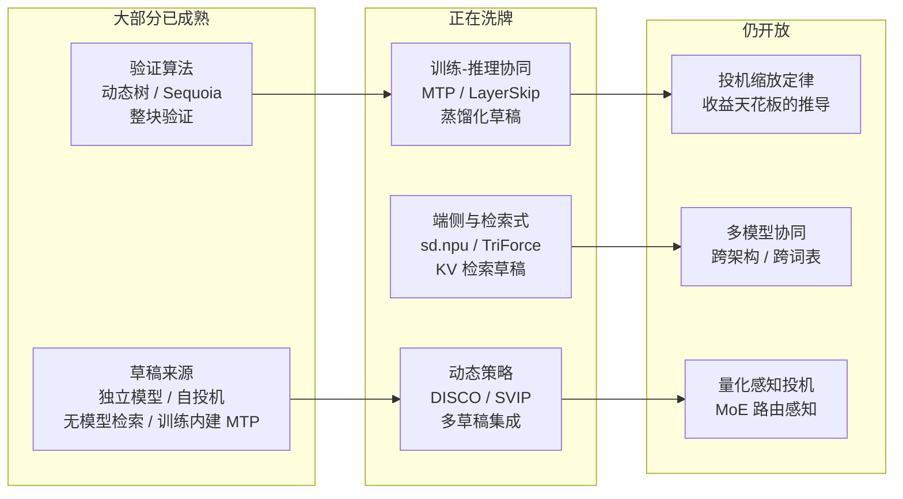

> **投机解码系列 · 第 08 篇**
>
> 本系列把投机解码从「一个加速技巧」拆成可核验的几层：综述与演化 → 收益模型 → 草稿从哪来 →
> 引擎支持 → 生产陷阱 → 业界实践 → 评测数字怎么读 → **未来方向与开放问题（本文）**。
>
> - 01 综述与演化 → 02 收益模型 → 03 EAGLE 家族 → 04 引擎支持矩阵 → 05 生产部署陷阱 →
>   06 业界实践 → 07 评测数字怎么读 → **08 未来方向与开放问题（本文）**

**TL;DR**

> * **四张牌桌**：草稿来源与验证算法两桌的牌已基本打完；**动态策略**与**部署形态**正在洗牌；
>   量化感知投机、MoE 路由感知、跨词表投机仍是开放题。
> * **训练—推理协同是最大变量**：DeepSeek-V3 把 MTP 写进预训练目标，投机从「后装件」变成
>   **权重自带的能力**；llama.cpp 2026-04 重构后把 `draft-mtp` 与 ngram 并列为一等公民。
> * **收益天花板有两条极限边界**（第 02 篇 §6 已数值验证）：$$c \to 0$$ 时上界
>   $$1/(1-\alpha)$$；$$\alpha \to 1$$ 时上界 $$1/c$$。**$$c \ge 1$$ 时上界不超过 1**，
>   即草稿不比验证便宜时无正增益——压缩草稿比调 $$\gamma$$ 更根本。
> * **失效区不是 batch 的函数，是 (batch, 序列长度, 模型规模, 硬件) 的四元函数**（第 07 篇 §6）。
>   下一个工程方向是让**调度器**按运行时状态开关投机，而不是让算法层自己适应。
> * **草稿正在从「下一个 token 写什么」退化成「去哪里查」**：长序列场景下 KV 加载是最后瓶颈，
>   检索式 KV 草稿把淘汰策略本身当成草稿。

---

## 0. 符号约定

沿用第 02 篇的记号：目标 $$p$$、草稿 $$q$$、草稿长度 $$\gamma$$、接受率 $$\alpha$$、
成本比 $$c = t_D/t_T$$、每轮产出期望 $$\mathbb{E}[T]$$。
本篇新增：

| 符号 | 含义 |
|:---|:---|
| $$S_{\max}^{(c\to0)}$$ | 草稿免费时的收益上界，$$= 1/(1-\alpha)$$ |
| $$S_{\max}^{(\alpha\to1)}$$ | 草稿完美时的收益上界，$$= 1/c$$ |
| $$S_{\rm infl}$$ | MagicDec 的临界序列长度，超过它大 batch 下才有正收益 |

---

## 1. 前沿坐标：2026 年的四张牌桌

沿用[第 07 篇](/2026/10/18/specdec-07-benchmarks-and-tradeoffs/)的四维谱系
（草稿来源 / 验证算法 / 草稿长度 / 批量与长序列），2024–2026 的研究可以归到四张仍在洗牌的牌桌。

**一句话版**：验证算法已经便宜到接近极限，剩下的收益要么在「把草稿训练便宜化」，
要么在「让系统按状态自适应」。

---

## 2. 训练—推理协同：投机不再是后装件

### 2.1 MTP：投机能力内建于预训练

DeepSeek-V3 的 Multi-Token Prediction
（[arXiv:2412.19437](https://arxiv.org/abs/2412.19437)，见[第 03 篇](/2026/10/18/specdec-03-eagle-family/)）
是划时代的一步：它不是在训练完成后挂一个草稿头，而是**在预训练阶段就让模型学会预测未来
第 $$t+1, t+2$$ 个 token**，推理时原生开启投机。

这直接终结了两大类运维问题：

- **词汇表 / 分布漂移**：草稿头就是目标模型自身，不存在独立草稿模型的分布失配——
  [第 05 篇](/2026/10/18/specdec-05-production-traps/)列过的硬约束全部不成立；
- **两段式部署**：不需要单独加载、对齐、调度一个草稿模型。

行业信号：llama.cpp 在 2026-04 的重构（**PR #22397 / #22539**，合并进统一 `--spec-type` CLI）中
加入了 `draft-eagle3`、`draft-dflash`、`draft-mtp`、`draft-dspark` 四种自投机后端，
其中 `draft-mtp` 直接读取 DeepSeek-V3 权重里的 MTP 模块——
**权重内建投机被当成第一等公民功能**，与 ngram 检索草稿并列在同一个参数体系里
（见[第 04 篇](/2026/10/18/specdec-04-engine-support-matrix/)）。

### 2.2 把「草稿训练」做成廉价流水线

MTP 要求从预训练第一天就设计进去，对存量模型不可用。于是「给任意已部署模型补一个草稿」
成为独立赛道：

- **DistillSpec**（[arXiv:2310.08461](https://arxiv.org/abs/2310.08461)）：先蒸馏主模型、
  再 on-policy 蒸馏草稿，比标准 SD 快 10–45%。两段式管线拿到 6–10× 的综合提升
  （**含主模型性能提升，不能全记在投机账上**，见[第 07 篇](/2026/10/18/specdec-07-benchmarks-and-tradeoffs/) §3.1）。
- **FastDraft**（[arXiv:2411.11055](https://arxiv.org/abs/2411.11055)）：约 24 小时、
  约 100 亿 token，产出 50M–150M 草稿。它展示的核心是**增量成本**——一夜就能补出生产级草稿。
- **EAGLE-3 的蒸馏路径**：训练用无监督蒸馏 100B token 且**不依赖精调模型**，
  对 base 模型直接可用——「草稿训练与主任务解耦」又前进了一步。

> **趋势判断**：草稿训练的边际成本正在逼近「一夜训练」级别。一旦低于「维护双模型」的
> 运维成本，独立草稿路线会在存量模型上重新成为主流，而把 KV 缓存与调度问题
> 让给推理引擎解决。

### 2.3 结构化的「半草稿」：多流与早退

- **Speculative Streaming**（[arXiv:2402.11131](https://arxiv.org/abs/2402.11131)）：
  把 fine-tune 目标从 next-token 改成 n-gram 预测，单模型内多流注意力同时「投机 + 验证」，
  额外参数比 Medusa 少约三个数量级。意义在于**把投机的训练代价摊进普通 SFT**。
- **LayerSkip**（[arXiv:2404.16710](https://arxiv.org/abs/2404.16710)）：训练期层丢弃 +
  共享退出损失，推理期浅层早退自回归、深层并行验证，**单一 KV cache** 解决双模型内存问题。
- **Kangaroo**（[arXiv:2404.18911](https://arxiv.org/abs/2404.18911)）：浅层子网络 +
  轻量 adapter 桥接，比 Medusa-1 少 88.7% 额外参数。

三篇的共同指向：**「草稿」不再是一个独立模型，而是目标模型内部的一种受训能力**
（早退层、多流头、n-gram 分支）。自称 self-speculative 的分支正在吃掉独立小模型的地盘。

---

## 3. 自适应与多草稿：动态策略牌桌

### 3.1 动态 lookahead 已进产品

静态 $$\gamma$$ 的短板第 02 篇已分析：$$\gamma^*$$ 依赖未知的 $$\alpha$$。两条产品化路径
（[第 07 篇](/2026/10/18/specdec-07-benchmarks-and-tradeoffs/) §5）：

- **DISCO**（[arXiv:2405.04304](https://arxiv.org/abs/2405.04304)）：逐 token 打分器决定
  「继续草稿 or 交回验证」，平均比最优静态 lookahead 快约 10%，**分布不变**；
- **SVIP**（[arXiv:2411.18462](https://arxiv.org/abs/2411.18462)）：用草稿熵在线估计
  接受率下界，**训练无关**，最高 +20%。

两者都已进入 HF Transformers：`assistant_confidence_threshold` 与
`num_assistant_tokens_schedule`（见[第 04 篇](/2026/10/18/specdec-04-engine-support-matrix/)）。

> **产品化的终点不是「更长的草稿」，而是「该停就停」。**

### 3.2 多草稿集成：把「谁的草稿更好」交给验证器

多草稿集成验证（DIVERSED，[arXiv:2604.07622](https://arxiv.org/abs/2604.07622)；
HF 文档称 static ensemble verification）把多路草稿——不同 draft 模型、不同 ngram、
不同自投机头——**同时**喂给一次验证，让验证器挑最优。
HF 的 `assistant_ensemble_weight`（默认 0.7）已内置。

开放问题随之而来：**多路草稿的价值上限在哪里？**
从第 02 篇的接受率上界看，两路以上草稿的**同分布边际收益快速递减**；
真正的增益只出现在「两路草稿各自擅长不同 token 分布」的互补场景。
「几路草稿、权重怎么调」目前仍是经验题，没有理论最优解。

### 3.3 系统级自适应：排队、并发、硬件

[第 07 篇](/2026/10/18/specdec-07-benchmarks-and-tradeoffs/) §6 已证明失效区是
(batch, 序列长度, 模型规模, 硬件) 的四元函数。于是下一个工程方向是**运行时开关**：

- 按当前 batch 大小动态启用 / 禁用投机（vLLM 与 llama.cpp 已支持按请求粒度开关）；
- 按序列长度切换策略：短序列关、中长开 MTP、超长切检索式草稿；
- 按服务水位（并发高低）做投机削峰。

> **自适应不再是算法层的事，而是调度器的一等公民条件。**
> 这与[第 05 篇](/2026/10/18/specdec-05-production-traps/)的 TPC
> （throughput per cost）指标接上了头——**单位成本的吞吐**才是该优化的对象，
> 不是峰值 tokens/s。

---

## 4. 端侧与检索式：草稿退化成「去哪查」

### 4.1 检索式 KV：长序列的新范式

TriForce（[arXiv:2404.11912](https://arxiv.org/abs/2404.11912)）引入的关键思想：
**长序列投机解码的最后一个瓶颈是 KV cache 加载**，而「检索稀疏 KV 当草稿中间层」
把投机从「预测下一个 token」降维成「猜下一个要查哪块 cache」。

配合 StreamingLLM / H2O 等有损压缩对照，这条路线在长上下文时代（128K+）是
少数能同时维护无失真保证与成本可控的地方——**它替代的正是有损压缩**。

### 4.2 端侧 NPU：不加硬件、不加模型

sd.npu（[arXiv:2510.15312](https://arxiv.org/abs/2510.15312)，见[第 06 篇](/2026/10/18/specdec-06-industry-practice/)）
在端侧 NPU 上证明：**投机解码不需要额外 draft 硬件，也不给模型加附属结构**——
直接用主流框架、零推理映射，同样拿到 device-bound 上界内的加速，且延迟敏感场景下 TPC 优于 CPU 投机。

它同时实测到**解码期 NPU 计算图切换开销与利用率低下**——**端侧算力闲置正是投机解码的利基**：
解码阶段 NPU 空转率高，恰恰给了交换式投机解码低成本的进入空间。

> **这条牌桌的下一步是混合推理**：什么时候把草稿丢给 NPU / 专用 IP，
> 什么时候回落到 CPU 检索式（REST / prompt-lookup / ANPD），
> 完全由设备的功耗与带宽预算决定。

---

## 5. 投机解码的「缩放定律」：收益天花板

这是本篇唯一做数学的地方，也是整个系列唯一谈「极限」的地方。

### 5.1 两条极限边界

第 02 篇 §3 给出的加速比：

$$
S(\alpha, \gamma, c) \;=\; \frac{1 - \alpha^{\gamma+1}}{(1 - \alpha)(1 + \gamma c)}
$$

它有**两条**极限边界，沿不同方向取极限得到，分别对应「草稿免费」与「草稿完美」两个极端：

**边界一 · $$c \to 0$$（草稿几乎免费）**，固定 $$\alpha$$：

$$
S \;\longrightarrow\; \frac{1 - \alpha^{\gamma+1}}{1 - \alpha} \;\;\xrightarrow{\;\gamma \to \infty\;}\;\; \frac{1}{1 - \alpha}
$$

**边界二 · $$\alpha \to 1$$（草稿几乎全对）**：

$$
S \;\longrightarrow\; \frac{\gamma + 1}{1 + \gamma c} \;\;\xrightarrow{\;\gamma \to \infty\;}\;\; \frac{1}{c}
$$

两条边界都已在第 02 篇 §6 用数值方式验证（相对误差均小于 $$10^{-4}$$），
配套实验见 [`experiments/speculative-decoding/acceptance-model`](https://github.com/lrypcy/ipynbs/blob/79a07f1e68ff23612838da5d7821b32021ca2b76/experiments/speculative-decoding/acceptance-model/run.py)。

> **注意这两个上界的适用条件不同，不能混用**：
> $$1/(1-\alpha)$$ 要求草稿成本可忽略；$$1/c$$ 要求草稿质量可忽略地好。
> 真实系统处在两者之间，实际上界由「哪个极限先饱和」决定。

### 5.2 三个工程公理

从两条边界可以直接读出三条可操作的结论：

**公理一 · $$c \ge 1$$ 时收益上界不超过 1。**
由边界二：$$(\gamma+1)/(1+\gamma c) \le 1 \iff c \ge 1$$。
也就是说**草稿每次前向不比验证便宜时，加速比被死死封在 1 以内**。
推论：**压缩草稿（量化、剪枝、缩小）是比调 $$\gamma$$ 更根本的杠杆**——
$$\gamma$$ 只能在既有的天花板下腾挪，$$c$$ 直接决定天花板的高度。

**公理二 · 失效区可计算。**
MagicDec（[arXiv:2408.11049](https://arxiv.org/abs/2408.11049)）证明瓶颈类型由
**batch × 序列长度**决定，存在临界序列长度 $$S_{\rm infl}$$，越过它大 batch 下 SD 反而更有效。
所以「$$bs \ge 16$$ 就别用」不是定律，是一个**需要按四元函数求值**的经验阈值。

**公理三 · 现场收益由两个可测量决定。**
$$\alpha$$ 与 $$c$$ 都能在运行时可观测——引擎日志里的 accept length 直接给出 $$\alpha$$ 的量级，
分别计时 $$t_D$$ 与 $$t_T$$ 给出 $$c$$（测法见[第 02 篇](/2026/10/18/specdec-02-acceptance-and-speedup-model/) §5.2）。
**在测出这两个数之前，任何调参都是盲目的。**

### 5.3 仍未闭合的「缩放」问题

- **草稿模型缩放定律**：draft 参数量、训练 token 量 $$\to \alpha \to S$$ 的整条传递函数，
  目前没有公开的跨规模拟合。EAGLE-3 的 100B token 与 FastDraft 的 10B token 之间差一个数量级，
  谁对什么场景更优，仍是经验题。
- **多卡投机**：草稿放在哪张卡、步间通信成本怎么分摊，只有零星数字
  （Sequoia 的 offload 实验，见[第 07 篇](/2026/10/18/specdec-07-benchmarks-and-tradeoffs/) §4）。
- **理论最优树**：Sequoia 的动态规划给出了给定 draft 分布下的最优树，
  但「给定任意形态草稿的最优验证策略」仍无闭合解。

---

---

## 5.4 一个十分钟的判断流程

两条边界加上公理三，可以压成一套不需要 GPU 的决策流程：

| 步骤 | 动作 | 数据来源 |
|:---|:---|:---|
| 1 | 开一轮只记录不加速的运行，统计平均接受长度 | 引擎日志的 accept length |
| 2 | 由接受长度反推 $$\alpha$$ 的量级 | $$\mathbb{E}[T] = (1-\alpha^{\gamma+1})/(1-\alpha)$$ |
| 3 | 分别计时 $$t_D$$ 与 $$t_T$$，得 $$c$$ | 单次前向的墙钟拆分 |
| 4 | 代入第 02 篇闭式画 $$S(\gamma)$$ 曲线，读 $$\gamma^*$$ | 纯算术 |
| 5 | 对照失效区：当前 batch 与序列长度落在哪 | 第 07 篇 §6 的四元判据 |
| 6 | 若 $$c \ge 1$$ 或 $$\alpha$$ 低于约 0.4，直接关闭 | 公理一与第 02 篇的 $$\gamma^*=0$$ 格 |

前三步都只需要一次生产流量的影子运行。**这套流程的输出不是「要不要开投机」一个布尔值，
而是「在什么 batch / 序列长度区间开、$$\gamma$$ 取多少」的一张表**——后者才是能交给运维的东西。

---

## 6. 与其他加速路线的分工

投机解码经常和另外三条路线混为一谈。把它们按「省掉的是什么」排开，分工就清楚了。

| 路线 | 省掉的东西 | 起作用的场景 |
|:---|:---|:---|
| **前缀缓存 / 复用** | 重复前缀的 prefill 计算 | 系统提示共享、多轮对话、RAG 固定知识库 |
| **投机解码** | decode 的**步数** | 长输出、算力有余量的服务 |
| **早退 / 多流头** | 层数或质量 | 对延迟极端敏感、可容忍少量质量损失 |
| **并行（Jacobi）解码** | token 间的串行依赖 | 短输出、可并行求解的封闭任务 |

### 6.1 与前缀缓存是乘法关系，不是竞争关系

前缀缓存省掉的是 **prefill 的计算量**，投机解码省掉的是 **decode 的迭代步数**，
两者作用在不同阶段，收益相乘。一个多轮对话服务完全可以同时吃满两边：

- 前缀命中率高 → prefill 几乎免费 → TTFT 由调度决定；
- 接受率可观 → decode 步数下降 → TPOT 由 $$1/\mathbb{E}[T]$$ 决定。

这也是[推理引擎系列](/2026/10/18/serving-01-architecture-divergence/)把前缀复用率
列为选型第一自变量后，仍然要给投机解码单开八篇的原因——**它们回答的是不同的问题**。

### 6.2 与 Jacobi 解码的血缘

Lookahead Decoding 与 Jacobi 迭代常被当作投机解码的「近亲」，实质上它们与
**无模型 n-gram 自投机 + 并行验证**是同一件事的两种表述：用 n-gram 窗口生成草稿，
一次验证多个位置，被拒的部分回退继续。第 03 篇把这条线归入「草稿从哪来」的谱系，
这里补充的是**验证侧的视角**：Jacobi 解码的每一步都在做「整块验证」，
它天然适配第 04 篇里 llama.cpp `ngram` 后端与 TensorRT-LLM 的 Lookahead 方案。

区分它的实用价值在于：**n-gram 类方案零训练成本、与模型无关**，
在领域文本（代码、模板化输出）上 $$\alpha$$ 反而可能超过独立小模型——
第 07 篇的「什么时候不要用」清单里，它是唯一在短输出场景仍然值得开的选项。

### 6.3 什么时候其它路线更值

- **输出很短（$$<$ 50 token）**：decode 占比低，投机收益被 prefill 稀释，
  前缀缓存与更激进的批调度更值；
- **超长上下文（128K+）且 batch 大**：瓶颈在 KV 加载带宽，
  检索式 KV 草稿（TriForce）或 KV 压缩比预测下一个 token 更根本；
- **compute-bound 的打满服务**：先进入失效区，应该先做批调度与量化，
  见[推理引擎（01）](/2026/10/18/serving-01-architecture-divergence/)。

### 6.4 与本站量化系列的接口：一个非对称结论

开放问题清单第 3 条（量化感知投机）值得单独展开，因为它能给出一个**不依赖实验的结论**。

把量化分到草稿侧与目标侧，两边的影响完全不同：

- **目标侧量化直接改变输出质量**。验证器本身就是量化的目标模型，
  它的数值误差会进入最终分布——这是[量化系列](/2026/08/23/llm-quant-00-quantizer-fundamentals-rtn/)
  处理了十几篇的经典问题；
- **草稿侧量化不改变输出质量，只改变速度**。验证一步是**精确重采样**：
  草稿猜错的 token 会被拒绝并从目标分布重新采，猜对的 token 与不用草稿时同分布。
  草稿数值误差的全部后果是「多被拒几次」，即 $$\alpha$$ 下降。

代入第 02 篇的闭式，$$\alpha$$ 在分子、$$c$$ 在分母且被 $$\gamma$$ 放大：

$$
\frac{\partial S}{\partial c} \propto -\gamma S,\qquad
\frac{\partial S}{\partial \alpha} > 0 \ \text{但被 } 1/(1-\alpha) \ \text{封顶}
$$

于是有这条工程结论：**草稿侧可以比目标侧激进一个量级（如目标 8-bit、草稿 4-bit），
因为草稿侧量化是「质量安全、只耗速度」的**；而目标侧每降一档精度都要回到量化系列的
评估框架里过一遍。这与 KV cache 量化（[《LLM 量化（24）：KV Cache》](/2026/08/29/llm-quant-24-kv-cache/)）
共享同一个判断结构——**省的是带宽，赔的是精度，但赔本的位置不同**。

> 需要说明的是：$$\alpha$$ 随草稿量化下降的**幅度**没有理论值，只能实测；
> 可先验断言的只有「输出质量不受影响」这一条。实测方法就是第 5.4 节流程的第 1 步。

---

## 7. 开放问题清单

| # | 问题 | 为什么难 |
|:---|:---|:---|
| 1 | 草稿训练成本能否压到「一夜」以下，让独立草稿路线反超自投机？ | 涉及蒸馏数据构造与算力成本，无公开缩放曲线 |
| 2 | 多草稿集成的理论价值上限在哪（互补性何时成立）？ | 同分布下边际收益递减，互补条件无刻画 |
| 3 | **量化感知投机**：4-bit 草稿 + 8-bit 目标的混合精度如何影响 $$\alpha$$ 与 $$c$$？ | 两个方向相反：量化降 $$c$$ 但可能降 $$\alpha$$ |
| 4 | **MoE 路由感知**：草稿是否需要跟随 expert 切换？ | [第 05 篇](/2026/10/18/specdec-05-production-traps/)的 MoE 陷阱，解法在草稿侧还是验证侧未定 |
| 5 | **跨词汇表投机**：两模型词表并集 / 差集的验证器 | 目前只有实验性方案，是[第 05 篇](/2026/10/18/specdec-05-production-traps/)的硬约束 |
| 6 | 投机解码 vs 推测架构：SD 与「并行解码整段再 reject」在延迟分布上的差异 | 从未被正式对比，两者服务的目标不同（尾延迟 vs 吞吐） |

其中第 3 条值得特别说一句，因为它与本站的[量化系列](/2026/08/23/llm-quant-00-quantizer-fundamentals-rtn/)
有天然接口：量化降 $$c$$ 的同时通常也降 $$\alpha$$，而这两个效应在
$$S(\alpha,\gamma,c)$$ 里一个在分母一个在分子——**净收益的符号不能先验判断**，
只能实测。这正好是第 02 篇 §5.2 说的「$$c$$ 必须实测」的又一个理由。

---

## 8. 系列收尾：一条决策链

把八篇压成一条链：

> **草稿质量（$$\alpha$$）→ 成本比（$$c$$）→ 失效区（batch × 序列长度）→
> 部署形态（双模型 / MTP / 检索式）→ 生产指标（TPC 而非 TPS）**

缺哪一环就回哪一篇：

- 缺 $$\alpha$$ 的数学 → [第 01 篇](/2026/10/18/specdec-01-overview-and-evolution/)、[第 02 篇](/2026/10/18/specdec-02-acceptance-and-speedup-model/)
- 缺草稿器谱系 → [第 03 篇](/2026/10/18/specdec-03-eagle-family/)
- 缺引擎侧默认值与约束 → [第 04 篇](/2026/10/18/specdec-04-engine-support-matrix/)
- 缺失效区与生产陷阱 → [第 05 篇](/2026/10/18/specdec-05-production-traps/)、[第 07 篇](/2026/10/18/specdec-07-benchmarks-and-tradeoffs/)
- 缺部署形态参考 → [第 06 篇](/2026/10/18/specdec-06-industry-practice/)

**最后一句话**：投机解码从未承诺「免费算力」——它承诺的是
**「把闲置的验证带宽换成延迟」**。什么时候这笔交易划算，本系列给出的答案都是可推导、可测量的：
$$\alpha$$ 与 $$c$$ 可测，天花板可推，失效区可按四元函数求值。

---

**上一篇**：[投机解码（07）：评测数字怎么读，以及何时不要用](/2026/10/18/specdec-07-benchmarks-and-tradeoffs/)

**下一篇**：本篇为投机解码系列收尾

**站内承接**：收益模型与两条极限边界见
[《投机解码（02）：收益模型》](/2026/10/18/specdec-02-acceptance-and-speedup-model/)；
量化与成本的关系见
[《LLM 量化（00）：Quantizer 基础与 RTN》](/2026/08/23/llm-quant-00-quantizer-fundamentals-rtn/)；
引擎侧架构见
[《推理引擎（01）：三条独立的设计路线》](/2026/10/18/serving-01-architecture-divergence/)。

## 参考

**训练—推理协同**：

1. DeepSeek-AI，*DeepSeek-V3 Technical Report*（Multi-Token Prediction 章节）— [arXiv:2412.19437](https://arxiv.org/abs/2412.19437)
2. Zhou et al.（Google），*DistillSpec: Improving Speculative Decoding via Knowledge Distillation* — [arXiv:2310.08461](https://arxiv.org/abs/2310.08461)
3. Zafrir et al.（Intel），*FastDraft: How to Train Your Draft*（ACL Findings 2025）— [arXiv:2411.11055](https://arxiv.org/abs/2411.11055)
4. Bhendawade et al.，*Speculative Streaming: Fast LLM Inference without Auxiliary Models* — [arXiv:2402.11131](https://arxiv.org/abs/2402.11131)
5. Elhoushi et al.（Meta），*LayerSkip: Enabling Early Exit Inference and Self-Speculative Decoding*（ACL 2024）— [arXiv:2404.16710](https://arxiv.org/abs/2404.16710)
6. Liu et al.，*Kangaroo: Lossless Self-Speculative Decoding via Double Early Exiting* — [arXiv:2404.18911](https://arxiv.org/abs/2404.18911)

**动态策略与多草稿**：

7. Mamou et al.（IBM Research），*Dynamic Speculation Lookahead Accelerates Speculative Decoding of LLMs (DISCO)* — [arXiv:2405.04304](https://arxiv.org/abs/2405.04304)
8. *Draft Model Knows When to Stop: Self-Verification Speculative Decoding for Long-Form Generation (SVIP)* — [arXiv:2411.18462](https://arxiv.org/abs/2411.18462)
9. *DIVERSED: Relaxed Speculative Decoding via Dynamic Ensemble Verification* — [arXiv:2604.07622](https://arxiv.org/abs/2604.07622)（经 HF `assistant_ensemble_weight` 文档引用核验）

**端侧与检索式**：

10. Sun et al.，*TriForce: Lossless Acceleration of Long Sequence Generation with Hierarchical Speculative Decoding*（COLM 2024）— [arXiv:2404.11912](https://arxiv.org/abs/2404.11912)
11. Chen et al.（北京大学 / 北邮），*Accelerating Mobile Language Model via Speculative Decoding and NPU-Coordinated Execution*（sd.npu）— [arXiv:2510.15312](https://arxiv.org/abs/2510.15312)

**缩放与失效区**：

12. Sadhukhan et al.，*MagicDec: Breaking the Latency-Throughput Tradeoff for Long Context Generation with Speculative Decoding* — [arXiv:2408.11049](https://arxiv.org/abs/2408.11049)
13. Chen et al.，*Sequoia: Scalable, Robust, and Hardware-aware Speculative Decoding*（NeurIPS 2024）— [arXiv:2402.12374](https://arxiv.org/abs/2402.12374)

**引擎实现参考**：

14. llama.cpp 统一投机解码 CLI（`--spec-type` / `draft-eagle3` / `draft-mtp` / `draft-dflash` / `draft-dspark`），PR #22397 / #22539（2026-04）— <https://github.com/ggml-org/llama.cpp/blob/master/docs/speculative.md>

**配套实验**（纯 numpy / CPU，`seed = 20261018`）：

- [投机解码收益模型：接受率、最优草稿长度与加速比上界](https://github.com/lrypcy/ipynbs/blob/79a07f1e68ff23612838da5d7821b32021ca2b76/experiments/speculative-decoding/acceptance-model/run.py)
  —— `ipynbs` 仓库 `experiments/speculative-decoding/acceptance-model/`，commit `79a07f1`
