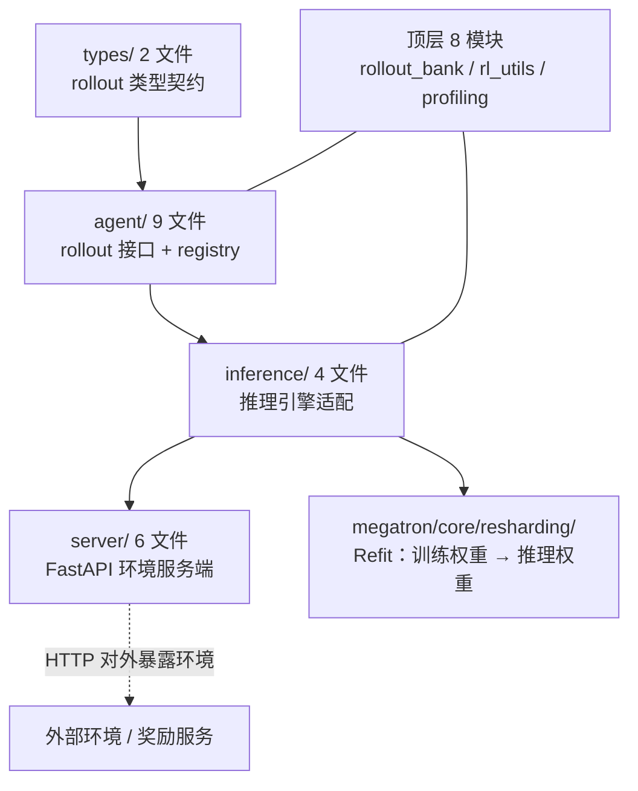
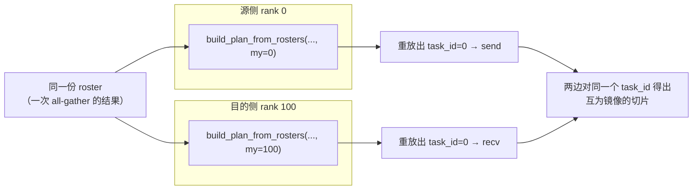
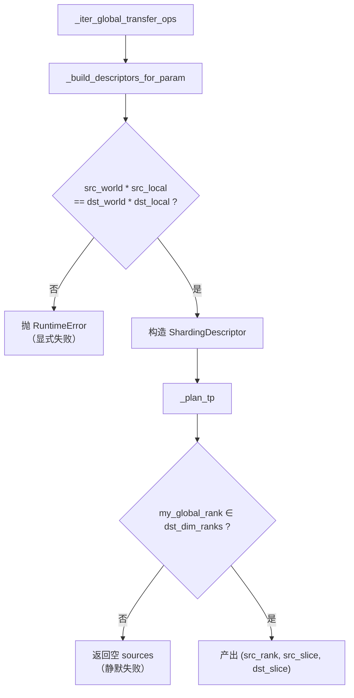
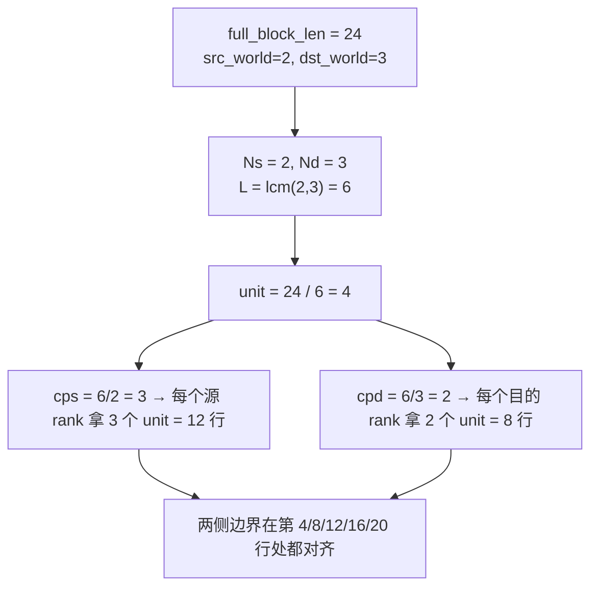
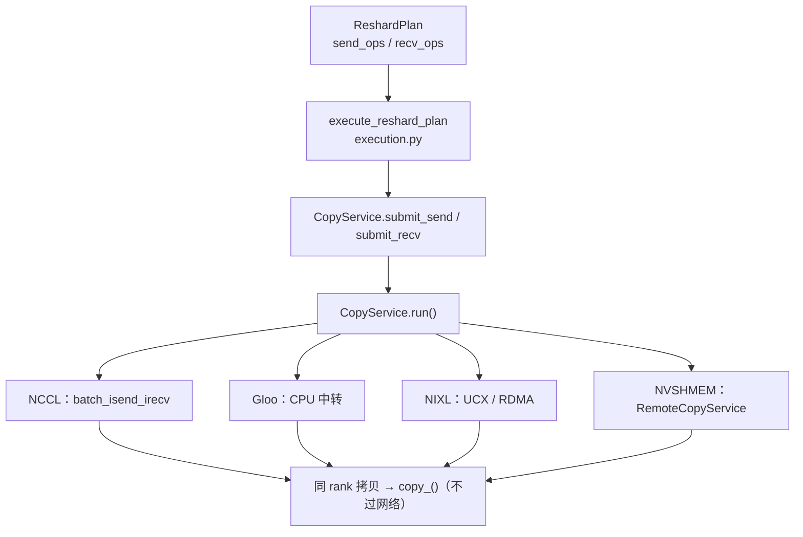
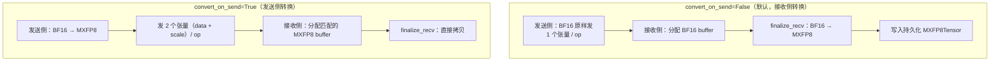
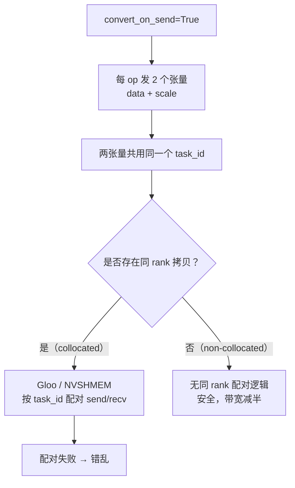
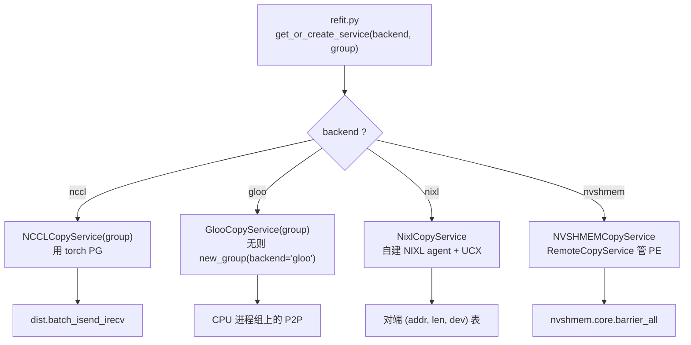
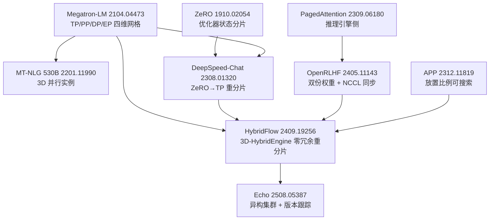

> **Megatron-LM 深度剖析系列 · 第 11 篇**
>
> 前置：[00 地基](/2026/09/28/megatron-00-foundation/)（代码地图 / 配置系统 / 控制流）｜ [01 进程组](/2026/10/08/megatron-01-process-groups-and-comm-overlap/)（组怎么建、怎么选、stream 流派）｜ [02 专家并行](/2026/10/08/megatron-02-expert-parallel/)｜ [03 张量并行与序列并行](/2026/10/09/megatron-03-tensor-parallel-and-sequence-parallel/)｜ [04 GTP](/2026/10/11/megatron-04-generalized-tensor-parallelism/)｜ [05 数据并行与优化器](/2026/10/10/megatron-05-data-parallel-and-optimizers/)｜ [06 流水并行调度器](/2026/10-16/megatron-06-pipeline-parallel-schedules/)｜ [07 上下文并行](/2026/10/17/megatron-07-context-parallel-and-long-context/)｜ [08 显存账本](/2026/10/12/megatron-08-memory-ledger/)｜ [09 低精度 FP8/FP4](/2026/10/15/megatron-09-low-precision-fp8-fp4/)｜ [10 CUDA Graph](/2026/10/18/megatron-10-cuda-graph/)｜ [14 模块规格与层栈](/2026/10/12/megatron-14-module-spec-and-layer-stack/)｜ [15 GPT/LLaMA 装配](/2026/10/13/megatron-15-gpt-and-llama-model-assembly/)｜ [16 Hybrid 与 MoE 装配](/2026/10/14/megatron-16-hybrid-and-moe-model-assembly/)
>
> 原理层：[分布式训练（03）张量并行](/2026/08/31/dist-train-03-tensor-parallel/)｜ [分布式训练（04）流水并行](/2026/08/31/dist-train-04-pipeline-parallel/)｜ [分布式训练（06）数据并行](/2026/09/03/dist-train-06-data-parallel/)
>
> 本系列做**源码层**：并行原理已在《分布式训练》系列讲透，这里一律引用不重推。源码基准 **`megatron-core` 0.20.0**，commit `60e039626`。
>
> **本篇的边界**：讲 `megatron/core/resharding/` 里的 **Refit 内核**——
> `refit.py` 门面、`planner.py` 排期、`execution.py` 落地、`transforms.py` 的量化转换，
> 以及 `copy_services/` 下**四种**传输路径。`megatron/rl/`（29 个文件）只作为
> 「Refit 服务的是谁」来引用，不展开写 RL 框架本身。
>
> **本篇是本博客与六条 RL 线交叉的唯一接口。** 本博客已有 `rl-*` /
> `toolrl` / `search-rl` / `distillation-*` / `online-distillation` / `opd-*`
> 六条线，那些篇目推导的 RL 原理这里一律引用不重推：
> [RL 变量与估计量](/2026/09/19/rl-notation-and-estimators-deepdive/)｜
> [信用分配](/2026/09/19/rl-credit-assignment-settlement/)｜
> [优势估计谱系](/2026/10/05/rl-advantage-estimation-lineage/)｜
> [RL 训练框架综述](/2026/09/29/rl-training-frameworks-survey/)｜
> [框架里的变量](/2026/09/30/rl-variables-in-frameworks/)｜
> [ToolRL](/2026/08/10/toolrl-reward-is-all-deepdive/)｜
> [Search-RL](/2026/08/11/search-rl-deepdive/)｜
> [蒸馏与 RL 的统一谱系](/2026/08/22/distill-rl-unified-spectrum/)｜
> [On-Policy Distillation](/2026/08/11/on-policy-distillation-deepdive/)｜
> [在线蒸馏方法](/2026/08/11/online-distillation-methods/)｜
> [OPD 一年回顾](/2026/08/24/opd-one-year-landscape/)
>
> **图全部自绘。** 本系列遵循「默认一律自绘」的引用许可原则：NVIDIA 官方文档与 blog 的图版权保留、不可复制；arXiv 论文的图需逐篇确认 abs 页有无 CC 标识。所以本篇每张图下方均注明所据的源码 permalink 或官方页面链接。

**TL;DR**

> * **Refit 解决的是一个非常具体的问题：同一份权重，要从「训练布局」搬到「推理布局」，而这两个布局通常不是同一个。** 训练侧是 DP×TP×PP×EP 的四维网格（[01 篇](/2026/10/08/megatron-01-process-groups-and-comm-overlap/)），推理侧通常只剩 TP——没有 DP 副本、没有梯度、没有优化器状态。搬一次就是**把一份分片方式不同的数据重新分片**。
> * **`planner.py` 的核心设计是「每个 rank 各自重放同一份确定性排期，只取属于自己的那一片」。** N 个 rank 得到 N 份**互补**的排期，而不是 N 份相同的排期再互相协调（[L403–L451](https://github.com/NVIDIA/Megatron-LM/blob/60e039626/megatron/core/resharding/planner.py#L403-L451)）。
> * **省掉协调的代价是「排期必须严格确定」。** 迭代顺序只依赖 metadata roster，源码用 `sorted(dst_param_metadata_by_rank)` 遍历，因此 sender 与 receiver 各自重放出的 `task_id` 自然一致（[L305–L356](https://github.com/NVIDIA/Megatron-LM/blob/60e039626/megatron/core/resharding/planner.py#L305-L356)）。
> * **C 级实验直接跑真实 `build_plan_from_rosters`（不是重实现）**，五组断言全过：两次跑逐位相同、每个 `task_id` 恰好一个 sender、切片互为镜像、**打乱 dict 插入序结果不变**、稀疏 rank 集结果不变。
> * **`task_id` 不只是记账，它是 NVSHMEM 的正确性前提。** NVSHMEM 后端对没有 `task_id` 的传输直接抛异常（[nvshmem_copy_service.py L16–L21](https://github.com/NVIDIA/Megatron-LM/blob/60e039626/megatron/core/resharding/copy_services/nvshmem_copy_service.py#L16-L21)）。
> * **「每个 rank 都有一份排期」也是 NVSHMEM 能安全用集合操作的原因**：`schedule()` 里有 all-gather、`run()` 里有 `barrier_all`，源码注释明写*ALL ranks must call*，因为 non-collocated 场景下有些 rank 确实没有搬运任务（[L151–L156](https://github.com/NVIDIA/Megatron-LM/blob/60e039626/megatron/core/resharding/copy_services/nvshmem_copy_service.py#L151-L156)）。
> * **四种 copy service 的差别是「谁在搬、搬的是什么」**：NCCL 走 `batch_isend_irecv`；Gloo 走 **CPU 侧中转**（GPU→pinned CPU→Gloo PG→pinned CPU→GPU）；NIXL 走 UCX/RDMA 且是**发送方驱动**；NVSHMEM 走硬件化远程拷贝。同 rank 拷贝四条路径都**不过网络**。
> * **NIXL 有一个会 segfault 的硬前提**：`UCX_TLS` 里必须有 `cuda_copy` / `cuda_ipc`，否则 UCX 把 GPU 指针当主机内存、直接崩在传输中途（[nixl_copy_service.py L16–L18](https://github.com/NVIDIA/Megatron-LM/blob/60e039626/megatron/core/resharding/copy_services/nixl_copy_service.py#L16-L18)）。
> * **搬运不是纯字节拷贝。** `MXFP8ReshardTransform` 让接收端把数据**直接写进持久化的 `MXFP8Tensor`**，以保住 CUDA graph 捕获的设备指针不变（[transforms.py L118–L123](https://github.com/NVIDIA/Megatron-LM/blob/60e039626/megatron/core/resharding/transforms.py#L118-L123)）。
> * **sender 侧量化能把带宽砍半，但只对 non-collocated 安全。** 代价是每 op 发两个张量，而 Gloo 与 NVSHMEM 靠 `task_id` 配对同 rank 拷贝——**多个张量共用一个 `task_id` 会让配对失效**（[transforms.py L142–L146](https://github.com/NVIDIA/Megatron-LM/blob/60e039626/megatron/core/resharding/transforms.py#L142-L146)）。这是全篇最值得记住的一处跨模块张力。
> * **A 级解析结论：字节总量与 TP 度无关，op 数才随 TP 度线性增长。** 每参数 op 数 == $$\max(\text{src\_tp}, \text{dst\_tp})$$。提高 TP 度不增加通信量，只把同样的字节切成更多次、更小的传输。
> * **决定代价的不是「同构与否」，而是「rank 是否重合」。** 同构且共址时远端字节 **0**、全部退化成进程内 `copy_()`；同构但不共址时远端占比仍是 **100%**。
> * **`megatron/rl/` 是四组不是两组**：`agent/` 定接口、`inference/` 接引擎、**`server/` 是 FastAPI 环境服务端**、`types/` 是 rollout 类型契约。**训练侧的类型契约与训练侧的权重搬运是两件事**，这个区分值得单列。
> * **规模感**：`megatron/core/resharding/` 全目录 **5800 行**，本篇覆盖 9 个文件；`planner.py` 524 行是核心，`copy_services/` 四条路径合计 760 行。

---

## 1. 两套布局，以及它们之间那道沟

### 1.1 问题从哪来

训练一个模型的并行布局是一张四维网格：**DP × TP × PP × EP**。
张量并行切权重（[03 篇](/2026/10/09/megatron-03-tensor-parallel-and-sequence-parallel/)），
流水并行切层（[06 篇](/2026/10/16/megatron-06-pipeline-parallel-schedules/)），
专家并行切专家（[02 篇](/2026/10/08/megatron-02-expert-parallel/)），
数据并行切批次（[05 篇](/2026/10/10/megatron-05-data-parallel-and-optimizers/)）。
四者正交组合的原始设计见
[Megatron-LM](https://arxiv.org/abs/2104.04473)（arXiv:2104.04473），
组怎么建见 [01 篇](/2026/10/08/megatron-01-process-groups-and-comm-overlap/)。

推理侧的布局是**另一回事**。生成阶段没有梯度、没有反向、没有优化器状态，
所以 DP 这一维通常整个消失——每个权重只需要一份。
剩下 TP（有时加 EP）决定权重怎么分片。

于是同一份权重在两个时刻有两种**切法**：

```text
训练时刻：  TP=t1  ×  PP=p1  ×  DP=d1  →  每个 rank 持一份 (out/t1, in) 的行块
推理时刻：  TP=t2  ×  PP=p2  →           每个 rank 持一份 (out/t2, in) 的行块
```

> 两套布局给出的两种分片方式。出处：本节由
> [`planner.py` `_build_descriptors_for_param` L56–L62](https://github.com/NVIDIA/Megatron-LM/blob/60e039626/megatron/core/resharding/planner.py#L56-L62)
> 的尺寸守恒条件 `src_world*src_local == dst_world*dst_local` 推出。

**Refit 就是把前者变成后者。** 这件事看起来只是「重新分片」，
但真做起来会撞上一串具体问题：谁该发、谁该收、发哪一段、
两边的切片怎么对齐、传输走哪条路径、以及——
**如果权重是量化过的，搬完还能保持量化语义吗**。

### 1.2 外部工作怎么处理这道沟

这不是 Megatron 独有的问题，它是 RLHF 训练循环里的一个已知瓶颈。
[HybridFlow](https://arxiv.org/abs/2409.19256)（verl）的论文把当时几种主流做法
列成一张表，这张表本身就是问题的定义：

| RLHF 系统 | 并行策略 | actor 权重在训练与生成之间怎么处理 |
| --- | --- | --- |
| DeepSpeed-Chat | 训练 ZeRO / 生成 TP | **在 ZeRO 与 TP 之间重分片** |
| OpenRLHF | 训练 ZeRO / 生成 TP | **两份 actor 权重**，分处不同设备 |
| NeMo-Aligner | 训练与生成都用 3D 并行 | 两阶段用**相同的模型切分**（共享权重） |
| HybridFlow | 训练 3D / ZeRO / FSDP，生成 3D | **零冗余重分片** |

表中第三列就是全部差异所在。**DeepSpeed-Chat 走的就是「重分片」这条路**，
其 [arXiv:2308.01320](https://arxiv.org/abs/2308.01320) 把这层机制叫 Hybrid Engine。
[OpenRLHF](https://arxiv.org/abs/2405.11143)（arXiv:2405.11143）走了另一条路：
它用 vLLM 做生成，靠 **NCCL 加 vLLM 的 weight loader** 在 ZeRO 引擎与 vLLM 引擎之间
同步权重——**宁可多存一份 actor 权重，也要换取切分逻辑的简单**。
[APP](https://arxiv.org/abs/2312.11819)（arXiv:2312.11819）则把模型放置本身
当成可搜索的问题，引入 *Model Placement Ratio* 概念。

Megatron 的 Refit 对应的是表里第一行那条路，
但做得更一般：**它不假设训练侧是 ZeRO、生成侧是 TP**，
而是接受任意两套 `(TP, PP)` 布局，把差集算出来。

这条路线在 RL 圈子里一直被认为代价高。
HybridFlow 论文给的数据是：它相对 DeepSpeed-Chat 把 transition 阶段的开销
最多压掉 89.1%（70B 模型），相对 OpenRLHF 平均压掉 55.2%。
**「transition」这个词本身就是这个问题的常用名**——
训练与生成之间那次权重搬运，在英文里就叫 model resharding / transition。

[Echo](https://arxiv.org/abs/2508.05387)（arXiv:2508.05387）则把这条路径推到了
更极端的地方：把推理与训练**彻底拆到异构集群**，靠 *version drift* 跟踪与
`sync_weight` 广播维持一致性。它的两条同步协议（sequential 拉取式 /
asynchronous 推送式）本质上是同一个问题的两种答案：
**搬运的频率与方向**。

> 值得对照的是本博客 [RL 训练框架综述](/2026/09/29/rl-training-frameworks-survey/)
> 与 [框架里的变量](/2026/09/30/rl-variables-in-frameworks/) 两篇——
> Refit 在 Megatron 侧的位置，对应它们讲的框架侧角色划分。

### 1.3 Megatron 原生 RL 栈的四组结构

Refit 不是为 RL 栈而造的，但 Megatron 确实带了一套原生 RL 栈
（`megatron/rl/`，29 个文件）。**把它说清楚有助于理解 Refit 服务的是谁**，
不过本篇不展开 RL 框架本身。

在 commit `60e039626` 下，这个目录是**四个子目录 + 8 个顶层模块**：

| 子目录 | 文件数 | 职责 |
| --- | --- | --- |
| `agent/` | 9 | 定义 rollout 的**接口**：`api.py` 定协议，`registry.py` 定注册表，`rollout_pipeline.py` 582 行是主力 |
| `inference/` | 4 | **对接推理引擎**：`inference_interface.py` 60 行定协议，`megatron.py` 251 行是 Megatron 侧实现 |
| **`server/`** | **6** | **FastAPI 环境服务端**：`agent/fastapi_env_server.py` 205 行、`inference/inference_interface_server.py` 95 行、`api.py` 49 行 |
| **`types/`** | **2** | **rollout 的类型契约**：`rollout.py` 72 行、`__init__.py` 25 行 |

顶层另有 `README.md` / `__init__.py` / `logging.py` / `rl_profiling.py` /
`rl_utils.py`（3056 行）/ `rollout_bank.py`（984 行）/ `rollout_granularity.py` /
`sequence_packing_utils.py`（1268 行）八个模块。

图 1 是这四组与 Refit 的关系。



> 图 1：`megatron/rl/` 的四组结构与 `resharding/` 的关系。出处：
> 文件清单由 `git ls-tree -r 60e039626 -- megatron/rl/` 逐条核出，
> 与 [`megatron/rl/`](https://github.com/NVIDIA/Megatron-LM/blob/60e039626/megatron/rl/) 目录一致。

四组里最值得注意的是 `server/`。**一个训练库内部自带 HTTP 服务端**，
这件事本身就是「原生 RL 栈的边界画在哪」这个问题的答案：
它不是纯粹的 trainer，而是把环境接口也纳进来了。

**而 `types/` 与 `resharding/` 的对照更能说明问题。**
`types/` 定义的 `rollout.py` 是**跨进程通信的数据契约**——
一次 rollout 要发出去、要能被远端环境消费、结果要能收回来。
`resharding/` 定义的 `TransferOp` 是**跨进程通信的数据搬运契约**。
**训练侧的类型契约与训练侧的权重搬运是两件事**：
前者关心语义（一个 rollout 是什么、奖励怎么记），
后者只关心字节与切片（哪块归谁）。这个区分是本篇的一条暗线——
§2 的 `task_id` 与 §4 的量化语义都属于后者，
它们不需要知道任何 RL 概念，也因此可以在没有 RL 栈时独立测试。

### 1.4 一处需要核正的清单

研究计划 `RESEARCH_PLAN.md` 把 `copy_services/` 写成
「**NCCL / Gloo / NVSHMEM 三种传输**」。
这个数不对：**实际有四种**。

| 传输路径 | 文件 | 行数 |
| --- | --- | --- |
| NCCL | `nccl_copy_service.py` | 77 |
| Gloo | `gloo_copy_service.py` | 133 |
| **NIXL** | `nixl_copy_service.py` | **277** |
| NVSHMEM | `nvshmem_copy_service.py` | 166 |
| （抽象基类） | `base.py` | 107 |

漏掉的 NIXL 不是边角料——**它是四条里最长的一条**（277 行），
也是唯一一条为 **non-collocated**（训练与推理分处不同集群）设计的路径，
走 UCX/RDMA。四条路径各自的适用场景见 §3。

这个「三 vs 四」的差别值得记一笔：它说明**计划文档里的清单容易在版本之间失同步**。
读源码时逐条 `ls-tree` 核一遍，比相信文档上的枚举可靠。

---

## 2. planner：每个 rank 重放同一份排期

### 2.1 设计陈述

这是全篇最值得写的一节。先把设计说清楚，再看它为什么成立。

朴素的做法是：**rank 0 算出完整排期，再广播给所有人**。
问题是 rank 0 成了瓶颈，而且排期本身可能大到广播不划算。

Megatron 选了另一条路。它在
[`build_local_reshard_plan`](https://github.com/NVIDIA/Megatron-LM/blob/60e039626/megatron/core/resharding/planner.py#L454-L500)
的 docstring 里把设计写得很直白：

> Build this rank's reshard plan **locally**: all-gather the parameter metadata,
> **replay the global schedule**, and **keep only the ops where this rank is the
> sender or receiver**. No rank-0 bottleneck and no scatter, **since sender and
> receiver derive matching task_ids from the same metadata**.

拆成三步就是：**一次集合通信换元数据 → 各 rank 独立重放完整排期 → 只留自己那一片**。

图 2 是与朴素方案的对照。


> 图 2：两种排期分发方式。出处：
> [`build_local_reshard_plan` docstring L462–L471](https://github.com/NVIDIA/Megatron-LM/blob/60e039626/megatron/core/resharding/planner.py#L462-L471)。

两种方案都只做**一次**集合通信。差别在于：朴素方案集合通信传的是**排期**，
Megatron 传的是**元数据**，排期在本地重算。

### 2.2 集合通信只发生一次

那一行集合通信在
[`L492–L495`](https://github.com/NVIDIA/Megatron-LM/blob/60e039626/megatron/core/resharding/planner.py#L492-L495)：

```python
# One all-gather gives every rank the full (src, dst) picture, replacing the
# gather-to-0 + scatter.
gathered_pairs = [None] * world_size
dist.all_gather_object(gathered_pairs, (my_src_metadata, my_dst_metadata), group=group)
```

源码注释明说是 **replacing the gather-to-0 + scatter**。
`all_gather_object` 的语义见
[PyTorch 官方文档](https://docs.pytorch.org/docs/stable/distributed.html#torch.distributed.all_gather_object)。

有两个实现细节值得记：

**第一，rank 编号用 `group.rank()` 而不是 `dist.get_rank(group)`。**
[`L477–L480`](https://github.com/NVIDIA/Megatron-LM/blob/60e039626/megatron/core/resharding/planner.py#L477-L480)
的注释写得很清楚：前者 *support cross-cluster PGs whose members have independent
default PGs*。**这正是 non-collocated 场景的刚需**——
训练集群与推理集群各有自己的默认进程组，进程组内成员要能在自己的世界里拿到正确编号。

**第二，rank list 做了去重。**
[`L482–L484`](https://github.com/NVIDIA/Megatron-LM/blob/60e039626/megatron/core/resharding/planner.py#L482-L484)：

```python
# Dedup rank lists so params sharing a group reuse one list object; shrinks
# the pickled all-gather ~75%.
rank_list_cache: dict = {}
```

注释里的 **~75%** 是源码自述的量级，未经本机复现（属 D 级，不引为实测）。
但机制是清楚的：`ParameterMetadata` 里 `tensor_parallel_group_ranks` 这类字段，
同一个 TP 组下的成百上千个参数共享同一个 list；不共享的话 pickle 出的
`all_gather_object` 载荷会大量重复。

### 2.3 确定性从哪来

拿到 roster 之后，两个纯函数接手。
第一个是
[`index_metadata_rosters`](https://github.com/NVIDIA/Megatron-LM/blob/60e039626/megatron/core/resharding/planner.py#L388-L400)，
把「按 rank 排列的列表」转成两份 roster：目的侧按 rank 建索引，源侧按参数名聚合。

第二个是真正的排期生成器
[`_iter_global_transfer_ops`](https://github.com/NVIDIA/Megatron-LM/blob/60e039626/megatron/core/resharding/planner.py#L305-L356)：

```python
for dst_rank in sorted(dst_param_metadata_by_rank):
    dst_rank_params = dst_param_metadata_by_rank[dst_rank]
    for resolved_name, dst_metadata in dst_rank_params.items():
        src_meta_list = src_param_metadata.get(resolved_name)
        ...
        for src_rank, src_slice, dst_slice in sources:
            task_id = next_task_id
            next_task_id += 1
            yield task_id, dst_rank, src_rank, src_slice, dst_slice, ...
```

docstring 把确定性的来源写成了三条：

> The iteration order (dst rank ascending, then that rank's dst params in
> gathered order, then per-source sub-ops) **depends only on the rosters**, so
> replaying this on any rank produces the same sequence and assigns the same
> task_id to the same transfer. **That's what lets each rank build its own
> send/recv ops while sender and receiver still agree on task_id.**

**三个层次各自的不确定性来源都被掐断了：**

| 层次 | 排序键 | 为什么确定 |
| --- | --- | --- |
| rank 之间 | `sorted(dst_param_metadata_by_rank)` | 显式 `sorted`，与 dict 插入序无关 |
| 同一 rank 的参数之间 | `dst_rank_params.items()` | 继承自 all-gather 的**按 rank 序**拼装结果 |
| 同一参数的多份源之间 | `_determine_source_ranks_for_dst_param` 的返回值顺序 | 由切分算式决定，不依赖运行时状态 |

docstring 还补了一句容易被忽略的：
**Ranks are taken from the roster keys rather than `range(world_size)`**,
所以稀疏或增长的 rank 集合（后来才加入的节点）重放结果一样。
这条正是 C5 要验的。

图 3 画出 `task_id` 是怎么被两端共同认领的。



> 图 3：`task_id` 的一致性来自「同一份 roster + 同一个确定性迭代」，不来自通信。出处：
> [`_iter_global_transfer_ops` docstring L309–L315](https://github.com/NVIDIA/Megatron-LM/blob/60e039626/megatron/core/resharding/planner.py#L309-L315)。

### 2.4 只留自己那一片

第三个函数
[`build_plan_from_rosters`](https://github.com/NVIDIA/Megatron-LM/blob/60e039626/megatron/core/resharding/planner.py#L403-L451)
就是那个「重放并筛选」。它遍历完整的全局排期，然后：

```python
for (task_id, dst_rank, src_rank, src_slice, dst_slice,
     src_metadata, dst_metadata) in _iter_global_transfer_ops(...):
    if dst_rank == my_global_rank:
        my_plan.recv_ops.append(TransferOp(..., peer_slice=src_slice, task_id=task_id))
    if src_rank == my_global_rank:
        my_plan.send_ops.append(TransferOp(..., peer_slice=dst_slice, task_id=task_id))
```

**两个 `if` 而不是一个 `if/elif`。** 这不是笔误：collocated 模式下
同一个 rank 既是某条传输的 sender 也是另一条的 receiver，两个列表都可能有东西。
§5 的表 4 会显示源侧 8 个 rank 每个只发不收，目的侧 4 个每个只收不发——
但那只发生在 non-collocated 布局下。

这个函数的 docstring 还有一句关键的话：
**Pure and collective-free, so it can be tested or reused with preassembled
rosters without touching the process group.**
纯函数、无集合通信。**C 级实验正是靠这一点才成立**——见 §2.6。

顺带一提，旧的
[`build_centralized_reshard_plan`](https://github.com/NVIDIA/Megatron-LM/blob/60e039626/megatron/core/resharding/planner.py#L503-L524)
已经成了 deprecated wrapper：先 `warnings.warn(..., DeprecationWarning, stacklevel=2)`
再转调新函数（[`warnings.warn`](https://docs.python.org/3/library/warnings.html)
 的 `stacklevel=2` 让警告指向调用方而非 wrapper 自身）。
函数名里的 “centralized” 对应的正是 §2.1 那个被放弃的朴素方案。

### 2.5 两处会「静默改变结果」的陷阱

源码里有两处细节，写出来能省下不少调试时间。

**第一，TP 维度必须精确整除。**
[`_build_descriptors_for_param`](https://github.com/NVIDIA/Megatron-LM/blob/60e039626/megatron/core/resharding/planner.py#L56-L62)
在做任何事之前先做尺寸守恒校验：

```python
if src_world * src_local != dst_world * dst_local:
    raise RuntimeError(
        f"Cannot build TP descriptor for {dst_metadata.name} dim{tp_dim}: ..."
        "This usually means the param is marked TP but is effectively replicated on that "
        "dim or partition_dim/metadata is inconsistent between source and destination.")
```

**这是显式抛错，不是静默截断。** 踩过一次：让 `OUT=2048`、推理侧 `TP=6`，
planner 立刻报 `8*256=2048 != 6*341`。改用 `OUT=1152`（可被 8/6/4/2 整除）后正常。

**第二，共址必须在建 roster 时就把 rank 编号编对。**
如果事后只把 roster 的 dict key 从 `100` 改成 `0`，
却不同步改 `ParameterMetadata.tensor_parallel_group_ranks`，
那么 `_plan_tp` 里 `my_global_rank not in dst_dim_ranks` 的判断会失败，
**静默返回一个空排期**——不抛异常，`task_id` 变成 0。
这类「输入改了但内部组信息没跟着改」的 bug 最难查，因为没有报错。

图 4 标出这两处检查各自的位置。



> 图 4：planner 里两种失败模式——一个显式抛错，一个静默返回空。出处：
> [`_build_descriptors_for_param` L56–L62](https://github.com/NVIDIA/Megatron-LM/blob/60e039626/megatron/core/resharding/planner.py#L56-L62)
> 与 `_plan_tp`。

### 2.6 C 级实验：五组确定性断言

前面所有说法都可以靠读 docstring 相信，**但 C 级实验把它们变成了可复现的事实**。

实验的关键做法是：**不重实现 planner，直接跑仓库里那份。**
`planner.py` 的依赖极浅——只 import `torch` / `torch.distributed` 与同目录的
`utils.py`，**不碰任何 `megatron.core.*` 模块**，
所以可以在运行时用 `git show 60e039626:` 把两个文件抽成临时包再 import。
脚本见
[`planner_determinism.py`](https://github.com/lrypcy/ipynbs/blob/4bfaa47/experiments/megatron/refit/planner_determinism.py)。

测试拓扑：训练侧 `TP=8`（源 rank 0–7）、推理侧 `TP=4`（目的 rank 100–103），
6 层 × 4 类权重，`OUT=1152 INP=1024` bf16。真实 planner 产出：

```text
[规模] task_id 共 192 个；send op 192 个，recv op 192 个，合计 384 个
[参与] 12 个 rank 都有 op（源 8 + 目的 4 = 12）

[对账]
  C1 确定性: ok
  C2 互补性: ok
  C3 收发自洽: ok
  C4 插入序无关: ok
    （稀疏 roster：源 4 rank + 目的 1 rank，产出 48 个 task_id，全部是基准的子集）
  C5 稀疏 rank 集: ok
```

> 出处：`ipynbs` `experiments/megatron/refit/planner_determinism.py` 真实输出，
> 见 [`results/planner_determinism.stdout.txt`](https://github.com/lrypcy/ipynbs/blob/4bfaa47/experiments/megatron/refit/results/planner_determinism.stdout.txt)。

五组断言的判据：

| 对账 | 判据 | 结果 |
| --- | --- | --- |
| C1 | 同输入跑两次，`task_id → op` 映射逐位相同 | ok |
| C2 | 所有 rank 的 `send_ops` 合起来，每个 `task_id` 恰好出现一次；无孤立 send/recv | ok |
| C3 | 同一 `task_id` 上 sender 的 `my_slice` == receiver 的 `peer_slice`，且 sender 认为的对端确实是该 rank | ok |
| C4 | 打乱 roster 的 dict 插入顺序后，`task_id` 分配不变 | ok |
| C5 | roster 的 key 换成非连续值后，结果不变且为基准的子集 | ok |

**C3 是这一节最关键的证据。** sender 与 receiver 从未就任何一条传输通信过，
却能对同一个 `task_id` 得出**互为镜像**的切片——唯一可能就是两边独立重放了同一个
确定性迭代。这正是 §2.1 docstring 那句 *sender and receiver derive matching task_ids
from the same metadata* 的实测版本。

**C4 验的是最容易实现错的一环。** 源码用 `sorted(...)` 遍历就是为了摆脱
dict 插入序的影响；如果实现里写成 `.items()` 直接迭代，C4 就会失败。
**C5** 则验证了 docstring 说的「rank 取自 roster 的 key 而非 `range(world_size)`」。

另外注意规模那一行的两个数：**192 个 `task_id`、12 个 rank 全部有 op**。
192 = 24 个参数 × 8 个源分片——`TP=8 → TP=4` 时每个源分片恰好喂给一个目的 rank，
所以每参数产生 8 个 op。这条关系在 §5 会被推广成一条定律。

> 本节不含任何 GPU 实测数字。C 级实验只跑纯 CPU 的 Python 排期逻辑，
> 不涉及通信、显存或吞吐。

### 2.7 两种参数，两条排期路径

`_determine_source_ranks_for_dst_param`（见
[`L282–L302`](https://github.com/NVIDIA/Megatron-LM/blob/60e039626/megatron/core/resharding/planner.py#L282-L302)）
是个二选一的路由器：**能建 TP 描述符就走 `_plan_tp`，否则走 `_finalize_dp_transfers`**。
这对应两类参数，而它们的排期逻辑完全不同。

**第一类：TP 分片参数。** 这类走
[`_emit_lcm_block_ops`](https://github.com/NVIDIA/Megatron-LM/blob/60e039626/megatron/core/resharding/planner.py#L77-L130)，
一个**最小公倍数微切块**算法：

```python
Ns = src_world * max(1, src_stride)
Nd = dst_world * max(1, dst_stride)
L = math.lcm(Ns, Nd)
if full_block_len % L != 0:
    raise RuntimeError(f"{param_name}: {block_label} length {full_block_len} "
                       f"not divisible by LCM {L} (Ns={Ns}, Nd={Nd})")
unit = full_block_len // L
cps = L // Ns
cpd = L // Nd
```

**为什么要取 LCM？** 因为两侧的切分粒度未必一致：
源侧按 `Ns` 份切、目的侧按 `Nd` 份切，只有把整块细分成
$$\operatorname{lcm}(N_s, N_d)$$ 份，两边的边界才对得齐。
`unit` 是每份的长度，`cps` / `cpd` 分别是每个源 / 目的 rank 拿几份。

**`src_stride` / `dst_stride` 的存在把序列并行纳进来了。**
stride 大于 1 表示该维度是**交错分片**而非连续分片——
序列并行切 LayerNorm/Dropout 所在的维度正是这种形态
（见 [03 篇](/2026/10/09/megatron-03-tensor-parallel-and-sequence-parallel/)）。
**如果只按连续块处理，序列并行下的权重搬运会算错切片。**
这就是为什么是 LCM 而不是简单整除。

图 5 用一个具体例子说明 LCM 切法。



> 图 5：LCM 微切块把两侧边界对齐。出处：
> [`_emit_lcm_block_ops` `L100–L112`](https://github.com/NVIDIA/Megatron-LM/blob/60e039626/megatron/core/resharding/planner.py#L100-L112)。
> 图中数值为按该公式构造的示意，非实测。

**这里还有第二种 block 布局。**
[`_tp_block_layout`](https://github.com/NVIDIA/Megatron-LM/blob/60e039626/megatron/core/resharding/planner.py#L131-L191)
的 docstring 区分了两种：没有 `partition_sizes` 时是**整维一个块**；
有 `partition_sizes` 时是**按打包组件各出一个块**，
docstring 举例说 *e.g. Mamba `in_proj`*。
换言之，**投影被打包成几个互相独立的子张量**时（如 Mamba 的融合投影），
每个子张量独立分片、各自走一遍 LCM 切分。`math.lcm` 的语义见
[Python math 文档](https://docs.python.org/3/library/math.html)。

**第二类：DP 复制参数。** LayerNorm 这类参数在所有 rank 上都是完整的，
没有 TP 切分。它们走
[`_finalize_dp_transfers`](https://github.com/NVIDIA/Megatron-LM/blob/60e039626/megatron/core/resharding/planner.py#L247-L279)：

```python
if my_global_rank not in dst_dp_ranks:
    return []
full_slice = tuple(slice(None) for _ in range(len(dst_shape)))
# Same DP layout - local copy
if src_dp_ranks == dst_dp_ranks and my_global_rank in src_dp_ranks:
    return [(my_global_rank, full_slice, full_slice)]
return [(src_metadata.owner_rank, full_slice, full_slice)]
```

三条分支读下来是：
**不属于目的 DP 组 → 不参与**；
**两侧 DP 组相同且本 rank 也持有源 → 本地整块拷贝**（`src_rank == dst_rank`，
正好落进 §3 各路径的 `local_sends` 分支）；
**否则 → 从 `select_src_metadata_balanced` 挑好的源 rank 整块搬**。
docstring 说这种 round-robin 选择是 *deterministic ... based on the receiver's
global rank for better load distribution*——
**确定性与负载均衡在这里是同一个要求**：正因为选择规则确定，
重放才能对上 `task_id`。

`ParameterMetadata` 里 `data_parallel_group_ranks` 这个字段就是为此存在的；
它与 `tensor_parallel_group_ranks` 并列，描述该参数在哪个维度上被切。
DDP 与 FSDP 的参数分片语义分别见
[PyTorch DDP 文档](https://docs.pytorch.org/docs/stable/notes/ddp.html)
与 [PyTorch FSDP 文档](https://docs.pytorch.org/docs/stable/fsdp.html)，
ZeRO 的分片对象见
[arXiv:1910.02054](https://arxiv.org/abs/1910.02054)，Megatron 侧的对应实现见
[05 篇](/2026/10/10/megatron-05-data-parallel-and-optimizers/)。

---

---

## 3. 四条传输路径

### 3.1 抽象只有四个方法

[`copy_services/base.py`](https://github.com/NVIDIA/Megatron-LM/blob/60e039626/megatron/core/resharding/copy_services/base.py)
只有 107 行，定义了一个 ABC 与三个数据结构：

| 符号 | 作用 |
| --- | --- |
| `SendOp` | 一条待执行的发送：带 `task_id`、`tensor`、`dest_rank` |
| `RecvOp` | 一条待执行的接收：带 `task_id`、`tensor`、`src_rank` |
| `CopyService` | 抽象基类，`submit_send` / `submit_recv` / `run` / `close` |
| `match_local_ops_by_task_id` | 把同 rank 的 send/recv 按 `task_id` 配对，不配对就抛错 |

**这个接口小得出奇，但恰好够用**：先把所有 op 攒起来，再一次性 `run()`。
这种「攒批 + 一次性执行」的形状不是为了性能，而是为了让**四种后端共享同一套排期**——
`execution.py` 完全不需要知道底层是 NCCL 还是 NIXL。

`close()` 的默认实现是 no-op，docstring 注明只有 NVSHMEM 覆写它
（*Release backend-owned resources. Default no-op; NVSHMEM overrides*）。

图 6 是这层抽象的位置。



> 图 6：`CopyService` 的四方法抽象与四条实现路径。出处：
> [`base.py`](https://github.com/NVIDIA/Megatron-LM/blob/60e039626/megatron/core/resharding/copy_services/base.py)
> 与 [`execution.py` `execute_reshard_plan`](https://github.com/NVIDIA/Megatron-LM/blob/60e039626/megatron/core/resharding/execution.py#L68-L91)。

### 3.2 NCCL：最薄的一条

[`nccl_copy_service.py`](https://github.com/NVIDIA/Megatron-LM/blob/60e039626/megatron/core/resharding/copy_services/nccl_copy_service.py)
只有 77 行，docstring 自称 *Thin wrapper around torch.distributed batch_isend_irecv*。

它做的两件事都值得看：

**第一，同 rank 拷贝被单独拎出来，走一条专用 stream。**

```python
# Dedicated stream for local (same-rank) copies to avoid unnecessary
# serialization with work on the default stream.
self._copy_stream = torch.cuda.Stream()
```

然后 `run()` 里先按 `dest_rank == self.rank` 把 op 分成 `local_sends` / `remote_sends`
（recv 同理），本地的用 `match_local_ops_by_task_id` 配对后直接
`recv_op.tensor.copy_(send_op.tensor)`，远端的才包成 `dist.P2POp` 交给
`dist.batch_isend_irecv`。最后 `torch.cuda.current_stream().wait_stream(self._copy_stream)` join。

**这个「先分本地/远端」的结构是四条路径共有的**，
§5 的成本模型正是按这个分界给出本地字节与远端字节。

**第二，一次 all-gather 换来的元数据没有被浪费**：
`batch_isend_irecv` 一次提交整批 p2p op，语义见
[PyTorch 官方文档](https://docs.pytorch.org/docs/stable/distributed.html#torch.distributed.batch_isend_irecv)；
底层 `P2POp` 见
[`torch.distributed.P2POp`](https://docs.pytorch.org/docs/stable/distributed.html#torch.distributed.P2POp)。
NCCL 本身的集合语义见 [NCCL collectives](https://docs.nvidia.com/deeplearning/nccl/user-guide/docs/usage/collectives.html)
与 [NCCL p2p](https://docs.nvidia.com/deeplearning/nccl/user-guide/docs/usage/p2p.html)。

### 3.3 Gloo：唯一一条绕道 CPU 的

[`gloo_copy_service.py`](https://github.com/NVIDIA/Megatron-LM/blob/60e039626/megatron/core/resharding/copy_services/gloo_copy_service.py)
133 行，docstring 说它 *routes refit traffic over a CPU/Gloo process group instead of NCCL*。

它的数据路径因此变成四跳：

```text
GPU 张量 → pinned CPU → Gloo CPU 进程组 → pinned CPU → GPU 张量
```

> Gloo 路径的四跳数据通路。出处：
> [`gloo_copy_service.py` `L43–L51`](https://github.com/NVIDIA/Megatron-LM/blob/60e039626/megatron/core/resharding/copy_services/gloo_copy_service.py#L43-L51)
> 的 pinned CPU 暂存与 docstring *routes refit traffic over a CPU/Gloo process group*。

两个实现细节撑住了这条绕路：

**第一，收端为每个 recv op 预分配一块 pinned 内存。**

```python
# Allocate a pinned CPU buffer for faster CPU↔GPU transfer.
cpu_buffer = torch.empty(dest_tensor.shape, dtype=dest_tensor.dtype,
                          device="cpu", pin_memory=True)
self.recv_ops.append((RecvOp(task_id=task_id, tensor=cpu_buffer, src_rank=src_rank),
                      dest_tensor))
```

注意 `RecvOp` 与 GPU 侧目标张量被**成对存进一个 tuple**——
`RecvOp` 里装的是 CPU buffer，真正的落点另存一份。发送侧则相反，
`run()` 里先用 `non_blocking` 把所有 GPU→CPU 的拷贝发出去、sync 一次，
再构建 CPU 张量上的 P2P op。

**第二，仍然开了一条 `_copy_stream`**，注释说明它覆盖
*local same-rank copies and the final CPU→GPU writebacks*，
好让这些 GPU 侧工作与默认流上发出的 GPU→CPU 暂存拷贝重叠。

pinned memory 的语义见
[`torch.Tensor.copy_`](https://docs.pytorch.org/docs/stable/generated/torch.Tensor.copy_.html)
相关章节；Gloo 作为 CPU 后端见
[PyTorch distributed 文档的 gloo 小节](https://docs.pytorch.org/docs/stable/distributed.html#gloo)。

**这条路径的取舍是清楚的：多两跳搬运，换来「不需要 GPU 互联」与「能跨到没有 NCCL 的进程组」。**

### 3.4 NIXL：最长的一条，为跨集群而生

[`nixl_copy_service.py`](https://github.com/NVIDIA/Megatron-LM/blob/60e039626/megatron/core/resharding/copy_services/nixl_copy_service.py)
277 行，是四条里最长的。docstring 点明用途：
*Refit transport over NIXL (UCX/RDMA), for **cross-cluster non-collocated** refit*。

**第一，一个会 segfault 的环境前提。**
文件开头定义了这份常量：

```python
# Transports that let UCX read/write CUDA memory. Without one of these UCX sees
# a GPU pointer as host memory and segfaults mid-transfer.
_CUDA_UCX_TRANSPORTS = ("cuda_copy", "cuda_ipc")
```

配套的
[`_ensure_cuda_ucx_transports()`](https://github.com/NVIDIA/Megatron-LM/blob/60e039626/megatron/core/resharding/copy_services/nixl_copy_service.py#L25-L37)
会检查 `UCX_TLS` 环境变量：如果它被钉死成一个不含 `cuda` 的白名单（部署里常见
`UCX_TLS=tcp`），就**追加**这两个 transport 并打 warning。
函数注释说明了三条边界：*UCX reads `UCX_TLS` once at agent init*（所以必须早于 agent 初始化）、
只对**包含式**白名单做追加、未设置（默认 `all`）或**排除式**（`^` 开头）都不动。

**第二，控制反转：发送方驱动。**
这是 NIXL 路径与前三条最大的结构差异：

> Every refit after that is **pure NIXL and sender-driven**: a receiver signals
> each source that its buffers are free (“ready”); the source waits, syncs its
> weights, ... Same-rank transfers skip NIXL and copy directly.

NCCL/Gloo/NVSHMEM 都可以理解成「双方各自提交 op，然后一起执行」；
NIXL 则是**接收方先喊 ready，发送方再写进去**。
支撑这套的是一张**预先建好的对端表**：每个 rank 跑一个 NIXL agent，
要写对端就需要对端的 agent 元数据（连接信息）加上
一份 `{task_id: (addr, len, dev)}` 的已注册区域表。
docstring 说这张表由 *A one-time torch all-gather* 建立并缓存，
而 *Buffers are registered locally, not exchanged*。

这里的 `(addr, len_bytes, device_id)` 三元组就是文件顶部定义的 `_MemDesc`，
它让发送方可以**直接 WRITE 进接收方的目标缓冲区**，
而不需要接收方参与传输本身。UCX 的传输层语义见
[UCX 官方文档](https://openucx.readthedocs.io/en/master/)。

**第三，后端是写死 UCX-only 的。**
`nixl_agent(name, nixl_agent_config(backends=["UCX"]))`，注释解释
*refit moves CPU/CUDA tensors directly between ranks and does not use NIXL's
storage-oriented plugins*。另外 host 张量的 device id 是 `-1`，
而 NIXL 把 DRAM 记作 device 0，源码里做了这个转换。

### 3.5 NVSHMEM：把 `task_id` 变成硬约束

[`nvshmem_copy_service.py`](https://github.com/NVIDIA/Megatron-LM/blob/60e039626/megatron/core/resharding/copy_services/nvshmem_copy_service.py)
166 行，但它**不是终点**——它 import 了另一个目录
[`resharding/nvshmem_copy_service/`](https://github.com/NVIDIA/Megatron-LM/blob/60e039626/megatron/core/resharding/nvshmem_copy_service/)（约 20 个文件）里的
`RemoteCopyService`。这个同名目录容易和 `copy_services/nvshmem_copy_service.py` 混淆：
**前者是完整的 NVSHMEM 传输栈（带自己的 planning/ core/ memory/ kernels/），后者只是接到
Refit 里的适配层。** 本篇按范围只写后者。

它的 docstring 把 `task_id` 的地位写得很直接：

> NVSHMEM requires a **globally unique task_id for every transfer** so that the
> planner can schedule send/recv pairs. **Calls without a task_id will raise.**

```python
if task_id is None:
    raise RuntimeError(
        "NVSHMEMCopyService requires a task_id for every transfer; got task_id=None"
    )
```

**这就是 §2 那套「确定性重放」设计的真正价值所在。**
`task_id` 在 NCCL 与 Gloo 路径里只是记账用的标签，
在 NVSHMEM 这里却成了**正确性前提**——因为 NVSHMEM 要靠它把 send/recv 配成对。
如果排期不确定、两端算不出同一个 `task_id`，NVSHMEM 这条路径直接不可用。

NVSHMEM 的 `run()` 里有第二处硬约束，注释写得很清楚：

```python
# NOTE: ALL ranks must call schedule() and run() because they contain collective
# operations that require all ranks to participate:
#  - schedule() has dist.all_gather_object() (torch distributed collective)
#  - run() has nvshmem.core.barrier_all() (nvshmem collective)
# This is critical for non-collocated refit where some ranks may have no work.
```

**「有些 rank 没有搬运任务」恰恰是 non-collocated 的常态**——
某些 rank 只发不收、某些只收不发。但集合操作要求所有参与者到场，
所以哪怕手上是空排期也必须调 `schedule()` 与 `run()`。
§2.6 实测的「12 个 rank 全部有 op」是本测试拓扑下的结果；
即便某个 rank 为空，**它也仍然有排期对象**（只是那个列表是空的），
这正是这条注释成立的前提。

`run()` 里同 rank 拷贝的处理也与其他三条一致（按 `task_id` 配对、直接 `copy_`），
但**校验更严**：会检查 `src.numel() != dst.numel()` 或
`src.element_size() != dst.element_size()` 并抛错，
还会把不匹配的 `task_id` 列表打出来（截断到 10 个）。

### 3.6 四条路径对照

| | NCCL | Gloo | NIXL | NVSHMEM |
| --- | --- | --- | --- | --- |
| 文件行数 | 77 | 133 | 277 | 166 |
| 底层 | `batch_isend_irecv` | Gloo CPU PG | UCX / RDMA | `RemoteCopyService` |
| 数据路径 | GPU → GPU | GPU → **pinned CPU** → CPU PG → GPU | GPU → 对端 buffer（直接 WRITE） | GPU → 对端（硬件化） |
| 方向语义 | 双方提交 | 双方提交 | **发送方驱动**（接收方 ready 信号） | 双方提交 + 集合 |
| 需要 `task_id` | 记账 | 同 rank 配对 | 对端表用 | **硬性要求，缺失即抛** |
| 全部 rank 须参与 | 否 | 否 | 否（对端表一次性 all-gather） | **是**（`barrier_all`） |
| 典型场景 | 同集群 GPU 间 | 无 GPU 互联 / CPU 进程组 | **跨集群 non-collocated** | 同集群高速互联 |

> 表 3-1：四条 copy service 对照。出处：四个文件各自的类 docstring 与 `run()` 实现，
> 见 [`copy_services/`](https://github.com/NVIDIA/Megatron-LM/blob/60e039626/megatron/core/resharding/copy_services/)。

---

## 4. transforms.py：搬运不是字节拷贝

### 4.1 抽象：四个方法，两种模式

[`ReshardTransform`](https://github.com/NVIDIA/Megatron-LM/blob/60e039626/megatron/core/resharding/transforms.py#L23-L67)
定义了四个方法：`should_transform` / `prepare_send` / `prepare_recv` / `finalize_recv`。

docstring 里有一条决定性的约束：

> The only constraint is that **`prepare_send` and `prepare_recv` must return the
> same number of tensors** for a given parameter so that send/recv pairs match.

**「张量个数相等」是唯一的硬约束**，其余都自由。docstring 还指出 transform 可以
*change the wire format*（如发 MXFP8 的 data+scale 而不是 BF16），
**或**保持 wire format 不变、只在接收侧后处理。

### 4.2 MXFP8ReshardTransform：为什么接收侧要写进持久化 buffer

[`MXFP8ReshardTransform`](https://github.com/NVIDIA/Megatron-LM/blob/60e039626/megatron/core/resharding/transforms.py#L118-L163)
的 docstring 第一句就点明了它的存在理由：

> Writes received weight data **directly into persistent `MXFP8Tensor` buffers so
> that CUDA-graph device-pointer captures remain valid across refits**.

**这里有一条跨篇的因果链。** CUDA graph 捕获的是**设备指针**，
而不是「某个偏移处的值」。如果 Refit 每次都把权重 clone 到一块新显存，
捕获的指针就失效了。所以接收端必须**原地写回那块持久化 buffer**。
这把 [10 篇](/2026/10/18/megatron-10-cuda-graph/) 的约束直接传导进了
resharding 的实现里。MXFP8 格式本身的 scale 语义见
[09 篇](/2026/10/15/megatron-09-low-precision-fp8-fp4/)，
OCP 对 microscaling 格式的规范见
[OCP Microscaling Formats (MX) v1.0 规范](https://www.opencompute.org/documents/ocp-microscaling-formats-mx-v1-0-spec-final-pdf)。

图 7 画出两种模式的差异。



> 图 7：`MXFP8ReshardTransform` 的两种模式。出处：
> [`transforms.py` `L125–L146`](https://github.com/NVIDIA/Megatron-LM/blob/60e039626/megatron/core/resharding/transforms.py#L125-L146)。

**默认模式（`convert_on_send=False`）的妙处是 sender 不需要 transform。**
wire format 没变，发送侧照常走默认路径，**只有接收侧创建 transform**——
docstring 说这是 *the simplest mode and avoids any sender/receiver coordination*。

### 4.3 一处跨模块的张力

发送侧转换能把带宽砍一半——docstring 说 *This mode halves wire bandwidth
(~1 byte/elem vs 2)*。但它有一条明确的限制：

> **Caveat**: CopyService backends that match local (same-rank) transfers by
> `task_id` (**Gloo, NVSHMEM**) will break if multiple tensors share the same
> `task_id`. This mode is therefore **only safe for non-collocated setups**
> where sender and receiver are on different ranks. A future fix could generate
> unique sub-IDs.

**这是全篇最值得记住的一处跨模块张力。** 把它拆开看：

1. sender 侧转换后，每条 op 要发**两个**张量（data + scale）。
2. 但两条张量**共用同一个 `task_id`**（一个 `TransferOp` 对应一个 `task_id`）。
3. 而 Gloo 与 NVSHMEM 靠 `task_id` 把同 rank 的 send/recv **配成对**——
   §3.3 与 §3.5 里那段 `match_local_ops_by_task_id` 的逻辑。
4. 两个张量抢一个 `task_id`，配对关系就断了。

所以这个模式**只在 non-collocated 下安全**——
那里没有同 rank 拷贝，`task_id` 配对逻辑根本不触发。
源码给的修法是 *generate unique sub-IDs*，标注为 *A future fix*。

图 8 把这条张力画出来。



> 图 8：`transforms.py` 的发送侧转换与 `copy_services` 的 `task_id` 配对之间的张力。
> 出处：[`transforms.py` `L142–L146`](https://github.com/NVIDIA/Megatron-LM/blob/60e039626/megatron/core/resharding/transforms.py#L142-L146)
> 与 `base.py` 的 `match_local_ops_by_task_id`。

**这四个文件之间的耦合是双向的**：`copy_services` 假定一个 `task_id` 对一次传输，
`transforms` 想一次发多个张量却不能改 `task_id`。
接口小（§3.1 的四方法）反而让这个张力变得可见——
如果接口再宽一点（比如允许 send 接受张量列表），这处冲突可能就被吞掉了。

### 4.4 execution.py 里的三种落盘方式

[`execute_reshard_plan`](https://github.com/NVIDIA/Megatron-LM/blob/60e039626/megatron/core/resharding/execution.py#L68-L260)
（260 行）是排期的落地处，收端有三种写法：

| `kind` | 条件 | 做法 |
| --- | --- | --- |
| `direct` | 目的切片**连续**且非量化张量 | 直接 `submit_recv` 进 `dst_param.data[my_slice]`，免掉一次回写 |
| `transform` | 该参数命中 transform | 走 `prepare_recv` / `finalize_recv` |
| `copy` | 切片**不连续**（或需延迟量化） | 先收进临时 BF16 buffer，再回写 |

量化目的参数的特殊处理值得单独记：
源码要**先把该参数的所有 BF16 切片收齐，再统一调一次 `quantize_()`**，
注释说得很直接——*This avoids corrupting MXFP8 per-block scales from
partial-slice updates*。**分片写回会破坏 per-block scale**，
所以宁可多占一份完整的 BF16 buffer。

发送侧则相反，用 **side stream + per-param `torch.cuda.Event`** 做预取：
*multiple send ops for the same param reuse one dequant instead of repeating it*，
而且*each send op only waits on its own dequant*——
后来的反量化可以和早先发送的切片在默认流上重叠。
`torch.cuda.Event` 与 stream 语义见
[PyTorch Event 文档](https://docs.pytorch.org/docs/stable/generated/torch.cuda.Event.html)
与 [CUDA 语义说明](https://docs.pytorch.org/docs/stable/notes/cuda.html)。

最后还有两处容易漏的收尾：
**第二次 `torch.cuda.synchronize()`**（`L251`）——
第一次 sync 发生在回写循环**之前**，所以回写的 `.copy_()` 仍是异步的，
不补一次 sync 会与紧接着要检查或捕获参数的调用方竞争；
以及 MXFP8 staging 之后的 `torch.cuda.empty_cache()`，
注释说*Without this the caching allocator retains the peak allocation*。
涉及的原语语义见
[`torch.cuda.synchronize`](https://docs.pytorch.org/docs/stable/generated/torch.cuda.synchronize.html)、
[`torch.empty_like`](https://docs.pytorch.org/docs/stable/generated/torch.empty_like.html)
与
[`torch.no_grad`](https://docs.pytorch.org/docs/stable/generated/torch.no_grad.html)——
后两个分别对应那条延迟量化路径上的 buffer 分配与「拷贝不建图」这两处要求。

**本节回引 [09 篇](/2026/10/15/megatron-09-low-precision-fp8-fp4/)**：
MXFP8 的量化语义、per-block scale 的含义、以及
[`MXFP8Tensor` 的来源](https://docs.nvidia.com/deeplearning/transformer-engine/)
都在那里，本篇只讲「重分片时怎么保住量化语义」。

### 4.5 门面：两阶段与两级缓存

[`refit.py`](https://github.com/NVIDIA/Megatron-LM/blob/60e039626/megatron/core/resharding/refit.py)
495 行是这一层的门面。它自己不搬一个字节，但把上面几节的东西编排成可调用的 API。

**两阶段：prepare 与 swap 分离。**

| 阶段 | 函数 | 时机 |
| --- | --- | --- |
| 准备 | [`prepare_swap_model_weights` L295](https://github.com/NVIDIA/Megatron-LM/blob/60e039626/megatron/core/resharding/refit.py#L295-L339) | 初始化时，模型还是**原生 BF16** |
| 执行 | [`swap_model_weights` L342](https://github.com/NVIDIA/Megatron-LM/blob/60e039626/megatron/core/resharding/refit.py#L342-L413) | 每次权重更新后 |

prepare 的 docstring 说明了为什么必须分两步：
*Call this during initialization while models are in their native (BF16) format,
**before any weight format conversion** (e.g., MXFP8)*。
换言之，**排期必须在权重还是 BF16 时算好**——
一旦目标侧已经量化成 `MXFP8Tensor`，§4 那套形状与 scale 语义就变了。
这条约束把 §2 的排期与 §4 的量化在时间轴上钉死了先后顺序。

prepare 还会自动做一次 MXFP8 探测：若目标模型用
`transformer_impl == 'inference_optimized'` 且 `fp8_recipe == 'mxfp8'`，
就由 `_setup_mxfp8_transform_on_plan` 建好 transform 挂到 plan 上，
docstring 说 *Callers do **not** need to know about MXFP8*。
另外它提醒*All participating ranks must call this simultaneously*，
因为 plan builder 内部有集合通信。

还有一个更简洁的入口
[`reshard_model_weights` L464](https://github.com/NVIDIA/Megatron-LM/blob/60e039626/megatron/core/resharding/refit.py#L464-L495)，
一次做完 build plan → harmonize dtypes → execute。它的 docstring 把四种模式列全了：

| `src_model` | `target_model` | 该 rank 的角色 |
| --- | --- | --- |
| 有 | 有 | collocated，既发又收 |
| 有 | `None` | source-only，只发 |
| `None` | 有 | destination-only，只收 |
| `None` | `None` | **idle：参与集合通信但没有搬运** |

最后一行正是 §3.5 里 NVSHMEM 那句 *critical for non-collocated refit where
some ranks may have no work* 的来源。

**两级缓存：service 与 plan 分开。**

`get_or_create_service(backend, group)` 按后端名缓存一个 `CopyService`
实例，docstring 说这是为了*avoid expensive repeated allocations
(especially for NVSHMEM buffers)*。它的分派分支本身就是
§1.4 那处「三 vs 四」核正的**权威依据**：

```python
if backend == "nccl":    service = NCCLCopyService(group=group)
elif backend == "gloo":  service = GlooCopyService(group=group)
elif backend == "nvshmem": service = NVSHMEMCopyService(group=group)
elif backend == "nixl":  service = NixlCopyService(group=group)
else: raise ValueError(f"Unknown backend '{backend}'")
```

**四个分支，一条不多一条不少。**

清理走 `clear_service_cache` / `clear_plan_cache` / `clear_all_caches` 三件套。
前者的 docstring 提到服务会先被 `close()` 掉，好让
*backends owning GPU buffers (NVSHMEM) release them cleanly*——
这正是 §3.1 里 `close()` 默认 no-op、只有 NVSHMEM 覆写的原因。

plan 缓存的键是 `_PlanCacheKey`，它的每个字段都对应一类「会改变排期」的因素，
而字段上的注释把理由写得很直白：

| 字段 | 注释里的理由 |
| --- | --- |
| `rank` | 本 rank 的编号 |
| `src_config` / `dst_config` | `(TP, PP, EP, DP, expt_tp)`，non-collocated 侧为 `None` |
| `num_experts` | 专家数影响 EP 侧的切分 |
| `world_size` | *Adding inference nodes leaves the configs and offsets unchanged, so without world_size the **stale pre-growth plan would be reused*** |
| `src_rank_offset` / `dst_rank_offset` | 区分「元组相同但路由到不同全局 rank」的 non-collocated 配置 |
| `pool_index` | 多目的池时避免 source-only rank（每个池上 `dst_config` 都是 `None`）把它们混为一谈 |

**`world_size` 那条注释正好接上 §2.3 的 C5。**
C5 验证的是「roster 的 key 变了、排期仍然一致」；
而这里说的是**反向的问题**：集群扩大后 configs 与 offsets 都没变，
若缓存键不含 `world_size`，旧的（增长前的）排期就会被错误复用。
**一个管「新增节点后重算」，一个管「不新增就别重算」，两侧合起来才完整。**

`_get_config_tuple` 还演示了第三级缓存：它把 `(TP, PP, EP, DP, expt_tp)`
**memoize 在 core 对象上**，注释说*each refit looks the key up 2-3x*。
`ParameterMetadata` 是个 `@dataclass`，字段定义见
[Python dataclasses 文档](https://docs.python.org/3/library/dataclasses.html)。

### 4.6 tied embeddings：一个跨 PP 的隐式分支

排期生成器里有一处容易漏掉的特判，
[`_iter_global_transfer_ops` L331–L342](https://github.com/NVIDIA/Megatron-LM/blob/60e039626/megatron/core/resharding/planner.py#L331-L342)：

```python
if not src_meta_list and resolved_name.endswith("output_layer.weight"):
    # Tied embeddings: the source shares the output projection with the
    # input embedding, so it has no separate output_layer.weight.
    # A pp>1 destination materializes one (embedding and output land
    # on different stages), e.g. pp=1 (tied) -> pp=2. Source it from the
    # embedding weight ...
    for emb_name in ("embedding.word_embeddings.weight", "word_embeddings.weight"):
        src_meta_list = src_param_metadata.get(emb_name)
```

**共享 embedding 会让源侧根本没有 `output_layer.weight` 这个条目。**
训练侧 `pp=1`（embedding 与输出头同一个张量）而推理侧 `pp=2`
（两者落在不同 stage，必须各有一份）时，目的侧会「凭空多出」一个参数。
源码的处理是**回退去源侧找 embedding 权重顶上**，注释说得很直白：
*that tensor then feeds both the destination embedding and output_layer*。

这解释了为什么 §5.2 里那些数字是「参数量 × 2」那么干净：
本篇的测试模型没有 tied embedding。一旦引入，**字节总量会略大于**
`参数量 × 2`，因为同一份源数据要喂给两个目的参数。
**这是本篇 A 级模型的一处已知边界**，已列入 §6.4。

另外 PP 在整个排期里是**隐式处理**的——`planner.py` 的 docstring 明说
*PP is handled implicitly: each rank contributes metadata only for the params
it owns*。换言之，planner **不需要知道 PP 度**，它只认「哪个 rank 拥有哪个参数」。
§5.4 的 op 数律之所以只涉及 TP 也是这个原因。

---

## 5. 代价测算

### 5.1 模型的口径

**本节所有数字都是解析量**，由「布局 + 参数形状」算出，
再借真实 planner 产出的 op 列表落实成「多少个 op、多少字节」。
本机无 GPU，**不含任何实测吞吐或耗时**。凡是需要真机才能得到的量，一律标为待验证。

模型：6 层 × 4 类权重 = 24 个参数，`OUT=1152 INP=1024` bf16，
**参数量对应的字节总量恒为 `56,623,104`**（$$24 \times 1152 \times 1024 \times 2$$）。
这个总量在所有布局组合下都不变——**它是恒等式，不是测量结果**。

脚本见
[`reshard_cost.py`](https://github.com/lrypcy/ipynbs/blob/4bfaa47/experiments/megatron/refit/reshard_cost.py)，
它同样 import 真实 planner 而非重实现。

**本地字节 vs 远端字节**这个区分直接对应 §3 里每条路径都有的
`local_sends` / `remote_sends` 分派：

```text
本地字节：src_rank == dst_rank → 各后端走 copy_()，不过网络
远端字节：src_rank != dst_rank → 走 NCCL / Gloo / NIXL / NVSHMEM
```

> 本地/远端的划分依据是各 backend `run()` 里 `dest_rank == self.rank` 的分派
> （例如 [`nccl_copy_service.py` `L47–L52`](https://github.com/NVIDIA/Megatron-LM/blob/60e039626/megatron/core/resharding/copy_services/nccl_copy_service.py#L47-L52)）。

### 5.2 异构：字节不随 TP 度变

固定训练侧 `TP=8`，只改推理侧：

```text
[表 1] 异构：训练侧 TP=8 固定，推理侧 TP 变（non-collocated）
 dst_tp  task_id   send   recv          远端字节        本地字节           总字节      远端占比
      8      192    192    192    56,623,104           0   56,623,104    100.0%
      6      576    576    576    56,623,104           0   56,623,104    100.0%
      4      192    192    192    56,623,104           0   56,623,104    100.0%
      2      192    192    192    56,623,104           0   56,623,104    100.0%
      1      192    192    192    56,623,104           0   56,623,104    100.0%
```

> 出处：`ipynbs` `experiments/megatron/refit/reshard_cost.py` 真实输出，
> 见 [`results/reshard_cost.stdout.txt`](https://github.com/lrypcy/ipynbs/blob/4bfaa47/experiments/megatron/refit/results/reshard_cost.stdout.txt)。

**第一件值得注意的事：字节总量在所有 `dst_tp` 下完全相同，都是 56,623,104。**
异构并不搬运「更多」的数据——**它搬运的是同样的数据，只是切成不同的形状**。
这符合直觉：权重的总比特数不会因为重分片而改变。

`dst_tp=6` 那行的 `task_id` 跳到 576（其余都是 192），
原因是 4 不整除 6 时分片边界不再对齐，一个目的分片要跨多个源分片拼，
于是产生更多 op——见 §5.4。

### 5.3 真正的分野：rank 是否重合

表 2 与表 3 只差一个布尔量，结论却完全相反：

```text
[表 2] 同构：TP=8 → TP=8，但目的 rank 与源 rank 共址（热切换）
  task_id 192 | send 192 | recv 192
  远端字节 0 | 本地字节 56,623,104 | 总 56,623,104
  → 远端占比 0.0%（同构且共址时全部是本地 copy_()，不过网络）

[表 3] 同构但不共址：TP=8 → TP=8，rank 空间错开
  远端字节 56,623,104 | 本地字节 0 | 总 56,623,104
  → 远端占比 100.0%（布局相同但 rank 不同，仍要整份搬）
```

> 出处：同上，表 2 与表 3。

**这是本节最核心的一条结论：决定代价的不是「同构与否」，而是「rank 是否重合」。**

两种情形搬运的字节数一模一样（56,623,104），
但表 2 全部走进程内 `copy_()`，表 3 全部过网络。
换句话说，**「零通信量的权重同步」在 Megatron 这套实现里的条件不是
「训练与推理布局相同」，而是「训练与推理的 rank 重合」。**

这条结论正好解释了外部工作为什么在布局设计上花那么多力气。
[HybridFlow](https://arxiv.org/abs/2409.19256)（arXiv:2409.19256）的
3D-HybridEngine 核心做法是**在生成阶段重划 TP/PP 组**，
按 $$t/t_g$$ 与 $$p/p_g$$ 的间隔取 rank，
让训练权重与生成权重在设备上重叠，从而 *overlap between training and
generation model weights on each device*。
**它追求的正是本文表 2 那一列——让搬运退化成设备内复用。**

[APP](https://arxiv.org/abs/2312.11819)（arXiv:2312.11819）的
*Model Placement Ratio* 是同一件事的显式表达：
用 0–1 的比例决定每个模型占多少设备，并说这样*shields users from the
complexities of model placement*。
[Echo](https://arxiv.org/abs/2508.05387)（arXiv:2508.05387）则更彻底——
既然 rank 天然不重合，那就把整个推理集群拆出去，用版本跟踪管理陈旧问题。

### 5.4 op 数律

固定 `dst_tp=4`，只改 `src_tp`：

```text
[表 5] op 数与 src_tp 的关系（dst_tp=4 固定）
src_tp  task_id   send      每参数 op 数
     1       96     96          4.00
     2       96     96          4.00
     4       96     96          4.00
     8      192    192          8.00
    16      384    384         16.00
```

> 出处：同上，表 5。

**每参数 op 数 == $$\max(\text{src\_tp}, \text{dst\_tp})$$**（在两者互整除时）。

把这条律和 §5.2 合起来读，图像就清楚了：

```text
字节总量：恒定（= 模型大小），与 TP 度无关
op 数  ：随 max(src_tp, dst_tp) 线性增长
```

> 出处：`ipynbs` `experiments/megatron/refit/reshard_cost.py` 的表 1 与表 5，
> 见 [`results/reshard_cost.stdout.txt`](https://github.com/lrypcy/ipynbs/blob/4bfaa47/experiments/megatron/refit/results/reshard_cost.stdout.txt)。

**提高 TP 度不增加通信量，只把同样的字节切成更多次、更小的传输。**
这个区别对实现有直接影响：搬运耗时 ≈ 总字节 / 带宽 + op 数 × 单 op 开销。
在带宽受限时前者主导；在小消息开销显著时后者才开始咬人。

表 4 给出每 rank 负载。`TP=8 → 4` 时源侧 8 个 rank 完全对称：

```text
[表 4] 每 rank 负载（TP=8→4，non-collocated）
  rank   0 源(训练)         7,077,888 B
  rank   1 源(训练)         7,077,888 B
  rank   2 源(训练)         7,077,888 B
  rank   3 源(训练)         7,077,888 B
  rank   4 源(训练)         7,077,888 B
  rank   5 源(训练)         7,077,888 B
  rank   6 源(训练)         7,077,888 B
  rank   7 源(训练)         7,077,888 B
```

> 出处：同上，表 4。

`7,077,888 = 56,623,104 / 8`，即源侧完美均分。
**均分不是因为 planner 做了负载均衡，而是因为 `TP=8 → 4` 天然对齐**：
每个源分片恰好喂给一个目的 rank。
一旦两个 TP 度互不整除，均分就未必成立——这正是 §2.5 那个尺寸守恒校验存在的原因。

### 5.5 模型自检

A 级脚本带两条不变量断言，全部通过：

| 对账 | 判据 | 结果 |
| --- | --- | --- |
| M1 | 总字节 == 参数量 × 2（异构时每个字节恰好搬一次） | ok |
| M2 | `task_id` 数 == 参数数 × `src_tp` | ok |

M2 在 `src_tp` 能整除 `dst_tp` 或反之时成立；
`dst_tp=6` 那类不对齐的情形不纳入断言（见 §5.2 的说明）。

### 5.6 与外部数据的对照边界

[HybridFlow](https://arxiv.org/abs/2409.19256)（arXiv:2409.19256）报告
transition 开销相对 DeepSpeed-Chat 最多降 89.1%、相对 OpenRLHF 平均降 55.2%；
[DeepSpeed-Chat](https://arxiv.org/abs/2308.01320)（arXiv:2308.01320）与
[OpenRLHF](https://arxiv.org/abs/2405.11143)（arXiv:2405.11143）报告了各自的权重同步开销；
[DeepSpeed-FastGen](https://arxiv.org/abs/2401.08671)（arXiv:2401.08671）
则把问题放在 MII 与 DeepSpeed-Inference 的生成路径上讨论。
[PagedAttention](https://arxiv.org/abs/2309.06180)（arXiv:2309.06180）
代表的 vLLM 一侧则是推理引擎自身的显存管理，见
[vLLM 官方文档](https://docs.vllm.ai/en/latest/)。

**这些数字本篇不引用为「Megatron 的性能」**，它们是各家在各自实现上的自报值。
本篇能给的只有解析量。**要把本节的解析量与真实耗时对上，
需要真机测量，而那超出本机能力范围**——见 §6.3。

### 5.7 训练侧布局的选择，反过来决定重分片代价

§5.4 给了 op 数律：$$\max(\text{src\_tp}, \text{dst\_tp})$$。
**这个式子把「怎么配训练并行度」和「每次 refit 多少 op」直接连起来了**——
训练侧 TP 取得越大，每次 refit 的 op 数就越多（字节不变，见 §5.2）。

于是训练侧并行度的选择多了一个此前不存在的约束。
官方 [parallelism guide](https://docs.nvidia.com/megatron-core/developer-guide/latest/user-guide/parallelism-guide.html)
讨论了各并行策略的适用边界与推荐组合；
但它讨论的是**训练本身**的效率（气泡、显存、通信），
**没有把「refit 阶段的 op 数」列进代价**。这是训练侧与 RL 侧的目标函数不一致之处，
也正是 [HybridFlow](https://arxiv.org/abs/2409.19256)（arXiv:2409.19256）
要自己重划生成阶段分组的原因之一。

降低 TP 度不是唯一选择。几条常见替代路线及其对 refit 的影响：

| 路线 | 代表工作 | 对 refit 的影响 |
| --- | --- | --- |
| 加深 PP、压低 TP | [GPipe](https://arxiv.org/abs/1811.06965) 式的排期 | TP 小 → op 数少；但 PP 气泡见 [06 篇](/2026/10/16/megatron-06-pipeline-parallel-schedules/) |
| 交错调度压 PP 气泡 | [Zero Bubble](https://arxiv.org/abs/2401.10241)、[Controllable Memory](https://arxiv.org/abs/2405.15362)、[ZeroPP](https://arxiv.org/abs/2402.03791)、[BitPipe](https://arxiv.org/abs/2410.19367)、[Chimera](https://arxiv.org/abs/2107.06925)、[Hanayo](https://arxiv.org/abs/2308.15762) | 不影响 op 数；只影响训练侧本身的效率 |
| 长序列靠 CP 而不是加 TP | [Seq1F1B](https://arxiv.org/abs/2406.03488) | 序列维度切分不产生权重重分片 |
| 用 offload 而不是加并行度 | [ZeRO-Infinity](https://arxiv.org/abs/2104.07857) | 权重本来就在 CPU↔GPU 搬，refit 路径可与之合并 |
| 激活重计算换 TP | [arXiv:2205.05198](https://arxiv.org/abs/2205.05198) | 降低 TP 可行性压力，但不改变 op 数律 |
| 平衡 stage 间激活 | [BPipe 复现评估](https://arxiv.org/abs/2401.02088) | 不影响权重 op 数 |

其中两条值得多看一眼。

**第一，offload 路线与 refit 天然同构。**
§3.3 的 Gloo 路径已经是 `GPU → pinned CPU → CPU PG → pinned CPU → GPU` 的四跳结构；
如果权重本来就在 CPU 与 GPU 之间来回搬，把 refit 接进同一条数据通路
在结构上是自然的。[ZeRO-Infinity](https://arxiv.org/abs/2104.07857) 与
[ZeRO](https://arxiv.org/abs/1910.02054) 描述的正是这种 offload 形态。
**这条判断只到结构层面——真机上把两条通路合并是否更好，属待验证。**

**第二，「训练侧与推理侧目标函数不一致」有前例。**
[DeepSeek-V3](https://arxiv.org/abs/2412.19437)（arXiv:2412.19437）在训练侧
同时用了多种并行与 DualPipe 来压气泡，
而它对推理侧的权重更新另有安排。
[MT-NLG 530B](https://arxiv.org/abs/2201.11990)（arXiv:2201.11990）是
3D 并行的早期大规模实例，其训练配置见 [06 篇](/2026/10/16/megatron-06-pipeline-parallel-schedules/) §3.5。
这些工作都没有把 refit 代价写进并行度选择的讨论——
**本篇的 op 数律补上了这一角，但只补了 op 数，没有补时间。**

### 5.8 多目的池

`_PlanCacheKey` 里那个 `pool_index` 字段对应 **multi-pool refit**：
一次 refit 要同时喂给多个推理池（`swap_model_weights` 的签名里有
`num_dst_pools` 与 `dst_pool_index`）。缓存键必须带 `pool_index`，
注释说明了原因——source-only rank 在**每个池上 `dst_config` 都是 `None`**，
不带这个字段就会互相别名。

多目的池天然是 non-collocated：源侧一份权重要分发给 N 组互不相干的目的 rank。
这正是 §3.4 的 NIXL 路径与 §3.5 的 NVSHMEM 路径被设计出来的场景。
**多池场景下每个目的池都要独立重放一次排期**（§2 的设计使这件事零协调成本），
但 §5.4 的 op 数律要对每个池分别核算。

进程组拓扑上的工具见 [PyTorch `new_group`](https://docs.pytorch.org/docs/stable/distributed.html#torch.distributed.new_group)
与 [NCCL groups](https://docs.nvidia.com/deeplearning/nccl/user-guide/docs/usage/groups.html)；
把多个 actor/critic/reward 模型放到不同设备上的工程做法见
[APP](https://arxiv.org/abs/2312.11819)（arXiv:2312.11819）与
[Ray 的调度文档](https://docs.ray.io/en/latest/ray-core/scheduling/index.html)。

### 5.9 四种后端的进程组依赖

三条路径与进程组的关系并不一样，这一点在 §3 里没有集中说清，在这里补一张：

| backend | 是否需要显式 group | 进程组由谁建 |
| --- | --- | --- |
| NCCL | 可选 | 调用方传入；不传则用默认 PG |
| Gloo | 可选 | 不传时 `dist.new_group(backend="gloo")` 自建 |
| NIXL | 需要 | 内部另有 NIXL agent，**不是** torch 进程组 |
| NVSHMEM | 需要 | 由 `RemoteCopyService` 维护 PE 概念 |

图 9 是这四条的关系。



> 图 9：四条路径与进程组的关系。出处：四个 `__init__` 与 `run()` 实现，
> 见 [`copy_services/`](https://github.com/NVIDIA/Megatron-LM/blob/60e039626/megatron/core/resharding/copy_services/)。

「NVSHMEM 用 PE（processing element）概念而非 rank」这一点值得留意：
它初始化时打的是 `PE %d / %d` 的日志（`my_pe` / `n_pes`），
说明这套传输栈有**自己独立的一套编号**，与 torch 的 global rank 不同源。
NCCL 侧的进程组与拓扑语义见
[NCCL overview](https://docs.nvidia.com/deeplearning/nccl/user-guide/docs/overview.html)；
torch 进程组创建的语义见
[`torch.distributed.new_group`](https://docs.pytorch.org/docs/stable/distributed.html#torch.distributed.new_group)，
它也是多目的池（§5.8）能各建各的组的前提。
点对点原语的阻塞/非阻塞语义见
[`isend`](https://docs.pytorch.org/docs/stable/distributed.html#torch.distributed.isend)
与 [`irecv`](https://docs.pytorch.org/docs/stable/distributed.html#torch.distributed.irecv)，
流层面的组织见 [01 篇](/2026/10/08/megatron-01-process-groups-and-comm-overlap/) §10。

**一句话概括这四行：前两条是「torch 进程组的不同 backend」，
后两条是「绕开 torch 进程组的独立传输栈」。**
§3.6 那张对照表的「典型场景」一栏之所以呈现两两成对，
根源就在这个分界。

---

## 6. 图与引用关系网

### 6.1 本篇的实验

本机无 GPU，两个脚本分别为 C 级与 A 级，
落在 `ipynbs`
[`experiments/megatron/refit/`](https://github.com/lrypcy/ipynbs/tree/4bfaa47/experiments/megatron/refit)，
无第三方依赖（仅需 `torch`）、输出确定性（重跑逐位一致）。

| 脚本 | 级别 | 断言 | 结果 |
| --- | --- | --- | --- |
| `planner_determinism.py` | C | C1 确定性 / C2 互补性 / C3 收发自洽 / C4 插入序无关 / C5 稀疏 rank 集 | **5/5 ok** |
| `reshard_cost.py` | A | M1 字节恒等 / M2 `task_id` 计数 | **2/2 ok** |

**七组断言全部通过。** 两个脚本都**不重实现 planner**——
它们在运行时用 `git show 60e039626:` 把 `planner.py` 与 `utils.py` 抽成临时包再 import，
因此测的是仓库里那份代码。`Megatron-LM` 全程只读。两个脚本只用 `torch.distributed` 的纯 Python 面，
不触发任何通信——[NCCL 的进程组语义](https://docs.nvidia.com/deeplearning/nccl/user-guide/docs/overview.html)
与 Megatron 的 [API 总入口](https://docs.nvidia.com/megatron-core/developer-guide/latest/api-guide/index.html)
在本实验里都没有被实际调用，只是作为 §3 / §4 引用时的官方落点。

**本篇不含任何 GPU 显存数字或真机吞吐数字**——那属 B 级实测，本机不具备条件。

### 6.2 引用关系网



> 图 10：Refit 在 RL 权重同步谱系中的位置。图**仅画引用关系**，
> 故按契约豁免 per-edge permalink；每条论文的 arXiv ID 均已逐个打开 abs 页核对标题一致。

### 6.3 与本系列其他篇、与其他主线的衔接

**本系列内：**
- 并行组怎么建：见 [01 篇](/2026/10/08/megatron-01-process-groups-and-comm-overlap/)；
  `build_local_reshard_plan` 用 `group.rank()` 而非 `dist.get_rank(group)` 正是那一篇的约束。
- TP 切分语义：见 [03 篇](/2026/10/09/megatron-03-tensor-parallel-and-sequence-parallel/)。
  §5 的 op 数律之所以是 $$\max$$，根源就在 TP 的切法。
- 量化格式：见 [09 篇](/2026/10/15/megatron-09-low-precision-fp8-fp4/)。
- CUDA graph 的设备指针约束：见 [10 篇](/2026/10/18/megatron-10-cuda-graph/)，
  §4.2 的持久化 buffer 直接来自那一条。
- 显存账目：见 [08 篇](/2026/10/12/megatron-08-memory-ledger/)。

**与本博客六条 RL 线的交叉：**
本篇是 Megatron 侧与它们对接的唯一接口。RL 侧的原理一概不重推：
[RL 变量与估计量](/2026/09/19/rl-notation-and-estimators-deepdive/)｜
[信用分配](/2026/09/19/rl-credit-assignment-settlement/)｜
[优势估计谱系](/2026/10/05/rl-advantage-estimation-lineage/)｜
[RL 训练框架综述](/2026/09/29/rl-training-frameworks-survey/)｜
[框架里的变量](/2026/09/30/rl-variables-in-frameworks/)｜
[ToolRL](/2026/08/10/toolrl-reward-is-all-deepdive/)｜
[Search-RL](/2026/08/11/search-rl-deepdive/)｜
[蒸馏与 RL 的统一谱系](/2026/08/22/distill-rl-unified-spectrum/)｜
[On-Policy Distillation](/2026/08/11/on-policy-distillation-deepdive/)｜
[在线蒸馏方法](/2026/08/11/online-distillation-methods/)｜
[OPD 一年回顾](/2026/08/24/opd-one-year-landscape/)

**其中 [蒸馏与 RL 的统一谱系](/2026/08/22/distill-rl-unified-spectrum/) 与
[On-Policy Distillation](/2026/08/11/on-policy-distillation-deepdive/)
值得特别对照**：两者都要在同一套训练栈里反复跑「生成 → 训练 → 再生成」，
因此都需要**训练布局与生成布局之间的权重搬运**——
这正是 Refit 的位置。RL 那边关心的是*该搬几次、搬得有多同步*，
本文关心的是*怎么把一次搬运做对*。

### 6.4 待验证

- **四条 copy service 的真实性能对比：待验证。** 本机无 GPU，
  NCCL / Gloo / NIXL / NVSHMEM 的吞吐与延迟无法测量。
  §3.6 的对照表是**按实现机制**归纳的，不是按实测数据。
- **§5 的解析量与真实耗时之间的差距：待验证。** 解析模型只给了字节数与 op 数，
  没有带宽、延迟、单 op 开销三项参数，因此给不出耗时。
- **非互整除 TP 度下的 op 数律：待验证。** §5.4 的
  $$\max(\text{src\_tp}, \text{dst\_tp})$$ 只在互整除时实测验证过；
  `dst_tp=6` 那类不对齐情形的通项未见源码显式声明，本篇不做推测。
- **`convert_on_send=True` 的实际带宽收益：待验证。** docstring 说约
  *1 byte/elem vs 2*，本机未复现该测量；且该模式按 §4.3 的限制只在
  non-collocated 下安全。
- **`UCX_TLS` 追加逻辑在真实部署中的影响：待验证。**
  §3.4 引的是源码注释，本机无 NIXL/UCX 环境可验证。
- **NVSHMEM `RemoteCopyService` 内部（约 20 个文件）本篇未展开**，
  按工单范围只写 `copy_services/` 下的适配层。
- **M2 不变量在不对齐情形下不成立**（§5.5），该情形的通项关系**待验证**。