> **系列导航** ｜ 本系列承接 [编译器知识体系深度解析](/2026/08/25/compiler-01-lexing-parsing/)（torch.compile / Triton / TensorRT 站在哪一层）与 [PyTorch 采样实现深读](/2026/09/30/pytorch-sampling-internals/)（框架内部同一层的另一块），回答一个更底层的问题：**编译器是从哪里拿到「要编译的东西」的**。
> 上一篇：无（系列首篇）｜ 下一篇：待写

> **TL;DR**
>
> - `torch.compile()` 拿到的输入不是 Python 源码，而是**已经编译好的字节码**。它挂的是 CPython 的 Frame Evaluation Hook（[PEP 523](https://peps.python.org/pep-0523/)），在每次函数即将被求值时插一脚。**它绕开 Python 吗？不，它正是踩在 Python 的执行路径上。**
> - 字节码里藏着编译期就定好的信息：`LOAD_FAST` / `LOAD_GLOBAL` / `LOAD_DEREF` / `LOAD_NAME` 不是运行时查表决定的，而是编译期符号表分析的结果（实测：同一行 `a + b + c + x`，四个名字被分成 free / free / local / global，落成四条不同的指令）。
> - 「优化」在 CPython 里有两个层次：**编译期**的常量折叠（`2*3` 在 `co_consts` 里就是 `6`）和**运行时**的自适应专门化（PEP 659）。后者是**推测性的、可撤销的**——三份源码完全相同的 code object，只喂 int 得到 `BINARY_OP_ADD_INT`，只喂 str 得到 `BINARY_OP_ADD_UNICODE`，没跑过的仍是通用 `BINARY_OP`。
> - 这个「先推测、再检查、失败就退回」的形状，和 Dynamo 的 Guard 是同一个形状，只是在不同的层。
> - 代码只有一份（`__code__` 是共享的），状态每次一份（每次调用有独立的 frame，递归时同时存活多层，生成器在 `yield` 处把 frame 留着）。求值栈深度是编译器算出来的精确值，不是上界（实测累加峰值恰好等于 `co_stacksize`）。
> - Dynamo 不是「记录算子调用日志」，而是**符号执行字节码**：维护符号化的局部变量与操作数栈，按每条指令的语义推进，遇到 Tensor 运算就在 FX 图上加一个节点。所以它知道控制流、知道数据依赖、知道哪些值必须退出图。
> - Graph Break 不是错误，是**切图 + 续跑**：断点处先结算当前子图，再生成一段续执行代码恢复 Python 执行。代价是图边界开销 + 失去跨断点的融合机会。
> - Guard 分两层：Python 侧的 `code_list`（`torch` 模块 id、`torch.relu` 函数 id 等）与 C++ 侧的 `TENSOR_MATCH`（形状 / dtype / stride / device 根本不进 Python code）。两个 Tensor 输入的一次最简编译就有 11 条 guard。
> - **自动动态形状只救得了形状，救不了 dtype**：4 个不同 batch 依次调用，默认编译 2 次、关掉自动动态编译 4 次、显式 `mark_dynamic` 后 1 次；而 f32 → f64 → f32 是 2 次。

配套实验：[`ipynbs` commit `9087af2`](https://github.com/lrypcy/ipynbs/tree/9087af2277089223696d6ad4a2cd9ee56eab2c8a/experiments/pytorch-runtime/dynamo-frame-capture/) 下的 `dynamo-frame-capture/`，纯 CPU、固定 seed `20261019`、无网络，66 条断言全过。两个 notebook 都**内嵌了输出**，点开就能看到每组跑了什么、跑出什么：[`runtime_lab.ipynb`](https://github.com/lrypcy/ipynbs/blob/9087af2277089223696d6ad4a2cd9ee56eab2c8a/experiments/pytorch-runtime/dynamo-frame-capture/runtime_lab.ipynb)（G1–G6，只用标准库）与 [`dynamo_lab.ipynb`](https://github.com/lrypcy/ipynbs/blob/9087af2277089223696d6ad4a2cd9ee56eab2c8a/experiments/pytorch-runtime/dynamo-frame-capture/dynamo_lab.ipynb)（G7–G9，需要 torch CPU）。本文所有「实测」数字都来自它们的输出（[`results/`](https://github.com/lrypcy/ipynbs/tree/9087af2277089223696d6ad4a2cd9ee56eab2c8a/experiments/pytorch-runtime/dynamo-frame-capture/results/)）。

---

## 0. 版本、符号与取证约定

CPython 内部机制版本差异很大。本文的**运行时基准是 CPython 3.11+**，实测覆盖 **3.11.14** 与 **3.13.12**；**PyTorch 源码基准是 `pytorch/pytorch` 标签 `v2.10.0`**，本机对应 `torch 2.10.0`（CPU）。凡引用源码行号处，均给出锁 tag 的 permalink，可直接点开核对。

| 符号 / 缩写 | 含义 | 备注 |
|---:|:---|:---|
| `co` | 一个 code object（`types.CodeType`） | 下文的 `co_name` / `co_consts` 等均指它的字段 |
| `frame` | 一次调用的 frame 对象 | `sys._getframe()` 拿到的那个 |
| `LOAD_FAST` 等 | 字节码助记符 | 大写下划线形式，区别于 `co_code` 里的字节序列 |
| `cell` | 闭包单元 | 函数 `__closure__` 里的元素 |
| `VT` | Dynamo 的 `VariableTracker` | 符号执行时用来表示一个「值」的对象 |
| `FX` | `torch.fx` 的图 IR | Dynamo 捕获产物的表示形式 |
| `guard` | 运行时的假设检查 | 编译结果的复用条件 |

一个贯穿全文的对照：

| 层 | 静态产物 | 动态状态 |
|---|:---|:---|
| 编译层 | AST、符号表、code object、字节码 | —— |
| 函数层 | code object（一份） | `__globals__` / `__closure__` / `__defaults__`（每份） |
| 执行层 | `co_stacksize`、`co_nlocals` 等（一份） | frame、localsplus、求值栈（每次调用一份） |
| 捕获层 | 编译产物 + guard 代码 | guard 检查结果、缓存条目、重编译次数 |

---

## 1. 引言：一个「没改源码」的承诺背后欠了多少债

```python
import torch

def model(x, w):
    y = x @ w
    y = torch.relu(y)
    return y * 2

compiled_model = torch.compile(model)
out = compiled_model(x, w)
```

表面上只是多了一行。但这一行承诺了一件很强的事：**不动 `model` 的源码，就能把它变成一张可以被优化、被融合、被生成代码的 Tensor 数据流图。**

而 `model` 是一段货真价实的 Python：

- `x @ w` 会走 `Tensor.__matmul__`，而它可以在运行时被 monkeypatch；
- `torch.relu` 是从全局名字 `torch` 上查属性得到的，全局字典随时可变；
- `y` 被赋值两次，中间夹着一次函数调用；
- `y * 2` 里的 `2` 是常量，但 `y` 是什么只有在运行时才知道。

要兑现这个承诺，必须解决五个问题：

1. Python 源码是怎么变成解释器能执行的东西的？（§2）
2. 函数、代码、执行现场分别是什么，界线在哪？（§3、§5、§6）
3. CPython 凭什么允许外部代码介入函数执行？（§7）
4. 介入之后，怎么从字节码推出 Tensor 图？（§8、§9）
5. 编译出来的东西，下次还能不能用？（§11）

这五个问题把 Python 运行时和深度学习编译器接在了一起。

---

## 2. 编译流水线：五个阶段，四个产物

CPython 不是「逐行解释源码」。它有一条明确的编译流水线，每个阶段产出不同类型的东西。

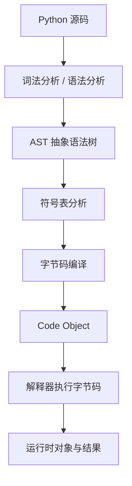

四个产物是**四种不同的类型**，可以直接验证：

| 阶段 | 调用 | 产物类型 |
|---|:---|:---|
| 语法分析 | `ast.parse(src)` | `ast.Module` |
| 符号表分析 | `symtable.symtable(src, f, "exec")` | `symtable.SymbolTable` |
| 编译 | `compile(src, f, "exec")` | `types.CodeType` |
| 反汇编 | `dis.dis(co)` | 人类可读的指令文本 |

实测（G1）：

```python
co  = compile(src, "<lab>", "exec")       # 顶层 code object
sub = [c for c in co.co_consts if isinstance(c, types.CodeType)]

# 顶层 code object 的 consts：(1, <code object add>, None, (1,))
# 函数体 code object：co_name='add', co_varnames=('a','b','c'), co_consts=(None,)
```

两个容易记反的细节：

- **函数体是外层 code object 的一个常量**。`def add(...)` 这条语句本身就是外层代码的一部分，编译结果（内层 code object）被塞进外层的 `co_consts`。
- **默认参数不在函数自己的 `co_consts` 里**。`def add(a, b=1)` 中的 `1` 存在**外层** code object 里，形态是一个元组 `(1,)`；运行时由 `MAKE_FUNCTION` 才把它绑到函数对象上。这也解释了为什么默认值是可变对象时会出那个经典坑——它只有一份，属于函数对象而不是每次调用。

### 2.1 `LOAD_NAME` 是字节码吗

是，但它是**CPython 虚拟机**的指令助记符，不是 CPU 机器指令。代码对象里存的是字节序列（`co_code` 给的是字节，不是字符串 `"LOAD_NAME"`）；助记符只是 `dis` 模块为方便阅读做的映射。

另外一个必须说清的层次问题：CPython 3.11 引入了自适应解释器与指令专门化（[PEP 659](https://peps.python.org/pep-0659/)）。因此 **`dis` 看到的公开字节码、内部 quickened 状态、以及专门化之后的运行时指令，三者不能简单画等号**。§4 会实测这个差别。

---

## 3. 名称解析：编译期的分类决定运行时的指令

名称查找看起来是一件「运行时的事」——变量在哪儿、全局有没有这个符号，好像只有跑起来才知道。但字节码里其实早就写死了去哪儿找。这一节专门说明这一点。

```python
x = 10

def outer(a):
    b = 20
    def inner(c):
        return a + b + c + x
    return inner
```

`inner` 里那一行有四个名字。编译器怎么知道该去哪儿找它们？靠**符号表分析**——在生成字节码之前，编译器已经把每个名字归了类。

实测（G2），编译期分类与运行时指令严格一一对应：

| 名字 | 编译期分类（`symtable`） | 运行时指令（`dis`） | 查找位置 |
|:---:|:---:|:---:|:---|
| `a` | free（自由变量） | `LOAD_DEREF` | 闭包 cell |
| `b` | free（自由变量） | `LOAD_DEREF` | 闭包 cell |
| `c` | local（局部变量） | `LOAD_FAST` | frame 的 localsplus 数组 |
| `x` | global（全局名） | `LOAD_GLOBAL` | globals 字典 → builtins |

四条指令的代价差得很远，而这正是分类的意义：

- **`LOAD_FAST`**：按下标读 frame 里的一个定长数组，没有哈希、没有字典。
- **`LOAD_GLOBAL`**：查 globals 字典（3.11+ 带内联缓存，缓存键是 `PyDictKeysObject` 的版本号），未命中再退到 builtins。
- **`LOAD_DEREF`**：解一次 cell 引用，再取 cell 内容。
- **`LOAD_NAME`**：**三个名字空间依次试**（locals 字典 → globals → builtins），最慢。

关键点在于：**`LOAD_NAME` 不出现在普通函数体里**。它只出现在模块体、类体这类「未经优化」的作用域——因为这些作用域的局部变量真的存在一个字典里，编译器无法在编译期确定某个名字一定是局部的。实测中，模块体 `y = z + 1` 编译出的是 `LOAD_NAME` / `STORE_NAME`，而 `inner` 里一条 `LOAD_NAME` 都没有。

> **为什么这对 Dynamo 重要**：字节码直接告诉了 Dynamo「这个值该去哪儿找」。局部 Tensor 就在 frame 的数组里，可以符号化；全局函数要查字典，查到之后必须额外挂一条 **ID_MATCH guard**，因为下次调用时它可能被换掉。§11 会看到这些 guard 的实际清单。

---

## 4. 优化的两个层次：编译期折叠与运行时专门化

「Python 会优化字节码吗」这个问题，答案取决于问的是哪一层。

### 4.1 编译期：常量折叠

编译器会把能静态算出来的表达式直接算掉。实测：

```python
def k(): return 2 * 3       # co_consts == (None, 6)      —— 没有 BINARY_OP
def s(): return "ab" * 3    # co_consts == (None, 'ababab')
def dyn(a): return a * 3    # 涉及局部名，不折叠，仍留 BINARY_OP
```

判据很简单：**表达式里出现任何运行时才能知道的名字，就折叠不了**。这一层的优化是语义保持的、确定性的、与运行数据无关的。

### 4.2 运行时：自适应专门化（PEP 659）

另一层完全相反：**它取决于这次跑的是什么数据，而且是推测性的、可撤销的。**

实测（G3）：用**同一份源码**编译出三份独立的 code object，分别喂不同类型的数据，各跑 40 次以上：

| 喂进去的数据 | `dis` 看到的 `BINARY_OP` 形态 |
|:---|:---|
| 只喂 `int` | `BINARY_OP_ADD_INT` |
| 只喂 `str` | `BINARY_OP_ADD_UNICODE` |
| 一次都没跑过 | `BINARY_OP`（通用形态） |

第三行是关键的对照：**专门化状态不是源码的属性，是运行时累积出来的状态。** 同一个函数、同一份字节码，跑过什么数据就变成什么样子。

专门化失败时会**反优化（deopt）**退回通用指令。退回的具体形态与解释器版本有关（3.11 实测退回 `BINARY_OP_ADAPTIVE`，3.13 上仍保留 `BINARY_OP_ADD_INT`），所以正文只引用版本间稳定的前两行。

### 4.3 这两层和 Dynamo 是什么关系

形状上一个字都不差：

| | CPython（PEP 659） | TorchDynamo |
|:---|:---|:---|
| 推测什么 | 操作数类型 | 形状 / dtype / 全局对象 id / 分支条件 |
| 怎么确认 | 指令内联缓存里比对类型 | guard 在运行时检查 |
| 失败怎么办 | 反优化，退回通用指令 | guard 失效，重编译或退回 eager |

**「先按看到的情况做一次乐观假设，把假设记下来，下次进来先检查假设还成不成立」——这个模式在解释器层叫专门化，在编译器层叫 guard。** 理解了前面一层，后面一层几乎是同义反复。

---

## 5. 三大对象：Code、Function、Type

### 5.1 `PyCodeObject`：代码的静态描述

一份 code object 携带的元数据（实测 G1）：

| 字段 | 含义 |
|:---|:---|
| `co_name` | 代码块名称 |
| `co_code` | 字节码字节序列 |
| `co_consts` | 常量表（含嵌套的 code object） |
| `co_names` | 全局名 / 属性名 |
| `co_varnames` | 参数与局部变量名 |
| `co_freevars` | 自由变量名 |
| `co_cellvars` | 需要暴露为 cell 的局部变量名 |
| `co_filename` / `co_firstlineno` | 源文件与起始行号 |
| `co_stacksize` / `co_nlocals` | 求值栈最坏深度 / 局部变量个数 |

**它不保存每次调用的局部变量当前值。** 两次调用可以共享同一份 code object 而参数完全不同——这是 CPython 的基本设计，也是后面所有内容的前提。

### 5.2 `PyFunctionObject`：代码 + 环境 + 调用元数据

code object 解释不了一个函数的全部语义。还缺三样：

- **全局名字空间在哪**（`__globals__`）——运行时查 `torch` 这样的名字要用；
- **默认参数是什么**（`__defaults__` / `__kwdefaults__`）；
- **有没有闭包变量**（`__closure__`）。

概念上：

$$
\mathrm{Function} = \mathrm{Code} + \mathrm{Execution\ Environment} + \mathrm{Call\ Metadata}
$$

（这是概念表达，不是内存布局公式。）

闭包是最能说明问题例子（实测 G4）：

```python
def make_adder(x):
    def add(y):
        return x + y
    return add

f1 = make_adder(10); f2 = make_adder(100)
# f1.__code__ is f2.__code__ -> True       代码只有一份
# f1.__closure__[0] is not f2.__closure__[0] -> True   环境各有一份
# f1(1), f2(1) -> 11, 101                 所以结果不同
```

还有一条容易被忽略的：**闭包捕获的是变量（cell），不是值**。两个闭包如果捕获同一个局部变量，一个写、另一个能读到（实测：1 → 42）。

### 5.3 `PyTypeObject`：类型决定行为

`PyTypeObject` 记录类型名、基类、方法字典，并通过行为入口参与调用、属性访问、运算。三个后果：

- **可调用不等于函数对象**。类定义了 `__call__`，它的实例就能被调用——`nn.Module` 正是如此。
- **类本身也是对象**，由元类 `type` 创建。`type(Animal) is type`，`type(type) is type`。
- **方法是通过描述符协议变成绑定方法的**。类字典里的函数对象实现了描述符行为，实例访问得到绑定方法：

```python
u.greet.__func__ is User.greet   # True
u.greet.__self__ is u            # True
```

所以 `u.greet("Bob")` 语义上等于 `User.greet(u, "Bob")`。

> **为什么这对 Dynamo 重要**：模型代码里几乎没有「直接调算子」，全是 `self.linear(x)` 这类属性查找 + 绑定方法 + 调用。Dynamo 必须能跟穿这条链——看到属性、看到绑定、再决定要不要把函数体**内联**进符号执行栈（§8.3）。它跟不穿的地方，就是一个 graph break。

---

## 6. Frame：一次调用的执行现场

如果 code object 是代码，function object 是代码 + 环境，那 **frame 就是这段代码某一次执行时的动态状态**。

一次调用需要保存或关联：

- 参数与局部变量（localsplus 数组）；
- 求值栈上的临时操作数；
- 当前指令位置（`f_lasti`，是字节码里的字节偏移）；
- 所属 code object；
- 全局名字空间；
- 调用链（`f_back`）。

### 6.1 两个 frame 概念要分开

CPython 3.11 之后：

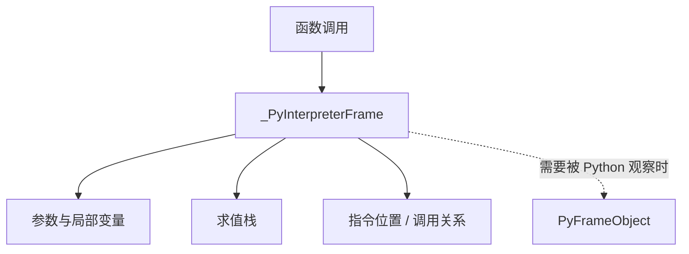

- **`_PyInterpreterFrame`**：解释器内部真正用的执行帧。普通函数调用不要求每次都先造一个完整的 Python 可见 frame 对象；内部帧更轻量，通常连续分配在线程的数据栈上以改善内存局部性。
- **`PyFrameObject`**：Python 程序能观察到的 frame。只有在调试、回溯、`sys._getframe()` 这类需求出现时才会创建或关联。

**这也是 PEP 523 在 3.11 变化的地方**：hook 的第二个参数从 `PyFrameObject*` 变成了 `_PyInterpreterFrame*`（[C API 文档，3.11 变更说明](https://docs.python.org/3/c-api/init.html)）。换句话说，3.11 把「外部接管求值」这件事，从「观察层」下沉到了「执行层」。

### 6.2 求值栈：为什么需要它，以及它有多精确

```python
def calc(a, b):
    c = a + b
    return c * 2
```

`a + b` 要先把两个操作数放到某处，再执行加法，再暂存结果。这个「某处」就是求值栈：

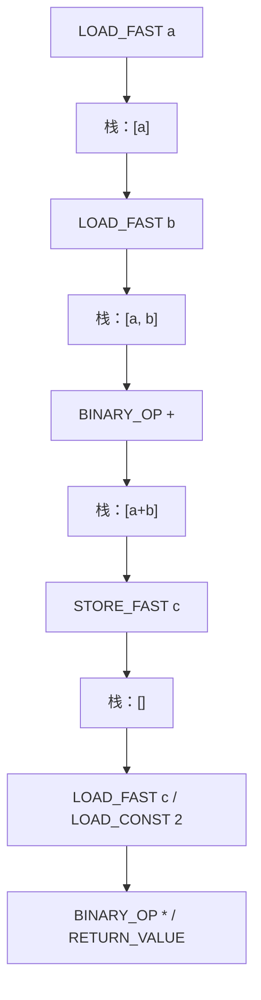

栈里存的是对象**引用**，不是对象副本。

真正有意思的是 `co_stacksize` 的精度。用 `dis.stack_effect` 逐条累加指令的栈效应，得到的峰值与 `co_stacksize` 实测对比（G5）：

```
指令                        栈效应       栈深
RESUME                     +0        0
LOAD_FAST                  +1        1
LOAD_FAST                  +1        2
BINARY_OP                  -1        1
STORE_FAST                 -1        0
LOAD_FAST                  +1        1
LOAD_CONST                 +1        2
BINARY_OP                  -1        1
RETURN_VALUE               -1        0
峰值 2，co_stacksize 2
```

**恰好相等。** 编译器算的不是「拍脑袋留大一点的上界」，而是这段代码最坏情况的精确值——因为 frame 要按它预分配空间，给多了浪费、给少了溢出。

> **为什么这对 Dynamo 重要**：Dynamo 的符号执行器维护的正是「一个符号化的 localsplus + 一个符号化的求值栈」。它必须逐指令复现 CPython 的栈效果，否则推出来的图就是错的。§8 会看到这个「影子栈」。

### 6.3 生成器：frame 不只是临时容器

```python
def gen():
    x = 10
    yield x
    x += 1
    yield x
```

普通函数返回后清理执行现场；生成器在 `yield` 处必须**留着** frame 才能恢复。实测（G5）：

```
生成器 gi_frame 快照（f_lasti, f_locals）：
    (0,  {})
    (12, {'x': 10})
    (30, {'x': 11})
    (38, {'x': 11})
```

（上面是 3.11.14 的字节偏移；3.13.12 上同一次实验是 2 / 14 / 32 / 36 —— 偏移值随版本变，单调推进这件事不变。）

`f_lasti` 单调推进，局部变量始终可读——生成器「暂停」的实现方式就是**从求值循环里返回，但把 frame 留在原地**。

同源生成器的 frame 彼此独立（实测：两个 `counter()` 各自的 `n` 分别是 2 和 1），这也是 §5.1 那句「代码一份、状态多份」的又一例。

---

## 7. PEP 523：外部代码凭什么接管 Frame 求值

前面五节都是 Dynamo 依赖的基础设施。真正让它**介入**的是 [PEP 523 — Adding a frame evaluation API to CPython](https://peps.python.org/pep-0523/)。

### 7.1 默认路径长什么样

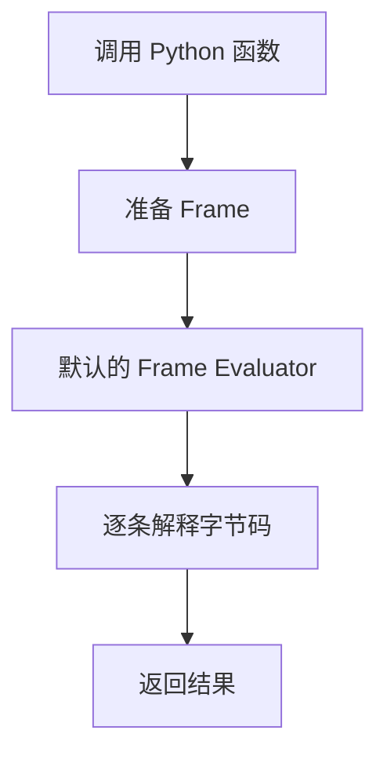

解释器准备好执行帧之后，要进入求值逻辑。PEP 523 提供的是**在求值入口处替换这个逻辑**的能力：运行时或扩展可以装一个自定义求值函数，由它决定这个 frame 怎么执行；不合适时再退回默认解释器。

PEP 523 自 CPython 3.6 起提供；3.11 起 hook 签名改为接收 `_PyInterpreterFrame*`（前述）。它原本就考虑了 JIT 这类用途。

### 7.2 它只给入口，不给能力

这一条必须讲清楚，否则容易高估 PEP 523：

> **PEP 523 不知道什么是 Tensor，也不会自动生成 FX Graph。它提供的是「控制 Frame 如何被求值」的机制，仅此而已。**

TorchDynamo 在这个入口**之上**实现了六件事：

1. 判断这个 frame 要不要处理（跳过 Dynamo 自身的帧、被 `torch._dynamo.disable` 标记的代码等）；
2. 分析 code object 与字节码；
3. 把 Python 值符号化，做符号执行；
4. 把 Tensor 运算记录成 FX 图节点；
5. 生成改写后的字节码（把原来的算子序列换成一次对编译产物的调用）；
6. 为编译结果建立 guard 与缓存。

### 7.3 和 `sys.settrace` / `sys.monitoring` 的差别

Python 早就提供了观察执行的机制：`sys.settrace`（行级 / 指令级）和 3.12+ 的 `sys.monitoring`。它们能做 Dynamo 做的事吗？不能，差别在**回调的返回值意味着什么**：

| 机制 | 回调返回值的作用 | 能否替换求值结果 | 代价 |
|:---|:---|:---:|:---|
| `sys.settrace`（行级） | 返回自身继续跟踪，返回 `None` 停止 | 否 | 约 5–8x |
| `sys.settrace`（指令级） | 同上 | 否 | 约 37–41x |
| `sys.monitoring` | 返回 `DISABLE` 关掉该处事件 | 否 | 观察开销，非接管 |
| **PEP 523 hook** | **返回这次求值的 `PyObject*` 结果** | **是** | 只在它决定管的 frame 上付 |

实测（G6），2000 次 `work(20)`：基线 1.00x，行级 `settrace` 约 5–8x，指令级约 37–41x；且 tracing 下求值结果不变（`work(5) == 30`）。倍率随机器与版本浮动，稳定的是这个量级差。

**观察钩子只能「看」，不能改写这一步该算出什么；PEP 523 的返回值就是这次求值的结果。** 这就是分界线。

---

## 8. TorchDynamo 的核心：符号执行 Python 字节码

### 8.1 为什么不只是 hook 算子

```python
def model(x, use_relu):
    y = x @ x
    if use_relu:
        y = torch.relu(y)
    else:
        y = torch.sigmoid(y)
    return y * 2
```

如果只在 `torch.matmul` / `torch.relu` / `torch.sigmoid` 上挂钩子，能拿到一条调用序列，但拿不到：

- `y` 的两次赋值之间的**数据依赖**（第二次覆盖第一次）；
- `if` 依赖 `use_relu` 这个**分支条件**（下次调用它可能是另一个值）；
- `y * 2` 里的 `y` 到底是 relu 分支还是 sigmoid 分支来的；
- 这段图**能不能在下次调用时复用**。

算子级别的 hook 看到的是「发生了什么」，看不到「为什么」。所以 Dynamo 从字节码入手。

### 8.2 整体流程

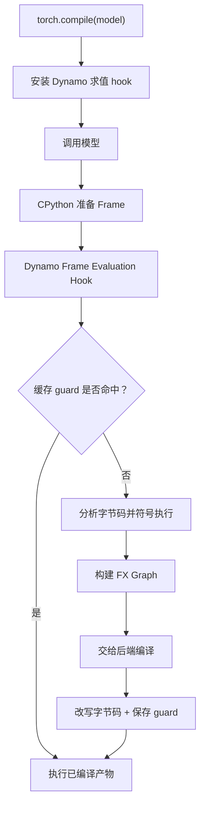

这是主流程。实际还有 graph break、多版本缓存、动态形状、异常处理、重编译和回退路径。

### 8.3 什么是这里的「符号执行」

```python
def f(x, y):
    a = x + y
    b = a * 2
    return b
```

普通解释器会**真的**算 `x + y` 和 `a * 2`。符号执行器不真算，它维护：

- 一张**符号化的局部变量表**（对应 frame 的 localsplus）；
- 一个**符号化的求值栈**（对应 frame 的求值栈）；

然后按每条指令的语义更新这两样东西。如果 `x`、`y` 是 Tensor，那 `a` 不是某个具体数值，而是 FX 图上的一个 `add` 节点；`b` 是挂在它后面的 `mul` 节点。

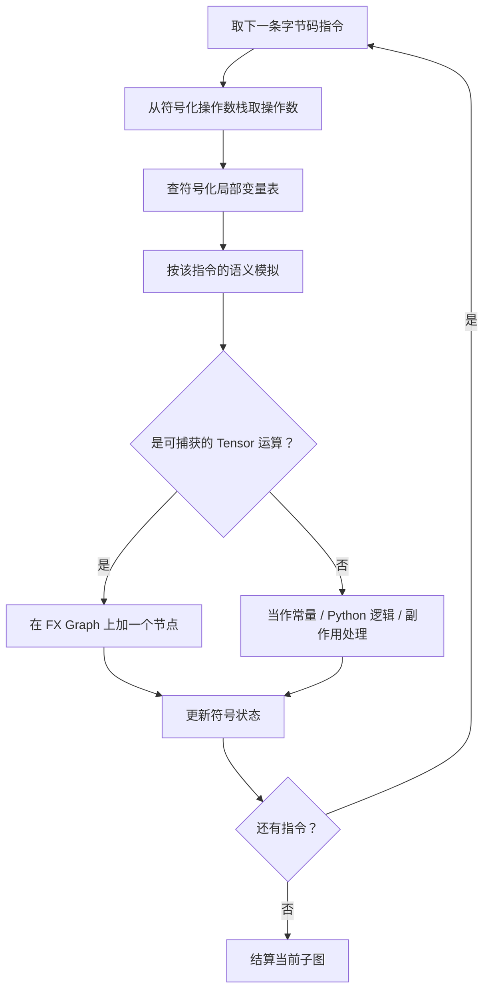

核心源码（锁 `v2.10.0`）：

- [`torch/_dynamo/symbolic_convert.py`](https://github.com/pytorch/pytorch/blob/v2.10.0/torch/_dynamo/symbolic_convert.py)：符号执行主体，[`InstructionTranslatorBase`](https://github.com/pytorch/pytorch/blob/v2.10.0/torch/_dynamo/symbolic_convert.py#L1120)、[`step()`](https://github.com/pytorch/pytorch/blob/v2.10.0/torch/_dynamo/symbolic_convert.py#L1291)、[`run()`](https://github.com/pytorch/pytorch/blob/v2.10.0/torch/_dynamo/symbolic_convert.py#L1647)。
- [`torch/_dynamo/convert_frame.py`](https://github.com/pytorch/pytorch/blob/v2.10.0/torch/_dynamo/convert_frame.py)：frame 转换调度与缓存，[`convert_frame()`](https://github.com/pytorch/pytorch/blob/v2.10.0/torch/_dynamo/convert_frame.py#L2053)、[`convert_frame_assert()`](https://github.com/pytorch/pytorch/blob/v2.10.0/torch/_dynamo/convert_frame.py#L736)、[`_compile()`](https://github.com/pytorch/pytorch/blob/v2.10.0/torch/_dynamo/convert_frame.py#L1390)。
- [`torch/_dynamo/eval_frame.py`](https://github.com/pytorch/pytorch/blob/v2.10.0/torch/_dynamo/eval_frame.py)：hook 的安装与上下文管理。

**所以 Dynamo 不是「记录算子日志」，而是在编译期分析 Python 程序的数据流与控制流。** 这是它能区分「这段 Python 逻辑要不要进图」的根本原因。

---

## 9. FX Graph：从命令式 Python 到数据流图

对于：

```python
def model(x, w):
    y = x @ w
    y = torch.relu(y)
    return y * 2
```

实测捕获到（G7）：

```python
class GraphModule(torch.nn.Module):
    def forward(self, L_x_: "f32[8, 16]", L_w_: "f32[16, 32]"):
        l_x_ = L_x_
        l_w_ = L_w_

        # File: .../dynamo_lab.py:62 in model, code: y = x @ w
        y: "f32[8, 32]" = l_x_ @ l_w_;  l_x_ = l_w_ = None

        # File: .../dynamo_lab.py:63 in model, code: y = torch.relu(y)
        y_1: "f32[8, 32]" = torch.relu(y);  y = None

        # File: .../dynamo_lab.py:64 in model, code: return y * 2
        mul: "f32[8, 32]" = y_1 * 2;  y_1 = None
        return (mul,)
```

注意两件事：源码里的两个 `y`（两次赋值）在图里变成 `y` 和 `y_1` 两个不同节点——**「变量」在 FX 里没有位置，只有 SSA 式的节点名**；每个中间量用完就置 `None`，那是图在显式释放引用。

图结构：

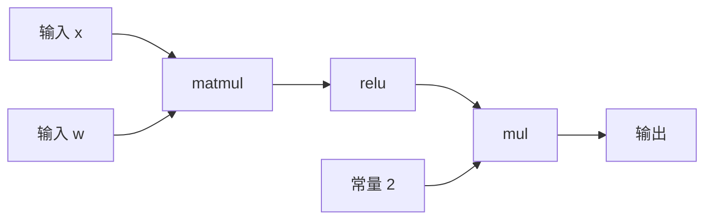

实测统计：**1 个图、3 个 `call_function` 节点**（matmul → relu → mul）、**2 个 placeholder**。

原始数据与图的差别：

| | 原始 Python 函数 | FX Graph |
|:---|:---|:---|
| 控制流 | 有（`if` / 循环 / 异常） | 只保留被特化后的那一条路径 |
| 变量赋值 | `y = ...` 出现两次 | 无「变量」，只有节点与边 |
| 对象操作 | 属性查找、绑定方法 | 已被内联或留在图外 |
| 优化空间 | 几乎为零 | 融合、调度、代码生成 |

**图里没有的东西和有的东西同样重要**：赋值、属性查找、Python 分支一个都没进图，留下的只有 Tensor 之间的数据依赖。

---

## 10. Graph Break：把函数切成几段，然后缝回去

```python
def model(x):
    y = torch.relu(x)
    print("shape:", y.shape)
    z = y * 2
    return z
```

`print` 是个有副作用的内置函数，Dynamo 选择不把它放进图。于是：

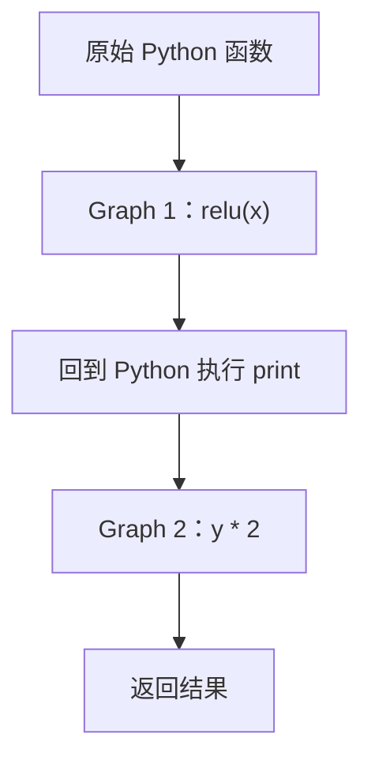

实测（G7）：确实是 **2 个图**，第一个只有 `relu`，第二个只有 `mul`。

### 10.1 常见的触发源（实测清单）

用 `torch._dynamo.explain(fn)(x)` 逐个跑了一遍（G8）：

| 用例 | 图数 | 断点数 | 捕获算子数 | 首个断点的原因 |
|:---|---:|---:|---:|:---|
| 纯 Tensor 运算（基线） | 1 | 0 | 2 | —— |
| 内置 `print` | 2 | 1 | 2 | `Failed to trace builtin operator` |
| `.item()` | 1 | 0 | 0 | `Unsupported Tensor.item() call with capture_scalar_outputs=False` |
| 数据依赖分支 `if y.sum() > 0` | 2 | 1 | 3 | `generic_jump TensorVariable()` |
| `.tolist()` | 1 | 0 | 0 | `Tensor.tolist() with non-integer tensor` |
| numpy 往返 | 1 | 0 | 3 | —— |

几条读法：

- **`.item()` 和 `.tolist()` 这两行里，图里一个算子都没捕到（ops=0）。** 它们强制把 Tensor 值搬回 Python，整段都跟不进图了——这比「切一刀」严重得多。
- **数据依赖分支的原因是 `generic_jump TensorVariable()`**：`y.sum() > 0` 的真假只有真跑才知道，Dynamo 无法在编译期确定走哪支，只能断开。
- **`.item()` / `.tolist()` 这两行的「图数 / 断点数」两列与「原因文本」不是同一个口径**：`explain` 报 `graph_break_count = 0`（因为整段都没进图，没有「被切开的子图」可言），但 `break_reasons` 里仍各有一条 `graph_break = True` 的记录。引用时取原因文本。

### 10.2 断点之后怎么续跑

断点的处理是：结算当前子图 → 生成一段**续执行代码** → 从断点处恢复普通 Python 执行，遇到下一段可捕获的 Tensor 运算时再进一次 Dynamo。

相关源码：[`output_graph.py`](https://github.com/pytorch/pytorch/blob/v2.10.0/torch/_dynamo/output_graph.py) 的 [`compile_subgraph()`](https://github.com/pytorch/pytorch/blob/v2.10.0/torch/_dynamo/output_graph.py#L1432)，以及 [`resume_execution.py`](https://github.com/pytorch/pytorch/blob/v2.10.0/torch/_dynamo/resume_execution.py) 的 [`ContinueExecutionCache`](https://github.com/pytorch/pytorch/blob/v2.10.0/torch/_dynamo/resume_execution.py#L297)。

### 10.3 断点不是错误，但有代价

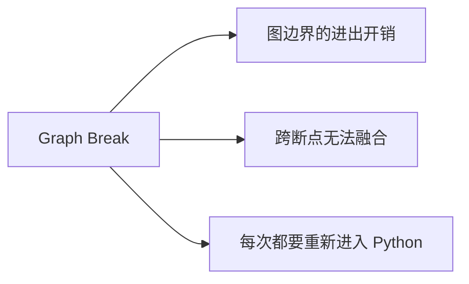

减少不必要的断点通常是有收益的，但**断点本身不是 bug**——它是「这段逻辑我不敢/不能编译」的诚实表达。

实测：把 `print` 放在 `fullgraph=True` 下，断点直接从「切图」变成抛异常（`Unsupported`）。这是排查断点的常用手段。

---

## 11. Guard：编译结果凭什么能复用

第一次调用捕获并编译了一张图。第二次调用时，凭什么认为这张图还能用？

```python
compiled_model(x1)   # 捕获 + 编译
compiled_model(x2)   # 复用？取决于 guard
```

如果形状、dtype、分支条件或相关全局状态变了，原编译结果可能不再适用。**Guard 就是一组运行时条件，用来验证编译时所依赖的假设现在还成不成立。**

### 11.1 Guard 分两层

实测（G9），两个最简函数：

```
单输入 f(x) = relu(x) * 2：
   guard 总数 10，带 Python code 的 5 条
   guard 类型： ['AUTOGRAD_SAVED_TENSORS_HOOKS', 'DEFAULT_DEVICE', 'ID_MATCH', 'TENSOR_MATCH']
   Python 侧 code_list：
       utils_device.CURRENT_DEVICE == None
       torch._functorch.aot_autograd.utils.top_saved_tensors_hooks ids == None
       ___check_obj_id(G['torch']  ...
       ___check_obj_id(G['torch'].relu  ...
       hasattr(L['x']  ...

双输入 model(x, w) = relu(x@w) * 2：
   guard 总数 11，带 Python code 的 6 条
   guard 类型： ['AUTOGRAD_SAVED_TENSORS_HOOKS', 'DEFAULT_DEVICE', 'ID_MATCH', 'TENSOR_MATCH']
   Python 侧 code_list：
       utils_device.CURRENT_DEVICE == None
       torch._functorch.aot_autograd.utils.top_saved_tensors_hooks ids == None
       hasattr(L['x']  ...
       hasattr(L['w']  ...
       ___check_obj_id(G['torch']  ...
       ___check_obj_id(G['torch'].relu  ...
```

（脚本为对齐输出把每条 code 截断到 78 字符，所以后面几行看着是半句；完整的第 4 行是 `hasattr(L['x'], '_dynamo_dynamic_indices') == False`。）

多一个 Tensor 输入，就多一条 guard——多出来的正好是第二个输入的 `_dynamo_dynamic_indices` 检查。

| 层 | 实现位置 | 检查什么 |
|:---|:---|:---|
| Python 侧 | guard 的 `code_list`，运行时 `eval` | 全局对象 id、默认设备、梯度相关状态 |
| C++ 侧 | [`torch/csrc/dynamo/guards.cpp`](https://github.com/pytorch/pytorch/blob/v2.10.0/torch/csrc/dynamo/guards.cpp) | Tensor 的形状 / stride / dtype / device |

**Tensor 的形状和 dtype 根本不出现在 Python code_list 里**，它们在 C++ 侧检查。这是很多人读 `TORCH_LOGS=guards` 时觉得「少了一堆东西」的原因——`TENSOR_MATCH` 只留一个类型标签给你看，检查逻辑不经过 Python。

### 11.2 失效之后会发生什么

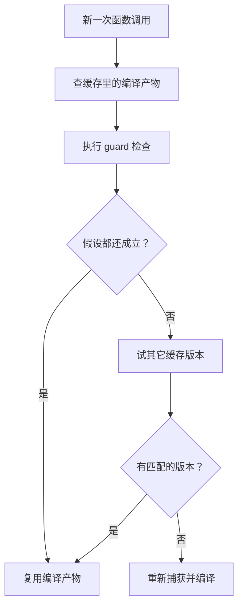

实测（G9），同一个函数 `f(x) = relu(x) * 2`：

| 调用序列 | 编译出的图数 |
|:---|---:|
| 相同 batch（8）跑 4 次 | **1** |
| 不同 batch（4/8/16/32），默认配置 | **2** |
| 不同 batch（4/8/16/32），`automatic_dynamic_shapes=False` | **4** |
| 不同 batch（4/8/16/32），显式 `mark_dynamic(t, 0)` | **1** |
| f32 → f64 → f32 | **2** |

读法：

- 第一次形状不匹配时 guard 失败 → 重编译；**自动动态形状**会把这一维标记成动态，于是后续尺寸不再重编译。这就是 2 与 4 的差。
- 显式 `mark_dynamic` 从一开始就声明这一维是动态的，所以只有 1 次。
- **dtype 那一格是 2 次，自动动态救不了它**——自动动态只作用于形状维度，dtype 变化仍需重新编译。

---

## 12. 动手验证

### 12.1 捕获一张图

```python
import torch
from torch._dynamo.testing import EagerAndRecordGraphs

def model(x, w):
    return torch.relu(x @ w) * 2

backend = EagerAndRecordGraphs()
compiled_model = torch.compile(model, backend=backend)

out = compiled_model(torch.randn(8, 16), torch.randn(16, 32))
print(backend.graphs[0].print_readable())
```

这个例子用于观察捕获结果，不是性能基准。`torch._dynamo.testing` 属于内部测试工具，接口可能随版本变化。

### 12.2 统计断点与 guard

```python
exp = torch._dynamo.explain(model)(x, w)
exp.graph_count        # 图的数量
exp.graph_break_count  # 断点数量
exp.op_count           # 捕获到的算子数
exp.out_guards         # guard 清单
```

### 12.3 调试日志

```bash
TORCH_LOGS="graph_breaks" python example.py
TORCH_LOGS="guards,recompiles" python example.py
TORCH_LOGS="graph_code,bytecode" python example.py
```

第三条最有意思，它会同时打印 **ORIGINAL BYTECODE** 和 **MODIFIED BYTECODE**。实测节选：

```
ORIGINAL BYTECODE model
   2           0 RESUME                   0
   3           2 LOAD_FAST                0 (x)
               4 LOAD_FAST                1 (w)
               6 BINARY_OP                4 (@)
              10 STORE_FAST               2 (y)
   4          12 LOAD_GLOBAL              1 (NULL + torch)
              24 LOAD_ATTR                1 (relu)
              34 LOAD_FAST                2 (y)
              36 PRECALL                  1
              40 CALL                     1
              50 STORE_FAST               2 (y)
   5          52 LOAD_FAST                2 (y)
              54 LOAD_CONST               1 (2)
              56 BINARY_OP                5 (*)
              60 RETURN_VALUE

MODIFIED BYTECODE model
   2           0 RESUME                   0
               2 LOAD_GLOBAL              5 (NULL + __compiled_fn_1_<hash>)
               ...
              56 LOAD_FAST                0 (x)
              58 LOAD_FAST                1 (w)
              ...
             104 PRECALL                  2
             108 CALL                     2
             118 STORE_FAST               3 (graph_out_0)
             ...
             160 RETURN_VALUE
```

原来要逐条解释的那一串指令——两次 `LOAD_FAST` + `BINARY_OP` + `STORE_FAST`（算 `x @ w`），再来 `LOAD_GLOBAL` / `LOAD_ATTR` / `PRECALL` / `CALL`（调 `torch.relu`），再来 `LOAD_FAST` + `LOAD_CONST` + `BINARY_OP`（乘 2）——**整个被换成了一次对 `__compiled_fn_<hash>` 的调用**，参数还是 `x` 和 `w`，返回值存进 `graph_out_0` 再拆包返回。

**这就是「Dynamo 改写字节码」的字面意思**：它不是绕开解释器，而是把解释器的输入换掉了。剩下的 Python 语义（取参、调用、拆包、返回）照旧，被换掉的只有中间那段 Tensor 计算。

---

## 13. 推荐源码阅读路线

目标是理解 Dynamo 怎么用 Python 解释器，而不只是会调 `torch.compile()`。

### 第一步：Frame 与 PEP 523

- [PEP 523](https://peps.python.org/pep-0523/)
- [CPython InternalDocs：Frames](https://github.com/python/cpython/blob/main/InternalDocs/frames.md)
- [CPython 3.13 Frame C API](https://docs.python.org/3.13/c-api/frame.html)

重点：为什么 Frame Evaluator 能成为外部编译器介入 Python 执行的入口；以及 3.11 把 hook 参数从 `PyFrameObject*` 改成 `_PyInterpreterFrame*` 意味着什么。

### 第二步：Dynamo 的执行入口

- [`torch/_dynamo/eval_frame.py`](https://github.com/pytorch/pytorch/blob/v2.10.0/torch/_dynamo/eval_frame.py)
- [`torch/_dynamo/convert_frame.py`](https://github.com/pytorch/pytorch/blob/v2.10.0/torch/_dynamo/convert_frame.py)

重点：函数执行何时进入 Dynamo、何时查缓存、何时触发转换。

### 第三步：字节码符号执行

- [`torch/_dynamo/symbolic_convert.py`](https://github.com/pytorch/pytorch/blob/v2.10.0/torch/_dynamo/symbolic_convert.py)
- [Python `dis` 模块](https://docs.python.org/3/library/dis.html)

重点：[`InstructionTranslatorBase`](https://github.com/pytorch/pytorch/blob/v2.10.0/torch/_dynamo/symbolic_convert.py#L1120) 怎么维护符号化的操作数栈和局部变量表；[`LOAD_FAST`](https://github.com/pytorch/pytorch/blob/v2.10.0/torch/_dynamo/symbolic_convert.py#L1715)、[`STORE_FAST`](https://github.com/pytorch/pytorch/blob/v2.10.0/torch/_dynamo/symbolic_convert.py#L1759)、[`CALL`](https://github.com/pytorch/pytorch/blob/v2.10.0/torch/_dynamo/symbolic_convert.py#L3806) 分别怎么处理。

### 第四步：图生成与 Guard

- [`torch/_dynamo/output_graph.py`](https://github.com/pytorch/pytorch/blob/v2.10.0/torch/_dynamo/output_graph.py)
- [`torch/csrc/dynamo/guards.cpp`](https://github.com/pytorch/pytorch/blob/v2.10.0/torch/csrc/dynamo/guards.cpp)
- [`torch/_dynamo/resume_execution.py`](https://github.com/pytorch/pytorch/blob/v2.10.0/torch/_dynamo/resume_execution.py)

重点：[`OutputGraph`](https://github.com/pytorch/pytorch/blob/v2.10.0/torch/_dynamo/output_graph.py#L512) 与 [`create_proxy()`](https://github.com/pytorch/pytorch/blob/v2.10.0/torch/_dynamo/output_graph.py#L917) 怎么往图上挂节点；guard 在哪里生成（[`compile_and_call_fx_graph()`](https://github.com/pytorch/pytorch/blob/v2.10.0/torch/_dynamo/output_graph.py#L2076) 一带）与怎么检查（C++ 侧）。

### 第五步：后端

- [TorchInductor 源码](https://github.com/pytorch/pytorch/tree/v2.10.0/torch/_inductor)
- [PyTorch Compiler 文档](https://docs.pytorch.org/docs/main/user_guide/torch_compiler/torch.compiler.html)

重点：图捕获之后的优化、融合与代码生成。

---

## 14. Dynamo 与 TorchInductor 的职责区别

**Dynamo 不是 `torch.compile()` 的全部。** 典型链路：

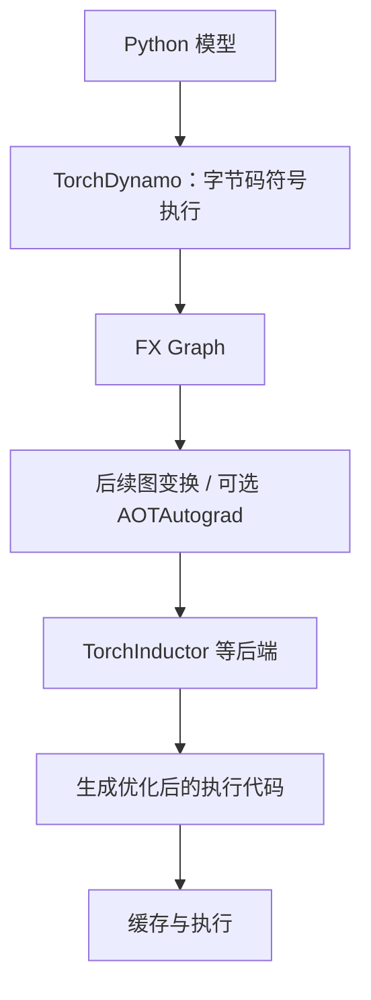

| 组件 | 职责 | 不负责 |
|:---|:---|:---|
| **TorchDynamo** | 拦截 frame、符号执行字节码、捕获 FX 图、生成 guard、管理缓存与重编译 | 不生成内核 |
| **FX** | 图的表示与变换机制 | 不决定捕获什么 |
| **AOTAutograd** | 训练场景下前向 / 反向图的联合变换 | 不参与推理路径的图捕获 |
| **TorchInductor** | 图优化、融合、代码生成（常见路径含 GPU 上的 Triton 内核、CPU 上的 C++） | 不认识 Python 字节码 |

具体流水线随 PyTorch 版本、编译配置和模型类型变化，不是每次编译都经过完全相同的所有阶段。

顺带一句实测观察：`TORCH_LOGS="bytecode"` 打出的 ORIGINAL 与 MODIFIED BYTECODE 两段日志之间，本机（CPU 后端、三算子的小图）隔了十几秒——这段就是「捕获之后、可用之前」的全部代价。**这个数字不代表 GPU 上的典型情况，也不主张耗时构成**，它只说明一件事：**编译是一次性的、代价不低，所以才有 §11 那整套缓存与 guard 机制。**

---

## 15. 总结：把整条链路串起来

五层：

| 层次 | 核心对象或机制 | 解决的问题 |
|:---|:---|:---|
| 编译层 | AST、符号表、`PyCodeObject` | 源码怎么变成代码描述 |
| 函数层 | `PyFunctionObject`、`PyTypeObject` | 函数怎么关联环境，对象怎么获得行为 |
| 执行层 | `_PyInterpreterFrame`、解释器 | 每次调用的动态状态怎么保存和推进 |
| 捕获层 | PEP 523、Dynamo、符号执行、Guard | 怎么在 Python 执行时捕获 Tensor 计算图 |
| 后端层 | FX Graph、AOTAutograd、TorchInductor | 捕获的图怎么进一步优化并生成代码 |

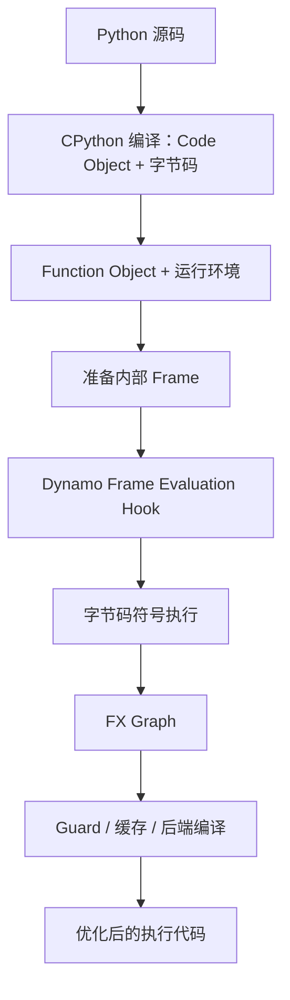

**最终要理解的核心是：TorchDynamo 并没有绕开 Python 解释器，而是利用 CPython 提供的执行入口，在 Python 语义与 Tensor 计算图之间建立了一层编译器。**

- Code Object 说清了**代码是什么**；
- Function Object 把代码和**运行环境**绑在一起；
- Frame 表示**一次调用的执行现场**；
- PEP 523 让 Dynamo 能**接管这次求值**；
- 符号执行把能捕获的 Tensor 运算**提取成 FX Graph**；
- Guard 把「当时看到的情况」变成「下次能不能复用」的**检查条件**。

这也解释了为什么「懂一点 Python 解释器」对研究 PyTorch 编译器、图捕获、动态形状、graph break 和编译缓存的收益这么大：**这些话题里有一半的问题，本质上不是编译器问题，而是「Python 这门语言到底允许你确定什么」的问题。**

---

## 参考资料

- [PEP 523 — Adding a frame evaluation API to CPython](https://peps.python.org/pep-0523/)
- [PEP 659 — Specializing Adaptive Interpreter](https://peps.python.org/pep-0659/)
- [CPython InternalDocs：Interpreter](https://github.com/python/cpython/blob/main/InternalDocs/interpreter.md)
- [CPython InternalDocs：Frames](https://github.com/python/cpython/blob/main/InternalDocs/frames.md)
- [Python `dis` 模块文档](https://docs.python.org/3/library/dis.html)
- [Python `symtable` 模块文档](https://docs.python.org/3/library/symtable.html)
- [Python Code Objects C API](https://docs.python.org/3/c-api/code.html)
- [PyTorch Dynamo Overview](https://docs.pytorch.org/docs/main/user_guide/torch_compiler/torch.compiler_dynamo_overview.html)
- [TorchDynamo 源码（`v2.10.0`）](https://github.com/pytorch/pytorch/tree/v2.10.0/torch/_dynamo)
