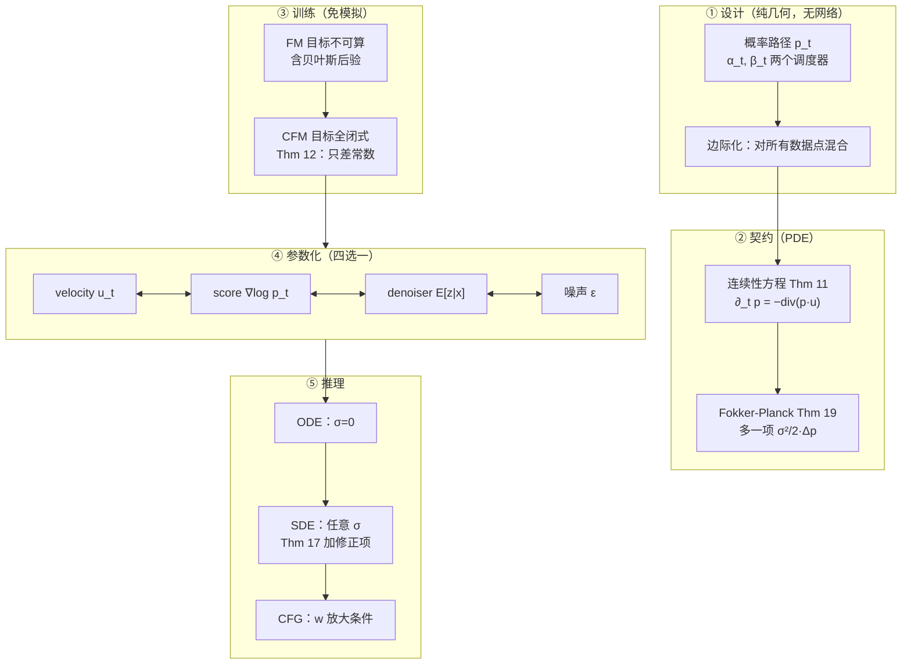

> **系列导航** ｜ [建模之一：概率路径与边际向量场（数值核验存档）](/2026/08/22/flow-matching-01-algorithm-evolution/) ｜ [建模之二：score、扩散与 SDE](/2026/08/22/flow-matching-02-score-diffusion-sde/) ｜ [建模之三：条件生成、离散域与潜空间](/2026/08/22/flow-matching-03-guidance-discrete-latent/) ｜ [应用篇：SD3 到蛋白质设计](/2026/08/22/flow-matching-04-applications/) ｜ [扩散模型综述](/2026/08/24/diffusion-survey-algorithms-applications/)

> **TL;DR**
>
> * **整个框架只有三个可独立选择的东西**：一条**概率路径** $$p_t$$（噪声分布到数据分布的插值轨迹）、一个**输运它的速度场** $$u_t$$（由连续性方程唯一确定）、一个**网络参数化**（velocity / score / denoiser / 噪声四选一，最优解相同）。其余的“扩散”“流”“score”“SDE”都是这三件事的不同侧面。
> * **训练之所以便宜，靠的是一条恒等式**：$$\mathcal L_{\rm FM}=\mathcal L_{\rm CFM}+C$$（$$C$$ 与参数无关）。它把“回归那个算不出来的边际速度场”换成“回归那个有闭式的条件速度场”，于是训练变成一行 MSE，**训练期完全不解微分方程**。实测：确定性求积下两损失之差跨参数的相对跨度 $$\le 9.9\times10^{-13}$$。
> * **扩散模型与流匹配不是两件事**：高斯路径下有逐点恒等式 $$u_t(x)=a_t\nabla\log p_t(x)+b_tx$$（Prop 1）。学 velocity、学 score、学 denoiser、学噪声，四个名字指向同一个解，差别只在**有效时间权重** $$a_t^2$$——CondOT 下它跨 4 个数量级，VP 下它是常数 $$-\gamma/2$$。
> * **采样期 $$\sigma_t$$ 是一个免费旋钮**：按 Thm 17 加一项 $$\tfrac{\sigma_t^2}{2}\nabla\log p_t$$ 就得到一个边际分布完全不变的 SDE。实测 $$\sigma\in[0,1]$$ 四档终点 W1 极差 $$0.0196$$，而采样噪底本身就是 $$0.0151$$。**不加这一项会直接毁掉分布**：$$\sigma=0.8$$ 时 Fokker–Planck 残差高达 $$2.43$$。
> * **CFG 是启发式不是推断**：$$\tilde u=(1-w)u_t(x\mid\emptyset)+wu_t(x\mid y)$$ 恰好是**倾斜分布** $$\tilde p_t(x)\propto p_t(x)\,p_t(y\mid x)^w$$ 的真实速度场（实测逐点误差 $$\le 8.2\times10^{-14}$$）。$$w=1$$ 时它才是 $$p_{\rm data}(\cdot\mid y)$$；$$w>1$$ 时它是被锐化过的另一族分布。



## 1. 先抓住那一个句子

所有这类模型——DDPM、Score SDE、Stable Diffusion 3、FLUX、Meta Movie Gen——都在做同一件事：

> **设计一个从 $$p_{\rm init}$$（通常取标准高斯）到 $$p_{\rm data}$$ 的连续过程，让它的终点分布等于数据分布。**

这句话里有两个层次的“设计”，把它们分开是这个框架能做大的根源：

| 层次 | 问的问题 | 自由度 |
|---|---|---|
| **概率路径** $$p_t$$ | 中间的 $$0<t<1$$ 时刻，粒子应该长什么样？ | 完全自由（**设计**问题） |
| **速度场** $$u_t$$ | 什么样的瞬时速度能输运这条路径？ | 由 $$p_t$$ **唯一确定**（**求解**问题） |
| **网络参数化** | 让网络直接输出哪个量？ | 四选一，最优解相同（**数值**问题） |

历史上扩散模型走的是相反的顺序：先造一个物理上加噪的随机过程，再倒推怎么生成。Flow Matching 的贡献是把顺序**颠倒**过来：先想要什么路径，再算速度场。这不是等价重写，而是**设计空间的扩大**——$$p_{\rm init}$$ 不必是高斯，路径不必是仿射的，也不必从 $$t\to\infty$$ 才收敛到噪声。

## 2. 动力学底座：ODE 与 SDE

两种微分方程给出两套搬运工具。讲义把它们讲得很干净，这里照原序走一遍，因为后面的每个定理都挂在这几个定义上。

### 2.1 ODE：确定性搬运

一个 ODE 由**向量场** $$u:\mathbb R^d\times[0,1]\to\mathbb R^d$$ 定义，它给每个时空点指定瞬时速度。轨迹 $$X:[0,1]\to\mathbb R^d$$ 满足

$$
\frac{d}{dt}X_t=u_t(X_t),\qquad X_0=x_0 .
$$

把“所有初值”的轨迹合起来就是**流** $$\psi_t:\mathbb R^d\to\mathbb R^d$$：

$$
\frac{d}{dt}\psi_t(x_0)=u_t(\psi_t(x_0)),\qquad \psi_0=\mathrm{id}.
$$

**向量场定义 ODE，ODE 的解是流，流把空间“皱起来”**——三者是同一件事的三种说法。只要 $$u_t$$ 关于 $$x$$ 连续可微且导数有界，$$\psi_t$$ 存在、唯一、且是微分同胚（Thm 3）。神经网络天然满足这个条件，所以工程上永远不用操心存在性。

**模拟**用显式 Euler：

$$
X_{t+h}=X_t+h\,u_t(X_t),\qquad h=1/n .
$$

一阶精度。想更好可以用 Heun 法：先按 Euler 试走一步拿到猜测点 $$X'_{t+h}$$，再用起点与猜测点处的两个速度取平均修正。

### 2.2 SDE：把随机性加回来

ODE 是确定的，随机性只来自 $$X_0$$。要刻画“同一初值能演化到不同终点”，需要 SDE。

**布朗运动** $$W_t$$ 满足 $$W_0=0$$、路径连续、增量正态（$$W_{t+h}-W_t\sim\mathcal N(0,hI)$$）且互不相关。可以理解成连续版本的随机游走，并且路径连续但无限长。它的离散模拟是 $$W_{t+h}=W_t+\sqrt h\,\epsilon_t$$。

因为随机过程不可求导，SDE 的严格定义要走**无穷小增量**而不是导数：

$$
X_{t+h}=X_t+\underbrace{h\,u_t(X_t)}_{\text{确定性}}+\underbrace{\sigma_t\,(W_{t+h}-W_t)}_{\text{随机}}+\underbrace{h\,R_t(h)}_{\text{误差项}},
$$

其中 $$R_t(h)$$ 的标准差随 $$h\to0$$ 消失。习惯上写成

$$
dX_t=u_t(X_t)\,dt+\sigma_t\,dW_t,
$$

但请记住这个“$$dX_t$$”只是**记号**，真正的定义是上一行。SDE 没有流映射——$$X_t$$ 不再由 $$X_0$$ 完全决定。

**模拟**用 Euler–Maruyama：

$$
X_{t+h}=X_t+h\,u_t(X_t)+\sigma_t\sqrt h\,\epsilon_t,\qquad \epsilon_t\sim\mathcal N(0,I).
$$

**玩具：Ornstein–Uhlenbeck 过程** $$dX_t=-\theta X_tdt+\sigma dW_t$$。漂移拉回原点、噪声持续注入，$$t\to\infty$$ 时收敛到 $$\mathcal N\big(0,\tfrac{\sigma^2}{2\theta}\big)$$。$$\sigma=0$$ 时退化为线性 ODE 流——**这就是“flow model 是 diffusion model 的 $$\sigma\equiv0$$ 特例”这句话的精确含义**。

### 2.3 一张对照表

| | 漂移（决定“往哪走”） | 噪声（决定“走多远”） | 随机性来源 |
|---|---|---|---|
| **Flow model** | $$u^\theta_t$$ | 无（$$\sigma_t\equiv0$$） | 仅初始点 $$X_0$$ |
| **Diffusion model** | $$u^\theta_t$$ | $$\sigma_t\ge0$$ | 初始点 + 沿途注入 |

两者共用同一套训练代码，**唯一区别是采样时加不加噪声项**。§7 会把这句话变成一个定理。

## 3. 中心对象：概率路径

现在回答“中间时刻应该长什么样”。**概率路径 $$p_t$$ 就是对这份自由度的正式命名。**

### 3.1 条件路径与边际路径

**定义（条件概率路径）** 一族分布 $$p_t(x\mid z)$$，其中 $$z\sim p_{\rm data}$$ 是数据点，满足

$$
p_0(\cdot\mid z)=p_{\rm init},\qquad p_1(\cdot\mid z)=\delta_z .
$$

读法：以单个数据点 $$z$$ 为条件，把噪声分布逐步收缩成一个点。

每个条件路径都诱导一个**边际概率路径**

$$
p_t(x)=\int p_t(x\mid z)\,p_{\rm data}(z)\,dz ,
$$

它由“先采 $$z\sim p_{\rm data}$$、再采 $$x\sim p_t(\cdot\mid z)$$”得到。边界自动成立：

$$
p_0=p_{\rm init},\qquad p_1=p_{\rm data}.
$$

⚠️ **必须记住的区分**：$$p_t$$ 是**可采样而不可计算**的。采样过程写得出来，但那个积分算不出来。§5 的整个技术内容都在绕开这个“能采不能算”的对象。

### 3.2 最重要的一例：高斯路径

取**噪声调度器** $$\alpha_t,\beta_t$$——两个连续可微、单调的函数，满足 $$\alpha_0=\beta_1=0$$ 与 $$\alpha_1=\beta_0=1$$——定义

$$
p_t(\cdot\mid z)=\mathcal N(\alpha_t z,\;\beta_t^2 I).
$$

这是**当前绝大多数生产模型用的路径**。它合法：$$t=0$$ 时是 $$\mathcal N(0,I)$$，$$t=1$$ 时是 $$\mathcal N(z,0)=\delta_z$$。采样极其简单：

$$
\epsilon\sim\mathcal N(0,I),\qquad x_t=\alpha_t z+\beta_t\epsilon .
$$

即“把数据和噪声按 $$\alpha_t,\beta_t$$ 线性插值”。

| 常见选择 | $$\alpha_t$$ | $$\beta_t$$ | 谁在用 |
|---|---|---|---|
| **CondOT** | $$t$$ | $$1-t$$ | Rectified Flow、SD3、FLUX、Movie Gen |
| **CondOT + $$\sigma_{\min}$$** | $$t$$ | $$1-(1-\sigma_{\min})t$$ | 工程惯例（避免 $$t\to1$$ 除零） |
| **三角路径** | $$\sin(\pi t/2)$$ | $$\cos(\pi t/2)$$ | 随机插值文献里的常见替代 |

### 3.3 两个必须先看清楚的约定

**（a）时间方向。** 文献存在两套互斥约定，读错会让所有公式失效：

| 约定 | $$t=0$$ | $$t=1$$ | 谁在用 |
|---|---|---|---|
| **讲义 / 本文** | 噪声 $$p_{\rm init}$$ | 数据 $$\delta_z$$ | Flow Matching、SD3 |
| **反向约定** | 数据 | 噪声 | DDPM、Score SDE 原文 |

VE（$$\alpha_t=1,\beta_t=t$$）与 VP（$$\alpha_t=e^{-\gamma t/2},\beta_t=\sqrt{1-e^{-\gamma t}}$$）属于反向约定，**只能用于核对代数恒等式，不能从 $$t=0$$ 积分做生成**。

**（b）$$\sigma_{\min}$$ 是一个不得不做的妥协。** CondOT 的 $$\beta_1=0$$ 让条件场 $$u_t(x\mid z)=\frac{z-x}{1-t}$$ 在 $$t=1$$ 发散。实践改为 $$\beta_t=1-(1-\sigma_{\min})t$$，代价是终点分布变成 $$\mathcal N(z,\sigma_{\min}^2)$$ 而不是严格的 $$\delta_z$$。$$\sigma_{\min}$$ 是**精度与数值稳定性的权衡**：太大则终点模糊，太小则 $$t\to1$$ 处除零把噪声放大。

## 4. 契约：连续性方程与边际化 trick

有了路径，还差一个速度场。这一节给出两个定理：一个说“什么样的场算对”，一个说“怎么从条件场构造出它”。

### 4.1 Thm 11：路径与速度场的契约

**定理 11（连续性方程）** 设 $$X_0\sim p_{\rm init}=p_0$$。则 $$X_t\sim p_t$$ 对所有 $$t\in[0,1]$$ 成立，**当且仅当**

$$
\boxed{\;\partial_t p_t(x)=-\mathrm{div}\big(p_t u_t\big)(x)\;}
$$

其中 $$\mathrm{div}(v)(x)=\sum_{i=1}^d\frac{\partial}{\partial x_i}v^i(x)$$。

一维下就是 $$\partial_t p_t=-\partial_x(p_tu_t)$$，读作「某点密度的变化率 $$=$$ 该点的净概率流入」。物理上它和电荷守恒、质量守恒是同一个式子；比热传导方程多一项把密度推着走的漂移。

**它是充分必要的**，所以它就是我们的训练目标：找到 $$u_t$$ 使它成立。而且满足它的场彼此只差一个与 $$p_t$$ 正交的无旋分量——在 $$p_t>0$$ 处几乎处处唯一，所以“这条路径的速度场”是有良定意义的对象。

**实测**：实验 B 取 $$p_{\rm data}$$ 为有限原子的加权混合（这样 $$p_t$$、$$\nabla\log p_t$$、$$u_t$$、$$\mathrm{div}(u_t)$$ 全部有解析闭式，残差不需要任何数值差分），在 5 条路径上逐点核对：

```text
  表 B1｜连续性方程相对残差  max|∂_t p + div(p·u)| / max|∂_t p|
  路径                          相对残差
  OT(σ_min=0)             4.13e-15
  OT(σ_min=0.05)          4.80e-15
  OT(σ_min=0.2)           5.98e-15
  trig                    5.20e-15
  poly                    5.34e-15
```

换路径只改变常数因子、不改变成立性——**连续性方程是路径无关的通用契约**。

### 4.2 Thm 9：条件场没用，但它的后验加权平均有用

对每个 $$z$$ 都能写出条件场 $$u_t(x\mid z)$$（§5.1 给闭式），但它**对生成毫无用处**：所有轨迹都会塌到训练时被固定住的那个 $$z$$。有用的是下面这个构造。

**定理 9（边际化 trick）** 定义

$$
u_t(x)=\int u_t(x\mid z)\,\underbrace{\frac{p_t(x\mid z)\,p_{\rm data}(z)}{p_t(x)}}_{\text{后验 }p(z\mid x)}\,dz .
$$

则 $$u_t$$ 满足连续性方程，因而输运**边际**路径：$$X_0\sim p_{\rm init}$$、$$dX_t=u_t(X_t)dt$$ 蕴含 $$X_t\sim p_t$$，特别地 $$X_1\sim p_{\rm data}$$。

直觉非常好懂：**对每个可能的 $$z$$，取“它会把 $$x$$ 带到哪里”的速度，再按「相信 $$x$$ 来自 $$z$$ 的程度」加权平均。**

**证明**（五步，只用「求导与积分可交换」和散度的线性性）：

$$
\begin{aligned}
\partial_t p_t(x)
&\overset{\rm (i)}{=}\partial_t\int p_t(x\mid z)\,p_{\rm data}(z)\,dz
=\int \partial_t p_t(x\mid z)\,p_{\rm data}(z)\,dz \\[2pt]
&\overset{\rm (ii)}{=}\int -\mathrm{div}\big(p_t(\cdot\mid z)u_t(\cdot\mid z)\big)(x)\,p_{\rm data}(z)\,dz \\[2pt]
&\overset{\rm (iii)}{=}-\mathrm{div}\Big(\int p_t(x\mid z)\,u_t(x\mid z)\,p_{\rm data}(z)\,dz\Big) \\[2pt]
&\overset{\rm (iv)}{=}-\mathrm{div}\Big(p_t(x)\int u_t(x\mid z)\,\frac{p_t(x\mid z)p_{\rm data}(z)}{p_t(x)}\,dz\Big) \\[2pt]
&\overset{\rm (v)}{=}-\mathrm{div}\big(p_t u_t\big)(x).
\end{aligned}
$$

首末两行正是连续性方程。$$\blacksquare$$

（i）用边际路径定义；（ii）对**条件**路径用连续性方程；（iii）积分与散度交换；（iv）乘除 $$p_t(x)$$；（v）用 $$u_t$$ 的定义。**最关键的是（iii）——积分与线性算子交换，这是全框架唯一用到的分析性质。**

## 5. 训练目标：Thm 12 与那条“免费”的 MSE

有了 $$u_t$$ 的定义，训练看起来只是回归它。但 $$u_t(x)$$ 里那个积分不可算。这正是 score matching 当年遇到过的同一个障碍，解法也一模一样。

### 5.1 高斯路径的条件场（有闭式）

先做一件有用的事：把条件场算出来。**条件流**的定义很自然：

$$
\psi_t(x\mid z)=\alpha_t z+\beta_t x ,
$$

它显然把 $$\mathcal N(0,I)$$ 送到 $$\mathcal N(\alpha_tz,\beta_t^2 I)=p_t(\cdot\mid z)$$。对 $$t$$ 求导，再用 $$x=\alpha_tz+\beta_tx_0$$ 反解出 $$x_0=\frac{x-\alpha_tz}{\beta_t}$$：

$$
\dot\alpha_t z+\dot\beta_t\,x_0
=u_t\big(\psi_t(x_0\mid z)\mid z\big)
=u_t(x\mid z),
$$

$$
\Longrightarrow\quad
\boxed{\;u_t(x\mid z)=\Big(\dot\alpha_t-\frac{\dot\beta_t}{\beta_t}\alpha_t\Big)z+\frac{\dot\beta_t}{\beta_t}\,x\;}
$$

以 CondOT（$$\dot\alpha_t=1,\dot\beta_t=-1$$）代入：

$$
u_t(x\mid z)=\Big(1+\frac{t}{1-t}\Big)z-\frac{x}{1-t}=\frac{z-x}{1-t}.
$$

漂亮：条件场就是「当前位置到目标点的方向，除以剩余时间」——一条直线。$$\sigma_{\min}\to0$$ 时它就是 Rectified Flow 的条件速度。

### 5.2 从 FM 到 CFM：一条恒等式

最朴素的损失是**流匹配损失**

$$
\mathcal L_{\rm FM}(\theta)=\mathbb E_{t\sim\mathrm{Unif},\,x\sim p_t}\big\|u^\theta_t(x)-u_t(x)\big\|^2 .
$$

它良定但**不可计算**。换成**条件流匹配损失**

$$
\mathcal L_{\rm CFM}(\theta)=\mathbb E_{t\sim\mathrm{Unif},\,z\sim p_{\rm data},\,x\sim p_t(\cdot\mid z)}\big\|u^\theta_t(x)-u_t(x\mid z)\big\|^2 ,
$$

这里每一项都可采，目标有闭式。

**定理 12** $$\mathcal L_{\rm FM}(\theta)=\mathcal L_{\rm CFM}(\theta)+C$$，其中 $$C$$ 与 $$\theta$$ 无关，因此 $$\nabla_\theta\mathcal L_{\rm FM}=\nabla_\theta\mathcal L_{\rm CFM}$$。特别地，$$\mathcal L_{\rm CFM}$$ 的最优解满足 $$u^{\theta^*}_t=u_t$$。

**证明**（讲义给的是完整展开，照抄一遍）：先把平方展开成三项，把与 $$\theta$$ 无关的项收进常数

$$
\mathcal L_{\rm FM}(\theta)
=\underbrace{\mathbb E_{t,x\sim p_t}\big\|u^\theta_t(x)\big\|^2}_{\text{(A)}}
-2\,\underbrace{\mathbb E_{t,x\sim p_t}\big\langle u^\theta_t(x),\,u_t(x)\big\rangle}_{\text{(B)}}
+\underbrace{\mathbb E_{t,x\sim p_t}\big\|u_t(x)\big\|^2}_{=:C_1}.
$$

（A）项可以直接改写成条件采样口径（因为 $$x\sim p_t$$ 就是“先采 $$z$$ 再采 $$p_t(\cdot\mid z)$$”）。关键在（B）项：把 $$u_t$$ 的定义代进去，写成积分并交换积分次序

$$
\begin{aligned}
\text{(B)}
&=\int_0^1\!\!\int p_t(x)\Big\langle u^\theta_t(x),\;\int u_t(x\mid z)\frac{p_t(x\mid z)p_{\rm data}(z)}{p_t(x)}dz\Big\rangle dx\,dt \\[2pt]
&=\int_0^1\!\!\iint \big\langle u^\theta_t(x),\,u_t(x\mid z)\big\rangle\,p_t(x\mid z)p_{\rm data}(z)\,dz\,dx\,dt \\[2pt]
&=\mathbb E_{t,\,z\sim p_{\rm data},\,x\sim p_t(\cdot\mid z)}\big\langle u^\theta_t(x),\,u_t(x\mid z)\big\rangle .
\end{aligned}
$$

这一步是定理的全部内容：**左端用边际场，右端用条件场，两者只差一个把 $$p_t(x)$$ 约掉的代数操作**。把（B）代回去，再加减同一个量凑出平方：

$$
\begin{aligned}
\mathcal L_{\rm FM}
&=\mathbb E\big\|u^\theta_t(x)\big\|^2-2\,\mathbb E\big\langle u^\theta_t,u_t(x\mid z)\big\rangle+C_1\\
&=\mathbb E\Big[\big\|u^\theta_t(x)\big\|^2-2\big\langle u^\theta_t,u_t(x\mid z)\big\rangle+\big\|u_t(x\mid z)\big\|^2\Big]
-\underbrace{\mathbb E\big\|u_t(x\mid z)\big\|^2}_{=:C_2}+C_1\\
&=\mathcal L_{\rm CFM}(\theta)+\underbrace{C_1+C_2}_{=:C}.
\end{aligned}
$$

$$C$$ 只依赖 $$p_{\rm data}$$ 与路径，不依赖 $$\theta$$。$$\blacksquare$$

### 5.3 落到高斯路径：训练伪代码只有五行

把 §5.1 的闭式代进 CFM 损失，并把 $$x=\alpha_tz+\beta_t\epsilon$$ 代进去：

$$
\mathcal L_{\rm CFM}(\theta)=\mathbb E_{t,\,z\sim p_{\rm data},\,\epsilon\sim\mathcal N(0,I)}
\Big\|u^\theta_t\big(\alpha_t z+\beta_t\epsilon\big)-\big(\dot\alpha_t z+\dot\beta_t\epsilon\big)\Big\|^2 .
$$

注意 $$x$$ 里的 $$\beta_t$$ 与目标的 $$\dot\beta_t$$ 抵消成一条极简形式。CondOT 下 $$\dot\alpha_t=1,\dot\beta_t=-1$$，目标就是 $$z-\epsilon$$：

```python
# CondOT 路径的 CFM 训练步：全部可采、目标有闭式
z, eps = sample_data(), torch.randn_like(z)
t = torch.rand(z.size(0), 1)              # 时间分布 π(t)，工业上常换成 logit-normal
x_t = t * z + (1 - t) * eps               # x ~ p_t(·|z)
loss = ((model(t, x_t) - (z - eps)) ** 2).mean()
```

三个特点：**免模拟**（训练期完全不解 ODE）、**免似然**（不需要 Jacobian、不需要 trace 估计）、**简单到不像研究工作**（就是一个 MSE）。这就是它能撑住百亿参数模型的原因。

### 5.4 实测：这条定理不能用蒙特卡洛验

```text
  路径                  t            差值 C         跨 θ 的跨度          相对跨度
  OT(σ_min=0)       0.2      5.14430422        2.66e-15      5.18e-16
  OT(σ_min=0)       0.8      0.00180236        1.78e-15      9.86e-13
  trig              0.5      2.82706897        2.66e-15      9.43e-16

      t       样本量          差值均值         跨 θ 的跨度          相对跨度
    0.5     20000        2.2928          0.1437         6.27%
    0.5    200000        2.2855          0.0698         3.05%
    0.9     20000       -0.0036          0.1260      3508.89%
    0.9    200000        0.0001          0.0693     47966.94%
```

求积下“跨 $$\theta$$ 的跨度”是机器精度；换成蒙特卡洛，$$t=0.9$$ 时常数 $$C$$ 本身接近 0（重尾路径下 $$u_t^{\rm marg}$$ 含 $$1/(1-t)$$ 因子），估计量的散布比被测量大几个数量级——**看起来定理是错的，其实是估计量不可用**。判据永远是：**残差是否随网格/样本量收敛**，不收敛就是工具的问题。

## 6. score：四种参数化其实是同一个解

扩散模型走的是另一条路：直接学 **score 函数** $$\nabla\log p_t(x)$$，即对数似然的最陡上升方向。这一节说明它与 velocity 是**同一个量的两种坐标**。

### 6.1 条件与边际 score

平行的定义与平行的关系（用 $$\nabla\log p=\nabla p/p$$ 与链式法则，一步就得到）：

$$
\nabla\log p_t(x)=\int \nabla\log p_t(x\mid z)\,\frac{p_t(x\mid z)p_{\rm data}(z)}{p_t(x)}\,dz .
$$

与 Thm 9 逐字对应，**后验权重是同一个**——这是本节所有结论的枢纽。高斯路径下

$$
\nabla\log p_t(x\mid z)=-\frac{x-\alpha_tz}{\beta_t^2},
\qquad
\nabla\log p_t(x)=-\frac{x-\alpha_t\,\mathbb E[z\mid x_t=x]}{\beta_t^2}.
$$

### 6.2 Prop 1：换算公式

**命题 1** 对高斯路径，条件与边际的向量场 / score 满足

$$
u_t(x\mid z)=a_t\nabla\log p_t(x\mid z)+b_t x,
\qquad
u_t(x)=a_t\nabla\log p_t(x)+b_t x,
$$

$$
a_t=\beta_t^2\Big(\frac{\dot\alpha_t}{\alpha_t}-\frac{\dot\beta_t}{\beta_t}\Big),
\qquad
b_t=\frac{\dot\alpha_t}{\alpha_t}.
$$

**推导**（条件版，边际版对 $$z$$ 积分即可）：由 score 的闭式反解出 $$z=\frac{x+\beta_t^2\nabla\log p_t(x\mid z)}{\alpha_t}$$，代入 §5.1 的 $$u_t(x\mid z)=Az+Bx$$（$$A=\dot\alpha_t-\frac{\dot\beta_t}{\beta_t}\alpha_t$$、$$B=\frac{\dot\beta_t}{\beta_t}$$）：

$$
u_t=\frac{A}{\alpha_t}x+\frac{A\beta_t^2}{\alpha_t}\nabla\log p_t(x\mid z)+Bx
=\underbrace{\beta_t^2\Big(\frac{\dot\alpha_t}{\alpha_t}-\frac{\dot\beta_t}{\beta_t}\Big)}_{a_t}\nabla\log p_t(x\mid z)
+\underbrace{\frac{\dot\alpha_t}{\alpha_t}}_{b_t}x,
$$

最后一步用了 $$\frac{A}{\alpha_t}+B=\frac{\dot\alpha_t}{\alpha_t}-\frac{\dot\beta_t}{\beta_t}+\frac{\dot\beta_t}{\beta_t}=b_t$$。$$\blacksquare$$

**含义**：学好了 $$u_t$$ 就等于学好了 $$\nabla\log p_t$$，反之亦然。所以“扩散模型与流匹配是同一个东西”不是类比，是逐点函数相等。

### 6.3 四个名字，一个解

Prop 1 两边都是仿射重组，Remark 16 进一步说明：**任何能反解出 $$\mathbb E[z\mid x]$$ 的量都行**。工业上四种选择：

| 参数化 | 网络输出 | 与 velocity 的关系 | 备注 |
|---|---|---|---|
| **velocity** | $$u_t$$ | — | FM / SD3 / FLUX 默认 |
| **score** | $$\nabla\log p_t$$ | $$u=a_t\,s+b_tx$$ | Score SDE 原始选择 |
| **denoiser** | $$D_t(x)=\mathbb E[z\mid x]$$ | $$D_t=\dfrac{\beta_tu_t-\dot\beta_t x}{\dot\alpha_t\beta_t-\alpha_t\dot\beta_t}$$ | 数值最稳 |
| **噪声** | $$\epsilon$$ | $$z=\dfrac{x-\beta_t\epsilon}{\alpha_t}$$ | DDPM 的 $$\epsilon$$-预测 |

denoiser 的直觉最好：**给定带噪样本 $$x$$，预测其背后的干净数据**。但它输出的是**后验均值**而不是“某个真实样本”：若 $$x$$ 附近有多个可能的数据源，均值会落在数据流形之外。

**实测**：实验 D 在 CondOT 上把同一个真值在四个参数化之间来回换算：

```text
       t         a_t       b_t        a_t² (CFM/DSM 权重比)       u→s→u       u→D→u       u→ε→u
    0.05     19.0000    20.000                   361.000    2.13e-14    0.00e+00    1.38e-14
    0.20      4.0000     5.000                    16.000    3.55e-15    0.00e+00    4.44e-15
    0.50      1.0000     2.000                     1.000    1.78e-15    0.00e+00    1.78e-15
    0.80      0.2500     1.250                     0.062    3.55e-15    0.00e+00    7.11e-15
    0.95      0.0526     1.053                     0.003    7.11e-15    0.00e+00    2.84e-14
```

全部机器精度。**所以“换输出层不改变模型能力”这句话在数学上是精确的。**

### 6.4 换参数化到底换了什么：一条 $$a_t^2$$ 的时间权重

由 Prop 1，若网络输出 score 且 $$v_\theta=a_ts_\theta+b_tx$$，则残差满足

$$
v_\theta-u_t=a_t\big(s_\theta-\nabla\log p_t\big)
\quad\Longrightarrow\quad
\big\|v_\theta-u_t\big\|^2=a_t^2\big\|s_\theta-\nabla\log p_t\big\|^2 .
$$

**CFM 损失恰好等于以 $$a_t^2$$ 为权重的去噪 score 匹配。** 上表第 4 列给出这条权重：CondOT 下从 $$t=0.05$$ 的 $$361$$ 一路降到 $$t=0.95$$ 的 $$0.003$$，**横跨 5 个数量级**。

换条路看更清楚（实验 D2）：

```text
       t   CondOT  a_t     trig  a_t    VP(γ=1)  a_t
    0.10        9.0000        9.9176         -0.5000
    0.50        1.0000        1.5708         -0.5000
    0.90        0.1111        0.2488         -0.5000
```

VP 路径下 $$a_t\equiv-\gamma/2$$ 与 $$t$$ 无关（实测最大偏差 $$1.1\times10^{-16}$$），此时 CFM 与 DSM 只差一个全局常数，是“严格等价”的特例；CondOT 下则天差地别。**这解释了为什么“同一个模型换个输出层就等价”这句话在跨路径讨论时总是被说错。**

### 6.5 DDPM 的 $$\epsilon$$-预测：从 score matching 到一行 MSE

**去噪 score 匹配**就是回归条件 score：

$$
\mathcal L_{\rm CSM}(\theta)=\mathbb E_{t,z,x}\Big\|s^\theta_t(x)+\frac{x-\alpha_tz}{\beta_t^2}\Big\|^2 .
$$

把 $$x=\alpha_tz+\beta_t\epsilon$$ 代进去，目标变成 $$-\epsilon/\beta_t$$：

$$
\mathcal L_{\rm CSM}=\mathbb E\Big\|s^\theta_t(\alpha_tz+\beta_t\epsilon)+\frac{\epsilon}{\beta_t}\Big\|^2
=\mathbb E\Big[\frac{1}{\beta_t^2}\big\|\beta_ts^\theta_t+\epsilon\big\|^2\Big].
$$

$$\beta_t\to0$$ 时前面的 $$1/\beta_t^2$$ 会数值爆炸。DDPM 的做法是**丢掉这个权重**，并重参数化为噪声预测网络 $$\epsilon^\theta_t=-\beta_ts^\theta_t$$：

$$
\mathcal L_{\rm DDPM}(\theta)=\mathbb E_{t,z,\epsilon}\big\|\epsilon^\theta_t(\alpha_tz+\beta_t\epsilon)-\epsilon\big\|^2 .
$$

**“denoising”这个名字的来源**就在这里：网络学的正是“当初用来污染 $$z$$ 的那个噪声 $$\epsilon$$”，减掉它就是去噪。

### 6.6 那为什么现在都用 velocity：实测 $$1/\alpha_t$$ 放大

四个参数化同解，为什么 SD3 / FLUX 一律用 velocity 头？实验 G 用纯 numpy 手训两个头（同一份数据、同一套超参，12000 步 Adam），再把 $$\epsilon$$ 头用 $$z=(x-\beta_t\epsilon)/\alpha_t$$ 换算回 velocity，与解析的边际场比 RMSE：

```text
       t          目标噪声    velocity 头           ε 头    ε/velocity         两个头之差
    0.05         2.214         0.452         5.484         12.13         5.400
    0.20         2.449         0.320         1.215          3.80         1.090
    0.50         2.023         0.447         0.617          1.38         0.512
    0.80         0.128         0.850         0.687          0.81         0.372
```

两个头收敛到同一个函数（最后一列与各自的误差同量级），**差别全在换算里的 $$1/\alpha_t$$**：$$t$$ 越小，同样的 $$\epsilon$$ 预测误差被放得越大，$$t=0.05$$ 处已经差 **12.13 倍**。CondOT 的 $$\alpha_t=t$$ 在 $$t\to0$$ 时就是这个放大因子——**这是数值理由，不是表达力理由**。

### 6.7 一个必须避开的换头陷阱

既然四个参数化等价，自然会想把 velocity 网络的输出层换掉当 score 用。**这里有个很容易错的细节**：由 $$s=(u-b_tx)/a_t$$ 出发，正确写法是

$$
s_\theta=\frac{v_\theta-b_tx}{a_t},
\qquad\text{而不是}\qquad
s_\theta=\frac{v_\theta}{b_t}.
$$

实验 D3 给同一个 velocity 网络注入 2% 的相对误差，比较两种“还原 score”的加权 RMSE：

```text
       t          正确 s=(v−bx)/a 误差           错误 s=v/b 误差        放大倍数
    0.05                 1.116e-03             1.008e+00       903.5
    0.50                 3.759e-02             1.690e+00        45.0
    0.95                 8.862e-01             1.916e+01        21.6
```

丢掉 $$b_tx$$ 那一项，等价于把整条 targets 平移了 $$x/b_t$$，误差被 $$\|x\|/\lvert b_t\rvert$$ 放大 **20～900 倍**。这不是“换个输出层”能解释的量级差。

## 7. SDE 采样：Fokker–Planck 与 Thm 17

前面只覆盖了 ODE。要覆盖 SDE，需要连续性方程的随机版本。

### 7.1 Thm 19：Fokker–Planck

**定理 19** 对 $$dX_t=u_t(X_t)dt+\sigma_tdW_t$$，有 $$X_t\sim p_t$$ 当且仅当

$$
\partial_t p_t(x)=-\mathrm{div}\big(p_tu_t\big)(x)+\frac{\sigma_t^2}{2}\Delta p_t(x),
$$

其中 $$\Delta=\mathrm{div}\circ\nabla$$ 是拉普拉斯算子。$$\sigma_t\equiv0$$ 时退化回 Thm 11。

多出来的 $$\frac{\sigma^2}{2}\Delta p_t$$ 就是**热传导方程那一项**——布朗运动在传播热。它的来源可以做一次分部积分看清：Itô 公式给出 $$\partial_t\mathbb E[f(X_t)]=\mathbb E\big[\langle\nabla f,u_t\rangle+\frac{\sigma_t^2}{2}\Delta f\big]$$，$$\Delta f$$ 经分部积分转到密度一侧就是 $$\frac{\sigma^2}{2}\Delta p_t$$。

### 7.2 Thm 17：噪声随便加，但必须加一项

**定理 17（SDE 扩展）** 对**任意**扩散系数 $$\sigma_t\ge0$$，

$$
dX_t=\Big[u_t(X_t)+\frac{\sigma_t^2}{2}\nabla\log p_t(X_t)\Big]dt+\sigma_t\,dW_t
\quad\Longrightarrow\quad X_t\sim p_t .
$$

**证明**（用 FPE，一行思路）：从 Thm 11 出发，加减同一个量，再把加回来的项写成散度形式

$$
\partial_t p_t=-\mathrm{div}(p_tu_t)\underbrace{-\frac{\sigma_t^2}{2}\Delta p_t+\frac{\sigma_t^2}{2}\Delta p_t}_{=0}
=-\mathrm{div}\Big(p_t\big[u_t+\tfrac{\sigma_t^2}{2}\nabla\log p_t\big]\Big)+\frac{\sigma_t^2}{2}\Delta p_t,
$$

末步用了 $$p_t\nabla\log p_t=\nabla p_t$$ 与 $$\mathrm{div}(\nabla p_t)=\Delta p_t$$。与 Thm 19 逐项对上。$$\blacksquare$$

**这个修正项是必需品，不是技巧。** 实验 B2 直接量化了“不加会怎样”——用同一个 $$u_t$$ 配噪声，看 FPE 残差：

```text
       σ_t        FPE 残差 (裸 u_t)       FPE 残差 (u + σ²/2·s)
       0.0              2.36e-14                  2.36e-14
       0.3              3.42e-01                  2.60e-14
       0.8              2.43e+00                  5.36e-14
       2.0              1.52e+01                  2.64e-13
```

裸 $$u_t$$ 在 $$\sigma=0.8$$ 时残差已经到 $$2.43$$（相对量级），而加上修正项后回到机器精度。**原因是显然的**：$$\partial_tp_t=-\mathrm{div}(p_tu_t)$$ 已被连续性方程钉死，只要 $$\sigma_t\neq0$$，右端多出的扩散项就必须由漂移抵消掉。

**一个漂亮的推论**：对 Thm 17 构造出的 SDE 套用 probability flow ODE 公式（漂移减去 $$\tfrac12\sigma^2\nabla\log p_t$$），得到的恰好是原来的 flow ODE：

$$
\Big(u_t+\frac{\sigma_t^2}{2}\nabla\log p_t\Big)-\frac{\sigma_t^2}{2}\nabla\log p_t=u_t .
$$

**任意 $$\sigma_t$$ 的 SDE 与 $$\sigma_t\equiv0$$ 的 ODE 共享同一条概率流**——这就是“训练完之后噪声可以随便调”的几何版本。

### 7.3 实测：$$\sigma_t$$ 真的是免费旋钮吗

实验 E 用解析的 $$u_t$$ 与 score，60000 个粒子、Euler–Maruyama 400 步：

```text
  噪底：两组各 60000 个「直接从 p_data 采」的样本之间的 W1 = 0.0151
       σ_t     W1 到 p_data        终点均值         终点标准差
       0.0          0.0675     -0.7484        2.0327
       0.3          0.0479     -0.7196        2.0466
       0.6          0.0581     -0.7360        2.0395
       1.0          0.0555     -0.7193        2.0454
       2.0          0.1291     -0.7290        2.0516
```

前四档极差 $$0.0196$$，与采样噪底 $$0.0151$$ 同量级——**在能分辨的范围内，$$\sigma_t$$ 确实不改变终点分布**。而 $$\sigma=2.0$$ 明显变差：**Euler–Maruyama 的步长不够了，模拟误差压过了理论不变性**。

讲义对此有一个明确提醒，值得原样引用：**“最优 $$\sigma_t$$”是不完美模型 + 有限算力的产物，不是连续极限下动力学的性质。**

### 7.4 旁支：把路径冻住会得到 Langevin

取常数路径 $$p_t\equiv p$$，则 $$u_t=0$$、$$\partial_tp_t=0$$，Thm 17 退化为

$$
dX_t=\frac{\sigma_t^2}{2}\nabla\log p(X_t)\,dt+\sigma_t\,dW_t ,
$$

这就是 **Langevin 动力学**。$$p$$ 是它的平稳分布；从别处出发在温和条件下也会收敛到 $$p$$。Ornstein–Uhlenbeck 过程是 $$p$$ 为高斯时的特例，而它正是早期扩散模型的起点——**这条旁支解释了扩散模型与 MCMC / 分子动力学的同源性**。

## 8. 引导：CFG 的三步推导，以及它到底在采什么

实际应用几乎全是条件生成：**给定提示 $$y$$，从 $$p_{\rm data}(\cdot\mid y)$$ 采样**。

> ⚠️ **术语**：讲义用 conditional 指「对数据点 $$z$$ 的条件」，用 **guided** 指「对提示 $$y$$ 的条件」。中文里两者都叫“条件”，下面统一把 $$y$$ 叫**引导**。

### 8.1 第一步：把 $$y$$ 喂给网络（正确但不够）

把网络改成 $$u^\theta_t(x\mid y)$$，损失相应变成

$$
\mathcal L^{\rm guided}_{\rm CFM}(\theta)=\mathbb E_{(z,y)\sim p_{\rm data}(z,y),\,t,\,x\sim p_t(\cdot\mid z)}\big\|u^\theta_t(x\mid y)-u_t(x\mid z)\big\|^2 .
$$

与无条件版唯一的区别是 dataloader 要同时返回 $$(z,y)$$。原理上完全正确，但**实践中生成结果对提示的贴合度不够**（模型欠拟合、图文对本身有噪声等都是原因）。

### 8.2 第二步：Bayes 分解 + 放大 = classifier guidance

先由 Prop 1 把引导场写成 score 形式 $$u_t(x\mid y)=a_t\nabla\log p_t(x\mid y)+b_tx$$。$$p_t(x\mid y)$$ 是个条件密度，Bayes 给出

$$
\nabla\log p_t(x\mid y)=\nabla\log p_t(x)+\nabla\log p_t(y\mid x)
$$

（$$\nabla$$ 对 $$x$$ 求导，所以 $$\nabla\log p_t(y)=0$$）。代入：

$$
u_t(x\mid y)=u_t(x)+a_t\nabla\log p_t(y\mid x).
$$

**形状很漂亮**：引导场 = 无引导场 + 一个「分类器梯度」项。$$\log p_t(y\mid x)$$ 就是“给定带噪样本 $$x$$，提示 $$y$$ 的对数似然”——一个训练在噪声样本上的分类器。放大它就是 **classifier guidance**：

$$
\tilde u_t(x\mid y)=u_t(x)+w\,a_t\nabla\log p_t(y\mid x),\qquad w>1 .
$$

### 8.3 第三步：把分类器消掉 = CFG

分类器不好训（$$y$$ 是文本时尤其难），于是把 $$\nabla\log p_t(y\mid x)$$ 反解成两个场的差：

$$
\begin{aligned}
\tilde u_t(x\mid y)
&=u_t(x)+w\,a_t\big(\nabla\log p_t(x\mid y)-\nabla\log p_t(x)\big)\\
&=(1-w)u_t(x)+w\,u_t(x\mid y).
\end{aligned}
$$

再把 $$u_t(x)$$ 记作 $$u_t(x\mid\emptyset)$$（训练时以概率 $$\eta$$ 把 $$y$$ 替换成空标签），就得到标准形式

$$
\boxed{\;\tilde u_t(x\mid y)=(1-w)\,u^\theta_t(x\mid\emptyset)+w\,u^\theta_t(x\mid y)\;}
$$

**一个模型、两次前向**，不需要第二个网络。Remark 26 还指出：这个组合式对**任意**概率路径都成立，不只是高斯路径——上面的高斯推导只是用来说明「放大的是什么」。

### 8.4 CFG 到底在采什么：被锐化的分布

把 CFG 场按 Prop 1 的逆变换读回 score 空间：

$$
\tilde u_t=a_t\big(\nabla\log p_t+w\,\nabla\log p_t(y\mid x)\big)+b_tx
=a_t\,\nabla\log\tilde p_t(x)+b_tx,
\qquad
\tilde p_t(x)\propto p_t(x)\,p_t(y\mid x)^w .
$$

**结论**：CFG 场恰好是倾斜分布 $$\tilde p_t$$ 的真实速度场。$$w=1$$ 时 $$\tilde p_t=p_t(\cdot\mid y)$$，推断正确；$$w>1$$ 时它把分布按 $$p_t(y\mid x)^w$$ **锐化**——质量被推向“更像 $$y$$”的区域，同时多样性下降。

实验 F 用一个两类的原子混合把这件事逐点核对（两条恒等式都是机器精度），并推一遍 ODE 看终点质量怎么移动：

```text
  表 F1｜两条恒等式（整条 x 网格逐点核对）
       t    u(x|y) = u(x) + a_t∇log p(y|x)   CFG = classifier guidance
    0.20                          1.15e-14                    8.26e-14

  表 F2｜w>1 之后，它采的是「倾斜分布」 p~_t(x) ∝ p_t(x)·p_t(y|x)^w
       w           ∇log p~ 重构的场与原 CFG 场的误差        终点均值        y=1 区域占比
     1.0                          1.07e-14      1.4949           0.499
     3.0                          2.84e-14      2.2288           0.673
     8.0                          8.17e-14      3.4189           0.956
```

**CFG 是启发式，不是后验推断**——它的依据是优秀的实测结果，而不是任何推断正确性。讲义对此的说法很直接：几乎所有你看到的 AI 生成图像都重度依赖 $$w\ge4$$ 的 CFG。

## 9. 工程上真正被选择的四件事

原理讲完，剩下的是“这些自由度在工业上怎么被用掉”。

### 9.1 为什么大家都选 CondOT：直线最省步数

条件路径是**直线**时，条件速度是常量（$$z-\epsilon$$），学习目标是与 $$t$$ 无关的——这让训练方差更小。更关键的是**边际**路径的弯曲程度决定采样步数：学出来的速度场是所有条件场的后验加权平均，独立耦合下大量轨迹互相交叉，平均出来的场是弯的；轨迹越弯，一阶 Euler 的截断误差越大。

于是有三条“把路径拉直”的路线，都在同一个框架内：

| 路线 | 做法 | 出处 |
|---|---|---|
| **Rectified Flow** | 直接用直线插值，再用训练好的模型生成 $$(\text{噪声},\text{输出})$$ 配对、重新训练（**reflow**），迭代后轨迹几乎不再交叉 | Liu et al. 2022（[arXiv:2209.03003](https://arxiv.org/abs/2209.03003)） |
| **OT-CFM** | 每个 mini-batch 内用最优输运做配对，取代随机配对；代价是每批多一次指派问题求解 | Tong et al. 2024（[arXiv:2302.00482](https://arxiv.org/abs/2302.00482)） |
| **蒸馏 / 一致性 / MeanFlow** | 一步或少步学生，或改建模**平均速度**而非瞬时速度 | MeanFlow（[arXiv:2505.13447](https://arxiv.org/abs/2505.13447)）在 ImageNet 256² 上 1-NFE 达到 FID 3.43 |

### 9.2 时间分布 $$\pi(t)$$ 与分辨率 shift（SD3 的两个具体选择）

SD3（[arXiv:2403.03206](https://arxiv.org/abs/2403.03206)）在同等条件下比了 **61 种训练配方**（$$\epsilon$$-预测 + 线性/余弦 schedule、$$v$$-预测、EDM、LDM-Linear、若干 RF 变体），排第一的是 **rectified flow + logit-normal 时间采样**：

$$
\pi_{\rm ln}(t;m,s)=\frac{1}{s\sqrt{2\pi}}\cdot\frac{1}{t(1-t)}
\exp\Big(-\frac{(\mathrm{logit}(t)-m)^2}{2s^2}\Big),\qquad m=0,\ s=1 .
$$

理由很直观：$$t\approx0$$ 时样本几乎就是数据、$$t\approx1$$ 时目标退化成数据集均值，两头都“太容易”，把训练权重压在中间最难的区间。

第二个选择是**分辨率相关的时间平移**：分辨率越高，同样的噪声破坏的信息比例越小，于是要把调度整体往高噪声推。SD3 给的是（在分辨率 $$n$$ 上预训练、$$m$$ 上微调）

$$
t_m=\frac{\sqrt{m/n}\;t_n}{1+(\sqrt{m/n}-1)\,t_n},
\qquad\text{1024² 微调时取 }\alpha=\sqrt{m/n}=3.0 .
$$

同一篇论文还给了“直路径值多少钱”的实测：8B 模型把推理从 **50 步降到 5 步**只损失 2.71%（同条件下 15 层小模型损失 4.30%）——**模型越大，直路径的收益越明显**。SD3.5 Large Turbo 把这条路线蒸馏到 4 步；FLUX.1（12B rectified flow transformer）、Meta Movie Gen Video 用的是同一套目标。

### 9.3 另外三块：交给本站的专门文章

| 主题 | 本文立场 | 详情 |
|---|---|---|
| **主干架构**（U-Net → DiT → MMDiT / 双流单流混排） | 只说一句：网络实现的是 $$u^\theta_t(x\mid y)$$，输入 $$x,y,t$$ 三个，输出一个 $$d$$ 维向量 | [DiT 01](/2026/10/14/dit-01-patchify-adaln-zero-token-budget/) |
| **潜空间**（为什么在 VAE 潜空间里做） | 潜空间是 $$p_{\rm data}$$ 的重新参数化，不改动上面的任何一条推导 | [VAE 01](/2026/10/13/vae-01-elbo-reparameterization-latent-space/) |
| **离散域**（文本、CTMC、掩码扩散） | 把速度场换成速率矩阵、连续性方程换成 Kolmogorov 前向方程，其余平行 | [diffusion-lm 01](/2026/10/12/diffusion-lm-01-discrete-diffusion-elbo/) |

## 10. 陷阱清单

读文献和写代码时最容易踩的几处，按“踩了会不会静默出错”排序：

| 陷阱 | 症状 | 正确做法 |
|---|---|---|
| **时间方向搞反** | 所有 $$\alpha_t,\beta_t$$ 错位，公式推不出来 | 读公式前先确认 $$t=0$$ 是噪声还是数据；VE/VP 是反向约定，只用于核对恒等式 |
| **$$s_\theta=v_\theta/b_t$$** | 损失放大 20～900 倍，且看起来“能训练” | 正确是 $$s_\theta=(v_\theta-b_tx)/a_t$$ |
| **$$\beta_1=0$$** | 条件场 $$1/(1-t)$$ 在 $$t\to1$$ 除零 | 用 $$\sigma_{\min}>0$$；同时注意它把终点变成 $$\mathcal N(z,\sigma_{\min}^2)$$ |
| **用蒙特卡洛验证 Thm 12** | 定理“看起来不成立” | 用确定性求积，判据是残差随网格收敛 |
| **用一阶矩评估采样器** | 多模态分布的成分间过渡区被压平，而 mean / std 完全正常 | 看分位数或分布距离（W1 / FID） |
| **把 CFG 当推断** | $$w$$ 调大后样本“更符合要求”但分布已不是 $$p_{\rm data}(\cdot\mid y)$$ | 记住它采的是 $$\tilde p_t\propto p_t\,p_t(y\mid x)^w$$ |
| **“扩散是 FM 的特例”说得过头** | 以为两者只是记号差别 | 准确说法：加噪过程（forward process）构造出的**高斯路径**是概率路径的一个子集；FM 的贡献是不必从加噪过程出发 |

## Takeaway

- **三个可独立选择的东西**：概率路径（设计）、速度场（由连续性方程唯一确定并可用 Thm 9 构造）、网络参数化（四选一，同解）。
- **训练只要一行 MSE**，因为 $$\mathcal L_{\rm FM}$$ 与 $$\mathcal L_{\rm CFM}$$ 只差一个与参数无关的常数（求积实测相对跨度 $$\le 9.9\times10^{-13}$$）；训练期完全不解微分方程。
- **扩散模型与流匹配是同一个函数**：高斯路径下 $$u_t=a_t\nabla\log p_t+b_tx$$ 逐点成立（实测 $$\le 4.9\times10^{-14}$$），四个参数化互为仿射重组，差别只在有效时间权重 $$a_t^2$$。
- **采样期的 $$\sigma_t$$ 是免费旋钮，但必须配 $$\tfrac{\sigma^2}{2}\nabla\log p_t$$**：裸 $$u_t$$ 在 $$\sigma=0.8$$ 时 FPE 残差 $$2.43$$，加项后回到 $$5\times10^{-14}$$；$$\sigma\in[0,1]$$ 四档终点 W1 极差 $$0.0196$$，与噪底 $$0.0151$$ 同量级。
- **CFG 是启发式**：$$(1-w)u(x\mid\emptyset)+wu(x\mid y)$$ 恰好是倾斜分布 $$p_t(x)p_t(y\mid x)^w$$ 的真实速度场，$$w>1$$ 时它已不是后验推断。
- **工业选 CondOT 的理由是数值的**：直线路径让回归目标与 $$t$$ 无关、让采样少步数；velocity 头避开 $$\epsilon$$ 头在 $$t\to0$$ 处的 $$1/\alpha_t$$ 放大（实测 $$t=0.05$$ 处差 12.13 倍）。

## 参考与延伸阅读

* Holderrieth & Erives, *An Introduction to Flow Matching and Diffusion Models*, MIT 6.S184（2026）—— [课程网站](https://diffusion.csail.mit.edu/)。本文的定理编号（Thm 9/11/12/17/19、Prop 1、Example 10/13、Remark 16/20/26）与记号均按此讲义。
* Lipman et al., “Flow Matching for Generative Modeling” ([arXiv:2210.02747](https://arxiv.org/abs/2210.02747)) —— Thm 9 与 Thm 12 的原始出处。
* Albergo & Vanden-Eijnden, “Stochastic Interpolants” ([arXiv:2303.08797](https://arxiv.org/abs/2303.08797)) —— 把纯流与 SDE 扩展统一在一个插值框架下。
* Ho et al., “Denoising Diffusion Probabilistic Models” ([arXiv:2006.11239](https://arxiv.org/abs/2006.11239)) —— $$\epsilon$$-预测与离散时间 ELBO。
* Song et al., “Score-Based Generative Modeling through SDEs” ([arXiv:2011.13456](https://arxiv.org/abs/2011.13456)) —— Fokker–Planck、probability flow ODE、Langevin 视角。
* Karras et al., “Elucidating the Design Space of Diffusion-Based Generative Models” ([arXiv:2206.00364](https://arxiv.org/abs/2206.00364)) —— 预条件与时间调度的解耦，$$\sigma_t$$ 的工程讨论。
* Liu, Gong & Liu, “Flow Straight and Fast: Learning to Generate and Transfer Data with Rectified Flow” ([arXiv:2209.03003](https://arxiv.org/abs/2209.03003))；Tong et al., “Improving and generalizing flow-based generative models with minibatch optimal transport” ([arXiv:2302.00482](https://arxiv.org/abs/2302.00482))。
* Esser et al., “Scaling Rectified Flow Transformers for High-Resolution Image Synthesis” ([arXiv:2403.03206](https://arxiv.org/abs/2403.03206)) —— SD3：61 种配方对比、logit-normal 时间采样、分辨率 shift $$\alpha=3.0$$、50→5 步的 2.71% / 4.30%。
* Ho & Salimans, “Classifier-Free Diffusion Guidance” ([arXiv:2207.12598](https://arxiv.org/abs/2207.12598))；Dhariwal & Nichol, “Diffusion Models Beat GANs” ([arXiv:2105.05233](https://arxiv.org/abs/2105.05233))（classifier guidance）。
* Geng et al., “Mean Flows for One-step Generative Modeling” ([arXiv:2505.13447](https://arxiv.org/abs/2505.13447)) —— 改建模平均速度，1-NFE 在 ImageNet 256² 上 FID 3.43。
* 核验实验：`ipynbs` 仓库 `experiments/flow_matching/fm-principles/`，[notebook permalink](https://github.com/lrypcy/ipynbs/blob/0248ce6/experiments/flow_matching/fm-principles/fm_principles.ipynb)（commit `0248ce6`），纯 numpy / 纯 CPU，26 条断言全通过，输出固化在 `results/stdout.txt`。
* 本系列：[建模之一](/2026/08/22/flow-matching-01-algorithm-evolution/) ｜ [建模之二](/2026/08/22/flow-matching-02-score-diffusion-sde/) ｜ [建模之三](/2026/08/22/flow-matching-03-guidance-discrete-latent/) ｜ [应用篇](/2026/08/22/flow-matching-04-applications/)

> 🧪 **动手练习**：① 改实验 A，加一条你自己的路径（如 $$\alpha_t=t^2,\beta_t=\sqrt{1-t^2}$$），看三条恒等式的误差是否仍在 $$10^{-13}$$ 量级；② 在实验 E 里把 $$\sigma$$ 序列扩到 $$[0,0.1,0.3,0.6,1.0,2.0,4.0]$$ 并同时把步数从 400 提到 1600，找出「理论不变性」与「模拟误差」的分界点在哪一步；③ 把实验 G 的两个头换成 denoiser 头（回归 $$z$$），用 Eq. 43 的反解换回 velocity，看 $$t$$ 扫描的误差曲线落在上面哪一列附近。

## 上一篇 / 下一篇

- 上一篇：[变分自编码器之一：ELBO、重参数化与潜空间](/2026/10/13/vae-01-elbo-reparameterization-latent-space/)
- 下一篇：[扩散 Transformer 之一：架构与规模化](/2026/10/14/dit-01-patchify-adaln-zero-token-budget/)
