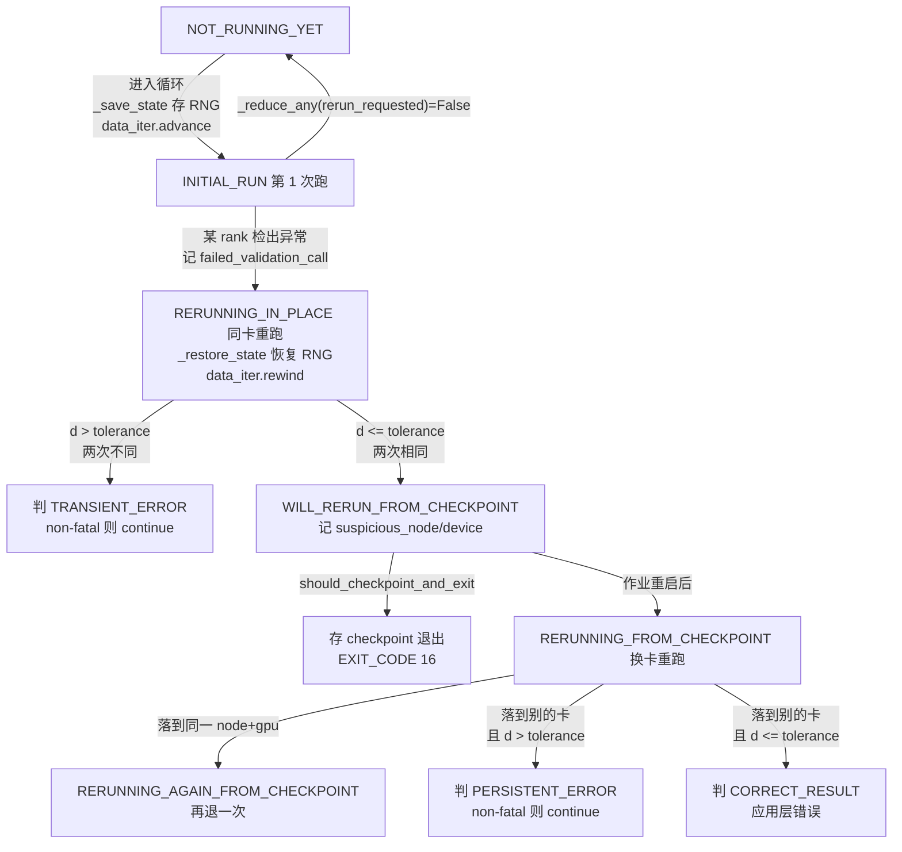
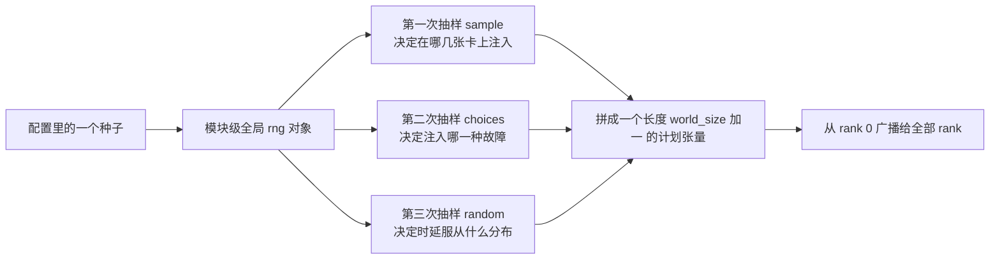

> 源码基准：`megatron-core` **0.20.0**，commit [`60e039626`](https://github.com/NVIDIA/Megatron-LM/tree/60e039626)。本文所有行号均对该 commit 取证。
> 配套实验：[`ipynbs` commit `ca234bb`](https://github.com/lrypcy/ipynbs/tree/ca234bb) 的 `experiments/megatron/rerun/`。

训练作业挂在集群上是常态。崩了重启就行，真正的麻烦是那些**不崩的作业**。

一个 bit 翻在某个 kernel 的中间结果上，它不会抛异常、不会触发 ECC、不会让 loss 变 NaN——它只是让那一步的梯度错了一点。这一步的梯度进了 `main_grad`，参与 reduce-scatter，参与 optimizer.step()，然后被下一个 checkpoint 存下来。**从头到尾没有任何一行代码知道出事了。**

这类故障在文献里叫 silent data corruption（SDC）。有一项在生产级 GPU 上做门级 stuck-at 故障注入、耗掉三百多万模拟器小时的研究给出的数字是：**SDC 的结果里 NaN / ±Inf 只占 1.01%**，而「值被清零」占 50.68%（见 [*The Anatomy of Silent Data Corruption*, arXiv:2605.04213](https://arxiv.org/abs/2605.04213)）。也就是说——**挂一个 `torch.isnan` 能抓到的东西，不到 2%。**

那剩下 98% 怎么办？Megatron 的答案是：**重跑这一个 step，比对两次的结果。** 本文拆的就是这套机制。

本篇只写 `rerun_state_machine.py`（1420 行）与 `fault_injector.py`（233 行）两个文件。`dist_checkpointing/` 那 22 个文件、7793 行是另一条线索（存档格式），本篇只在需要区分「重跑」与「存档」时提一句，不展开。

---

## 1. 要解决的到底是什么问题

### 1.1 三种失败，三种处置

训练作业的失败可以分三类，处置方式完全不同。

| 类型 | 特征 | 常规处置 | 本篇机制 |
| --- | --- | --- | --- |
| crash | 段错误、非法指令、OOM | 从最近 checkpoint 重启 | 无关 |
| DUE（detected unrecoverable error） | 硬件或软件检出，作业终止 | 同上 | 无关 |
| **SDC** | **无任何显式信号，结果已错** | **无处可查** | **本篇** |

这个三分法来自 [*Exploring Silent Data Corruption as a Reliability Challenge in LLM Training*, arXiv:2604.00726](https://arxiv.org/abs/2604.00726) 的定义。该文用 NVBit 在 GPU 矩阵乘指令层面做定向故障注入，观察到局部起源的故障可以产生「NaN 传播、loss 与梯度范数的短时尖峰、attention logits 的偏移，以及持久性的参数发散」——并明确指出这两者的区别：**前两类给开发者即时反馈，SDC 不给**。

ECC 挡不住 SDC。同一个来源给出的机制是：ECC 只能纠正单比特、检测双比特，且**对「计算过程中发生的错误」与「未受保护的通信路径」完全无效**。这是把校验挂到数值结果上、而不是挂到硬件错误计数器上的根本理由。

### 1.2 「重跑」听起来简单，做对很难

朴素的想法是：结果不对就重算一次。这一步有三件事没说清楚：

**第一，重跑必须与原跑逐位一致，否则比对没有意义。** 如果重跑本身就带着随机性，两次结果的差异里混着「故障造成的差异」与「随机性造成的差异」，判据就没了。

**第二，重跑不能重复计入梯度。** 一次 step 通常由多个 microbatch 累加而成。如果第 3 个 microbatch 出错、重跑它，前两个的梯度已经被累加过一次了。状态机必须保证重跑时整个 step 的累加**从头开始**，而不是接着上一次继续。

**第三，重跑要能在「同一张卡」和「另一张卡」之间做出区分。** 这个区分是整个机制的核心，见 §2.3。

第二条正是 Megatron 把整个 forward-backward 包在一个 `while` 循环里的原因。[`training.py` L2960-L2963](https://github.com/NVIDIA/Megatron-LM/blob/60e039626/megatron/training/training.py#L2960-L2963)：

```python
num_microbatches = get_num_microbatches()
rerun_state_machine = get_rerun_state_machine()
while rerun_state_machine.should_run_forward_backward(data_iterator):
    for _ in range(num_microbatches):
        ...
```

循环体是**整个 step**，不是单个 microbatch。`optimizer.zero_grad()` 与 `optimizer.step()` 都在循环体内（见 `train_step` 的写法，[L283-L292](https://github.com/NVIDIA/Megatron-LM/blob/60e039626/megatron/core/rerun_state_machine.py#L283-L292) 的 docstring 示例）。**重跑一次 = 整个 step 重来 = 梯度从零重新累加。** 第二条因此是结构上保证的，不需要额外代码。

状态机把这个 while 循环的「还要不要再跑一遍」交给 `should_run_forward_backward` 返回。返回 `False` 时循环退出，训练继续；返回 `True` 时整个 step 重来。

### 1.3 05 篇的 `check_grads` 就是这套机制的入口

本系列 05 篇讲数据并行时提到过 `check_grads`（[`param_and_grad_buffer.py` L345-L360](https://github.com/NVIDIA/Megatron-LM/blob/60e039626/megatron/core/distributed/param_and_grad_buffer.py#L345-L360)），当时只说「它会把 CUDA 流排空，开了就放弃这一桶的重叠」。那是从性能角度看的。本篇给出它的另一半：这三行 `validate_result` **就是确定性重跑机制挂在数据并行路径上的接口**。

```python
rerun_state_machine = get_rerun_state_machine()
for i in range(len(self.buckets)):
    grad_norm = self.buckets[i].grad_data.norm(p=2)
    # check for NaN, Inf and unexpectedly large grads
    if check_for_nan_or_inf:
        rerun_state_machine.validate_result(
            result=grad_norm,
            rejection_func=torch.isnan,
            message=f"found NaN in local grad norm for bucket #{i} "
            f"in backward pass before data-parallel communication collective",
            tolerance=0.001,  # 0.1% tolerance to account for non-deterministic FA backward
            fatal=True,
        )
```

三个参数值得逐个读：

- `rejection_func=torch.isnan` —— **这是「第一次跑」的判据**，与 SDC 的 1.01% 命中率对应。
- `tolerance=0.001` —— **这是「重跑比对」的判据**，注释写明理由是「0.1% tolerance to account for non-deterministic FA backward」。**非零容差的存在本身就是这条机制存在的理由**：FlashAttention 的反向不逐位确定，所以两次结果的**允许**有差异。
- `fatal=True` —— 检出后是否终止作业。NaN/Inf 用 `True`，而下面的「异常大」用 `False`（[L371-L380](https://github.com/NVIDIA/Megatron-LM/blob/60e039626/megatron/core/distributed/param_and_grad_buffer.py#L371-L380)）：一个 NaN 梯度必然毁掉这一步，一个偏大的梯度未必。

本章标题里那个「逐位一致」需要在这里修正一次：**Megatron 自己的默认容差是 0.001，不是 0。** 05 篇 §6.5 提到的那条源码注释「`tolerance=0.001, # 0.1% tolerance to account for non-deterministic FA backward`」说的正是这件事。真正要求逐位的是 §3.1 的 `REPORT_DETERMINISM_STATS` 模式——那个模式不判定通过与否，只统计差异分布。

---

## 2. 状态机记的是什么

### 2.1 六个状态与四条请求标志

`RerunState` 是六个枚举值（[`rerun_state_machine.py` L82-L111](https://github.com/NVIDIA/Megatron-LM/blob/60e039626/megatron/core/rerun_state_machine.py#L82-L111)），源码的 docstring 自己写了「would benefit from a diagram」——本章给这张图。

| 状态 | 编号 | 含义 |
| --- | --- | --- |
| `NOT_RUNNING_YET` | 0 | 循环外。首次进入前，或成功完成后 |
| `INITIAL_RUN` | 1 | 第一次跑这个 step |
| `RERUNNING_IN_PLACE` | 2 | 第二次跑，**同一张 GPU** |
| `WILL_RERUN_FROM_CHECKPOINT` | 3 | 已决定存 checkpoint 并退出，等作业重启后再跑 |
| `RERUNNING_FROM_CHECKPOINT` | 4 | 作业从 checkpoint 重启后，跑这个 step（**换卡了**） |
| `RERUNNING_AGAIN_FROM_CHECKPOINT` | 5 | 重启后又落到同一张卡，还要再退一次 |

六个状态里，**2 与 4 的区别是整篇的核心**：状态 2 是「同卡重跑」，状态 4 是「换卡重跑」。区分这两者的目的，是判断故障到底在卡上还是在别处。

四条请求标志（[L199-L207](https://github.com/NVIDIA/Megatron-LM/blob/60e039626/megatron/core/rerun_state_machine.py#L199-L207)）：

```python
# The flags below are per-rank flags that get all-reduced across all ranks
# request to rerun iteration because validation failed (1st re-run).
self.rerun_requested: bool = False
# Request to checkpoint to re-run iteration on different GPU (2nd re-run).
self.checkpoint_requested: bool = False
# Request to restart job again from checkpoint because got the same GPU (3rd+ re-run).
self.restart_again_requested: bool = False
# Request to resume normal execution when no HW fault was detected.
self.continue_requested: bool = False
```

**注释里那句「per-rank flags that get all-reduced across all ranks」是分布式语义的要点。** 这些标志是**每个 rank 各自置位**的，但下一次决策前会 all-reduce（§2.2）。所以「某个 rank 检出异常」会变成「所有 rank 一起重跑」——这在语义上是对的：梯度归约是跨 rank 的，一个 rank 的错误梯度已经污染了 collective 的输入。

### 2.2 `_reduce_any`：四条标志怎么变成一个决定

[`_reduce_any` L254-L270](https://github.com/NVIDIA/Megatron-LM/blob/60e039626/megatron/core/rerun_state_machine.py#L254-L270) 只有 17 行，做的是 all-reduce OR：

```python
if isinstance(value, list):
    val_tensor: torch.Tensor = torch.tensor(value, dtype=torch.int32, device='cuda')
    torch.distributed.all_reduce(val_tensor)
    return tuple([x > 0 for x in val_tensor.tolist()])
else:
    val_tensor: torch.Tensor = torch.tensor([value], dtype=torch.int32, device='cuda')
    torch.distributed.all_reduce(val_tensor)
    return val_tensor.item() > 0
```

支持标量与列表两种输入；列表版本返回 tuple，供一次 all-reduce 同步取多个决策用。**这四个 all-reduce 点是状态机全部的通信开销**——每个都是一次同步的 NCCL 集合通信。§3 会算这笔账。

调用点只有两处，都在 `should_run_forward_backward` 里：

```python
# L329：第一次跑结束时，是否有人要求重跑
will_rerun = self._reduce_any(self.rerun_requested)

# L354：同卡重跑结束时，是否继续 / 是否存 checkpoint
will_continue, will_checkpoint = self._reduce_any(
    [self.continue_requested, self.checkpoint_requested]
)
```

第二次（[L378-L380](https://github.com/NVIDIA/Megatron-LM/blob/60e039626/megatron/core/rerun_state_machine.py#L378-L380)）在状态 4 分支：

```python
will_restart_again, will_continue = self._reduce_any(
    [self.restart_again_requested, self.continue_requested]
)
```

**代价模型由此确定：正常情况每 step 一次 all-reduce；检出异常时该 step 变成两次到三次，加上重跑本身。**

### 2.3 状态转移：一条完整的路径

把 §1.3 那个 NaN 场景走一遍。状态转移的代码全在 `should_run_forward_backward`（[L272-L398](https://github.com/NVIDIA/Megatron-LM/blob/60e039626/megatron/core/rerun_state_machine.py#L272-L398)），共 127 行、五个分支。



*图 1：状态机的完整路径。核心是「同卡重跑」与「换卡重跑」这一步分叉——它把「故障在卡上」与「故障不在卡上」区分开。同卡能复现 → 换卡试；同卡不能复现 → 瞬态错误，直接放过。数据出处：六个状态定义见 [`rerun_state_machine.py` L82-L111](https://github.com/NVIDIA/Megatron-LM/blob/60e039626/megatron/core/rerun_state_machine.py#L82-L111)，转移逻辑见 [`should_run_forward_backward` L272-L398](https://github.com/NVIDIA/Megatron-LM/blob/60e039626/megatron/core/rerun_state_machine.py#L272-L398)，三次 `_reduce_any` 调用点见 [L329](https://github.com/NVIDIA/Megatron-LM/blob/60e039626/megatron/core/rerun_state_machine.py#L329) / [L354-L356](https://github.com/NVIDIA/Megatron-LM/blob/60e039626/megatron/core/rerun_state_machine.py#L354-L356) / [L378-L380](https://github.com/NVIDIA/Megatron-LM/blob/60e039626/megatron/core/rerun_state_machine.py#L378-L380)，退出码见 [L36-L40](https://github.com/NVIDIA/Megatron-LM/blob/60e039626/megatron/core/rerun_state_machine.py#L36-L40)。*

三条路径的判读：

- **同卡重跑不同**（`d > tolerance`）→ 判 `TRANSIENT_ERROR`。逻辑是：同一张卡上跑两次结果都不一样，那第一次的「异常」本身就不可信，可能是别的原因。源码的 log 文案是「Possible transient error!」（[L636](https://github.com/NVIDIA/Megatron-LM/blob/60e039626/megatron/core/rerun_state_machine.py#L636)）。**注意「possible」——它不下结论，只是归类。**
- **同卡重跑相同**（`d <= tolerance`）→ 故障可复现，很可能在卡上 → 存 checkpoint 换卡重跑。
- **换卡重跑不同** → `PERSISTENT_ERROR`，是应用层的错误（log 文案：「therefore was likely incorrect」）。
- **换卡重跑相同** → `CORRECT_RESULT`，第一次的「异常」其实是正常的（log 文案：「therefore it was likely correct」）。

三种归因对应 [`RerunDiagnostic` L60-L71](https://github.com/NVIDIA/Megatron-LM/blob/60e039626/megatron/core/rerun_state_machine.py#L60-L71) 的三个枚举值，docstring 给的定义分别是「the result was the expected result given the input」「the result could not be reproduced on the same GPU」「the result could be reproduced on the same GPU, but not on a different GPU」。

### 2.4 换卡那一步：记住坏卡，别在它上面重试

状态 4 分支里有一段容易被跳过但很关键的逻辑（[L659-L668](https://github.com/NVIDIA/Megatron-LM/blob/60e039626/megatron/core/rerun_state_machine.py#L659-L668)）：

```python
elif self.state == RerunState.RERUNNING_FROM_CHECKPOINT:
    # Ensure we're not on the same GPU as the first rerun.
    node = os.uname()[1]
    device = torch.cuda.current_device()
    if node == self.suspicious_node and device == self.suspicious_device:
        logger.error(
            f"Got rescheduled on the same GPU. Need to resume again from the same "
            f"checkpoint (node: {self.suspicious_node}, gpu: {self.suspicious_device})"
        )
        self.restart_again_requested = True
```

**判据是「节点名 + 设备号」同时相同。** 这两个值在状态 2 → 3 的转移里被记下来（[L645-L646](https://github.com/NVIDIA/Megatron-LM/blob/60e039626/megatron/core/rerun_state_machine.py#L645-L646)）：

```python
# Remember the node and device we're running on so that we can check we're not
# rerunning on the same GPU when we resume from the checkpoint.
self.suspicious_node = os.uname()[1]
self.suspicious_device = torch.cuda.current_device()
```

这条逻辑的工程价值很高：**调度器把作业重新调度回同一台机器是常事**（尤其是机架级故障后可用节点变少）。如果不做这个检查，状态机会在坏卡上重跑同一个 step，得到「可复现」，然后判定「硬件故障，应用层问题」——**结论完全反过来**。

`suspicious_node` 与 `suspicious_device` 因此必须进 checkpoint，[L851-L852](https://github.com/NVIDIA/Megatron-LM/blob/60e039626/megatron/core/rerun_state_machine.py#L851-L852)。

### 2.5 退出码：把决定交给调度器

`should_checkpoint_and_exit`（[L400-L462](https://github.com/NVIDIA/Megatron-LM/blob/60e039626/megatron/core/rerun_state_machine.py#L400-L462)）返回三元组 `(should_checkpoint, should_exit, exit_code)`。两个退出码定义在 [L36-L40](https://github.com/NVIDIA/Megatron-LM/blob/60e039626/megatron/core/rerun_state_machine.py#L36-L40)：

| 退出码 | 名字 | 何时用 |
| --- | --- | --- |
| 16 | `EXIT_CODE_RESUME_TO_DISAMBIGUATE` | 状态 3 与状态 5：存了 checkpoint（或已有），请**从 checkpoint 重启去换卡** |
| 17 | `EXIT_CODE_FAILED_ON_RESULT_VALIDATION` | 状态 2 与状态 4：校验失败且**无处可去**，作业终止 |

逐状态对照（[L427-L462](https://github.com/NVIDIA/Megatron-LM/blob/60e039626/megatron/core/rerun_state_machine.py#L427-L462)）：

| 状态 | 返回 | log 文案要点 |
| --- | --- | --- |
| `RERUNNING_IN_PLACE` | `(False, True, 17)` | 可从之前的 checkpoint 恢复 |
| `WILL_RERUN_FROM_CHECKPOINT` | `(True, True, 16)` | 存 checkpoint 后退出，换卡重跑以定位 |
| `RERUNNING_FROM_CHECKPOINT` | `(False, True, 17)` | 上一个 iteration 的 checkpoint 已存在 |
| `RERUNNING_AGAIN_FROM_CHECKPOINT` | `(False, True, 16)` | 从同一个 checkpoint 再重启 |

**退出码 16 是「请再来一次」而不是「失败」。** 它的名字 `RESUME_TO_DISAMBIGUATE` 说的是「恢复以消除歧义」——机制需要换一张卡才能给出结论，而调度器把作业送回同一台机器时要再退一次。

训练循环的用法在 [`training.py` L3128-L3131](https://github.com/NVIDIA/Megatron-LM/blob/60e039626/megatron/training/training.py#L3128-L3131)：

```python
should_checkpoint, should_exit, exit_code = rerun_state_machine.should_checkpoint_and_exit()
if should_exit:
    return {}, True, should_checkpoint, should_exit, exit_code, None, None, 0
```

`should_exit` 为真时直接返回，梯度、优化器状态、scheduler 状态全部不落——**因为退出码 16 的语义是「这一步还没算对，不能存」**。真正要存的 checkpoint 由循环外的 `if should_checkpoint: save_checkpoint_and_time(...)` 处理（[L4697-L4701](https://github.com/NVIDIA/Megatron-LM/blob/60e039626/megatron/training/training.py#L4697-L4701)）。

### 2.6 状态怎么进 checkpoint

`state_dict`（[L768-L872](https://github.com/NVIDIA/Megatron-LM/blob/60e039626/megatron/core/rerun_state_machine.py#L768-L872)）有三条短路值得记：

```python
if not force:
    # Disabled mode never triggers a rerun workflow, so there's
    # nothing to persist across a restart; keep returning None to
    # avoid bloating the checkpoint.
    if self.mode == RerunMode.DISABLED:
        return None
    # ShardedObject is only supported by the torch_dist format.
    if ckpt_format != "torch_dist":
        log_single_rank(logger, logging.WARNING,
            "RerunStateMachine checkpoints ONLY SUPPORTED for checkpoint format torch_dist")
        return None
```

**第一，DISABLED 模式不占 checkpoint 空间**（返回 `None`）。第二，**只支持 `torch_dist` 格式**，别的格式直接放弃并打警告——不报错，只是机制静默失效。第三，这些状态按 rank 分片（每张卡一份，因为 `suspicious_device` 各卡不同），且分片结构必须在所有保存点保持一致，所以 `NOT_RUNNING_YET` 时也要写一份哨兵而不能省掉。

存档格式本身（分片布局、`ShardedObject` 的序列化、约束来自 `--ckpt-assume-constant-structure`）属于 `dist_checkpointing/` 那条线索，本篇不展开——这里只需要记住一条边界：**状态机能存进 checkpoint，但换一种存档格式它就静默失效。**

哪些存、哪些不存（[L841-L858](https://github.com/NVIDIA/Megatron-LM/blob/60e039626/megatron/core/rerun_state_machine.py#L841-L858)）：

| 存 | 不存 | 理由（源码注释） |
| --- | --- | --- |
| 四条请求标志 | `logged_sdc_enabled` | 「set at the job startup time」 |
| `error_injector` 状态 | `validation_counts` | 「reset at start of training loop」 |
| `failed_validation_call` / `initial_result` | `saved_state` | 「RNG state already captured in checkpoint」 |
| `suspicious_node` / `suspicious_device` | `saved_results` / `stats` | 「resets when job resumes」 |
| `data_iterator_checkpoints` / `large_value_counts` / `max_values` | | |

**`saved_state` 不存的理由是关键的**：RNG 状态已经由 checkpoint 自己保存了，`_save_state` 里的 RNG 是给**同进程内**的重跑用的（§3.2）。跨进程重跑时 RNG 从 checkpoint 恢复，不走 `saved_state` 这条路。

`validate_state_dict`（[L874-L888](https://github.com/NVIDIA/Megatron-LM/blob/60e039626/megatron/core/rerun_state_machine.py#L874-L888)）只有三行，判断「要不要按重跑模式启动」：

```python
if state_dict is None:
    return False
if 'state' not in state_dict or state_dict['state'] == RerunState.NOT_RUNNING_YET:
    return False
return True
```

**只有状态不是 `NOT_RUNNING_YET` 才算「有待重跑的 step」。** 这意味着一个普通 checkpoint 恢复后不会莫名其妙进入重跑模式。

---

## 3. 校验的时机与代价

这是全篇最该算清的一节。「用多少算力换容错」是一个显式的成本核算，不是免费的保险。

### 3.1 三种运行模式

[`RerunMode` L74-L79](https://github.com/NVIDIA/Megatron-LM/blob/60e039626/megatron/core/rerun_state_machine.py#L74-L79) 三个值：

| 模式 | 行为 | 每 step 的额外工作 |
| --- | --- | --- |
| `DISABLED` | 只做 `rejection_func`，命中就抛/警告，**不重跑** | 0 |
| `VALIDATE_RESULTS` | 命中就重跑至多两次 | 一次 all-reduce |
| `REPORT_DETERMINISM_STATS` | **每个 step 都重跑一次**，只统计差异分布，不判定 | 一次 all-reduce + 一次完整重跑 |

第三种模式的行为在 `validate_result` 里写得很清楚（[L554-L564](https://github.com/NVIDIA/Megatron-LM/blob/60e039626/megatron/core/rerun_state_machine.py#L554-L564)）：

```python
if self.mode == RerunMode.REPORT_DETERMINISM_STATS:
    if self.state == RerunState.INITIAL_RUN:
        self.rerun_requested = True
        self.saved_results[validation_call] = result
    elif self.state == RerunState.RERUNNING_IN_PLACE:
        initial_result = self.saved_results.get(validation_call)
        assert initial_result is not None, "Result from initial run missing"
        diff = comparison_func(initial_result, result)
        caller: Caller = Caller(message=message, rank=0)
        self.stats[caller].record(diff)
        return
```

**无条件把 `rerun_requested` 置真**——所以每个 step 都会重跑。这是「体检模式」：不判定好坏，只量出「这套训练到底有多不确定」。§3.5 的统计输出格式正是为此设计的。

`DISABLED` 模式的行为在 [L519-L537](https://github.com/NVIDIA/Megatron-LM/blob/60e039626/megatron/core/rerun_state_machine.py#L519-L537)，有一条向后兼容的说明：

```python
# If reruns are disabled, still validate the result and throw a RuntimeError if it is
# rejected when fatal. This is a backward-compatible behavior for infs and NaNs.
```

**禁用重跑 ≠ 禁用检查。** 这是个容易误解的点：关掉重跑引擎，NaN 检查照做。

### 3.2 状态恢复：存了什么，为什么是四个 RNG

[`_save_state` L964-L983](https://github.com/NVIDIA/Megatron-LM/blob/60e039626/megatron/core/rerun_state_machine.py#L964-L983) 只存两类东西：

```python
self.saved_state = {
    "rng_state": {
        "random_rng_state": random.getstate(),
        "np_rng_state": np.random.get_state(),
        "torch_rng_state": torch.get_rng_state(),
        "cuda_rng_state": torch.cuda.get_rng_state(),
    },
    "other_state": self.state_save_func() if self.state_save_func else None,
    # any other state to save to guarantee deterministic execution?
}
```

**四个 RNG，缺一不可**：Python 标准库 `random`、NumPy、PyTorch CPU、PyTorch CUDA。训练代码可能从任意一个取随机数，只恢复一个就够不着另一个。`_restore_state`（[L985-L994](https://github.com/NVIDIA/Megatron-LM/blob/60e039626/megatron/core/rerun_state_machine.py#L985-L994)）逐个 set 回去，最后调 `state_restore_func` 恢复用户自定义状态。

`other_state` 那行留了个注释：`# any other state to save to guarantee deterministic execution?`——**这是留给使用者的钩子**，Megatron 自己不知道用户的模型里有什么状态会变。

时机在 `should_run_forward_backward` 的 `NOT_RUNNING_YET` 分支（[L312-L315](https://github.com/NVIDIA/Megatron-LM/blob/60e039626/megatron/core/rerun_state_machine.py#L312-L315)）：

```python
self._save_state()
if data_iterators:
    for d in data_iterators:
        d.advance()
```

**保存时机是「即将开始这个 step」，恢复时机是「判定要重跑」。** 这两个时刻之间的所有状态变化，都必须能被恢复。

数据迭代器的状态由 [`RerunDataIterator` L1111-L1179](https://github.com/NVIDIA/Megatron-LM/blob/60e039626/megatron/core/rerun_state_machine.py#L1111-L1179) 单独管——它是**缓存 microbatch 而不是重放迭代器**：

```python
def __next__(self) -> Any:
    if self.replaying:
        # we should not read past the saved batches if execution is deterministic,
        # as the number of calls to get_batch() should remain the same across reruns
        assert len(self.saved_microbatches) > self.replay_pos, "No more batches to replay"
        n = self.saved_microbatches[self.replay_pos]
        self.replay_pos += 1
        return n
    n = next(self.iterable)
    if get_rerun_state_machine().get_mode() != RerunMode.DISABLED:
        # Shallow-copy so downstream dict-entry mutations do not
        # corrupt the saved snapshot used for replay.
        self.saved_microbatches.append(copy.copy(n))
    return n
```

**这个断言是整个机制的一个隐含前提的显式化**：注释说「we should not read past the saved batches **if execution is deterministic**, as the number of calls to get_batch() should remain the same across reruns」。

这正是 §1.2 说的「重跑必须与原跑一致」的另一面——不只是数值要一致，**控制流也要一致**。源码把这条要求写在了类的 docstring 里（[L169-L175](https://github.com/NVIDIA/Megatron-LM/blob/60e039626/megatron/core/rerun_state_machine.py#L169-L175)）：

> 1) A core assumption of the rerun state machine is that execution (flow control) of the iteration is deterministic w.r.t. the state captured by the rerun state... the requirement is that a re-run of the iteration yields **the same calls to validate_results()** as in the initial run. On the other hand, **computations are NOT required to be deterministic**, i.e. results may vary slightly across re-runs of the iteration.

**「控制流确定、计算不要求确定」——这一条是整套机制的立足点。** 校验点的调用序列必须可复现（所以 `validation_counts` 那个计数器有意义），但校验点的返回值可以有微小差异（所以有 `tolerance`）。

同一个 docstring 的 Caveat 2 给出了机制的能力边界（[L177-L180](https://github.com/NVIDIA/Megatron-LM/blob/60e039626/megatron/core/rerun_state_machine.py#L177-L180)）：

> 2) The re-run logic is currently only able to re-run **the current step**. It may be that an unexpected result (e.g. spiky loss) is the result of a calculation that happened at a previous iteration. The current implementation will not catch such issues.

**只能重跑当前 step。** 上一步算错导致的异常，这套机制抓不到。

### 3.3 一个不能当证据的比较：`tolerance` 的语义

`validate_result` 的判据在两处，都是 `comparison > tolerance`（[L623](https://github.com/NVIDIA/Megatron-LM/blob/60e039626/megatron/core/rerun_state_machine.py#L623) 与 [L669](https://github.com/NVIDIA/Megatron-LM/blob/60e039626/megatron/core/rerun_state_machine.py#L669)）。

默认比较函数是 [`_compare_floats` L1401-L1420](https://github.com/NVIDIA/Megatron-LM/blob/60e039626/megatron/core/rerun_state_machine.py#L1401-L1420)：

```python
af: float = a.item()
bf: float = b.item()
if (af == bf) or (math.isnan(af) and math.isnan(bf)):
    return COMPARISON_MATCH
if (
    (math.isnan(af) and not math.isnan(bf))
    or (not math.isnan(af) and math.isnan(bf))
    or (math.isinf(af) and not math.isinf(bf))
    or (not math.isinf(af) and math.isinf(bf))
    or (math.isnan(af) and math.isinf(bf))
    or (math.isinf(af) and math.isnan(bf))
):
    return COMPARISON_MISMATCH
return math.fabs((af - bf) / (af + bf) * 2)
```

四个可读点：

1. **`COMPARISON_MATCH = 0.0`、`COMPARISON_MISMATCH = math.inf`**（[L125-L126](https://github.com/NVIDIA/Megatron-LM/blob/60e039626/megatron/core/rerun_state_machine.py#L125-L126)）——返回的是「相对差」，两个哨兵值占了定义域的两端。
2. **判定顺序不能改**：先判相等、再判双 NaN、再判类别交叉，最后才算相对差。**NaN 与 NaN 视为相等**——两次都出 NaN 说明结果一致（虽然都不对），这正是这套判据要的语义。
3. **相对差是 $$\lvert (a-b)/(a+b) \rvert \times 2$$**，对称、量级无关。
4. **`.item()` 的后果**：`a` 与 `b` 是 Python float，**`a + b == 0` 时会抛 `ZeroDivisionError` 而不是返回 `inf`**。Python 的 float 除零是异常。这一点在配套实验里被复现并记录（见 §5.1）。

这条度量有个明显的弱点：**它对「两次结果异号且量级相近」不可用**。loss 恒为正所以实际训练里不会碰到，但梯度可以是正的也可以是负的——§1.3 那个 `grad_norm` 因为取了 norm 所以为正，安全。**自定义 `rejection_func` 挂到一个可能变号的量上时要小心。**

用 `tolerance` 做判定的另一面是它**不能区分「略超出容差」与「差得离谱」**。状态机只看 `d > tolerance` 这一个布尔值，`d` 到底是 1.5 倍还是 1e6 倍都一样。§5.2 的实验给出这个度量的实际量级。

### 3.4 `is_unexpectedly_large`：一个可作为 `rejection_func` 的现成实现

除了 NaN/Inf 这类「类别」检查，源码还给了一个「量级」检查。[`is_unexpectedly_large` L698-L766](https://github.com/NVIDIA/Megatron-LM/blob/60e039626/megatron/core/rerun_state_machine.py#L698-L766) 的实现只有 15 行：

```python
value: float = math.fabs(result.item())
# Ignore NaNs and Infs. They should be checked separately.
if math.isnan(value) or math.isinf(value):
    return False

if resample or context not in self.large_value_counts:
    self.large_value_counts[context] = 0
if self.large_value_counts[context] < num_samples:
    self.large_value_counts[context] += 1
    self.max_values[context] = max(self.max_values.get(context, 0.0), value)
    if self.large_value_counts[context] == num_samples:
        logger.warning(f"Max value for {context}: {self.max_values[context]}")
    return False

return value >= self.max_values[context] * threshold
```

三点设计：

- **前 `num_samples`（默认 100）次一定返回 `False`**——先攒样本估计「正常值域」，攒够了才开始判。攒够时打一条日志把基线记下来。
- **`context` 字符串分桶**（§1.3 里传的是 `"grads"`），所以 loss 与 grads 各有各的基线。
- **判据是 `value >= max * threshold`**，即「超过历史最大值的 threshold 倍」。05 篇那个调用传的是 `threshold=10`。

**它只抓「突然变大」，不抓「突然变小」。** 文档字符串说这是针对「results with unexpectedly large exponents, e.g. spiky loss or grads」——位翻转最常见的两种表现是「变成一个巨大的数」与「变成 NaN/Inf」，而「变成一个极小的数」通常是下溢，不致命。这个取舍是对的，但它意味着**「值突然缩小」这类故障这套机制抓不到**。

`large_value_counts` 与 `max_values` 要进 checkpoint（[L855-L856](https://github.com/NVIDIA/Megatron-LM/blob/60e039626/megatron/core/rerun_state_machine.py#L855-L856)）——否则换卡重跑时基线丢失，会误判。

### 3.5 开销核算

把上面几项合起来是这张表。**A 级：只给算术模型，不含实测。**

| 项 | 频次 | 代价 | 依据 |
| --- | --- | --- | --- |
| 校验项本身 | 每个校验点一次 | 扫一遍结果张量 | `validate_result` 的调用点 |
| 结果存储 | 每个校验点一份 | 通常 4 字节（一个 0-dim float） | `initial_result`（[L600](https://github.com/NVIDIA/Megatron-LM/blob/60e039626/megatron/core/rerun_state_machine.py#L600)） |
| 状态机 all-reduce | **每 step 一次** | 一次 NCCL 同步 | `_reduce_any`（[L329](https://github.com/NVIDIA/Megatron-LM/blob/60e039626/megatron/core/rerun_state_machine.py#L329)） |
| RNG 状态存取 | 每 step 一次 | 四个 RNG 的 get/set | `_save_state`（[L974-L983](https://github.com/NVIDIA/Megatron-LM/blob/60e039626/megatron/core/rerun_state_machine.py#L974-L983)） |
| microbatch 缓存 | 每 step 全部 | **一个 step 的输入张量** | `RerunDataIterator.saved_microbatches` |
| **重跑整个 step** | **检出时** | **1–2 倍 step 时间** | `should_run_forward_backward` 返回 `True` |
| **存 checkpoint + 退出** | 换卡路径 | **一次完整存档 + 作业重启** | `should_checkpoint_and_exit` 返回 `(True, True, 16)` |

配套实验给了一个玩具规模的算术模型（[`gen_stdout.py` §5](https://github.com/lrypcy/ipynbs/blob/ca234bb/experiments/megatron/rerun/gen_stdout.py)，参数 128 元素、8 个 microbatch）：

| 校验项数 | 校验 FLOP/step | 结果显存 字节 | 重跑 FLOP |
| --- | --- | --- | --- |
| 1 | 256 | 4 | 2048 |
| 2 | 512 | 8 | 2048 |
| 4 | 1024 | 16 | 2048 |
| 8 | 2048 | 32 | 2048 |
| 16 | 4096 | 64 | 2048 |

每增挂一个校验项的边际校验算力 **256 FLOP/step**（= 128 元素 × 2 FLOP），结果显存每项 4 字节。

**这个玩具规模下的「校验很便宜」不可外推。** 真实模型里挂 N 个校验项的边际 FLOP 与重跑一个 step 的 FLOP 之比是另一个数量级——重跑包含整个模型的前反向，而校验只是扫一个标量。**决定成本的是「检出后重跑」这一项，不是校验本身。**

数据侧的成本也值得单列：`RerunDataIterator` 在 `DISABLED` 之外的模式下会 `copy.copy` 每个 microbatch 存起来（[L1147-L1150](https://github.com/NVIDIA/Megatron-LM/blob/60e039626/megatron/core/rerun_state_machine.py#L1147-L1150)）。**这是一个 step 的输入张量的浅拷贝**，长序列 + 大 batch 时不可忽略。源码只做了浅拷贝（注释：「Shallow-copy so downstream dict-entry mutations do not corrupt the saved snapshot used for replay」）——**如果 microbatch 里的张量本身被原地改写，浅拷贝挡不住**。

### 3.6 误报怎么办

`fatal` 参数是唯一的开关，取值决定检出后是否终止作业。三处调用点的取值（§1.3 已列）：NaN/Inf 用 `fatal=True`，「异常大」用 `fatal=False`。

`fatal=False` 时的行为在状态 2 分支（[L624-L630](https://github.com/NVIDIA/Megatron-LM/blob/60e039626/megatron/core/rerun_state_machine.py#L624-L630)）：

```python
if not fatal:
    self.continue_requested = True
    log_failure(
        "First rerun: unexpected result is not reproducible within the tolerance "
        f"({result} != {self.initial_result})",
        fatal=fatal,
    )
```

**「不可复现」这一结论本身就足以让训练继续。** 逻辑是：如果两次跑的结果不一样，那第一次的异常本身就不可信，没有理由为一个不可信的东西终止作业。状态 4（换卡）分支的 `fatal=False` 同理（[L680-L681](https://github.com/NVIDIA/Megatron-LM/blob/60e039626/megatron/core/rerun_state_machine.py#L680-L681)）。

源码在 [L350-L353](https://github.com/NVIDIA/Megatron-LM/blob/60e039626/megatron/core/rerun_state_machine.py#L350-L353) 留了一条关于分布式语义的注释：

> N.B. We may be able to rely on the behavior of the state machine to produce an equivalent value of `self.continue_requested` across ranks, since it depends on `"fatal"`. That logic coupling seems brittle though.

**「That logic coupling seems brittle though」——源码自己承认这个耦合脆弱。** 现在的实现靠 all-reduce 保证各 rank 一致，但如果某个 rank 走的是「同卡不可复现」、另一个走的是「换卡不可复现」，两条分支的 `continue_requested` 都会置真所以没差别；真正的风险在于两条分支的**其他**标志（`checkpoint_requested` 只在状态 2 的 else 分支置位）不一致。all-reduce 之后只要有一条置真就走那条路，所以实际是安全的——但源码的谨慎有道理。

### 3.7 tracker 文件：一个可以离线复盘的日志

每次检出都往 `result_rejected_tracker_filename` 追加一行（[L1023-L1040](https://github.com/NVIDIA/Megatron-LM/blob/60e039626/megatron/core/rerun_state_machine.py#L1023-L1040)）：

```python
f.write(
    f"ts={datetime.datetime.now()} node={node} device={device} "
    f"jobID={os.getenv('SLURM_JOBID', 'N/A')} rank={rank} "
    f"iteration={self.current_iteration + 1} status={status} result={result} "
    f"message='{message}'\n"
)
```

**格式是手写的、无 schema 的键值串**——`ts` / `node` / `device` / `jobID` / `rank` / `iteration` / `status` / `result` / `message`。带 `SLURM_JOBID` 说明它预期在 SLURM 环境下跑。

`get_skipped_iterations_from_tracker_file`（[L1042-L1108](https://github.com/NVIDIA/Megatron-LM/blob/60e039626/megatron/core/rerun_state_machine.py#L1042-L1108)）反过来读这个文件，给出一个「应该跳过的 iteration 列表」。它的跳过规则（[`rerun_state_machine.py` L1072-L1083](https://github.com/NVIDIA/Megatron-LM/blob/60e039626/megatron/core/rerun_state_machine.py#L1072-L1083)）：

```python
# Skip an iteration if:
# - Reruns were disabled and it has failed on the same rank twice.
# or
# - Reruns were enabled and it was reproducible on the 2nd rerun
if status in [
    "RERUN_DISABLED",
    "FIRST_RERUN_REPRODUCIBLE",
    "SECOND_RERUN_REPRODUCIBLE",
]:
    if (rank, iteration) in iterations_seen:
        iterations_to_potentially_skip.add(iteration)
```

**同一个 (rank, iteration) 出现两次才跳过。** 一次可能是偶发，两次说明可复现。但还有一个反向规则（[`rerun_state_machine.py` L1084-L1090](https://github.com/NVIDIA/Megatron-LM/blob/60e039626/megatron/core/rerun_state_machine.py#L1084-L1090)）：

```python
iterations_seen_by_job[job][iteration].add(rank)
if len(iterations_seen_by_job[job][iteration]) > 1:
    iterations_to_ignore.add(iteration)
```

**多个 rank 在同一个 iteration 上报错 → 跳过这个 iteration。** 理由很直接：所有 rank 都挂说明不是某一张卡的问题，是模型或数据的问题——重跑也没用，跳过即可（通常是数据里有一条坏样本）。

这个函数是 **classmethod**，可以在训练之外单独调用——把 tracker 文件拿去做离线分析。它用正则解析（[L1059-L1062](https://github.com/NVIDIA/Megatron-LM/blob/60e039626/megatron/core/rerun_state_machine.py#L1059-L1062)），正则写死字段顺序，所以**改 `f.write` 的格式会同时打破解析**。

### 3.8 第一个 iteration 不校验：一条机制自身的前置条件

`validate_result` 在真正判定之前有一道早退（[`rerun_state_machine.py` L590-L595](https://github.com/NVIDIA/Megatron-LM/blob/60e039626/megatron/core/rerun_state_machine.py#L590-L595)）：

```python
if self.state == RerunState.INITIAL_RUN and not self.rerun_requested:
    # Do not validate results on the first iteration, as we cannot guarantee a checkpoint
    # can be taken before the optimizer has been stepped at least once.
    if not self.first_iteration_complete:
        return
```

**校验从第二个 iteration 才开始。** 注释给的理由是：第一个 iteration 之前无法保证已经存在一个 checkpoint。

这个理由值得展开，因为它正好接上 §2.5 的退出码语义。状态机在「同卡重跑可复现」时会存 checkpoint 并以退出码 16 退出，把作业交给调度器换卡重启。但如果在第一个 iteration 就检出异常，作业手里可能一个存档都没有——此时「换卡重跑」无从谈起：**没有存档，就没有「从 checkpoint 重启」这个动作。** 所以这条早退不是「热身一下」的工程惯例，而是机制能运转的前提条件。

置位点值得单独看：它在 `should_checkpoint_and_exit` 里（[L427](https://github.com/NVIDIA/Megatron-LM/blob/60e039626/megatron/core/rerun_state_machine.py#L427)），紧跟在 `sys.exit(exit_code)` 之后：

```python
self.first_iteration_complete = True
if self.mode in [RerunMode.DISABLED, RerunMode.REPORT_DETERMINISM_STATS]:
    return False, False, 0
```

**也就是说这个标志由「这个 iteration 走完了收尾流程」推进，而不是由「校验被调用过」推进。** 训练循环每个 iteration 末尾都会调一次 `should_checkpoint_and_exit`（见 §2.5），所以第二个 iteration 开始时它已经是 `True`。

还有一个只有按顺序读源码才看得出来的事实：**这道早退对 `REPORT_DETERMINISM_STATS` 模式不生效。** 统计分支在 [L554-L564](https://github.com/NVIDIA/Megatron-LM/blob/60e039626/megatron/core/rerun_state_machine.py#L554-L564) 就 `return` 了，位置在 L590 那道早退**之前**：

| 分支 | 起始行 | 出口 | 第一个 iteration 是否参与 |
| --- | --- | --- | --- |
| `DISABLED` | L519 | L537 `return` | 只做 `rejection_func`，不重跑 |
| `REPORT_DETERMINISM_STATS` | L554 | L564 `return` | **参与**，无条件重跑并记录 |
| `VALIDATE_RESULTS` | L590 | L595 `return` | **不参与**，被 `first_iteration_complete` 挡掉 |

**只有 `VALIDATE_RESULTS` 模式会丢掉第一个 iteration。** 体检模式反而把第一个 iteration 也重跑并统计进去——它要的是「这套计算到底有多不确定」的分布，少一个样本不划算；而 `VALIDATE_RESULTS` 模式少一个样本无所谓，反正它只在检出异常时才做事。

---

## 4. `fault_injector.py`：怎么主动制造故障

233 行，是本篇最独特的一节。前三节讲的都是「机制存在」，这一节讲「怎么证明机制有效」。

### 4.1 为什么必须有它

一个容错机制如果只在没有故障时跑过，你无法区分两件事：

- 机制正确，重跑确实还原了原结果；
- 机制根本没触发，重跑代码路径从未被执行。

**主动注入故障是唯一能把「机制存在」升级为「机制有效」的办法。** 这在软件测试里叫 mutation testing——故意注入错误，看测试能不能抓到。

`rerun_state_machine.py` 里已经有这个能力（`RerunErrorInjector`），`fault_injector.py` 是它的更大兄弟：前者注入**数值结果层面的假异常**，后者注入**进程层面的真崩溃**。

### 4.2 两层注入：结果注入 vs 故障注入

| | `RerunErrorInjector` | `FaultInjector` |
| --- | --- | --- |
| 文件 | `rerun_state_machine.py` L1267-L1362 | `fault_injector.py` 全文 |
| 注入什么 | 让 `validate_result` 返回假信号 | 让进程挂 / 卡死 / 抛异常 |
| 注入点 | 纯 Python，`maybe_inject()` 返回 `bool` | 外部库 `nvidia_resiliency_ext` |
| 验证什么 | 状态机的转移逻辑对不对 | 作业的恢复逻辑对不对 |
| 是否需要外部依赖 | 否 | **是** |

`fault_injector.py` 的依赖是硬性的（[L12-L28](https://github.com/NVIDIA/Megatron-LM/blob/60e039626/megatron/core/fault_injector.py#L12-L28)）：

```python
try:
    from nvidia_resiliency_ext.shared_utils.inject_fault import (  # type: ignore[import-untyped]
        Fault,
        clear_workload_exception,
        dispatch_fault_injection,
        maybe_raise_workload_exception,
    )

    has_nvidia_resiliency_ext = True
except ModuleNotFoundError:
    has_nvidia_resiliency_ext = False

    def maybe_raise_workload_exception():
        raise ModuleNotFoundError(
            "nvidia_resiliency_ext is required for fault injection. "
            "Please install it or disable fault injection."
        )
```

**没装 `nvidia_resiliency_ext` 时不报错，只是把 `maybe_raise_workload_exception` 换成一个永远抛 `ModuleNotFoundError` 的桩。** 233 行里真正做事的只有 `setup_fault_injection` 一个函数。

`__all__` 只有三项（[L31](https://github.com/NVIDIA/Megatron-LM/blob/60e039626/megatron/core/fault_injector.py#L31)）：

```python
__all__ = ["FaultInjectorConfig", "setup_fault_injection", "maybe_raise_workload_exception"]
```

**注意 `FaultInjectorConfig` 被导出，而 `get_fault_ranks` / `get_fault` / `get_fault_delay` 都不在 `__all__` 里**——它们是内部辅助函数，外部不该直接调。

### 4.3 时延采样：一个指数分布

`get_fault_delay`（[L174-L189](https://github.com/NVIDIA/Megatron-LM/blob/60e039626/megatron/core/fault_injector.py#L174-L189)）：

```python
def get_fault_delay(config: FaultInjectorConfig):
    fault_delay = config.fault_injector_fault_delay
    assert (
        fault_delay is not None or config.fault_intti_seconds is not None
    ), "fault_injector_fault_delay or fault_injector_mtti_seconds must be specified"
    if fault_delay is None:
        mtti_seconds = config.fault_injector_mtti_seconds
        offset_seconds = config.fault_injector_offset_seconds or 0.0
        lambda_inj = 1.0 / mtti_seconds
        fault_delay = offset_seconds + (-math.log(1.0 - _require_rng().random()) / lambda_inj)

    return fault_delay
```

**MTTI（mean time to inject）是「平均多久注入一次故障」**，采样出的时延服从以 $$1/\text{mtti}$$ 为率的指数分布，偏移量 `offset_seconds` 用来保证故障不会落在训练刚开始的位置。

这是标准的指数分布反函数法 $$X = -\ln(1-U)/\lambda$$（$$U$$ 均匀）。配套实验验证了这个采样的正确性（§5.4），并给出一个容易被忽略的性质：**指数分布的标准差等于均值**，所以故障时延的变异系数恒为 1——`mtti=600s` 并不意味着「大约 10 分钟」，它有大约 1/3 的概率超过 10 分钟。

两种模式：`fault_injector_fault_delay` 固定一个时延（确定性测试），或 `fault_injector_mtti_seconds` 按分布采样（压测）。两者互斥，源码用断言强制。

### 4.4 选哪张卡、注入什么、什么时刻

三个正交的选择，各由一个字段控制。

**选卡**（[L104-L129](https://github.com/NVIDIA/Megatron-LM/blob/60e039626/megatron/core/fault_injector.py#L104-L129)）：`fault_injector_ranks` 显式指定，或 `fault_injector_num_ranks` 随机抽。两者互斥（断言「Cannot specify both force_ranks and num_ranks」）。显式指定时校验范围：

```python
assert all(
    0 <= r < world_size for r in fault_ranks
), f"Fault ranks must be between 0 and {world_size - 1}"
assert len(fault_ranks) > 0, "Must specify at least one fault rank"
```

随机模式抽的是 `range(1, world_size)`——**从 1 开始，不抽 rank 0**（[L127](https://github.com/NVIDIA/Megatron-LM/blob/60e039626/megatron/core/fault_injector.py#L127)）。rank 0 往往承担广播与协调的角色，让它挂掉会让整个作业立刻停摆而不是走到恢复逻辑。

**注入什么**（[L132-L160](https://github.com/NVIDIA/Megatron-LM/blob/60e039626/megatron/core/fault_injector.py#L132-L160)）：`fault_injector_fault_types` 是逗号分隔的类型名（help 里举例 `'hang,crash'`），`fault_injector_fault_probabilities` 是对应权重。**权重会被归一化**：

```python
fault_probabilities = [p / sum(fault_probabilities) for p in fault_probabilities]
```

不给权重时均匀分配。类型数量与权重数量必须相等（断言）。

**什么时刻**由两个函数分岔（[L163-L171](https://github.com/NVIDIA/Megatron-LM/blob/60e039626/megatron/core/fault_injector.py#L163-L171)）：

```python
def should_setup_fault_injection_at_start(config):
    return config.fault_injector_delay_start_iteration is None

def should_setup_fault_injection_at_iteration(config, iteration):
    delay_start_iteration = config.fault_injector_delay_start_iteration
    return delay_start_iteration is not None and delay_start_iteration == iteration
```

给了 `fault_injector_delay_start_iteration` 就「从第 N 步结束后开始计时」，不给就「从训练启动开始计时」。训练循环里两条路都接上了（[`training.py` L4156-L4157](https://github.com/NVIDIA/Megatron-LM/blob/60e039626/megatron/training/training.py#L4156-L4157) 与 [L4689-L4692](https://github.com/NVIDIA/Megatron-LM/blob/60e039626/megatron/training/training.py#L4689-L4692)）。

`training.py` 里给了一句注释解释「从 iteration 开始」这个选项的用意（[L4686-L4688](https://github.com/NVIDIA/Megatron-LM/blob/60e039626/megatron/training/training.py#L4686-L4688)）：

> Fault delay timing can start at the end of iteration N. Self-firing faults (signals, GIL, GPU) may then manifest in iteration N or N+1 depending on the configured delay; **workload-exception faults manifest on a later poll**.

**故障的实际发作时刻不等于注入时刻**——signals / GIL / GPU 类故障在配置延迟到达时立刻发作，而 workload-exception 类要等到某次轮询。这是「配置时延」与「观测时延」的差。

### 4.5 计划广播：为什么只有 rank 0 决策

`setup_fault_injection`（[L192-L233](https://github.com/NVIDIA/Megatron-LM/blob/60e039626/megatron/core/fault_injector.py#L192-L233)）是本文件唯一的核心逻辑，42 行：

```python
device = torch.device("cuda", torch.cuda.current_device())
plan_tensor = torch.full((world_size + 1,), float("nan"), dtype=torch.float64, device=device)

clear_workload_exception()

if my_rank == 0:
    if rng is None:
        rng = cast(_FaultInjectorRNG, random.Random(config.fault_injector_seed))

    fault_ranks = get_fault_ranks(config)
    fault = get_fault(config)
    fault_delay = get_fault_delay(config)

    for rank in fault_ranks:
        plan_tensor[rank] = float(fault.value)
    plan_tensor[world_size] = fault_delay

dist.broadcast(plan_tensor, src=0)

planned_fault = float(plan_tensor[my_rank].item())
is_target_rank = not math.isnan(planned_fault)

if is_target_rank:
    fault = Fault(int(planned_fault))
    fault_delay = float(plan_tensor[world_size].item())
    current_time = datetime.datetime.now()
    fault_time = current_time + datetime.timedelta(seconds=fault_delay)
    ...
    dispatch_fault_injection(fault=fault, delay=fault_delay, callback=None)
```

四个设计：

1. **一个 `float64` 张量承载整个计划**，长度 `world_size + 1`。前 `world_size` 个元素是「这张卡该注入什么故障」（NaN = 不注入），最后一个元素是时延。**用一个 tensor 一次广播传完，比拆成多次 all-reduce 干净。**
2. **`clear_workload_exception()` 在广播之前无条件调用**——清掉上一次注入残留的异常，否则重跑时第一件事就是抛旧异常。
3. **只有 rank 0 抽签**，用 `random.Random(config.fault_injector_seed)` 而不是全局 `random`。**种子可控 → 故障计划可复现。** `fault_injector_seed` 是配置里的一个字段。
4. **`is_target_rank` 用 `not math.isnan(...)` 判定**，而不是显式比较某个哨兵值——NaN 天然表示「没被选中」。

最后那行 `logger.warning` 的文案格式是 `[时间戳] FAULT INJECTION: Rank N will inject fault <类型> at <时间戳>`——**注入的时刻在日志里是明确的**，因为事后要拿这个时间戳去对齐训练日志。

### 4.6 故障在训练循环的哪个点被引爆

`training.py` 里 `maybe_raise_workload_exception` 的调用点只有一处（[L4684-L4685](https://github.com/NVIDIA/Megatron-LM/blob/60e039626/megatron/training/training.py#L4684-L4685)）：

```python
ft_integration.on_training_step_end()
if _maybe_raise_workload_exception is not None and iteration != start_iteration:
    _maybe_raise_workload_exception()
```

**在 `train_step` 返回之后、checkpoint 之前。** 两个细节：

- `iteration != start_iteration` —— **第一个 iteration 不引故障**。启动阶段的状态还没有稳定，引故障得到的结果不好解释。
- 位置在 `train_step` 返回后 —— 那时梯度已经归约完、优化器已经 step 完。**故障打断的是「这一步已提交、下一步还没开始」的间隙**，这正是恢复逻辑要处理的位置。

紧接着的 [L4697-L4701](https://github.com/NVIDIA/Megatron-LM/blob/60e039626/megatron/training/training.py#L4697-L4701)：

```python
if should_checkpoint:
    save_checkpoint_and_time(...)
```

所以故障与 checkpoint 的先后关系是确定的：**先引爆故障（如果到点了），再决定要不要存档。** 故障引燃后代码不会走到这里。

### 4.7 配置怎么进来

`FaultInjectorConfig` 是一个 `kw_only=True` 的 dataclass，九个字段全带 docstring（[L47-L77](https://github.com/NVIDIA/Megatron-LM/blob/60e039626/megatron/core/fault_injector.py#L47-L77)）。CLI 侧不手写参数，而是用工厂（[`arguments.py` L3790-L3792](https://github.com/NVIDIA/Megatron-LM/blob/60e039626/megatron/training/arguments.py#L3790-L3792)）：

```python
def _add_fault_injector_args(parser):
    from megatron.training.config import FaultInjectorConfig
    ArgumentGroupFactory(FaultInjectorConfig).build_group(parser, "fault injector")
    return parser
```

**参数由 dataclass 反射生成**，加一个字段就自动多一个 CLI flag，不用改 `arguments.py`。`training.py` 那边同样用反射取值（[L4136-L4140](https://github.com/NVIDIA/Megatron-LM/blob/60e039626/megatron/training/training.py#L4136-L4140)）：

```python
fault_injector_kwargs = {}
for f in dataclasses.fields(FaultInjectorConfig):
    if hasattr(args, f.name):
        fault_injector_kwargs[f.name] = getattr(args, f.name)
fault_injector_config = FaultInjectorConfig(**fault_injector_kwargs)
```

而是否启用由两个字段任一非空决定（[L4143-L4146](https://github.com/NVIDIA/Megatron-LM/blob/60e039626/megatron/training/training.py#L4143-L4146)）：

```python
if (
    fault_injector_config.fault_injector_ranks is not None
    or fault_injector_config.fault_injector_num_ranks is not None
):
```

**必须显式指定「哪些卡」或「几张卡」，否则整个机制不启用**——这与 `RerunStateMachineConfig` 的 `rerun_mode` 默认 `"validate_results"` 不同（[L21](https://github.com/NVIDIA/Megatron-LM/blob/60e039626/megatron/training/config/resilience_config.py#L21)）。故障注入是**默认关**的，重跑校验是**默认开**的。

`resilience_config.py` 里两个 dataclass 挨在一起：`RerunStateMachineConfig`（五个字段）与 `StragglerDetectionConfig`（四个字段）。后者与本篇无关但同属「韧性」这个主题——慢卡检测（straggler detection）是另一种「机器没坏但变慢了」的故障。

### 4.8 `RerunErrorInjector`：不需要外部依赖的那一半

`fault_injector.py` 需要 `nvidia_resiliency_ext`，但 `rerun_state_machine.py` 里的 `RerunErrorInjector`（[L1267-L1362](https://github.com/NVIDIA/Megatron-LM/blob/60e039626/megatron/core/rerun_state_machine.py#L1267-L1362)）是纯 Python 的，任何环境都能跑。它注入的是**假信号**而不是真故障。

**注入概率**（[L1298-L1302](https://github.com/NVIDIA/Megatron-LM/blob/60e039626/megatron/core/rerun_state_machine.py#L1298-L1302)）：

```python
r: int = (
    random.randint(0, self.error_injection_rate - 1) + safe_get_rank()
) % self.error_injection_rate
if r != 0:
    return False
```

**`error_injection_rate=1000` 表示「每 1000 次校验有 1 次注入」**，而 `+ safe_get_rank()` 让不同 rank 的注入时刻错开——**避免所有 rank 同时注入同一个类型的假故障**（那会触发一次真实的 all-reduce 重跑，看起来像真故障）。

**注入内容由 `maybe_miscompare` 决定**（[L1309-L1344](https://github.com/NVIDIA/Megatron-LM/blob/60e039626/megatron/core/rerun_state_machine.py#L1309-L1344)），它的逻辑是一张真值表：

| 注入类型 | 状态 2（同卡重跑） | 状态 4（换卡重跑） | 结论 |
| --- | --- | --- | --- |
| `TRANSIENT_ERROR` | 返回 **MISMATCH** | 返回 MATCH | 判为瞬态错误 |
| `PERSISTENT_ERROR` | 返回 MATCH | 返回 **MISMATCH** | 判为持续错误 |
| `CORRECT_RESULT` | 返回 MATCH | 返回 MATCH | 判为结果正确 |

**这张表把 §2.3 的三条路径全部覆盖了一遍。** 也就是说：打开 `error_injection_type` 依次跑三次，就能验证状态机的三条转移路径各走一遍——**这就是「把机制存在升级为机制有效」的具体做法**。

未注入时 `maybe_miscompare` 直接退化为用户的比较函数（[L1322-L1323](https://github.com/NVIDIA/Megatron-LM/blob/60e039626/megatron/core/rerun_state_machine.py#L1322-L1323)）：

```python
if self.injected_error_type is None:
    return comparison_func(initial_result, result)
```

`injected_error_type` 在每次注入被消费时置 `None`（[L1328](https://github.com/NVIDIA/Megatron-LM/blob/60e039626/megatron/core/rerun_state_machine.py#L1328) / [L1336](https://github.com/NVIDIA/Megatron-LM/blob/60e039626/megatron/core/rerun_state_machine.py#L1336) / [L1339](https://github.com/NVIDIA/Megatron-LM/blob/60e039626/megatron/core/rerun_state_machine.py#L1339)），保证**一次注入只影响一次判定**。

配套实验的 §5.3 用的就是这个思路：注入 `TRANSIENT_ERROR`，验证状态机走到「不可复现 → 继续执行」这条路。

### 4.9 `_FaultInjectorRNG`：三个方法、三次抽样、一个种子

[`fault_injector.py` L80-L95](https://github.com/NVIDIA/Megatron-LM/blob/60e039626/megatron/core/fault_injector.py#L80-L93) 定义了一个只声明接口的 Protocol：

```python
class _FaultInjectorRNG(Protocol):
    """Minimal RNG interface used by fault injector helper functions."""

    def sample(self, population: Sequence[int], k: int) -> list[int]:
        """Return ``k`` sampled items from the given population."""
        ...

    def choices(self, population: Sequence[_T], weights: Sequence[float], k: int) -> list[_T]:
        """Return ``k`` weighted samples from the given population."""
        ...

    def random(self) -> float:
        """Return a floating-point value in the half-open interval [0.0, 1.0)."""
        ...
```

三个方法与「一次故障计划要做的三个决定」一一对应：

| 方法 | 决定什么 | 调用点 |
| --- | --- | --- |
| `sample` | **选哪几张卡** | `get_fault_ranks`（[L127](https://github.com/NVIDIA/Megatron-LM/blob/60e039626/megatron/core/fault_injector.py#L127)） |
| `choices` | **注入什么类型** | `get_fault`（[L160](https://github.com/NVIDIA/Megatron-LM/blob/60e039626/megatron/core/fault_injector.py#L160)） |
| `random` | **什么时候发作** | `get_fault_delay`（[L187](https://github.com/NVIDIA/Megatron-LM/blob/60e039626/megatron/core/fault_injector.py#L187)） |

**一次故障计划 = 三次抽样，全部来自同一个 RNG。** 这个设计有一个直接的好处：`fault_injector_seed` 一个字段就足以让整份计划可复现。因为三个决定串行地取自同一个 `random.Random`，给定种子，选中的 rank、故障类型、时延三者都确定。



*图 2：一次故障计划由同一个 RNG 的三次连续抽样决定，因此单个种子即可让整份计划可复现。三个抽样点分别见 [`fault_injector.py` L127](https://github.com/NVIDIA/Megatron-LM/blob/60e039626/megatron/core/fault_injector.py#L127)（`sample`）、[L160](https://github.com/NVIDIA/Megatron-LM/blob/60e039626/megatron/core/fault_injector.py#L160)（`choices`）、[L187](https://github.com/NVIDIA/Megatron-LM/blob/60e039626/megatron/core/fault_injector.py#L187)（`random`）；计划张量的拼装与广播见 [L201-L217](https://github.com/NVIDIA/Megatron-LM/blob/60e039626/megatron/core/fault_injector.py#L201-L217)。*

用 Protocol 而不是直接写 `random.Random` 有两个实际好处。第一个是**可替换**：全局变量 `rng`（[L96](https://github.com/NVIDIA/Megatron-LM/blob/60e039626/megatron/core/fault_injector.py#L96)）的类型标注是 `_FaultInjectorRNG | None`，任何提供这三个方法的对象都能塞进去——§4.10 会看到单元测试正是这么做的。第二个是**可断言**：`_require_rng`（[L99-L101](https://github.com/NVIDIA/Megatron-LM/blob/60e039626/megatron/core/fault_injector.py#L99-L101)）用一句 `assert rng is not None` 把「rng 还没初始化就调用抽签函数」这件事变成显式失败：

```python
def _require_rng() -> _FaultInjectorRNG:
    assert rng is not None, "fault injector rng must be initialized"
    return rng
```

这个断言是有意义的，因为 `get_fault_ranks` / `get_fault` / `get_fault_delay` 三个函数都在模块顶层直接改 `global rng`，理论上可以被任何调用方在 rank 0 之外触发。源码用 `_require_rng` 把这条约束收紧成「只有 rank 0 的 `setup_fault_injection` 才会先填好 rng」。

### 4.10 仓库自带的单元测试：机制有效的第一手证据

`fault_injector.py` 的正确性不只能靠注入真故障来验——那需要一张真卡。仓库自己带了一份单元测试（[`tests/unit_tests/test_fault_injector.py` L1-L174](https://github.com/NVIDIA/Megatron-LM/blob/60e039626/tests/unit_tests/test_fault_injector.py#L1-L174)），它把「注入计划是怎么算出来的」逐条钉住。

这份测试对本篇有两重价值：它**印证了前面几节读源码得到的结论**，而且它自己暴露了一个只有读测试才看得见的边界。

**第一重：它印证了 §4.4 的三条结论。** 抽卡不抽 rank 0 这条，测试写得很直白（[L48-L60](https://github.com/NVIDIA/Megatron-LM/blob/60e039626/tests/unit_tests/test_fault_injector.py#L48-L60)）——把 world size 伪造成 8，然后断言抽样总体是 `[1, 2, 3, 4, 5, 6, 7]`：

```python
def test_get_fault_ranks_samples_requested_num_ranks(self, monkeypatch):
    config = create_test_config(fault_injector_ranks=None, fault_injector_num_ranks=2)
    ...
    monkeypatch.setattr(fault_injector.dist, "get_world_size", lambda: 8)
    monkeypatch.setattr(fault_injector, "rng", SimpleNamespace(sample=fake_sample))

    assert fault_injector.get_fault_ranks(config) == [2, 5]
    assert sampled == [([1, 2, 3, 4, 5, 6, 7], 2)]
```

权重归一化那条也有对应断言（[L69-L92](https://github.com/NVIDIA/Megatron-LM/blob/60e039626/tests/unit_tests/test_fault_injector.py#L69-L92)）：传 `"hang,crash"` 加权重 `"2,1"`，断言传给 RNG 的是 `[2 / 3, 1 / 3]`。

顺带能看到测试如何替换 RNG——`monkeypatch.setattr(fault_injector, "rng", SimpleNamespace(sample=fake_sample))`：一个 `SimpleNamespace` 只带一个 `sample` 方法就被接受了。**这就是 §4.9 那个 Protocol 的直接回报**：测试不需要构造真的 `random.Random`，只给它要的那一个方法。

**第二重：一个只有读测试才看得见的边界。** 最后一个测试的名字叫 `test_setup_fault_injection_uses_single_plan_broadcast_for_zero_valued_fault`（[L133-L174](https://github.com/NVIDIA/Megatron-LM/blob/60e039626/tests/unit_tests/test_fault_injector.py#L133-L174)）——**「零值故障」为什么要单独写一个用例？**

它伪装的故障枚举是：

```python
class ZeroFault(enum.IntEnum):
    ZERO_FAULT = 0
```

然后断言目标 rank 仍然正常派发：

```python
fault_injector.setup_fault_injection(config)

assert len(broadcasts) == 1
assert dispatched == [(ZeroFault.ZERO_FAULT, 3.5, None)]
```

答案在 §4.5 那行 `is_target_rank = not math.isnan(planned_fault)` 里。**计划张量用 NaN 当「没被选中」的哨兵，而不是用 0。** 如果当初写成 `if planned_fault:` 这种真值判断，那么故障枚举值为 `0` 的合法情形就会被判成「没选中」，故障根本不会派发。选 NaN 的好处是它不可能等于任何 `Fault` 枚举值，于是 `not math.isnan(...)` 对**所有**枚举取值都成立。

这是「哨兵值选得对不对」的一个真实案例：哨兵必须落在取值域之外。计划张量初始化成 `torch.full(..., float("nan"))`（[L201](https://github.com/NVIDIA/Megatron-LM/blob/60e039626/megatron/core/fault_injector.py#L201)）正是为此。

同一个测试还断言了 `len(broadcasts) == 1`——**整个计划只用一次广播传完**，印证了 §4.5「一个 tensor 传全部」的设计。测试用的假张量甚至不需要 GPU：它把 `torch` 整个替换成 `SimpleNamespace`，其中 `device` 直接返回字符串 `"cpu"`。

### 4.11 与本篇实验的交叉验证：指数采样公式

§4.3 从源码读出时延采样是反函数法 $$X = \text{offset} + \bigl(-\ln(1-U)\bigr)/\lambda$$，§5.4 的配套实验独立复现了它并验证了均值与标准差。仓库的单元测试提供了一个**第三方锚点**：它把随机数发生器换成返回固定 `0.5` 的桩，然后断言结果（[L111-L121](https://github.com/NVIDIA/Megatron-LM/blob/60e039626/tests/unit_tests/test_fault_injector.py#L111-L121)）：

```python
config = create_test_config(
    fault_injector_delay_start_iteration=50,
    fault_injector_mtti_seconds=10.0,
    fault_injector_offset_seconds=2.0,
)
monkeypatch.setattr(fault_injector, "rng", SimpleNamespace(random=lambda: 0.5))

fault_delay = fault_injector.get_fault_delay(config)

assert math.isclose(fault_delay, 2.0 + (math.log(2.0) * 10.0))
```

代入公式核对一遍：$$\text{offset}=2.0$$、$$U=0.5$$、$$\lambda = 1/10.0 = 0.1$$，于是 $$X = 2.0 + \bigl(-\ln(1-0.5)\bigr)/0.1 = 2.0 + 10\ln 2 \approx 8.9315$$，与断言里的 `2.0 + math.log(2.0) * 10.0` 一致。**源码、仓库测试、随文实验三方对同一条公式给出同一个数**，这条采样路径的可信度到此才算立住。

同类的锚点还有两条：固定时延模式下 `get_fault_delay` 直接原样返回配置值、没有任何随机性参与（[L105-L109](https://github.com/NVIDIA/Megatron-LM/blob/60e039626/tests/unit_tests/test_fault_injector.py#L105-L109)，断言 `== 7.5`），以及时序锚点必须精确等于配置的那个 iteration 才触发（[L99-L103](https://github.com/NVIDIA/Megatron-LM/blob/60e039626/tests/unit_tests/test_fault_injector.py#L99-L103)，配置 12 时 `at_iteration(11)` 为假、`at_iteration(12)` 为真）。**「必须精确等于」而不是「大于等于」**——这个选择意味着漏掉那一轮就永远不会注入，配置时必须与训练循环的 iteration 计数对齐。

还有一条容易被忽略的兼容性约束：`test_old_cli_arg_removed`（[L33-L38](https://github.com/NVIDIA/Megatron-LM/blob/60e039626/tests/unit_tests/test_fault_injector.py#L33-L38)）断言旧的 `--fault-injector-fault-iteration` 已经不存在、传入会 `SystemExit`。故障注入的 CLI 参数经历过一次重命名，`tests/` 里的这条断言就是防止旧名字悄悄复活。

### 4.12 这套机制在文献里的位置

故障注入不是 Megatron 的独创，它是分布式训练韧性的一个既有子领域，本篇只列三条坐标：

- [**REFT**, arXiv:2310.12670](https://arxiv.org/abs/2310.12670) 走的是另一条路——**周期性内存快照**，把参数存到易失内存里，故障后从内存加载而不是从远程存储重启。该文给出的对比是「checkpoint-restart 有长时间停机」，而 Megatron 的重跑走的是「只重跑一个 step」的粒度。
- [**TrainMover**, arXiv:2412.12636](https://arxiv.org/abs/2412.12636) 把这条产业实践量化了：对一个 16000 卡的 LLM 作业，中断导致「more than an hour of downtime and `$86K` of daily waste」。**重跑一个 step 的成本与重启整个作业的成本差着两三个数量级**，这是 §2.3 那个「存 checkpoint 退出」的设计动机。
- [**ElasWave**, arXiv:2510.00606](https://arxiv.org/abs/2510.00606) 明确把「保持静态 run 的优化轨迹」列为四个目标之一（computation consistency），并指出**重算（recompute）是一个独立轴**：它同时做 layer 重分片、RNG 重分片与 per-step 内存快照。这个「RNG 重分片」与 §3.2 的四个 RNG 是同一类问题的两个规模。

注意这三条**都不是 Megatron 的路线**——它们解决的是「作业级恢复」（换机器、保持进度），而重跑状态机解决的是「step 级诊断」（这一步的结果对不对）。两者的粒度差一层。

MoE 场景下的容错是另一条线索（[**Lazarus**, arXiv:2407.04656](https://arxiv.org/abs/2407.04656) 通过专家副本而非 checkpoint 恢复），本篇不展开。

### 4.13 这套单元测试证明了什么，没证明什么

§4.10 引用了仓库自带的单元测试，但必须说清它们的**证据边界**——否则很容易把「计划算对了」误当成「故障真能注入、恢复真能生效」。

这份测试的每一个外部依赖都被换掉了：`dist.get_world_size` / `dist.get_rank` 换成返回固定值的 lambda（[L152-L153](https://github.com/NVIDIA/Megatron-LM/blob/60e039626/tests/unit_tests/test_fault_injector.py#L152-L153)），`torch` 整个换成 `SimpleNamespace` 且 `device` 直接返回字符串 `"cpu"`（[L142-L147](https://github.com/NVIDIA/Megatron-LM/blob/60e039626/tests/unit_tests/test_fault_injector.py#L142-L147)），`dist.broadcast` 换成只记录调用的 lambda（[L154-L158](https://github.com/NVIDIA/Megatron-LM/blob/60e039626/tests/unit_tests/test_fault_injector.py#L154-L158)），真正的 `Fault` 枚举换成 `FakeFault` / `ZeroFault`（[L150](https://github.com/NVIDIA/Megatron-LM/blob/60e039626/tests/unit_tests/test_fault_injector.py#L150)），而 `dispatch_fault_injection` 本身被替换成一个只往列表里追加的函数（[L163-L168](https://github.com/NVIDIA/Megatron-LM/blob/60e039626/tests/unit_tests/test_fault_injector.py#L163-L168)）。

于是能划出三条清楚的界线：

| 这份测试证明了 | 这份测试没有证明 |
| --- | --- |
| 计划张量的**算术**正确（选卡、类型、时延、归一化） | 真实的 `Fault` 枚举有哪些取值 |
| 全程只广播**一次**且张量形状正确 | 真实 `dist.broadcast` 在多机上的行为 |
| 哨兵选 NaN 时零值故障仍能派发 | 故障**真的发作**，且发作形态与预期一致 |
| 旧的 CLI 参数名已不可用 | 训练循环的恢复路径是否正确响应 |

**换句话说：这份测试验的是「计划算对了」，不是「故障注入与恢复真的有效」。** 后者需要真实的 `nvidia_resiliency_ext` 与真实硬件——而本机无 GPU，这条路径**待验证**。§5 的 C 级实验补的是另一个缺口（重跑一致性与静默累加），同样覆盖不到「真故障 → 真恢复」这条链。

这也正是本篇开头那个区分的意义：机制**存在**可以靠读源码与单元测试立住，机制**有效**必须靠主动注入故障在真机上观察。两件事的证据等级不同，不能互相替代。

---

## 5. C 级实验：重跑到底能不能逐位一致

配套实验在 `ipynbs` 的 `experiments/megatron/rerun/`，commit `ca234bb`，纯 numpy float64，固定 `seed=20261020`。规格：单层线性（`in=16`、`out=8`）+ 均方损失，微批大小 4、每 step 8 个 microbatch，**dropout 概率 0.1 作用在输入上**——dropout 是 forward 里唯一依赖 RNG 的地方，没有它重跑就不可能逐位一致。

### 5.1 判据的每个分支

把 `_compare_floats` 的每个分支跑一遍：

| 分支 | a | b | 返回值 |
| --- | --- | --- | --- |
| 完全相等 | 3.5 | 3.5 | 0.000000E+00 |
| 双 NaN 视为相等 | nan | nan | 0.000000E+00 |
| 单边 NaN | nan | 3.5 | inf |
| 单边 Inf | inf | 3.5 | inf |
| NaN vs Inf | nan | inf | inf |
| 双 Inf 同号 | inf | inf | 0.000000E+00 |
| 同号相对差 | 1 | 1.001 | 9.995002E-04 |
| 对称性 a↔b | 1 | 1.001 | 9.995002E-04 |
| 零对一 | 0 | 1 | 2.000000E+00 |
| 同号极接近 | 1 | 1+1e-15 | 1.110223E-15 |
| 异号且和为零 | 1 | -1 | **ZeroDivisionError** |

**最后一行是本实验的一个真实发现，不是 bug。** Python 的 float 除零抛 `ZeroDivisionError` 而不是返回 `inf`，而源码用 `.item()` 取到的正是 Python float，所以真实代码在这个边界上同样抛异常。实际训练里 `grad_norm` 取了 norm 恒为正、loss 恒为正，触发不到；但**自定义 `rejection_func` 挂到可能变号的量上时要避开这个边界**。

来源见 [`results/stdout.txt`](https://github.com/lrypcy/ipynbs/blob/ca234bb/experiments/megatron/rerun/results/stdout.txt) 的 §2 段。

### 5.2 恢复 RNG 与不恢复

| 口径 | loss 相对差 | 梯度最大绝对差 | 逐位相同 |
| --- | --- | --- | --- |
| 恢复 RNG 后重跑 | **0.000000E+00** | 0.000000E+00 | 是 |
| 不恢复 RNG 重跑 | 7.554232E-02 | 6.865585E+00 | 否 |

参考：loss = 17.449276，梯度 absmax = 22.127018。

**这是 §3.2 那四个 RNG 存在意义的直接证据。** 不恢复那一路用的是同一个 generator 继续往下走——第一次 forward 消耗掉的随机数不会被退回，dropout mask 变了，于是 loss 偏 7.6%、梯度偏 6.87（相对 absmax 是 31%）。

**注意这与 §3.3 的 `tolerance` 读起来矛盾、其实不矛盾**：本实验说的是「不恢复 RNG 会导致偏差」，而 `tolerance=0.001` 说的是「就算恢复了也可能残留一点偏差」（来自 GPU kernel 的浮点非结合性）。**两者的来源不同**：前者是软件层的状态管理漏洞，后者是硬件层的浮点不确定性。§3.1 的 `RerunDiagnostic` docstring 把这个区分写成了「Computations are NOT required to be deterministic」。

### 5.3 静默累加对照

工单说「挂上就一致」不如「不挂会烂」有说服力。这一组数字给的是后者。

第 3 个 microbatch 注入一次瞬时翻转（梯度乘 1e6）：

| 情形 | 检出 | 重跑 | 平均梯度 L2 | 梯度 absmax |
| --- | --- | --- | --- | --- |
| 无注入（真值） | 0 | 0 | 1.842057E+01 | 7.653679E+00 |
| 注入但不挂校验项 | 0 | 0 | 6.043381E+06 | 1.929045E+06 |
| 注入且挂校验项 | 1 | 1 | 1.842057E+01 | 7.653679E+00 |

| 对照 | 相对差 |
| --- | --- |
| d(guarded, clean) | **0.000000E+00** |
| d(silent, clean) | 1.999988E+00 |

污染倍率：**3.280778E+05 倍**。

四个读法：

1. **不挂校验项时梯度被污染 32.8 万倍**，相对差顶到 2.0（这个度量的上界）。这就是 §1.1 说的「SDC 不给任何信号」的量化形态。
2. **挂上之后与真值逐位相同**——不是「接近」，是 `0.0`。因为重跑时 RNG 已恢复、计算逐位确定。
3. **污染不是 1e6 倍而是 3.28e5 倍**，因为翻转只发生在一个 microbatch 上，累加求平均时权重是 1/8。
4. **`detected` 与 `reran` 都恰好是 1**——检出一次、重跑一次、接受重跑结果。这正是 `validate_result` 的状态 2 → `continue_requested` 路径（§3.6）。

这与 [*Exploring Silent Data Corruption*, arXiv:2604.00726](https://arxiv.org/abs/2604.00726) 的实验结论同向：该文提出一个轻量检测方法「identifies potentially harmful parameter updates」，并证明「recomputing the most recent training step upon detection can effectively mitigate the impact of these events」。**Megatron 的重跑状态机是同一个思路的系统化实现**——区别在于它不判断「更新是否有害」，而是把判断交给「重跑后结果是否一致」这个可判定的判据。

### 5.4 故障注入时延的采样分布

复刻 `fault_injector.get_fault_delay` 的指数分布反函数法（§4.3）：

| mtti 秒 | 样本数 | 实测均值 | 理论均值 | 实测标准差 | 理论标准差 |
| --- | --- | --- | --- | --- | --- |
| 60 | 20000 | 59.565736 | 60.000000 | 59.079600 | 60.000000 |
| 600 | 20000 | 595.657357 | 600.000000 | 590.795997 | 600.000000 |

两档的均值与标准差都落在理论值的 1% 以内。**注意标准差等于均值**——这是指数分布的性质（$$\text{std} = 1/\lambda = \text{mean}$$），意味着故障时延的**变异系数恒为 1**，不随 mtti 变化。配一个 `mtti=600s` 的期望最长要等 10 分钟，配 `mtti=60s` 也有 1/5 的概率超过 76 秒。

这一组数字还有**第三个独立锚点**。§4.11 提到仓库单元测试把随机数桩成固定 `0.5`、断言时延等于 `2.0 + math.log(2.0) * 10.0`（[L111-L121](https://github.com/NVIDIA/Megatron-LM/blob/60e039626/tests/unit_tests/test_fault_injector.py#L111-L121)）。本实验用 20000 个样本估出的均值与标准差，是同一个公式在大样本下的表现；**源码给公式、仓库测试给单点、随文实验给分布**，三方指向同一条采样路径。

---

## 6. 与其他篇的接口

### 6.1 与 05 篇：梯度归约不能重复计入

05 篇讲 `param_and_grad_buffer` 时，`check_grads`（[L345-L360](https://github.com/NVIDIA/Megatron-LM/blob/60e039626/megatron/core/distributed/param_and_grad_buffer.py#L345-L360)）只在归约**之前**跑。本篇补上另一半：它检出的异常会触发**整个 step 重来**，而重来时 `optimizer.zero_grad()` 在循环体内（§1.2），所以 `main_grad` 被清零后重新累加——**不会把上一次的错误梯度带进来**。

这条链路的顺序是：`check_grads` → `validate_result` → `rerun_requested=True` → `_reduce_any` → 状态 1→2 → `_restore_state` + `data_iter.rewind()` → 循环体重跑 → `check_grads` 再跑（此时 RNG 已恢复，结果应一致）→ `d <= tolerance` → 状态 3。

有一个例外要说清：**`fatal=True` 且检出时，作业直接退出**（`EXIT_CODE_FAILED_ON_RESULT_VALIDATION`），不重跑。NaN 梯度走的是这条路——因为 NaN 一旦进了 optimizer 的二阶矩就不可逆，重跑也没用（05 篇 §10.2 提到的 Adam 状态被污染问题）。

### 6.2 与 01 篇：哪些 rank 参与

01 篇讲进程组。`rerun_state_machine` 用到的进程组有两个：

| 组 | 用在哪 | 语义 |
| --- | --- | --- |
| `torch.distributed` 默认 world | `_reduce_any`（[L265](https://github.com/NVIDIA/Megatron-LM/blob/60e039626/megatron/core/rerun_state_machine.py#L265)） | 全部 rank 参与，OR 语义 |
| `torch.distributed.gather_object` 到 rank 0 | `_maybe_report_stats`（[L1004](https://github.com/NVIDIA/Megatron-LM/blob/60e039626/megatron/core/rerun_state_machine.py#L1004)） | 只在 `REPORT_DETERMINISM_STATS` 模式用 |

**没有用 DP 组、也没有用 TP 组。** `_reduce_any` 用的是 `torch.distributed.all_reduce` 而不带 `group=` 参数，落默认 world 组。这是对的——重跑要**整个作业同步**，不只是数据并行的那些 rank。某张卡的 TP 同伴上出问题时，那张卡所在的整个 TP 组都要重跑。

`_maybe_report_stats` 的 rank-0 聚合只在统计模式用，且它有 `gather_object` 的分布式对象序列化（[L1004](https://github.com/NVIDIA/Megatron-LM/blob/60e039626/megatron/core/rerun_state_machine.py#L1004)）——这是 01 篇讲过的对象 collective，代价随对象大小增长。`QuickStats` 专门实现了 `__getstate__` / `__setstate__` 来支持它（[L1253-L1264](https://github.com/NVIDIA/Megatron-LM/blob/60e039626/megatron/core/rerun_state_machine.py#L1253-L1264)）。

`QuickStats` 的容量上限默认 100000（[L1189](https://github.com/NVIDIA/Megatron-LM/blob/60e039626/megatron/core/rerun_state_machine.py#L1189)），满了之后新样本覆盖旧样本（环形缓冲，`self.samples[self.pos % self.max_size] = data`）。**统计模式跑久了之后分布只保留最近 10 万个样本**，这个截断在诊断长期趋势时要注意。

### 6.3 与 07 篇：控制流确定性是前提

§3.2 引的 docstring 说「a re-run of the iteration yields the same calls to validate_results() as in the initial run」。07 篇讲的 zigzag 切分、THD 打包、hybrid CP 都满足这条——它们切的是**序列维**而不是 batch 维，`get_batch()` 的调用次数不变。

但 07 篇 §5.3 提到的逐文档 zigzag 有一个前提：**每个文档长度能被 `2 * cp_size` 整除**。不满足时源码要 pad 到整除（07 篇 §4.2 的 `padding_factor`），pad 的位置在 batch 张量里——**仍然是同一个张量、同样多的 token**，不影响 `get_batch()` 的次数。

真正会破坏控制流确定性的是**动态形状的路径**：07 篇 §7.3 的多模态动态分辨率切分会在 `_add_dummies` 里改变图像数量（补 dummy 图像）。如果重跑时数据迭代器已 rewind、拿到的是同一批图像，补的 dummy 数也相同——所以仍然确定。**这一条本篇没有实测，标为待验证。**

---

## 7. 图 + 引用关系网

```mermaid
graphLR
    CLAIM["核心论断<br/>重跑必须与原跑一致 否则比对无意义<br/>于是整套机制建立在 状态恢复 加 容差 上"]

    subgraph SAVE["§2 状态存什么"]
        S1["四个 RNG 加 用户自定义状态"]
        S2["microbatch 缓存 而非重放迭代器"]
        S3["控制流确定 计算不要求确定"]
    end

    subgraph DECIDE["§3 怎么判"]
        D1["compare_floats 相对差 a+b==0 抛异常"]
        D2["tolerance 默认 0.001 非零"]
        D3["三次 all-reduce OR 每 step 一次"]
        D4["fatal=False 时 不可复现即放过"]
    end

    subgraph INJECT["§4 怎么证明有效"]
        I1["RerunErrorInjector 假信号 无依赖"]
        I2["三种类型覆盖三条转移路径"]
        I3["fault_injector 真故障 需外部库"]
        I4["单 tensor 广播计划 种子可控"]
    end

    subgraph EVID["§5 实验"]
        E1["恢复 RNG 逐位一致 不恢复偏 7.6%"]
        E2["不挂校验项 污染 32.8 万倍"]
        E3["挂上后与真值逐位相同"]
        E4["指数分布 std 等于 mean"]
    end

    subgraph SCOPE["§1 边界"]
        B1["NaN 只占 SDC 的 1.01%"]
        B2["只能重跑当前 step"]
        B3["只支持 torch_dist 存档格式"]
    end

    S1 -->|"支撑 状态可恢复"| CLAIM
    S2 -->|"支撑 数据可重放"| CLAIM
    S3 -->|"支撑 校验点序列可复现"| CLAIM
    D1 -->|"支撑 判据的度量与边界"| CLAIM
    D2 -->|"支撑 容差为何非零"| CLAIM
    D3 -->|"支撑 成本是显式的"| CLAIM
    D4 -->|"支撑 误报不致命"| CLAIM
    I1 -->|"支撑 无依赖即可验逻辑"| CLAIM
    I2 -->|"支撑 三条路径可穷举"| CLAIM
    I3 -->|"支撑 可验恢复逻辑"| CLAIM
    I4 -->|"支撑 计划可复现"| CLAIM
    E1 -->|"支撑 状态恢复的必要性"| CLAIM
    E2 -->|"支撑 不挂校验的代价"| CLAIM
    E3 -->|"支撑 挂上就一致"| CLAIM
    E4 -->|"支撑 时延分布的性质"| CLAIM
    B1 -->|"支撑 为什么不能只查 NaN"| CLAIM
    B2 -->|"支撑 机制的能力上限"| CLAIM
    B3 -->|"支撑 存档格式的约束"| CLAIM
```

*图 3：中心论断与四组支撑。状态恢复（S 组）给出前提，判定逻辑（D 组）给出方法，注入机制（I 组）给出验证手段，实验（E 组）与边界（E/B 组）给出量级与天花板。完整 permalink 见各图注与参考节。*

中心论断是「重跑必须与原跑一致，否则比对没有意义」。它的支撑分三层：**S 组**给前提（状态可恢复、控制流确定），**D 组**给方法（相对差 + 非零容差 + 显式的 all-reduce 成本），**I 组与 E 组**给验证——只有把故障主动造出来（I 组）并量出污染倍率（E 组），才能说机制「有效」而不只是「存在」。**B 组**是这条论断的边界：它只对当前 step 有效，且只在一种存档格式下可用。

---

## 8. 小结与下一篇

本篇钉死了七件事：

1. **SDC 不给任何信号，且 NaN/Inf 只占 1.01%**（[arXiv:2605.04213](https://arxiv.org/abs/2605.04213)），所以「挂个 `isnan` 就够了」在数量级上就是错的。
2. **重跑要逐位一致，但 Megatron 自己的默认容差是 0.001**——因为 FlashAttention 的反向不逐位确定（§1.3）。真正要求控制流一致的是**校验点的调用序列**，不是数值。
3. **状态机记的是四条 per-rank 请求标志 + 六个状态**，每 step 一次 all-reduce 把标志合成一个决定（[L254-L270](https://github.com/NVIDIA/Megatron-LM/blob/60e039626/megatron/core/rerun_state_machine.py#L254-L270)）。
4. **同卡重跑 vs 换卡重跑的分叉是整篇的核心**：同卡不同 → 瞬态错误放过；同卡相同 → 换卡；换卡不同 → 应用层错误；换卡相同 → 结果正确（§2.3）。
5. **换卡时要记住 `node + device`**，否则调度器把作业送回同一台机器会得出完全相反的结论（[L659-L668](https://github.com/NVIDIA/Megatron-LM/blob/60e039626/megatron/core/rerun_state_machine.py#L659-L668)）。
6. **成本的大头不是校验而是重跑**：校验是扫一个标量，重跑是整个 step 的前反向；换卡路径还要加一次存档 + 作业重启（§3.5）。
7. **故障注入分两层**：`RerunErrorInjector` 注入假信号、纯 Python、三个类型覆盖三条转移路径；`fault_injector.py` 注入真故障、需要 `nvidia_resiliency_ext`、用单 tensor 广播计划（§4）。

配套实验的四个数字：恢复 RNG 后重跑 **0.0（逐位一致）**，不恢复则 loss 偏 **7.6%**；不挂校验项梯度被污染 **3.28e5 倍**，挂上后与真值**逐位相同**；故障注入时延的指数分布采样**标准差等于均值**。

四个明确的**待验证**（本篇不编造）：

- **真实 GPU 上的重跑一致性**。§5 的实验是 CPU float64；GPU kernel 的原子加法顺序、split-k 归约会让 `tolerance=0` 大概率失败，具体容差需真实模型验证
- **§3.5 的算术模型没有对照真实参数量**。玩具规模下「校验很便宜」**不可外推**
- **NCCL 超时路径**。`_reduce_any` 走 `all_reduce`，超时由 NCCL 侧抛出，状态机不直接处理超时
- **07 篇 §6.3 那条「控制流确定性」的动态分辨率路径**未实测

一条容易踩的坑：`micro_iterator` 的 `saved_microbatches` 用的是**浅拷贝**（[L1148-L1150](https://github.com/NVIDIA/Megatron-LM/blob/60e039626/megatron/core/rerun_state_machine.py#L1148-L1150)）——如果 microbatch 里的张量本身被原地改写，重放拿到的是被改过的数据。

本篇只写确定性重跑与故障注入两个文件。`dist_checkpointing/`（22 个文件、7793 行）是**存档**这条线索，与本篇的**重跑**是两件事，编号待定。

---

## 参考

### 论文：确定性与位级复现

1. Xie, Zhang & Chen, *RepDL: Bit-level Reproducible Deep Learning Training and Inference*：https://arxiv.org/abs/2510.09180
2. Chen et al., *Towards Training Reproducible Deep Learning Models*：https://arxiv.org/abs/2202.02326
3. Shanmugavelu et al., *Impacts of floating-point non-associativity on reproducibility for HPC and deep learning applications*：https://arxiv.org/abs/2408.05148
4. Srivastava, Arora & Boneh, *Optimistic Verifiable Training by Controlling Hardware Nondeterminism*：https://arxiv.org/abs/2403.09603
5. Yang et al., *Taming Bitwise Behavior in GPU Kernels with Tensor Core*：https://arxiv.org/abs/2609.11356
6. Donaghy et al., *OPEN-1B: A Fully Auditable Training Run*：https://arxiv.org/abs/2609.17380
7. Dao, *FlashAttention: Fast and Memory-Efficient Exact Attention with IO-Awareness*：https://arxiv.org/abs/2205.14135

### 论文：静默数据损坏

8. Tung et al., *The Anatomy of Silent Data Corruption: GPU Error Pattern Study and Modeling Guidance*：https://arxiv.org/abs/2605.04213
9. Altenbernd, Wiesner & Kao, *Exploring Silent Data Corruption as a Reliability Challenge in LLM Training*：https://arxiv.org/abs/2604.00726
10. Hari et al., *Estimating Silent Data Corruption Rates Using a Two-Level Model*：https://arxiv.org/abs/2005.01445

### 论文：作业级容错（对照）

11. Lao et al., *TrainMover: An Interruption-Resilient Runtime for ML Training*：https://arxiv.org/abs/2412.12636
12. Wang et al., *Fault-Tolerant Hybrid-Parallel Training at Scale with Reliable and Efficient In-memory Checkpointing*：https://arxiv.org/abs/2310.12670
13. Kang et al., *ElasWave: An Elastic-Native System for Scalable Hybrid-Parallel Training*：https://arxiv.org/abs/2510.00606
14. Wu et al., *Lazarus: Resilient and Elastic Training of Mixture-of-Experts Models*：https://arxiv.org/abs/2407.04656
15. Li et al., *Malleus: Straggler-Resilient Hybrid Parallel Training of Large-scale Models*：https://arxiv.org/abs/2410.13333
16. Gandhi et al., *ReCycle: Resilient Training of Large DNNs using Pipeline Adaptation*：https://arxiv.org/abs/2405.14009

### 官方文档：Megatron-Core

17. Megatron Core 源码：`https://github.com/NVIDIA/Megatron-LM`（本文对应 commit `60e039626`，`megatron-core` 0.20.0）
18. [`core.rerun_state_machine`](https://docs.nvidia.com/megatron-core/developer-guide/latest/apidocs/core/core.rerun_state_machine.html)
19. [`core.fault_injector`](https://docs.nvidia.com/megatron-core/developer-guide/latest/apidocs/core/core.fault_injector.html)
20. [`core.dist_checkpointing`](https://docs.nvidia.com/megatron-core/developer-guide/latest/apidocs/core/core.dist_checkpointing.html)（存档，另一条线索；本篇只引这一条作为边界，不展开存档格式）
21. [`core.parallel_state`](https://docs.nvidia.com/megatron-core/developer-guide/latest/apidocs/core/core.parallel_state.html)（进程组 getter）
22. [`core.utils`](https://docs.nvidia.com/megatron-core/developer-guide/latest/apidocs/core/core.utils.html)
23. [`core.num_microbatches_calculator`](https://docs.nvidia.com/megatron-core/developer-guide/latest/apidocs/core/core.num_microbatches_calculator.html)
24. [`core.transformer.transformer_config`](https://docs.nvidia.com/megatron-core/developer-guide/latest/apidocs/core/core.transformer.transformer_config.html)
25. [`core.process_groups_config`](https://docs.nvidia.com/megatron-core/developer-guide/latest/apidocs/core/core.process_groups_config.html)
26. [Parallelism Strategies Guide](https://docs.nvidia.com/megatron-core/developer-guide/latest/user-guide/parallelism-guide.html)
27. [Distributed Optimizer 特性页](https://docs.nvidia.com/megatron-core/developer-guide/latest/user-guide/features/dist_optimizer.html)

### 官方文档：PyTorch 与 NCCL

28. [`torch.use_deterministic_algorithms`](https://docs.pytorch.org/docs/2.14/generated/torch.use_deterministic_algorithms.html)
29. [`torch.get_rng_state`](https://docs.pytorch.org/docs/2.14/generated/torch.get_rng_state.html)
30. [`torch.set_rng_state`](https://docs.pytorch.org/docs/2.14/generated/torch.set_rng_state.html)
31. [`torch.cuda.get_rng_state`](https://docs.pytorch.org/docs/2.14/generated/torch.cuda.get_rng_state.html)
32. [`torch.utils`](https://docs.pytorch.org/docs/2.14/utils.html)（确定性相关的工具）
33. [`torch.distributed`](https://docs.pytorch.org/docs/2.14/distributed.html)（`Work` 与 `init_process_group` 的语义）
34. [`torch.distributed.elastic`](https://docs.pytorch.org/docs/2.14/distributed.elastic.html)（作业级重启的对照）
35. [`torch.nn.parallel.DistributedDataParallel` 设计说明](https://docs.pytorch.org/docs/2.14/notes/ddp.html)
36. [NCCL 集合通信](https://docs.nvidia.com/deeplearning/nccl/user-guide/docs/usage/collectives.html)（`_reduce_any` 用的 `all_reduce`）
37. [NCCL Overview](https://docs.nvidia.com/deeplearning/nccl/user-guide/docs/overview.html)
38. [arXiv 许可与复用说明](https://info.arxiv.org/help/license/reuse.html)（本篇所引论文均无 CC 标识，故其图一律不引用）

### 配套实验

39. 配套实验（ipynbs 仓库，commit `ca234bb`）：`experiments/megatron/rerun/`
   - [`rerun_equiv.py`](https://github.com/lrypcy/ipynbs/blob/ca234bb/experiments/megatron/rerun/rerun_equiv.py) `compare_floats` / `check_e2`…`check_e6` / `sample_fault_delay`
   - [`gen_stdout.py`](https://github.com/lrypcy/ipynbs/blob/ca234bb/experiments/megatron/rerun/gen_stdout.py) 逐格对账
   - [`results/stdout.txt`](https://github.com/lrypcy/ipynbs/blob/ca234bb/experiments/megatron/rerun/results/stdout.txt) 固化输出（65 行，六项验证全过）
   - [`README.md`](https://github.com/lrypcy/ipynbs/blob/ca234bb/experiments/megatron/rerun/README.md) 对应文章、运行方式与结论
40. 本系列前作：《（00）代码地图、配置系统与一次迭代的控制流全图》[/2026/09/28/megatron-00-foundation/]、《（01）进程组——网格切分、通信域与计算组织》[/2026/10/08/megatron-01-process-groups-and-comm-overlap/]、《（03）张量并行与序列并行——f / g 算子与 RS + AG 的真实实现》[/2026/10/09/megatron-03-tensor-parallel-and-sequence-parallel/]、《（05）数据并行与优化器——三套实现的分野》[/2026/10/10/megatron-05-data-parallel-and-optimizers/]、《（07）上下文并行与长上下文——序列怎么切，通信落在 kernel 侧》[/2026/10/17/megatron-07-context-parallel-and-long-context/]