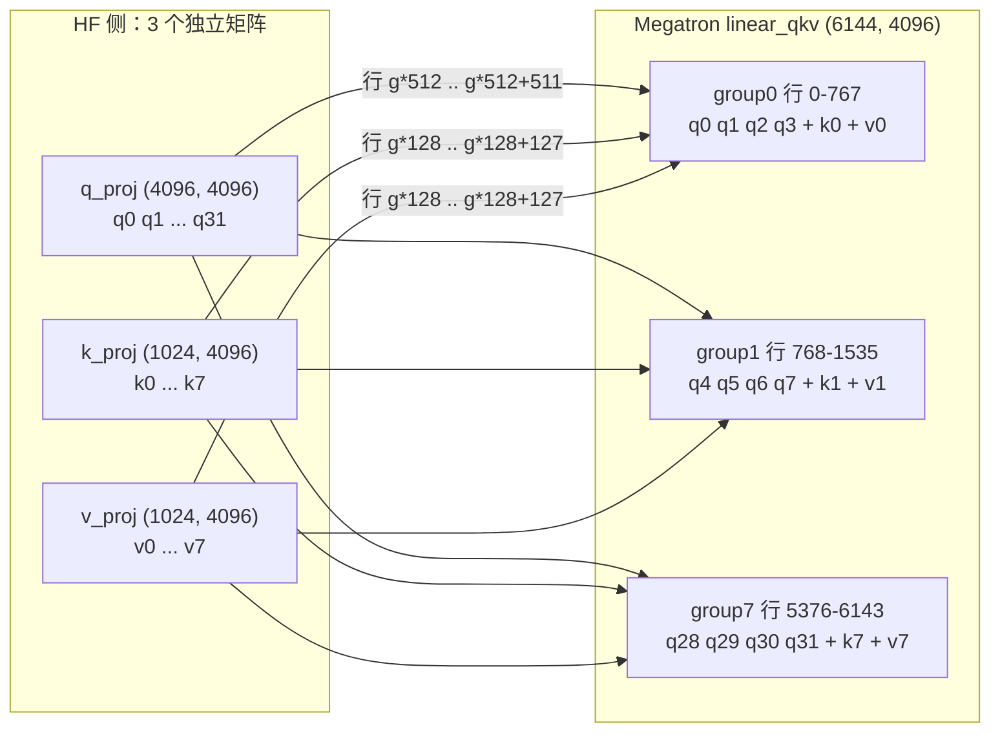

> **系列导航** ｜ Megatron 系列已完成 14 篇（[00 地基](/2026/09/28/megatron-00-foundation/) → [01 进程组与通信重叠](/2026/10/08/megatron-01-process-groups-and-comm-overlap/) → … → [16 混合与 MoE 模型装配](/2026/10/14/megatron-16-hybrid-and-moe-model-assembly/)），讲的是并行原理与源码层；本文是其中的**框架视角补充篇**，只回答「一个外部模型与一份外部数据，怎么变成一个能在多卡上跑起来的 Megatron 作业」。RL 框架系列：[02 slime](/2026/10/24/rl-frameworks-02-slime/) ｜ [03 veRL](/2026/10/24/rl-frameworks-03-verl/) ｜ [08 两族横评](/2026/10/24/rl-frameworks-08-landscape/)

> **TL;DR**
>
> * **数据链路是「三重切分」叠加**：拆文档 → 按 `seq_len` 打包成样本 → 按 DP rank 分样本。前两层决定一条样本长什么样，第三层决定它被哪张卡读到。三层的边界分别落在 `GPTDataset.__getitem__`、`build_pretraining_data_loader` 的 sampler、以及 `consumed_samples` 这个续训游标上。
> * **普通 HF 模型不能直接用，缺的是三样东西**：并行层替换（`nn.Linear` → `ColumnParallelLinear` / `RowParallelLinear`）、参数名与布局改写（q/k/v 三段合并成 GQA 交错布局）、以及一份**可逆的映射表**（Bridge 的 `MegatronMappingRegistry`）。
> * **切分点的正确性可以被证明**：`ColumnParallelMapping` 沿 dim 0 切、`RowParallelMapping` 沿 dim 1 切，两者在 `Y = XW` 的矩阵乘法里天然互补——上游按输出维切、下游按输入维切，中间的局部结果相加即得全局结果。这就是「为什么这样切是等价的」的全部答案。
> * **QKV 是唯一的例外，也是唯一需要逐个模型写代码的地方**。HF 是三个独立矩阵，Megatron 是一个按 GQA 交错的融合矩阵：顺序是 $$[q_1\ldots q_n, k_1, v_1, q_1\ldots q_n, k_2, v_2, \ldots]$$，其中 $$n = n_{\rm heads}/n_{\rm query\_groups}$$。这个交错布局不能靠「沿某个维度 concat」得到。
> * **自动切分有三个静默退化的边界**：`num_query_groups` 不能被 TP 整除、`sequence_parallel` 开着但注意力没按序列切、以及 embedding 与 LM head 共享权重时 vocab 不能被 TP 整除。三者都不报错，只是算出来的东西不对或者性能莫名其妙地掉。
> * **「切完怎么落到卡上」的答案不只是广播**。每个 rank 拿到的是自己那一份分片，但**初始化必须各 rank 各自做**：带 rank 的随机种子 + 本地分片形状，而不是「主 rank 建完整模型再切」。后者在 TP 大于 1 时会因为形状不一致直接崩，在 PP 下更是不可能。
> * **RL 场景下这条数据链路会被整段绕过**：`args.perform_rl_step` 为真时 Megatron 直接把三个 dataloader 全置为 `None`，数据由外部框架（slime / veRL）自己塞进来。理解这一点才能看清 RL 框架与 Megatron 的真实分工边界。

---

## 目录

- [1. 本文的边界：14 篇讲过的与没讲的](#1-本文的边界14-篇讲过的与没讲的)
- [2. 数据链路（一）：从文档到样本](#2-数据链路一从文档到样本)
- [3. 数据链路（二）：从样本到卡](#3-数据链路二从样本到卡)
- [4. HF 模型改造：缺的是哪三样东西](#4-hf-模型改造缺的是哪三样东西)
- [5. 矩阵视角：为什么沿 dim 0 / dim 1 切是等价的](#5-矩阵视角为什么沿-dim-0--dim-1-切是等价的)
- [6. QKV 与 gate_up：唯一需要逐模型写代码的地方](#6-qkv-与-gateup唯一需要逐模型写代码的地方)
- [7. 自动切分的三个静默边界](#7-自动切分的三个静默边界)
- [8. 切完怎么落到卡上](#8-切完怎么落到卡上)
- [9. RL 场景：这条链路被整段绕过](#9-rl-场景这条链路被整段绕过)
- [10. 小结：Megatron 在 RL 栈里的真实位置](#10-小结megatron-在-rl-栈里的真实位置)

---

## 1. 本文的边界：14 篇讲过的与没讲的

Megatron 系列已经把并行机制讲透了。本文刻意**不重复**这些内容：

| 主题 | 已有位置 |
| --- | --- |
| 进程组、rank / world size 语义、通信与计算重叠 | `megatron-01` |
| TP / SP / GTP 的切分原理 | `megatron-03`、`megatron-04` |
| 三套 DP 优化器与分布式参数管理 | `megatron-05` |
| PP 调度器 | `megatron-06` |
| 重计算与显存账本 | `megatron-08` |
| refit 与权重导出 | `megatron-11` |
| 模块规格与模型装配 | `megatron-14`、`megatron-15`、`megatron-16` |

本文只补四件事，它们共同回答一个问题：**一个外部世界的东西（HF 模型、JSONL 数据）怎么变成 Megatron 作业**。

> **基准声明**：本文引用 Megatron-LM `core_v0.19.2`（`4b4acac9a1d28ea6829c8d4f566d75698a21249d`）与 Megatron-Bridge `v0.6.2`（`c0e164ed2aedac4ad1c877780e2564a19d5d54ec`）。`megatron-` 系列的行号锁在 `60e039626`（v0.20.0），**两者不同，行号不可跨篇比对**。

---

## 2. 数据链路（一）：从文档到样本

### 2.1 三层结构

一份 JSONL 语料要变成一张卡上的一个 batch，中间隔三层，而**三层之间只靠一个整数 idx 通信**：


三层的代码位置完全不同：

| 层 | 职责 | 代码位置 |
| --- | --- | --- |
| ① 混合 | 多数据集按权重混合，**不搬数据**，只决定 idx 落在哪个数据集 | `BlendedMegatronDatasetBuilder` |
| ② 切分 | 决定「哪个 rank 读哪几个 idx」 | `MegatronPretrainingSampler.__iter__` |
| ③ 物化 | idx → token 序列（含文档边界） | `GPTDataset.__getitem__` |

**这个「只传整数」的设计是这个数据管线最重要的性质**：任一层都可以单独替换（换成 HF dataset、换成自定义 sampler），因为接口就是一个 `int`。

### 2.2 第二层是真正的分片点：`MegatronPretrainingSampler.__iter__`

分片不在 DataLoader 里做，而在这个 sampler 的迭代器里：

```python
def __iter__(self):
    batch = []
    # Last batch will be dropped if drop_last is not set False
    for idx in range(self.consumed_samples, self.total_samples):
        batch.append(idx)
        if len(batch) == self.micro_batch_times_data_parallel_size:
            start_idx, end_idx = self.get_start_end_idx()
            yield batch[start_idx:end_idx]
            batch = []

    # Check the last partial batch and see drop_last is set
    if len(batch) > 0 and not self.drop_last:
        start_idx, end_idx = self.get_start_end_idx()
        yield batch[start_idx:end_idx]
```

其中 `get_start_end_idx` 只有两行：

```python
start_idx = self.data_parallel_rank * self.micro_batch_size
end_idx = start_idx + self.micro_batch_size
```

**读法**：这是**一条全局 idx 流，每凑满 `m × dp` 个就切成 `dp` 片，第 `r` 片给 rank `r`**。所以：

$$
\text{idx}(t, k, r) = tG + k(m \cdot dp) + r m + [0, m)
$$

其中 $$t$$ 是 iteration、$$k$$ 是 microbatch 序号、$$G$$ 是 global batch size。

**注意 sampler 完全不知道「一个 step 有几个 microbatch」**——它拿不到 `global_batch_size`。这个量被拆成独立的 `num_microbatches` 在别处维护（见 2.4）。

### 2.3 一个具体例子：G=32, m=2, dp=4

代入：每 rank 每 step 样本数 $$G/dp = 8$$，每 rank 每 step microbatch 数 $$G/(m \cdot dp) = 4$$。

step 0（`base = 0`）的 idx 分配：

| microbatch $$k$$ | 全局窗口 $$[k md, (k+1)md)$$ | rank 0 | rank 1 | rank 2 | rank 3 |
| --- | --- | --- | --- | --- | --- |
| 0 | `[0, 8)` | 0, 1 | 2, 3 | 4, 5 | 6, 7 |
| 1 | `[8, 16)` | 8, 9 | 10, 11 | 12, 13 | 14, 15 |
| 2 | `[16, 24)` | 16, 17 | 18, 19 | 20, 21 | 22, 23 |
| 3 | `[24, 32)` | 24, 25 | 26, 27 | 28, 29 | 30, 31 |

按 rank 汇总（这是 rank 在一次 `for mb in range(num_microbatches)` 里依次拿到的四个 list）：

| DP rank | 本 step 的 8 个 idx（按 microbatch 顺序） |
| --- | --- |
| 0 | `[0,1] [8,9] [16,17] [24,25]` |
| 1 | `[2,3] [10,11] [18,19] [26,27]` |
| 2 | `[4,5] [12,13] [20,21] [28,29]` |
| 3 | `[6,7] [14,15] [22,23] [30,31]` |

**这张表能直接回答一个常见困惑**：为什么 rank 0 拿到的是 `0,1` 而不是连续的 `0..7`？因为 DP 切分的语义是「**同一 microbatch 内**按 rank 均分」，而不是「按 rank 连续分段」。**这意味着任意两个 rank 在同一 microbatch 看到的样本天然不同**——这正是 DP 的定义。

### 2.4 `consumed_samples` 游标：一个跨三处维护的隐式状态

续训的正确性全靠这个游标，而它在三处被读写：

**（a）每 step 推进**（`training.py` L3936-L3942）：

```python
batch_size = (
    _dp_world_size() * args.micro_batch_size * get_num_microbatches()
)
iteration_sequences = batch_size
# Update consumed samples (always means sequences now)
args.consumed_train_samples += iteration_sequences
```

**（b）按 iteration 反推**（`training.py` L4523-L4528）：

```python
if args.iteration > 0 and args.consumed_train_samples == 0:
    assert (
        args.train_samples is None
    ), 'Only backward compatiblity support for iteration-based training'

    args.consumed_train_samples = args.iteration * args.global_batch_size
```

**（c）载入 checkpoint 时重算 microbatch 数**（`checkpointing.py` L2499-L2501）：

```python
args.consumed_train_samples = getattr(checkpoint_args, 'consumed_train_samples', 0)
...
update_num_microbatches(consumed_samples=args.consumed_train_samples, verbose=True)
```

由此得到恒等式：

$$
G = m \cdot dp \cdot n_{\rm mb}, \qquad
\text{consumed\_samples}(t) = t \cdot G, \qquad
\text{窗口}(t) = [tG,\ (t+1)G)
$$

**这里有一个没有任何机制保证的一致性约束**：(b) 里的 `assert` 只校验了「`consumed_train_samples` 为 0 时按 `iteration × global_batch_size` 反推」。如果 checkpoint 里的 `consumed_train_samples` 与 `iteration × G` **对不上**（例如中途改过 `global_batch_size`），数据会被重复读或跳过，而**训练不会报错**——只是收敛曲线莫名其妙地变差。

这是 Megatron 数据管线里最隐蔽的一类 bug，也是为什么 `rl-variables-in-frameworks` 第 10 节把「改了并行度必须验 loss 不变」列为必查项。

### 2.5 `num_microbatches` 在不整除时怎么办

$$G$$ 与 $$m \cdot dp$$ 不一定整除（例如 $$G = 100$$、$$m \cdot dp = 24$$）。`update_num_microbatches` 的处理是**向上取整再标记尾批**：

$$
n_{\rm mb} = \left\lceil \frac{G}{m \cdot dp} \right\rceil
$$

尾批不足时由 `GPTDataset` 的 `idx is None` 分支补 padding 样本，并把 loss mask 全清零：

```python
if idx is None:
    # Batch padding sequence so the index does not matter
    text, _, document_lengths = self._query_document_sample_shuffle_indices(0)
...
# Batch padding sequence so we mask the loss
if idx is None:
    loss_mask = torch.zeros_like(loss_mask)
```

**padding 样本走完整的 tokenize 与 mask 构造流程**，只是最后把 loss 抹掉。这个设计的好处是形状与真实样本完全一致，不需要为 padding 写单独的前向路径；**代价是 padding 样本仍然消耗一次完整的前向+反向算力**（梯度为零但仍要算），所以 `G` 应该尽量被 `m · dp` 整除。

### 2.6 第三层：`idx → token` 与文档边界

`GPTDataset.__getitem__` 拿到 idx 后做四件事，其中第 2 步的**错位**最容易被忽略：

```python
text = torch.from_numpy(text).long()
if self.config.add_extra_token_to_sequence:
    tokens = text[:-1].contiguous()
    labels = text[1:].contiguous()
else:
    tokens = text
    labels = torch.roll(text, shifts=-1, dims=0)
    labels[-1] = self._pad_token_id
```

| 分支 | 样本长度 | 语料消耗 | 说明 |
| --- | --- | --- | --- |
| `add_extra_token_to_sequence=True` | `seq_len + 1` | **`seq_len + 1`** | 多取一个 token 供错位 |
| `=False` | `seq_len` | `seq_len` | 用 `roll` 循环移位，末位补 pad |

**这个 `+1` 直接决定了「一条样本消耗多少语料」**。它对 `drop_last` 与总样本数的计算有影响，是数据管线里经常被忽略的一处差一。

跨文档的边界记在 `document_lengths` 里，当 `inter_document_masking` 打开时转成 `cu_seqlens`。转换前必须减一：

```python
if self.config.add_extra_token_to_sequence:
    document_lengths[-1] -= 1
    if document_lengths[-1] == 0:
        document_lengths.pop()
# If the sample was padded (e.g., the last validation sample),
# fold the padding into the last document so cu_seqlens[-1]
# equals sequence_length.
```

注释说明了理由：取的是 `seq_len + 1` 个 token，多出来的那个被追加到最后一个文档里（用来造 label），所以算 `cu_seqlens` 之前必须减掉。**这是「两个子系统各自正确、接口处差一」的典型例子**，只能靠注释守。


样本拿到之后的第二件事是造 `tokens` / `labels` 的错位：

```python
if self.config.add_extra_token_to_sequence:
    tokens = text[:-1].contiguous()
    labels = text[1:].contiguous()
else:
    tokens = text
    labels = torch.roll(text, shifts=-1, dims=0)
    labels[-1] = self._pad_token_id
```

两条分支的差别在于**样本长度是 `seq_len + 1` 还是 `seq_len`**。`add_extra_token_to_sequence` 为真时多取一个 token 供错位使用，此时 `text[:-1]` 与 `text[1:]` 长度都是 `seq_len`；为假时用 `roll` 循环移位，末位补 pad。

这个细节在数据管线里经常被忽略，但它决定了 `drop_last` 与总样本数怎么算——**多取一个 token 意味着每个样本实际消耗 `seq_len + 1` 个 token 的语料**。

### 2.4 第三层：跨文档边界怎么记

打包会把多个文档拼进一个样本，于是 `document_lengths` 记录每个文档占了多少 token。当 `inter_document_masking` 打开时，这些长度被转成 `cu_seqlens` 交给 flash attention 的变长接口：

```python
if self.config.add_extra_token_to_sequence:
    document_lengths[-1] -= 1
    if document_lengths[-1] == 0:
        document_lengths.pop()
# If the sample was padded (e.g., the last validation sample),
# fold the padding into the last document so cu_seqlens[-1]
# equals sequence_length.
```

注释说明了这段减一的理由：`_query_document_sample_shuffle_indices` 取的是 `seq_len + 1` 个 token，多出来的那一个被追加到最后一个文档里（用来造错位的 label），所以计算 `cu_seqlens` 之前必须把它减掉。**这是一个典型的「两个子系统各自正确、接口处差一」的问题**，只能靠注释守。

### 2.5 掩码与位置编码的缓存

`_get_ltor_masks_and_position_ids` 的产物（attention_mask / loss_mask / position_ids）在 `masks_and_position_ids_are_cacheable` 为真时只算一次并缓存。原因很直接：**同一个 `seq_len` 下，这三个张量与内容无关**，只与长度和 padding 有关。省掉它们的重复构造对长序列（8k、32k）的训练吞吐有可见影响。

---

## 3. 数据链路（二）：从样本到卡

### 3.1 sampler 决定 idx 的分布

`build_pretraining_data_loader` 是第三层切分的落点。它先按 split 决定 batch size，再按四种情况选 sampler：

| 条件 | sampler | 语义 |
| --- | --- | --- |
| `split == valid` 且 `full_validation` | `MegatronFullValidationSampler` | 所有 rank 跑同样步数，长度取 DP 间最大值 |
| `dataloader_type == single` 且 `hybrid_context_parallel` | `HybridCPMegatronPretrainingSampler` | CP 与 DP 混合切 |
| `dataloader_type == single` | `MegatronPretrainingSampler` | 标准 DP 切 |
| 其他 | 按 `cyclic` / `external` 走 | — |

构造时传入的四个参数里，`consumed_samples` 是最容易出问题的那个——它是**断点续训的游标**。

### 3.2 `consumed_samples` 是一个跨三处的隐式状态

`build_train_valid_test_data_loaders` 开头有一段专门为「按 iteration 训练」做的向后兼容：

```python
# Backward compatibility, assume fixed batch size.
if args.iteration > 0 and args.consumed_train_samples == 0:
    assert args.train_samples is None, 'Only backward compatiblity support for iteration-based training'
    args.consumed_train_samples = args.iteration * args.global_batch_size
```

也就是说 **`consumed_train_samples` 必须与 `iteration` 保持一致**，而这个一致性没有任何机制保证，只能靠调用方维护。续训时如果 checkpoint 里的 `consumed_train_samples` 与 `iteration * global_batch_size` 对不上，数据会被重复读或跳过，而**训练不会报错**——只是收敛曲线会莫名其妙地变差。这是 Megatron 数据管线里最隐蔽的一类 bug。

验证集的游标更绕：`consumed_valid_samples` 的计算里带 `start_eval_at_iter` 与 `eval_interval`，因为「从第几步开始评测」会改变已经消费了多少验证样本。

### 3.3 TP rank 0 建完再广播

数据管线的构造是**有条件的**：

```python
if is_distributed or mpu.get_tensor_model_parallel_rank() == 0:
    # 建 dataset 与 dataloader
    ...
    flags = torch.tensor([int(do_train), int(do_valid), int(do_test)], ...)
else:
    flags = torch.tensor([0, 0, 0], ...)

torch.distributed.broadcast(flags, 0)
args.do_train = getattr(args, "do_train", False) or flags[0].item()
```

只有 TP rank 0 会真正构造 dataset（除非 dataset 自己声明 `is_distributed`），然后把「这一阶段要不要 train / valid / test」三个标志广播给所有 rank。**被广播的不是数据本身，而是「有没有数据」这件事**。

为什么 TP 内只需一份：TP 组内所有 rank 读的是**同一批样本**（正是 TP 的定义——同一条样本的不同切片）。所以 dataset 对象在 TP 组内是冗余的，只留 rank 0 一份即可省内存与文件句柄。真正需要每 rank 一份的是 DP 维度，这一点由 sampler 的 `data_parallel_rank` 处理。

---

## 4. HF 模型改造：缺的是哪三样东西

### 4.1 为什么 HF 模型不能直接塞进去

一个 HuggingFace 的 `LlamaForCausalLM` 扔进 Megatron 会立刻遇到三个不同层次的问题：

| 层 | 问题 | 表现 |
| --- | --- | --- |
| **计算层** | HF 用 `nn.Linear`，没有并行切分 | 即使给了 TP 配置也不会切，全部算在每张卡上 |
| **参数层** | HF 的 q/k/v 是三个独立矩阵，Megatron 是一个融合矩阵 | 名字都对不上，`load_state_dict` 直接报 missing |
| **映射层** | 没有「HF 名 ↔ Megatron 名 + 切分方式」的表 | 即使逐个手动改也容易漏 |

Bridge 的解法是给出三样对应的东西：**并行层替换（provider 负责）**、**参数布局转换（mapping 负责）**、**可逆映射表（registry 负责）**。

### 4.2 映射层：`MegatronMappingRegistry`

`mapping_registry.py` 的核心是一个注册表，支持按参数名模式做双向查找：

```python
def megatron_to_hf_lookup(self, megatron_param_name: str) -> Optional[MegatronParamMapping]:
...
def hf_to_megatron_lookup(self, hf_param_name: str) -> Optional[MegatronParamMapping]:
```

注意它是**双向**的：既能从 HF 转进 Megatron（加载预训练权重），也能从 Megatron 转回 HF（导出、给推理引擎用）。RL 框架最依赖的正是后一个方向——slime 的 `megatron_to_hf/<model>.py` 干的同一件事，只是自己写而不是用 Bridge。

注册表还额外做了两件自动补全：

- `_add_separate_layernorm_mappings`：当模型用独立的 LayerNorm 参数（而非 fused）时自动补齐映射
- `_add_quantization_mappings`：量化权重的映射
- `_convert_pattern_to_regex`：把 `decoder.layers.*.self_attention...` 这种通配模式转成正则

**这个设计的关键在于「模式匹配而不是枚举」**：40 层的模型不需要写 40 条映射，一条带 `*` 的模式就能覆盖所有层。代价是模式冲突时后注册的会覆盖先注册的，调试时只能靠 `describe()` 打印全部映射来排查。

### 4.3 三种基础映射

`param_mapping.py` 里最基础的是三个类，它们覆盖了绝大多数参数：

| 类 | 语义 | 切分维度 |
| --- | --- | --- |
| `DirectMapping` | 直接搬运，不变形 | 无 |
| `ColumnParallelMapping` | 列并行（embedding、QKV、MLP up） | dim 0 |
| `RowParallelMapping` | 行并行（attention out、MLP down） | dim 1 |
| `ReplicatedMapping` | 复制，每 rank 一份 | 无 |

`ColumnParallelMapping` 的文档写得最清楚：

> Column-parallel layers in Megatron split the output dimension across tensor parallel ranks. […] The weight matrix is partitioned along dimension 0 (rows), so each TP rank holds a subset of output features while maintaining all input features.

- 原始权重：$$[\,d_{\rm out},\, d_{\rm in}\,]$$
- 每个 rank：$$[\,d_{\rm out}/t,\, d_{\rm in}\,]$$

`RowParallelMapping` 则切**输入维**（dim 1），并且它的文档里有一段值得单独看的说明：

> **Forward path (external → Megatron)**
> 1. Rank 0 validates that the *second* dimension is divisible by `tp_size`.
> 2. Rank 0 splits the tensor with `torch.chunk(..., dim=1)` producing `tp_size` equally-sized shards.
> 3. The shards are **scattered** so that every TP rank receives exactly one shard matching the shape of its local Megatron parameter.

三个动作：**rank 0 校验整除 → rank 0 切 → scatter 到各 rank**。校验放在 rank 0 是刻意的：不整除时只需要一个 rank 报错就够了，让所有 rank 都去算一遍整除判断纯属浪费。

---

## 5. 矩阵视角：为什么沿 dim 0 / dim 1 切是等价的

这是本文唯一需要一点数学的地方，但它同时也是整篇文章里最容易被当作「显然」而跳过的地方。

### 5.1 列并行 + 行并行是一对

考虑一个两层 MLP：$$Y = f(X W_1) W_2$$，其中 $$W_1 \in \mathbb{R}^{d_{\rm in} \times d_{\rm hidden}}$$、$$W_2 \in \mathbb{R}^{d_{\rm hidden} \times d_{\rm out}}$$。

**列并行**把 $$W_1$$ 的**输出维**（即 hidden 维）切成 $$t$$ 份：

$$W_1 = \begin{bmatrix} W_1^{(1)} & W_1^{(2)} & \cdots & W_1^{(t)} \end{bmatrix},\qquad W_1^{(i)} \in \mathbb{R}^{d_{\rm in} \times d_{\rm hidden}/t}$$

每个 rank 独立算出自己的局部激活：$$Z^{(i)} = f(X W_1^{(i)})$$，不需要任何通信。

**行并行**把 $$W_2$$ 的**输入维**（同样是 hidden 维）切成同样的 $$t$$ 份：

$$W_2 = \begin{bmatrix} W_2^{(1)} \\ W_2^{(2)} \\ \vdots \\ W_2^{(t)} \end{bmatrix},\qquad W_2^{(i)} \in \mathbb{R}^{d_{\rm hidden}/t \times d_{\rm out}}$$

每个 rank 算局部乘积：$$P^{(i)} = Z^{(i)} W_2^{(i)}$$。因为矩阵乘法的分块性质，

$$Y = Z W_2 = \sum_{i=1}^{t} Z^{(i)} W_2^{(i)} = \sum_{i=1}^{t} P^{(i)}$$

所以最后只需要一次 all-reduce 求和。**这就是「切分是等价的」的全部证明**——它不依赖任何近似，是精确的代数恒等式。

### 5.2 数值上并不完全等价

代数等价不等于浮点等价。分块求和的顺序由 TP rank 的归约顺序决定，$$t$$ 路 all-reduce 的求和顺序与单卡算完整矩阵乘的顺序不同，因此**最后一个 bit 会不一样**。这一点在 RL 里会变得重要：当推理引擎用另一套并行度算 logprob 时，累积的浮点差异会进入重要性比的分母。这就是训推一致「数值层」的根源之一，详见第 7 节。

### 5.3 TEG 的融合边界

真实的 Transformer 里，列并行与行并行总是成对出现：attention 的 QKV 投影是列并行，输出投影是行并行；MLP 的 up 投影是列并行，down 投影是行并行。**融合算子（fused attention、fused MLP）会把这对边界吞掉**，于是通信次数从「每个子层两次」降到「每个子层一次」。

理解这一点才能解释一个常见的困惑：**为什么开了 TP 之后算力利用率反而低于单卡**——因为即使代数上零冗余，通信与融合边界上的同步开销仍然在。

---

## 6. QKV 与 gate_up：唯一需要逐模型写代码的地方

### 6.1 为什么 QKV 不能靠 concat

如果模型是标准多头注意力（$$n_{\rm heads} = n_{\rm kv\_heads}$$），HF 的 `q_proj` / `k_proj` / `v_proj` 形状相同，Megatron 的 `linear_qkv` 就是把三者沿输出维拼接。这种情形下 `QKVMapping` 退化成一次 concat。

**但只要引入 GQA，交错方式就变了**。`QKVMapping` 的文档给出了 Megatron 的实际布局：

> Interleaving order: `[q1...qn, k1, v1, q1...qn, k2, v2, ...]`
> Where `n = num_attention_heads / num_query_groups`

也就是说当 $$n_{\rm query\_groups} = 8$$、$$n_{\rm heads} = 32$$ 时，每个 KV 头对应 4 个 Q 头，融合矩阵的输出维排列是：

$$\underbrace{q_1 q_2 q_3 q_4}_{\text{group 1}},\, k_1,\, v_1,\, \underbrace{q_5 q_6 q_7 q_8}_{\text{group 2}},\, k_2,\, v_2,\, \ldots$$

这个布局**不是任何一个简单维度上的 concat**，它要求先 reshape 再 transpose 再 flatten。这就是为什么每个模型族都需要自己的转换器，而不能用一个通用规则解决。

### 6.1.1 把排列算清楚：32 头 / 8 组 / head_dim=128

设 $$n_{\rm heads}=32$$、$$n_{\rm query\_groups}=8$$、$$d_{\rm head}=128$$、`hidden = 32 × 128 = 4096`。则：

- `heads_per_group = 32 / 8 = 4`
- Q 总行数 $$32 \times 128 = 4096$$；K/V 各 $$8 \times 128 = 1024$$
- Megatron `linear_qkv` 输出维 $$= 4096 + 2 \times 1024 = 6144$$
- 每个 group 占 $$4 \times 128 + 128 + 128 = 768$$ 行，$$8 \times 768 = 6144$$ 对得上

HF 侧三个独立矩阵：

| 矩阵 | 形状 | 行区间语义 |
| --- | --- | --- |
| `q_proj.weight` | `(4096, 4096)` | 32 个头，每头 128 行 |
| `k_proj.weight` | `(1024, 4096)` | 8 个 KV 头，每头 128 行 |
| `v_proj.weight` | `(1024, 4096)` | 8 个 KV 头，每头 128 行 |

合并后 `linear_qkv` 的 6144 行排列：

| group $$g$$ | 行区间 `[g*768, (g+1)*768)` | 内容（按子块） |
| --- | --- | --- |
| 0 | `[0, 768)` | q 头 0-3（512 行）│ k 头 0（128）│ v 头 0（128） |
| 1 | `[768, 1536)` | q 头 4-7 │ k 头 1 │ v 头 1 |
| 2 | `[1536, 2304)` | q 头 8-11 │ k 头 2 │ v 头 2 |
| 3 | `[2304, 3072)` | q 头 12-15 │ k 头 3 │ v 头 3 |
| 4 | `[3072, 3840)` | q 头 16-19 │ k 头 4 │ v 头 4 |
| 5 | `[3840, 4608)` | q 头 20-23 │ k 头 5 │ v 头 5 |
| 6 | `[4608, 5376)` | q 头 24-27 │ k 头 6 │ v 头 6 |
| 7 | `[5376, 6144)` | q 头 28-31 │ k 头 7 │ v 头 7 |

**逐行映射公式**（写转换器或自检时可直接用）：

```text
对 Megatron linear_qkv 的第 r 行：
    g   = r // 768
    off = r %  768
    if   off < 512:   来源 = q_proj 第 (g*512 + off) 行          # 4 个 q 头
    elif off < 640:   来源 = k_proj 第 (g*128 + (off-512)) 行
    else:             来源 = v_proj 第 (g*128 + (off-640)) 行
```

举两个例子自检：

- Megatron 第 1000 行 → `g = 1000//768 = 1`、`off = 232 < 512` → `q_proj` 第 `1×512 + 232 = 744` 行
- Megatron 第 1450 行 → `g = 1`、`off = 682`、`682 − 640 = 42` → `v_proj` 第 `1×128 + 42 = 170` 行



**这张表的实践价值**：验证转换器时不需要跑前向，**拿几个行号按公式反算来源、再直接比对张量即可**。这比端到端跑一遍快两个数量级，而且能定位到具体是哪一行的交错写错了。

### 6.2 gate 让事情更复杂

`QKVGMapping` 处理的是带额外 scalar gate（`g_proj`）的变体。文档说明 Megatron 一侧有两种布局：

> For regular QKV modules, gate rows are appended after the standard GQA-interleaved QKV block. For Megatron-Core `attention_output_gate` modules, the scalar gate is expanded across each head dimension and interleaved as the module's output-gate block.

**同名的 `linear_qkv`，在两个不同的 attention 模块里可能是两种完全不同的布局**。这意味着映射表必须知道「当前用的是哪个 provider」，这也是 Bridge 里 `AutoMapping` 存在的理由——它按实际模块形状反推该用哪种映射，而不是让用户指定。

`QKVGMapping` 还有一条明确的限制：

> QKVGMapping does not support bias tensors; add_qkv_bias must be False.

不支持 bias 是显式的 `NotImplementedError`，而不是静默算错。这类「明确拒绝」在转换层里非常重要，因为静默错误会一路传到训推一致问题上，查起来要花几天。

### 6.3 一个可以直接抄的判据

把上面的内容压缩成一句话：**如果 HF 侧的参数能通过「沿单一维度 concat/split」还原成 Megatron 侧，就用基础映射；一旦涉及 reshape + 交错，就必须写专用映射。**

按这个判据，需要专用映射的只有三处：**QKV（含 gate）**、**gate_up（MLP 的融合）**、以及**MoE 的专家参数**（因为专家在 EP 下跨 rank 分布，名字与布局都不规则）。

---

## 7. 自动切分的三个静默边界

### 7.1 边界一：`num_query_groups` 与 TP 必须「整除或为其因数」

GQA 模型的 KV 头数通常很小（Llama-3-8B 是 8、Qwen2.5-7B 是 4、更小的模型是 1 或 2）。Megatron 对此有一条**入学考试**：

```python
if (
    self.num_query_groups % self.tensor_model_parallel_size != 0
    and self.tensor_model_parallel_size % self.num_query_groups != 0
):
    raise ValueError(
        f"num_query_groups ({self.num_query_groups}) must be a multiple or divisor of "
        f"tensor_model_parallel_size ({self.tensor_model_parallel_size})."
    )
```

**两个方向任一成立即可**：

$$
n_{\rm qg} \bmod tp = 0 \quad \text{或} \quad tp \bmod n_{\rm qg} = 0
$$

注意这是 `raise ValueError` 而不是 `assert`，所以 `python -O` 也拦得住。以 $$n_{\rm qg} = 8$$ 为例：

| TP | 关系 | 结论 | 每 rank 的 KV 组数 | KV 复制倍数 |
| --- | --- | --- | --- | --- |
| 1 / 2 / 4 / 8 | $$8 \bmod tp = 0$$ | 均分 | 8 / 4 / 2 / 1 | 1 |
| 16 / 32 / 64 | $$tp \bmod 8 = 0$$ | **复制** | 1 | 2 / 4 / 8 |
| 3 / 5 / 6 / 7 / 12 | 都不成立 | **报错** | — | — |

### 7.1.1 路径 A（$$n_{\rm qg} \ge tp$$）：直接均分

```python
else:
    # When num_kv_heads >= tp_size, each TP rank produces activations for
    # (num_kv_heads / tp_size) kv_heads and (num_q_heads / tp_size) q_heads.
    self.num_query_groups_per_partition = divide(self.config.num_query_groups, world_size)
    self.num_attention_heads_per_partition = divide(
        self.config.num_attention_heads, world_size
    )
```

`divide()` 内部是 `assert n % d == 0`——6.1 已经保证过，这里不会炸。

### 7.1.2 路径 B（$$n_{\rm qg} < tp$$）：用通信换「无除尽约束」

这条路径才是真正要小心的。源码先说清楚为什么不能简单切：

```python
if self.config.num_query_groups < world_size:
    # When num_kv_heads < tp_size, each TP rank (post AG) initially produces
    # activations for 1 kv_head and (num_q_heads / num_kv_heads) q_heads.
    # We then pull out the appropriate (num_q_heads / tp_size) q_heads.
    self.num_query_groups_per_partition = 1
    self.num_attention_heads_per_partition = divide(
        self.config.num_attention_heads, self.config.num_query_groups
    )
```

**注意 `num_attention_heads_per_partition` 被设成 $$n_h / n_{\rm qg}$$（一个完整的组），不是 $$n_h / tp$$**。

前向里靠一次 all-gather 把局面救回来：

```python
if self.config.num_query_groups < self.world_size:
    # Note that weights are interleaved in the following manner:
    # q1 q2 k1 v1 | q3 q4 k2 v2 | q5 q6 k3 v3 | ...
    # When tp_size > num_kv_heads, we split "q1 q2 k1 v1" over multiple
    # ranks, so a rank does not have a clean partitioning of just the q_heads
    # it needs. Instead, we perform the following steps:
    # 1. Assemble the full "q1 q2 k1 v1 | q3 q4 k2 v2 | ..."
    #    through an AG.
    # 2. Pull out the right slice (e.g., "q1 q2 k1 v1" or "q3 q4 k2 v2").
    # 3. Split q_heads (e.g., q1, q2), k_heads (e.g., k1), v_heads (e.g., v1).
    # 4. Further index into query to get only the q_heads that this rank is
    #    responsible for (e.g., q1).
    mixed_qkv = all_gather_last_dim_from_tensor_parallel_region(
        mixed_qkv, group=self.pg_collection.tp
    )
    idx = get_pg_rank(self.pg_collection.tp) // (
        self.world_size // self.config.num_query_groups
    )
    size = mixed_qkv.size()[-1] // self.config.num_query_groups
    mixed_qkv = mixed_qkv[:, :, idx * size : (idx + 1) * size]
```

`idx = tp_rank // (tp_size / n_qg)` 的含义是：**每 $$tp/n_{\rm qg}$$ 个 rank 共享同一个 KV 组**（它们手上的 KV 权重是复制品），AG 之后各自切出自己那一段 q。

### 7.1.3 这条路径的真实代价：算一遍

设 $$n_{\rm qg} = 8$$、$$tp = 32$$、$$d_{\rm head} = 128$$、`hidden = 4096`，序列长度 $$s = 8192$$、batch = 1、bf16。

一次 AG 搬运的是**一个完整组的 qkv 输出**：

$$
\text{宽度} = \underbrace{4 \times 128}_{q} + \underbrace{128}_{k} + \underbrace{128}_{v} = 768
$$

$$
\text{每层每 microbatch 流量} = 8192 \times 768 \times 4096 \times 2\ \text{B} \approx 48\ \text{GiB}
$$

**32 层就是约 1.5 TiB**。这就是文档里「$$tp > n_{\rm kv\_heads}$$ 时别开」的真正含义——**复制带来的显存节省，被 AG 的气泡和流量全吃光**。

### 7.1.4 还有一个更隐蔽的坑：`num_query_groups` 被临时改写

```python
if self.config.num_query_groups < world_size:
    # TE throws an assertion error if num_kv_heads / num_query_groups
    # is not divisible by TP size.
    # TODO(rwaleffe/dnarayanan): Clean this up eventually.
    tmp_config = copy.deepcopy(self.config)
    tmp_config.num_query_groups = world_size
```

**为了让 Transformer Engine 的 fused attention 不 assert，代码临时把 `num_query_groups` 改写成 `world_size`**。

后果：在 $$n_{\rm qg} < tp$$ 时，**「配置里写的 ng」与「attention 实现看到的 ng」不是同一个数**。任何基于 `config.num_query_groups` 反推 shape 的外部代码（权重转换脚本、推理引擎的权重加载器）都会拿到错的值。

**这一条对 RL 的影响是直接的**：训练端按 `ng=4` 造张量，SGLang 按 `ng=8` 恢复布局，于是 KV 权重在推理侧的排布与训练端不同——而两边都不会报错。

### 7.2 边界二：`sequence_parallel` 对激活切分的隐含要求

序列并行（SP）切的是**激活值的序列维**，而不是权重。它的前提是：注意力和 MLP 里的 LayerNorm 是沿 hidden 维做的，所以序列维可以自由切分而不影响结果。

但有两个前提容易被忽略：

1. **只对 LayerNorm 后的激活切**。LayerNorm 之前的激活如果被切，算子就需要跨 rank 的统计量；
2. **TP 通信要改成 RS ∘ AG**。SP 打开后，列并行层之后的 all-gather 变成 reduce-scatter、行并行层之前的 all-reduce 变成 all-gather。

关于 SP 有一个已核正的事实值得重申：**SP 不降低 TP 通信总量**，因为 AR = RS ∘ AG，总量守恒。它的收益在**激活显存**——省下来的显存能让长序列关掉重计算，那才是延迟的来源（见 `megatron-03`）。

回到本文的语境：**「激活值切分」这个说法在 Megatron 里对应的是 SP，而 SP 是否生效取决于注意力实现是否走 `sequence_parallel=True` 的路径**。如果某个 fused kernel 只在 `sequence_parallel=False` 下可用，打开 SP 会静默地走进另一条实现，性能与数值都变。

### 7.3 边界三：embedding 与 LM head 共享权重

Tie word embeddings 的模型（Qwen 小模型、Gemma 系列）里，输入 embedding 与输出 LM head 是同一块权重。而这两者在 Megatron 里的并行语义不同：

- 输入 embedding 是**列并行**（按 vocab 切）
- LM head 的输出投影是**列并行**（按 vocab 切，但输出的是 logits）

它们能共享，前提是 **vocab 能被 TP 整除**。当 vocab = 151936、TP = 8 时 151936 / 8 = 18992 正好整除；而 vocab = 151936、TP = 16 时也是整除。但很多自定义词表不满足，此时要么 pad 词表要么改用分开的 embedding。

**pad 词表会污染 logprob**：多加的 pad 位置在 softmax 里虽然是 0，但 vocab 维变大后归一化的浮点误差分布会变。对 RL 来说这是可测量的一阶差异，不是可以忽略的小数。

---

## 8. 切完怎么落到卡上

### 8.1 初始化必须各 rank 各自做

一个常见的错误心智模型是：主 rank 建好完整模型，再按 TP 切开分给各卡。**这个模型在 Megatron 里是错的**。

正确的顺序是：

```text
每个 rank
   ├─ 设置 TP / PP / DP / EP / CP 的世界大小与 rank（set_*_world_size）
   ├─ 用【带 rank 的随机种子】初始化本地分片形状的张量
   └─ 建通信组
```

**为什么必须带 rank 种子**：如果所有 rank 用同一个种子初始化「自己的分片」，那么切分后的各分片之间会存在不该有的相关性——因为同一段随机序列的前 N 个元素在每张卡上都被用了一次。带 rank 的种子（通常是 `seed + tp_rank * 因子 + pp_rank * 因子`）保证每个分片拿到的都是独立随机数。

这个细节只在**从头训练**时影响收敛，加载预训练权重时根本看不出来——所以它属于「只在特定场景咬人」的那类设计，一旦咬到就很难归因。

### 8.2 加载：`--load` 的 reshard 路径

从 checkpoint 加载时，如果**保存时的并行度与当前的并行度不同**，需要一次重切（reshard）。这是 RL 框架里最常踩的一步，因为：

- 预训练 checkpoint 通常是 TP=8、PP=1
- RL 训练可能要用 TP=4、PP=2
- 推理引擎又可能是 TP=8

三次转换的规则不同：

| 转换 | 能不能直接做 | 需要什么 |
| --- | --- | --- |
| TP 8 → TP 4 | 可以 | 每卡把两个相邻分片 concat 起来 |
| TP 4 → TP 8 | 可以 | 每卡把分片 split 后 scatter |
| PP 1 → PP 2 | 可以 | 按层号范围切分，**但需要每卡都知道全量权重** |
| PP 2 → PP 1 | 可以 | 收集两段再拼接 |

**PP 的转换成本远高于 TP**：TP 转 PP 时，每个 rank 手上只有一部分层，必须先把完整模型 gather 到某个位置再按层切分。这就是为什么 RL 框架通常固定训练的 PP，只让 TP 变化。

### 8.3 一个判断「落没落到正确位置」的检查

无法直接观察显存里每个参数属于哪个 rank，但可以间接验证：**加载完成后做一次前向，比较损失**。

- 单卡完整模型算出的 loss 与多卡切分算出的 loss 应该**在合理浮点误差内相等**
- 如果差异在 1e-3 量级以上，几乎一定是切分错了（通常是 QKV 交错顺序错，或者 row/column 弄反）

这个检查成本很低，值得固化到任何框架的启动流程里。

---

## 9. RL 场景：这条链路被整段绕过

### 9.1 Megatron 自己知道 RL 不用 dataloader

`build_train_valid_test_data_loaders` 里有一段专门为 RL 准备的分支：

```python
if args.perform_rl_step:
    # we don't need to build any dataloaders for RL training
    train_dataloader = None
    valid_dataloaders = None
    test_dataloader = None
    do_train = (args.train_iters or 0) > 0
    do_valid = (args.full_validation or args.eval_iters > 0)
    do_test = (args.full_validation or args.eval_iters > 0)
```

也就是说：**在 RL 训练里，前面第 2、3 节讲的三层数据切分完全不起作用**。RL 的数据是 rollout 产出的，由外部框架（slime、veRL）构造好后直接送进 `train_step`。

同一段代码在优化器那边也有对应分支：

```python
has_rl_optimizer = args.perform_rl_step and not args.no_load_optim
```

注释解释了原因：*the Forward pre-hooks are part of the distributed optimizer's overlapped param-gather; so in order to disable them, we must check that the optimizer actually exists.*——**RL 场景下即使 `--skip-train`，优化器仍然存在**，因为它要参与权重更新的前置工作。这个细节如果不看注释，几乎不可能从代码推断出来。

### 9.2 真实分工边界

| 层 | 谁负责 | Megatron 是否参与 |
| --- | --- | --- |
| 数据切分（第 2、3 节） | RL 框架 | **不参与** |
| 模型转换（第 4~6 节） | Bridge / RL 框架的转换器 | 提供目标布局与并行层 |
| 并行切分（第 7 节） | Megatron | 完全负责 |
| 落到卡上（第 8 节） | Megatron | 完全负责 |
| 权重导出给推理引擎 | RL 框架 | 提供 `megatron_to_hf` 方向的转换 |

结论很清楚：**在 RL 栈里，Megatron 承担的是「并行执行与优化器」这一层，前面的数据链路整段由 RL 框架接管，后面的权重导出由 RL 框架对接。** 这也解释了为什么 slime 只需要 `megatron_to_hf/<model>.py` 一个方向的重活——它不需要 Megatron 的数据管线。

---

## 10. 小结：Megatron 在 RL 栈里的真实位置

### 10.1 四件事的答案

| 问题 | 答案 |
| --- | --- |
| 数据怎么进来 | 三层：索引采样 → 打包成 `seq_len` → sampler 按 DP rank 分。RL 下整段绕过 |
| HF 模型怎么改 | 三样：并行层替换、布局改写成 GQA 交错、可逆映射表 |
| 自动切分怎么做到、有没有问题 | 沿 dim 0 / dim 1 切，代数上精确等价；三个静默边界在 GQA、SP、tied embedding |
| 怎么落到卡上 | 各 rank 带 rank 种子各自初始化；加载时按 TP / PP 重切，PP 的成本高一个量级 |

### 10.2 给选型的一句话

**如果你的模型族在 Bridge 的支持列表里，用 Bridge；如果不在，就要自己写 `megatron_to_hf` 转换器——工作量集中在 QKV 交错与 MoE 专家两块。**

这也解释了为什么 slime 的模型支持面窄：它没有 Bridge 那样的自动映射表，只有逐模型的转换器文件。Bridge 用「模式匹配 + 自动推断」换广度，slime 用「显式逐模型代码」换确定性。两种做法在下一篇分别代表了两个极端。

---

**上一篇**：[Megatron-LM 深度剖析（16）：混合与 MoE 模型装配](/2026/10/14/megatron-16-hybrid-and-moe-model-assembly/) ｜ **下一篇**：[02 slime 源码拆解](/2026/10/24/rl-frameworks-02-slime/)

## 参考

- Megatron-LM：<https://github.com/NVIDIA/Megatron-LM>，基准 `core_v0.19.2` = `4b4acac9a1d28ea6829c8d4f566d75698a21249d`
- Megatron-Bridge：<https://github.com/NVIDIA-NeMo/Megatron-Bridge>，基准 `v0.6.2` = `c0e164ed2aedac4ad1c877780e2564a19d5d54ec`
- 数据迭代器：[`megatron/training/training.py`](https://github.com/NVIDIA/Megatron-LM/blob/4b4acac9a1d28ea6829c8d4f566d75698a21249d/megatron/training/training.py#L4601-L4690)
- RL 分支：[`training.py` L4553-4560](https://github.com/NVIDIA/Megatron-LM/blob/4b4acac9a1d28ea6829c8d4f566d75698a21249d/megatron/training/training.py#L4553-L4560)
- sampler 构造：[`megatron/training/datasets/data_samplers.py`](https://github.com/NVIDIA/Megatron-LM/blob/4b4acac9a1d28ea6829c8d4f566d75698a21249d/megatron/training/datasets/data_samplers.py#L19-L58)
- 样本构造：[`megatron/core/datasets/gpt_dataset.py` L230-L300](https://github.com/NVIDIA/Megatron-LM/blob/4b4acac9a1d28ea6829c8d4f566d75698a21249d/megatron/core/datasets/gpt_dataset.py#L230-L300)
- 映射注册表：[`mapping_registry.py`](https://github.com/NVIDIA-NeMo/Megatron-Bridge/blob/c0e164ed2aedac4ad1c877780e2564a19d5d54ec/src/megatron/bridge/models/conversion/mapping_registry.py)
- 列 / 行并行映射：[`param_mapping.py`](https://github.com/NVIDIA-NeMo/Megatron-Bridge/blob/c0e164ed2aedac4ad1c877780e2564a19d5d54ec/src/megatron/bridge/models/conversion/param_mapping.py#L919-L935)
