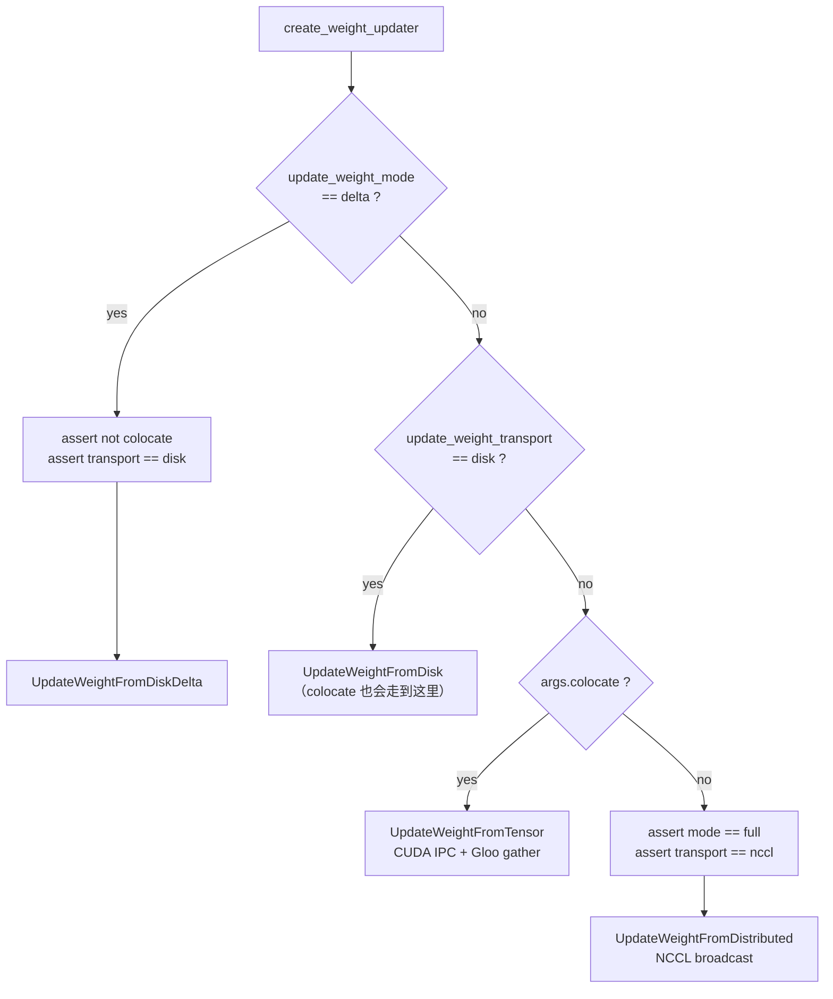
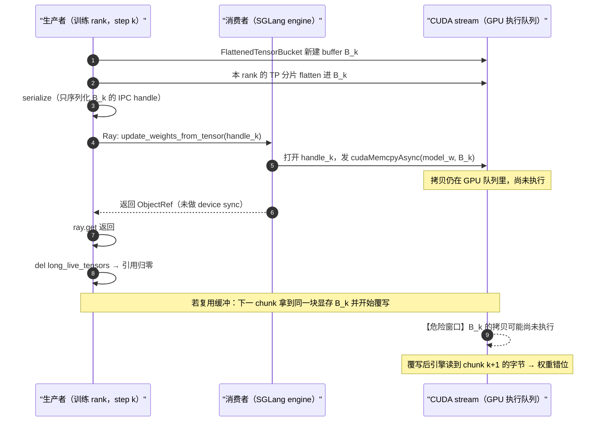

> **系列导航** ｜ 本系列：[01 Megatron 训练栈](/2026/10/24/rl-frameworks-01-megatron/) ｜ 本文 02 ｜ [03 veRL](/2026/10/24/rl-frameworks-03-verl/) ｜ [04 AReaL](/2026/10/24/rl-frameworks-04-areal/) ｜ [05 RLinf](/2026/10/24/rl-frameworks-05-rlinf/) ｜ [06 SGLang 接缝](/2026/10/24/rl-frameworks-06-sglang/) ｜ [07 vLLM 接缝](/2026/10/24/rl-frameworks-07-vllm/) ｜ [08 两族横评](/2026/10/24/rl-frameworks-08-landscape/) ｜ 全景：[RL 训练框架横评](/2026/09/29/rl-training-frameworks-survey/) ｜ 变量侧：[RL 框架里的那些变量](/2026/09/30/rl-variables-in-frameworks/)

**TL;DR**

> * **slime 的简洁来自一件极端的事：它不自己造并行层，也不自己造推理引擎。** 训练端原样用 Megatron-LM（`slime/backends/megatron_utils`），推理端原样起 SGLang 服务（`slime/backends/sglang_utils`），Ray 只负责三件事：摆卡（placement group）、起 actor、在 actor 之间搬数据。框架自己没有 `Worker` 抽象、没有 `WorkerGroup`、没有 `ResourcePool`——`slime/ray/` 一共六个文件。
> * **初始化的顺序决定了后面所有的坑**。`create_placement_groups` 先按 `--colocate` 决定「actor 和 rollout 是抢同一批卡还是各占一批」，这个决定一路传导到权重同步方式：colocate 走 **CUDA IPC + `gather_object`**（Gloo CPU 侧收集），非 colocate 走 **NCCL broadcast**，两者在 `create_weight_updater` 里被硬断言互斥。
> * **一个 RL step 的阻塞点只有四处**：`generate` 返回、`async_train` 返回、`offload_train`、`update_weights`。其余全是异步 Ray ObjectRef 在飞。这就是「简洁」的代价——**重叠是靠 Ray 的异步而不是靠框架的调度器**。
> * **权重同步有五种实现**，不是一个函数：`update_weight_from_disk` / `_from_disk_delta` / `_from_tensor`（IPC）/ `_from_distributed`（NCCL）以及 `hf_weight_iterator_direct`。选哪个由 `--update-weight-mode` × `--update-weight-transport` 交叉决定，其中 **delta 模式被硬绑在 disk 传输且禁止 colocate**。
> * **训推一致靠三层各自兜底**：数值层靠「同一份 Megatron 权重先转 HF 格式再灌进 SGLang」；权重层靠 `pause_generation` + 可选 `flush_cache` + 版本号递增；样本层靠 `pause_rollout_admission` / `resume_rollout_admission` 把异步生产者在更新窗口内掐住。
> * **全异步不是另一套框架，是另一个 rollout 后端**。`slime/rollout/fully_async_rollout.py` 里的 `AsyncRolloutWorker` 是一个「后台线程 + asyncio 循环」的连续消费者，输出队列**故意无界**，反压在循环里做而不是在队列上做——理由是 `put()` 跑在事件循环线程里，有界队列会冻住所有在途生成。
> * **监控是 slime 相对同类框架的强项**：`slime/observability/` 十个模块覆盖 metric / rollout_metrics / timer / trace / profile / tensorboard / logging，且 rollout 侧指标带 PD 分离的 prefill/decode 分项（transfer 速度、bootstrap 时长、retry 次数），这在其他框架里少见。

---

## 目录

- [1. 设计出发点：把复杂度推给上下游](#1-设计出发点把复杂度推给上下游)
- [2. 模块初始化逻辑（上）：摆卡](#2-模块初始化逻辑上摆卡)
- [3. 模块初始化逻辑（下）：起 actor](#3-模块初始化逻辑下起-actor)
- [4. 进程运行逻辑：一个 rollout 的四个阻塞点](#4-进程运行逻辑一个-rollout-的四个阻塞点)
- [5. 角色封装：四个角色，两种身份](#5-角色封装四个角色两种身份)
- [6. 权重同步：五种实现与它们的选择条件](#6-权重同步五种实现与它们的选择条件)
- [7. 训推一致：三层各自兜底](#7-训推一致三层各自兜底)
- [8. 异步形态：从 partial rollout 到完全异步](#8-异步形态从-partial-rollout-到完全异步)
- [9. 监控系统：十个模块与三层观测面](#9-监控系统十个模块与三层观测面)
- [10. 小结：简洁的边界在哪](#10-小结简洁的边界在哪)

---

## 1. 设计出发点：把复杂度推给上下游

slime 的 README 把目标写成两件事：**简洁**（thin training framework，只做 GLM/Qwen 这类模型的对齐，不做训练基础设施）与**高性能**（与 SGLang 深度耦合，把生成与训练放在同一批卡上）。这两个目标在别处通常是互斥的，slime 的做法是**把复杂度推给上下游**：

| 层 | slime 自己写 | 推给谁 |
| --- | --- | --- |
| 并行与优化器 | 不写 | Megatron-LM 原样引入 |
| 推理引擎与调度 | 不写 | SGLang 原样起服务 |
| 进程编排 | 写一点（`slime/ray/`） | Ray |
| RL 角色与数据流 | 全写（`slime/ray/rollout.py`、`slime/rollout/`） | — |
| 权重搬运 | 全写（`slime/backends/megatron_utils/update_weight/`） | — |

这个选择的直接后果是**依赖面极窄但版本敏感**：slime 的 `pyproject.toml` 同时钉住 Megatron-LM 与 SGLang 的具体 commit，换一个版本就可能因为内部 API 变动跑不起来。它换来的是：新增一个模型只需要写一份 `megatron_to_hf/<model>.py` 转换器，而不是改并行层。

对照同类框架：veRL 自己维护 `single_controller`（WorkerGroup / ResourcePool / decorator）这一整套编排抽象，因此能表达 colocate / 分离 / 混合三种布局；slime 没有这层，布局只有 `--colocate` 一个布尔开关。**这不是 slime 缺了什么，而是它主动放弃了布局表达的通用性，换取代码量**。

---

## 2. 模块初始化逻辑（上）：摆卡

### 2.1 一个布尔决定全部布局

整个布局逻辑集中在 `_get_placement_group_layout`，它是一个纯函数，返回 `(总 GPU 数, rollout 起始偏移)`：

```python
def _get_placement_group_layout(args) -> tuple[int, int]:
    actor_num_gpus = args.actor_num_nodes * args.actor_num_gpus_per_node

    if args.debug_train_only:
        return actor_num_gpus, 0

    if args.rollout_external:
        if args.debug_rollout_only:
            return actor_num_gpus, 0
        return actor_num_gpus, actor_num_gpus

    if args.debug_rollout_only:
        return args.rollout_num_gpus, 0

    if args.colocate:
        return max(actor_num_gpus, args.rollout_num_gpus), 0

    return actor_num_gpus + args.rollout_num_gpus, actor_num_gpus
```

四种布局可以列成一张表：

| 条件 | 总卡数 | rollout 偏移 | 含义 |
| --- | --- | --- | --- |
| `--colocate` | $$\max(N_{\rm act}, N_{\rm roll})$$ | 0 | 训练与推理共享同一批卡，偏移为 0 表示 rollout 从第 0 张卡开始重复使用 |
| 默认（分离） | $$N_{\rm act} + N_{\rm roll}$$ | $$N_{\rm act}$$ | 前一段给训练，后一段给推理 |
| `--rollout-external` | $$N_{\rm act}$$ | $$N_{\rm act}$$ | 训练端不拥有推理卡，偏移指向末尾即「空集」 |
| `--debug-train-only` / `--debug-rollout-only` | 单侧 | 0 | 调试用 |

`offset = N_act` 而 `total = N_act + N_roll`，切片 `indices[offset:]` 正好取到后半段；这个「用偏移表达子集」的写法比显式维护两套索引简单，但读代码时要留意：**`rollout_offset` 是总卡数里的起点，不是 rollout 卡数**。

### 2.2 物理 GPU 号需要重新排序

摆卡之后 slime 做了一件很多框架会漏掉的事：**把逻辑序号映射到物理 GPU 号并排序**。

`_create_placement_group` 先建 `num_gpus` 个单卡 bundle（`strategy="PACK"`，尽量挤在一台机器上），然后给每个 bundle 起一个临时 `InfoActor` 去问自己落在哪张物理卡上，问完立刻 `ray.kill`。拿到 `(ip, gpu_id)` 之后按 `sort_key` 排序，于是：

- `pg_reordered_bundle_indices`：逻辑序号 → bundle 序号
- `pg_reordered_gpu_ids`：逻辑序号 → 物理 GPU 号

**为什么必须排序**：Megatron 与 SGLang 建通信组时都假设同一节点内的 rank 在物理卡上连续（NVLink 拓扑内通信更快）。Ray 分配 bundle 的顺序不保证与实际物理卡号一致，如果不重排，「相邻的两个 rank」可能落在跨 NVLink 域的两张卡上，TP 通信会平白掉性能。

等待 placement group 就绪的那段也值得看一眼：**它没有用 `ray.get(pg.ready())`，而是每 30 秒打印一次「集群里注册了多少卡、当前可用多少卡」**。注释给的理由是「集群还在扩缩容、或者节点的 GPU 尚未向 GCS 注册时，干等是没有任何输出的」。这个细节在自动扩缩容集群上有实际价值——否则一个跑不起来的任务看起来像是挂死了。

### 2.3 `create_training_models` 的连锁初始化

初始化顺序是 `placement group → actor → critic → rollout manager → load checkpoint`，其中有三处容易忽略：

**第一，actor 是否需要 ref 模型，是由 KL 系数决定的**：

```python
with_ref=actor_args.kl_coef != 0 or actor_args.use_kl_loss,
```

也就是说 **GRPO 只要 KL 项为 0，就不会额外加载一份 reference 模型**。这直接省掉一份与 actor 等大的权重和一份并行通信组——在 7B 量级上大约是 14 GB 的 bf16 权重。

**第二，critic 只在 `use_critic` 且 `num_rollout != 0` 时才建**，并且当 `megatron_config_path` 为空时要手动把 `disable_param_buffers_cpu_backup` 置为 `False`。后者是 Megatron 的参数备份开关，关掉可以省 CPU 内存，但 critic 与 actor 共享同一份 `parse_megatron_role_args` 的产物时就可能串味。

**第三，重启后的起点由所有 rank 投票得出**：`actor_model.create()` 返回每个 rank 从 checkpoint 里读到的 `start_rollout_ids`，代码断言它们全部相同（`assert len(set(start_rollout_ids)) == 1`），然后统一回填到 `args.start_rollout_id`。这是一个**隐式的分布式一致性检查**——如果某个 rank 读到了不同的 step，这里会直接炸而不是带着错位的状态继续训。

### 2.4 rollout manager 在另一端

训练 actor 起来之后，`create_rollout_manager` 才去起 rollout 侧。这个顺序是有意的：**SGLang 引擎需要在启动时就知道训练端的世界大小与卡号偏移**，因为后续 `connect_rollout_engines` 要按 `engine_gpu_counts` / `engine_gpu_offsets` 建立「哪几个训练 rank 对应哪一个推理引擎」的映射。反过来先起引擎再起训练端，这个映射就得靠另一条回传链路补齐。

初始化阶段的完整时序：

```text
parse_args
  └─ create_placement_groups
       ├─ _get_placement_group_layout      → (总卡数, rollout 偏移)
       ├─ _create_placement_group          → bundle → 物理卡号 → 排序
       └─ 按 colocate / external 决定 actor 与 rollout 是否共用同一个 pg
  └─ create_training_models
       ├─ allocate_train_group(actor)      → RayTrainGroup（num_gpus_per_actor=0.4）
       ├─ actor_model.create(rollout_manager)  → 各 rank 汇报 start_rollout_id
       ├─ [可选] allocate_train_group(critic)
       └─ assert 所有 rank 的 start_rollout_id 一致
  └─ create_rollout_manager → SGLang 引擎 + 负载均衡器
  └─ rollout_manager.load.remote(start_rollout_id - 1)   回放历史 rollout
```

注意 `num_gpus_per_actor=0.4` 这个默认值：训练 actor 只占 0.4 张卡，剩下的 0.6 留给同 bundle 上的 SGLang 引擎。这是 colocate 的显式编码——**Ray 层面就把「一张卡要同时装下两个进程」这件事写进了资源账本**。

### 2.5 这个 0.4 是一个「乐观配额」，没有上界检查

`allocate_train_group` 把 `num_gpus_per_actor=0.4` 传给 `RayTrainGroup`，而后者在起 actor 时**同时把它当成 CPU 与 GPU 两份配额**（`slime/ray/actor_group.py` L125-L131）：

```python
for rank in range(world_size):
    actor = TrainRayActor.options(
        num_cpus=num_gpus_per_actor,
        num_gpus=num_gpus_per_actor,
        scheduling_strategy=PlacementGroupSchedulingStrategy(
            placement_group=pg,
            placement_group_bundle_index=reordered_bundle_indices[rank],
        ),
```

而 placement group 的 bundle 是 `{"GPU": 1, "CPU": 1}`（`_create_placement_group` 里那行 `bundles = [{"GPU": 1, "CPU": 1} for _ in range(num_gpus)]`）。

**于是每张卡上能塞几个训练 actor，完全由 0.4 这个分数反推**：

$$
\text{每 bundle 可容纳的 actor 数} = \left\lfloor \frac{1.0}{0.4} \right\rfloor = 2
$$

问题在于**实际需要的 actor 数取决于配置，而配置可以让它超过 2**：

| 条件 | 该 bundle 上的 actor | 需要 0.4 × 数量 | 结果 |
| --- | --- | --- | --- |
| 只要 actor | 1 | 0.4 | 放得下 |
| actor + critic（`use_critic`） | 2 | 0.8 | 放得下 |
| actor + ref（`kl_coef != 0`） | 2 | 0.8 | 放得下 |
| **actor + critic + ref** | **3** | **1.2 > 1.0** | **超配** |
| **actor + teacher（`use_opd`）+ critic** | **3** | **1.2 > 1.0** | **超配** |

代码里**没有任何断言检查这件事**。超配的表现在 Ray 侧是「placement group 放不下 → 永久 pending」，也就是 §2.2 里那个「每 30 秒打印一次集群资源」的循环会一直打下去，看起来像卡住。

**对照组**：veRL 用的是相反的思路——`max_colocate_count` 是一个显式的**最大值声明**，`num_gpus = 1 / max_colocate_count`，语义是「我承诺最多叠这么多个」。slime 的 `0.4` 是一个**隐式的经验值**，它编码的其实是「通常有 2 个角色」，而不是「最多 2 个角色」。

这个差异值得记下来：**两个框架都在用分数配额表达 colocate，但一个把它当上界，一个把它当典型值**。

---

## 3. 模块初始化逻辑（下）：起 actor

### 3.1 `slime/ray/` 的六个文件各管什么

| 文件 | 职责 | 关键点 |
| --- | --- | --- |
| `placement_group.py` | 摆卡与建组 | 物理卡排序、offset 表达子集 |
| `actor_group.py` | 训练 actor 组 | 每 rank 一个 Ray actor，组内 collective 走 NCCL |
| `train_actor.py` | 训练 actor 基类 | `init` / `train` / `sleep` / `wake_up` / `update_weights` |
| `rollout.py` | rollout 侧总控 | 生成、pause/resume、flush cache、评测 |
| `serving.py` | SGLang 服务生命周期 | 引擎启动、attach/detach 训练端、健康监测 |
| `training_recovery.py` | 训练端故障恢复 | 重启训练 actor 而不动仍持有 rollout 状态的引擎 |

真正体现「薄」的是 `train_actor.py` 只有 126 行。它定义的基类 `TrainRayActor` 里，`train` / `update_weights` / `save_model` 全部是**留给 backend 实现的方法**，基类只提供 `sleep` / `wake_up` / `clear_memory` 与进程组管理。也就是说 **slime 的 Ray actor 是一个装载器，不是一个调度单元**——调度逻辑都在 driver 上的 `train.py` 循环里。

### 3.2 训练进程内部的四个阶段

`init` 阶段做的事（按调用顺序）：建 NCCL 进程组（`master_addr` / `master_port` 由 Ray 侧传入）→ 初始化 Megatron（`initialize_model_and_optimizer`）→ 若 `with_ref` 再建一份 reference → 若 `with_opd_teacher` 再建一份 teacher。三份模型共用同一个进程，内存压力全部落在这一侧。

这里有一个与「训推一致」直接相关的设计：**训练端保存的不是 SGLang 的格式，而是 Megatron 的分布式分片格式**。所有权重搬运都必须经过一次 `megatron_to_hf` 的格式转换（`slime/backends/megatron_utils/megatron_to_hf/<model>.py`，按模型族分文件）。**这既是 slime 最大的兼容性成本，也是它最大的正确性保障**——转换器是逐模型的显式代码，写错了能被发现，而不是靠通用的 state_dict 名字匹配去猜。

---

## 4. 进程运行逻辑：一个 rollout 的四个阻塞点

`train.py` 的主循环只有约 50 行，可以完整读下来。核心骨架：

```python
for rollout_id in range(args.start_rollout_id, args.num_rollout):
    if ...: ray.get(rollout_manager.eval.remote(rollout_id))

    rollout_data_ref = ray.get(rollout_manager.generate.remote(rollout_id))   # 阻塞点 1

    if args.offload_rollout:
        ray.get(rollout_manager.offload.remote())

    actor_trains = (not args.use_critic) or rollout_id >= args.num_critic_only_steps
    if args.use_critic:
        value_refs = critic_model.async_train(rollout_id, rollout_data_ref)   # 异步
        if actor_trains:
            ray.get(actor_model.async_train(rollout_id, rollout_data_ref, external_data=value_refs))  # 阻塞点 2
        else:
            ray.get(value_refs)
    else:
        ray.get(actor_model.async_train(rollout_id, rollout_data_ref))        # 阻塞点 2

    ray.get(rollout_manager.training_completed.remote(rollout_id))

    ... save_checkpoint(...)

    offload_train(actor_trains)                                              # 阻塞点 3
    if args.offload_rollout and not release_train:
        ray.get(rollout_manager.onload_weights.remote())
    was_paused = ray.get(rollout_manager.pause_rollout_admission.remote())
    actor_model.update_weights()                                             # 阻塞点 4
    if rollout_id + 1 < args.num_rollout:
        ray.get(rollout_manager.resume_rollout_admission.remote(was_paused))
    if args.offload_rollout:
        ray.get(rollout_manager.onload_kv.remote())
```

### 4.1 重叠发生在哪

从上往下数，**真正的并发只在 `critic_model.async_train` 与 `actor_model.async_train` 之间**：`value_refs` 是一个未完成的 ObjectRef，actor 的训练可以带着它一起跑，critic 算出的 value 在被 actor 真正读取时才形成同步点。这是 PPO 场景下唯一的重叠机会。

GRPO（`use_critic=False`）路径上**没有训练与生成的重叠**——`generate` 阻塞结束后才轮到 `async_train`，两者严格串行。slime 的重叠不来自这里，而来自 **rollout 内部**：SGLang 引擎用 continuous batching 把整批请求叠在一起，训练端则在等待期完全空闲。想更进一步就要换 `--offload-rollout` 的 onload/offload 那套，或者直接用第 8 节的全异步后端。

### 4.2 三次 offload 的分工

循环里有三种不同的「卸载」，名字很像但语义不同：

| 调用 | 卸载谁 | 为什么 |
| --- | --- | --- |
| `rollout_manager.offload.remote()` | SGLang 引擎的 KV cache 与权重 | 训练端要用卡 |
| `offload_train(actor_trains)` | Megatron 的优化器状态与参数 | 生成端要用卡 |
| `rollout_manager.onload_kv.remote()` | 把 KV cache 装回推理引擎 | 下一轮生成要接着用 |

`--offload-rollout` 与 `--offload-train` 是两个独立开关，但代码里有一条隐含约束：**colocate + `--release-train` 时 `--no-offload-rollout` 会被忽略**（`arguments.py` 里会打日志说明），因为 release-train 模式下训练进程整个被释放，不卸载 rollout 就没有卡可用。

### 4.3 `pause_rollout_admission`：一个为异步准备的门

在 `update_weights` 前后有一对调用：

```python
was_paused = ray.get(rollout_manager.pause_rollout_admission.remote())
actor_model.update_weights()
if rollout_id + 1 < args.num_rollout:
    ray.get(rollout_manager.resume_rollout_admission.remote(was_paused))
```

同步训练下这对调用看起来多余——反正 `generate` 已经返回，没有在途请求。它真正的作用对象是**异步生产者**：全异步后端会让生成在训练期间继续推进，换权重时必须把这些生产者挡在门外，否则新权重会被写进正在读旧权重的那批请求里。`was_paused` 的回传保证「本来就暂停的保持暂停」，而不是被误唤醒。

### 4.4 恢复点：`start_rollout_id - 1`

初始化最后一行是 `rollout_manager.load.remote(args.start_rollout_id - 1)`。**减一**是因为 `start_rollout_id` 是「下一个要跑的」，而历史里已经完成的最后一个是它减一。这个细节在断点续训时决定 `rollout_data_buffer` 里回放的数据对不对。

---

## 5. 角色封装：四个角色，两种身份

slime 的四个 RL 角色并没有四个对称的类，而是**两种身份**：

| 角色 | 身份 | 实现 | 持有权重 | 关键约束 |
| --- | --- | --- | --- | --- |
| actor | 训练 actor | `RayTrainGroup` + Megatron | 是，分片 | 每 rank 一个 Ray actor |
| critic | 训练 actor | 同上，`role="critic"` | 是，另起一组 | 可与 actor 共用 pg |
| reference | **actor 的一个属性** | `with_ref=True` 时同进程多建一份 | 是，只做前向 | KL 为 0 时不建 |
| rollout | **SGLang 服务** | `slime/ray/rollout.py` + `sglang_utils` | 是，完整 HF 副本 | 独立进程，可多引擎 |

**reference 不是一个独立进程**，这是理解 slime 内存占用的关键。`with_ref=True` 时训练 actor 的 `init` 会在同一个进程里再初始化一份 Megatron 模型，加载同一份 checkpoint 的权重。好处是 ref 的前向可以直接复用 actor 的并行布局与通信组，省钱省代码；坏处是**显存里永远有两份完整模型**，7B 模型在 8 卡 TP=8 下每卡多占约 1.75 GB 参数（bf16），加上 ref 的激活与临时缓冲区，实际开销更大。

rollout 侧的封装则走了另一个极端：**它不是一个 actor 类，而是一个「服务群的管理句柄」**。`slime/ray/serving.py` 里的方法名直接反映职责——`attach_training` / `detach_training` / `register_trainers` / `release_trainers` / `health_monitoring_pause` / `recover_updatable_engines`。这些方法存在的原因只有一个：**推理引擎会跑得比训练端久**。训练端崩了可以重启并重新 attach 到还活着的引擎上，不必丢 KV cache 重新预热。

---

## 6. 权重同步：五种实现与它们的选择条件

### 6.1 选择逻辑是一棵判定树，不是一张平行表

`create_weight_updater` 是理解整个同步机制的入口。**关键在于它是一棵有顺序的 `if/elif` 树，而不是一张任意的交叉表**：

```python
if update_weight_mode == "delta":
    # Delta sync is disk-transport only: each engine's /pull_weights applies the published
    # deltas into a host-local checkpoint on every host it spans, and the engines reload
    # via vanilla update_weights_from_disk.
    assert not args.colocate, "--update-weight-mode=delta is not supported with --colocate"
    assert update_weight_transport == "disk", "--update-weight-mode=delta requires --update-weight-transport=disk"
    from .update_weight_from_disk_delta import UpdateWeightFromDiskDelta
    update_weight_cls = UpdateWeightFromDiskDelta
elif update_weight_transport == "disk":
    from .update_weight_from_disk import UpdateWeightFromDisk
    update_weight_cls = UpdateWeightFromDisk
elif args.colocate:
    from .update_weight_from_tensor import UpdateWeightFromTensor
    update_weight_cls = UpdateWeightFromTensor
else:
    assert update_weight_mode == "full"
    assert update_weight_transport == "nccl", f"unsupported weight sync mode/transport: {update_weight_mode!r}/{update_weight_transport!r}"
    from .update_weight_from_distributed import UpdateWeightFromDistributed
    update_weight_cls = UpdateWeightFromDistributed
```



**这里藏着一个静默优先级坑**：`elif update_weight_transport == "disk"` **排在 `elif args.colocate` 前面**。所以 `--colocate --update-weight-transport disk` 不会走最快的 CUDA IPC，而是静默地走「写共享盘 + HTTP reload」。

判断这句话的重要性：colocate 的字面意思就是「同一张卡」，而 IPC 正是同卡之间唯一不需要经过网络的路径。**用户以为指定了 colocate 就自动走 IPC，实际上被 transport 参数截走了**。两者代价差了三个量级（见 6.2 的量化表）。

### 6.1.1 两个断言给出的硬约束

`delta` 分支的两行 `assert`：

| 断言 | 理由 |
| --- | --- |
| `not args.colocate` | 官方文档给的理由是「CUDA IPC handles 下 delta 不减小实际传输」——colocate 下本来就不走网络，delta 省不到东西 |
| `transport == "disk"` | delta 传的是**文件里的变化字节**，不是一个张量；只有 disk 传输能承载这种载体 |

**第二条断言背后是一个架构选择**：delta 同步绕过了「张量搬运」这一整层抽象，直接在字节层面做 diff。这带来了 §6.5 要讲的编码问题。

### 6.1.2 一个 `isinstance` 陷阱

`UpdateWeightFromDiskDelta` 的**父类是 `UpdateWeightFromDistributed`，不是 `UpdateWeightFromDisk`**（虽然名字里有 Disk）。原因是 delta 要复用的「连接 / 断开 / 元数据交换」那套逻辑在 distributed 类里。

后果很具体：`isinstance(updater, UpdateWeightFromDistributed)` 对 delta 路径**返回 True**。下游任何用它来判断「这是 NCCL 路径」的代码都会误判。**要区分四条路径只能用 `type()`，不能用 `isinstance`**。

### 6.2 colocate 路径：为什么要绕地球一圈

colocate 下最反直觉的一点是：**训练和推理明明在同一张卡上，权重却要先从 GPU 拷到 CPU、用 Gloo 收集、再经 Ray IPC 送回去、最后在引擎侧拷回 GPU**。为什么不直接走 NCCL 或直接共享显存？

`UpdateWeightFromTensor` 的类注释把这条路线写得很清楚：

```text
load(dict→GPU) → broadcast PP/EP(GPU NCCL) → gather TP(GPU NCCL) → convert HF(GPU) → send.
Colocated: GPU→CPU serialize → gather_object(Gloo CPU, collects from rollout_num_gpus_per_engine ranks) → Ray IPC to engine.
Distributed: GPU NCCL broadcast to remote engines.
```

原因有三层：

1. **TP 必须先 gather**。训练端一个参数被切成 TP 份，SGLang 引擎要的是完整参数（它自己按自己的 TP 再切）。所以必须先做一次 GPU NCCL 的 TP gather，得到「单 rank 视角下的完整 HF 参数」。
2. **PP/EP 必须先 broadcast**。流水线并行下只有首个 stage 持有 embedding、末个 stage 持有 lm_head，中间层的参数也只在自己 stage 上；EP 同理。broadcast 让每个 rank 都拿到完整视图。
3. **收集到 CPU 是因为 IPC 只能传 CPU 指针**。CUDA IPC 在跨进程场景下传递的是可映射的显存句柄，而 Ray 的 object store 只存 CPU 字节。所以最终形态必然是「GPU → CPU（`MultiprocessingSerializer` 序列化）→ Ray 传输 → 引擎侧反序列化回 GPU」。

### 6.2.1 四段流水线，四种通信设施

把这四步拆开，会发现**每一段用的通信设施都不同**，而且每一段的必要性都能从并行语义或进程边界推出来：

| 段 | 做什么 | 代码位置 | 通信设施 |
| --- | --- | --- | --- |
| ① load + PP/EP broadcast | 把「本 rank 有分片」和「本 rank 只有空壳」统一成每个 rank 都有完整值 | `hf_weight_iterator_direct.py` L73-L134 | NCCL（PP 组 / EP 组） |
| ② gather TP | 把 TP 分片拼成 full | 同上 L131-L134 → `common.py` L59-L126 | NCCL（TP 组） |
| ③ convert HF | Megatron 布局 → HF 布局（GLU 重排、MoE 维度修正） | `hf_weight_iterator_direct.py` L53-L70 | 无通信 |
| ④ serialize + gather + IPC | flatten → 序列化句柄 → Gloo 聚到 src → Ray 调引擎 | `update_weight_from_tensor.py` L378-L443 | Gloo `gather_object` + Ray + CUDA IPC |

### 6.2.2 为什么 TP 必须 gather：一个具体的例子

**不是「因为要完整参数」这么简单**。真正的原因是 Megatron 与 SGLang 的 TP 分片编号没有任何约定关系，而且**某些参数的切法必须重新排列**。

`common.py` 里处理 GLU 的那段代码说明了问题：

```python
partition_dim = param.partition_dim
assert param.partition_stride == 1 or (
    param.partition_stride == 2 and "linear_fc1" in name
), "partition_stride != 1 is not supported"
# TODO: here we did an extra copy during concat, maybe merge this with convert_to_hf is better?
# TODO: check only GLU is used.
if "linear_fc1.weight" in name or "linear_fc1.bias" in name:
    param_partitions = [p.chunk(2, dim=0) for p in param_partitions]
    param_partitions = [p[0] for p in param_partitions] + [p[1] for p in param_partitions]
```

**Megatron 的 `linear_fc1` 切法是「每个 rank 拿到 `[gate; up]` 的同一段」，而 HF 要的是「前一半全是 gate、后一半全是 up」**。

举例：`intermediate_size = 4d`，`TP = 2`：

| 布局 | rank 0 上 | rank 1 上 | 能否直接给引擎 |
| --- | --- | --- | --- |
| Megatron 分片 | `[gate_0..gate_d ; up_0..up_d]` | `[gate_{d+1}..gate_{2d} ; up_{d+1}..up_{2d}]` | 不能 |
| 直接 concat（错） | `[gate_0..d ; up_0..d ; gate_{d+1}..2d ; up_{d+1}..2d]` | — | **顺序交错，错的** |
| rechunk 后 concat（对） | `[gate_0..2d ; up_0..2d]` | — | 正确 |

**这个重排只能在一个 rank 上对完整张量做**。如果各 TP rank 直接各发本地分片，引擎拼出来的 `linear_fc1` 权重就是交错错位的——**而且不会报错**。

### 6.2.3 为什么 PP/EP 必须先 broadcast：`torch.empty` 的陷阱

PP 场景下每个 rank 只持有自己那段层的权重，其余层在它手里是**空壳**。源码里那个空壳是 `torch.empty`：

```python
else:
    params.append(torch.empty(info.shape, dtype=info.dtype, device=accelerator.current_device()))
```

**`torch.empty` 分配的内存里是上一轮遗留的权重（或任何垃圾）**。如果不先 broadcast 就直接 gather，拼出来的张量会**一半是新的、一半是上一轮的**——这是最坏的一类 bug：不崩溃、不报错，权重看似合理。

EP 那边还有一段更精细的处理：

```python
# broadcast params across ep ranks
if ep_size > 1:
    handles = []
    for info, param in zip(megatron_local_param_infos, params, strict=False):
        if ".experts." in info.name:
            src_rank = (
                info.src_rank
                if info.src_rank in dist.get_process_group_ranks(mpu.get_expert_model_parallel_group())
                else rank
            )
            handles.append(torch.distributed.broadcast(param, src=src_rank, group=mpu.get_expert_model_parallel_group(), async_op=True))
```

**`else rank` 是一个「自广播」占位**：如果这个专家参数的权威 rank 不在这条 EP 链路里，就让**本 rank 自己当 src**。语义上是 no-op，作用是**让所有 rank 参与同样的集合调用次数**，避免 NCCL 集合通信挂死。

这是一个典型的「用自指向 broadcast 占位」的防御写法——**在集合通信里，「跳过」不是一个选项，因为集合操作要求全员参与**。

### 6.2.4 权重丢了也不报错的那条路

`_ipc_gather_group` 的建立逻辑里有一段最值得警惕的代码：

```python
# Placeholder ranks (GPU slots reserved but no engine) have no gather group.
# gather_object is only collective among group members, so we skip entirely.
if ipc_gather_group is None:
    return [], None
```

**占位 rank（在 placement group 里留了 GPU slot 但没配引擎）拿不到 gather group，函数直接返回空**。没有断言、没有告警、没有任何日志。

这条路径的设计动机是合理的（它确实不该参与 gather），但后果是：**如果 `engine_gpu_offsets` 配置错了，某些训练 rank 会被静默判成占位 rank，它们那一份权重就永远送不到引擎**。而训练继续跑，只有 loss 会歪。

更隐蔽的是映射逻辑用的是半开区间匹配：

```python
for i, engine in enumerate(self.rollout_engines):
    start = colocate_gpu_offsets[i]
    end = start + colocate_gpu_counts[i]
    if start <= self.rank < end:
        self._ipc_engine = engine
```

**如果两个 engine 的区间重叠，后写的那次会静默覆盖前一次**——源码里没有任何断言校验 `engine_gpu_offsets` 互不重叠。

### 6.3 一个真实的竞态与它的注释

`_build_flattened_tensor_data` 里有一段少见的「解释为什么不能这么做」的注释：

> Do not reuse the IPC-facing flattened tensor. SGLang returns from the HTTP/Ray request after enqueueing GPU copies into model weights, but it does not guarantee a CUDA-device sync before the response. Reusing and overwriting the same producer buffer immediately after `ray.get` can race with the consumer-side copy and corrupt weights.

拆开讲：SGLang 收到 IPC 句柄后会**把拷贝任务 enqueue 到 GPU 上**就返回，并不等 CUDA 同步完成。如果训练端在 `ray.get` 返回后立刻复用同一块缓冲区去装下一批参数，GPU 上还没执行完的上一次拷贝会读到被覆盖的数据——**权重就静默地错了，而所有 barrier 都通过**。这条注释对应的正是训推一致的「权重层」最难查的一类 bug：它不会报错，只会让训练曲线莫名其妙地抖。

两个关键词值得单独拎出来：`enqueueing`（入队，不是完成——`cudaMemcpyAsync` 函数返回不等于数据到齐）与 `corrupt weights`（失败模式是内容错，不是崩溃）。

竞态的时间线：



**关键的不对称**：`ray.get` 返回与 `cudaMemcpyAsync` 的执行之间**没有任何顺序保证**。两者唯一的同步点是「同一 CUDA device 上 stream 之间的隐式顺序」——但那只在**同一个进程内**成立，**跨进程（训练进程 vs 引擎进程）不适用**。

对应的防御措施在 `update_weights` 的循环尾部：

```python
refs, long_lived_tensors = self._send_hf_params(hf_named_tensors)
ray.get(refs)
# Free GPU tensors so the caching allocator can reuse the blocks,
# then release CUDA IPC cache entries whose consumers (sglang engines)
# have already closed their IPC handles.
del refs, long_lived_tensors, hf_named_tensors
accelerator.ipc_collect()
accelerator.empty_cache()
```

**每个 chunk 送完就 `del` + `ipc_collect` + `empty_cache`**，而不是攒到最后一次性释放。这样做的原因是 IPC 句柄不释放的话，PyTorch 的 caching allocator 无法复用那些块，显存会随 chunk 数膨胀。

**这里有一个容易算错的账，值得单列一张表**。以 70B bf16（140 GB）分 8 个 chunk、`TP=8` 为例，每 chunk 每 rank 摊 $$17.5/8 \approx 2.19$$ GB：

| 策略 | 每 rank 的 flattened 显存峰值 | 倍数 |
| --- | --- | --- |
| 复用同一块缓冲（危险，见 6.3 竞态） | 2.19 GB | 1× |
| **每 chunk 新建 + 每 chunk 回收（实际策略）** | 2.19 GB，最坏时上一块与下一块短暂共存 | **1× ~ 2×** |
| 每 chunk 新建且**不回收** | 2.19 × 8 = 17.5 GB | 8× |

**「不过复用」的真实代价是 1–2 倍，不是 8 倍**——因为 `ipc_collect` + `empty_cache` 让显存能及时回池。8 倍只出现在「既不回收又不复用」这种假想实现里。

**但这张表真正的用处是反推**：如果把 L527-L528 两行删掉只留 `del`，就会退化成 8 倍。判断方法是看 `print_memory("after update_weights")` 的打点是否随 chunk 数线性增长——**这是一个不需要 GPU 也能设计出来的验证**。

### 6.4 暂停、刷缓存、版本号

`update_weights` 的头三步构成了「让引擎安全接收新权重」的完整协议：

```python
self.weight_version += 1
flush_cache = should_flush_cache(
    self.args.flush_cache_interval, self.weight_version, getattr(self.args, "update_weight_start_version", 0)
)
if self.rank == 0:
    ray.get([engine.pause_generation.remote(mode="abort" if flush_cache else "in_place")
             for engine in self.rollout_engines])
    if flush_cache:
        ray.get([engine.flush_cache.remote() for engine in self.rollout_engines])
```

三个细节：

- **每次更新都递增 `weight_version`**，这是训推一致「样本层」的版本标记：每条样本都能追溯到它是在哪个权重版本下生成的。
- **`pause_generation` 有两种模式**：`abort` 直接中止在途请求，`in_place` 让在途请求跑完。**只有在要刷缓存时才用 `abort`**，因为刷缓存会让在途请求的前缀 KV 失效。
- **`flush_cache` 不是每次都做**，由 `--flush-cache-interval` 控制。不刷的话，新旧权重混用的 KV cache 会残留错误状态；每次都刷的话，前缀缓存彻底失效，长前缀场景的吞吐会掉。这是一个**正确性与吞吐的直接权衡**，slime 把它做成了可配的周期而不是二选一。

### 6.5 MoE 的额外一步

`update_weights` 末尾有一段只在 `_expert_transfer_plan` 存在时才跑的 `_update_expert_weights`。MoE 模型的专家参数在 EP 下分布与稠密参数不同，需要一套独立的传输计划（`_expert_param_info_buckets` 与 `_full_param_info_buckets` 二选一）。这也是为什么 slime 的每个权重更新器都有两个 bucket 列表——**稠密部分与专家部分走不同的分桶策略**。

---

## 7. 训推一致：三层各自兜底

### 7.1 数值层

slime 的数值层策略是「**宁可多一次转换，也不要两套模型定义**」：

- 训练端只有 Megatron 一份模型定义，没有第二套 PyTorch 实现去对齐
- 推理端只有 SGLang 一份模型定义
- 两者之间的唯一桥梁是 `megatron_to_hf/<model>.py` 的逐模型转换器

这样做的好处是**不存在的偏差不会出现**（无需对齐两套 kernel 实现），代价是**存在的偏差不可消除**：Megatron 与 SGLang 的 attention kernel、rope 实现、RMSNorm 的数值路径仍然不同，同一份权重在两边的 logprob 必然有微小差异。

真正把数值层风险压到可接受范围的是两个配置项：

- **`--rollout-temperature` 与训练时的采样温度必须一致**，否则重要性比的分母从一开始就是错的
- **logprob 复用**：rollout 时让 SGLang 一并返回 `prompt_logprobs` / `input_token_logprobs`，而不是训练端再前向算一遍。这一条直接消灭了「同一批 token 在两套 kernel 下算两次」的问题

### 7.1.1 官方给出的「逐位对齐」条件清单

上面的说法是「差异不可消除」。但 slime 的文档里有一份更硬的答案：**在特定条件下，训练端与 rollout 端的 logprob 可以逐位对齐**（`docs/en/advanced/reproducibility.md`）。

先说单侧逐位复现，需要同时满足六件事：

| 类别 | 配置 | 作用 |
| --- | --- | --- |
| SGLang | `--sglang-enable-deterministic-inference` | 推理侧确定性 |
| SGLang | `--sglang-attention-backend flashinfer` | 换成有确定性实现的 attention 后端 |
| Megatron | `--deterministic-mode` | 训练侧确定性 |
| NCCL | `NCCL_ALGO=Ring` | 固定集合通信算法 |
| Transformer Engine | `NVTE_ALLOW_NONDETERMINISTIC_ALGO=0` | 禁用非确定性 kernel |
| cuBLAS | `CUBLAS_WORKSPACE_CONFIG=:4096:8` | 固定 GEMM 工作区，避免算法选择抖动 |

**还有一个不在配置里的前置动作：卸载 FlashAttention 3**（`pip uninstall flash_attn_3 -y`）。FA3 的 kernel 是非确定性的，留着它上面那六条都不生效。

再说**训推之间的 logprob 对齐**，限制更严：**目前只支持 GLM-5 结构**（MLA + DSA 稀疏注意力），且需要 batch-invariant DeepGEMM / DeepEP 构建加上 `megatron-sglang-aligned.patch`。文档逐条列了对齐所依赖的东西：

| 依赖 | 具体内容 |
| --- | --- |
| 注意力 | DSA 稀疏注意力（`flashmla_sparse` prefill/decode），含确定性的 NSA RadixCache / prefix cache |
| GEMM | DeepGEMM 的 batch-invariant block-FP8 前向（稠密与 grouped-MoE 层），**反向仍用 BF16** |
| MoE 路由 | **fp32 router** |
| MoE 通信 | SGLang 侧 DeepEP 低延迟 rollout + Megatron 侧 DeepEP normal 训练；**普通 Megatron all-to-all 不能作为对齐后端** |
| KV cache | bf16 或 FP8-E4M3 |

其中 MoE 路由那条有一个反直觉的细节，值得原文引用：

> fp32 MoE router (the LM head stays bf16 on both train and rollout — matching precision, not fp32, is what aligns)

**「对齐的是精度的匹配，而不是 fp32 本身」**。这句话纠正了一个常见误解：很多人以为「都开 fp32 就能对齐」，实际上如果一侧 fp32 一侧 bf16 反而不对齐。**判据是两侧一致，不是两侧都高精度**。

这张清单的实践意义：**训推一致的「数值层」不是靠调参逼近的，是靠把两侧的数值路径在每一个分叉点上都统一**。这也是为什么只有 GLM-5 一条路径做成了——每加一个模型族，就要把它所有的 kernel 分叉重新对齐一遍。

### 7.2 权重层

第 6 节的协议本身就是权重层的全部内容。这里补三条容易漏的：

1. **初始化时就已经同步过一次**。`train()` 的第一段在进入循环之前就调用了 `actor_model.update_weights()`，注释写得很直白：`# Always push actor weights to rollout once weights are loaded.`。如果漏了这一步，第一次 rollout 用的是 SGLang 从磁盘加载的原始权重，而训练端加载的 checkpoint 可能不同（尤其是 `--finetune` 场景）。
2. **重启会导致连接失效**。`update_weights` 里有这样一段判断：当 `num_new_engines > 0` 或者需要重连时，必须重新 `connect_rollout_engines`，因为「上一个 trainer 的 rank 建的 update group 已经随它一起死了」。跨 rank 的 `dist.barrier(group=get_gloo_group())` 保证所有 rank 都连上了才清掉标记位。
3. **`check_weights` 是一个可选的端到端校验**。初始化阶段有 `ray.get(rollout_manager.check_weights.remote(action="compare"))`，它把训练端与引擎侧的权重逐项比对。这是本文提到的所有机制里**唯一一个能端到端证明「权重真的同步到位」的动作**——其余靠的都是「接口返回成功」。

### 7.2.1 delta 同步：`xor` 是不可逆对合，`overwrite` 是幂等

delta 路径（`--update-weight-mode delta`，字节级 diff）的编码选择里有一个容易被忽略的正确性陷阱，官方文档写得非常直接：

| 编码 | 写什么 | 关键性质 | 适用 |
| --- | --- | --- | --- |
| `xor`（默认） | `new ^ old` | **对合式（involution）：必须恰好应用一次，应用两次会回退** | 追求最小传输量 |
| `overwrite` | 变化位置的新绝对值 | **幂等：重复应用结果不变** | 需要可重放时 |

**「应用两次会回退」是一类极其隐蔽的失效**：如果某次 apply 因为超时被重试，`xor` 编码会把已经正确的权重 XOR 回旧值。`overwrite` 没有这个性质——它写的是绝对值，重放多少次都收敛到同一状态。

**一个正确性设计值得学：版本链不允许乱序**。文档原文是 *The apply also refuses to run out of order: a version only applies on top of its declared base version.* 也就是说每个版本目录里记着自己的 base 版本，apply 时校验——**这正好把 `xor` 的对合性质绑在了「恰好一次」上**，重放被 base 校验挡住。

**校验与失败语义也是显式的**：

> The trainer stores a per-tensor checksum of each tensor's new state in the version. After applying, every host recomputes the checksum and **raises on any mismatch** — the failure propagates through the `/pull_weights` response, so a corrupt delta or a wrong base fails loud instead of serving bad weights.

**「fail loud instead of serving bad weights」**——这句话正好是 §6.2.4 那条「静默跳过」的反面。同一个框架里，delta 路径做了逐 tensor 校验 + 抛错，IPC 路径的占位 rank 却是静默 `return [], None`。**这不是疏忽，而是两种路径的正确性成本不同**：delta 需要校验是因为它有版本链与跨主机状态，IPC 每 chunk 都是全量、无状态。

**一个非配置项的工程判断**：delta 数据恒用 zstd level 1 压缩，文档说 **profiling 证明它在传输体积与解压速度上都胜过 lz4 / gzip / snappy / brotli**，所以直接做成常量，不给开关。这是一个「实测替代调参」的例子——**把不需要用户决策的东西固定下来，本身是一种设计质量**。

### 7.3 样本层

样本层的三个旋钮：

| 旋钮 | 作用 | 它控制的不一致 |
| --- | --- | --- |
| `weight_version` | 每条样本标记生成时的权重版本 | 训练时用的是哪个版本的策略 |
| `pause_rollout_admission` / `resume` | 更新窗口内禁止新请求进入 | 权重更新瞬间的读写交错 |
| `training_completed` | 训练完成才释放队列容量 | 数据与模型进度的联合快照 |

第三条的语义在代码注释里写得非常明确：

> Runtime completion releases queue capacity, without claiming that the model/optimizer or this data progress have a durable joint checkpoint.

**这句话是在划清「训练完了」与「checkpoint 存了」的界线**。队列容量可以在训练返回后立刻释放，让新的 rollout 进来；但这不等于模型状态与数据进度已经落到一个能一起恢复的点上。这个区分在异步框架里很容易搞混，而在 slime 里被显式写进了注释。

---

## 8. 异步形态：从 partial rollout 到完全异步

### 8.1 四种形态在 slime 里的落点

| 形态 | slime 的对应 | 入口 |
| --- | --- | --- |
| 同步 | 默认 `train.py` | `slime/rollout/sglang_rollout.py` |
| 部分异步（partial rollout） | `--partial-rollout` | `slime/rollout/sglang_streaming_rollout.py` |
| 流式 + 恢复 | streaming partial rollout | `slime/rollout/streaming_utils.py` |
| 全异步 | `--fully-async` | `slime/rollout/fully_async_rollout.py` |

**注意最后一级的实现位置**：全异步不是另一个 train 脚本，而是 `generate_rollout_fully_async` 这个函数替换了默认的 rollout 生成逻辑。主循环、权重同步、checkpoint 逻辑全部复用。这就是 slime「薄」的好处——**换一种异步程度不需要改控制流**。

### 8.2 `AsyncRolloutWorker` 的一个设计决策

全异步的核心是一个后台线程 + asyncio 事件循环组成的连续消费者。它的类注释写明了职责：*Background thread + asyncio loop that continuously consumes groups from `data_buffer` and runs `generate_and_rm_group` on each.*

最有信息量的是输出队列的注释：

> Unbounded on purpose: `put()` runs inside the event-loop thread (task done-callback), so a bounded queue that fills up would block the loop and freeze every in-flight generation. Backpressure lives in `_loop()` instead, which stops topping up while a full pool of completed groups is already waiting to be consumed.

这是一个典型的「**在事件循环里不能阻塞**」问题。`put()` 发生在 task 的 done-callback 中，也就是运行在事件循环线程上；如果队列有界且满了，`put()` 会把整个事件循环堵住，所有正在 await 的生成任务一起冻结。所以队列必须无界，而**反压必须换一个地方做**——`_loop()` 在「已经有一整池完成的分组在等着被消费」时就停止补充新任务，用「不再启动」代替「阻塞写入」。

这个模式值得记住，因为任何在 asyncio 里做生产者-消费者的系统都会遇到：**限流只能限入口，不能限出口**。

### 8.3 并发数会被 n 除

```python
self.concurrency = max(1, concurrency // getattr(args, "n_samples_per_prompt", 1))
```

GRPO 的 `n`（同一 prompt 采几条）直接除在并发上限上。原因是**并发单位是 prompt 组而不是单条样本**：一个组的 n 条必须凑齐才能算组内优势，所以「同时进行 10 个任务」在 n=8 时实际是「10 个组、80 条生成」。这个除法让 `--concurrency` 的语义在 n 变化时保持一致。

### 8.4 partial rollout 与全异步的差别

这两级经常被混为一谈，在 slime 的代码里它们有明确区别：

| | partial rollout | 全异步 |
| --- | --- | --- |
| 生成与训练能否同时 | 不能，但**在途生成能跨步续用** | 能，两者真并发 |
| 权重更新时的在途请求 | 保留 KV，换权重后继续 | 由 `pause_rollout_admission` 统一管辖 |
| 输出缓冲 | 无独立缓冲，直接进下一步 | `output_queue` + `data_buffer` |
| staleness | 不产生（同一步内） | 由队列深度决定 |

一句话区分：**partial rollout 省的是「被截断的生成」，全异步省的是「训练等待生成的空闲」**。

### 8.5 一个容易漏掉的动机：PD 分离是为了绕开 EP 的硬件上限

大多数人把 PD 分离理解成「把 prefill 与 decode 拆到不同卡以匹配各自的计算特性」。slime 的官方 GLM-5.2 744B 配置里给出了**另一个更硬的理由**：

> The rollout side runs with **prefill/decode (PD) disaggregation**: 1 prefill engine (64 GPU) + 3 decode engines (192 GPU) = 256 GPUs total (which must equal the colocated `rollout_num_gpus`). Each engine spans 64 GPUs with DP attention and `EP=64` (**DeepEP's dispatch config map supports up to 160 EP ranks, so a single 256-GPU engine would be invalid**).

拆开看这个约束：

| 量 | 值 |
| --- | --- |
| 总 rollout GPU | 256 |
| DeepEP dispatch config map 上限 | **160 EP ranks** |
| 单引擎 256 GPU 配 EP=256 | **超过上限，无效配置** |
| 实际拆法 | 1 × 64（prefill，EP=64）+ 3 × 64（decode，EP=64） |

**所以 PD 分离在 slime 里承担了一个额外职责：把「一个需要 256 卡的大引擎」拆成多个都在 EP 上限内的引擎**。

这条对选型的启示：**当你的模型规模让单引擎 EP 超过 DeepEP 上限时，PD 分离不是优化项，而是唯一可行解**。反过来，如果模型规模没到这个量级，PD 分离只带来复杂度。

**注意配置里那句约束**：`256 GPUs total (which must equal the colocated rollout_num_gpus)`——**拆开之后总数必须与 colocate 的 `rollout_num_gpus` 相等**，否则 §2 的摆卡逻辑与 §6 的 `engine_gpu_offsets` 映射就对不上。

---

## 9. 监控系统：十个模块与三层观测面

### 9.1 模块清单

`slime/observability/` 下的十个文件构成了完整的观测面：

| 文件 | 层 | 内容 |
| --- | --- | --- |
| `metric_utils.py` | 指标 | pass@k 估计、统计量、压缩比、重复检测 |
| `rollout_metrics.py` | 指标 | rollout 侧指标 + PD 分离分项 |
| `train_data_utils.py` | 指标 | 训练数据侧的 token/长度统计 |
| `train_metric_utils.py` | 指标 | 训练侧的 loss/grad_norm 等 |
| `timer.py` | 计时 | 单例 `Timer`，支持嵌套 context 与装饰器 |
| `profile_utils.py` | 归因 | `TrainProfiler`，分阶段打点 |
| `trace_utils.py` | 追踪 | 分布式 trace 采集 |
| `tensorboard_utils.py` | 导出 | TensorBoard writer |
| `logging_utils.py` | 日志 | `init_tracking` / `finish_tracking` / `configure_logger` |
| `rollout_data_utils.py` | 数据 | rollout 样本的落盘与回放 |

### 9.2 `Timer` 是一个单例

`timer.py` 的 `Timer` 用了 `SingletonMeta`，也就是说**整个进程共用一个计时器实例**。这个设计让任意深度的函数都能用 `with timer("rollout"):` 或者 `@timer` 装饰器打点，最终在 `log_dict()` 里汇总。好处是打点零侵入；坏处与 `megatron-*` 系列里讨论过的问题同源：**同一个 `Timer` 既被外层用又被内层用，嵌套的语义需要自己保证不重复计数**。slime 用 `with_defer` 与 `inverse_timer` 两个辅助装饰器来处理「先结束再补记」与「反向计时」这两种特殊情况。

### 9.3 rollout 指标里最有价值的部分

`rollout_metrics.py` 的映射表把 SGLang 的原始指标名映射到统一命名，其中 PD 分离相关的部分粒度很细：

| 原始指标 | 统一名 | 它回答的问题 |
| --- | --- | --- |
| `request/e2e_latency` | `e2e_latency` | 端到端有多慢 |
| `request/queue_time` | `queue_time` | 排队占了多少 |
| `decode/throughput` | `decode_throughput` | 解码阶段的实际吞吐 |
| `prefill/bootstrap_queue_duration` | `pd_prefill_bootstrap_queue_duration` | PD 移交前的排队 |
| `prefill/transfer_speed_gb_s` | `pd_transfer_speed_gb_s` | KV 传输有多快 |
| `prefill/retry_count` | `pd_prefill_retry_count` | 移交失败重试了几次 |

**`prefill/retry_count` 这一项特别值得看**：PD 分离下 KV 传输失败会自动重试，重试是正确性上的救命机制，但也是吞吐上的隐形杀手——重试次数上升通常意味着 RDMA 链路或目标节点的显存压力出了问题，而端到端延迟可能还看不出异常。

样本侧指标则集中在 `compute_metrics_from_samples`，一次产出：

- `response_len/*`（长度分布的统计量）
- 零标准差指标（GRPO 的退化信号）
- 投机解码指标
- 前缀缓存指标
- reward 分档指标
- top-p 截断词表指标
- `repetition_frac`（重复率）
- `truncated_ratio`（截断率）

**`truncated_ratio` 和 `repetition_frac` 是两个最能早期发现训练跑歪的指标**：截断率上升通常意味着长度失控，重复率上升通常意味着熵崩塌。它们与 `rl-training-frameworks-survey` 第 9 章列的失败模式一一对应。

---

## 10. 小结：简洁的边界在哪

### 10.1 slime 的设计取舍表

| 维度 | slime 的选择 | 代价 |
| --- | --- | --- |
| 并行层 | 全交 Megatron | 必须与 Megatron 版本强绑定 |
| 推理引擎 | 全交 SGLang | 无法换 vLLM（换引擎要重写 `sglang_utils` 与所有 update_weight） |
| 编排 | 极薄的 Ray 壳 | 布局只有 colocate 布尔开关，无法表达 veRL 那样的混合 placement |
| 布局 | 一次性摆卡 | 运行中不能改并行度 |
| 参考模型 | 同进程第二份 | 显存翻倍 |
| 权重同步 | 五种实现 + 逐模型转换器 | 每加一个模型族要写一份 `megatron_to_hf` |
| 异步 | 换 rollout 后端，不换控制流 | 全异步与 partial rollout 的语义边界要靠人记 |

### 10.2 什么时候选它

**适合**：已经在用 Megatron 训预训练、推理侧已经上 SGLang、模型族在 slime 支持的范围内（Qwen / GLM / DeepSeek 系列）、需要 MoE 且在意 EP 权重同步的正确性。

**不适合**：需要 FSDP 路线、需要频繁换推理引擎、需要在同一次训练里动态调整并行度、或者模型族不在支持列表里（此时要写转换器）。

### 10.3 与下一篇的接口

slime 的「简洁」是通过**砍掉编排层**实现的：没有 WorkerGroup 抽象，所以不存在「把同一份算法代码跑在不同 placement 上」的能力。veRL 走的是完全相反的路——它把编排层做成了框架的核心资产。下一篇看 veRL 如何用 `single_controller` 换取 placement 的表达力，以及这份表达力在调试时收多少利息。

---

**上一篇**：[01 Megatron 训练栈](/2026/10/24/rl-frameworks-01-megatron/) ｜ **下一篇**：[03 veRL 源码拆解](/2026/10/24/rl-frameworks-03-verl/)

## 参考

- 仓库：<https://github.com/THUDM/slime>，基准 `v0.4.0` = `0b0c277d5b4cc66efc3b6db269e2e5184e8f3b1e`（2026-10-09）
- 摆卡与建组：[`slime/ray/placement_group.py`](https://github.com/THUDM/slime/blob/0b0c277d5b4cc66efc3b6db269e2e5184e8f3b1e/slime/ray/placement_group.py#L45-L160)
- 主循环：[`train.py`](https://github.com/THUDM/slime/blob/0b0c277d5b4cc66efc3b6db269e2e5184e8f3b1e/train.py#L13-L100)
- 权重同步工厂：[`slime/backends/megatron_utils/update_weight/__init__.py`](https://github.com/THUDM/slime/blob/0b0c277d5b4cc66efc3b6db269e2e5184e8f3b1e/slime/backends/megatron_utils/update_weight/__init__.py#L12-L56)
- IPC 路径：[`update_weight_from_tensor.py`](https://github.com/THUDM/slime/blob/0b0c277d5b4cc66efc3b6db269e2e5184e8f3b1e/slime/backends/megatron_utils/update_weight/update_weight_from_tensor.py#L52-L58)
- 全异步 rollout：[`slime/rollout/fully_async_rollout.py`](https://github.com/THUDM/slime/blob/0b0c277d5b4cc66efc3b6db269e2e5184e8f3b1e/slime/rollout/fully_async_rollout.py#L78-L100)
- 观测面：[`slime/observability/`](https://github.com/THUDM/slime/tree/0b0c277d5b4cc66efc3b6db269e2e5184e8f3b1e/slime/observability)
