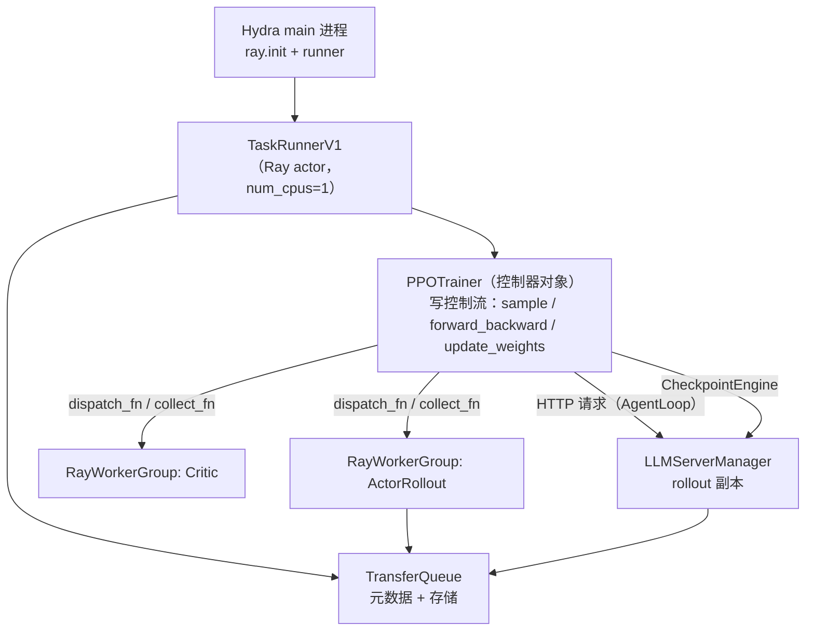
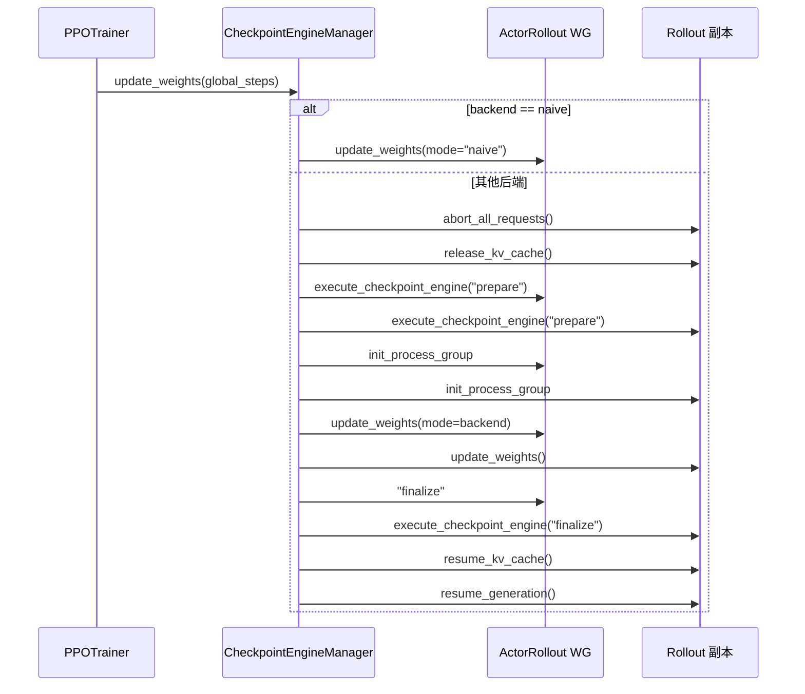

> **系列导航** ｜ 上游全景：[RL 训练框架全景横评（2026）](/2026/09/29/rl-training-frameworks-survey/) §4.1 已给过 veRL 的一段式定位，本篇不重复 ｜ 变量侧：[RL 框架里的那些变量到底怎么算](/2026/09/30/rl-variables-in-frameworks/) ｜ 算法侧：[从 MDP 到 GRPO（五）：GRPO 组相对优势](/2026/08/21/mdp-to-grpo-05-grpo-group-relative/) ｜ 后端机制：`serving-01..08` 与 `megatron-00..16` 已各自讲透推理引擎与并行内核，本篇只讲**它们被放在哪里、谁调用它们**
>
> 本篇是源码级拆解：每一条论断都落到 `verl-project/verl` 的一个 permalink 上。框架的「为什么这样设计」可以争论，但「哪一行做的这件事」不能。

> 源码基准：`verl` **v0.9.1**，commit [`1876b06d`](https://github.com/verl-project/verl/tree/1876b06d0a3e4e71e06230be10af14492ca8a75b)。仓库已于 2026-01 从 `volcengine/verl` 迁到 `verl-project/verl`（[README `News`](https://github.com/verl-project/verl/blob/1876b06d0a3e4e71e06230be10af14492ca8a75b/README.md#L62)），旧组织路径会 301，本文所有 permalink 一律用 `verl-project`。

**TL;DR**

> * **veRL 的心智模型只有一句话**：一个单控制器进程写「图」，图的节点是角色（actor / rollout / critic / ref / reward / teacher），边是数据依赖；每个节点内部是标准 SPMD 训练。控制流在 Python 里，并行策略在引擎里，两者之间只隔一张 `dispatch_mode` 表。
> * **代价不在写图，在读图**。控制流被抽象成经过 Ray 的 `dispatch_fn` / `collect_fn` 对之后，出问题的地方从「哪一行 Python 抛异常」变成「哪个 placement group 里的哪个 rank 没接上消息」。V1 训练器更极端——它连**样本数据本身**都不再经过控制器：控制器只发 key，数据躺在 TransferQueue 里。
> * **V1 训练器的一条主循环，三个 hook 就是全部差异**。`step()` 里只有三件事：`replay_buffer.sample()`、`_step_once()`（一次 `forward_backward`）、`on_step_end()` 里的 `checkpoint_manager.update_weights()`。三条路径 `sync` / `colocate_async` / `separate_async` 各 44 / 50 / 439 行，差异全部落在 `on_sample_end` 与 `on_step_end` 两个钩子。
> * **按 BRIEF §4 的四级定义归位**：`sync` = 同步；`colocate_async` = **部分异步**（partial rollout，权重更新仍是全局屏障）；`separate_async` 的 `hybrid_engine=False` 形态 = **全异步**（训练端与推理端两个独立资源池，用样本队列连接）；`experimental/fully_async_policy` = **off-policy 异步到全异步之间**，它把 `MessageQueue` + staleness 上限做到了源码级，但仍是独立 recipe、与 V1 训练器不共享控制流。
> * **权重同步不是一条路，是十条**。`CheckpointEngineManager.update_weights()` 对 `naive` 后端是一次进程内 `update_weights` 调用，对其他后端走 **abort → 建进程组 → 释放 KV → 传输 → finalize → 恢复 KV → 恢复生成** 八步。`separate_async` 在构造函数里直接 `assert backend != "naive"`——这条断言是整个区分「colocate」与「分离」的分界线。
> * **监控分三层，且第三层才刚刚有**。指标层是 `metric_utils` 的 `compute_data_metrics` / `compute_timing_metrics` / `compute_throughout_metrics`；日志层是 `Tracking` 的 10 个 backend；归因层是 2026-07 发布的独立项目 RL-Insight，通过 `VERL_RL_INSIGHT_ENABLE=1` 才启用，未启用时所有 `trace_state` / `trace_span` 是空实现。
> * **离线策略有两个衡量口径，不是一个**。`trajectory_spans`（一条轨迹跨了几个模型版本）与 `trajectory_staleness`（落后当前策略几个版本）在 `_compute_metrics` 里被分开记录——因为 partial rollout 续用产生的是**轨迹内部**的策略不一致，与「拿旧样本训练」是两回事。
> * **社区问题已经解决的部分有据可查**：控制/数据流耦合（[RFC #5400](https://github.com/verl-project/verl/issues/5400) → TransferQueue 落地）、长尾空转（v0.7 博客给的 20%–40% 量级、V1 文档给的三模式 150 步实测）、权重同步抽象（[roadmap #4880](https://github.com/verl-project/verl/issues/4880) 的 Checkpoint Engine 三条子项全部打勾）。
> * **没解决的部分同样有据**：崩溃后丢失 `trainer.save_freq` 窗口内已生成的轨迹（[RFC #7579](https://github.com/verl-project/verl/issues/7579) 作者自述「no consistent point-in-time recovery」）、启动期静默死锁（[issue #7656](https://github.com/verl-project/verl/issues/7656) 在 ≤8 CPU 核的机器上无输出无超时）、`full_determinism` 与 V1 训练器互斥（官方 `docs/advance/determinism.md` 自己写的要求）。
> * **`verl.experimental` 不是历史包袱，是三个不同性质的目录**：`agent_loop` / `reward_loop` / `teacher_loop` 是已被主流程 import 的稳定依赖（只是还没搬目录）；`fully_async_policy` / `one_step_off_policy` 已被 v0.9.1 release note 明确标记 **deprecated by V1 trainer、下个版本移到 verl-recipe**；`separation` 只被 `separate_async` 借用了一个类。迁移成本三者差一个数量级。

---

## 目录

- [1. 设计出发点：为什么把控制流画成一张 Ray 上的图](#1-设计出发点为什么把控制流画成一张-ray-上的图)
- [2. 模块初始化逻辑：从 `main_ppo` 到「所有 worker 就绪」](#2-模块初始化逻辑从-main_ppo-到所有-worker-就绪)
- [3. 进程与角色：谁是控制面，谁是数据面](#3-进程与角色谁是控制面谁是数据面)
- [4. 数据与样本流：一条样本的完整生命周期](#4-数据与样本流一条样本的完整生命周期)
- [5. 权重同步：Checkpoint Engine 的八步与十条后端](#5-权重同步checkpoint-engine-的八步与十条后端)
- [6. 训推一致三层](#6-训推一致三层)
- [7. 异步形态：V1 训练器三条路径归位](#7-异步形态v1-训练器三条路径归位)
- [8. 监控系统：指标层、日志层、归因层](#8-监控系统指标层日志层归因层)
- [9. 性能 benchmark 与不可比声明](#9-性能-benchmark-与不可比声明)
- [10. 小结：它解决到什么程度、还剩什么](#10-小结它解决到什么程度还剩什么)

---

## 1. 设计出发点：为什么把控制流画成一张 Ray 上的图

### 1.1 官方给出的三条设计目标

README 把 veRL 的定位写成四个「flexible」加两个「fast」的条目，其中三条是设计目标的原文表述（[`README.md` L28-L40](https://github.com/verl-project/verl/blob/1876b06d0a3e4e71e06230be10af14492ca8a75b/README.md#L28-L40)）：

| 原文（节选） | 落到源码里是什么 |
| --- | --- |
| 「The hybrid-controller programming model enables flexible representation and efficient execution of complex post-training dataflows」 | `single_controller` 的 `dispatch_mode` 表：控制器写一次调用，各 rank 各拿一份数据 |
| 「Decouples computation and data dependencies, enabling seamless integration with existing LLM frameworks」 | `workers/engine/` 的 `BaseEngine` 抽象 + `workers/rollout/replica.py` 的 `RolloutReplica` 抽象 |
| 「Supports various placement of models onto different sets of GPUs」 | `ResourcePoolManager` 的 `resource_pool_spec` 字典 + `role → pool` 的 `mapping` |

第三项是这篇文章的主线。**placement 是一等公民**这件事不是修辞：在 `_init_resource_pool_mgr` 里，整个资源布局被表达成一个 `dict[str, list[int]]`——键是池名，值是「每节点几张卡」（[`trainer_base.py` L830-L834](https://github.com/verl-project/verl/blob/1876b06d0a3e4e71e06230be10af14492ca8a75b/verl/trainer/ppo/v1/trainer_base.py#L830-L834)）：

```python
global_pool_id = "global_pool"
resource_pool_spec = {
    global_pool_id: [config.trainer.n_gpus_per_node] * config.trainer.nnodes,
}
```

加一个独立的 reward 池就是往这个 dict 里再塞一个键（[L836-L846](https://github.com/verl-project/verl/blob/1876b06d0a3e4e71e06230be10af14492ca8a75b/verl/trainer/ppo/v1/trainer_base.py#L836-L846)），加一个 teacher 池同理（[L848-L860](https://github.com/verl-project/verl/blob/1876b06d0a3e4e71e06230be10af14492ca8a75b/verl/trainer/ppo/v1/trainer_base.py#L848-L860)）。角色到池的映射是另一个 dict：

```python
self.mapping[Role.RewardModel] = "reward_pool"     # 或 "global_pool"
self.mapping[Role.TeacherModel] = "teacher_pool"
```

**「换布局」在这套代码里就是改两行 dict。** 这是 HybridFlow 论文那套「一张图 + placement」在工程上的落地形态。

### 1.2 图是怎么变成 Ray 调用的

`WorkerGroup` 的构造过程就是把「图」翻译成「Ray 远程调用」的过程。`_bind_worker_method` 遍历 worker 类的全部方法，凡是被 `@register` 装饰过的，就读出装饰器写进函数对象的 `MAGIC_ATTR`，据此把方法绑成一个会做 `dispatch` / `execute` / `collect` 的闭包（[`worker_group.py` L193-L250](https://github.com/verl-project/verl/blob/1876b06d0a3e4e71e06230be10af14492ca8a75b/verl/single_controller/base/worker_group.py#L193-L250)）：

```python
if hasattr(method, MAGIC_ATTR):
    attribute = getattr(method, MAGIC_ATTR)
    dispatch_mode = attribute["dispatch_mode"]
    execute_mode = attribute["execute_mode"]
    blocking = attribute["blocking"]
```

装饰器本身只往函数上挂三个字段（[`decorator.py` L440-L442](https://github.com/verl-project/verl/blob/1876b06d0a3e4e71e06230be10af14492ca8a75b/verl/single_controller/base/decorator.py#L440-L442)）：

```python
attrs = {"dispatch_mode": dispatch_mode, "execute_mode": execute_mode, "blocking": blocking}
setattr(wrapper, MAGIC_ATTR, attrs)
```

于是「怎么切数据」被声明在 worker 方法上而不是调用点。`DISPATCH_MODE_FN_REGISTRY` 是这张表的具体内容（[`decorator.py` L309-L333](https://github.com/verl-project/verl/blob/1876b06d0a3e4e71e06230be10af14492ca8a75b/verl/single_controller/base/decorator.py#L309-L333)），共七个内置模式：

| dispatch mode | dispatch_fn | collect_fn | 语义 |
| --- | --- | --- | --- |
| `ONE_TO_ALL` | `dispatch_one_to_all` | `collect_all_to_all` | 参数原样广播到每 rank，收齐所有输出 |
| `ALL_TO_ALL` | `dispatch_all_to_all` | `collect_all_to_all` | 参数已按 rank 分好，一 rank 一份 |
| `DP_COMPUTE` | `dispatch_dp_compute` | `collect_dp_compute` | 按 DP 维度切，收集时聚合指标 |
| `DP_COMPUTE_PROTO` | `dispatch_dp_compute_data_proto` | `collect_dp_compute_data_proto` | 按 DP 切 `DataProto`，收集时拼回 |
| `DP_COMPUTE_PROTO_WITH_FUNC` | 同上 + 附带函数 | `collect_dp_compute_data_proto` | 切数据的同时传 loss fn |
| `DP_COMPUTE_METRIC` | `dispatch_dp_compute_data_proto` | `collect_dp_compute` | 只回传指标，不回传张量 |
| `DIRECT_ROLLOUT_METHOD` | `dummy_direct_rollout_call` | 同左 | 直通，给 vLLM 的 ExternalRayDistributedExecutor 用 |

这七个名字是 BRIEF 里「一张图」的**词法**。写不到这张表里的数据流，就只能塞进一个适配器——这正是后面 §7 会看到的代价。

### 1.3 代价：调试对象换了

代价有两层，都有源码层面的证据。

**第一层：一个方法调用不再是「一次函数调用」。** 执行顺序是 `dispatch_fn(args) → ray.get([w.method.remote(chunk) for w ...]) → collect_fn(outputs)`。任何一侧抛异常，你在控制器栈上看到的只有 `ray.get` 的远端错误，与原始调用点隔了一层。

**第二层也是 V1 训练器引入的那层：数据本身不再经过控制器。** 控制器只写 key 和 tag，真正的 tensor 由 TransferQueue 的点对点通路送到 worker。`_submit_batch_to_rollout` 里两行 `kv_batch_put` 的区别就是这层设计的分水岭（[`trainer_base.py` L1511-L1527](https://github.com/verl-project/verl/blob/1876b06d0a3e4e71e06230be10af14492ca8a75b/verl/trainer/ppo/v1/trainer_base.py#L1511-L1527)）：

```python
tags = [{"is_prompt": True, "status": "pending", "global_steps": self.global_steps} for _ in range(len(batch))]
if self.trainer_mode != "sync":
    tq.kv_batch_put(keys=list(batch["uid"]), partition_id="train", tags=tags,
                    fields=batch.select(*[key for key in batch.keys() if not isinstance(batch.get(key), NonTensorData)]))
else:
    tq.kv_batch_put(keys=list(batch["uid"]), partition_id="train", tags=tags)
```

异步路径把 prompt 的 tensor **持久化进 TransferQueue**，注释写的理由是「Persist prompt data for async checkpoint recovery」。同步路径只写 tag。

§9 会给出这条设计的直接后果：挂起时你无法从控制器的内存快照里读出「在途样本长什么样」。

---

## 2. 模块初始化逻辑：从 `main_ppo` 到「所有 worker 就绪」

### 2.1 入口：一个 Hydra main + 一个 Ray actor

`main_ppo.py` 的 `main()` 校验配置后按 `trainer.use_v1` 分派到 `TaskRunnerV1` 或已废弃的 V0 `TaskRunner`（[`main_ppo.py` L183-L191](https://github.com/verl-project/verl/blob/1876b06d0a3e4e71e06230be10af14492ca8a75b/verl/trainer/main_ppo.py#L183-L191)）。`TaskRunnerV1.run()` 的过程是固定的五步（[L138-L166](https://github.com/verl-project/verl/blob/1876b06d0a3e4e71e06230be10af14492ca8a75b/verl/trainer/main_ppo.py#L138-L166)）：

```python
trainer_cls = get_trainer_cls(config.trainer.v1.trainer_mode)
config.transfer_queue.enable = True
tq.init(config.transfer_queue)
self.trainer = trainer_cls(config=config)
self.trainer.init()
self.init_agent_loop_manager()
self.trainer.fit(self.agent_loop_manager)
```

有三点值得单独指出：

1. **`config.transfer_queue.enable = True` 是无条件写的**（[L143](https://github.com/verl-project/verl/blob/1876b06d0a3e4e71e06230be10af14492ca8a75b/verl/trainer/main_ppo.py#L143)）。配置文件里 `transfer_queue.enable` 的默认值是 `False`（[`transfer_queue.yaml` L1-L2](https://github.com/verl-project/verl/blob/1876b06d0a3e4e71e06230be10af14492ca8a75b/verl/trainer/config/transfer_queue/transfer_queue.yaml#L1-L2)），V1 训练器会覆盖它。**V1 无法脱离 TransferQueue 运行。**
2. `tq.init()` 在 trainer 构造之前，`tq.close()` 在 `finally` 里。TransferQueue 的生命周期比 trainer 长。
3. trainer 类由注册表查出来，`get_trainer_cls` 找不到就抛 `ValueError` 并列出可用名字（[`trainer_base.py` L2032-L2038](https://github.com/verl-project/verl/blob/1876b06d0a3e4e71e06230be10af14492ca8a75b/verl/trainer/ppo/v1/trainer_base.py#L2032-L2038)）。注册表由 `register_trainer` 类装饰器维护，重名会直接 `raise`（[L2014-L2029](https://github.com/verl-project/verl/blob/1876b06d0a3e4e71e06230be10af14492ca8a75b/verl/trainer/ppo/v1/trainer_base.py#L2014-L2029)）。

### 2.2 `init()`：十个步骤，一台状态机

`PPOTrainer.init()` 的 docstring 把组件清单列成五条（[L228-L239](https://github.com/verl-project/verl/blob/1876b06d0a3e4e71e06230be10af14492ca8a75b/verl/trainer/ppo/v1/trainer_base.py#L228-L239)），真正执行的 `_setup()` 是十步（[L240-L408](https://github.com/verl-project/verl/blob/1876b06d0a3e4e71e06230be10af14492ca8a75b/verl/trainer/ppo/v1/trainer_base.py#L240-L408)）：

| 步 | 做什么 | 关键产物 |
| --- | --- | --- |
| 1 | `_init_tokenizer` / `_init_dataloader` / `_init_dump_executor` | tokenizer、`StatefulDataLoader`、后台 dump 线程池 |
| 2 | `_init_resource_pool_mgr` + `create_resource_pool` | `resource_pool_spec`、`role → pool` 映射 |
| 3 | 组装 `RayClassWithInitArgs`（actor / critic / ref） | 每角色一份「待实例化」的类 + 构造参数 |
| 4 | `create_colocated_worker_cls` + `RayWorkerGroup` | 每个池一个 WorkerGroup |
| 5 | `spawn_wg` 展开成 `all_wg` 字典 | `{"ActorRollout": wg, "Critic": wg, ...}` |
| 6 | critic `reset()` + `set_loss_fn` | critic 引擎与 loss |
| 7 | actor/ref `init_model()` | 权重就位 |
| 8 | `RewardLoopManager` / `MultiTeacherModelManager` | reward 与 teacher 的 worker 句柄 |
| 9 | `LLMServerManager.create(...)` | rollout server 副本 |
| 10 | `CheckpointEngineManager(...)` | 权重同步通道 |

随后两句是状态机的关键（[L400-L406](https://github.com/verl-project/verl/blob/1876b06d0a3e4e71e06230be10af14492ca8a75b/verl/trainer/ppo/v1/trainer_base.py#L400-L406)）：

```python
# sleep all replicas to load checkpoint
self.checkpoint_manager.sleep_replicas()
self._load_checkpoint()
```

**训练开始时 rollout 副本是睡着（sleep）的。** 权重由调用方负责推过去——`sync` 与 `colocate_async` 在 `on_init_end` 里推一次；`separate_async` 推两次（hybrid 池与 standalone 池各一次）。这条约定是整个 sync/async 分岔的起点。

第 10 步里还有一行容易被忽略的赋值（[L396](https://github.com/verl-project/verl/blob/1876b06d0a3e4e71e06230be10af14492ca8a75b/verl/trainer/ppo/v1/trainer_base.py#L396)）：

```python
checkpoint_engine_config.backend = "naive"
```

基类**强制把后端改成 `naive`**（进程内 CUDA IPC），不看用户配置。`separate_async` 因此必须在构造函数里提前断言用户给的不是 `naive`（它自己另建两个 manager，不经过基类的这条赋值）。这条时序是理解「为什么 `separate_async.__init__` 里会有那条 assert」的关键。

### 2.3 「所有 worker 就绪」的判据

`WorkerGroup` 有一个后台存活检查线程，启动前先阻塞等所有 worker 起来（[`worker_group.py` L159-L177](https://github.com/verl-project/verl/blob/1876b06d0a3e4e71e06230be10af14492ca8a75b/verl/single_controller/base/worker_group.py#L159-L177)）：

```python
def _block_until_all_workers_alive(self) -> None:
    while True:
        all_state = [self._is_worker_alive(worker) for worker in self._workers]
        if False in all_state:
            time.sleep(1)
        else:
            break
```

这是**无超时的轮询**。`ResourcePoolManager` 另有一道前置检查：所需 GPU 总数超过 Ray 报告的可用量就直接抛错（[`ray/base.py` L228-L244](https://github.com/verl-project/verl/blob/1876b06d0a3e4e71e06230be10af14492ca8a75b/verl/single_controller/ray/base.py#L228-L244)）。但资源够、worker 却卡在启动时，这两处都不会报错——这正是 §10 提到 issue #7656 的现场。

---

## 3. 进程与角色：谁是控制面，谁是数据面

### 3.1 三层结构



| 层 | 谁 | 职责 | 有没有张量 |
| --- | --- | --- | --- |
| 控制面 | `PPOTrainer` 实例（在 TaskRunnerV1 里） | 决定下一步做什么：采样多少、训练几次、何时同步权重 | **只有 key 与 tag** |
| 数据面（训练） | `RayWorkerGroup` 下的 SPMD worker | 真正跑 `forward_backward`、算 logprob、更新参数 | 全量张量 |
| 数据面（生成） | `RolloutReplica` 起的 server 进程 | continuous batching 生成 | 全量张量 + KV |
| 中转 | `TransferQueue` | 按 key 存取 tensor，tag 记录状态 | 全量张量（在它自己的存储里） |

`TaskRunnerV1` 自己的资源声明是 `@ray.remote(num_cpus=1)`（[`main_ppo.py` L102](https://github.com/verl-project/verl/blob/1876b06d0a3e4e71e06230be10af14492ca8a75b/verl/trainer/main_ppo.py#L102)）。控制器只占一个 CPU。

### 3.2 rank 与 world size 怎么落地

三个不同含义的「size」在源码里各有出处，混淆它们是最常见的读码错误：

| 名字 | 出处在哪 | 含义 |
| --- | --- | --- |
| `ResourcePool.world_size` | `sum(self._store)`（[`worker_group.py` L57-L59](https://github.com/verl-project/verl/blob/1876b06d0a3e4e71e06230be10af14492ca8a75b/verl/single_controller/base/worker_group.py#L57-L59)） | 一个池里的进程总数 = 该池的 GPU 数 |
| `WorkerGroup.world_size` | `len(self._workers)`（[L179-L181](https://github.com/verl-project/verl/blob/1876b06d0a3e4e71e06230be10af14492ca8a75b/verl/single_controller/base/worker_group.py#L179-L181)） | 一个角色组的 worker 数 |
| `RolloutReplica.world_size` | `tp × dp × pp`（[`replica.py` L108-L112](https://github.com/verl-project/verl/blob/1876b06d0a3e4e71e06230be10af14492ca8a75b/verl/workers/rollout/replica.py#L108-L112)） | 一个推理副本的引擎并行度 |

`RolloutReplica` 的构造还会据此反推节点数（[L113-L118](https://github.com/verl-project/verl/blob/1876b06d0a3e4e71e06230be10af14492ca8a75b/verl/workers/rollout/replica.py#L113-L118)）：

```python
self.gpus_per_replica_node = min(gpus_per_node, self.world_size)
assert self.world_size % self.gpus_per_replica_node == 0
self.nnodes = self.world_size // self.gpus_per_replica_node
```

**一条副本可以跨节点。** 这与训练侧的 rank 布局完全解耦——训练侧的 DP 组按 `dp_rank_mapping` 算（见 §4.4 的 `_balance_batch`），推理侧只认副本。

### 3.3 谁持有权重

只有两侧持有全量权重：训练侧的 model engine（分片持有，各 rank 拿自己那片），和推理侧的 server 进程（分片持有，按 TP/DP 切）。控制器不持有。`CheckpointEngine` 的文档图把这一点画得很清楚——训练侧是 `ME0..MEn` 与 `CE0..CEn` 同进程，推理侧是 `CE` 与 server 分进程、靠 CUDA IPC 交接（[`checkpoint_engine/base.py` L386-L403](https://github.com/verl-project/verl/blob/1876b06d0a3e4e71e06230be10af14492ca8a75b/verl/checkpoint_engine/base.py#L386-L403)）。

**权重从来没经过控制器。** 这一条决定了后面 §5 的八步流程，也决定了 §9 里「权重同步时间」这个指标到底在测什么。

---

## 4. 数据与样本流：一条样本的完整生命周期

### 4.1 从 dataloader 到 TransferQueue

一条训练样本的一生有七个可标记的节点。全部由 tag 表达，tag 的形状写在 `ReplayBuffer` 的类 docstring 里（[`replay_buffer.py` L64-L108](https://github.com/verl-project/verl/blob/1876b06d0a3e4e71e06230be10af14492ca8a75b/verl/trainer/ppo/v1/replay_buffer.py#L64-L108)）：

```
pending  →  sampled from dataset but its sessions are not yet started
running  →  all sessions of the prompt are running
finished →  all sessions finished without error
failure  →  finished, but at least one session failed
```

key 的格式是 `{uid}_{session_id}_{index}`（同段 docstring）：`uid` 是 prompt 级唯一 id，`session_id ∈ [0, n)` 对应 GRPO 的 n 次采样，`index` 是一个会话内的第几条轨迹（agent loop 允许一个会话产出多条轨迹）。

`_submit_batch_to_rollout` 写 tag 后立刻 `agent_loop_manager.generate_sequences(batch)`（[`trainer_base.py` L1511-L1527](https://github.com/verl-project/verl/blob/1876b06d0a3e4e71e06230be10af14492ca8a75b/verl/trainer/ppo/v1/trainer_base.py#L1511-L1527)）。而 `AgentLoopManagerTQ.generate_sequences` 的 docstring 写着「without blocking」——它把 chunk 分发给 `AgentLoopWorkerTQ` 就返回，worker 完成后自己往 TransferQueue 里写（[`agent_loop_tq.py` L54-L62](https://github.com/verl-project/verl/blob/1876b06d0a3e4e71e06230be10af14492ca8a75b/verl/trainer/ppo/v1/agent_loop_tq.py#L54-L62)、[L243-L257](https://github.com/verl-project/verl/blob/1876b06d0a3e4e71e06230be10af14492ca8a75b/verl/trainer/ppo/v1/agent_loop_tq.py#L243-L257)）。

**这是 V1 与 V0 最大的结构性差别**：提交与收取被彻底解耦。控制器发完就往下走，什么时候有样本可训练由 ReplayBuffer 轮询决定。

### 4.2 两个 ReplayBuffer 子类

`_build_replay_buffer` 按 `trainer_mode` 选类（[`trainer_base.py` L153-L200](https://github.com/verl-project/verl/blob/1876b06d0a3e4e71e06230be10af14492ca8a75b/verl/trainer/ppo/v1/trainer_base.py#L153-L200)）：

```python
sampler_cls = ReplayBuffer if self.trainer_mode == "sync" else ReplayBufferAsync
```

| | `ReplayBuffer`（sync） | `ReplayBufferAsync`（异步路径） |
| --- | --- | --- |
| 抽样前提 | 攒够 `batch_size` 个 terminal 组就取 | 先做淘汰/补充，再判够不够 |
| 是否淘汰陈旧样本 | 否（docstring 明写 `drop` 在此为 NO-OP） | 是，按 `max_off_policy_threshold` |
| 选批顺序 | 按 `prompt_global_steps` 升序取前 k 个（[L383-L392](https://github.com/verl-project/verl/blob/1876b06d0a3e4e71e06230be10af14492ca8a75b/verl/trainer/ppo/v1/replay_buffer.py#L383-L392)） | 同样升序，但先过淘汰 |
| 没有样本时 | `time.sleep(poll_interval)` 后重来（[L408-L420](https://github.com/verl-project/verl/blob/1876b06d0a3e4e71e06230be10af14492ca8a75b/verl/trainer/ppo/v1/replay_buffer.py#L408-L420)） | 同左 |

「按 `prompt_global_steps` 升序」是一条**隐式策略**：先进先出，老样本优先被训练。这保证了 staleness 的上界不是随机的，但也意味着**没有任何采样随机性**——没有 shuffle、没有 seed。异步模式下样本的到达时间抖动会直接改变训练批的组成。

`ReplayBuffer` 的 docstring 里有一张 terminal-group 淘汰/补充矩阵（[L84-L100](https://github.com/verl-project/verl/blob/1876b06d0a3e4e71e06230be10af14492ca8a75b/verl/trainer/ppo/v1/replay_buffer.py#L84-L100)），这是理解同步/异步语义差的最短路径：

| trainer mode | `drop`（陈旧） | DAPO（组内奖励全同） | `failure` |
| --- | --- | --- | --- |
| sync | NO-OP | 淘汰 k，补 2k | NO-OP 或 opt-in 补 k |
| async | 淘汰 k，补 k | 淘汰 k，补 k | 淘汰 k，补 k |

异步模式下三条路径统一成「淘汰 k 补 k」，补偿成本靠 `num_warmup_batches` 预热窗口吸收（同段 docstring 原文：`num_warmup_batches` absorbs retry cost）。

### 4.3 从 TransferQueue 到 worker

控制器拿到 `KVBatchMeta`（一张 key + tag 的清单），然后每一步只写两样东西：`keys` 与 `extra_info`。以 `_update_actor` 为例（[`trainer_base.py` L1842-L1881](https://github.com/verl-project/verl/blob/1876b06d0a3e4e71e06230be10af14492ca8a75b/verl/trainer/ppo/v1/trainer_base.py#L1842-L1881)）：

```python
extra_info = {
    "calculate_entropy": calculate_entropy,
    "global_batch_size": ppo_mini_batch_size,
    "mini_batch_size": ppo_mini_batch_size,
    "epochs": self.config.actor_rollout_ref.actor.ppo_epochs,
    "seed": self.config.actor_rollout_ref.actor.data_loader_seed,
    "dataloader_kwargs": {"shuffle": self.config.actor_rollout_ref.actor.shuffle},
    "temperature": self.config.actor_rollout_ref.rollout.temperature,
}
batch.extra_info.update(extra_info)
output: TensorDict = self.actor_rollout_wg.update_actor(batch)
```

**`update_actor(batch)` 里的 `batch` 是元数据，不是张量。** worker 侧据 key 自己去 TransferQueue 读。这一步是 §1.3 说的「调试对象变了」最具体的地方：`update_actor` 的参数在调试器里只有几百字节。

### 4.4 切分与聚合

进 worker 之前要先按 DP 维度切匀。`_balance_batch` 做三件事（[L1623-L1647](https://github.com/verl-project/verl/blob/1876b06d0a3e4e71e06230be10af14492ca8a75b/verl/trainer/ppo/v1/trainer_base.py#L1623-L1647)）：

1. 从 worker group 的 `_dispatch_info` 查出 DP 大小；
2. 用 `_get_required_batch_multiple(dp_size)` 算出批大小必须是 `lcm(dp_size, critic_mini_batch×n, actor_mini_batch×n)` 的倍数（[L1604-L1621](https://github.com/verl-project/verl/blob/1876b06d0a3e4e71e06230be10af14492ca8a75b/verl/trainer/ppo/v1/trainer_base.py#L1604-L1621)），不够就 padding 补齐；
3. 按 token 总长做 `get_seqlen_balanced_partitions(..., k_partitions=dp_size, equal_size=True)`，再 `batch.reorder(...)`。

```python
batch_multiple = self._get_required_batch_multiple(dp_size)
batch = upsample_batch_to_divisible_size(batch, batch_multiple, self.tokenizer.eos_token_id)
```

注意第 3 步的 `equal_size=True`：切出来每份**样本数相等**，但 token 数只是尽量均衡。这两条约束与 `batch_multiple` 三者共同决定了有效批大小通常大于 `train_batch_size`——padding 样本会进 `_compute_metrics`，但在那里被 `is_padding` 标记过滤掉（[L1885-L1887](https://github.com/verl-project/verl/blob/1876b06d0a3e4e71e06230be10af14492ca8a75b/verl/trainer/ppo/v1/trainer_base.py#L1885-L1887)）。

聚合方向相反：worker 返回 `TensorDict` 形式的指标字典，控制器用 `rename_dict` 加前缀、`reduce_metrics` 跨 rank 归约（[L1866-L1875](https://github.com/verl-project/verl/blob/1876b06d0a3e4e71e06230be10af14492ca8a75b/verl/trainer/ppo/v1/trainer_base.py#L1866-L1875)）。

---

## 5. 权重同步：Checkpoint Engine 的八步与十条后端

### 5.1 抽象：三个 API

`verl/checkpoint_engine/README.md` 把接口写成三个函数：

- `send_weights`：从训练侧取 named tensor，流式发出去；
- `receive_weights`：流式产出一个 named tensor 生成器；
- `get_weights`：从本地缓存（共享内存 / 磁盘）取，给独立更新的推理实例用。

对应的抽象基类在 [`base.py` L116-L227](https://github.com/verl-project/verl/blob/1876b06d0a3e4e71e06230be10af14492ca8a75b/verl/checkpoint_engine/base.py#L116-L227)，注册表是 `CheckpointEngineRegistry`（[L49-L114](https://github.com/verl-project/verl/blob/1876b06d0a3e4e71e06230be10af14492ca8a75b/verl/checkpoint_engine/base.py#L49-L114)），后端按需导入、导入失败时记录错误而不是静默跳过（[`__init__.py` L34-L84](https://github.com/verl-project/verl/blob/1876b06d0a3e4e71e06230be10af14492ca8a75b/verl/checkpoint_engine/__init__.py#L34-L84)）。

### 5.2 十条后端与它们的拓扑

README 的表格给了每个后端的通信库、拓扑、硬件、性能、弹性等级与适用场景：

| 后端 | 通信库 | 拓扑 | 弹性 | README 声明的适用场景 |
| --- | --- | --- | --- | --- |
| `naive` | `torch.distributed` | all_gather | — | on-policy，actor/rollout colocate |
| `nccl` | NCCL | all_gather + broadcast | 低（重建组） | off-policy，分离，固定集群 |
| `hccl` | HCCL | all_gather + broadcast | 低（重建组） | 昇腾 NPU 上的分离 |
| `nixl` | NIXL | all_gather + ring p2p | **高**（动态调整环形拓扑） | 分离 + 弹性 rollout + 容错 + 异构硬件 |
| `mooncake` | Mooncake Transfer Engine | all_gather + ring p2p | 高 | 分离，固定集群 |
| `kimi_ckpt_engine` | Mooncake + NCCL/HCCL | p2p + broadcast | 低 | 分离 + 每次都存 checkpoint |
| `delta_sharded` | （差分分片，见下） | — | — | 只传变化的分片 |

`delta_sharded` 的定位与上面六个不同：它不换传输层，改的是**传多少**。v0.9.1 release note 记了它的两处扩展——`delta_sharded` 增加 vLLM 消费端（#7227），以及覆盖 TorchTitan 引擎的 FSDP / FSDP+TP / FSDP+EP / HSDP 组合（#7324，**A800、GSM8K GRPO、TorchTitan → SGLang 分离部署下，Qwen3-8B / 32 卡上权重同步 3.34 s vs 34.26 s，10.3×；16 卡上 3.7×**）`[官方]`。这组数字的不可比原因见 §9。

### 5.3 `naive` 与其他：一条 if 分开两种物理世界

`CheckpointEngineManager.update_weights` 的第一段就是分水岭（[`base.py` L497-L607](https://github.com/verl-project/verl/blob/1876b06d0a3e4e71e06230be10af14492ca8a75b/verl/checkpoint_engine/base.py#L497-L607)）：

```python
# 0. update weights for sync training with colocated actor and rollout
if self.backend == "naive":
    ray.get(self.actor_wg.update_weights(global_steps=global_steps, mode=self.backend))
    return {}
```

**一行。** `naive` 把整件事压成一个 worker 方法调用——因为此时 rollout 与 actor 在同一个进程里，权重从 buffer 直接拷。这就是 colocate 的本质：同步成本几乎为零。

非 `naive` 的路径是八步：

| 步 | 动作 | 源码注释原文 |
| --- | --- | --- |
| 1 | `abort_replicas()` | abort and save all unfinished requests for partial rollout |
| 2 | 从所有副本的 worker 拼一个临时 `RayWorkerGroup` | create a temporay worker group for all replicas |
| 3 | `release_kv_cache_replicas()` | release kv_cache before weight sync (weights stay in place) |
| 4 | `build_process_group(rollout)` | build process group |
| 5 | `actor_wg.update_weights(...)` + `rollout.update_weights(...)` | update weights of all workers |
| 6 | 两侧 `execute_checkpoint_engine(["finalize"])` | finalize all workers |
| 7 | `resume_kv_cache_replicas()` | restore kv_cache after weight sync |
| 8 | `resume_generation_replicas()` | resume all unfinished requests for partial rollout |

第 3 步与第 7 步是性能关键。注释特意说明 `release_kv_cache` 与 `sleep_replicas` 的区别：**只释放 KV，不动权重**，这样 NCCL 可以直接往现有权重 buffer 里写，省掉一次 offload/reload。

第 1 步和第 8 步之间就是 **partial rollout 的窗口**：被 abort 的请求保住了已生成的 token，权重换完再续。`docs/advance/v1_async_trainer.md` 把它写成四步——保留 token 与 logprob、经负载均衡器重试、用更新版本的权重续生成、为保留前缀重建 KV cache。**一条轨迹因此可以横跨多个模型版本**，这是 §6 样本层与 §7 异步归位的交会点。

`build_process_group` 内部是实现无关的两段（[L422-L445](https://github.com/verl-project/verl/blob/1876b06d0a3e4e71e06230be10af14492ca8a75b/verl/checkpoint_engine/base.py#L422-L445)）：先让所有 worker `prepare` 并收集 metadata，再交给后端的 `build_topology` 算出各 rank 的建组参数，最后各 rank `init_process_group`。**换后端只换 `build_topology` 与传输实现，调度逻辑不变。**

### 5.4 谁调用谁



三条路径调它的时机不同：

| 路径 | 何时调 `update_weights` | 同步到哪 |
| --- | --- | --- |
| `sync` | `on_init_end` 一次 + 每步 `on_step_end` 一次（[`trainer_sync.py` L25-L44](https://github.com/verl-project/verl/blob/1876b06d0a3e4e71e06230be10af14492ca8a75b/verl/trainer/ppo/v1/trainer_sync.py#L25-L44)） | 一个池（hybrid） |
| `colocate_async` | 同上 + 额外 `resume_generation_replicas()`（[`trainer_colocate_async.py` L29-L50](https://github.com/verl-project/verl/blob/1876b06d0a3e4e71e06230be10af14492ca8a75b/verl/trainer/ppo/v1/trainer_colocate_async.py#L29-L50)） | 一个池（hybrid） |
| `separate_async` | 每步 `on_step_end` 只推 standalone；hybrid 池由 `switch_to_rollout()` 推（[`trainer_separate_async.py` L378-L430](https://github.com/verl-project/verl/blob/1876b06d0a3e4e71e06230be10af14492ca8a75b/verl/trainer/ppo/v1/trainer_separate_async.py#L378-L430)） | 两个池，各自一个 manager |

---

## 6. 训推一致三层

### 6.1 数值层：同一份权重的 logprob 偏移

veRL 对数值层有两条互补的手段，都在 API 层而不在 kernel 层。

**第一条：同一引擎重算 logprob。** `_compute_old_log_prob` 先看 `algorithm.rollout_correction.bypass_mode`（[`trainer_base.py` L1649-L1656](https://github.com/verl-project/verl/blob/1876b06d0a3e4e71e06230be10af14492ca8a75b/verl/trainer/ppo/v1/trainer_base.py#L1649-L1656)）：

```python
bypass_recomputing_logprobs = rollout_corr_config and rollout_corr_config.get("bypass_mode", False)
if bypass_recomputing_logprobs:  # Use `rollout_log_probs`
    ...
    data["old_log_probs"] = data.pop("rollout_log_probs")
```

bypass 模式下 `π_old` 直接取 rollout 引擎自己算的 logprob——**两个策略**（`π_rollout`、`π_θ`）。非 bypass 模式下重算——**三个策略**（`π_rollout`、`π_old`、`π_θ`）。源码注释把这两个模式写了清楚：

```
# - Bypass mode: Sets old_log_probs = rollout_log_probs (2 policies: π_rollout, π_θ)
# - Decoupled mode: Recomputes old_log_probs as proximal anchor (3 policies: π_rollout, π_old, π_θ)
```

**第二条：把两侧的差量化出来。** 打开 `rollout.calculate_log_probs` 后，`_compute_old_log_prob` 会保留 `rollout_log_probs`，并调用 `calculate_debug_metrics(data)` 产出 rollout 与 actor 的 logprob 差（[L1700-L1708](https://github.com/verl-project/verl/blob/1876b06d0a3e4e71e06230be10af14492ca8a75b/verl/trainer/ppo/v1/trainer_base.py#L1700-L1708)）。这是数值层的**直接测度**，不是间接推断。

**偏差的方向与来源**（KV cache dtype、attention kernel、rope 实现、采样温度与 top-p 的应用顺序）属于推理引擎侧，`serving-01..08` 已展开，这里不重复。veRL 层面的动作是：**把 `temperature` 显式塞进 `extra_info`** 再下发（[L1662-L1668](https://github.com/verl-project/verl/blob/1876b06d0a3e4e71e06230be10af14492ca8a75b/verl/trainer/ppo/v1/trainer_base.py#L1662-L1668)），保证两侧用同一个温度算 logprob。

### 6.2 权重层：refit 是否真的完成

权重层的判据在 veRL 里是结构性的，因为 refit 有明确的完成点：`update_weights` 返回即代表第 5 步的两个 `ray.get` 都返回了（[`base.py` L537-L548](https://github.com/verl-project/verl/blob/1876b06d0a3e4e71e06230be10af14492ca8a75b/verl/checkpoint_engine/base.py#L537-L548)）。**没有「后台异步 refit、训练继续跑」这条路径**——传输完成后才 `finalize`，才恢复生成。

但「完成」不等于「数值等价」。下面三种情况会打破等价：

1. **并行形状重排**。训练侧按 FSDP/Megatron 的 shard 持有，推理侧按 TP/DP 持有，一次 refit 是一次 reshape。`delta_sharded` 就是为了减少这次搬运的量（§5.2）。
2. **差分累积**。`delta_sharded` 只传变化的分片，误差是累积的；v0.9.1 为它加了 vLLM 消费端，说明此前只有一个消费端（SGLang），格式的语义在 vLLM 侧要靠 `model.load_weights()` 兜（release note #7227 原文：`leaving model.load_weights() responsible for name mapping, packed layouts, TP slicing and EP placement`）。
3. **通信组的生命周期**。`nccl` / `hccl` / `kimi_ckpt_engine` 的弹性等级是「低：重建组」（README 表格原文 `Low: rebuild nccl group`），意味着副本变化后必须重建通信组，重建失败就是一个「没同步完但没报错」的窗口。

**veRL 没有在框架层做「refit 后校验」。** 它把这个判断交给指标层：打开 `rollout.calculate_log_probs` 后逐步看 logprob 差（§6.1）。

### 6.3 样本层：staleness 的两个口径

样本层的核心问题是「rollout 用的策略版本与训练用的版本是否同一个」。veRL 的答案由 `min_global_steps` / `max_global_steps` 两个 tag 承载，并在 `_compute_metrics` 里被换算成 9 个指标（[`trainer_base.py` L1970-L1996](https://github.com/verl-project/verl/blob/1876b06d0a3e4e71e06230be10af14492ca8a75b/verl/trainer/ppo/v1/trainer_base.py#L1970-L1996)）：

```python
trajectory_spans = max_global_steps - min_global_steps + 1
trajectory_staleness = (global_steps - 1) - max_global_steps
trajectory_staleness_worst = (global_steps - 1) - min_global_steps
```

源码注释给了两个口径的定义，值得逐字读：

- **`trajectory_spans`**：一条轨迹**跨了几个不同模型版本**（1 = 全程单版本）。它衡量的是 partial rollout / 续用造成的**轨迹内部**策略不一致。
- **`trajectory_staleness`**：轨迹落后当前策略几个版本。因为一条轨迹跨 `[min, max]`，所以落后是一个**区间**：用最新权重给下界（`global_steps - 1 - max`），用最旧权重给上界（`global_steps - 1 - min`）。主指标记下界，`_worst` 记上界。

**这两个量必须分开记。** 一条轨迹可以在完全陈旧的版本上从头生成（span=1，staleness 大），也可以在两个版本之间续用（span=2，staleness 小）。只用后者衡量会低估 off-policy 程度，只用前者会漏掉「一批样本整体是旧的」。

控制手段是 `ReplayBufferAsync` 的两条策略（[`replay_buffer.py` L520-L556](https://github.com/verl-project/verl/blob/1876b06d0a3e4e71e06230be10af14492ca8a75b/verl/trainer/ppo/v1/replay_buffer.py#L520-L556)）：

```python
def _stale_terminal_keys(self, global_steps, partition_id):
    ...
    return {uid for uid in terminal_keys
            if global_steps - prompt_global_steps.get(uid, global_steps) + 1 > self.max_off_policy_threshold}
```

- `max_off_policy_strategy="drop"`：超过阈值就淘汰 + 补一个；
- `max_off_policy_strategy="wait"`：**不淘汰**，但有在途 prompt 到达阈值时整体阻塞采样，等它跑完（`_has_enough_samples` 的前半段就是这件事）；
- `max_off_policy_threshold=null`：完全关掉版本控制，staleness 只由并发度与生产/消费平衡约束（配置文件注释原文）。

再加上 partial rollout 的续用（§5.3），样本层的完整账目是**三件事的乘积**：淘汰阈值、续用跨度、队列深度。

---

## 7. 异步形态：V1 训练器三条路径归位

### 7.1 先归位

按 BRIEF §4 的四级定义，veRL v0.9.1 里能找到四种形态，位置各不相同：

| BRIEF 形态 | 判定条件 | veRL 里对应什么 | 证据 |
| --- | --- | --- | --- |
| **同步** | 每步 rollout 全完成后才更新，两侧轮流占同一批卡 | `trainer_mode=sync`（`PPOTrainerSync`） | 类 docstring 两行：`Trainer and rollout are colocated` / `Partial rollout is disabled` |
| **部分异步**（partial rollout） | 同一步内允许在途生成跨步续用，但权重更新仍是全局屏障 | `trainer_mode=colocate_async`（`PPOTrainerColocateAsync`） | docstring：`Trainer and rollout are colocated` / `Partial rollout is enabled` |
| **off-policy 异步** | 训练第 $$k$$ 步时 rollout 已在产第 $$k+1$$ 步，同一组卡流水 | `experimental/fully_async_policy` 与 `experimental/one_step_off_policy` | 两者都是独立 recipe，各自有 `README.md` 与配置 |
| **全异步**（服务解耦） | 训练端与推理端是两个独立服务，样本队列连接，staleness 由队列深度控制 | `separate_async` + `hybrid_engine=False` | `docs/advance/v1_async_trainer.md` 原文：`v0 fully-async semantics` |

`separate_async` 的默认形态（hybrid replicas 开着）介于「部分异步」与「全异步」之间：它有一个独立的 standalone rollout 池（服务解耦的那一侧），同时训练卡上还挂着 hybrid 副本并在 idle 时借给生成（`enable_switch`）。**它不是纯的第四级，是把第三级和第四级拼在一起。**

### 7.2 主循环的阻塞点

三条路径共用同一个 `fit()`（[`trainer_base.py` L431-L545](https://github.com/verl-project/verl/blob/1876b06d0a3e4e71e06230be10af14492ca8a75b/verl/trainer/ppo/v1/trainer_base.py#L431-L545)）。去掉验证与 checkpoint 之后，一个训练步的骨架是：

```python
with marked_timer("step", self.timing_raw):
    self.on_step_begin()
    self._start_profiling()
    batch = self.step(metrics, self.timing_raw)     # ← 唯一的重活
    self._stop_profiling()
    if <到了 save_freq>:
        self._save_checkpoint()
    self.on_step_end()                               # ← 权重回推
    metrics.update(self._consume_sync_metrics())
```

`step()` 按 `parameter_sync_step` 切分（[L547-L574](https://github.com/verl-project/verl/blob/1876b06d0a3e4e71e06230be10af14492ca8a75b/verl/trainer/ppo/v1/trainer_base.py#L547-L574)），每次 `_step_once()` 走一遍完整 PPO 流水（[L576-L628](https://github.com/verl-project/verl/blob/1876b06d0a3e4e71e06230be10af14492ca8a75b/verl/trainer/ppo/v1/trainer_base.py#L576-L628)）：

| 阶段 | 计时器名 | 阻塞在什么上 |
| --- | --- | --- |
| 采样 | `gen` | **ReplayBuffer 轮询**（`time.sleep(poll_interval)`，默认 2.0 s）——等 TransferQueue 里攒够 terminal 组 |
| reward（colocate 时） | `reward` | reward model 的前向 |
| 均衡 | （无计时器） | 控制器本地的排序与 padding |
| 重算 logprob | `old_log_prob` | `actor_rollout_wg.compute_log_prob` 的 RPC 往返 |
| ref logprob | `ref` | 同上（或 ref worker） |
| value | `values` | critic 的 `infer_batch` |
| advantage | `adv` | 控制器本地（+ 可选 IS 加权） |
| critic 更新 | `update_critic` | critic 的 `train_mini_batch` |
| actor 更新 | `update_actor` | actor 的 `update_actor` |
| **权重回推** | `update_weights` | 在 `on_step_end` 里（§5.3 八步） |

**唯一的「等待」是 `gen`。** 其余全部是「发出去、等结果」的同步 RPC。这就是为什么 veRL 把异步化的全部武器指向了 `gen` 这一段：长尾在生成，不在梯度。

三条路径对 `gen` 的处理各不相同：

| 路径 | `gen` 在等什么 | 关键代码 |
| --- | --- | --- |
| `sync` | 本步 `train_batch_size` 个 prompt 全部跑完（无 partial rollout，abort 即丢） | `on_sample_end` 里 `sleep_replicas()` |
| `colocate_async` | 同上，但**在途请求会被 abort 后保住 token**，下一步权重换了再续 | `on_sample_end` 里 `abort_replicas()` + `sleep_replicas()` |
| `separate_async` | standalone 池持续产出；hybrid 池在 trainer 模式下睡、在 rollout 模式下借用 | `on_step_begin` / `_wait_for_sampleable_and_switch` |

### 7.3 三个 hook 就是全部差异

把三条路径的代码并排看，差异只有三类动作（`abort` / `sleep` / `resume` 的取舍）。

**`sync`（44 行，[`trainer_sync.py`](https://github.com/verl-project/verl/blob/1876b06d0a3e4e71e06230be10af14492ca8a75b/verl/trainer/ppo/v1/trainer_sync.py#L22-L44)）：**

```python
def on_step_end(self):
    with marked_timer("update_weights", self.timing_raw, color="red"):
        self.checkpoint_manager.update_weights(self.global_steps)

def on_sample_end(self):
    self.checkpoint_manager.sleep_replicas()   # 丢掉权重与 KV
```

每步结束推权重、每步采样完让副本睡。**闭环节奏 = 一步一推。**

**`colocate_async`（50 行，[`trainer_colocate_async.py`](https://github.com/verl-project/verl/blob/1876b06d0a3e4e71e06230be10af14492ca8a75b/verl/trainer/ppo/v1/trainer_colocate_async.py#L23-L50)）：**

```python
def on_train_begin(self):
    self._add_async_warmup_batches(self.config.trainer.v1.colocate_async.num_warmup_batches)

def on_step_end(self):
    with marked_timer("update_weights", self.timing_raw, color="red"):
        self.checkpoint_manager.update_weights(self.global_steps)
        self.checkpoint_manager.resume_generation_replicas()   # ← 多这一行

def on_sample_end(self):
    self.checkpoint_manager.abort_replicas()    # ← 多这一行
    self.checkpoint_manager.sleep_replicas()
```

三个动作的差别：`on_train_begin` 里先灌 `num_warmup_batches` 个批次的 prompt 进去（把第一个空窗口填掉），`on_sample_end` 先 abort 保住在途 token 再睡，`on_step_end` 换完权重后重新开闸。

**这三行就是「部分异步」的全部实现。** 权重更新仍然是全局屏障（`sleep_replicas` 之后所有副本都停），所以它是 BRIEF 定义的**第二级**，不是第三级。

**`separate_async`（439 行，[`trainer_separate_async.py`](https://github.com/verl-project/verl/blob/1876b06d0a3e4e71e06230be10af14492ca8a75b/verl/trainer/ppo/v1/trainer_separate_async.py#L46-L439)）。**

构造函数第一段是五个断言，它们把这条路径的适用条件写死了（[L55-L74](https://github.com/verl-project/verl/blob/1876b06d0a3e4e71e06230be10af14492ca8a75b/verl/trainer/ppo/v1/trainer_separate_async.py#L55-L74)）：

```python
assert train_batch_size == parameter_sync_step * ppo_mini_batch_size
assert config.actor_rollout_ref.rollout.nnodes > 0
assert config.actor_rollout_ref.rollout.n_gpus_per_node > 0
assert config.actor_rollout_ref.rollout.checkpoint_engine.backend != "naive"
assert config.reward.reward_model.enable_resource_pool   # 若需要 reward model
```

第二条与第四条是结构性的：**必须有独立的 rollout 资源池，且必须用真正的跨进程传输。** 这两条合起来就是「服务解耦」的定义。第五条给出原因：「standalone rollout never pauses to free GPU memory」，共卡 reward model 在这条路径上没有生存空间。

`_setup()` 里建了第二个 `LLMServerManager` 与第二个 `CheckpointEngineManager`（[L160-L200](https://github.com/verl-project/verl/blob/1876b06d0a3e4e71e06230be10af14492ca8a75b/verl/trainer/ppo/v1/trainer_separate_async.py#L160-L200)）：

```python
self.standalone_server_manager = LLMServerManager.create(config=self.config, start_rank=hybrid_num_replicas)
...
self.standalone_checkpoint_manager = CheckpointEngineManager(
    config=checkpoint_engine_config, actor_wg=self.actor_rollout_wg,
    replicas=self.standalone_server_manager.get_replicas())
```

`start_rank=hybrid_num_replicas` 让两套副本的 rank 不冲突。此后训练侧有两个池，权重有两个通道，**两个池各有自己的生命周期**。

`hybrid_engine=False` 时行为不同：`current_mode` 直接置 `TRAINER` 且永不切走，`switch_to_rollout` / `switch_to_trainer` / `add_replicas_to_balancer` / `remove_replicas_from_balancer` 全部首行 `return`（[L433-L437](https://github.com/verl-project/verl/blob/1876b06d0a3e4e71e06230be10af14492ca8a75b/verl/trainer/ppo/v1/trainer_separate_async.py#L433-L437)、[L431-L439](https://github.com/verl-project/verl/blob/1876b06d0a3e4e71e06230be10af14492ca8a75b/verl/trainer/ppo/v1/trainer_separate_async.py#L431-L439)）。这时模型才退化成 BRIEF 的**第四级**：训练端与推理端两个独立服务，只有 TransferQueue 与 NCCL 连着。

### 7.4 switching：把 idle 的卡借出去，代价是决策逻辑

`hybrid_rollout.enable_switch=True` 时多出一台状态机。阈值计算是三行（[L302-L308](https://github.com/verl-project/verl/blob/1876b06d0a3e4e71e06230be10af14492ca8a75b/verl/trainer/ppo/v1/trainer_separate_async.py#L302-L308)）：

```python
target = round(self._switch_threshold_ratio * train_batch_size)
mini_batch_size = train_batch_size // self.parameter_sync_step
return min(max(target, mini_batch_size), train_batch_size)
```

切回 trainer 的条件在 `on_step_begin`（[L212-L226](https://github.com/verl-project/verl/blob/1876b06d0a3e4e71e06230be10af14492ca8a75b/verl/trainer/ppo/v1/trainer_separate_async.py#L212-L226)）：可采样组数 ≥ 阈值就切。判定「要不要在下一步借出去」在 `on_step_end` 里，用的是**收益 vs 成本**的比较（[L349-L372](https://github.com/verl-project/verl/blob/1876b06d0a3e4e71e06230be10af14492ca8a75b/verl/trainer/ppo/v1/trainer_separate_async.py#L349-L372)）：

```python
benefit = remaining * per_sample_time * (1.0 - 1.0 / self._scaling_factor) if per_sample_time is not None else None
should_switch = (self.global_steps < self.total_training_steps and remaining > 0
                 and (benefit is None or effective_switch_cost is None or benefit > effective_switch_cost))
```

`_scaling_factor` 是 `(hybrid_gpus + standalone_gpus) / standalone_gpus`（[L131-L133](https://github.com/verl-project/verl/blob/1876b06d0a3e4e71e06230be10af14492ca8a75b/verl/trainer/ppo/v1/trainer_separate_async.py#L131-L133)），源码在这里留了一句 **TODO：`Use a more accurate or dynamic scaling factor.`**

这条路径值得单独一提的原因：它是「placement 是一等公民」的直接后果——**为了让资源布局变成时间维度上的决策变量，控制器必须内建一台预测器**。这是 §1.3 所说代价的第三种形态：不只是调试难，是控制流里多了可调参数（6 个 `hybrid_rollout.*` 配置项，见 [`ppo_trainer.yaml` L263-L286](https://github.com/verl-project/verl/blob/1876b06d0a3e4e71e06230be10af14492ca8a75b/verl/trainer/config/ppo_trainer.yaml#L263-L286)）。

### 7.5 `experimental/fully_async_policy`：第三级的独立实现

这条路径不进 V1 训练器，走自己的 `fully_async_main.py`。它的组件是四个（[`fully_async_main.py` L57-L120](https://github.com/verl-project/verl/blob/1876b06d0a3e4e71e06230be10af14492ca8a75b/verl/experimental/fully_async_policy/fully_async_main.py#L57-L120)）：

```python
self.components["trainer"] = ...
self.components["rollouter"] = ...
message_queue = MessageQueue.remote(config, max_queue_size)
message_queue_client = MessageQueueClient(message_queue)
```

`MessageQueue` 是一个 `deque(maxlen=max_queue_size)`（[`message_queue.py` L27-L53](https://github.com/verl-project/verl/blob/1876b06d0a3e4e71e06230be10af14492ca8a75b/verl/experimental/fully_async_policy/message_queue.py#L27-L53)）。`max_queue_size` 由 Rollouter 给出（[`fully_async_rollouter.py` L499-L512](https://github.com/verl-project/verl/blob/1876b06d0a3e4e71e06230be10af14492ca8a75b/verl/experimental/fully_async_policy/fully_async_rollouter.py#L499-L512)）：

```python
self.max_required_samples = int(self.required_samples * (self.staleness_threshold + 1)
                                * self.config.async_training.trigger_parameter_sync_step)
self.max_concurrent_samples = self.llm_server_manager.get_active_server_count() * self.concurrent_samples_per_replica
self.max_concurrent_samples = min(self.max_concurrent_samples, self.max_required_samples)
self.max_queue_size = self.max_required_samples
```

**这里是 BRIEF 第四级定义里「staleness 由队列深度控制」的源码对应物**：`max_required_samples` 同时是队列长度与并发上限，而它是 `required_samples × (staleness_threshold + 1) × trigger_parameter_sync_step`。三个旋钮直接乘出队列深度。

限流在 `_should_pause_generation`（[L1142-L1164](https://github.com/verl-project/verl/blob/1876b06d0a3e4e71e06230be10af14492ca8a75b/verl/experimental/fully_async_policy/fully_async_rollouter.py#L1142-L1164)）：

```python
if queue_size >= self.max_queue_size:
    return True
if self.staleness_samples >= self.max_required_samples:
    return True
return False
```

两条并列：**队列满了停，staleness 攒到上限也停。** 每次权重更新后 `reset_staleness()` 把计数重置成当前在途数加队列深度（[L594-L632](https://github.com/verl-project/verl/blob/1876b06d0a3e4e71e06230be10af14492ca8a75b/verl/experimental/fully_async_policy/fully_async_rollouter.py#L594-L632)）：

```python
self.staleness_samples = len(self.active_tasks) + await self.message_queue_client.get_queue_size()
```

**这一行是「换版本时刻的存量」——它不归零，因为那些样本已经产出了，会继续被训练。**

`fully_async_policy/README.md` 给了这条路径的定位与收益口径：Qwen2.5-7B / 128 GPU 上 **2.35×–2.67×**，作者标注为 Meituan-search，`[官方]`。这个数字与 §7.3 的 V1 三模式实测口径完全不同（不同模型、不同卡数、不同基线），不可横向比较。

---

## 8. 监控系统：指标层、日志层、归因层

### 8.1 指标层：三组计算 + 一组诊断

`_compute_metrics` 一次调五个计算函数（[`trainer_base.py` L1883-L1968](https://github.com/verl-project/verl/blob/1876b06d0a3e4e71e06230be10af14492ca8a75b/verl/trainer/ppo/v1/trainer_base.py#L1883-L1968)）：

| 函数 | 产出 | 出处 |
| --- | --- | --- |
| `compute_data_metrics` | `critic/{score,rewards,advantages,returns,values}/*`、`response_length/*`、`prompt_length/*`、`response/aborted_ratio`、`prompt_length/clip_ratio`、`response_length_non_aborted/*`、`num_turns/*` | [`metric_utils.py` L429-L608](https://github.com/verl-project/verl/blob/1876b06d0a3e4e71e06230be10af14492ca8a75b/verl/trainer/ppo/metric_utils.py#L429-L608) |
| `compute_timing_metrics` | `timing_s/{name}` + `timing_per_token_ms/{name}` | [L611-L653](https://github.com/verl-project/verl/blob/1876b06d0a3e4e71e06230be10af14492ca8a75b/verl/trainer/ppo/metric_utils.py#L611-L653) |
| `compute_throughout_metrics` | `perf/total_num_tokens`、`perf/time_per_step`、`perf/throughput` | [L655-L688](https://github.com/verl-project/verl/blob/1876b06d0a3e4e71e06230be10af14492ca8a75b/verl/trainer/ppo/metric_utils.py#L655-L688) |
| `compute_variance_proxy_metrics` | `variance_proxy/proxy1_signal_strength` 等 5 个 | [L691-L802](https://github.com/verl-project/verl/blob/1876b06d0a3e4e71e06230be10af14492ca8a75b/verl/trainer/ppo/metric_utils.py#L691-L802) |
| `compute_moe_lb_metrics` | MoE 负载均衡 | [L274-L338](https://github.com/verl-project/verl/blob/1876b06d0a3e4e71e06230be10af14492ca8a75b/verl/trainer/ppo/metric_utils.py#L274-L338) |

三个值得单独拎出来的指标：

**`response/aborted_ratio`。** `compute_data_metrics` 里把 `response_length == 0` 的行算成 aborted（[L466-L468](https://github.com/verl-project/verl/blob/1876b06d0a3e4e71e06230be10af14492ca8a75b/verl/trainer/ppo/metric_utils.py#L466-L468)），并单独给一组 `response_length_non_aborted/*`。**这是 partial rollout 是否真的在保住 token 的直接证据**——abort 率飙高说明续用没生效，被 abort 的请求在续接时被丢掉了。

**`perf/throughput` 的分母。** 定义是 `total_tokens / (time × n_gpus)`（[L686-L687](https://github.com/verl-project/verl/blob/1876b06d0a3e4e71e06230be10af14492ca8a75b/verl/trainer/ppo/metric_utils.py#L686-L687)）。分母的 `n_gpus` 由 `_get_n_gpus_for_throughput()` 给，基类回 `resource_pool_manager.get_n_gpus()`，`separate_async` 覆写成训练卡 + standalone rollout 卡（[`trainer_separate_async.py` L375-L382](https://github.com/verl-project/verl/blob/1876b06d0a3e4e71e06230be10af14492ca8a75b/verl/trainer/ppo/v1/trainer_separate_async.py#L375-L382)）：

```python
return trainer_gpus + rollout_gpus
```

**所以 `separate_async` 与 `sync` 的 `perf/throughput` 是同一个定义、可直接比**——这是 veRL 少数在指标层做了口径统一的例子，也是 §9 敢引用它那张表的原因。

**`timing_per_token_ms` 的两套分母。** `gen` 用 response token 数，其余阶段用 prompt + response（[L630-L637](https://github.com/verl-project/verl/blob/1876b06d0a3e4e71e06230be10af14492ca8a75b/verl/trainer/ppo/metric_utils.py#L630-L637)）。跨阶段比每 token 时间时必须记住这条。

另外 `_compute_metrics` 自己还补了两组：

- `training/num_turns/{mean,max,min}`（[L1961-L1968](https://github.com/verl-project/verl/blob/1876b06d0a3e4e71e06230be10af14492ca8a75b/verl/trainer/ppo/v1/trainer_base.py#L1961-L1968)），同时为兼容 V0 也写一份 `__num_turns__` 让 `compute_data_metrics` 产出 `num_turns/*`；
- 投机解码统计 `compute_spec_decode_metrics`，**只在 `mtp.enable && mtp.enable_rollout` 时才去取**（[L1905-L1925](https://github.com/verl-project/verl/blob/1876b06d0a3e4e71e06230be10af14492ca8a75b/verl/trainer/ppo/v1/trainer_base.py#L1905-L1925)），后端不报时三个值全是 `None`。

### 8.2 日志层：`Tracking` 的十个 backend

`Tracking.supported_backend` 是一个十项清单（[`tracking.py` L48-L59](https://github.com/verl-project/verl/blob/1876b06d0a3e4e71e06230be10af14492ca8a75b/verl/utils/tracking.py#L48-L59)）：

```python
supported_backend = ["wandb", "mlflow", "swanlab", "vemlp_wandb", "tensorboard",
                     "console", "clearml", "trackio", "file", "rl_insight"]
```

每个 backend 一个 logger 实例，`log()` 遍历字典逐个下发（[L191-L194](https://github.com/verl-project/verl/blob/1876b06d0a3e4e71e06230be10af14492ca8a75b/verl/utils/tracking.py#L191-L194)）；`finish(exit_code)` 保证每个 backend 只收尾一次（[L196-L221](https://github.com/verl-project/verl/blob/1876b06d0a3e4e71e06230be10af14492ca8a75b/verl/utils/tracking.py#L196-L221)），并且 `__del__` 里也调 `finish()`。

`TaskRunnerV1.run()` 的 `finally` 块显式调了 `tracking.finish(exit_code=0 if succeeded else 1)`（[`main_ppo.py` L158-L164](https://github.com/verl-project/verl/blob/1876b06d0a3e4e71e06230be10af14492ca8a75b/verl/trainer/main_ppo.py#L158-L164)）——**训练失败时 wandb run 会以 exit_code=1 收尾而不是永远挂着。** 这条在跑长任务时很实用。

还有两个专用 logger 与主 `Tracking` 分开：

| logger | 用途 | 触发条件 |
| --- | --- | --- |
| `ValidationGenerationsLogger` | 把验证集输入/输出/分数做成表格推到 7 个后端 | `trainer.log_val_generations > 0` |
| `DapoFilteredRewardTableLogger` | DAPO 组过滤的奖励分布表 | `algorithm.filter_groups` 开启且本轮有过滤 |

### 8.3 日志在哪产生

日志分四类，位置不同，排查时要按类去找：

| 类别 | 产生位置 | 载体 |
| --- | --- | --- |
| 控制器进度 | `PPOTrainer` 的 `logger.info` / `print` | Hydra 的 stdout + Ray driver 日志 |
| worker 侧 | 各 worker 进程的 `logging`（`VERL_LOGGING_LEVEL` 控制） | Ray actor 日志 |
| 生成侧 | rollout server 进程（vLLM/SGLang 自己的日志体系） | server 进程 stdout |
| 结构化 traces | `RayWorkerGroup` / TransferQueue | 可选的 `ray.timeline()` 输出 `timeline_json_file`（[`main_ppo.py` L97-L99](https://github.com/verl-project/verl/blob/1876b06d0a3e4e71e06230be10af14492ca8a75b/verl/trainer/main_ppo.py#L97-L99)） |

**四类日志默认不会自动对齐时间轴。** `timing_s/*` 是控制器视角的墙钟，worker 侧的打点是各自进程的，rollout server 的是引擎自己记的。要对齐得靠 Ray timeline 或下一节的 RL-Insight。

### 8.4 归因层：RL-Insight

`Tracking` 里有一个 `RLInsightLogger`，它不是简单的 metric sink——它提供三种原语（[`tracking.py` L226-L462](https://github.com/verl-project/verl/blob/1876b06d0a3e4e71e06230be10af14492ca8a75b/verl/utils/tracking.py#L226-L462)）：

| 原语 | 签名要点 | 作用 |
| --- | --- | --- |
| `trace_state` | `(state_name, state_lane_id, **labels)`，`@contextmanager` | 标记一段 RL 状态 |
| `trace_span` | `(name, start_time_ns, end_time_ns, attributes)` | 上报一个已完成的 span |
| `agent_loop_session` | 会话级追踪（[L359-L416](https://github.com/verl-project/verl/blob/1876b06d0a3e4e71e06230be10af14492ca8a75b/verl/utils/tracking.py#L359-L416)） | 把 agent loop 的一整个会话串起来 |
| `register_metrics` / `register_rollout_metrics` / `register_transfer_queue_metrics` | 注册 Prometheus 端点 | 抓 rollout server 与 TQ 的指标 |

三个硬性前提：

1. **默认关闭。** `enabled()` 判 `os.getenv("VERL_RL_INSIGHT_ENABLE") == "1"`（[L247-L250](https://github.com/verl-project/verl/blob/1876b06d0a3e4e71e06230be10af14492ca8a75b/verl/utils/tracking.py#L247-L250)）。`main_ppo.run_ppo` 只在 `trainer.logger` 里出现 `rl_insight` 时才设这个环境变量（[`main_ppo.py` L53-L55](https://github.com/verl-project/verl/blob/1876b06d0a3e4e71e06230be10af14492ca8a75b/verl/trainer/main_ppo.py#L53-L55)）。没开时所有 trace 调用是空操作。
2. **有版本下限。** `MINIMUM_RL_INSIGHT_VERSION = Version("0.3.0")`，低于此版本的 `trace_span` 只 warn 一次（[L234](https://github.com/verl-project/verl/blob/1876b06d0a3e4e71e06230be10af14492ca8a75b/verl/utils/tracking.py#L234)、[L322-L341](https://github.com/verl-project/verl/blob/1876b06d0a3e4e71e06230be10af14492ca8a75b/verl/utils/tracking.py#L322-L341)）。
3. **它是独立项目。** README 的 News 记着 `[2026/07] RL-Insight is released`（[`README.md` L54](https://github.com/verl-project/verl/blob/1876b06d0a3e4e71e06230be10af14492ca8a75b/README.md#L54)），指向 `verl-project/rl-insight`。

v0.9.1 里归因层的两条补强：Agent Loop telemetry 转发到 RL-Insight（#7448），TransferQueue 指标可通过 `transfer_queue.metrics.enabled` 注册端点（[`tracking.py` L427-L441](https://github.com/verl-project/verl/blob/1876b06d0a3e4e71e06230be10af14492ca8a75b/verl/utils/tracking.py#L427-L441)）。

---

## 9. 性能 benchmark 与不可比声明

### 9.1 三组可引用数字

**A. V1 训练器三模式对比。** 出处：`docs/advance/v1_async_trainer.md` 的 `Benchmark` → `V1 trainer all modes`，`[官方]` 文档口径。

| 模式 | 资源划分 | 150 步训练时间 | 聚合 tokens/s | 平均响应长度 |
| --- | --- | --- | --- | --- |
| `sync` | 4 hybrid | 22.79 h | 12,053 | 12,720 |
| `colocate_async` | 4 hybrid | 14.72 h（−35.4%） | 18,852（+56.4%） | 12,854 |
| `separate_async` | 2 hybrid + 2 standalone | 14.10 h（−38.1%） | 18,829（+56.2%） | 12,288 |

**必须一起引用的条件**（文档原文）：前 150 步、同样的四节点总预算；Qwen3.5-35B-A3B；Megatron 训练 TP2 PP2 CP2 EP4 + vLLM rollout TP4；`train_batch_size=64`、`ppo_mini_batch_size=16`、`parameter_sync_step=4`；DAPO-Math-17k，max_prompt_length 2048，max_response_length 32768；**Decoupled PPO 开启**。

**这组数字唯一可以说的结论**：在「4 节点总预算」这个约束下，把一部分卡划给独立 rollout 池，比全部共卡快约 35%–38%。它**不能**用来说明「异步一定比同步快」——换模型、换长度分布、换资源总量都可能翻案。

**B. `separate_async` 的 switching 开关。** 同一文档的下一节，`[官方]` 文档口径。3 × 8 H100（2 trainer/hybrid + 1 standalone）、Qwen3.5-35B-A3B（Megatron TP2 PP2 CP2 EP8 + vLLM TP4）、同样的 batch 与长度配置、**Decoupled PPO 关闭**、前 100 步：

| 模式 | 100 步训练时间 | 聚合 tokens/s | 平均响应长度 | 平均奖励 |
| --- | --- | --- | --- | --- |
| `no-switch` | 13.15 h | 14,604 | 13,343 | 0.7755 |
| `switch` | 11.79 h（−10.3%） | 16,445（+12.6%） | 13,478 | 0.7762 |

**注意**：这一节 Decoupled PPO 是关的，上一节是开的。**两组数字不能拼成一张表。**

**C. 权重同步的差分分片。** `delta_sharded` 在 TorchTitan 引擎上的测量，`[官方]` release note #7324 口径：A800、GSM8K GRPO、TorchTitan → SGLang 分离部署、Qwen3-8B，32 卡 3.34 s vs 34.26 s（10.3×），16 卡 3.7×。FSDP+PP 组合不支持。

### 9.2 为什么这些数字横向不可比

| 维度 | A 组 | B 组 | C 组 |
| --- | --- | --- | --- |
| 硬件 | 4 节点（型号未在表格内标注） | 3 × 8 H100 | A800 |
| 模型 | Qwen3.5-35B-A3B | Qwen3.5-35B-A3B | Qwen3-8B |
| 并行度 | TP2 PP2 CP2 EP4 + vLLM TP4 | TP2 PP2 CP2 EP8 + vLLM TP4 | 未标 |
| 是否 colocate | 两种都有 | 两种都有 | 分离 |
| `rollout.n` | 未标 | 未标 | 未标 |
| 序列长度 | 2K prompt / 32K response | 2K prompt / 32K response | 未标 |
| 是否含首次编译 | 未标 | 未标 | 未标 |
| Decoupled PPO | **开** | **关** | 未标 |

**结论**：A 与 B 只能各自内部比，C 只能与同仓库同后端的历史数字比。跨框架比较**必须**引用同一份 benchmark——本系列其它篇里出现的 veRL 与 AReaL / slime 的对比，一律用 AReaL 论文那张表里的数字，不拼这几张。

### 9.3 `perf/throughput` 是唯一可直接横比的量

如 §8.1 所述，`separate_async` 把 standalone rollout 卡计入了分母，与 `sync` 同定义。所以上表里「聚合 tokens/s」这一列在 A 组内部可比。**其余 timing 指标（`timing_s/gen`、`timing_s/update_weights`）绝对不可横比**——它们的分母（本步处理了多少 token、推了多少 GB 权重）在不同模式下不同。

`docs/advance/v1_async_trainer.md` 的 `Observability and Tuning` 一节给的调参顺序也值得照抄：先平衡 trainer 与 standalone rollout 的资源，再按 batch-size 恒等式定 `parameter_sync_step`，再按策略容忍度选 `max_off_policy_threshold` 与 `drop`/`wait`，最后才开 switching。

---

## 10. 小结：它解决到什么程度、还剩什么

### 10.1 已解决（每条带出处）

**① 控制流与数据流耦合导致的控制器瓶颈。** 这条在 [RFC #5400](https://github.com/verl-project/verl/issues/5400) 里有完整的问题陈述：原 `RayPPOTrainer` 同时管控制与数据流，所有 `DataProto` 都经控制器转发，在多模态与 router replay 这种「每样本大张量」场景下成为单点瓶颈。落地标志是 V1 训练器的 `KVBatchMeta`——控制器只发 key。v0.8.0 release note 把它写成「New sync trainer with TransferQueue to decouple control flow and data flow in the single controller (#5401)」，并给出 `[官方]` 的 128 GPU 多模态训练「up to 2x speedup」。

**② 长尾造成的 GPU 空转。** 这是 veRL 2026 年所有异步工作的共同动机。`one_step_off_policy/README.md` 与 `fully_async_policy/README.md` 都把 long-tail 写成核心问题；`docs/advance/v1_async_trainer.md` 把「减少 trainer idle time」写成 switching 的直接目的。落地形态是 V1 的三条路径 + `enable_switch`。

**③ 权重同步的抽象与多后端。** [roadmap #4880](https://github.com/verl-project/verl/issues/4880) 的 Checkpoint Engine 三条子项全部打勾：抽象接口（#4775）、NCCL/NIXL 传输后端（#4885 / #4954）、manager（#5031）。v0.9.1 再加 `delta_sharded` 的 vLLM 消费端（#7227）与 TorchTitan 覆盖（#7324）。这条从 RFC 到落地到扩展的链条是完整的。

**④ 一个控制器表达多种布局。** `separate_async` 与 `sync` 共享同一个 `fit()` 与同一个 `_step_once()`，差异只在 hook 里。这条不是 issue 层面的需求，而是 §1 那个 `resource_pool_spec` 设计的直接产物——**代价与收益在这里同时可见**：收益是四条路径共享一条 PPO 流水（改算法只改一处），代价是 §7.4 那种控制流内的预测器。

**⑤ 异步训练的离线策略可观测性。** `trajectory_spans` / `trajectory_staleness` / `_worst` 三组指标把「轨迹内不一致」与「整体陈旧」分开计量（§6.3）。这是 V1 相对 v0 的一处实质改进，因为 v0 的 fully-async 路径没有这个口径。

### 10.2 未解决（每条带出处）

**① 崩溃后丢失 `save_freq` 窗口内的轨迹。** [RFC #7579](https://github.com/verl-project/verl/issues/7579)（2026-08-27 提交，**仍 open**）描述了现状：V1 已在 checkpoint 边界把 TransferQueue 快照下来、并能在重启后重发在途 prompt，但**上次 checkpoint 之后产出的全部轨迹都丢了**。作者在评论区对维护者的追问给了明确回答：

> 「The model and optimizer come back from their own checkpoint. You have the recovered state right: the model updates made since that checkpoint are lost, and there is no consistent point-in-time recovery.」

同一个 RFC 还点出一个结构性约束：提高 checkpoint 频率并不能缩小窗口，因为默认的 in-memory 后端做快照要把 buffer 的字节拷出来，而训练在步边界上停着等这次拷贝。

**② 启动期静默死锁。** [issue #7656](https://github.com/verl-project/verl/issues/7656)（2026-09-01 提交，**已 close as completed**）：在 ≤8 CPU 核的机器上跑标准 gsm8k PPO quickstart，config dump 之后「driver produces no output forever. No error, no timeout」。原因是 SimpleStorage 的 placement group 请求超过节点可用 CPU。§2.3 讲的 `_block_until_all_workers_alive` 无超时轮询是这类现象的机制侧支持。**已修，但暴露的问题是：资源不足的表现是静默而非报错。**

**③ 可复现性与 V1 训练器互斥。** 官方 `docs/advance/determinism.md` 有一张表格，`trainer.use_v1` 一行写着 `Must be false under full_determinism`，原因原文：

> 「V1 (AgentLoopManagerTQ) collects outputs in completion order, which varies across runs; V0 (AgentLoopManager) uses submission order.」

也就是说，**要严格可复现就必须退回 V0 训练器**。§4.2 里 ReplayBuffer 无 shuffle 但按到达顺序选批这件事，是同一问题的另一半：即使样本内部确定，批的组成仍取决于完成顺序。

**④ `experimental` 区里的两条路径已被弃用但仍在仓库里。** v0.9.1 release note 的 V1 trainer 段最后一行是加粗的原话：

> 「**`verl/experimental/fully_async_policy` and `verl/experimental/one_step_off_policy` are deprecated by V1 trainer and will be moved to verl-recipe in next release.**」

它们仍在 `verl/experimental/` 下、仍能 import、仍有 shell 脚本。**这是最典型的「昨天能跑、明天路径变了」状态。**

**⑤ refit 后没有框架层校验。** §6.2 已讲：`update_weights` 返回只保证传输完成，不保证数值等价。并行形状重排、差分累积、通信组重建这三条路径都没有内建的等价性检查，只能靠打开 `rollout.calculate_log_probs` 看 logprob 差。**这是一个可测但默认不测的维度。**

**⑥ 弹性与容错的最后一公里。** `checkpoint_engine/README.md` 的表格里只有 `nixl` 与 `mooncake` 标了「High」弹性，其余是「Low: rebuild group」；`v0.8.0` 引入的 `CheckpointCallback`（v0.9.1 加了配置入口 #7513）把「上传/保留策略」外置给了用户。**框架给钩子，不给策略。**

### 10.3 `verl.experimental` 区的漂移风险：三个目录三种性质

这一节是「迁移成本」的量化。判断依据是**谁在 import 它**：

| 子目录 | 被谁 import | 性质 | 迁移成本 |
| --- | --- | --- | --- |
| `agent_loop` | `trainer_base.py` 的 `from verl.experimental.agent_loop import AgentLoopManager` | **主流程依赖**，只是还没搬目录 | 极低（目录移动，`verl.experimental.agent_loop` → `verl.agent_loop`，一次 import 改名） |
| `reward_loop` | 同上，`RewardLoopManager` | 主流程依赖 | 极低 |
| `teacher_loop` | 同上，`MultiTeacherModelManager` | 主流程依赖（仅 OPD 时实例化） | 极低 |
| `separation` | `trainer_separate_async.py` 的 `from verl.experimental.separation.engine_workers import DetachActorWorker` | **只被借用一个类** | 低（一个类跟着 `separate_async` 一起走） |
| `fully_async_policy` | 不被主流程 import，自走 `fully_async_main.py` | **已被弃用，下版本迁出仓库** | 中到高（是独立 recipe，有 21 个 shell 脚本 + 两套 yaml） |
| `one_step_off_policy` | 不被主流程 import | **已被弃用，下版本迁出仓库** | 中（10 个 shell + 两套 yaml） |

`transfer_queue` 与 `vla` 在 v0.9.1 的源码树里**已经不在 `verl/experimental/` 下**了：`transfer_queue` 作为外部包安装（`verl/trainer/config/transfer_queue/` 只剩配置，`docs/data/transfer_queue.md` 指向 `Ascend/TransferQueue`），`vla` 已独立成 `verl-vla` 仓库（v0.8.0 release note：`experimental/vla` 迁到 standalone 仓库 #6162）。README 里那句「`transfer_queue`、`fully_async_policy`、`one_step_off_policy` 和 `vla` 都留在 `verl/experimental`」是 2026-01 的表述，**已经过时了一半**——这正是「experimental 区漂移」最直观的例子。

给二次开发者的三条判断准则：

1. **只看 import 关系判断稳定性，不看目录名。** `experimental/agent_loop` 比 `trainer/ppo/v1/` 里的任何东西都稳定，因为它被主流程 import 着。
2. **`trainer.v1.*` 的配置键是当前的稳定面**，但 v0.9.1 的 Breaking Changes 里已经有一条改了它的语义（`max_off_policy_threshold` 接受 `null`、`num_warmup_batches` 接受小数、`hybrid_engine=False` 被尊重，#7884）。**语义扩展也是破坏性变更**。配置键可改的幅度，说明这块还在演进。
3. **`fully_async_policy` 与 `one_step_off_policy` 不要作为长期起点。** 它们的替代者是 `separate_async`——V1 文档里明确把 `hybrid_engine=False` 的形态称作「compare against v0 fully-async」，即 v0 语义在 V1 里的等价物。

### 10.4 一句话收束

veRL 把「RL 后训练是一个可编排的数据流图」这件事做成了工程事实：placement 是 dict、控制流是 hook、权重同步是八步、样本流是 tag 状态机。代价在同一套设计里同样清晰——**图的每一层抽象都换走了一部分可观测性**：数据不再经控制器所以崩了看不见、完成顺序不确定所以要复现得退回旧训练器、experimental 区还在动所以要锁 commit。这三条都能在仓库自己的 issue、文档与 release note 里找到原话。

---

## 参考

**源码（全部锁 `1876b06d0a3e4e71e06230be10af14492ca8a75b` = `v0.9.1`，组织 `verl-project`）**

1. V1 训练器基类：[`verl/trainer/ppo/v1/trainer_base.py`](https://github.com/verl-project/verl/blob/1876b06d0a3e4e71e06230be10af14492ca8a75b/verl/trainer/ppo/v1/trainer_base.py)
2. 同步路径：[`verl/trainer/ppo/v1/trainer_sync.py`](https://github.com/verl-project/verl/blob/1876b06d0a3e4e71e06230be10af14492ca8a75b/verl/trainer/ppo/v1/trainer_sync.py)
3. 共卡异步路径：[`verl/trainer/ppo/v1/trainer_colocate_async.py`](https://github.com/verl-project/verl/blob/1876b06d0a3e4e71e06230be10af14492ca8a75b/verl/trainer/ppo/v1/trainer_colocate_async.py)
4. 分离异步路径：[`verl/trainer/ppo/v1/trainer_separate_async.py`](https://github.com/verl-project/verl/blob/1876b06d0a3e4e71e06230be10af14492ca8a75b/verl/trainer/ppo/v1/trainer_separate_async.py)
5. ReplayBuffer：[`verl/trainer/ppo/v1/replay_buffer.py`](https://github.com/verl-project/verl/blob/1876b06d0a3e4e71e06230be10af14492ca8a75b/verl/trainer/ppo/v1/replay_buffer.py)
6. TransferQueue 适配的 AgentLoop：[`verl/trainer/ppo/v1/agent_loop_tq.py`](https://github.com/verl-project/verl/blob/1876b06d0a3e4e71e06230be10af14492ca8a75b/verl/trainer/ppo/v1/agent_loop_tq.py)
7. 入口：[`verl/trainer/main_ppo.py`](https://github.com/verl-project/verl/blob/1876b06d0a3e4e71e06230be10af14492ca8a75b/verl/trainer/main_ppo.py)
8. 配置：[`verl/trainer/config/ppo_trainer.yaml`](https://github.com/verl-project/verl/blob/1876b06d0a3e4e71e06230be10af14492ca8a75b/verl/trainer/config/ppo_trainer.yaml) / [`transfer_queue.yaml`](https://github.com/verl-project/verl/blob/1876b06d0a3e4e71e06230be10af14492ca8a75b/verl/trainer/config/transfer_queue/transfer_queue.yaml)
9. 单控制器：[`verl/single_controller/base/decorator.py`](https://github.com/verl-project/verl/blob/1876b06d0a3e4e71e06230be10af14492ca8a75b/verl/single_controller/base/decorator.py) / [`worker_group.py`](https://github.com/verl-project/verl/blob/1876b06d0a3e4e71e06230be10af14492ca8a75b/verl/single_controller/base/worker_group.py) / [`ray/base.py`](https://github.com/verl-project/verl/blob/1876b06d0a3e4e71e06230be10af14492ca8a75b/verl/single_controller/ray/base.py)
10. 模型引擎与 worker：[`verl/workers/engine/base.py`](https://github.com/verl-project/verl/blob/1876b06d0a3e4e71e06230be10af14492ca8a75b/verl/workers/engine/base.py) / [`engine_workers.py`](https://github.com/verl-project/verl/blob/1876b06d0a3e4e71e06230be10af14492ca8a75b/verl/workers/engine_workers.py)
11. rollout 抽象：[`verl/workers/rollout/replica.py`](https://github.com/verl-project/verl/blob/1876b06d0a3e4e71e06230be10af14492ca8a75b/verl/workers/rollout/replica.py) / [`llm_server.py`](https://github.com/verl-project/verl/blob/1876b06d0a3e4e71e06230be10af14492ca8a75b/verl/workers/rollout/llm_server.py)
12. Checkpoint engine：[`verl/checkpoint_engine/base.py`](https://github.com/verl-project/verl/blob/1876b06d0a3e4e71e06230be10af14492ca8a75b/verl/checkpoint_engine/base.py) / [`README.md`](https://github.com/verl-project/verl/blob/1876b06d0a3e4e71e06230be10af14492ca8a75b/verl/checkpoint_engine/README.md)
13. 指标与日志：[`verl/trainer/ppo/metric_utils.py`](https://github.com/verl-project/verl/blob/1876b06d0a3e4e71e06230be10af14492ca8a75b/verl/trainer/ppo/metric_utils.py) / [`verl/utils/tracking.py`](https://github.com/verl-project/verl/blob/1876b06d0a3e4e71e06230be10af14492ca8a75b/verl/utils/tracking.py)
14. 文档：[`docs/advance/v1_async_trainer.md`](https://github.com/verl-project/verl/blob/1876b06d0a3e4e71e06230be10af14492ca8a75b/docs/advance/v1_async_trainer.md) / [`docs/blog/v0.7.md`](https://github.com/verl-project/verl/blob/1876b06d0a3e4e71e06230be10af14492ca8a75b/docs/blog/v0.7.md) / [`docs/advance/determinism.md`](https://github.com/verl-project/verl/blob/1876b06d0a3e4e71e06230be10af14492ca8a75b/docs/advance/determinism.md) / [`docs/data/transfer_queue.md`](https://github.com/verl-project/verl/blob/1876b06d0a3e4e71e06230be10af14492ca8a75b/docs/data/transfer_queue.md)
15. experimental：[`fully_async_policy/README.md`](https://github.com/verl-project/verl/blob/1876b06d0a3e4e71e06230be10af14492ca8a75b/verl/experimental/fully_async_policy/README.md) / [`fully_async_main.py`](https://github.com/verl-project/verl/blob/1876b06d0a3e4e71e06230be10af14492ca8a75b/verl/experimental/fully_async_policy/fully_async_main.py) / [`fully_async_rollouter.py`](https://github.com/verl-project/verl/blob/1876b06d0a3e4e71e06230be10af14492ca8a75b/verl/experimental/fully_async_policy/fully_async_rollouter.py) / [`message_queue.py`](https://github.com/verl-project/verl/blob/1876b06d0a3e4e71e06230be10af14492ca8a75b/verl/experimental/fully_async_policy/message_queue.py) / [`one_step_off_policy/README.md`](https://github.com/verl-project/verl/blob/1876b06d0a3e4e71e06230be10af14492ca8a75b/verl/experimental/one_step_off_policy/README.md) / [`separation/engine_workers.py`](https://github.com/verl-project/verl/blob/1876b06d0a3e4e71e06230be10af14492ca8a75b/verl/experimental/separation/engine_workers.py)

**Issue / RFC**

16. [RFC #5400 — PPOTrainer with TransferQueue Integration](https://github.com/verl-project/verl/issues/5400)（open，2026-02-25）
17. [RFC #7579 — A crash-durable replay buffer for the V1 trainer, behind TransferQueue](https://github.com/verl-project/verl/issues/7579)（open，2026-08-27）
18. [issue #7656 — V1 trainer deadlocks silently at startup when the SimpleStorage placement group exceeds the node's available CPUs](https://github.com/verl-project/verl/issues/7656)（closed，2026-09-01）
19. [issue #3624 — verl next steps](https://github.com/verl-project/verl/issues/3624)（open，五组件服务化的总纲）
20. [issue #4880 — roadmap（Q1 2026）](https://github.com/verl-project/verl/issues/4880)（closed，Checkpoint Engine 三条子项）
21. [issue #2618 — agentic RL multi-turn rollout 与 agent loop 开发追踪](https://github.com/verl-project/verl/issues/2618)（open）

**Release note**

22. [v0.9.1](https://github.com/verl-project/verl/releases/tag/v0.9.1)（2026-09-20）
23. [v0.9.0](https://github.com/verl-project/verl/releases/tag/v0.9.0)（2026-08-14）
24. [v0.8.0](https://github.com/verl-project/verl/releases/tag/v0.8.0)（2026-06-01）

**论文**

25. HybridFlow：[arXiv 2409.19256](https://arxiv.org/abs/2409.19256)，EuroSys 2025
26. AReaL：[arXiv 2505.24298](https://arxiv.org/abs/2505.24298)
27. AsyncFlow：[arXiv 2507.01663](https://arxiv.org/abs/2507.01663)（TransferQueue 的设计来源）

---

**上一篇 / 下一篇**

- 上游全景：[RL 训练框架全景横评（2026）](/2026/09/29/rl-training-frameworks-survey/)
- 变量侧对照：[RL 框架里的那些变量到底怎么算](/2026/09/30/rl-variables-in-frameworks/)
- 算法侧：[从 MDP 到 GRPO（五）：GRPO 组相对优势](/2026/08/21/mdp-to-grpo-05-grpo-group-relative/)
- 系列内：`rl-frameworks-01`（Megatron 原生栈）、`rl-frameworks-02`（slime）、`rl-frameworks-04`（AReaL）、`rl-frameworks-05`（RLinf）——同系列按 BRIEF §2 统一骨架撰写，本篇为 03。
