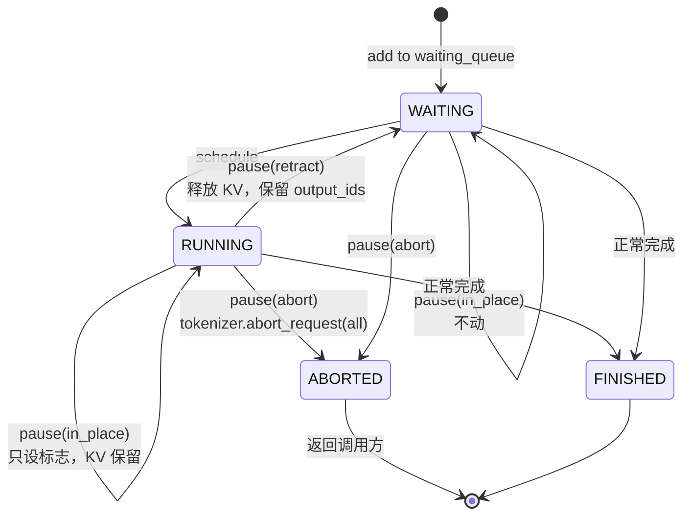
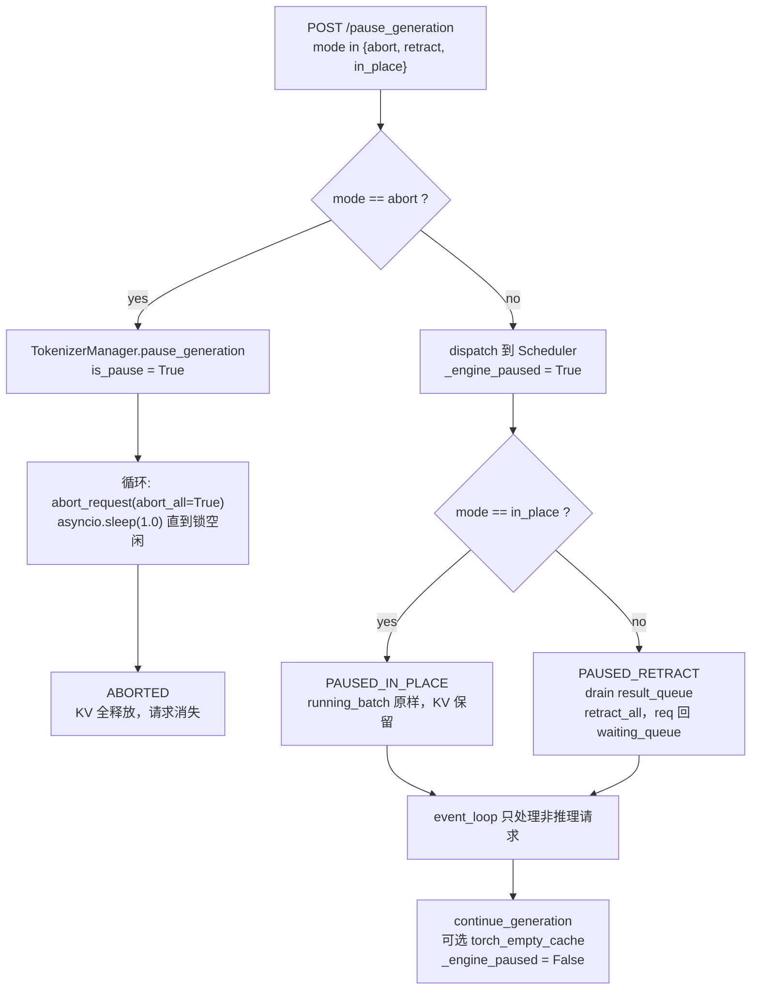
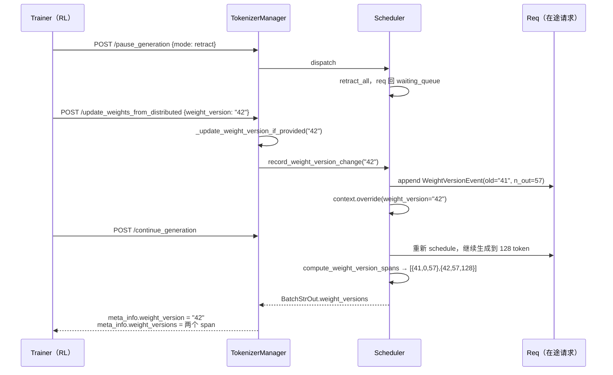

> **系列导航** ｜ 引擎架构请看 [推理引擎深度对比（01）：架构分歧的根](/2026/10/18/serving-01-architecture-divergence/)，本文不重复引擎内部。本系列：[01 Megatron](/2026/10/24/rl-frameworks-01-megatron/) ｜ [02 slime](/2026/10/24/rl-frameworks-02-slime/) ｜ [03 veRL](/2026/10/24/rl-frameworks-03-verl/) ｜ [04 AReaL](/2026/10/24/rl-frameworks-04-areal/) ｜ [05 RLinf](/2026/10/24/rl-frameworks-05-rlinf/) ｜ 本文 06（SGLang 接缝）｜ [07 vLLM 接缝](/2026/10/24/rl-frameworks-07-vllm/) ｜ [08 两族横评](/2026/10/24/rl-frameworks-08-landscape/)

**TL;DR**

> * **SGLang 相对 vLLM 最有信息量的差异是暂停语义的三档**：`abort` / `retract` / `in_place`。三者的区别不在「停不停」，而在**停下之后在途请求的命运**——被杀死、被退回等待队列、还是原地冻住并把 KV 留着。**这是 RL 换权重时唯一需要精确语义的地方**，选错会导致要么丢样本、要么 KV 失效、要么刷缓存被**静默跳过**。
> * **`in_place` 模式与 `flush_cache` 是互斥的，这一点写在类型定义里**：*Note: In 'inplace' mode, flush_cache will fail if there are any requests in the running_batch.* —— 想保住在途请求就别想刷缓存，这是硬约束不是建议。
> * **`retract` 是唯一「能刷缓存又能保住请求」的档位**：请求被退回 `waiting_queue`，KV 被丢弃，`continue_generation` 之后**自动重算**。代价是重算那部分前缀。
> * **权重热更新有三条路径，且分布式的那个有完整的建组协议**：`init_weights_update_group`（含 `master_address` / `master_port` / `rank_offset` / `world_size`）→ 推权重 → `destroy_weights_update_group`。**建组是显式的、有生命周期的**，不是隐式连接。
> * **`weight_version` 是 SGLang 独有的一个显式字段**（`UpdateWeightVersionReqInput`），且带 `abort_all_requests` 开关。它把「训推一致」从隐式约定变成了引擎侧可查询的状态——**这是它在 RL 场景里比 vLLM 更直接的一点**。
> * **`FlattenedTensorBucket` 把多个张量压进一个 `uint8` 视图再传**，保留还原所需的元数据。它的 `supports_multi_dtypes = True` 意味着一个桶里可以混放不同 dtype 的参数——这是为 MoE 与量化模型准备的。
> * **prefix caching 对 GRPO 组内一致性的影响需要实测而不是推理**：理论上缓存只影响计算路径不影响采样随机性，但请求顺序变化会改变种子序列，这是实现相关的。

---

## 目录

- [1. RL 语境下 SGLang 与 vLLM 的真实差异](#1-rl-语境下-sglang-与-vllm-的真实差异)
- [2. 权重热更新的三条路径](#2-权重热更新的三条路径)
- [3. 分布式路径的建组协议](#3-分布式路径的建组协议)
- [4. 暂停语义的三档：abort / retract / in_place](#4-暂停语义的三档abort--retract--in_place)
- [5. 权重版本：把训推一致变成可查询状态](#5-权重版本把训推一致变成可查询状态)
- [6. FlattenedTensorBucket：压平、多 dtype 与还原](#6-flattenedtensorbucket压平多-dtype-与还原)
- [7. 并行形状重排与训推数值接缝](#7-并行形状重排与训推数值接缝)
- [8. rollout 侧特有开关](#8-rollout-侧特有开关)
- [9. 它在各框架里怎么被接进去](#9-它在各框架里怎么被接进去)
- [10. 小结](#10-小结)

---

## 1. RL 语境下 SGLang 与 vLLM 的真实差异

引擎层的架构差异（KV 组织、调度、语言边界）已在 `serving-01` 讲透。本节只列**在 RL 接缝上看得到**的差异：

| 维度 | SGLang | vLLM | RL 里的意义 |
| --- | --- | --- | --- |
| 暂停语义 | **三档**（abort / retract / in_place） | 主要是 abort | SGLang 能保住在途请求 |
| 权重版本 | **显式字段** `weight_version` | 无统一字段 | 训推一致可查询 |
| 分布式建组 | **显式** init / destroy | 通过 `collective_rpc` 隐式 | 建组成本可观测 |
| 张量桶 | `FlattenedTensorBucket`，**支持多 dtype** | 类似但按 rank 分发 | MoE 与量化友好 |
| 休眠唤醒 | 无对等实现 | **可插拔后端 + 两个等级** | vLLM 在 colocate 上更强 |

**一句话概括：SGLang 把「换权重」做成了一套有生命周期的协议，vLLM 把「让显存」做成了一套有生命周期的机制。** 前者面向分离部署，后者面向 colocate。

---

## 2. 权重热更新的三条路径

引擎侧对外暴露三个方法，与 vLLM 的三条路径一一对应：

| 方法 | 传输 | 适用 |
| --- | --- | --- |
| `update_weights_from_distributed` | NCCL 集合通信 | 训练与推理分离、跨机 |
| `update_weights_from_tensor` | 序列化张量（含 CUDA IPC） | colocate、同机 |
| `update_weights_from_disk` | 磁盘 checkpoint | 跨集群、需要格式落盘 |

### 2.1 请求结构暴露了所有可调的旋钮

`UpdateWeightsFromDistributedReqInput` 的字段就是这条路径的全部能力：

```python
class UpdateWeightsFromDistributedReqInput(BaseReq, kw_only=True):
    names: List[str]
    dtypes: List[str]
    shapes: List[List[int]]
    # The group name
    group_name: str = "weight_update_group"
    # Whether to flush the cache after updating weights
    flush_cache: bool = True
    # Whether to abort all requests before updating weights
    abort_all_requests: bool = False
    # Optional: Update weight version along with weights
    weight_version: Optional[str] = None
    # Optional format specification for loading
    load_format: Optional[str] = None
    # which runners the op applies to
    selector: Literal["target", "draft", "all"] = "all"
    # Whether to call torch.cuda.empty_cache() during flush
    torch_empty_cache: bool = False
```

六个字段值得逐个说：

- **`names` / `dtypes` / `shapes` 先于数据到达**。引擎据此在自己的模型上定位参数并校验形状。**这是唯一能在传输前发现「参数名对不上」的机会**——如果等到传数据才发现，已经浪费了一次通信
- **`flush_cache` 默认 `True`**。分块推权重时必须显式置 `False`，理由与 vLLM 侧相同
- **`abort_all_requests` 默认 `False`**。这个默认值是有意的：不主动杀在途请求，把决定权交给调用方
- **`weight_version` 可选**。允许「更新权重」与「更新版本号」在同一个请求里完成，避免两步之间的窗口
- **`selector`**：`target` / `draft` / `all`。**投机解码场景下要能只更新其一**——draft 模型和 target 模型的更新频率可能不同
- **`torch_empty_cache` 默认 `False`**。刷缓存时默认不调用 `empty_cache`，因为它是全局同步点，会让所有 rank 停顿

### 2.2 张量路径的特殊性

`UpdateWeightsFromTensorReqInput` 的注释说明了它的协议细节：

```python
class UpdateWeightsFromTensorReqInput(BaseReq, kw_only=True):
    """Internal IPC request for updating model weights from serialized tensors."""

    # Serialized named tensors, normalized to raw MultiprocessingSerializer
    # bytes before scheduler IPC. Python Engine callers construct this field
    # with bytes directly. FastAPI HTTP callers send base64 strings because JSON
    # has no bytes type; the Annotated Base64Bytes marker is used only by the
    # msgspec-to-Pydantic schema for the HTTP protocol to decode those strings.
    serialized_named_tensors: Annotated[List[bytes], Base64Bytes()]
```

**这段注释揭示了一个三重编码问题**：

1. Python 调用方直接传 `bytes`（`MultiprocessingSerializer` 的产物）
2. HTTP 调用方传 base64 字符串，因为 JSON 没有 bytes 类型
3. 两者的统一由 `msgspec` → Pydantic 的 schema 层负责，用 `Base64Bytes` 标记

**对框架开发者的意义**：如果自己实现一个客户端（而不是用官方 SDK），必须清楚自己走的是哪条编码路径，否则会得到「反序列化失败」或更糟的「反序列化成了别的东西」。

---

## 3. 分布式路径的建组协议

### 3.1 三段式

分布式权重更新不是「一个调用」，而是一个有三段生命周期的协议：

```text
① init_weights_update_group   →  建 NCCL 组，双方进入
② update_weights_from_distributed  →  推权重（可多次）
③ destroy_weights_update_group     →  销毁组，释放资源
```

第一段的请求结构暴露了建组的全部参数：

```python
class InitWeightsUpdateGroupReqInput(BaseReq, kw_only=True):
    # The master address
    master_address: str
    # The master port
    master_port: int
    # The rank offset
    rank_offset: int
    # The world size
    world_size: int
    # The group name
    group_name: str = "weight_update_group"
    # The backend
    backend: str = "nccl"
```

### 3.2 `rank_offset` 是最需要理解的参数

建 NCCL 组时，训练端与引擎端都会成为组内成员。`rank_offset` 的作用是**告诉引擎它的 rank 从哪个数字开始编号**。

举例：训练端有 8 个 rank（TP=8），推理端有 4 个引擎实例（每个 TP=4，共 16 个 rank）。

- `world_size` = 8 + 16 = 24
- 第 $$i$$ 个引擎实例的 `rank_offset` = 8 + $$i \cdot 4$$

**这个偏移必须由框架侧精确计算**，因为引擎不知道训练端有多少 rank。算错了的后果不是报错，而是**rank 冲突**——两个进程争同一个 rank，NCCL 会挂住或给出诡异行为。

### 3.3 为什么建组是显式的

SGLang 需要显式的 init / destroy 而不是每次更新临时建组，原因是**建组成本极高**：

- NCCL 建组需要 all-gather 所有 rank 的地址与拓扑信息
- 在 NVLink + 多机场景下，建组可能要几百毫秒到数秒
- 组一旦建好，后续每次 broadcast 的开销只有建组的千分之一

**所以正确用法是「建一次、用很多次」**。这也解释了 slime 的 `connect_rollout_engines` 为什么要追踪 `num_new_engines`——**引擎实例增减才需要重建组**，而不是每次都重建。

`DestroyWeightsUpdateGroupReqInput` 只有一个字段 `group_name`，说明销毁是纯粹的清理动作。

---

## 4. 暂停语义的三档：abort / retract / in_place

### 4.1 类型定义把三档语义写全了

`PauseGenerationReqInput` 的文档是本文最有价值的一段引文：

```python
class PauseGenerationReqInput(BaseReq, kw_only=True):
    """
    Note that the PauseGenerationRequests is only supported in SGLang Server.
    abort: Abort and return all requests currently being processed.

    in_place: Pause the scheduler's event_loop from performing inference;
            only non-inference requests (e.g., control commands) will be handled.
            The requests in the engine will be paused and stay in the event_loop,
            then continue generation after continue_generation with the old kv cache.
            Note: In 'inplace' mode, flush_cache will fail if there are any requests
            in the running_batch.

    retract: Pause the scheduler's event loop from performing inference;
            only non-inference requests will be handled, and all currently running
            requests will be retracted back to the waiting_queue.
            Note: The KV cache can be flushed in this mode and will be automatically
            recomputed after continue_generation.
    """

    mode: Literal["abort", "retract", "in_place"] = "abort"
```

### 4.2 三档对照表

| 档位 | 在途请求 | KV cache | 已生成 token | 能否 flush_cache | 恢复成本 |
| --- | --- | --- | --- | --- | --- |
| `abort`（默认） | **被杀死** | 可清 | **丢弃** | 能 | 不存在（调用方重发） |
| `retract` | **退回 waiting_queue** | **已释放** | 保留（`output_ids`） | 能 | **重算整段 prefix** |
| `in_place` | **原地冻住** | 保留 | 保留 | **被静默跳过** | **0**（但长尾会一直占着） |

从「请求」的视角看，三档把请求导向三个不同的终态：



**注意 `RUNNING --> RUNNING` 这条自环**：`in_place` 下请求**根本没有离开 running_batch**。这不是图示简化，而是源码的行为——`in_place` 分支只设一个标志位就返回（见 4.3）。

更值得注意的是三档**走的是不同的进程**：



**`abort` 在 tokenizer 进程里完成，`retract` / `in_place` 在 scheduler 进程里完成**。这个差别决定了一件事：`abort` 那一档有 `asyncio.sleep(1.0)` 的轮询粒度——**最快也要 1 秒才退出循环**，且它在 `is_pause_cond` 锁内，这 1 秒里 `continue_generation` 拿不到锁。

### 4.3 `in_place` 的实现解释了为什么它便宜

`Scheduler.pause_generation` 里 `in_place` 分支只有三行：

```python
if recv_req.mode == "in_place":
    # In-place pause: just set the flag and return immediately.
    # All scheduler state (running_batch, last_batch, chunked_req,
    # result_queue) is left untouched. On resume, the normal event
    # loop (get_next_batch_to_run) handles last_batch merge,
    # chunked_req cleanup, and overlap result processing through
    # the standard code paths. This avoids duplicating batch
    # manipulation logic and the accounting bugs that come with it.
    return
```

**「只设一个标志位就返回」**。注释还给出了这么做的第二个理由：*This avoids duplicating batch manipulation logic and the accounting bugs that come with it.*——**如果暂停时手动去整理 batch 状态，就要写一套与正常运行路径平行的逻辑，那套逻辑会有它自己的记账 bug**。

这是一个值得记住的设计原则：**暂停/恢复的最好实现是「不改变状态、只改变是否继续」**，把所有状态处理都留给正常路径。

### 4.4 三档怎么选

| 场景 | 推荐档位 | 理由 |
| --- | --- | --- |
| 同步训练，rollout 已全部返回 | `abort`（默认） | 没有在途请求，三档等价 |
| 需要刷缓存（有旧权重的 KV 残留） | `retract` | 唯一能刷缓存又保住请求的档 |
| 希望保住长尾生成、且不刷缓存 | `in_place` | 零重算 |
| 紧急停服 | `abort` | 立刻释放 |

**最容易踩的坑，而且它的真实行为比 docstring 说的更糟**。想「既保住请求又刷缓存」，于是选 `in_place` 并传 `flush_cache=True`。docstring 写的是 *flush_cache will fail*，但源码里的实际行为是**静默跳过**：

```python
def flush_cache(self, empty_cache: bool = True):
    """Flush memory pools (e.g., KV cache, Mamba cache) and optionally empty device allocator cache."""
    if self.is_fully_idle(ignore_waiting=self._engine_paused):
        self.cur_batch_for_debug = None
        self.last_batch = None
        self.tree_cache.reset()
        ...
```

`flush_cache` 整个函数体都在 `is_fully_idle(...)` 的条件里。`in_place` 模式下 `running_batch` 非空 → `is_fully_idle` 为 False → **整个 flush 被跳过，不报错、不告警、调用方拿不到任何失败信号**。

**这意味着「用 `in_place` 保住请求」和「用 `flush_cache` 清掉旧权重 KV」是互斥的，而且第二个被静默丢弃。** 如果你以为刷了、实际没刷，旧权重的 KV 会继续被复用——这是训推一致的样本层与数值层的双重污染。

---

## 5. 权重版本：把训推一致变成可查询状态

### 5.1 一个专门的请求类型

SGLang 有一个 vLLM 没有的请求类型：

```python
class UpdateWeightVersionReqInput(BaseReq, kw_only=True):
    # The new weight version
    new_version: str
    # Whether to abort all running requests before updating
    abort_all_requests: bool = True
```

**注意 `abort_all_requests` 默认是 `True`**——与 `UpdateWeightsFromDistributedReqInput` 里默认 `False` 相反。这个不对称是有意的：**单纯的版本号更新没有数据要传，如果还留着在途请求，那些请求会带着旧版本的 KV 继续跑，然后被标记成新版本**，这是最坏的一种错标。

### 5.2 为什么版本号值得单独做一个接口

`weight_version` 的存在让「训推一致」的样本层从**隐式约定**变成了**引擎侧可查询的状态**：

| 没有版本号 | 有版本号 |
| --- | --- |
| 框架自己记「这批样本是哪次 rollout 产的」 | 引擎能回答「你现在是哪个版本」 |
| 出现不一致只能靠日志回溯 | 可以在采样时把版本打进 metadata |
| 多引擎时无法判断是否全部更新完 | **可以逐个查询，确认全部到位** |

**第三条是分离部署场景的关键**。推理端有多个引擎实例时，权重更新是逐个推送的，中间的窗口里不同实例是不同版本。有了版本号就可以：

1. 推送前记录目标版本
2. 推送后逐个查询 `weight_version`
3. 全部匹配才恢复接单

这个流程比「推送完 sleep 一段时间」可靠得多。

### 5.3 与 `weight_version` 字段的配合

`UpdateWeightsFromDistributedReqInput` 里也有一个可选的 `weight_version`。两者配合形成两种更新模式：

- **原子模式**：传 `weight_version` 给更新请求 → 权重与版本一起生效，无窗口
- **两步模式**：先更新权重，再调 `update_weight_version` → 有窗口，但可以显式控制

**推荐原子模式**，因为中间的窗口里引擎会用新权重 + 旧版本号继续接单，产出的样本版本标记是错的。

### 5.4 版本号怎么进到每条样本里：六跳链路

这是 SGLang 在 RL 场景下最实用、也最少被讲的一块。**版本号不是一个全局变量，它会被切成每请求的 token 区间**：

```text
POST /update_weights_*  {weight_version: "42"}
  │
  ├─ ① tokenizer_manager: _update_weight_version_if_provided("42")
  ├─ ② record_config_updates("tokenizer.weight_version", ...)
  ├─ ③ dispatch 到 scheduler → Scheduler.record_weight_version_change("42")
  │      get_context().override("scheduler.weight_version", weight_version="42")
  │      对每个 live req 追加 WeightVersionEvent(old="41", num_output_tokens=k)
  ├─ ④ 生成结束时 compute_weight_version_spans(events, current_version, num_out)
  ├─ ⑤ BatchStrOut.weight_versions ← 每请求的 spans
  └─ ⑥ tokenizer_manager: add_weight_versions_to_meta_info(...)
```

第 ③ 步的 `record_weight_version_change` 是关键：

```python
def record_weight_version_change(self, new_version: Optional[str]) -> None:
    if new_version is None or new_version == get_serving().weight_version:
        return

    old_version = get_serving().weight_version
    get_context().override("scheduler.weight_version", weight_version=new_version)

    live_reqs = {
        *self.collect_inflight_reqs(),
        *self.waiting_queue,
```

**「对每个在途请求记一条事件」** 是这整条链的核心：它把「版本切换」从一个全局时刻变成了一串 per-request 的切点。

最终 `meta_info` 里长这样（官方文档示例）：

```json
"weight_version": "42",
"weight_versions": [
    {"version": "41", "start": 0,  "end": 57},
    {"version": "42", "start": 57, "end": 128}
]
```

文档对该格式的说明值得逐字读：

> Ranges are half-open `[start, end)` over output-token indices, prompt excluded. The usual case is a single span.



三个对 RL 侧直接有用的细节：

| 细节 | 含义 | RL 侧怎么用 |
| --- | --- | --- |
| **半开区间 `[start, end)`** | 与 Python 切片语义一致 | 直接 `response_ids[start:end]` |
| **`prompt excluded`** | 区间只覆盖 output token，prompt 不占位 | **不需要减 `len(prompt)`**——这是个很容易写错的地方 |
| **通常只有一个 span** | 没跨版本时 `[{v, 0, len}]` | 用 `len(spans) == 1` 快速判断「这条轨迹干净」 |

### 5.5 但版本号本身不保证任何东西

这一节要泼一盆冷水，因为版本号很容易被误当成一致性证明：

| 事实 | 后果 |
| --- | --- |
| `weight_version` 是 **`str`，只存 metadata** | 它不参与任何计算或校验 |
| scheduler 记的是**自己当前版本**，不是请求声明的版本 | 两个版本窗口内的并发请求，都按同一条边界切 |
| 默认值是 `None` | **不传版本号时 `meta_info` 里根本没有这个字段** |

**最要命的是第一条与第 5.4 节的结合**：`weight_versions` 记录的是「在哪个时刻引擎自认为换了版本」，**而不是「这些 token 真的由那个版本的权重生成」**。

两者的差别在 PD 分离 + `retract` 场景下会真实发生——如果 retract 没有真正重建 KV（源码里这条路径有 TODO），被 retract 的请求会**带着旧权重的 KV 前缀继续生成**，但事件里记的却是新版本。

所以正确的用法是把版本号当成**观测材料**而不是**正确性保证**：

| 想回答的问题 | 该看什么 |
| --- | --- |
| 这条样本跨了几个版本？ | `len(weight_versions)` |
| 权重是否全部推送到位？ | `/get_weights_by_name` 或逐项比对 |
| token 真的来自那个版本吗？ | **无法从版本号得知**，只能靠 `retract` 的语义正确 |

---

## 6. FlattenedTensorBucket：压平、多 dtype 与还原

### 6.1 类的作用

```python
class FlattenedTensorBucket:
    """
    A bucket that flattens multiple tensors into a single tensor for efficient processing
    while preserving all metadata needed for reconstruction.
    """

    # This field is solely for users of to check whether the class supports this feature
    supports_multi_dtypes = True
```

两个能力：**压平**与**保留还原元数据**。压平的理由与 vLLM 侧相同——减少 RPC 次数、降低序列化开销、摊薄 CUDA IPC 的固定成本。

### 6.2 压平的关键一行

```python
for i, (name, tensor) in enumerate(named_tensors):
    flattened = tensor.flatten().view(torch.uint8)
    flattened_tensors[i] = flattened
```

**`view(torch.uint8)` 是把张量当成原始字节看待**。这一步很关键：

- 不同 dtype 的张量（bf16、fp32、fp8、int32）都能被当成 uint8 序列拼起来
- 拼接不需要任何类型转换，是纯粹的字节拼接
- 还原时靠元数据里的 dtype 重新 `view` 回去

**这就是 `supports_multi_dtypes = True` 的实现基础**——一个桶里可以混放不同精度的参数。

### 6.3 代价：还原必须精确

压平之后，引擎侧必须严格按元数据还原。元数据至少需要包含：

- 原始参数名
- 原始 dtype
- 原始形状
- 在压平缓冲区里的字节偏移

**任何一个字段错了，权重就会静默错位**。而错位的权重不会报错，只会让训练曲线慢慢歪掉。这就是为什么 slime 在初始化阶段要跑一次 `check_weights(action="compare")`——**它是唯一能端到端证明「压平-传输-还原」这条链没错的动作**。

### 6.4 与 vLLM `load_format="flattened_bucket"` 的呼应

vLLM 侧也有同样的概念（`load_format == "flattened_bucket"`），但语义不同：

| | SGLang | vLLM |
| --- | --- | --- |
| 桶的粒度 | 一个桶里多个参数，**每 rank 独立桶** | 每 rank 一份预序列化载荷 |
| 多 dtype | **显式支持** | 按载荷分发 |
| 谁负责切 | 引擎侧按元数据还原后再切 | 生产者侧按 rank 切好 |

**SGLang 的做法把「按 rank 切」放在引擎侧**，好处是生产者只需压平（与并行度无关），坏处是引擎侧要承担切分开销。

---

## 7. 并行形状重排与训推数值接缝

### 7.1 重排的三步与 vLLM 侧一致

第 5 节的结论适用于所有引擎——**先归约到完整参数、再转格式、最后按推理端 TP 切**。SGLang 侧的差异在于：它在 `update_weights_from_distributed` 的 `names` / `shapes` 里**显式要求生产者声明目标形状**，所以形状不匹配会在传输前被发现。

### 7.2 数值接缝的四个来源

与 vLLM 侧同构，但 SGLang 侧的着重点略有不同：

| 来源 | SGLang 侧的具体位置 | 影响 |
| --- | --- | --- |
| KV cache dtype | `--kv-cache-dtype`（fp8 路径） | **最大**，直接改变 attention 输入精度 |
| attention backend | FlashInfer / FlashAttention / Triton 后端 | 中等，softmax 归一化路径不同 |
| rope 实现 | 预计算表 vs 在线 | 长序列累积可见 |
| 采样顺序 | temperature 与 top-p 的先后 | 改变候选集合 |

**一个 SGLang 特有的、值得单独注意的点**：它的 `RadixAttention` 会复用前缀 KV，而**复用的 KV 是原始计算的结果**。如果两次计算之间引擎换了 attention backend（例如因为 kernel 选择策略变化），复用旧 KV 与新算的结果会混在一起。这种情况极少发生，但一旦发生极难归因。

### 7.3 一个可操作的验证流程

在三层里，只有数值层能被快速验证：

```text
① 固定权重、固定输入（同一段 prompt）
② 训练端前向，记录每个 token 的 logprob
③ 引擎端采样温度设为极低、top_p=1，记录 input_token_logprobs
④ 逐 token 比对
```

判据（与 vLLM 篇一致）：

- 误差 < 1e-4：正常，属于 kernel 差异
- 误差 1e-2 量级：**重排或格式转换错了**（结构性误差，某个 head 整体偏移）
- 误差随机且中等：可能是 KV dtype 不一致

---

## 8. rollout 侧特有开关

### 8.1 `rollout.n` 的展开

引擎没有「组」的概念。GRPO 的组内 $$n$$ 条必须由框架展开成 $$n$$ 个独立请求。

展开时有两个决定：

1. **是否让它们进入同一个 batch**：同一 batch 内可以共享 prefix cache，但也意味着它们的完成时间接近（对组内归一化是好事，对长尾是坏事）
2. **随机种子的分配方式**：见下文

### 8.2 prefix caching 与组内一致性

**现象**：SGLang 的 RadixAttention 让同一 prompt 的 $$n$$ 个请求共享前缀 KV。

**理论上这是纯收益**：KV 是确定性计算的产物，复用不引入随机性。

**实际上的两个风险点**：

1. **请求顺序影响种子**。如果种子由「到达顺序」决定，那么共享缓存后请求的调度顺序变化会改变种子序列，进而改变采样结果——这不是分布问题，而是可复现性问题
2. **长尾下的混合版本**。如果 $$n$$ 个请求跨越了权重更新，它们会带着不同版本的权重继续采样，但组内归一化假设它们同分布

**第 2 个风险才是真问题**，而且它正好是 `pause_generation` 与 `weight_version` 要解决的问题——**在更新权重前暂停接单，确认所有在途请求要么完成要么被退retract**。

### 8.3 关于「组内方差是否会被低估」

一个常见的疑问是：共享前缀缓存会不会让组内方差变小？

**纯粹的 KV 复用在数学上不改变任何东西**——KV 是 prompt 的函数，与采样无关。所以：

- 如果看起来组内方差变小了，先检查**是不是采样参数问题**（例如 $$n$$ 条用了同一个种子）
- 再检查**是不是长尾导致的样本不完整**（某几条被截断）

把这个疑问当成「需要实测确认」而不是「理论注定」，否则会去优化一个不存在的问题。

---

## 9. 它在各框架里怎么被接进去

| 框架 | 接入方式 | 关键调用 |
| --- | --- | --- |
| **slime** | 一等公民，深度耦合 | `sglang_utils` 直接管引擎生命周期；`update_weight_from_tensor` 走 CUDA IPC |
| **veRL** | rollout 后端之一 | 通过 `workers/rollout` 适配 |
| **AReaL** | 独立服务 | 服务解耦，走网络传输 |
| **RLinf** | `hybrid_engines` 适配层 | 引擎无关接口 |

### 9.1 slime 的用法最能说明 SGLang 的设计意图

slime 的 `UpdateWeightFromTensor` 类注释给出了完整的路线：

```text
load(dict→GPU) → broadcast PP/EP(GPU NCCL) → gather TP(GPU NCCL) → convert HF(GPU) → send.
Colocated: GPU→CPU serialize → gather_object(Gloo CPU, collects from rollout_num_gpus_per_engine ranks) → Ray IPC to engine.
Distributed: GPU NCCL broadcast to remote engines.
```

**注意它用的暂停模式是 `abort` 或 `in_place`**：

```python
engine.pause_generation.remote(mode="abort" if flush_cache else "in_place")
```

**这个二选一正是第 4 节那张表的直接应用**：要刷缓存就必须用 `abort`（因为 `in_place` 不能刷），不刷缓存就用 `in_place` 保住请求。slime 没有用 `retract`，因为它的策略是「要么杀要么保」，不需要中间的「退了再重算」这档。

### 9.2 一个 SGLang 侧的竞态

slime 的 `_build_flattened_tensor_data` 有一段关键注释：

> SGLang returns from the HTTP/Ray request after enqueueing GPU copies into model weights, but it does not guarantee a CUDA-device sync before the response. Reusing and overwriting the same producer buffer immediately after `ray.get` can race with the consumer-side copy and corrupt weights.

**这句话是本文所有接缝问题里最危险的一个**：SGLang 在把拷贝任务 enqueue 到 GPU 上之后就返回了，不等 CUDA 同步。所以生产者不能立刻复用发送缓冲。

**所有接入 SGLang 做 RL 的框架都要注意这一点**。防御方式有两种：每块都新分配缓冲（费显存），或者显式同步后再复用（费时间）。

---

## 10. 小结

### 10.1 SGLang 在 RL 语境下的能力表

| 能力 | 评价 |
| --- | --- |
| 权重热更新 | **完整**：三条路径 + 显式建组协议 |
| 暂停语义 | **最细**：三档覆盖「杀 / 退 / 冻」 |
| 版本可见性 | **最强**：引擎侧可查询 `weight_version` |
| 张量桶 | **好**：多 dtype 支持，还原灵活 |
| 显存让渡 | **弱**：无对等 sleep mode |
| 数值透明 | 与 vLLM 同级，需框架侧保证 |

### 10.2 两句话选型

**分离部署选 SGLang**：三档暂停 + 显式建组 + 版本可查，都是分离场景必需的能力。

**colocate 且显存紧张选 vLLM**：sleep mode 的两个等级 + 可插拔后端，让显存在训练与推理之间真正能让渡。

### 10.3 三处最容易踩的坑

1. **`in_place` + `flush_cache=True`** → **静默跳过**（`is_fully_idle` 为 False 时整个 flush 不执行，无报错）
2. **复用发送缓冲** → 静默权重污染，所有 barrier 都通过，只有训练曲线会歪
3. **`rank_offset` 算错** → NCCL 挂住或给出诡异行为，而且报错位置离根因很远

---

**上一篇**：[05 RLinf](/2026/10/24/rl-frameworks-05-rlinf/) ｜ **下一篇**：[07 vLLM 作为 rollout 引擎](/2026/10/24/rl-frameworks-07-vllm/)

## 参考

- 仓库：<https://github.com/sgl-project/sglang>，基准 `v0.5.22` = `baa9befa381511cd4d56f83980951e5a45fffc6d`（2026-10-13）
- 暂停语义：[`python/sglang/srt/managers/io_struct.py` L1921-L1941](https://github.com/sgl-project/sglang/blob/baa9befa381511cd4d56f83980951e5a45fffc6d/python/sglang/srt/managers/io_struct.py#L1921-L1941)
- 权重更新请求：[`io_struct.py` L1995-L2020](https://github.com/sgl-project/sglang/blob/baa9befa381511cd4d56f83980951e5a45fffc6d/python/sglang/srt/managers/io_struct.py#L1995-L2020)
- 建组协议：[`io_struct.py` L2120-L2148](https://github.com/sgl-project/sglang/blob/baa9befa381511cd4d56f83980951e5a45fffc6d/python/sglang/srt/managers/io_struct.py#L2120-L2148)
- 张量桶：[`python/sglang/srt/weight_sync/tensor_bucket.py`](https://github.com/sgl-project/sglang/blob/baa9befa381511cd4d56f83980951e5a45fffc6d/python/sglang/srt/weight_sync/tensor_bucket.py#L19-L60)
- 引擎接口：[`python/sglang/srt/entrypoints/engine.py` L1645-L1720](https://github.com/sgl-project/sglang/blob/baa9befa381511cd4d56f83980951e5a45fffc6d/python/sglang/srt/entrypoints/engine.py#L1645-L1720)
- 调度器暂停实现：[`python/sglang/srt/managers/scheduler.py` L5604-L5640](https://github.com/sgl-project/sglang/blob/baa9befa381511cd4d56f83980951e5a45fffc6d/python/sglang/srt/managers/scheduler.py#L5604-L5640)
