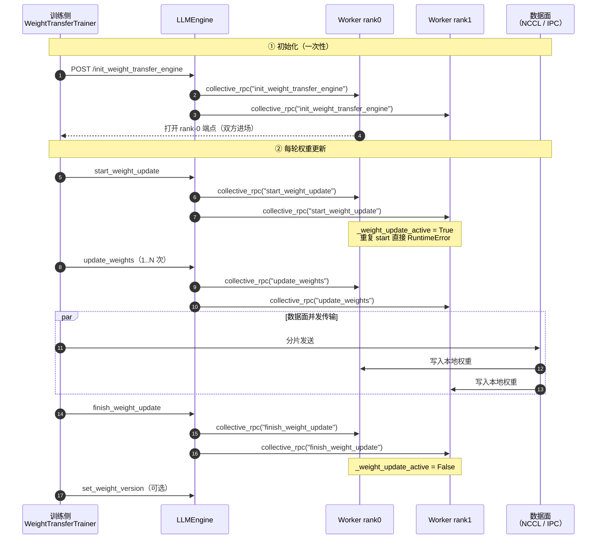
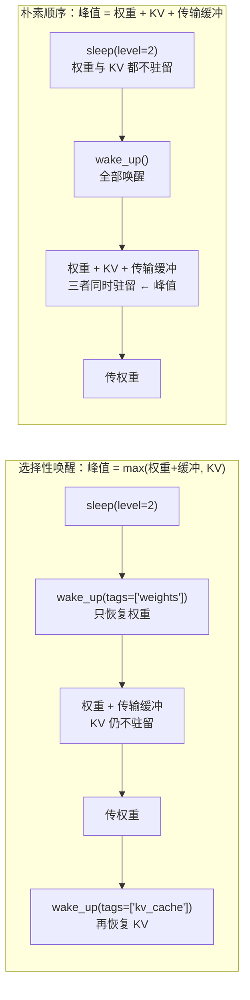

> **系列导航**
>
> 本系列是源码级拆解，每篇只回答「这个框架凭什么这样设计、它解决了什么、代价是什么」。
> 承接两条既有主线：
> [《RL 训练框架全景横评（2026）》](/2026/09/29/rl-training-frameworks-survey/)（三族划分、四轴定位）
> 与 [《RL 框架里的那些变量到底怎么算》](/2026/09/30/rl-variables-in-frameworks/)（变量侧逐行对照）。
>
> **本系列不含 `rl-frameworks-06`。** 本系列的篇号从 07 起算，`07` 是本系列的第一行编号。
>
> **引擎架构请看 serving 系列。** vLLM 与 SGLang 的架构分歧、调度与批处理、支持矩阵、
> PD 分离、benchmark 口径、前缀命中率，已经由
> [《推理引擎（01）：架构分歧的根》](/2026/10/18/serving-01-architecture-divergence/)
> 到 [《推理引擎（08）：前缀命中率》](/2026/10/18/serving-08-prefix-hit-rate/) 八篇讲透。
> 本文**不重写引擎架构**，只讲 **RL 训练循环压在 vLLM 上时新长出来的那条接缝**：
> 权重怎么进去、显存怎么让出来、并行形状怎么对上、logprob 怎么才能和训练端可比。
>
> **基准差异声明（重要）**：`serving-01..08` 的基准是 **vLLM `v0.31.0`（commit `db9527a4`）**
> 与 **SGLang `v0.5.21`（commit `e00930c5`）**；本文基准是
> **vLLM `v0.32.1rc0`（commit `2365177ddda7714502e4df7a1669cc79c0a4dfd0`）**、
> **SGLang `v0.5.22`（commit `baa9befa`）**、**verl `v0.9.1`**、**AReaL `v2.1.0`**。
> **两者不同，行号不可跨篇比对。**

> **TL;DR**
>
> * **vLLM 在 v0.32.1rc0 里已经没有 `update_weights_from_tensor` /
>   `update_weights_from_distributed` 这两个方法名了。** 权重热更新被重写成一套
>   **四阶段协议**：`init_weight_transfer_engine` → `start_weight_update` →
>   `update_weights`（可多次）→ `finish_weight_update`。四个阶段的入口全在训练侧，
>   推理侧只提供被 `collective_rpc` 调到的 worker 方法。
> * **四阶段是阻塞的，而且失败之后不能接着往下走。** `collective_rpc` 是同步等待
>   `TP×PP×PCP` 个 worker 全部返回（`non_block=False` 时直接 `.result()`）；
>   `update_weights` 抛异常会把 worker 的会话状态置为未激活，此时 `finish_weight_update`
>   被拒——必须整轮重来。官方文档明说：更新失败后 `/health` 仍然是 200。
> * **`flush_cache` 在这条路径上不是一个开关，而是一个必须自己补的动作。**
>   vLLM 的权重热更新**不负责**清前缀缓存；训练侧必须显式调
>   `reset_prefix_cache(reset_connector=True)`，否则新权重会命中旧权重算出来的 KV。
>   `sleep(level>=1)` 顺带清缓存、`sleep(level=0)` 不清，这一条差别在 RL 里会真的要命。
> * **sleep/wake 是 RL 与推理最强的耦合点，也是 vLLM 与 SGLang 分道最多的地方。**
>   vLLM 的语义是**按 tag 记账的分级释放**：`weights` / `kv_cache` 两个可延迟 tag，
>   加上 `level=1`（权重搬到 CPU、KV 丢弃）/ `level=2`（权重与 KV 都丢、只留 buffer）
>   两档深度。`wake_up(tags=[...])` 允许**只唤醒一部分**，这正是 RL 里避开
>   「权重 + KV 同时驻留」峰值的那把钥匙。
> * **并行形状对不上时，vLLM 把 rehsard 做成了可选的传输后端，而不是必经路径。**
>   广播式 NCCL 后端要求训练侧先把完整张量物化出来；`nccl_m2n` 才真的按
>   DTensor 的 mesh 与 placement 直接重排。**选错后端的代价是显存，不是正确性。**
> * **训推一致的数值层里，最容易被忽略的一条是采样参数的应用顺序。**
>   vLLM 的 logits 处理链是 `logit_bias → penalties → bad_words → 自定义 → 强制 → temperature → min_p → top_k/top_p`，
>   而 `logprobs` 默认返回的是**未截断**的全词表归一化值。GRPO 用 top-p 采样、
>   训练端按全词表算 logprob，两边分母不同——vLLM 给了 `--logprobs-mode processed_logprobs`
>   与 `--return-sampling-mask` 两件工具去补这个缺口。

---

## 1. 设计出发点：RL 需要一个「能改的」推理引擎

推理引擎的原始契约是**只读权重**。Serving 场景下模型是一个常量，引擎围绕这个常量做了
大量优化：CUDA Graph 把形状烧死、KV 缓存假设内容由当前权重算出、前缀缓存按 token 序列
做哈希、torch.compile 的 guard 假定参数不动。RL 把这四条前提全部打掉：

| Serving 的前提 | RL 的要求 | 冲突后果 |
| --- | --- | --- |
| 权重是常量 | 每步训练后换一版权重 | Graph 需要重捕、缓存需要失效 |
| 推理独占设备 | 训练与推理抢同一批卡 | 必须能把显存**还回去再要回来** |
| 并行形状由部署决定 | 训练端 TP/PP/EP 与推理端 TP 不同 | 需要跨 mesh 重排 |
| logprob 只是展示字段 | logprob 是重要性比的分子 | 采样截断与归一化口径必须可解释 |

vLLM 对这件事的态度有一个可引用的表述：官方文档把权重传递定位成
「在 RL 工作流中把权重从训练进程同步到推理引擎」的独立子系统，并说明它被设计成
**可插拔**——传输机制、权重来源、控制面传输三者各自可替换
（[`docs/training/weight_transfer/README.md:3`](https://github.com/vllm-project/vllm/blob/2365177ddda7714502e4df7a1669cc79c0a4dfd0/docs/training/weight_transfer/README.md#L3-L3)）。
同一份文档把系统切成**两个对称的引擎**：训练进程侧的 `TrainerWeightTransferEngine`
与推理 worker 侧的 `WeightTransferEngine`，两者各持一份通信器与传输计划
（[`README.md:7-14`](https://github.com/vllm-project/vllm/blob/2365177ddda7714502e4df7a1669cc79c0a4dfd0/docs/training/weight_transfer/README.md#L7-L14)）。

**放弃了什么**：vLLM 没有把「训练」这件事收进引擎。它不持有优化器、不做反向、
也不管样本队列与 staleness。所以它在 RL 里的角色**只能是 rollout 数据面**，
异步形态完全由外层框架决定（见 §7）。这是刻意的取舍：引擎一旦管训练，
就得同时吃下并行策略的演化，而那是 Megatron / FSDP 的地盘。

---

## 2. 证据基线与一处必须先纠正的前提

### 2.1 基准

| 仓库 | 版本 | commit |
| --- | --- | --- |
| vLLM | `v0.32.1rc0`（2026-10-18） | `2365177ddda7714502e4df7a1669cc79c0a4dfd0` |
| SGLang | `v0.5.22`（2026-10-13） | `baa9befa381511cd4d56f83980951e5a45fffc6d` |
| verl | `v0.9.1`（2026-09-20） | `1876b06d0a3e4e71e06230be10af14492ca8a75b` |
| AReaL | `v2.1.0`（2026-08-25） | `ecc8b0e4dfb4e3965f67121a5c87866a07c390ae` |

社区活跃度快照采集于 2026-10-24，全系列统一引用同一份：

| 仓库 | stars | open issues | 最近 90 天 commit | 90 天贡献者 | 最新 release |
| --- | --- | --- | --- | --- | --- |
| vllm | 95,268 | 9,377 | 729 | 343 | `v0.32.1rc0` 2026-10-18 |
| sglang | 37,688 | 6,136 | 4,327 | 665 | `v0.5.22` 2026-10-13 |
| verl | 23,998 | 1,386 | 219 | 97 | `v0.9.1` 2026-09-20 |
| AReaL | 5,866 | 141 | 45 | 14 | `v2.1.0` 2026-08-25 |

### 2.2 `vllm/worker/` 这个路径已经不存在了

一个流传很广的说法是「vLLM 的权重热更新接口在 `vllm/worker/` 下」。
在 `v0.32.1rc0` 上，**顶层 `vllm/worker/` 目录已经不存在**（`vllm/device_allocator/`、
`vllm/distributed/`、`vllm/v1/worker/` 都还在，唯独 `vllm/worker/` 不在树里）。
worker 侧的实现落在：

- `vllm/v1/worker/gpu_worker.py` —— 具体方法体（`update_weights`、`sleep`、`wake_up` 都在这里）
- `vllm/v1/worker/worker_base.py` —— worker 抽象基类
- `vllm/distributed/weight_transfer/` —— 传输后端（NCCL / IPC / m2n / sharded RDT 等）
- `vllm/entrypoints/rl/` —— RL 专用的 HTTP 路由与离线混入

所以下文所有 worker 侧的行号都指向 `vllm/v1/worker/gpu_worker.py`。

### 2.3 两个旧方法名的下落

`update_weights_from_tensor` 与 `update_weights_from_distributed` 这两个名字
在 `v0.32.1rc0` 的 `vllm/` 源码里**已经搜不到**（`git grep` 无命中）。
取而代之的是四阶段的 `init_weight_transfer_engine` / `start_weight_update` /
`update_weights` / `finish_weight_update`，以及一组**按后端区分**的传输引擎。
这意味着任何还按旧接口名写的 RL 对接代码，在 `v0.32.1rc0` 上都会直接失败。

---

## 3. 模块初始化：从「引擎起来」到「能接权重」

### 3.1 推理侧只需要给一个后端名

推理侧的配置面窄到一句：

```python
from vllm import LLM
from vllm.config import WeightTransferConfig

llm = LLM(
    model="my-model",
    weight_transfer_config=WeightTransferConfig(backend="nccl"),
)
```

在线服务侧对应 `vllm serve my-model --weight-transfer-config '{"backend": "nccl"}'`
（[`README.md:48-64`](https://github.com/vllm-project/vllm/blob/2365177ddda7714502e4df7a1669cc79c0a4dfd0/docs/training/weight_transfer/README.md#L48-L64)）。
这个 `WeightTransferConfig` **只装一个后端名字符串**——守卫、缓冲区大小、`packed` 标志
都不在这里（[`README.md:112-122`](https://github.com/vllm-project/vllm/blob/2365177ddda7714502e4df7a1669cc79c0a4dfd0/docs/training/weight_transfer/README.md#L112-L122)）。

设计意图写得很直白：**训练侧是唯一的真相来源**。两侧必须一致的东西（`packed`、
缓冲区大小、通信器 rendezvous 参数）全部由训练侧在 init 握手里推过来，
推理侧**读它被告知的值**，于是「两侧 `packed` 不一致」这种错误**无法表达**
（同上，`:118-122`）。

### 3.2 worker 侧什么时候建传输引擎

关键在 `load_model`：模型加载完之后才建引擎，因为引擎要拿模型的引用。

```python
# vllm/v1/worker/gpu_worker.py:603-609
if self.vllm_config.weight_transfer_config is not None:
    self.weight_transfer_engine = WeightTransferEngineFactory.create_engine(
        self.vllm_config.weight_transfer_config,
        self.vllm_config,
        self.device,
        self.model_runner.get_model(),
    )
```

（[`gpu_worker.py:603-609`](https://github.com/vllm-project/vllm/blob/2365177ddda7714502e4df7a1669cc79c0a4dfd0/vllm/v1/worker/gpu_worker.py#L603-L609)）

注意同一段的前两行：`load_model` 是在 `_maybe_get_memory_pool_context(tag="weights")`
里跑的（[`gpu_worker.py:591-598`](https://github.com/vllm-project/vllm/blob/2365177ddda7714502e4df7a1669cc79c0a4dfd0/vllm/v1/worker/gpu_worker.py#L591-L598)）。
**权重从生成第一刻起就落在带 tag 的自定义分配器池里**——这是后面 sleep 能精确释放
权重而不误伤别的东西的前提（§4）。这两件事的顺序不能反：先有 tag，再有引擎。

### 3.3 握手：两侧同时进场

NCCL 后端的 `trainer_init` 要在**同一时刻**打两侧：一边通过 client 触发推理侧的
`init_weight_transfer_engine`，一边打开训练侧自己的 rank-0 端点，因为两端必须在同一次
rendezvous 里碰面（[`nccl.md:66-70`](https://github.com/vllm-project/vllm/blob/2365177ddda7714502e4df7a1669cc79c0a4dfd0/docs/training/weight_transfer/nccl.md#L66-L70)）。
训练侧 `trainer_init` 自己算 worker 侧的 `rank_offset=1` 与 packed 参数，所以两侧
不可能对不上。

---

## 4. 进程与角色：谁持有权重、谁按下开关

### 4.1 一个进程两种身份

| 阶段 | 训练侧进程 | 推理侧 worker |
| --- | --- | --- |
| 通信器 | `TrainerWeightTransferEngine`，只有 rank 0 持通信器上线 | 每个 worker 都持，`rank` 从 `rank_offset` 起 |
| 数据面 | rank 0 真正发字节 | 每个 worker 都收、都 `load_weights` |
| 控制面 | `VLLMWeightSyncClient`（`HTTP`/`Ray`）发四个 RPC | `collective_rpc` 落到本进程的方法 |
| 主体 | 持有 `WeightSource`（可迭代） | 持有 `model_runner.model` |

多 rank 训练器有个容易踩反的点：**每个训练 rank 都要建引擎、都要调 `send_weights()`**，
但只有 rank 0 发字节。非发送 rank 仍然要完整迭代 `WeightSource`，因为「把参数物化出来」
本身常常是 collective（FSDP 的 `full_tensor()` all-gather、Megatron 的导出），
**谁跳过谁死锁**（[`README.md:124-135`](https://github.com/vllm-project/vllm/blob/2365177ddda7714502e4df7a1669cc79c0a4dfd0/docs/training/weight_transfer/README.md#L124-L135)）。

### 4.2 `collective_rpc` 的真实语义：同步、全收、可超时

这是本文最需要说清楚的一件事，因为 RL 框架几乎全是靠它把方法打进 worker 的。

`LLM.collective_rpc` 的签名是 `(method, timeout, args, kwargs)`，返回
**每个 worker 一个结果组成的列表**（[`llm.py:574-603`](https://github.com/vllm-project/vllm/blob/2365177ddda7714502e4df7a1669cc79c0a4dfd0/vllm/entrypoints/llm.py#L574-L603)）。
它的文档里有一句被反复忽略的忠告：**只用来传控制消息，数据面自己另开会话**
（`llm.py:598-601`）。这条正是四阶段协议存在的理由——`update_weights` 走 RPC 的只是
**元数据**，张量本身走传输后端。

到底阻塞多久？看 multiproc executor 的实现：

```python
# vllm/v1/executor/multiproc_executor.py:427-455（节选）
self.rpc_broadcast_mq.enqueue((send_method, args, kwargs, output_rank))
...
for mq in response_mqs:
    status, result = mq.dequeue(timeout=dequeue_timeout)
    if status != WorkerProc.ResponseStatus.SUCCESS:
        raise RuntimeError(...)
...
return future if non_block else future.result()
```

（[`multiproc_executor.py:427-455`](https://github.com/vllm-project/vllm/blob/2365177ddda7714502e4df7a1669cc79c0a4dfd0/vllm/v1/executor/multiproc_executor.py#L427-L455)）

由此可以确定三条语义：

1. **默认同步阻塞。** `non_block=False` 时直接 `.result()`，调用线程要等所有 worker
   都回包。
2. **全收集不是多数派。** 循环里任何一个 worker 返回非 `SUCCESS` 就抛 `RuntimeError`；
   没有「只要有一个成功就算成功」的语义。
3. **超时是按整体 deadline 算的。** `timeout` 先换算成 `deadline`，每次 `dequeue` 的
   超时是 `deadline - now`（`:401`、`:436-442`），所以传 `timeout` 是给**整轮**
   设总时限，不是给单个 worker。不传就是无限等。

`non_block=True` 时会返回一个 `FutureWrapper`（`:451-455`），verl 就用了这条路：
它先以 `non_block=True` 把 `update_weights_from_ipc`
打进去，再同时用 ZMQ 发字节，最后 `await future`。两边必须并发跑，
因为接收端的循环和发送端的推送是互相等的（[`vllm_rollout.py:229-244`](https://github.com/verl-project/verl/blob/1876b06d0a3e4e71e06230be10af14492ca8a75b/verl/workers/rollout/vllm_rollout/vllm_rollout.py#L229-L244)）。

### 4.3 DP 维度上 `collective_rpc` 不等于「全部」

vLLM 的 `world_size` 定义为 `PP × TP × PCP`，**DP 不在里面**；
跨 DP 的进程数是 `world_size_across_dp`（
[`parallel.py:965-969`](https://github.com/vllm-project/vllm/blob/2365177ddda7714502e4df7a1669cc79c0a4dfd0/vllm/config/parallel.py#L965-L969)、
[`parallel.py:626-629`](https://github.com/vllm-project/vllm/blob/2365177ddda7714502e4df7a1669cc79c0a4dfd0/vllm/config/parallel.py#L626-L629)）。
`collective_rpc` 只到**单个 DP shard 内的 TP worker**，跨 shard 的传播由 DP 协调器负责。

verl 踩过这个坑并留了注释：它的 `_sleep_hybrid` 特意用 `engine.sleep()` 而不是
`collective_rpc("sleep")`，理由是后者只到单个 DP shard 内的 TP worker，
**其余 DP shard 的权重没被释放，DP>1 时 FSDP 反向就 OOM**
（[`vllm_async_server.py:1307-1317`](https://github.com/verl-project/verl/blob/1876b06d0a3e4e71e06230be10af14492ca8a75b/verl/workers/rollout/vllm_rollout/vllm_async_server.py#L1307-L1317)）。
`wake_up` 一侧同样：`engine.wake_up()` 经 DP 协调器广播到所有 EngineCore，
而 `collective_rpc` 到不了（`vllm_async_server.py:836-840`）。

**这条是本文最值得记住的操作性结论**：`sleep` / `wake_up` 要用引擎级方法，
不要用 `collective_rpc` 手动打。

---

## 5. 权重同步：搬什么、搬多少、什么机制

### 5.1 四阶段协议与失败语义

```text
训练侧                                  推理侧
──────────────────────────────────────────────────────────────
WeightTransferTrainerFactory.trainer_init
   ├─→ POST /init_weight_transfer_engine ──→ collective_rpc("init_weight_transfer_engine")
   └─ 打开 rank-0 端点（同时进场）
                                    V 每轮
   engine.send_weights()
   ├─→ start_weight_update ──────────────→ collective_rpc("start_weight_update")
   ├─→ update_weights（1..N 次）──────────→ collective_rpc("update_weights")
   │     ║ 数据面并发传输（NCCL/IPC/…）║
   └─→ finish_weight_update ─────────────→ collective_rpc("finish_weight_update")
```

四个阶段在 `vllm/entrypoints/rl/offline.py` 里被逐条落到 `collective_rpc`：

```python
# vllm/entrypoints/rl/offline.py:25-58（节选）
self.llm_engine.collective_rpc(
    "init_weight_transfer_engine", kwargs={"init_info": init_info_dict}
)
...
self.llm_engine.collective_rpc("start_weight_update")
...
self.llm_engine.collective_rpc("update_weights", kwargs={"update_info": update_info_dict})
...
self.llm_engine.collective_rpc("finish_weight_update")
if weight_version is not None:
    self.llm_engine.set_weight_version(weight_version)
```

（[`offline.py:25-60`](https://github.com/vllm-project/vllm/blob/2365177ddda7714502e4df7a1669cc79c0a4dfd0/vllm/entrypoints/rl/offline.py#L25-L60)）



**这张图里最值得盯的是那条 `par` 分支**：控制面走 `collective_rpc`（Ray/HTTP），数据面走 NCCL 或 IPC——**两者并发而非串行**。所以「`update_weights` 返回」不代表数据到位，它只代表控制面 RPC 返回。

worker 侧的实现把这些状态收得很紧。`_start_weight_update` 里有一条硬检查：

```python
# vllm/v1/worker/gpu_worker.py:1545-1549
if self._weight_update_active:
    raise RuntimeError(
        "start_weight_update called while a weight update is already "
        "active. Call finish_weight_update first."
    )
```

（[`gpu_worker.py:1545-1549`](https://github.com/vllm-project/vllm/blob/2365177ddda7714502e4df7a1669cc79c0a4dfd0/vllm/v1/worker/gpu_worker.py#L1545-L1549)）

**失败语义**是这一节的重点。`update_weights` 用一个 `try/except BaseException` 包住，
一旦抛就把 `_weight_update_active` 置回 `False` 并重置更新目标，然后**继续往上抛**
（[`gpu_worker.py:1589-1607`](https://github.com/vllm-project/vllm/blob/2365177ddda7714502e4df7a1669cc79c0a4dfd0/vllm/v1/worker/gpu_worker.py#L1589-L1607)）。
于是接下来调 `finish_weight_update` 会撞上：

```python
# vllm/v1/worker/gpu_worker.py:1614-1617
if not self._weight_update_active:
    raise RuntimeError(
        "finish_weight_update called without a matching start_weight_update."
    )
```

（[`gpu_worker.py:1609-1622`](https://github.com/vllm-project/vllm/blob/2365177ddda7714502e4df7a1669cc79c0a4dfd0/vllm/v1/worker/gpu_worker.py#L1609-L1622)）

官方 HTTP 文档对这条链路的描述更狠：`/update_weights` 失败后模型停在「重载到一半」，
而 `/health` **仍然返回 200**，`/finish_weight_update` 会被拒；恢复方式是
**完整重发一遍** `start → update → finish`
（[`README.md:166-170`](https://github.com/vllm-project/vllm/blob/2365177ddda7714502e4df7a1669cc79c0a4dfd0/docs/training/weight_transfer/README.md#L166-L170)）。

**给 RL 主循环的结论**：refit 不是幂等的、也不能「重试单个 chunk」。
要么整轮重来，要么就带着半旧的权重继续训练——而后者会让权重层的一致性直接失效。

`shutdown_weight_transfer_engine` 也不能在更新中途调，worker 侧有一个前置检查：

```python
# vllm/v1/worker/gpu_worker.py:1511-1514
if self._weight_update_active:
    raise RuntimeError(
        "Cannot release a trainer connection during a weight update"
    )
```

（[`gpu_worker.py:1509-1516`](https://github.com/vllm-project/vllm/blob/2365177ddda7714502e4df7a1669cc79c0a4dfd0/vllm/v1/worker/gpu_worker.py#L1509-L1516)）

### 5.2 `flush_cache`：vLLM 不替你清，你必须自己清

「更新完权重要不要 flush cache」这个问题在 vLLM 里的答案很明确：**要，而且引擎不管**。

`finish_weight_update` 的最后一步只做一件事——因为权重传递**绕过了**
`GPUModelRunner.reload_weights()`，所以要补一次 LoRA 状态的复位：

```python
# vllm/v1/worker/gpu_worker.py:1628-1630
# Weight transfer bypasses GPUModelRunner.reload_weights().
if not self._weight_update_is_draft:
    self.model_runner.reset_lora_state()
```

（[`gpu_worker.py:1628-1630`](https://github.com/vllm-project/vllm/blob/2365177ddda7714502e4df7a1669cc79c0a4dfd0/vllm/v1/worker/gpu_worker.py#L1628-L1630)）

KV 前缀缓存、多模态缓存、encoder 缓存**都不在这一步里**。对比一下需要清的三样：

| 缓存 | 谁清 | 清了会怎样 |
| --- | --- | --- |
| 前缀缓存 / KV connector | `reset_prefix_cache(reset_connector=...)` | 旧权重算出的 KV 不再被复用 |
| 多模态缓存 | `reset_mm_cache()` | 旧权重算出的图像 embedding 不再被复用 |
| encoder 缓存 | `reset_encoder_cache()` | 同上，且 VLM 必需 |

`reset_encoder_cache` 的 docstring 把话说透了：

```python
# vllm/v1/engine/core.py:878-884
"""Reset the encoder cache to invalidate all cached encoder outputs.

This should be called when model weights are updated to ensure
stale vision embeddings computed with old weights are not reused.
...
"""
```

（[`core.py:878-896`](https://github.com/vllm-project/vllm/blob/2365177ddda7714502e4df7a1669cc79c0a4dfd0/vllm/v1/engine/core.py#L878-L896)）

verl 就是照这个清单自己补的：`clear_kv_cache` 一次性打三个
（[`vllm_async_server.py:864-873`](https://github.com/verl-project/verl/blob/1876b06d0a3e4e71e06230be10af14492ca8a75b/verl/workers/rollout/vllm_rollout/vllm_async_server.py#L864-L873)），
而且 `wake_up` 之后紧跟一次 `reset_prefix_cache(reset_connector=True)`——
注释说这是为了丢掉旧权重下算出的外部 KV store 条目
（`vllm_async_server.py:836-849`）。

**为什么 `reset_connector=True` 不能省**：接了外部 KV store（Mooncake、NIXL 之类）时，
连接器里存的是**旧权重算出的 K/V**。如果只清本地前缀缓存不清连接器，
命中一次就是把上一版策略的表示喂给这一版——权重层看是同步完了，
样本层却已经串了。这正是训推一致三层里「权重层通过、样本层失效」的典型形态。

### 5.3 六种传输后端：搬多少字节取决于选哪个

| 后端 | 传输 | 训练侧要不要物化完整张量 | 适用 |
| --- | --- | --- | --- |
| `nccl` | NCCL broadcast | **要**（非 rank0 也要迭代） | 训练/推理不同卡，常规场景 |
| `ipc` | CUDA IPC 句柄 | 要 | 同卡 colocat（训练与推理共用 GPU） |
| `sparse_nccl` | NCCL broadcast | 只要稀疏补丁 | checkpoint 坐标式的稀疏更新 |
| `sharded_rdt` | NIXL / Ray Direct Transport（拉式） | **不要**，各 worker 只拉自己那片 | 超大 MoE + EP，每 worker 只占少数专家 |
| `nccl_m2n` | NCCL M2N reshard | **不要**（直接按 local shard 发） | 训练/推理 shard 布局不同 |
| `ModelExpress` | 版本化传递 | 版本安装，可含增量 | 对象存储 checkpoint、增量更新 |

后端清单与定位见
[`README.md:30-39`](https://github.com/vllm-project/vllm/blob/2365177ddda7714502e4df7a1669cc79c0a4dfd0/docs/training/weight_transfer/README.md#L30-L39)。
搬多少字节的差距在 `sharded_rdt` 上最直观：它**拉式**，每个 worker 只请求它在 TP/EP 下
真正消费的那一片，于是大 MoE 每 worker 搬的是 `total_bytes / num_workers`，
而 broadcast 是 `total_bytes`
（[`sharded_rdt.md:3`](https://github.com/vllm-project/vllm/blob/2365177ddda7714502e4df7a1669cc79c0a4dfd0/docs/training/weight_transfer/sharded_rdt.md#L3-L3)）。

broadcast 后端的额外代价在打包缓冲区上：`packed=True` 时两侧各常驻
`packed_buffer_size_bytes × packed_num_buffers`，默认 1 GiB × 2 = **2 GiB**
（[`nccl.md:104-107`](https://github.com/vllm-project/vllm/blob/2365177ddda7714502e4df7a1669cc79c0a4dfd0/docs/training/weight_transfer/nccl.md#L104-L107)）。
RL 场景下这 2 GiB 是从推理侧显存账里出的，跟 KV 缓存池抢地方。

---

## 6. 训练端并行形状 → 推理端 TP 的重排

### 6.1 问题形状

训练端的权重分片形态可以很多样：FSDP 的 2D DTensor（`(dp, tp)`）、
Megatron 的 TP×PP×EP、或者干脆是 EP 下每个 rank 只持有一部分专家。
推理端要的是「本 worker 在 TP 切分下该持有的那块」。这两套布局**没有共同的坐标系**。

### 6.2 `WeightSource` 是这条缝的适配器

vLLM 定的契约很清楚：引擎拿到的永远是 **HF 格式的参数名 + 已经物化到完整形状的张量**。
gather、re-fuse、dequant、改名这些活都归 `WeightSource`
（[`base.md:26-28`](https://github.com/vllm-project/vllm/blob/2365177ddda7714502e4df7a1669cc79c0a4dfd0/docs/training/weight_transfer/base.md#L26-L28)）。
`WeightSource` 有两条必填通道：`metadata()`（name / wire dtype / 完整 shape，不搬数据）
与迭代（逐个 `(name, tensor)`）。**两条通道必须逐元素对齐**——顺序、dtype、shape 全都要对上，
这是 ABC 的不变量而不是某个后端的实现细节
（[`base.md:48-55`](https://github.com/vllm-project/vllm/blob/2365177ddda7714502e4df7a1669cc79c0a4dfd0/docs/training/weight_transfer/base.md#L48-L55)）。

为什么这条不变量这么要紧？因为 **NCCL 后端真的会读两条通道**：引擎用 `metadata()`
构造每轮 update info 先发过去，worker 用它决定接收 buffer 大小和 packed 模式下的 chunk 边界，
真正的字节随后才来。**如果迭代和 `metadata()` 对不上**（顺序变了、少了一个、dtype 改了），
两侧会用不同方式切同一段字节流，结果是要么 NCCL 卡在一个永远不会到达的长度上，
要么**把垃圾加载进模型**
（[`nccl.md:109-127`](https://github.com/vllm-project/vllm/blob/2365177ddda7714502e4df7a1669cc79c0a4dfd0/docs/training/weight_transfer/nccl.md#L109-L127)）。

`ModuleSource` 覆盖了「普通模块 + FSDP 分片模块」两种情况，不用特判：迭代时对每个
DTensor 调 `full_tensor()` 做 all-gather，而 `metadata()` 只读**全局** `.shape` / `.dtype`，
所以不触发 gather（[`base.md:64-75`](https://github.com/vllm-project/vllm/blob/2365177ddda7714502e4df7a1669cc79c0a4dfd0/docs/training/weight_transfer/base.md#L64-L75)）。
**这就是「广播式 refit 的显存账」**：全模型完整张量必须在一个 rank 上物化出来。

### 6.3 `held_names()`：让分片训练器少 gather

`held_names()` 是个可选覆盖：返回本 rank 实际持有的参数名（默认 `None` = 全都有）。
它覆盖了 pipeline stage（一个 rank 只持几层）、EP（只持几个专家）、两者叠加、
以及都不是的形状（[`base.md:113-134`](https://github.com/vllm-project/vllm/blob/2365177ddda7714502e4df7a1669cc79c0a4dfd0/docs/training/weight_transfer/base.md#L113-L134)）。

但有三条硬约束，其中第一条特别容易写错：

- **`metadata()` 仍然必须在每个 rank 上描述整个模型。** 只有发送方的 metadata 会到推理侧，
  一个只报自己那份的 rank 会让其余部分**静默不传输**（`base.md:138-141`）。
- 每个名字至少有一个 rank 持有，否则引擎在 init 阶段就报错点名。
- 不持有的名字迭代时 yield `None`（不是跳过），以保持跨 rank 的顺序对齐（`base.md:144-147`）。

并且 **只有 sharded RDT 这类按名路由的后端才认 `held_names()`**；广播后端忽略它，
从每个 rank 发每个名字，声明了也没用（`base.md:149-152`）。

### 6.4 `nccl_m2n`：真正在一个 collective 里做 reshard

`nccl_m2n` 的设计陈述是「在两块互不相交的 GPU mesh（训练器与推理 worker）之间
**reshard** 权重，每个参数一个 collective；训练侧按原样发自己的 local shard，
**任何完整张量都不会在训练侧物化**」
（[`m2n.md:3`](https://github.com/vllm-project/vllm/blob/2365177ddda7714502e4df7a1669cc79c0a4dfd0/docs/training/weight_transfer/m2n.md#L3-L3)）。

训练侧的布局从哪来？从 DTensor 自己的元数据读。`mesh_from_tensor` 处理 mesh 形状，
`placements_from_tensor` 处理 placement：

```python
# vllm/distributed/weight_transfer/m2n_source.py:148-153
if grid.ndim > 2:
    raise ValueError(
        f"nccl_m2n supports 1-D and 2-D device meshes, got {grid.ndim}-D"
    )
dims = tuple(grid.shape)
return M2NMesh(dims if len(dims) == 2 else (dims[0], 1), 0)
```

（[`m2n_source.py:131-153`](https://github.com/vllm-project/vllm/blob/2365177ddda7714502e4df7a1669cc79c0a4dfd0/vllm/distributed/weight_transfer/m2n_source.py#L131-L153)）

`DTensorModuleSource.__iter__` 只 yield `to_local()`，plain tensor 就直接 yield 自己
（[`m2n_source.py:203-207`](https://github.com/vllm-project/vllm/blob/2365177ddda7714502e4df7a1669cc79c0a4dfd0/vllm/distributed/weight_transfer/m2n_source.py#L203-L207)）。
**这就是「不物化」的实现**：整条路径上没有 `full_tensor()`。

### 6.5 直通 vs 回退：什么情况下还是得物化

`nccl_m2n` 只在一种情况下把参数**直接 reshard 进活的 vLLM 参数**：checkpoint 名字 1:1
映射到某个模型参数，且形状要么完全相同（replicated），要么**恰好在一个维度上差
一个 TP 因子**。这时那个 rank 只收自己那片。其余一律回退成「收完整张量 + 让
`load_weights` 去切」，回退覆盖三类：融合参数（`qkv_proj`、`gate_up_proj`、MoE 的
`w13`/`w2`，它们的 checkpoint 名并不对应某个模型参数）、量化模型（weight loader 做的
不只是分片拷贝）、以及 PP 部署（[`m2n.md:23-33`](https://github.com/vllm-project/vllm/blob/2365177ddda7714502e4df7a1669cc79c0a4dfd0/docs/training/weight_transfer/m2n.md#L23-L33)）。

文档还强调了一句：**正确性从不依赖某个参数是否解析成功**，引擎在 init 时打印
两条路径各走了多少个参数（同上，`:33`）。也就是说后端选择是**显存/带宽优化**，
不是正确性前提——反过来讲，选错了后端不会算错，只会更慢更占显存。

限制里有一条对 5D 布局（TP×DP×PP×CP×EP）特别现实：**只支持 1-D 和 2-D 的源 mesh**，
`Partial` placement 不支持，mesh 必须覆盖从 0 开始的连续 rank 区间
（[`m2n.md:98-99`](https://github.com/vllm-project/vllm/blob/2365177ddda7714502e4df7a1669cc79c0a4dfd0/docs/training/weight_transfer/m2n.md#L98-L99)、
[`m2n_source.py:143-151`](https://github.com/vllm-project/vllm/blob/2365177ddda7714502e4df7a1669cc79c0a4dfd0/vllm/distributed/weight_transfer/m2n_source.py#L143-L151)）。
Megatron 那套 5D 并行在推理侧对不上时，实际落地的是**自定义 `M2NWeightSource`
显式声明布局**，或者干脆退回广播后端。

### 6.6 端到端怎么验：Weight Checker

重排是否正确，vLLM 给了一个可以自己判的工具。`/weight_checker` 对每个参数算 SHA-256，
键的形态是 `dp{dp}:pp{pp}:pcp{pcp}:tp{tp}:{tensor_name}`，**每个 shard 单独校验**
（[`weight_checker.md:16-19`](https://github.com/vllm-project/vllm/blob/2365177ddda7714502e4df7a1669cc79c0a4dfd0/docs/training/weight_checker.md#L16-L19)）。
流程是 `checksum` 存基线 → `reset` 清零 → 传输 → `compare` 断言
（`weight_checker.md:21-42`）。

键里的 `tp{tp}` 这一段就是「重排后每个 shard 是否各自正确」的直接证据：
它不验整体等价，只验**每个 (dp, pp, pcp, tp) 位置上的张量该是什么就是什么**。
这正是权重层判据需要的东西——「refit 是否真的完成」不能只看总字节数。

worker 侧的键是怎么拼的：

```python
# vllm/v1/worker/gpu_worker.py:377-383
def _weight_checksum_prefix(self) -> str:
    # data_parallel_rank is 0 in dense workers; only the index is unique.
    dp = self.parallel_config.data_parallel_index
    pp = get_pp_group().rank_in_group
    pcp = get_pcp_group().rank_in_group
    tp = get_tp_group().rank_in_group
    return f"dp{dp}:pp{pp}:pcp{pcp}:tp{tp}:"
```

（[`gpu_worker.py:377-383`](https://github.com/vllm-project/vllm/blob/2365177ddda7714502e4df7a1669cc79c0a4dfd0/vllm/v1/worker/gpu_worker.py#L377-L383)）

---

## 7. 训推一致三层

按本系列统一术语（数值层 / 权重层 / 样本层），vLLM 侧的判据分别是：

| 层 | 在 vLLM 里对应什么 | 判据来源 |
| --- | --- | --- |
| 数值层 | logprob 的归一化支持集、KV dtype、attention 后端、rope、采样参数顺序 | `--logprobs-mode`、`--kv-cache-dtype`、`--return-sampling-mask` |
| 权重层 | 四阶段协议是否走完、重排后每个 shard 是否对、失败后是否整轮重来 | `/weight_checker`、`finish_weight_update` 的拒绝 |
| 样本层 | 在途请求跨权重更新、`weight_version` 标注、前缀缓存是否清 | `pause_generation(mode=...)`、`reset_prefix_cache` |

### 7.1 数值层：采样参数的应用顺序

这一条最容易被漏。vLLM 的 logits 处理是有明确顺序的，顺序写在采样器的
processor 列表注释里：

```python
# vllm/v1/worker/gpu/sample/sampler.py:69-76
# List order is pipeline order: bias adds, penalties scale, so the
# two do not commute.
self.logits_processors: list[LogitsProcessor] = [
    logit_bias_state,
    self.penalties_state,
    bad_words_state,
    *custom_logits_processors,
]
```

（[`sampler.py:69-76`](https://github.com/vllm-project/vllm/blob/2365177ddda7714502e4df7a1669cc79c0a4dfd0/vllm/v1/worker/gpu/sample/sampler.py#L69-L76)）

`apply_sampling_params` 把整条链走完，注释里逐段标了阶段：

```python
# vllm/v1/worker/gpu/sample/sampler.py:254-276（节选）
for processor in self.logits_processors:
    logits = processor.apply(logits, ctx)
# Forcing runs last so no stage can overwrite the forced end marker
self.thinking_budget_state.apply(logits, ctx)
# Apply temperature in place.
self.sampling_states.apply_temperature(...)
# Apply min_p in place.
self.sampling_states.apply_min_p(...)
# Apply top_k and/or top_p.
return self.sampling_states.apply_top_k_top_p(...)
```

（[`sampler.py:226-276`](https://github.com/vllm-project/vllm/blob/2365177ddda7714502e4df7a1669cc79c0a4dfd0/vllm/v1/worker/gpu/sample/sampler.py#L226-L276)）

完整顺序是：

```text
logit_bias → penalties（presence/frequency/repetition）→ bad_words
  → 自定义 logits processors → thinking budget 强制
  → temperature → min_p → top_k / top_p → 采样
```

**两个后果**：

1. `penalties` 在 `temperature` **之前**，而 `logit_bias` 在 `penalties` **之前**。
   注释明说「bias 是加、penalties 是乘，两者不可交换」（`sampler.py:69-70`）。
   训练端如果按「先温度再重复惩罚」实现，同一组权重也会给出不同的 logprob。
2. `top_k`/`top_p` 在**最后**，也就是截断发生在归一化之前。如果 `logprobs` 按
   截断后的分布算，那么它和训练端「全词表 softmax」的分母不同。

### 7.2 `logprobs_mode`：默认不是你以为的那个

`logprobs_mode` 的默认值是 `"raw_logprobs"`：

```python
# vllm/config/model.py:287-296
logprobs_mode: LogprobsMode = "raw_logprobs"
"""Indicates the content returned in the logprobs and prompt_logprobs.
Supported mode:
1) raw_logprobs, 2) processed_logprobs, 3) raw_logits, 4) processed_logits.
Raw means the values before applying any logit processors, like bad words.
Processed means the values after applying all processors, including
temperature and top_k/top_p.
...
"""
```

（[`model.py:287-296`](https://github.com/vllm-project/vllm/blob/2365177ddda7714502e4df7a1669cc79c0a4dfd0/vllm/config/model.py#L287-L296)）

也就是说**默认返回的 logprob 是「经过 softmax 的原始 logits」，不含温度、不含截断**。
对 PPO 一类的比值算法，这与训练端的 $$\log\pi_\theta(y_t\mid q,y_{<t})$$
只有在「演练分布 = 全词表 softmax」时才可比。

### 7.3 `--return-sampling-mask`：GRPO 组内一致性的正解

vLLM 给了一个专门为 GRPO 设计的功能，文档里把失配讲得比本文清楚：

> top-k/top-p 截断在 rollout 采样时引入了 `π_old` 与 `π_θ` 之间动作空间的失配，
> 违反重要性采样的前提并让训练不稳定。保留 `π_old` 的截断掩码并在训练时施加给
> `π_θ`，两个策略就共享同一动作子空间。

（[`sampling_mask.md:10-20`](https://github.com/vllm-project/vllm/blob/2365177ddda7714502e4df7a1669cc79c0a4dfd0/docs/training/sampling_mask.md#L10-L20)）

对应 DeepSeek-V3.2 技术报告 §3.3 的 **Keep Sampling Mask** 策略。
打开方式是两个开关一起给：

```bash
vllm serve <model> \
    --return-sampling-mask \
    --logprobs-mode processed_logprobs
```

（[`sampling_mask.md:24-28`](https://github.com/vllm-project/vllm/blob/2365177ddda7714502e4df7a1669cc79c0a4dfd0/docs/training/sampling_mask.md#L24-L28)）

它的实现路径很朴素：先做完全部 processor 与 top-k/top-p，被排除的 logits 置 `-inf`；
采样后用 `torch.isfinite(processed_logits)` 反查存活 token 集，这就是 mask
（`sampling_mask.md:77-86`）。训练端拿 mask 把 `π_θ` 的 logits 同样置 `-inf` 后
`log_softmax`，两边分母就一致了（`sampling_mask.md:100-110`）。

**代价写在需求表里**，而且代价不小：

| 要求 | 原因 |
| --- | --- |
| `--return-sampling-mask` | 引擎级开关，**会禁用 FlashInfer 采样器** |
| `--logprobs-mode processed_logprobs` | 返回的 logprob 在 nucleus 上归一化 |
| `temperature > 0` | 贪心没有截断分布 |
| `top_k > 0` | 限制 mask 大小；纯 top-p 可能产生词表大小的 mask |
| Model Runner V2 | 异步 D2H 拷贝管线依赖它 |

（[`sampling_mask.md:58-66`](https://github.com/vllm-project/vllm/blob/2365177ddda7714502e4df7a1669cc79c0a4dfd0/docs/training/sampling_mask.md#L58-L66)）

最后一行在采样器源码里能看到对应的分支：`return_sampling_mask` 为真时
`use_flashinfer` 直接置假
（[`sampler.py:88-90`](https://github.com/vllm-project/vllm/blob/2365177ddda7714502e4df7a1669cc79c0a4dfd0/vllm/v1/worker/gpu/sample/sampler.py#L88-L90)），
融合采样被关掉。**这是「一致性换吞吐」的一次明确标价**：想要数学上干净的比值，
就得放弃融合采样器。

### 7.4 KV cache dtype：fp8 确实改 logprob

`cache_dtype` 的取值表里有 `fp8`、`fp8_e4m3`、`fp8_e5m2`、`fp8_inc`、`fp8_ds_mla`
以及 nvfp4 / int4 / int8 / turboquant 一长串
（[`cache.py:39-59`](https://github.com/vllm-project/vllm/blob/2365177ddda7714502e4df7a1669cc79c0a4dfd0/vllm/config/cache.py#L39-L59)），
默认是 `"auto"`（跟随模型 dtype）：

```python
# vllm/config/cache.py:122-132
cache_dtype: CacheDType = "auto"
"""Data type for kv cache storage. If "auto", will use model data type.
An explicit float16 or bfloat16 must match the model data type.
...
"""
```

（[`cache.py:122-132`](https://github.com/vllm-project/vllm/blob/2365177ddda7714502e4df7a1669cc79c0a4dfd0/vllm/config/cache.py#L122-L132)）

对 RL 的含义：**KV 量化是有损的，而 loss 是它算出来的**。fp8 KV 缓存会让
attention 的输出带上量化误差，进而改变 logits，进而改变 logprob。
训练端如果按 bf16 全精度算 `π_θ`，那么 rollout 的 `π_old` 与训练的 `π_θ` 之间
就多了一份**与权重无关的固定偏差**——它在 GRPO 的组内比较里部分抵消（组内共享同一份
KV 量化误差），但在 KL 项与跨组比较上不会抵消。

vLLM 留了一个精确的旋钮：`kv_cache_dtype_skip_layers` 可以按层号或 attention 类型
跳过量化（[`cache.py:167-169`](https://github.com/vllm-project/vllm/blob/2365177ddda7714502e4df7a1669cc79c0a4dfd0/vllm/config/cache.py#L167-L169)）。
RL 里需要「只让少数层保持全精度」的场景，这就是入口。

### 7.5 attention 后端：FlashAttention vs FlashInfer

两者的 fp8 路径不同。FlashAttention 后端按 `q_descale` 展开传入：

```python
# vllm/v1/attention/backends/flash_attn.py:1698-1699
...
    q_descale=layer._q_scale.expand(descale_shape)  # type: ignore[operator]
```

（[`flash_attn.py:1699`](https://github.com/vllm-project/vllm/blob/2365177ddda7714502e4df7a1669cc79c0a4dfd0/vllm/v1/attention/backends/flash_attn.py#L1699-L1699)）

FlashInfer 后端则把 `bmm1_scale` 乘上 `q_scale` 与 `k_scale` 两个浮点标量：

```python
# vllm/v1/attention/backends/flashinfer.py:2045
self.bmm1_scale *= layer._q_scale_float * layer._k_scale_float
```

（[`flashinfer.py:2045`](https://github.com/vllm-project/vllm/blob/2365177ddda7714502e4df7a1669cc79c0a4dfd0/vllm/v1/attention/backends/flashinfer.py#L2045-L2045)）

差异的具体形态：一条路径把 descale 作为**张量**交给 kernel，另一条把 scale 折进
**标量** `bmm1_scale`。在数值上两者都正确，但**累加顺序与舍入点不同**，
所以同一个 fp8 KV 缓存下，不同后端给出的 attention 输出不会逐位相同。

**给 RL 的可操作结论**：rollout 端用的后端必须固定，并且最好与训练端参考实现的
attention 走同一种累加策略（例如训练端用 FlashAttention 时推理端别换 FlashInfer）。
这一条属于**部署约束**，不是配置优化。

### 7.6 rope：数值层里最隐蔽的一项

rope 的实现差异（角度计算用 fp32 还是 bf16、`cos`/`sin` 缓存是否共享、
是否走融合 kernel）在 serving 里只是精度噪声，在 RL 里是**每步都乘进 logprob 的系统项**。
vLLM 的 rope 在 `vllm/v1/worker/gpu/mm/rope.py` 一带，GPU model states 里还有专门的
`rope` 处理路径。判断方法不是去读每一行，而是：**同权重、同 prompt、同采样参数下
让推理端与训练端各算一遍 logprob，看残差是否随位置增长**——随位置线性增长的残差
是 rope 角度精度的指纹。

---

## 8. rollout 侧特有开关

### 8.1 `rollout.n` 在 vLLM 里的落点：`SamplingParams.n`

外层框架的 `rollout.n`（GRPO 的组大小 $$G$$）在 vLLM 侧就是
`SamplingParams.n`：

```python
# vllm/sampling_params.py:285-295
n: int = 1
"""Number of outputs to return for the given prompt request.

The maximum allowed value is controlled by the ``VLLM_MAX_N_SEQUENCES``
environment variable (default: 16384).

NOTE:
    `AsyncLLM` streams outputs by default. When `n > 1`, all `n` outputs
    are generated and streamed cumulatively per request. ...
"""
```

（[`sampling_params.py:285-295`](https://github.com/vllm-project/vllm/blob/2365177ddda7714502e4df7a1669cc79c0a4dfd0/vllm/sampling_params.py#L285-L295)）

`n > 1` 时引擎在**请求层**扇出，不是复制 prompt：

```python
# vllm/v1/engine/llm_engine.py:302-317（节选）
# Fan out child requests (for n>1).
parent_req = ParentRequest(request)
for idx in range(n):
    request_id, child_params = parent_req.get_child_info(idx)
    child_request = request if idx == n - 1 else copy(request)
    child_request.request_id = request_id
    child_request.sampling_params = child_params
    ...
    self.engine_core.add_request(child_request)
```

（[`llm_engine.py:302-317`](https://github.com/vllm-project/vllm/blob/2365177ddda7714502e4df7a1669cc79c0a4dfd0/vllm/v1/engine/llm_engine.py#L302-L317)）

两个对 GRPO 直接有用的细节：

1. **prompt 只算一次。** `ParentRequest` 的注释明说它「便于为子请求生成采样参数」，
   而子请求共享同一个 prompt（[`parallel_sampling.py:13-18`](https://github.com/vllm-project/vllm/blob/2365177ddda7714502e4df7a1669cc79c0a4dfd0/vllm/v1/engine/parallel_sampling.py#L13-L18)）。
   这就是组内样本共享 prefill 的来源。
2. **`seed` 会被逐子请求偏移。** 有 seed 时每个子请求拿 `seed + index`；
   没有 seed 时才复用同一份 child params 缓存
   （[`parallel_sampling.py:69-82`](https://github.com/vllm-project/vllm/blob/2365177ddda7714502e4df7a1669cc79c0a4dfd0/vllm/v1/engine/parallel_sampling.py#L69-L82)）。
   **复现性实验必须设 seed**，否则同一 prompt 的 $$G$$ 个样本在两次 run 里不可比。

### 8.2 前缀缓存对 GRPO 组内一致性：既帮忙又埋雷

`enable_prefix_caching` 在 vLLM 里**默认是 `True`**：

```python
# vllm/config/cache.py:142-143
enable_prefix_caching: bool = True
"""Whether to enable prefix caching."""
```

（[`cache.py:142-143`](https://github.com/vllm-project/vllm/blob/2365177ddda7714502e4df7a1669cc79c0a4dfd0/vllm/config/cache.py#L142-L143)）

在 GRPO 里它带来两个方向相反的效应：

**帮忙**：同一 prompt 的 $$G$$ 个子请求共享 prefill，这是组内一致性最好的情况——
所有子样本的 prefill 表示**逐位相同**（不是「数值相近」，是字面上同一份缓存）。
如果关掉它，$$G$$ 次 prefill 各自算一遍，bf16 的累加顺序在 batch 形状不同时可能不同，
组内比较就引入了一份与策略无关的噪声。

**埋雷**：跨步复用。第 $$k-1$$ 步算出的 KV 在第 $$k$$ 步仍然在缓存里，
而第 $$k$$ 步的权重已经换过了。vLLM 的权重热更新**不会**自动清它（§5.2），
所以这条依赖训练侧的 `reset_prefix_cache` 调用。
一旦漏调，rollout 会拿旧权重的前缀表示去生成新权重的 token——
样本层 staleness 从「可观测的步数」变成「不可观测的混合体」。

**该不该开？分情况：**

| 场景 | 建议 | 理由 |
| --- | --- | --- |
| 同步 RL，每步前显式 `reset_prefix_cache(reset_connector=True)` | **开** | 组内 prefill 复用带来确定性收益，且缓存生命周期被压在同一步内 |
| 同步 RL，不清缓存 | **关** | 跨步复用的旧 KV 会污染样本层，且误差不可度量 |
| 带在途请求的异步 RL（`mode="keep"`） | **开，但必须配合 `clear_cache=True`** | 见 §8.3 |
| 长 system prompt 短 completion（agent / 工具调用） | **强烈建议开** | 前缀占比高，省的是最贵的那段 prefill |
| 每步换 prompt 全随机、无共享前缀 | 无所谓 | 命中率为零，只有哈希开销 |

最后一行有个实现层面的依据：关掉前缀缓存且没有 KV connector 时，vLLM 直接把
`hash_block_size` 设成 scheduler block size，**不再做 block hash**
（[`kv_cache_utils.py:868-873`](https://github.com/vllm-project/vllm/blob/2365177ddda7714502e4df7a1669cc79c0a4dfd0/vllm/v1/core/kv_cache_utils.py#L868-L873)），
所以关掉的代价只是失去命中，不是额外的哈希开销。

### 8.3 在途请求跨更新：`pause_generation` 的三种模式

这是异步 RL 的核心机制。`mode` 有三个取值：

| 模式 | 行为 | 对 RL 的含义 |
| --- | --- | --- |
| `"abort"` | 立即中止所有在途请求，返回部分结果 | 最干净，丢掉半成品 |
| `"wait"` | 等在途请求自然跑完再暂停 | 不丢样本，但暂停时延不可控 |
| `"keep"` | 把请求冻结在队列里，`resume` 后继续 | 不丢样本也不等，**但跨了权重版本** |

（[`async_rl.md:21-27`](https://github.com/vllm-project/vllm/blob/2365177ddda7714502e4df7a1669cc79c0a4dfd0/docs/training/async_rl.md#L21-L27)）

`"keep"` 模式的问题在于它是**样本层**最脏的一种：暂停前用旧权重出 token、
恢复后用新权重出 token，一条序列里混了两个策略。vLLM 的解法不是禁止它，
而是**把它变成可观测的**：

> 带 `mode="keep"` 被暂停、跨过一次更新的请求，最终输出会带两个 `weight_versions` 段。

（[`async_rl.md:64-75`](https://github.com/vllm-project/vllm/blob/2365177ddda7714502e4df7a1669cc79c0a4dfd0/docs/training/async_rl.md#L64-L75)）

```python
completion = final_output.outputs[0]
for span in completion.weight_versions:
    # The tokens in [span.start, span.end) were sampled by weights `span.version`.
    print(span.version, completion.token_ids[span.start : span.end])
```

训练侧拿到这个 span 列表之后，可以**把跨版本的序列整条丢弃**，或者
**按段加权**——这是把 staleness 从隐藏变量变成显式数据的做法。

`clear_cache` 参数与 `weight_version` 是对偶的一对：前者管 KV 缓存要不要失效，
后者管输出怎么标注。文档里说得很清楚：

- `clear_cache=True`：暂停期间丢弃已有 KV，恢复后所有 token 完全用新权重算；
- `clear_cache=False`：保留 KV，**上下文中有些 token 仍然反映旧权重（stale KV）**。

（[`async_rl.md:62`](https://github.com/vllm-project/vllm/blob/2365177ddda7714502e4df7a1669cc79c0a4dfd0/docs/training/async_rl.md#L62-L62)）

注意 `pause` 的 HTTP 路由上 `clear_cache` 参数被标了 **DEPRECATED**，且
`mode="keep"` 时被忽略（[`api_router.py:44-48`](https://github.com/vllm-project/vllm/blob/2365177ddda7714502e4df7a1669cc79c0a4dfd0/vllm/entrypoints/rl/online/api_router.py#L44-L48)）。
所以走 `keep` 的异步路径上，「清缓存」的责任又回到了训练侧
——和 §5.2 是同一个结论。

**DP 下的一个坑**：用内部负载均衡（`data_parallel_backend="ray"`）时 pause/resume
在全 DP 上自动处理；用外部 LB（多个独立 vLLM 实例）时，必须**对每个实例各发一次**
pause / resume，weight_version 也要在每个实例上设
（[`async_rl.md:49-50`](https://github.com/vllm-project/vllm/blob/2365177ddda7714502e4df7a1669cc79c0a4dfd0/docs/training/async_rl.md#L49-L50)）。
漏了一个实例，那个实例就带着旧权重继续出样本。

---

## 9. 休眠唤醒：RL 离不开它的真正原因

### 9.1 显存语义：按 tag 记账、按 level 分深度

这是本文最重要的一节，也是 vLLM 与 SGLang 分道最多的地方。

**第一层：分配的 tag。** 开启 sleep mode 后，权重是在带 `"weights"` tag 的
自定义分配器池里加载的（§3.2）。池里的每块分配有 tag，sleep 时**按 tag 决定
搬走还是丢弃**：

```python
# vllm/device_allocator/cumem.py:97-101
When we call `sleep`, all tensors with the specified tag will be
offloaded to CPU memory, and the rest of the tensors will be discarded.
When we call `wake_up`, all tensors that are previously offloaded
will be loaded back to GPU memory, and the rest of the tensors will
have empty memory (zeroed on ROCm).
```

（[`cumem.py:88-110`](https://github.com/vllm-project/vllm/blob/2365177ddda7714502e4df7a1669cc79c0a4dfd0/vllm/device_allocator/cumem.py#L88-L110)）

**第二层：可延迟 tag 只有两个。** 这是理解选择性唤醒的关键：

```python
# vllm/device_allocator/__init__.py:16-17
# Selective wake may defer only these; any wake restores every other tag.
DEFERRABLE_TAGS: tuple[str, ...] = ("weights", "kv_cache")
```

（[`__init__.py:16-17`](https://github.com/vllm-project/vllm/blob/2365177ddda7714502e4df7a1669cc79c0a4dfd0/vllm/device_allocator/__init__.py#L16-L17)）

`wake_up(tags=...)` 的实现里，只有 `DEFERRABLE_TAGS` 里的 tag 会被 `tags` 参数过滤掉，
**其他所有 tag 无条件恢复**：

```python
# vllm/device_allocator/cumem.py:345-350（节选）
for ptr, data in self.pointer_to_data.items():
    if not data.is_asleep:
        continue
    if tags is None or data.tag in tags or data.tag not in DEFERRABLE_TAGS:
        handle = data.handle
        create_and_map(handle)
        data.is_asleep = False
```

（[`cumem.py:331-364`](https://github.com/vllm-project/vllm/blob/2365177ddda7714502e4df7a1669cc79c0a4dfd0/vllm/device_allocator/cumem.py#L331-L364)）

所以 `wake_up(tags=["weights"])` 的语义是：**唤醒 weights + runtime + cudagraph 等等
所有非延迟 tag，只把 `kv_cache` 继续留着不占显存**。

**第三层：两档深度。** `sleep(level)` 的 level 决定 offload 哪些 tag：

```python
# vllm/device_allocator/sleep_mode_backend.py:132-137
# Runtime state and graph pools are kept at every level; weights only
# at level 1.
offload_tags: tuple[str, ...] = ("runtime", "cudagraph")
if level == 1:
    offload_tags = ("weights", *offload_tags)
allocator.sleep(offload_tags=offload_tags)
```

（[`sleep_mode_backend.py:127-137`](https://github.com/vllm-project/vllm/blob/2365177ddda7714502e4df7a1669cc79c0a4dfd0/vllm/device_allocator/sleep_mode_backend.py#L127-L137)）

合起来是这张表（offload = 备份到 CPU、唤醒时拷回；discard = 直接 unmap，内容丢失）：

| level | `weights` | `kv_cache` | `runtime` / `cudagraph` | CPU 内存代价 | 唤醒后要做什么 |
| --- | --- | --- | --- | --- | --- |
| 0 | 不动 | 不动 | 不动 | 0 | `wake_up(tags=["scheduling"])` |
| 1 | **offload 到 CPU** | discard | offload 到 CPU | ≈ 权重体积 | 直接 `wake_up()` 即可 |
| 2 | **discard** | discard | offload 到 CPU | 只留 buffer | **必须重新加载权重** |

表格与官方文档对得上一一对：

> Level 1 sleep 把模型权重 unload 到 CPU、丢弃 KV 缓存；KV 缓存的内容被遗忘，
> 适合「睡一觉起来跑同一个模型」，**请确认 CPU 内存够存权重**。
> Level 2 sleep 把权重和 KV 缓存都丢弃（但模型的 buffer 留在 CPU，比如 rope scaling 张量）；
> 适合醒来跑不同模型或者更新模型——**也就是 RLHF 的权重更新场景**；
> 在 CPU 内存不足时也有用（例如 colocated 训练器已经用 CPU 内存做自己的 offload），
> 因为什么都没备份，**醒来后要用 `collective_rpc("reload_weights")` 恢复权重**。

（[`sleep_mode.md:21`](https://github.com/vllm-project/vllm/blob/2365177ddda7714502e4df7a1669cc79c0a4dfd0/docs/features/sleep_mode.md#L21-L21)）

**level 2 的 buffer 处理在代码里能看到**：sleep 前把 `named_buffers()` 拷一份到 CPU，
wake 时按名字拷回：

```python
# vllm/v1/worker/gpu_worker.py:302-308
if level == 2:
    model = self.model_runner.model
    self._save_sleep_parameters(model)
    self._sleep_saved_buffers = {
        name: buffer.cpu().clone() for name, buffer in model.named_buffers()
    }
```

（[`gpu_worker.py:298-336`](https://github.com/vllm-project/vllm/blob/2365177ddda7714502e4df7a1669cc79c0a4dfd0/vllm/v1/worker/gpu_worker.py#L298-L336)）

`_save_sleep_parameters` 则处理 `sleep_preserve_parameter_names` 指定的那些
「跨 level-2 要保住的参数」（冻结的 Engram 表、冻结的 draft 权重），
它们在 level 2 之后被原地恢复到 GPU
（[`gpu_worker.py:273-296`](https://github.com/vllm-project/vllm/blob/2365177ddda7714502e4df7a1669cc79c0a4dfd0/vllm/v1/worker/gpu_worker.py#L273-L296)）。

**sleep 与缓存的耦合**也是在这里定死的：`level >= 1` 时 `clear_prefix_cache` 为真：

```python
# vllm/v1/engine/core.py:972-976
# Pause scheduler before sleeping.
clear_prefix_cache = level >= 1
pause_future = self.pause_scheduler(mode=mode, clear_cache=clear_prefix_cache)
if level < 1:
    return pause_future
```

（[`core.py:959-995`](https://github.com/vllm-project/vllm/blob/2365177ddda7714502e4df7a1669cc79c0a4dfd0/vllm/v1/engine/core.py#L959-L995)）

**所以 `level=0` 不清前缀缓存，`level>=1` 清。** 一条「用 level 0 暂停、
更新权重、再 wake」的路径，前缀缓存是脏的。

### 9.2 为什么 RL 离不开它：训练与推理抢显存

RL 训练与 rollout 争的是同一块设备内存。colocate（共卡）部署下这一点最尖锐：
训练时优化器状态 + 梯度要占一大块，rollout 时 KV 缓存池要占一大块，两者峰值叠加会 OOM。

sleep/wake 把「同一批卡轮流给两个阶段用」变成了可执行的调度：

```text
训练阶段：                          rollout 阶段：
  optimizer states  ▲                 KV cache pool ▲
  gradients         │ 训练占满        weights       │ 推理占满
  weights（训练副本）│                （sleep 时已让出）
                    │                               │
        —— 推理侧 sleep(level=2)，权重与 KV 全让出 ——
```

vLLM 官方文档把这个场景写在最前面：sleep mode「在 RLHF、训练、或需要省钱的场景里
特别有用——需要在两次推理负载之间把 GPU 资源放出来」，并给出量化表述
「释放最多 90%+ 的 GPU 显存给其他任务」
（[`sleep_mode.md:3-11`](https://github.com/vllm-project/vllm/blob/2365177ddda7714502e4df7a1669cc79c0a4dfd0/docs/features/sleep_mode.md#L3-L11)）。
`[官方]` 口径，该数字未给 GPU 型号、并行度、模型规模，**不可横向比较**。

### 9.3 选择性唤醒：避开「权重 + KV 同时驻留」的峰值

这是 RL 专用的正确用法，官方文档单独列了一节：

```python
# Put engine to deep sleep (level=2)
llm.sleep(level=2)
# ... Get the new weights
# Wake up only weights to avoid OOM
llm.wake_up(tags=["weights"])
# ... Update the weights
# wake up KV cache after weights are updated
llm.wake_up(tags=["kv_cache"])
```

（[`sleep_mode.md:66-75`](https://github.com/vllm-project/vllm/blob/2365177ddda7714502e4df7a1669cc79c0a4dfd0/docs/features/sleep_mode.md#L66-L75)）

**为什么这个顺序能省显存**：如果先 `wake_up()` 全部，那么「权重已恢复、KV 池已分配」
和「传输引擎的接收缓冲/打包缓冲」会同时驻留，峰值 = 权重 + KV + 传输缓冲。
先只恢复权重、传完再恢复 KV，就把峰值压到 max(权重 + 传输缓冲, KV)，而不是两者之和。



**关键在于两次唤醒之间的不交集**：`DEFERRABLE_TAGS = ("weights", "kv_cache")` 让 KV 可以独立延后，
而 `runtime` / `cudagraph` 这些非延迟 tag 在第一次唤醒时就被无条件恢复（见 §9.1 第二层）。
所以两次唤醒之间存在一个「权重在、KV 不在」的中间态——**这个中间态就是省下来的显存**。

文档里的另一句必须注意：

> **注意** `is_sleeping` 在所有组件都醒来之前会一直报 `true`。

（`sleep_mode.md:64`）

这在代码里落地成 `wake_up` 的返回值语义：

```python
# vllm/v1/engine/core.py:1011-1019
if tags is None or tags:
    self.model_executor.wake_up(tags)

# Partial wakes intentionally keep the remaining allocations asleep.
# Resume scheduling only once all executor memory is resident again.
fully_awake = not self.model_executor.is_sleeping
if fully_awake:
    self.resume_scheduler()
return fully_awake
```

（[`core.py:997-1019`](https://github.com/vllm-project/vllm/blob/2365177ddda7714502e4df7a1669cc79c0a4dfd0/vllm/v1/engine/core.py#L997-L1019)）

**部分唤醒不会恢复调度。** 也就是说 `wake_up(tags=["weights"])` 之后引擎仍然是
`is_sleeping == True`，**还在接单但不排程**。这个语义在 RL 主循环里很容易被误读成
「唤醒完了可以出样本了」——实际不行，必须等 KV 也回来。

executor 侧的状态记账用的是 `sleeping_tags` 集合，`sleep` 一次性塞入
`{"weights", "kv_cache"}`，`wake_up` 按 tag 逐个移出：

```python
# vllm/v1/executor/abstract.py:36
SLEEP_TAGS = frozenset(("weights", "kv_cache"))
```

（[`abstract.py:36`](https://github.com/vllm-project/vllm/blob/2365177ddda7714502e4df7a1669cc79c0a4dfd0/vllm/v1/executor/abstract.py#L36-L36)、
[`abstract.py:372-411`](https://github.com/vllm-project/vllm/blob/2365177ddda7714502e4df7a1669cc79c0a4dfd0/vllm/v1/executor/abstract.py#L372-L411)）

`wake_up` 里还有个守卫：传了不认识的 tag 直接告警返回，不做事
（`abstract.py:392-398`）。

### 9.4 与 SGLang 的差异

| 维度 | vLLM `v0.32.1rc0` | SGLang `v0.5.22` |
| --- | --- | --- |
| 释放机制 | 自定义分配器池（`CuMemAllocator`）按 tag 记账 | `release_memory_occupation` / `resume_memory_occupation` |
| 释放粒度 | tag 级（weights / kv_cache）+ level 级（1/2） | 标签级（`--mem-fraction-static` 重算） |
| 部分唤醒 | 支持，`wake_up(tags=[...])`，且推迟恢复调度 | 支持按 tag 恢复 |
| 权重是否必然丢弃 | level 1 offload 到 CPU；level 2 直接丢 | 释放后按需重载 |
| 进程重启存活 | 不支持（默认 `cumem` 后端） | 不支持 |
| CUDA graph | 默认留 GPU；`sleep_mode_offload_cudagraph` 才搬到 CPU | 随实现而定 |

**vLLM 这一侧的结构性差异**在于它把「怎么释放」抽象成了可插拔后端：

> 今天的 sleep/wake 硬绑 `CuMemAllocator`；RFC #34303 提出 CUDA 进程 checkpoint、
> CRIU、持久化 snapshot/restore 等额外机制，它们共享**同一条 dispatch**
> （`/sleep` → engine → executor → worker），但**机制不同**、保留的资源不同
> （NCCL 通信器、编译过的 kernel、CUDA graph、跨重启存活）。

（[`sleep_mode_backend.py:3-18`](https://github.com/vllm-project/vllm/blob/2365177ddda7714502e4df7a1669cc79c0a4dfd0/vllm/device_allocator/sleep_mode_backend.py#L3-L18)）

后端的能力用 `@classmethod` 标志暴露，可以让调用方在不实例化的情况下查询
（`sleep_mode_backend.py:44-47`）：
`preserves_communicators` / `preserves_compiled_artifacts` /
`preserves_graphs_with_communicators` / `supports_durable_storage`
（`sleep_mode_backend.py:85-113`）。

默认的 `CuMemBackend` 在 `preserves_communicators` 上返回 `True`，理由是
「comm 的身份与拓扑在内存挂起后仍然有效，无需重建」
（[`sleep_mode_backend.py:154-157`](https://github.com/vllm-project/vllm/blob/2365177ddda7714502e4df7a1669cc79c0a4dfd0/vllm/device_allocator/sleep_mode_backend.py#L154-L157)）。
但另外三个标志是 `False`——**编译产物和 CUDA graph 不保证存活**。
这一点对 RL 是实打实的启动成本：每次 wake 是否重回 compile / 重捕 graph，
决定了「一步 RL 里 refit 的固定开销」。

### 9.5 唤醒后的两处必须补的动作

`sleep(level=2)` 之后权重是被丢弃的，所以 wake → reload 的序列不能写反。
vLLM 自己在 snapshot 路径里给了一个标准次序：

```python
# vllm/snapshot/server.py:97-101
async def _restore_reloadable_state(engine: Any) -> None:
    """Rebuild state discarded by ``_release_reloadable_state``."""
    await engine.wake_up(tags=["weights"])
    await engine.collective_rpc("reload_weights")
    await engine.wake_up(tags=["kv_cache"])
```

（[`server.py:92-101`](https://github.com/vllm-project/vllm/blob/2365177ddda7714502e4df7a1669cc79c0a4dfd0/vllm/snapshot/server.py#L92-L101)）

**先唤醒 weights 的显存 → 再原地加载 → 最后才唤醒 KV。**
RL 里把 `reload_weights` 换成训练侧的 refit 就是同一套次序（§9.3）。

另外，`vllm/snapshot/` 这条路径本身对 RL 有用：它强制打开 sleep mode
（[`server.py:205`](https://github.com/vllm-project/vllm/blob/2365177ddda7714502e4df7a1669cc79c0a4dfd0/vllm/snapshot/server.py#L205-L205)），
并且会做一次「释放 → 恢复 → 再算一遍 canary 输出 → 比对是否一致」的演习，
不一致就抛 `SnapshotCanaryError`
（`server.py:207-219`）。**RL 主循环里的「sanity canary」可以照这个形状写**：
用固定 prompt + 固定 seed，在 refit 前后各算一次 logprob，差异超阈值就报警。

---

## 10. 角色定位：vLLM 怎么被接进三个框架

### 10.1 三家的接法对比

| 维度 | verl `v0.9.1` | OpenRLHF | AReaL `v2.1.0` |
| --- | --- | --- | --- |
| 谁调 RPC | 训练侧的 `vLLMRollout` actor，经 Ray 拿到 server handle | 训练侧调用推理 actor | `areal/engine/vllm_ext/` 里的自定义 HTTP 路由 |
| 传什么格式 | ZMQ 分桶 + CUDA IPC / 共享内存（`BucketedWeightSender`） | 命名张量 | 两条路：写盘路径 + XCCL broadcast 路径 |
| 更新入口 | `collective_rpc("update_weights_from_ipc", non_block=True)` | `collective_rpc` 或 update_weights 系列 | 自定义 RPC 方法名（`areal_update_weights` / `..._xccl`） |
| sleep/wake | `engine.sleep(level)` + `engine.wake_up(tags)`，**特意不用 collective_rpc** | 视配置 | 靠 pause/resume |
| 是否用 vLLM 官方 weight transfer 引擎 | 部分（delta 路径用 `start_weight_update` / `finish_weight_update`） | 否 | 否 |

### 10.2 verl：`non_block=True` + 自建 ZMQ 数据面

verl 的接法最能说明 `collective_rpc` 的定位。它把 `update_weights_from_ipc`
以 `non_block=True` 打进去，拿到一个 future，然后**同时**用 ZMQ 推字节，
最后才 `await future`：

```python
# verl/workers/rollout/vllm_rollout/vllm_rollout.py:229-244（节选）
future = await self._execute_method(
    "update_weights_from_ipc",
    non_block=True,
    kwargs={**kwargs, "use_shm": self.use_shm},
)

bucket_size_mb = self.config.checkpoint_engine.update_weights_bucket_megabytes
sender = BucketedWeightSender(
    zmq_handle=self.zmq_handle,
    bucket_size_mb=bucket_size_mb,
    use_shm=self.use_shm,
)
await sender.async_send_weights(weights)

if future is not None:
    await future

# reset caches after updating weights
if self._has_server:
    await self.server_handle.clear_kv_cache.remote()
```

（[`vllm_rollout.py:209-253`](https://github.com/verl-project/verl/blob/1876b06d0a3e4e71e06230be10af14492ca8a75b/verl/workers/rollout/vllm_rollout/vllm_rollout.py#L209-L253)）

**四个值得注意的细节**：

1. **`non_block=True` 是必须的**。接收端在 worker 里等字节，发送端在训练 actor 里推，
   同步 RPC 会先卡死在等 worker 返回上。
2. **改完权重立刻 `clear_kv_cache`**（`:246-250`），它内部一次打三个 reset（§5.2）。
   这与 §5.2 的结论完全一致。
3. **worker 侧自己实现了接收逻辑**，不走 vLLM 的传输引擎。
   `update_weights_from_ipc` 里显式列举了各量化形态的前置准备：
   QAT 要先 `prepare_qat_for_load_weights`、ModelOpt 要先
   `prepare_modelopt_for_weight_reload`、量化模型要 `prepare_quanted_weights_for_loading`、
   普通模型要 `patch_vllm_moe_model_weight_loader`
   （[`utils.py:257-294`](https://github.com/verl-project/verl/blob/1876b06d0a3e4e71e06230be10af14492ca8a75b/verl/workers/rollout/vllm_rollout/utils.py#L257-L294)）。
   **这一段是权重层最容易被忽略的部分**：加载完之后 `process_weights_after_loading`
   还要再跑一遍，否则量化 scale 是旧的。
4. **sleep level 是算出来的，不是写死的**。`_resolve_sleep_level` 读 MTP 配置与
   `lora_as_adapter`：启用了 MTP drafter 或 LoRA adapter 时返回 **1**，否则返回 **2**。
   理由是「MTP drafter 专属权重由 vLLM 初始化，level-2 sleep 丢弃后**不能保证**被
   actor 权重同步恢复；LoRA 只更新 adapter 权重」
   （[`vllm_async_server.py:1289-1305`](https://github.com/verl-project/verl/blob/1876b06d0a3e4e71e06230be10af14492ca8a75b/verl/workers/rollout/vllm_rollout/vllm_async_server.py#L1289-L1305)）。

   **这条是本文最有操作价值的一条经验**：`level=2` 一刀切的代价是
   「draft 模型与 base 不同步」。投机解码的 draft 若还用旧权重，
   接受率会掉，而且日志上看不出来——只是变慢。

verl 还用了 vLLM 的 delta 路径：`start_weight_update` → 多个
`update_verl_delta_weights` → `finish_weight_update`，接口对齐四阶段协议
（[`vllm_rollout.py:287-310`](https://github.com/verl-project/verl/blob/1876b06d0a3e4e71e06230be10af14492ca8a75b/verl/workers/rollout/vllm_rollout/vllm_rollout.py#L287-L310)）。
它还处理了一个很有意思的边界：**一次稳定同步里没有任何 bf16 值变化时，
只发终止标记，不碰传输引擎也不碰 KV 缓存**，只推进 step tag
（`vllm_rollout.py:270-277`）。这是「空更新」的正确处理方式。

### 10.3 AReaL：两条完全不同的路径

AReaL 的接法在 `areal/engine/vllm_ext/` 下，自己建了一套 HTTP 路由。
**两条路径的形态差别极大**：

**路径一：写盘 + 原地 load（`areal_update_weights`）。**
训练侧把权重写到一个路径，服务端收到路径后让 worker 重新走一遍 `load_weights`：

```python
# areal/engine/vllm_ext/vllm_worker_extension.py:39-56（节选）
def areal_update_weights(self, model_path):
    try:
        self.model_runner.model_config.model = model_path
        model_loader = get_model_loader(self.model_runner.vllm_config.load_config)
        with set_current_vllm_config(self.model_runner.vllm_config):
            model_loader.load_weights(
                self.model_runner.model, model_config=self.model_runner.model_config
            )
        self.sync()
        return True, "Success"
    except Exception as e:
        error_msg = f"failed to upload weights! {e}"
        logger.error(error_msg)
        return False, error_msg
```

（[`vllm_worker_extension.py:39-56`](https://github.com/inclusionAI/AReaL/blob/ecc8b0e4dfb4e3965f67121a5c87866a07c390ae/areal/engine/vllm_ext/vllm_worker_extension.py#L39-L56)）

**注意这里的失败语义与 vLLM 官方路径相反**：异常被**吞掉**并返回
`(False, error_msg)`，而不是上抛。这和 vLLM 文档里「client 必须 raise，
否则失败的同步会变成静默的旧权重」的告诫正好是两种态度
（[`base.md:268-271`](https://github.com/vllm-project/vllm/blob/2365177ddda7714502e4df7a1669cc79c0a4dfd0/docs/training/weight_transfer/base.md#L268-L271)）。
路由层把 `ret_list` 原样返回（`areal_vllm_server.py:171-177`），
所以训练侧必须自己检查每个 worker 的布尔返回值——**只看 HTTP 200 是不够的**。

**路径二：XCCL broadcast（`areal_update_weight_xccl`）。**
先 `areal_set_weight_meta` 把 `names / dtypes / shapes` 推给 worker，
再逐个 `torch.distributed.broadcast` 到预分配张量、立即 `load_weights`：

```python
# areal/engine/vllm_ext/vllm_worker_extension.py:144-161（节选）
for name, dtype, shape in zip(names, dtypes, shapes):
    target_dtype = (dtype if isinstance(dtype, torch.dtype) else getattr(torch, dtype))
    tensor = torch.empty(shape, dtype=target_dtype, device=self.model_runner.device)
    torch.distributed.broadcast(tensor, src=0, group=group, async_op=False)
    with set_current_vllm_config(self.model_runner.vllm_config):
        self.model_runner.model.load_weights(weights=[(name, tensor)])
self.sync()
return True, "Success"
```

（[`vllm_worker_extension.py:133-165`](https://github.com/inclusionAI/AReaL/blob/ecc8b0e4dfb4e3965f67121a5c87866a07c390ae/areal/engine/vllm_ext/vllm_worker_extension.py#L133-L165)）

这条路径是**逐参数 broadcast + 逐参数 load**，没有打包、没有分桶。
优点是简单、可直接在任何有 NCCL 的环境里跑；代价是 round-trip 数等于参数个数。
对比 vLLM 自己的 NCCL 后端为什么要做 packed tensor：
「把多个小张量打包进大缓冲区、二/三重缓冲、CUDA stream 重叠」，
减少的正是 NCCL 调用次数
（[`nccl.md:15`](https://github.com/vllm-project/vllm/blob/2365177ddda7714502e4df7a1669cc79c0a4dfd0/docs/training/weight_transfer/nccl.md#L15-L15)）。

路由层在调用前后统一做 pause/resume，并把 `clear_cache=True` 写死
（[`areal_vllm_server.py:164-177`](https://github.com/inclusionAI/AReaL/blob/ecc8b0e4dfb4e3965f67121a5c87866a07c390ae/areal/engine/vllm_ext/areal_vllm_server.py#L164-L177)）：

```python
await llm.pause_generation(wait_for_inflight_requests=False, clear_cache=True)
await llm.reset_mm_cache()
try:
    ret_list = await llm.collective_rpc("areal_update_weights", args=(request.model_path,))
finally:
    await llm.resume_generation()
```

**`finally` 里的 `resume_generation` 是这一段的范本**：更新失败也要恢复调度，
否则引擎会永久卡在暂停态。同时它显式补了 `reset_mm_cache()`——和 §5.2 的清单一致，
但**漏了 `reset_prefix_cache`**（`clear_cache=True` 在 `pause_generation` 里覆盖了它）。

### 10.4 OpenRLHF：`generate` 模式的代表

本文未取证 OpenRLHF 的源码（本地无该仓库），所以这一小节只写可核验的部分：
vLLM 官方文档把 OpenRLHF 列进「用 vLLM 做快速 rollout 的 RL 库」名单
（[`rlhf.md:5-17`](https://github.com/vllm-project/vllm/blob/2365177ddda7714502e4df7a1669cc79c0a4dfd0/docs/training/rlhf.md#L5-L17)），
名单里还有 Cosmos-RL、ms-swift、NeMo-RL、Open Instruct、PipelineRL、Prime-RL、
SkyRL、TRL、Unsloth、verl。

**OpenRLHF 的具体接法不在本文断言范围内。** 按本 BRIEF 的判据，
它对异步形态的归类见系列内 OpenRLHF 专篇；本文只负责 vLLM 侧。

### 10.5 三家共有的三个「必须自己补」

综合三家代码，vLLM 不会替你做、而每家都得自己实现的清单只有三条：

1. **清缓存**。`reset_prefix_cache(reset_connector=True)` + `reset_mm_cache()` +
   `reset_encoder_cache()`，在 refit 之后、恢复生成之前。三家做法一致。
2. **sleep level 的选择**。有 draft 模型 / LoRA 就走 level 1，否则可以 level 2。
   verl 把它写成函数，AReaL 走 pause/resume 绕开。
3. **失败后的状态复位**。vLLM 官方路径会抛异常并把会话置为未激活（必须整轮重来），
   自定义路径（AReaL）会吞异常返回布尔值（必须自己查）。两种都不能静默忽略。

---

## 11. 监控：指标层、日志层、归因层

### 11.1 指标层

| 指标 | 出处 | RL 用途 |
| --- | --- | --- |
| `/is_sleeping` | `/sleep` 路由族 | 确认是否真的睡/醒全了 |
| `/is_paused` | RL 路由族 | 确认停止窗口 |
| `sleep_mode_operation_metrics()` | sleep 路由的 `record("sleep" / "wake")` | 睡/醒耗时 |
| `weight_operation_metrics()` | RL 路由的 `record("init" / "start" / "update" / "finish")` | 四阶段各段耗时 |
| `/weight_info` | `get_weight_version` | 当前权重版本标签 |
| 采样日志 `weight_versions` span | async_rl 输出字段 | 每条序列的跨版本段 |

sleep 路由的每个操作都用一个 metrics 上下文包住，例如：

```python
# vllm/entrypoints/serve/dev/sleep/api_router.py:32-34
with sleep_mode_operation_metrics().record("sleep"):
    await engine_client(raw_request).sleep(level, mode)
return JSONResponse(content={"status": "sleeping", "level": level})
```

（[`api_router.py:26-34`](https://github.com/vllm-project/vllm/blob/2365177ddda7714502e4df7a1669cc79c0a4dfd0/vllm/entrypoints/serve/dev/sleep/api_router.py#L26-L34)）

RL 路由侧同理，四个阶段各记一个
（[`api_router.py:159-211`](https://github.com/vllm-project/vllm/blob/2365177ddda7714502e4df7a1669cc79c0a4dfd0/vllm/entrypoints/rl/online/api_router.py#L159-L211)）。
**这套指标的最大价值是把「一个 step 里 refit 花了多少」拆成四段**——
不拆的话，refit 慢你只知道慢，不知道慢在握手、启动还是传输。

### 11.2 日志层

sleep 会打印实际释放了多少：

```python
# vllm/v1/worker/gpu_worker.py:330-336
used_bytes = total - free_bytes_after_sleep
assert freed_bytes >= 0, "Memory usage increased after sleeping."
logger.info(
    "Sleep mode freed %s GiB memory, %s GiB memory is still in use.",
    format_gib(freed_bytes),
    format_gib(used_bytes),
)
```

（[`gpu_worker.py:291-336`](https://github.com/vllm-project/vllm/blob/2365177ddda7714502e4df7a1669cc79c0a4dfd0/vllm/v1/worker/gpu_worker.py#L291-L336)）

分配器自己还有一层更细的账：区分「备份到 CPU 的字节」与「直接丢弃的字节」
（[`cumem.py:282-289`](https://github.com/vllm-project/vllm/blob/2365177ddda7714502e4df7a1669cc79c0a4dfd0/vllm/device_allocator/cumem.py#L282-L289)）。
两个数字一起看才能算出 CPU 内存够不够。

executor 侧记录了睡/醒耗时：

```python
# vllm/v1/executor/abstract.py:384-386
logger.info(
    "It took %.6f seconds to fall asleep.", time_after_sleep - time_before_sleep
)
```

（[`abstract.py:376-411`](https://github.com/vllm-project/vllm/blob/2365177ddda7714502e4df7a1669cc79c0a4dfd0/vllm/v1/executor/abstract.py#L376-L411)）

### 11.3 归因层

RL 里最难归因的是「loss 抖了，是谁的错」。按本文的三层拆：

| 现象 | 首先怀疑 | 用什么验 |
| --- | --- | --- |
| 训练前期就发散，KL 爆掉 | 数值层：logprob 口径不一致 | 固定权重算两边 logprob，看残差 |
| 训练能走但对不齐参考实现 | 数值层：采样参数顺序 / KV dtype / attention 后端 | 关掉 fp8 KV、固定后端重跑 |
| 损失突然跳一下后恢复 | 权重层：某次 refit 没完成 | `/weight_checker` 的 `compare` |
| 长尾样本质量差、组内方差大 | 样本层：跨版本序列混入 | 检查 `weight_versions` span 数 |
| 逐步变慢（不抖动） | draft 模型没同步 / graph 重捕 | sleep level 是否给了 2 |

**最后一行值得单独说**：它不是「坏了」而是「退化了」，
在 loss 曲线上看不出来，只有吞吐曲线会慢慢往下走。

---

## 12. 性能

### 12.1 可以引用的数字

本系列一律不实跑（无 GPU），所有数字带等级标签。

| 数字 | 等级 | 出处 | 不可比原因 |
| --- | --- | --- | --- |
| sleep mode 释放「最多 90%+ GPU 显存」 | `[官方]` | `docs/features/sleep_mode.md:7` | 未给 GPU 型号、模型规模、并行度；RL 场景 colocate 与否差异巨大 |
| `packed=True` 默认缓冲区 2 GiB（1 GiB × 2） | `[源码]` | `docs/training/weight_transfer/nccl.md:104-107` | 是**配置常量**不是测量值；两侧各一份 |
| `sharded_rdt` 每 worker 搬 `total_bytes / num_workers` | `[官方]` | `sharded_rdt.md:3` | 理想值；实际取决于每个 worker 消费的专家比例 |
| M2N staging pool 约 256 MiB（4 通道 × 64 MiB） | `[官方]` | `m2n.md:106` | 固定开销，与模型无关 |
| `sleep_mode_offload_cudagraph` 带来约 3% decode 延迟 | `[官方]` | `sleep_mode.md:152` | batch size 1，未给 GPU 型号 |

**「90%+」这个数字为什么不能直接用**：它衡量的是「睡下去之后空出多少」，
而 RL 需要的是「睡下去再醒过来的**净收益**」。净收益 = 省下的显存 −
（CPU 备份占用的内存 + 唤醒时的 PCIe 拷贝时间 + 可能的 graph 重捕）。
后三项在文档里都没有数字。

### 12.2 本文只给量级关系，不给绝对值

按 BRIEF 的分级要求，`[本机]` 在本文不存在。可以确定的是**方向性结论**，
它们的依据是源码结构而不是测量：

1. **level 2 比 level 1 便宜 CPU 但贵恢复。** level 1 要备份权重的完整副本到 pinned CPU
   （`cumem.py:268-275` 的 `pin_memory=PIN_MEMORY`），level 2 只备份 buffer。
   colocate 训练器已经用 CPU 内存 offload 自己的状态时，level 1 会直接撞内存墙。
2. **部分唤醒的峰值低于整体唤醒。** 依据是 §9.3 的 tag 记账机制，不是测量。
3. **打包传输把 NCCL 调用次数往下压。** `packed` 的整段设计目的就是减少调用次数
   （`nccl.md:15`），量级关系是「参数个数 → 缓冲区个数」。
4. **`--return-sampling-mask` 会关掉融合采样器**（`sampler.py:88-90`），
   这是本文唯一一条**有明确负向性能**的配置项。

### 12.3 不建议引用的数字

社区里流传的「vLLM rollout 吞吐是 X samples/s」「refit 耗时 Y ms」这类数字，
在本文语境下一律不可用：它们的取值完全由 `rollout.n`、序列长度、是否 colocate、
是否含首次编译、GPU 型号、并行度共同决定。跨框架比较只允许在同一份 benchmark 内进行
（BRIEF §5），本文没有这样的统一 benchmark。

---

## 13. 边界：本文不覆盖什么

| 内容 | 去哪看 | 原因 |
| --- | --- | --- |
| vLLM / SGLang 架构分歧 | `serving-01` | 已有专篇，且基准不同 |
| 调度与批处理、chunked prefill | `serving-02` | 同上 |
| 模型与 API 支持矩阵 | `serving-03` / `serving-04` | 同上 |
| PD 分离与 KV 传输 | `serving-05` | 同上 |
| benchmark 交叉验证口径 | `serving-06` | 同上 |
| 选型手册 | `serving-07` | 同上 |
| 前缀命中率的一阶模型 | `serving-08` | 同上；本文只讲 RL 语境下的开/关判断 |
| TTFT / TPOT / goodput 口径 | `profiling-00..02` | 已有专篇 |
| 算法推导（PPO / GRPO / GSPO） | `mdp-to-grpo-*` | 本系列不复述算法 |
| 并行原理通论（TP/PP/EP/CP） | `dist-train-00..08` | 本系列不复述并行原理 |
| Megatron 的 refit 机制 | `megatron-11` | 训练侧视角，与本文的推理侧视角互补 |
| advantage / ratio / KL 的逐行对照 | `rl-variables-in-frameworks` | 变量侧已有专篇 |

**本文与 `serving` 系列的接缝在哪**：`serving` 讲的是「引擎怎么服务一个只读模型」，
本文讲的是「引擎怎么服务一个每 N 分钟换一次的模型」。两篇的公共部分（EngineCore、
调度器、KV 缓存管理器）在本文里只作为前提出现，不展开。

---

## 14. 小结：vLLM 解决到什么程度、还剩什么

### 14.1 已经解决的问题

1. **权重热更新有了正式协议。** 四阶段 + 可插拔传输后端，把「refit」从各家自己
   拼 `load_weights` 变成了有失败语义的接口。代价是旧接口名全部失效，
   对接代码必须重写。
2. **显存可以被精确地借出与收回。** 按 tag 记账 + 两档深度 + 部分唤醒，
   这套机制的表达力在三个主流引擎里是最细的。
3. **重排有了可选的正解。** `nccl_m2n` 直接吃 DTensor 的 mesh 与 placement，
   不物化完整张量；`held_names()` 让 PP / EP 的训练器只发自己那部分。
4. **数值层给了可操作的旋钮。** `--logprobs-mode` 四档、`--return-sampling-mask`、
   `--kv-cache-dtype-skip-layers`、`--use-fp64-gumbel`，每一个都对应一个具体的失配来源。
5. **权重层可自验。** `/weight_checker` 按 `dp:pp:pcp:tp` 逐 shard 校验 SHA-256，
   这是唯一能直接判「refit 是否真的完成」的工具。

### 14.2 剩下的问题

1. **更新失败后的状态机是硬的。** 半路失败必须整轮重来，没有「回滚到上一个好版本」，
   也没有「只重发失败的 chunk」。`/health` 在更新失败后仍返回 200，
   监控会漏报（`README.md:166-170`）。
2. **清缓存的责任完全在训练侧。** 前缀 / 多模态 / encoder 三处都要清，
   `finish_weight_update` 一处都不做。三家框架都是自己补的，说明这是接口层面的缺口
   而不是某家的疏忽。
3. **`nccl_m2n` 的网格支持窄。** 只支持 1-D / 2-D 源 mesh、不支持 `Partial` placement、
   mesh 必须是从 0 起的连续区间。真正的 5D（TP×DP×PP×CP×EP）训练布局还是要写
   自定义 `M2NWeightSource` 显式声明，或者退回广播。
4. **编译产物与 CUDA graph 不保证跨 sleep 存活。** `CuMemBackend` 的四个能力标志里只有
   `preserves_communicators` 是 `True`。这意味着 wake 之后是否重回 compile，
   取决于平台与配置，而且这个开销会直接进 RL 的每步时间。
5. **`--return-sampling-mask` 与融合采样器互斥。** 数学上最干净的一致性方案，
   代价是关掉 FlashInfer 融合采样。这个取舍 vLLM 没有试图绕过，只是把账摆在明面上。

### 14.3 一句话定位

**vLLM 在 RL 里的价值不在吞吐，而在「可变性」**：它把「权重是一个常量」这条
serving 时代的隐含假设拆成了四个显式的控制点（传输 / 显存 / 重排 / 数值），
每个控制点都有源码可查的语义与可引用的失败模式。
用好它的关键在于接受一件事——**这些控制点之间的衔接（清缓存、sleep level、
失败复位）是调用方的责任，不是引擎的**。

---

## 上一篇 / 下一篇

系列总览与三族划分见
[《RL 训练框架全景横评（2026）》](/2026/09/29/rl-training-frameworks-survey/)；
优势、概率比、KL 与损失聚合的逐行对照见
[《RL 框架里的那些变量到底怎么算》](/2026/09/30/rl-variables-in-frameworks/)；
vLLM 与 SGLang 的引擎架构分歧见
[《推理引擎（01）：架构分歧的根》](/2026/10/18/serving-01-architecture-divergence/)；
前缀命中率的负载形状模型见
[《推理引擎（08）：前缀命中率》](/2026/10/18/serving-08-prefix-hit-rate/)。

---

## 参考

**vLLM（`v0.32.1rc0` = `2365177ddda7714502e4df7a1669cc79c0a4dfd0`）**

1. 权重传递总览（两引擎对称结构 `:7-14`、四阶段协议 `:22-28`、后端表 `:30-39`、
   多 rank 训练器 `:124-135`、HTTP 端点与失败语义 `:146-170`）—
   <https://github.com/vllm-project/vllm/blob/2365177ddda7714502e4df7a1669cc79c0a4dfd0/docs/training/weight_transfer/README.md>
2. 基类与自定义引擎（`WeightSource` 双通道 `:26-62`、`ModuleSource` `:64-75`、
   `held_names()` `:113-152`、`VLLMWeightSyncClient` `:204-277`）—
   <https://github.com/vllm-project/vllm/blob/2365177ddda7714502e4df7a1669cc79c0a4dfd0/docs/training/weight_transfer/base.md>
3. NCCL 后端（打包 `:15`、握手 `:66-74`、缓冲区 `:104-107`、双通道一致性 `:109-127`）—
   <https://github.com/vllm-project/vllm/blob/2365177ddda7714502e4df7a1669cc79c0a4dfd0/docs/training/weight_transfer/nccl.md>
4. NCCL M2N reshard（适用与机制 `:3-33`、限制 `:94-106`）—
   <https://github.com/vllm-project/vllm/blob/2365177ddda7714502e4df7a1669cc79c0a4dfd0/docs/training/weight_transfer/m2n.md>
5. Sharded RDT（拉式与每 worker 字节数 `:3`、切片发现 `:19-33`）—
   <https://github.com/vllm-project/vllm/blob/2365177ddda7714502e4df7a1669cc79c0a4dfd0/docs/training/weight_transfer/sharded_rdt.md>
6. Sleep Mode 文档（level 语义 `:19-21`、RLHF 用法 `:60-75`、CUDA graph `:137-155`、
   NCCL comm `:157-170`、在线端点 `:172-222`）—
   <https://github.com/vllm-project/vllm/blob/2365177ddda7714502e4df7a1669cc79c0a4dfd0/docs/features/sleep_mode.md>
7. 异步 RL（pause/resume 三模式 `:11-37`、weight_versions `:64-81`、DP 注意事项 `:49-50`）—
   <https://github.com/vllm-project/vllm/blob/2365177ddda7714502e4df7a1669cc79c0a4dfd0/docs/training/async_rl.md>
8. Sampling Mask（Keep Sampling Mask `:10-20`、需求表 `:58-66`、实现 `:77-110`）—
   <https://github.com/vllm-project/vllm/blob/2365177ddda7714502e4df7a1669cc79c0a4dfd0/docs/training/sampling_mask.md>
9. Weight Checker（键格式 `:16-19`、RL 校验流程 `:21-42`）—
   <https://github.com/vllm-project/vllm/blob/2365177ddda7714502e4df7a1669cc79c0a4dfd0/docs/training/weight_checker.md>
10. RLHF 支持名单 —
    <https://github.com/vllm-project/vllm/blob/2365177ddda7714502e4df7a1669cc79c0a4dfd0/docs/training/rlhf.md>
11. `vllm/v1/worker/gpu_worker.py`（sleep `:298-336`、`_save_sleep_parameters` `:273-296`、
    wake `:338-364`、checksum 前缀 `:377-388`、引擎创建 `:603-609`、
    会话状态守卫 `:1509-1630`）—
    <https://github.com/vllm-project/vllm/blob/2365177ddda7714502e4df7a1669cc79c0a4dfd0/vllm/v1/worker/gpu_worker.py>
12. `vllm/v1/executor/multiproc_executor.py`（`collective_rpc` `:382-455`）—
    <https://github.com/vllm-project/vllm/blob/2365177ddda7714502e4df7a1669cc79c0a4dfd0/vllm/v1/executor/multiproc_executor.py>
13. `vllm/v1/executor/abstract.py`（`SLEEP_TAGS:36`、`sleep`/`wake_up`/`discard` `:372-420`）—
    <https://github.com/vllm-project/vllm/blob/2365177ddda7714502e4df7a1669cc79c0a4dfd0/vllm/v1/executor/abstract.py>
14. `vllm/v1/engine/core.py`（`reset_encoder_cache` `:878-896`、`sleep` `:959-995`、
    `wake_up` `:997-1019`、`collective_rpc` `:1073-1080`、weight version `:1082-1087`）—
    <https://github.com/vllm-project/vllm/blob/2365177ddda7714502e4df7a1669cc79c0a4dfd0/vllm/v1/engine/core.py>
15. `vllm/device_allocator/cumem.py`（语义 `:88-110`、`sleep` `:233-298`、
    `discard` `:300-329`、`wake_up` `:331-364`）—
    <https://github.com/vllm-project/vllm/blob/2365177ddda7714502e4df7a1669cc79c0a4dfd0/vllm/device_allocator/cumem.py>
16. `vllm/device_allocator/__init__.py`（`DEFERRABLE_TAGS:17`）—
    <https://github.com/vllm-project/vllm/blob/2365177ddda7714502e4df7a1669cc79c0a4dfd0/vllm/device_allocator/__init__.py>
17. `vllm/device_allocator/sleep_mode_backend.py`（RFC 背景 `:3-18`、
    `CuMemBackend.suspend` `:127-137`、能力标志 `:85-113`）—
    <https://github.com/vllm-project/vllm/blob/2365177ddda7714502e4df7a1669cc79c0a4dfd0/vllm/device_allocator/sleep_mode_backend.py>
18. `vllm/v1/worker/gpu/sample/sampler.py`（processor 顺序 `:69-76`、
    `apply_sampling_params` `:226-276`、mask 与融合采样器互斥 `:88-90`）—
    <https://github.com/vllm-project/vllm/blob/2365177ddda7714502e4df7a1669cc79c0a4dfd0/vllm/v1/worker/gpu/sample/sampler.py>
19. `vllm/v1/worker/gpu/sample/logprob.py`（`_topk_log_softmax_kernel` `:16-58`）—
    <https://github.com/vllm-project/vllm/blob/2365177ddda7714502e4df7a1669cc79c0a4dfd0/vllm/v1/worker/gpu/sample/logprob.py>
20. `vllm/config/model.py`（`logprobs_mode:287-296`、`use_fp64_gumbel:297-301`、
    `enable_trace_replay:302-307`、`enable_sleep_mode:366-393`、校验 `:655-667`）—
    <https://github.com/vllm-project/vllm/blob/2365177ddda7714502e4df7a1669cc79c0a4dfd0/vllm/config/model.py>
21. `vllm/config/cache.py`（`CacheDType:39-59`、`cache_dtype:122-132`、
    `enable_prefix_caching:142-143`、`kv_cache_dtype_skip_layers:167-169`）—
    <https://github.com/vllm-project/vllm/blob/2365177ddda7714502e4df7a1669cc79c0a4dfd0/vllm/config/cache.py>
22. `vllm/config/parallel.py`（`world_size:963-973`、`world_size_across_dp:626-629`）—
    <https://github.com/vllm-project/vllm/blob/2365177ddda7714502e4df7a1669cc79c0a4dfd0/vllm/config/parallel.py>
23. `vllm/sampling_params.py`（`n:285-295`）—
    <https://github.com/vllm-project/vllm/blob/2365177ddda7714502e4df7a1669cc79c0a4dfd0/vllm/sampling_params.py>
24. `vllm/v1/engine/llm_engine.py`（`n>1` 扇出 `:293-317`）、
    `vllm/v1/engine/parallel_sampling.py`（`ParentRequest` `:13-96`）—
    <https://github.com/vllm-project/vllm/blob/2365177ddda7714502e4df7a1669cc79c0a4dfd0/vllm/v1/engine/llm_engine.py>、
    <https://github.com/vllm-project/vllm/blob/2365177ddda7714502e4df7a1669cc79c0a4dfd0/vllm/v1/engine/parallel_sampling.py>
25. `vllm/v1/core/kv_cache_utils.py`（关缓存则不算 block hash `:868-873`）、
    `vllm/v1/core/sched/scheduler.py`（`enable_caching:332`）—
    <https://github.com/vllm-project/vllm/blob/2365177ddda7714502e4df7a1669cc79c0a4dfd0/vllm/v1/core/kv_cache_utils.py>、
    <https://github.com/vllm-project/vllm/blob/2365177ddda7714502e4df7a1669cc79c0a4dfd0/vllm/v1/core/sched/scheduler.py>
26. `vllm/v1/attention/backends/flash_attn.py`（fp8 `q_descale:1699`）、
    `vllm/v1/attention/backends/flashinfer.py`（`bmm1_scale:2045`）—
    <https://github.com/vllm-project/vllm/blob/2365177ddda7714502e4df7a1669cc79c0a4dfd0/vllm/v1/attention/backends/flash_attn.py>、
    <https://github.com/vllm-project/vllm/blob/2365177ddda7714502e4df7a1669cc79c0a4dfd0/vllm/v1/attention/backends/flashinfer.py>
27. `vllm/entrypoints/rl/offline.py`（四阶段落到 RPC `:11-67`）、
    `vllm/entrypoints/rl/online/api_router.py`（pause/resume `:31-91`、
    weight transfer 路由 `:159-226`、weight checker `:229-263`、`get_world_size` `:266-286`）—
    <https://github.com/vllm-project/vllm/blob/2365177ddda7714502e4df7a1669cc79c0a4dfd0/vllm/entrypoints/rl/offline.py>、
    <https://github.com/vllm-project/vllm/blob/2365177ddda7714502e4df7a1669cc79c0a4dfd0/vllm/entrypoints/rl/online/api_router.py>
28. `vllm/entrypoints/serve/dev/sleep/api_router.py`（`sleep` / `wake_up` / `is_sleeping:26-61`）—
    <https://github.com/vllm-project/vllm/blob/2365177ddda7714502e4df7a1669cc79c0a4dfd0/vllm/entrypoints/serve/dev/sleep/api_router.py>
29. `vllm/entrypoints/llm.py`（`collective_rpc:574-603`、`sleep:836-859`、
    `release_kv_cache_memory:861-867`、`wake_up:869-885`）—
    <https://github.com/vllm-project/vllm/blob/2365177ddda7714502e4df7a1669cc79c0a4dfd0/vllm/entrypoints/llm.py>
30. `vllm/snapshot/server.py`（先权重后 KV 的恢复次序 `:92-101`、强制 sleep `:205`、
    canary 演习 `:207-229`）—
    <https://github.com/vllm-project/vllm/blob/2365177ddda7714502e4df7a1669cc79c0a4dfd0/vllm/snapshot/server.py>
31. `vllm/distributed/weight_transfer/m2n_source.py`（`mesh_from_tensor` `:131-153`、
    `placements_from_tensor` `:156-171`、`DTensorModuleSource` `:174-207`）—
    <https://github.com/vllm-project/vllm/blob/2365177ddda7714502e4df7a1669cc79c0a4dfd0/vllm/distributed/weight_transfer/m2n_source.py>

**verl（`v0.9.1` = `1876b06d0a3e4e71e06230be10af14492ca8a75b`）**

32. `verl/workers/rollout/vllm_rollout/vllm_rollout.py`（`non_block` + ZMQ 并发 `:209-253`、
    delta 路径 `:255-310`）—
    <https://github.com/verl-project/verl/blob/1876b06d0a3e4e71e06230be10af14492ca8a75b/verl/workers/rollout/vllm_rollout/vllm_rollout.py>
33. `verl/workers/rollout/vllm_rollout/vllm_async_server.py`（wake/sleep `:832-862`、
    缓存清理 `:864-873`、KV 释放/恢复 `:875-892`、sleep level 推导 `:1289-1317`）—
    <https://github.com/verl-project/verl/blob/1876b06d0a3e4e71e06230be10af14492ca8a75b/verl/workers/rollout/vllm_rollout/vllm_async_server.py>
34. `verl/workers/rollout/vllm_rollout/utils.py`（`update_weights_from_ipc` 三步 `:248-340`）—
    <https://github.com/verl-project/verl/blob/1876b06d0a3e4e71e06230be10af14492ca8a75b/verl/workers/rollout/vllm_rollout/utils.py>

**AReaL（`v2.1.0` = `ecc8b0e4dfb4e3965f67121a5c87866a07c390ae`）**

35. `areal/engine/vllm_ext/areal_vllm_server.py`（写盘路径 `:164-177`、
    LoRA/XCCL 路由 `:180-241`、元数据路由 `:244-279`）—
    <https://github.com/inclusionAI/AReaL/blob/ecc8b0e4dfb4e3965f67121a5c87866a07c390ae/areal/engine/vllm_ext/areal_vllm_server.py>
36. `areal/engine/vllm_ext/vllm_worker_extension.py`（原地重载 `:39-56`、
    LoRA 重载 `:58-87`、XCCL 逐参数 `:133-165`、LoRA XCCL `:167-290`）—
    <https://github.com/inclusionAI/AReaL/blob/ecc8b0e4dfb4e3965f67121a5c87866a07c390ae/areal/engine/vllm_ext/vllm_worker_extension.py>

**外部文献**

37. DeepSeek-V3.2 技术报告，§3.3（Keep Sampling Mask）—
    <https://huggingface.co/deepseek-ai/DeepSeek-V3.2/blob/main/assets/paper.pdf>
38. NeMo-RL packed tensor 实现（vLLM NCCL 后端的打包方案来源）—
    <https://github.com/NVIDIA-NeMo/RL/blob/main/nemo_rl/utils/packed_tensor.py>
39. vLLM sleep mode 博客（2025-10-26）— <https://blog.vllm.ai/2025/10/26/sleep-mode.html>
40. RFC #34303（sleep mode 后端抽象）与 PR #57854（更新失败后的状态）—
    <https://github.com/vllm-project/vllm/pull/57854>
