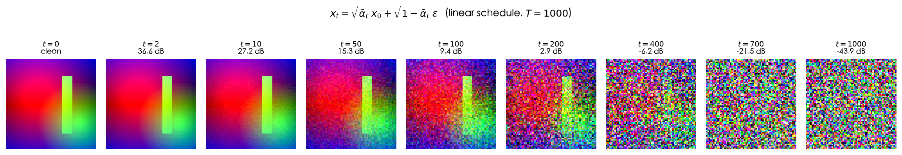
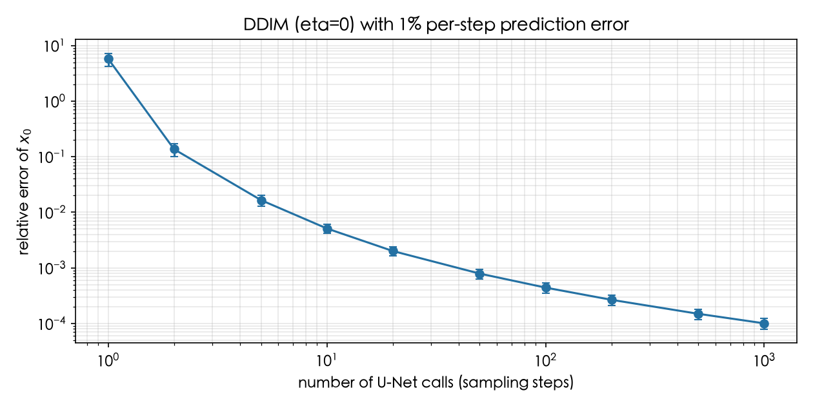
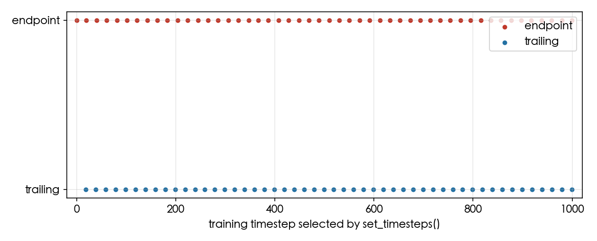
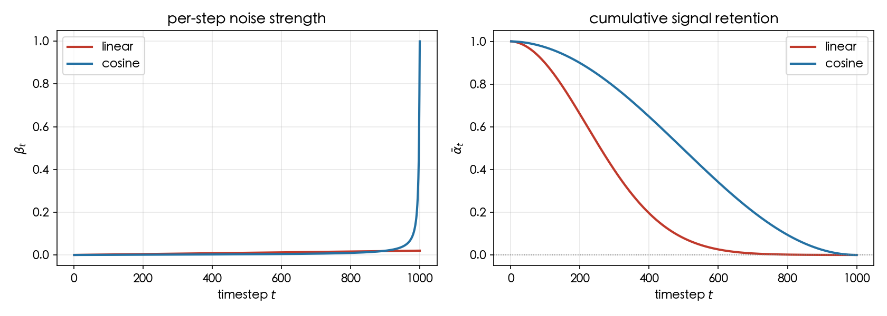
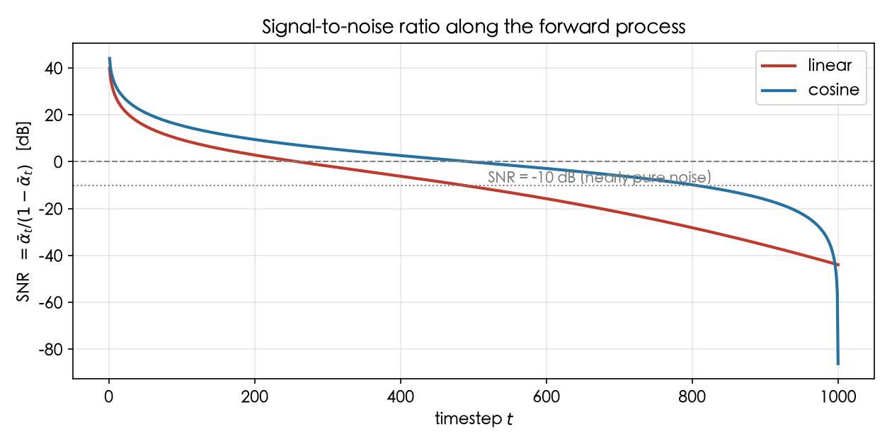

> **系列导航** ｜ [扩散模型综述：算法与应用](/2026/08/24/diffusion-survey-algorithms-applications/) ｜ [Score、扩散与 SDE](/2026/08/22/flow-matching-02-score-diffusion-sde/) ｜ [Flow Matching 原理篇](/2026/10/20/flow-matching-00-principles/) ｜ [扩散 Transformer 之一：Patchify、AdaLN-Zero 与 Token 预算](/2026/10/14/dit-01-patchify-adaln-zero-token-budget/)

> **TL;DR**
>
> * **前向过程只有一个目的**：把数据逐步推成标准高斯，并且任意步可以闭式采样——$$x_t=\sqrt{\bar\alpha_t}x_0+\sqrt{1-\bar\alpha_t}\epsilon$$。训练时不用真跑 $$t$$ 次前向，随机抽一个 $$t$$、按上式直接合成样本即可。
> * **简化目标把变分下界换成噪声回归**：$$L_{\mathrm{simple}}=\mathbb E\big\lVert\epsilon-\epsilon_\theta(x_t,t)\big\rVert^2$$。它丢掉了 ELBO 里的时间权重，换来更低方差和更好的生成质量，代价是训练目标不再是严格的似然下界，不能用它去比较不同模型的对数似然。
> * **时间步是全局条件，不是层号**：同一个 U-Net 在整个采样过程中被反复调用 $$T$$ 次；$$t$$ 经正弦位置编码后在每个残差块内注入，决定网络当前应该“去多少噪”。
> * **适用边界**：串行去噪意味着一次采样至少 $$T$$ 次网络前向，这是 DDPM 慢的结构性原因；DDIM（$$\eta=0$$）与高阶求解器把步数从 1000 压到几十步，代价是引入离散化误差，需要在采样预算与质量之间取舍。

## 一、DDPM 盯的是什么问题

生成模型的任务是从一个易采样的分布出发，把样本变换成目标数据分布 $$p_{\mathrm{data}}(x_0)$$。VAE 用一个编码器把这个变换一次性学出来，GAN 用判别器间接逼迫Generator 匹配分布，而 DDPM 选择了第三条路：**先定义一个固定的、能把数据毁成噪声的过程，再学它的逆过程**。

这条路有两个结构上的好处。第一，正向破坏过程完全由人指定、无需学习，所以中间状态的分布是可知的；第二，逆过程的每一步只需要做局部去噪，把一个极难的一步到位的生成任务拆成 $$T$$ 个相对容易的小任务。

下面沿着这条线索展开：先写清前向过程（§2），再看时间步如何进入网络（§3），然后是用什么目标训练（§4）、怎么采样与加速（§5）、网络长什么样（§6），最后是工程取舍与局限（§7–§8）。

## 二、前向扩散过程

### 2.1 单步马尔可夫链

每一步加噪遵循：

$$q(x_t\mid x_{t-1})=\mathcal N\big(x_t;\sqrt{1-\beta_t}\,x_{t-1},\ \beta_t I\big),\qquad \epsilon\sim\mathcal N(0,I)$$

等价地写成采样形式：

$$x_t=\sqrt{1-\beta_t}\,x_{t-1}+\sqrt{\beta_t}\,\epsilon$$

其中 $$\beta_t\in(0,1)$$ 是预设的方差序列（噪声调度），不参与学习。整个前向过程是一条马尔可夫链：

$$q(x_{1:T}\mid x_0)=\prod_{t=1}^{T}q(x_t\mid x_{t-1})$$

### 2.2 为什么是 $$\alpha_t=1-\beta_t$$

$$\alpha_t$$ 不是独立参数，是给余量起的名字。把单步写开，进入方差的是系数的平方：

$$\mathrm{Var}(x_t)=\alpha_t\,\mathrm{Var}(x_{t-1})+\beta_t,\qquad \alpha_t+\beta_t=1$$

这条递推里 $$\beta_t$$ 乘的是常数——它就是 $$\epsilon_t$$ 的方差，等于 1；系数 $$\alpha_t$$ 则是乘在上一时刻的方差上的。也就是说：**方差往前传递时是乘性衰减的，新注入的部分是加性的**。

这里有一个必须交代的前提。把上面的递推一路展开得

$$\mathrm{Var}(x_t)=\bar\alpha_t\,\mathrm{Var}(x_0)+(1-\bar\alpha_t)\cdot 1$$

只有当 $$\mathrm{Var}(x_0)=1$$ 时它才简并成 $$\mathrm{Var}(x_t)=1$$；对一般的数据分布，总方差并不恒为 1。所以 $$\alpha_t+\beta_t=1$$ 的确切含义是**参数化层面的一条约束，不是“每一步之后总方差仍为 1”这个结论**：

- $$\beta_t$$ 是调度里唯一自由、可解释的量——它就是这一步注入的噪声方差；
- $$\alpha_t$$ 是余额：噪声拿走 $$\beta_t$$ 的份额，信号能量的份额就还剩 $$1-\beta_t$$；
- 两者相加为 1，说的是“信号份额 + 噪声份额 = 1”，这就是“方差守恒（variance preserving，VP）”这个说法的来处——守恒的是这条**份额分配**，前提是 $$x_0$$ 已被归一化到单位方差。

两个容易看岔的地方：

- **$$\beta_t$$ 不进根号、$$\alpha_t$$ 进根号不是笔误**。$$\beta_t$$ 本身就是方差，直接填进分布；$$\alpha_t$$ 是方差的**份额**，而系数作用在样本上，所以进均值时要开方取 $$\sqrt{\alpha_t}$$。
- **这个取法等于宣布走 VP 路线**。换成 score-based 常用的 VE 参数化，根本没有 $$\alpha$$：$$x_t=x_0+\sigma_t\epsilon$$，方差随 $$\sigma_t$$ 发散，噪声靠加而不是靠“扣掉多少”。两条路线在 SDE 层面可以互相重参数化，但离散公式长得完全不同。

### 2.3 从单步到闭式：先看两步，再归纳

目标是消掉中间状态，直接拿到 $$q(x_t\mid x_0)$$。全程只用一件工具：**两个独立高斯之和仍是高斯，方差直接相加**。下面三段的分工是明确的，读的时候不必平摊注意力：

- **第一步（看两步）** 只负责建立直觉——信号系数怎么连乘、噪声怎么累积、为什么两项能并成一项。它本身不证明任意 $$t$$。
- **第二步（归纳一步）** 才是正式证明：把“两步成立”提升成“任意 $$t$$ 成立”。
- **第三步（换方向记账）** 不参与证明。它回答的是另一个问题：闭式里为什么会冒出 $$1-\bar\alpha_t$$ 这个量、它和噪声预算之和 $$\sum_s\beta_s$$ 是什么关系。这一段可以跳过，不影响后文。

**第一步：展开两层。** 把 $$x_{t-1}=\sqrt{\alpha_{t-1}}x_{t-2}+\sqrt{\beta_{t-1}}\epsilon_{t-1}$$ 代进单步：

$$x_t=\sqrt{\alpha_t\alpha_{t-1}}\,x_{t-2}+\underbrace{\sqrt{\alpha_t\beta_{t-1}}\,\epsilon_{t-1}+\sqrt{\beta_t}\,\epsilon_t}_{\text{两项独立、都是中心高斯}}$$

括号里两项为什么独立：$$\epsilon_{t-1}$$ 是上一步采的、$$\epsilon_t$$ 是这一步新采的，马尔可夫链的定义就是每一步重新注入一个与历史无关的噪声，所以两者独立；而 $$\sqrt{\alpha_t\beta_{t-1}}$$、$$\sqrt{\beta_t}$$ 都是确定的常数，线性组合的协方差里交叉项因此为 0。两项均值都是 0，和仍是中心高斯，方差直接相加：

$$\alpha_t\beta_{t-1}+\beta_t=\alpha_t(1-\alpha_{t-1})+(1-\alpha_t)=1-\alpha_t\alpha_{t-1}$$

于是 $$x_t=\sqrt{\alpha_t\alpha_{t-1}}\,x_{t-2}+\sqrt{1-\alpha_t\alpha_{t-1}}\,\epsilon$$——与单步同构，只是 $$\bar\alpha$$ 变成两层连乘。

这里合并出来的 $$\epsilon$$ 与原来的两项和**同分布**，但不是同一个随机变量：合并不是数值上的化简，而是“把一堆独立中心高斯换成一个等价的抽样方式”。为什么要这样换、换的合法性边界在哪，§2.4 单独交代。

**第二步：归纳一步。** 设 $$x_{t-1}=\sqrt{\bar\alpha_{t-1}}\,x_0+\sqrt{1-\bar\alpha_{t-1}}\,\epsilon'$$，代入：

$$x_t=\sqrt{\alpha_t\bar\alpha_{t-1}}\,x_0+\sqrt{\alpha_t(1-\bar\alpha_{t-1})}\,\epsilon'+\sqrt{\beta_t}\,\epsilon_t$$

均值系数 $$\sqrt{\alpha_t\bar\alpha_{t-1}}=\sqrt{\bar\alpha_t}$$；方差

$$\alpha_t(1-\bar\alpha_{t-1})+\beta_t=\alpha_t-\alpha_t\bar\alpha_{t-1}+1-\alpha_t=1-\bar\alpha_t$$

两处用的都是同一个 $$\alpha_t+\beta_t=1$$。归纳成立，任意时刻的边际分布与一步采样式同时得到：

$$q(x_t\mid x_0)=\mathcal N\big(x_t;\sqrt{\bar\alpha_t}\,x_0,\ (1-\bar\alpha_t)I\big)\ \Longleftrightarrow\ x_t=\sqrt{\bar\alpha_t}\,x_0+\sqrt{1-\bar\alpha_t}\,\epsilon$$

**第三步：换个方向看 $$1-\bar\alpha_t$$ 到底是谁。** 上面是往后展开，也可以往前记账：第 $$s$$ 步注入的 $$\beta_s$$ 在之后每一步都要被 $$\alpha_u$$ 衰减一次，于是

$$\mathrm{Var}_{\text{noise}}(x_t)=\sum_{s=1}^{t}\beta_s\prod_{u=s+1}^{t}\alpha_u$$

令 $$P_s=\prod_{u=s+1}^{t}\alpha_u$$，由 $$\beta_s=1-\alpha_s$$ 得 $$\beta_sP_s=P_s-P_{s-1}$$，求和就是望远镜：

$$\sum_{s=1}^{t}\beta_sP_s=P_t-P_0=1-\prod_{s=1}^{t}\alpha_s=1-\bar\alpha_t$$

这解释了为什么闭式里出现的是 $$1-\bar\alpha_t$$ 而**不是**噪声预算之和 $$\sum_s\beta_s$$：$$\bar\alpha_t$$ 是信号还剩多少，$$1-\bar\alpha_t$$ 是噪声进来多少，两者恒和为 1。线性调度下 $$\sum_s\beta_s=10.05$$，按方差直接累加会远超 1——能恰好累到 1，是因为每一项都被后续的 $$\alpha$$ 打过折。

三步都是可核验的代数恒等式，脚本里逐条对账：两层展开误差 $$1.4\times10^{-16}$$、归纳一步 $$2.2\times10^{-16}$$、望远镜求和 $$1.3\times10^{-15}$$，全在 float64 的舍入量级。

取对数能把“$$\beta$$ 加性、$$\alpha$$ 乘性”看得更直白：

$$\log\bar\alpha_T=\sum_{s=1}^{T}\log(1-\beta_s)\approx-\sum_{s}\beta_s-\frac{1}{2}\sum_{s}\beta_s^{2}$$

线性调度下 $$\sum_s\beta_s=10.0500$$、$$\frac{1}{2}\sum_s\beta_s^2=0.0670$$，于是 $$\bar\alpha_T\approx e^{-10.117}=4.0386\times10^{-5}$$，与实测 $$4.0358\times10^{-5}$$ 相对差 $$6.8\times10^{-4}$$。单步的 $$\beta_T=0.02$$ 看着很小，是因为它只是 log 上的 0.02，而 1000 步加起来是 10.05。

$$\bar\alpha_T\approx 0$$ 正是调度要满足的条件。线性调度下 $$\bar\alpha_T=4.04\times10^{-5}$$，信号能量只剩十万分之四，此时把 $$x_T$$ 当作标准高斯采样才是安全的。

### 2.4 为什么 $$t$$ 个噪声能合成一个

上面把 $$t$$ 项噪声合成了一个 $$\epsilon$$，这一步必须是**严格相等**而不是“推得够多就近似”。理由只有一句：线性组合加独立中心高斯，结果仍是中心高斯，分布只由方差决定；而各个 $$\epsilon_s$$ 同分布且独立，所以合并出来的那一个与 $$\mathcal N(0,I)$$ 同分布。

这条“分布意义上的相等”带来三个后果，前两个是整个算法能跑起来的前提：

1. **训练可随机访问**。在 $$1,\ldots,T$$ 上均匀采一个 $$t$$、再采一个 $$\epsilon$$，就能直接合成任意噪声强度的样本 $$(x_t,t,\epsilon)$$，**不需要真的执行 $$t$$ 次前向传播**。$$T$$ 步的序列化过程变成一个可随机访问的数据集，训练复杂度与 $$T$$ 解耦。
2. **样本之间完全独立**。没有序列、没有状态，不同样本、不同 batch 的 $$t$$ 互不相干，可以直接堆成 batch。
3. **但联合结构没被保留**。拿到 $$x_t$$ 无法反推 $$x_{t-1}$$：边缘已知不等于联合已知。“边缘已知不等于联合已知”这句话值得落到一个具体例子上：设 $$x_1,x_2$$ 各自服从 $$\mathcal N(0,1)$$，它们的联合分布由相关系数 $$\rho$$ 决定；$$\rho=0.9$$ 与 $$\rho=-0.9$$ 给出**完全相同**的两个边缘，却是两个截然不同的联合分布。只掌握每个时刻的边际，等于把 $$\rho$$ 这类相关性整个丢掉了。同理，知道 $$q(x_t\mid x_0)$$ 只说明“给定 $$x_0$$ 时 $$x_t$$ 怎么分布”，并不等于知道“给定 $$x_t$$ 时 $$x_{t-1}$$ 怎么分布”——后者是一个条件分布，必须回到马尔可夫结构上重新推。§4.1 里那组 $$\tilde\mu_t$$、$$\tilde\beta_t$$ 就是另一次独立推导，不是这条闭式的推论。

分布层面的核验：对一个固定的 $$x_0$$，一边按单步马尔可夫链真的推 $$t$$ 次、另一边直接用闭式，两边各 20 万条样本，均值与方差应当逐点相合——实测 $$t=1,10,100,500,1000$$ 上均值最大偏差 $$5.4\times10^{-3}$$、方差最大偏差 $$1.1\times10^{-3}$$，全部落在蒙特卡洛误差量级内。

### 2.5 时间步到底指的是什么

这是理解 DDPM 最容易出错的地方：**$$t$$ 不是神经网络的层编号，而是输入图像的噪声水平**。同一个 U-Net 在不同的 $$t$$ 上被反复调用：

| 时间步 | $$x_t$$ 的状态（$$T=1000$$ 时） |
| --- | --- |
| $$t=0$$ | 干净数据，无噪声 |
| $$t\approx 100$$ | 轻度噪声，局部纹理受损 |
| $$t\approx 500$$ | 中度噪声，全局轮廓尚存、细节丢失 |
| $$t=1000$$ | 几乎不可分辨，接近标准高斯 |

所以 DDPM **没有 1000 层网络**，它只有一个网络、$$T$$ 种不同的工作条件。$$t$$ 是整个 U-Net 的**全局条件变量**，它告诉网络“当前输入里的信噪比是多少”——信噪比高时该做细微修正，信噪比低时该先把大体结构猜出来。

**两套索引必须先对齐，否则后面全是歧义。** 本文的数学记号把干净数据记作 $$x_0$$、纯噪声记作 $$x_T$$，转移 $$q(x_t\mid x_{t-1})$$ 从 $$t=1$$ 走到 $$T$$，对应的调度量是 $$\beta_1,\ldots,\beta_T$$。官方实现与 diffusers 的张量是 0 索引：把数组下标记作 $$i$$，则 $$i=t-1$$。

| 论文记号 | 数组下标 | 代码里怎么写 |
| --- | --- | --- |
| $$\beta_t$$ | $$i=t-1$$ | `betas[i]` |
| $$\bar\alpha_t$$ | $$i=t-1$$ | `alpha_bar[i]` |
| $$x_t$$ | $$i=t$$ | 第 $$t$$ 个噪声等级的样本 |

$$\beta$$、$$\bar\alpha$$ 的索引差一位而 $$x$$ 不差，这一点最容易被忽略：`betas[0]` 是第一次加噪用的 $$\beta_1$$，而 `x[0]` 就是干净数据 $$x_0$$。所以 §5.1 采样循环里 `for t in reversed(range(T))` 的那个 `t` 是**下标**，循环体里的 `beta[t]`、`alpha_bar[t]` 分别对应 $$\beta_{t+1}$$、$$\bar\alpha_{t+1}$$；循环终点的 `t == 0` 那一步，正是从 $$x_1$$ 生成 $$x_0$$ 的那一步，这也是“最后一步不加随机项”的判据写成 `t > 0` 而不是 `t > 1` 的原因。

由于 $$x_t$$ 中的信号被 $$\sqrt{\bar\alpha_t}$$ 缩放，从输入本身其实能反推出一部分噪声水平信息，但显式地喂给网络 $$t$$ 更有效也更稳定。

**“信噪比”在本文有确切口径。** 后文与配图反复出现 SNR 和 dB，这里先把它定死。把闭式 $$x_t=\sqrt{\bar\alpha_t}x_0+\sqrt{1-\bar\alpha_t}\epsilon$$ 拆成两项看：信号项的逐分量方差是 $$\bar\alpha_t\,\mathrm{Var}(x_0)$$，噪声项的方差是 $$1-\bar\alpha_t$$，两者之比就是

$$\mathrm{SNR}(t)=\frac{\bar\alpha_t\,\mathrm{Var}(x_0)}{1-\bar\alpha_t}$$

在 §2.2 那个“$$x_0$$ 已归一化到单位方差”的前提下，它化简成最常用的形式：

$$\mathrm{SNR}(t)=\frac{\bar\alpha_t}{1-\bar\alpha_t}$$

本文与配图里的 dB 值都是 $$10\log_{10}\mathrm{SNR}(t)$$。线性调度下 $$\bar\alpha_T=4.04\times10^{-5}$$，折合 $$-43.9$$ dB——与 §7.1 表里那一行对得上；$$\mathrm{SNR}=0$$ dB 正是信号方差与噪声方差相等的分界点，越过它之后噪声已经压过信号。

$$\bar\alpha_t$$ 单调递减，所以 $$\mathrm{SNR}(t)$$ 也单调递减，且是 $$t$$ 的严格单调函数。这让它成为一个比 $$t$$ 更“物理”的横轴：两条调度在同一个 $$t$$ 上的噪声水平可能差很多，放到同一根 SNR 轴上就能直接比——§7.1 正是这么做的。

一张合成图上逐步加噪的直观结果（$$T=1000$$ 线性调度，每格下标是该步的信噪比）：



这里有一处经常含混的地方：**$$t$$ 只决定噪声的等级，不决定噪声的具体样子**。同一个 $$t$$ 换一个 $$\epsilon$$，得到的是同一个条件分布里的另一个样本。在 $$d=8$$、$$t=500$$ 上实测 $$\bar\alpha_{500}=0.0786$$：两次独立采样的**均方**距离与理论值 $$2d(1-\bar\alpha_t)=14.74$$ 相合（偏差 $$2.3\times10^{-3}$$），对应的平均欧氏距离是 3.72。这个事实决定了 $$\epsilon_\theta$$ 能学到的上限：在给定 $$t$$ 上它没有能力“猜出”是哪一个 $$\epsilon$$，只能学到这个条件分布的均值。

## 三、时间步如何进网络

### 3.1 时间嵌入

$$t$$ 是标量，需要先映射成高维向量。DDPM 用的是 Transformer 那套正弦位置编码：

$$\mathrm{TE}(t)=\big[\sin(\omega_1 t),\cos(\omega_1 t),\ldots,\sin(\omega_d t),\cos(\omega_d t)\big],\qquad \omega_k=\frac{1}{10000^{\,2k/d}}$$

它借的是傅里叶特征的路子：不同频率分量的周期从 $$1$$ 一直铺到 $$10000$$，低频率负责粗分辨、高频率负责细分，拼成一个向量后，相邻的整数步也能被区分开。三个常被引用的性质里，有两个要打折扣：

- **取值有界**：这一条确实成立，每一项都落在 $$[-1,1]$$ 内。
- **相邻的 $$t$$ 编码距离小**：把 $$t$$ 当连续量看时成立，在整数步长上表现为差分有界。这让网络能在邻近时间步之间插值，而不必给每个 $$t$$ 单独记一套行为。
- **不同步“近似正交”**：这个说法只在很窄的意义下成立——维度 $$d$$ 较大、且对若干组不同频率做平均时，两个编码的内积会向 0 集中，那是高维随机相位的典型行为。但对具体的两个整数 $$t,t'$$，内积既不为 0 也不“接近正交”。它真正提供的是**可分辨性**而不是**正交性**；把后者当设计目标，会推出“网络可以对每个 $$t$$ 学到互不干扰的行为”这类错误结论——实际上共享参数让相邻 $$t$$ 的行为必然是耦合的。

编码之后通常再过一层 MLP 得到条件向量 $$e_t$$。

### 3.2 注入策略

常见的注入方式有三种：

1. **加法注入**：把 $$e_t$$ 投影后直接加到残差块的特征图上，实现最简单。
2. **缩放偏移（AdaGN / scale-shift modulation）**：先做 GroupNorm，再用 $$e_t$$ 学出的 $$\gamma_t,\beta_t$$ 做仿射变换。这是目前最常用的形式，与 DiT 里的 AdaLN 属于同一类机制。
3. **交叉注意力**：把条件作为额外的 key / value 引入注意力层，多用于文本等更复杂的条件。

一个值得注意的事实：在同一次前向传播里，所有残差块收到的是**同一个** $$t$$。它们之所以能学到不同的去噪行为，靠的是各层参数不同、各分辨率的特征尺度不同，以及 $$e_t$$ 在进入不同块之前各自独立的投影。

## 四、训练目标

### 4.1 从变分下界到简化目标

严格的目标是对数似然的变分下界。把 ELBO 展开，每一项都是两个高斯的 KL：真正的后验 $$q(x_{t-1}\mid x_t,x_0)$$（高斯，且是闭式的）与模型 $$p_\theta(x_{t-1}\mid x_t)$$。两个高斯的 KL 有闭式解，因此目标可以写成：

$$L_{\mathrm{vlb}}=\mathbb E\Big[\sum_{t>1}D_{\mathrm{KL}}\big(q(x_{t-1}\mid x_t,x_0)\,\|\,p_\theta(x_{t-1}\mid x_t)\big)-\log p_\theta(x_0\mid x_1)\Big]$$

#### ELBO 是怎么拆成逐项 KL 的

真目标算不出来：$$\log p_\theta(x_0)=\log\int p_\theta(x_{0:T})\,\mathrm dx_{1:T}$$ 是 $$T\times d$$ 维积分，既没有闭式也没法直接求梯度。前向链 $$q(x_{1:T}\mid x_0)$$ 完全由调度指定、不含参数，正好拿来当提议分布——乘一个 $$q$$ 再除一个 $$q$$，再用一次 Jensen：

$$\log p_\theta(x_0)=\log\mathbb E_q\Big[\frac{p_\theta(x_{0:T})}{q(x_{1:T}\mid x_0)}\Big]\ \ge\ \mathbb E_q\Big[\log\frac{p_\theta(x_{0:T})}{q(x_{1:T}\mid x_0)}\Big]$$

等号是重要性采样，不等号是 Jensen；两者之间的差正是两条整链的 KL，所以这个下界只会被 $$q$$ 与真实反向链的差距拖低——这就是“变分下界”四个字的全部含义。

接下来的关键是把整链的差拆成逐项。分子分母都按链展开：

$$p_\theta(x_{0:T})=p(x_T)\prod_{t=1}^{T}p_\theta(x_{t-1}\mid x_t),\qquad q(x_{1:T}\mid x_0)=\prod_{t=1}^{T}q(x_t\mid x_{t-1})$$

再把每一条前向转移用贝叶斯改写成含 $$x_0$$ 的形式：

$$q(x_t\mid x_{t-1})=q(x_{t-1}\mid x_t,x_0)\cdot\frac{q(x_t\mid x_0)}{q(x_{t-1}\mid x_0)}$$

代进去求和，后面那个分式在 $$t$$ 上是望远镜：$$\sum_t\big[\log q(x_t\mid x_0)-\log q(x_{t-1}\mid x_0)\big]=\log q(x_T\mid x_0)$$。剩下的正好三项：

$$\mathrm{ELBO}=\mathbb E_q\log\frac{p(x_T)}{q(x_T\mid x_0)}+\sum_{t\ge2}\mathbb E_q\log\frac{p_\theta(x_{t-1}\mid x_t)}{q(x_{t-1}\mid x_t,x_0)}+\mathbb E_q\log p_\theta(x_0\mid x_1)$$

把符号翻过来就是最小化的写法：三项分别是起点项 $$L_T$$、去噪项 $$L_{t-1}$$（重复 $$T-1$$ 次）、解码项 $$L_0$$。开头那条 $$L_{\mathrm{vlb}}$$ 里看不到 $$L_T$$，因为它不含 $$\theta$$——$$p(x_T)$$ 是固定先验、$$q(x_T\mid x_0)$$ 由调度决定，整项是常数，对梯度没有贡献，实现里直接丢掉。

#### 真实后验的两个参数

后验只在给定 $$x_0$$ 时才是可算的（否则要积分整条链）。用贝叶斯公式加马尔可夫性，它只涉及两个已知高斯：

$$q(x_{t-1}\mid x_t,x_0)\ \propto\ q(x_t\mid x_{t-1})\,q(x_{t-1}\mid x_0)$$

$$\propto\ \exp\Big(-\frac{\lVert x_t-\sqrt{\alpha_t}\,x_{t-1}\rVert^2}{2\beta_t}-\frac{\lVert x_{t-1}-\sqrt{\bar\alpha_{t-1}}\,x_0\rVert^2}{2(1-\bar\alpha_{t-1})}\Big)$$

指数上是 $$x_{t-1}$$ 的二次型，所以结果必是高斯，两个参数各由一次加法得到。

**精度相加**（两个高斯相乘，二次项系数相加）：

$$\frac{1}{\tilde\beta_t}=\frac{\alpha_t}{\beta_t}+\frac{1}{1-\bar\alpha_{t-1}}\quad\Longrightarrow\quad \tilde\beta_t=\frac{\beta_t(1-\bar\alpha_{t-1})}{\alpha_t(1-\bar\alpha_{t-1})+\beta_t}=\frac{1-\bar\alpha_{t-1}}{1-\bar\alpha_t}\beta_t$$

分母 $$\alpha_t(1-\bar\alpha_{t-1})+\beta_t$$ 就是 §2.3 归纳一步里出现过的那一项，它等于 $$1-\bar\alpha_t$$——同一个恒等式在换了个地方起作用。

**均值取精度加权**（两个高斯的均值按各自精度加权平均）：

$$\tilde\mu_t=\tilde\beta_t\Big(\frac{\sqrt{\alpha_t}}{\beta_t}x_t+\frac{\sqrt{\bar\alpha_{t-1}}}{1-\bar\alpha_{t-1}}x_0\Big)=\frac{\sqrt{\bar\alpha_{t-1}}\,\beta_t}{1-\bar\alpha_t}x_0+\frac{\sqrt{\alpha_t}\,(1-\bar\alpha_{t-1})}{1-\bar\alpha_t}x_t$$

这就是下文反复用到的两个量：$$\tilde\mu_t$$ 是 §5.1 采样时模型要拟合的目标，$$\tilde\beta_t$$ 是 §5.3 讨论“最后一步为什么加噪”时那个 $$\sigma_t^2$$ 的 DDPM 取值。

DDPM 的做法是：既然网络可以直接预测噪声 $$\epsilon$$，就用它把 $$\tilde\mu_t$$ 重参数化，再把目标换成预测噪声与真噪声之间的均方误差，并**丢掉 KL 带来的那组时间权重**：

$$L_{\mathrm{simple}}=\mathbb E_{x_0,\,t,\,\epsilon}\Big\lVert\epsilon-\epsilon_\theta(x_t,t)\Big\rVert^2$$

#### 丢掉的那组权重有多大

$$L_{t-1}$$ 里随 $$t$$ 变化的只有 $$1/(2\tilde\beta_t)$$。把 $$\mu_\theta$$ 用 $$\epsilon_\theta$$ 写开（§5.1），两个均值之差就正比于两个噪声之差：

$$\big\lVert\tilde\mu_t-\mu_\theta\big\rVert^2=\frac{\beta_t^{2}}{\alpha_t(1-\bar\alpha_t)}\big\lVert\epsilon-\epsilon_\theta\big\rVert^2$$

$$\Longrightarrow\quad L_{t-1}=\frac{\beta_t^{2}}{2\tilde\beta_t\,\alpha_t(1-\bar\alpha_t)}\big\lVert\epsilon-\epsilon_\theta\big\rVert^2=\frac{\beta_t}{2\alpha_t(1-\bar\alpha_{t-1})}\big\lVert\epsilon-\epsilon_\theta\big\rVert^2$$

这个系数在时间轴上跨了两个数量级（线性调度，脚本直接算出）：

| $$t$$ | 2 | 10 | 100 | 500 | 1000 |
| --- | --- | --- | --- | --- | --- |
| 系数 $$\beta_t\big/\big(2\alpha_t(1-\bar\alpha_{t-1})\big)$$ | 0.5997 | 0.0864 | 0.0103 | 0.0055 | 0.0102 |

$$L_{\mathrm{simple}}$$ 把它一律换成 1：相对 $$t=500$$，$$t=2$$ 那一项被压低了 108.9 倍，等于把注意力的重心整体推向高噪声段。这是经验选择而不是推导结果——原论文报的是 FID 更好，代价随即可见：**换掉权重之后，目标不再对应任何一个似然下界**。

这个简化是有代价的，必须写清楚：

- **收益**：去掉权重后目标的方差显著降低，训练更稳，主观生成质量更好（原论文 FID 指标也更优）。
- **代价**：$$L_{\mathrm{simple}}$$ 不再是 log-likelihood 的严格下界，**不同模型之间的 $$L_{\mathrm{simple}}$$ 数值不可直接比较**，也不能拿它去做似然相关的评测。想优化真似然，还得回到带权重的 $$L_{\mathrm{vlb}}$$（其中 $$L_{t-1}$$ 项用预测均值与 $$\tilde\mu_t$$ 的加权 MSE 计算）或离格式 loss。

### 4.2 训练流程

对每个 batch：

1. 采数据 $$x_0\sim p_{\mathrm{data}}$$；
2. 均匀采时间步 $$t\sim\mathcal U\{1,\ldots,T\}$$，采噪声 $$\epsilon\sim\mathcal N(0,I)$$；
3. 用 §2.3 的闭式合成本步的带噪样本 $$x_t$$；
4. 前向 $$\hat\epsilon=\epsilon_\theta(x_t,t)$$，对 $$\lVert\epsilon-\hat\epsilon\rVert^2$$ 求梯度。

注意这里没有任何序列：不同样本、不同 batch 的 $$t$$ 完全独立。

## 五、采样与 DDIM 加速

### 5.1 反向马尔可夫链上的祖先采样

学习到的反向转移是一个高斯：

$$p_\theta(x_{t-1}\mid x_t)=\mathcal N\big(x_{t-1};\ \mu_\theta(x_t,t),\ \sigma_t^2 I\big)$$

用 §4.1 的 $$\tilde\mu_t$$ 做模板、把其中的 $$x_0$$ 换成从当前预测反解出来的干净图像

$$\hat x_0=\frac{x_t-\sqrt{1-\bar\alpha_t}\,\epsilon_\theta(x_t,t)}{\sqrt{\bar\alpha_t}}$$

代入即得：

$$\mu_\theta(x_t,t)=\frac{1}{\sqrt{\alpha_t}}\Big(x_t-\frac{\beta_t}{\sqrt{1-\bar\alpha_t}}\,\epsilon_\theta(x_t,t)\Big)$$

完整采样循环（**这里用的是数组下标**，与 §2.5 的映射表对照：`t` 对应论文时间步 $$t+1$$）：

```python
x_T = torch.randn_like(x)                 # 从标准高斯出发
for t in reversed(range(T)):              # t = T-1, ..., 0
    eps = unet(x, t)                      # 同一个 U-Net，输入不同 x 与 t
    eps_coef = beta[t] / (1 - alpha_bar[t]).sqrt()
    mean = (x - eps_coef * eps) / alpha[t].sqrt()
    z = torch.randn_like(x) if t > 0 else 0      # 代码的 t==0 对应论文里 x_1 -> x_0 那一步
    x = mean + sigma[t] * z               # sigma_t^2 取 beta_t 或后验方差（见 §5.3）
```

整个过程是串行的：必须算出 $$x_{t-1}$$ 才能算下一步。生成一张图要做 $$T$$ 次网络前向，这就是 DDPM 慢的结构性原因，也是后续加速工作的共同出发点。

这里要澄清一个常见误称。DDPM 的采样**不是**用 ODE 求解器迭代出来的：每一步都是从学到的反向条件分布 $$p_\theta(x_{t-1}\mid x_t)$$ 里抽一个样本，这是概率图模型里标准的**祖先采样**（ancestral sampling）——沿有向边依次做条件采样。它看起来像一阶显式离散化，但相似性只到“都把演化切成小步”为止：ODE 求解器求的是一条确定的轨迹，祖先采样求的是一个随机过程的样本路径，后者没有连续时间上的对象可供“求解”，也就谈不上阶数和截断误差。真正基于 ODE 的那条线（DPM-Solver 一系）是先证明采样能改写成概率流 ODE 的初值问题，再用显式 Runge–Kutta 类方法去积，那才配得上“求解器”这个词。

### 5.2 三条写法是同一个向量

$$\tilde\mu_t$$、$$\mu_\theta$$、$$\hat x_0$$ 这三组系数在论文和各家实现里轮番出现，很容易被当成三种不同的模型，它们其实是同一个向量的三种排布。在 $$t=2,50,300,900,1000$$ 上逐点比对：三种写法算出的向量最大差异 $$2.4\times10^{-14}$$，后验方差 $$\tilde\beta_t$$ 的两种写法差异在 $$10^{-17}$$ 量级，全是浮点误差。

### 5.3 最后一步为什么不加随机项

$$\sigma_t$$ 是**后验的标准差**，不是随手写的学习率：$$\tilde\beta_t=\frac{1-\bar\alpha_{t-1}}{1-\bar\alpha_t}\beta_t$$（§4.1 配出来的那一项），DDPM 的另一条做法是用网络把它学出来（learned variance）。线性调度下它的绝对值随 $$t$$ 减小而单调下降。

代码里 `z = randn if t > 0 else 0` 这一行，对应论文记号下“从 $$x_1$$ 生成 $$x_0$$ 的那一步不注噪”。理由有三条，按分量排：

1. **这一步要的是点估计，不是分布样本**。前面每一步的输出都还是带噪的中间态，需要它保持服从对应的边际分布，所以必须注噪；而最后一步的输出就是最终交付的像素值。往一张已经成型的图再叠一层噪声，等于主动把刚算出来的结果打脏，且之后没有任何一步能修正它。
2. **绝对幅度已经足够小**。线性调度下 $$\beta_1=10^{-4}$$，于是 $$\sigma_1=\sqrt{\beta_1}=0.01$$；相对 $$[-1,1]$$ 的像素范围只有 1%，加与不加在视觉上分不出来。这一条解释了为什么这个约定在实践中从未引起争议——它本来就在噪声的舍入量级上。
3. **连续时间极限下它本来会消失**。把 1000 步看成 $$[0,1]$$ 上的均匀离散，反向 SDE 的扩散系数在末端趋于 0，后验方差同步趋于 0。离散实现里“最后一步不注噪”是这条极限行为的粗粒度落地，不是一条孤立的经验规则。

顺带纠正一个容易走反的论证。若改用**相对**尺度衡量随机项，即 $$\sigma_t/\sqrt{1-\bar\alpha_{t-1}}$$，它在时间轴上并不单调：从 $$t=1000$$ 的 14.1% 先降到 $$t=250$$ 的 10.3%，随后一路升到 $$t=10$$ 的 38.4%、$$t=2$$ 的 73.9%。这个趋势说明的是“采样末段每一步的随机扰动相对该步目标更容易显形”，它可以解释为什么有人愿意在末段把 $$\eta$$ 调小；但它**不能**用来说明最后一步为什么不加——若相对占比大就该不加，那 $$t=2$$ 的 73.9% 更该不加，而它显然加了。判据是绝对幅度，不是相对比例。

### 5.4 DDIM：非马尔可夫前向与可跳步的反向采样

DDIM 的关键观察是：**前向过程不必非要马尔可夫**。只要满足边际条件 $$q(x_t\mid x_0)=\mathcal N(\sqrt{\bar\alpha_t}x_0,(1-\bar\alpha_t)I)$$，前向链有无穷多种取法（不同的联合结构，同一个边际——正是 §2.4 第 3 点说的那件事）；换一种取法，反向采样就变成：

$$x_{t-1}=\sqrt{\bar\alpha_{t-1}}\,\hat x_0+\sqrt{1-\bar\alpha_{t-1}-\sigma_t^2}\,\epsilon_\theta(x_t,t)+\sigma_t\epsilon_t$$

$$\sigma_t^2=\eta\cdot\frac{1-\bar\alpha_{t-1}}{1-\bar\alpha_t}\Big(1-\frac{\bar\alpha_t}{\bar\alpha_{t-1}}\Big)$$

其中 $$\hat x_0$$ 用 §5.1 的式子反解，$$\epsilon_t\sim\mathcal N(0,I)$$。参数行为：

- $$\eta=1$$：退回 DDPM 的随机采样——但这一步等价是有条件的：$$\sigma_t^2$$ 必须取成前文那个 $$\tilde\beta_t=\frac{1-\bar\alpha_{t-1}}{1-\bar\alpha_t}\beta_t$$，且式中的 $$t-1$$ 必须是原序列上真正相邻的那一步。一旦跳步（见本节末），相邻关系变了，$$\eta=1$$ 只是形式上保留了同样的注噪比例，不再逐点还原 DDPM 的采样分布。
- **$$\eta=0$$**：$$\sigma_t=0$$，随机项消失，更新式退化成一条确定的递推——同一个初始 $$x_T$$ 永远得到同一张图，这也让潜空间插值和编辑变得可以做。
- 需要区分的是，**这条确定性递推并不等于在精确求解某个连续 ODE**。它是概率流 ODE（probability flow ODE）的一阶离散近似，两者只在步长趋于零时重合。把 $$\eta=0$$ 直接读成“DDIM 求解了 ODE”，会诱使读者套用高阶求解器的收敛阶结论，从而高估它的精度——DDIM 在 50 步上的误差仍然是一阶截断误差量级，不是四阶 RK 的量级。

#### 步数到底换来了什么

在一个可控的合成装置上（16 维单位球面上的点作为数据，每一步给噪声预测注入 1% 的、依赖当前状态的误差），$$\eta=0$$ 的终点相对误差随 U-Net 调用次数单调下降：

| U-Net 调用次数 | 1 | 2 | 5 | 20 | 50 | 200 | 1000 |
| --- | --- | --- | --- | --- | --- | --- | --- |
| 平均相对误差 | 5.95 | 0.136 | 0.0174 | 0.0022 | 0.0008 | 0.0003 | 0.0001 |



一步跳到位的误差可以用一个乘法完全解释：**单步 DDIM 的终点误差恰好等于 $$\sqrt{(1-\bar\alpha_T)/\bar\alpha_T}\,\lVert\delta\rVert$$**，其中 $$\delta$$ 是那一步的预测误差，上式与实测的偏差在 $$10^{-14}$$ 以内。线性调度下 $$\bar\alpha_T=4.04\times10^{-5}$$，这个放大系数是 **157.4**——末端几乎没有信号留存，预测里 1% 的偏差要被放大两个数量级才落到 $$x_0$$ 上，于是 1 步的相对误差直接冲到 5.95。多步之所以见效，是因为每一步要跨的 $$\bar\alpha$$ 区间变小，末段的放大系数随之塌下来：同一个 toy 里，误差从 1 步到 1000 步压缩到原来的 $$1.75\times10^{-5}$$。

顺带一个细节：误差减免几乎全发生在前几十步。20 步已经把误差压到 0.002，再往 1000 步走只再赚一个数量级——这与实践里 DDIM 常用 20–50 步的经验是同一件事。

**这个装置的结论边界必须说清。** 它测的是“在每步 1%、与当前状态相关的各向同性误差模型下，离散化误差怎么随步数衰减”，是一个受控的误差传播实验。它不能外推成真实图像的“步数—质量曲线”：真实模型的误差既不是 1% 的各向同性扰动，也强烈依赖当前噪声水平与数据流形；而 FID 之类的指标还牵涉分布覆盖，与终点相对误差不是一回事。两者在实践中趋势常常一致，但**这不是定理**，把 toy 的曲线当成“步数—质量”的理论曲线会误判。

#### 加了随机项之后

用同一个装置也能说清 $$\eta$$ 的角色，结论和直觉略有出入：

- **模型完美时它完全不起作用**。如果在每一步都用精确实算给出 $$\epsilon$$，那么无论 $$\eta=0$$ 还是 $$\eta=1$$，同一个 $$x_T$$ 都精确回到同一个 $$x_0$$（相对偏差小于 $$10^{-8}$$）。原因很直接：模型完美意味着每步反解出来的 $$\hat x_0$$ 恒等于真值，随机项只搅乱中间轨迹，终点因此与 $$\eta$$ 无关。这也把“反向 ODE 与反向 SDE 输运同一族边缘分布”这句话落到了实处——两条路给出的是同一个分布，差别只在路径的随机性，而随机性只有在存在模型误差时才会转化为终点偏差。
- **有模型误差时，它换来的是多样性而不是精度**。$$\eta=0$$ 是一条确定性映射：换 20 条随机流，20 个终点是同一个点（多样度严格为 0）；$$\eta=1$$ 把同一个 $$x_T$$ 摊开成一片样本，这片散布占终点偏差的比例从 20 步时的 **49.2%** 降到 50 步的 28.1%、100 步的 15.8%——步数越多，每步能注入的 $$\sigma_t$$ 越小，撑开的散布范围也越小。这时平均终点误差与 $$\eta=0$$ 仍是同一个量级（比值 1.08 / 1.05 / 1.02，随机项反而略差一点）：随机项既没有修复模型误差，也没有把误差放大成数量级的差别。需要说明的是，这个比值对随机种子不稳妥（换一批种子会在 0.9–1.1 之间摆动，早期的 numpy 版本测出的是 0.90 / 0.98 / 0.98），所以能写进结论的只有「同量级」这一条，**不要**拿它去论证「随机项能/不能修复误差」。**$$\eta$$ 取舍的是多样性与确定性，不是准与不准**；想要可插值、可复现的 latent 编辑就取 $$\eta=0$$，想要同一个起点能长出不同样本就放宽 $$\eta$$。

真正的加速来自 DDIM 允许**只跑原时间序列的一个子序列** $$[\tau_1,\ldots,\tau_S]$$（$$S\ll T$$），把式中的 $$\bar\alpha_{t-1}$$ 换成子序列里上一个时刻的 $$\bar\alpha$$。因为不再要求每步的分布恰好匹配一条马尔可夫链，跳步带来的是这条确定性递推的一阶截断误差，而不是“分布不匹配”那一类结构性偏差，于是 50 步甚至 20 步也能得到合理结果。

这只是三类加速路线中的一类：

| 路线 | 代表 | 思路 | 代价 |
| --- | --- | --- | --- |
| 免训练跳步 | DDIM、DPM-Solver | 用高阶 ODE 求解器支持更大的步长 | 步长越大，离散化误差越明显 |
| 蒸馏 | Consistency Models、LCM | 训练模型在少数几步内到达同样的终点 | 需要额外训练，容量受限时细节下降 |
| 换空间 | Latent Diffusion | 在压缩后的潜空间扩散，像素上的计算交给自编码器 | 生成质量受自编码器重建上限约束 |

#### 这 50 步是哪 50 步

把 1000 步压到 50 步，还有一个容易被忽略的实现细节：**子序列具体取了哪些时间步**。三种常见的取点规则在同样 $$N=50$$ 次调用的预算下给出不同的序列：

| 规则 | 取点 | $$N=5$$ 时的序列 | $$N=50$$ 时的最大时间步 |
| --- | --- | --- | --- |
| endpoint | $$\mathrm{round}\big(i(T-1)/(N-1)\big)$$ | 999, 749, 500, 250, 0 | 999 |
| stride | $$\mathrm{round}\big(i\lfloor T/N\rfloor\big)+o$$ | 800, 600, 400, 200, 0 | 980 |
| trailing | $$\mathrm{round}\big((i+1)T/N\big)-1$$ | 999, 799, 599, 399, 199 | 999 |

三者都严格降序、不重复、不越界，但走的是三条不同的采样路径：endpoint 一定取到最脏的 $$T-1$$ 和干净的 $$0$$；stride 用整数步长，最大只能到 980，**训练时最脏的那一段从来不会被问到**；trailing 从不落在 $$0$$ 上（$$N=50$$ 时最小是 19），最后一段由边界处理补齐。



这提醒一件很实际的事：**同一个「50 步 DDIM」在不同实现之间并不等价**，比较两篇论文的“步数–质量”曲线之前，得先确认他们的 $$[\tau_i]$$ 是怎么挑出来的。

## 六、U-Net 骨架

DDPM 用的是带注意力机制的 U-Net：

- **编码器**：多级下采样，逐级提高通道数、降低分辨率，提取多尺度特征；
- **瓶颈层**：最低分辨率上接自注意力，做全局信息混合；
- **解码器**：上采样重建分辨率；
- **跳连**：把编码器对应分辨率的特征直接拼回到解码器，保住下采样过程中丢掉的高频细节；
- **残差块**：每一层的基本单元，也是时间嵌入的注入点（§3.2）。

之所以选 U-Net 而不是纯 Transformer：图像是二维网格，卷积的局部归纳偏置天然契合，参数效率更高；DDPM 需要在每个分辨率上都输出、并能接收注入的条件，U-Net 的多尺度对称结构刚好满足。后续 DiT 的工作才把它整体换成 Transformer，那需要更大的算力预算来换 scalability。

## 七、噪声调度与工程取舍

### 7.1 调度怎么选

三条设计原则：单调递增、相邻步平滑变化、$$\bar\alpha_T$$ 足够接近 0。

- **线性调度**（DDPM 原论文）：$$\beta_t$$ 从 $$10^{-4}$$ 线性增长到 $$0.02$$、$$T=1000$$。简单，但在接近纯噪声的区间上“消耗”了太多步数——它们对应的 SNR 已经极低，对最终质量贡献很小。
- **余弦调度**（Improved DDPM）：直接对 $$\bar\alpha_t$$ 而不是 $$\beta_t$$ 做约束，

  $$\bar\alpha_t=\frac{f(t)}{f(0)},\qquad f(t)=\cos^2\Big(\frac{t/T+s}{1+s}\cdot\frac{\pi}{2}\Big)$$

  偏移 $$s=0.008$$ 用来防止 $$t$$ 很小时 $$\beta_t$$ 过小。它在中间段近似线性，两端刻意放缓，让采样珍贵的步数集中在对质量最敏感的中等噪声区间。

实践里余弦调度更常见，但两者不是“哪个绝对更好”：在高分辨率或 latent 空间上，线性调度仍然被广泛使用，选择要看具体的 anchor 指标。

把两条调度放在同一根信噪比轴上，它们的差别是可以直接量出来的（$$T=1000$$，余弦取 $$s=0.008$$；SNR 的定义与 dB 换算见 §2.5）：

| | 线性 | 余弦 |
| --- | --- | --- |
| $$\beta_t$$ 取值（$$t=1/100/300/500/1000$$） | 0.00010 / 0.00207 / 0.00606 / 0.01004 / 0.02000 | 0.00004 / 0.00053 / 0.00162 / 0.00315 / 0.999（被 clamp） |
| $$\bar\alpha_T$$ | $$4.04\times10^{-5}$$ | $$2.43\times10^{-9}$$ |
| SNR 首次跌破 0 dB | $$t=260$$ | $$t=497$$ |
| 步数落在 SNR 高于 10 dB | 9.3% | 18.8% |
| 步数落在 $$-10\sim10$$ dB | 39.2% | 61.5% |
| 步数落在 SNR 低于 $$-10$$ dB | **51.5%** | **19.7%** |

线性调度把**一半以上**的时间步花在信噪比已经低于 $$-10$$ dB 的区段上——那里几乎只剩噪声，学出来的东西对最终样本的贡献很小；余弦调度把中等噪声区段的占比从 39.2% 提到 61.5%，把预算挪到了对最终样本最敏感的那一段。代价在末端：余弦的 $$\bar\alpha_t$$ 冲向 0 的速度更快，反解出来的 $$\beta_T$$ 要顶到 1（实现里通常 clamp 到 0.999，上表最后一项就是这个值），最后几步几乎是「一次性抹平」，在想要严格锚住某一端 $$\bar\alpha$$ 取值的场合不如线性可控。





### 7.2 训练稳定性手段

- **EMA**：对参数维护指数移动平均，采样时用平均后的权重，通常能明显提升样本质量；
- **学习率预热**：前若干千步线性升温，避免训练早期 Adam 的方差估计不稳；
- **混合精度**：显存减半、带宽减半；需要配合 loss scaling 防止下溢；
- **梯度检查点 / 梯度累积**：前者用重计算换显存，后者用小 batch 拼出等效大 batch 的统计量。

这些都是通用技巧，不属于 DDPM 的贡献，但扩散模型的训练实践几乎离不开它们。

## 八、局限与改进方向

1. **采样慢**：1000 步串行推理，延迟对交互式场景不可接受。路线见 §5.4 的表格：跳步、蒸馏、换潜空间，三者也可以叠加。
2. **似然优化与质量问题割裂**：$$L_{\mathrm{simple}}$$ 不是似然下界（§4.1），需要似然时要回到 $$L_{\mathrm{vlb}}$$ 或改用另一套目标。
3. **条件生成能力有限**：原版只支持类标签条件。文本到图像需要 CFG 之类的方法把条件信号放大，但那已经是启发式，会牺牲多样性。
4. **像素空间开销**：原版直接在像素上扩散，256 以上的分辨率成本陡增。Latent Diffusion 把压缩这一步交给预训练自编码器，这也是 Stable Diffusion 系列的地基。

## 九、小结

DDPM 的价值可以概括成三句话：

1. **把生成拆解成可监督的去噪任务**——前向过程人为设计且闭式可知，于是每一步都有精确的监督信号；
2. **训练完全可并行**：$$\bar\alpha_t$$ 的闭式让任意时间步可随机访问，训练复杂度与前进步数解耦；
3. **留下了一个清晰的可改进点**：采样的串行性。DDIM → DPM-Solver → Consistency Models → Latent Diffusion 这条线的每一环，都是在“效率”和“质量”之间重新取一个折中点。

## 十、实验复现

文中所有实测数字来自一个纯 PyTorch、纯 CPU 的脚本：`ddpm_lab.py`（90 条断言，全量约 26 秒，torch 2.10.0 / float64），固定种子 `20261101`，放在 ipynbs 仓库的 [experiments/diffusion/ddpm-timestep](https://github.com/lrypcy/ipynbs/tree/fff07eb/experiments/diffusion/ddpm-timestep)（README 里有逐组结论，`results/stdout.txt` 是本机实跑的完整输出）。设置统一为 $$T=1000$$、$$\beta$$ 从 $$10^{-4}$$ 线性到 $$0.02$$、余弦偏移 $$s=0.008$$。

选 torch 而不是 numpy 有两个理由：一是调度、$$q(x_t\mid x_0)$$ 与 DDIM 更新式在真实框架里就是逐元素张量运算，照 diffusers 的写法抄下来，读的人可以直接搬过去对照；二是 $$x_t$$ 的形状与真实训练代码一致，后续想把这个 toy 升级成真的 U-Net 不必重写数据管线。代价是纯 Python 的逐步递推比 numpy 版慢（12 秒 → 26 秒）。

还有一处精度开关要写清楚：脚本显式开了 `torch.set_default_dtype(torch.float64)`。默认 float32 下三种后验均值之间的差异会浮到 $$10^{-7}$$ 量级（float32 的机器精度约 1.2e-7），那时再说「它们就是同一个向量」就不严谨了——这类代数恒等式的核验必须在 float64 下做。

一处必须说明的实验设计：给 $$\epsilon_\theta$$ 注入的误差取 $$\rho\,W x_t$$（$$W$$ 是固定的随机线性算子），**依赖当前状态**。若改成每步注入与 $$x_t$$ 无关的白噪声，$$\hat x_0$$ 会被反解成与历史无关的量，轨迹每步都在重置，最终只由最后一段决定——那样测出来的「步数越多越准」是玩具本身的假象，$$\eta$$ 也会完全失效。

## 参考文献

1. **Denoising Diffusion Probabilistic Models** — Ho, Jain, Abbeel, NeurIPS 2020（arXiv:2006.11239）。本文 §2、§4、§6 的公式来源。<https://arxiv.org/abs/2006.11239>
2. **Denoising Diffusion Implicit Models** — Song, Meng, Ermon, ICLR 2021（arXiv:2010.02502）。§5.4 的非马尔可夫前向与跳步采样。<https://arxiv.org/abs/2010.02502>
3. **Improved Denoising Diffusion Probabilistic Models** — Nichol & Dhariwal, ICML 2021（arXiv:2102.09672）。余弦调度与 learned variance。<https://arxiv.org/abs/2102.09672>
4. **High-Resolution Image Synthesis with Latent Diffusion Models** — Rombach et al., CVPR 2022（arXiv:2112.10752）。<https://arxiv.org/abs/2112.10752>
5. **DPM-Solver: A Fast ODE Solver for Diffusion Probabilistic Model Sampling in Around 10 Steps** — Lu et al., NeurIPS 2022（arXiv:2206.00927）。<https://arxiv.org/abs/2206.00927>
6. **Consistency Models** — Song et al., ICML 2023（arXiv:2303.01469）。<https://arxiv.org/abs/2303.01469>

## 上一篇 / 下一篇

- 上一篇：[扩散 Transformer 之一：Patchify、AdaLN-Zero 与 Token 预算](/2026/10/14/dit-01-patchify-adaln-zero-token-budget/)
- 下一篇：[Flow Matching 原理篇：从概率路径到一边解方程一边生成](/2026/10/20/flow-matching-00-principles/)
