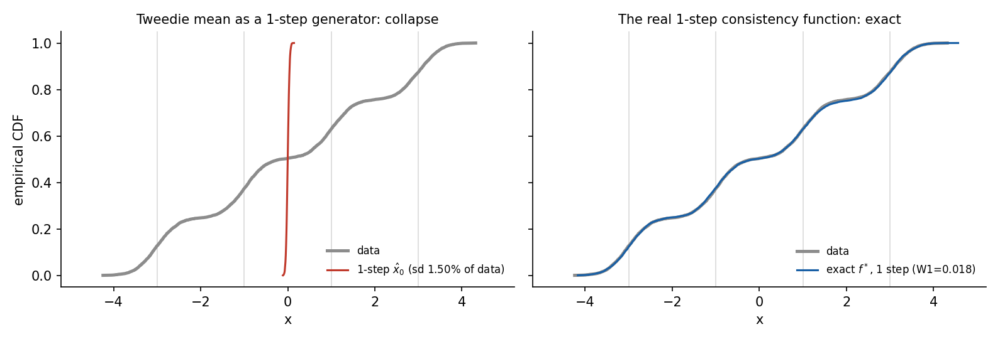
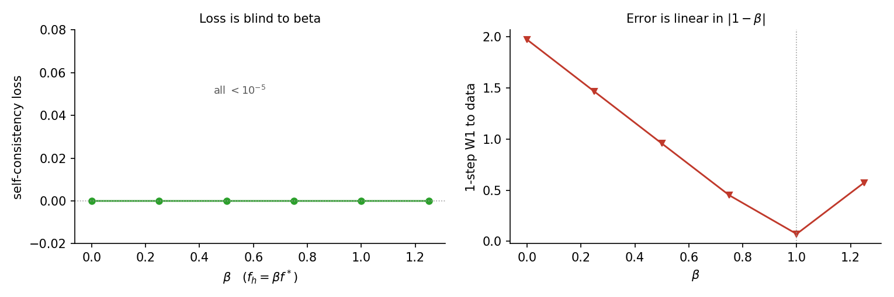
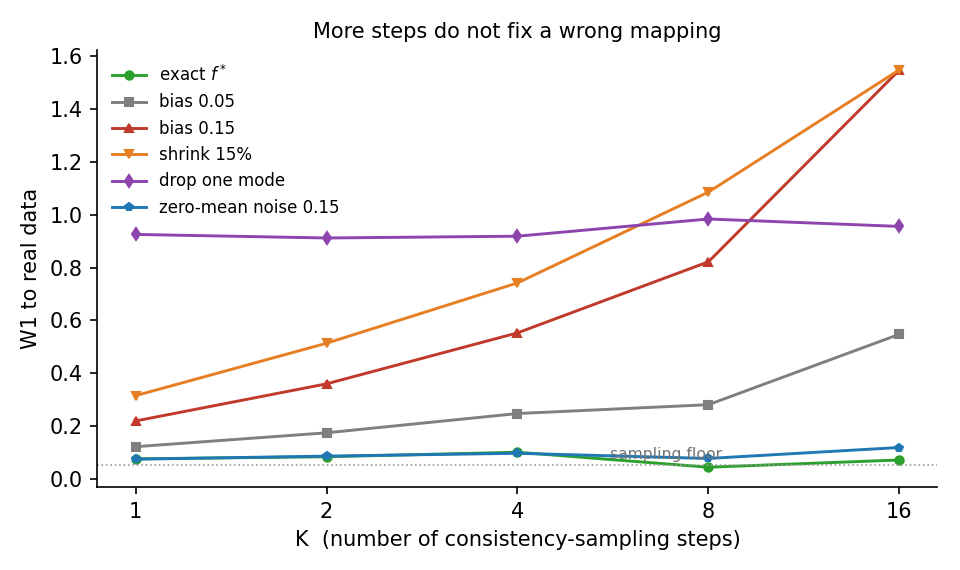

> **系列导航** ｜ [扩散模型综述：算法与应用](/2026/08/24/diffusion-survey-algorithms-applications/) ｜ [DDPM 深度剖析：前向闭式、时间步与 DDIM 采样](/2026/11/01/ddpm-deep-dive/) ｜ [采样器数值分析：DDIM 之后](/2026/11/01/diffusion-sampler-ode/) ｜ [后训练对齐：奖励只给一次，信用怎么摊到每一步](/2026/11/01/diffusion-post-training/)

> **TL;DR**
>
> * **1 步并不缺信息**：精确的一致性函数（把 $$x_t$$ 沿概率流 ODE 积到端点）做 1 步，W1 是 0.0184，比采样噪声地板 0.0265 还低，方差比 1.0059（§3）。
> * **糊的来源是把后验均值 $$\hat x_0$$ 当生成器**：它在噪声端的标准差只有数据的 1.50%，输出全挤到均值附近，W1 1.965，等于数据自身的平均绝对离差（§4，图 1）。
> * **自一致性损失管不了对错**：$$f_h=\beta f^*$$ 对任意 $$\beta$$ 损失都小于 $$10^{-5}$$，而 1 步误差随 $$\lvert 1-\beta\rvert$$ 线性增长，底在 $$\beta=1$$（§5，图 2）。
> * **步数修复方差、不修复偏差**：同样是 0.15 的误差，零均值抖动走到 16 步 W1 仍是 0.118，系统偏置涨到 1.549；丢掉的模态是 0.91 的死地板，任何步数都不恢复（§6，表 3）。
> * **适用边界**：以上都在 4 模态一维玩具上测的。「损失对缩放全盲」「偏差随步数放大」只依赖链式法则与重加噪结构，可以外推；1.50%、7.1 倍这类量级不可外推（§11）。

## 一、采样器这条路走到头之后

[上一篇](/2026/11/01/diffusion-sampler-ode/) 把反向过程写成概率流 ODE，然后把 DDIM、DPM-Solver-2/2M 放在一起比：NFE=80 时二阶方法到参考解的误差是 0.00339，DDIM 是 0.03784；但 NFE 掉到 20 以下，二阶每步两次网络前向的代价就让「步数减半」不再划算。那篇的结论是：**在「解同一个 ODE」这个框架里，能省的已经省完了**。

要把生成压到 1–4 步，只能换一件事：不再老老实实解方程，而是**学一个直接跳到终点的映射**。这条路线有三个名字——一致性模型（consistency model, CM）、一致性蒸馏（CD）、渐进蒸馏（PD）——但它们的共同点只有一句话：

> 让网络学会「不管从哪个噪声级出发，都落到同一条轨迹的同一个终点」。

这句话听起来很像「1 步采样」，也确实被这么宣传。但它同时藏了四个可以先量化、再讨论的问题：

- 1 步真的不够吗？如果够，那平时观察到的糊是哪来的？
- 自一致性这个训练目标，能不能把「对」和「错」区分开？
- 多走几步，是在修复什么、还是在放大什么？
- 训练成本付给谁？教师轨迹、还是学生自己的样本？

本文用一个 4 模态一维高斯混合把这四个问题逐条测出来（实验目录 [`few-step`](https://github.com/lrypcy/ipynbs/tree/88e9b1d/experiments/diffusion/few-step)，纯 numpy、不训练任何网络、36 条断言）。做法在 §2 说明，后面 §3–§8 是四组测量，§9 收六条常见误解，§10 是选择手册。

与已有几篇的分工：DDIM 为什么是一阶指数积分器在 [DDPM 篇](/2026/11/01/ddpm-deep-dive/)，$$\lambda$$ 变量替换与各阶求解器的误差结构在[采样器篇](/2026/11/01/diffusion-sampler-ode/)，「奖励怎么变成梯度」在[后训练篇](/2026/11/01/diffusion-post-training/)。本文只讨论**把多步换成少步时，被换掉的到底是什么**。

## 二、测量方法：把「学生」写成「真值 + 已知形态的扰动」

### 2.1 为什么不用小网络训练

想测「近似误差如何随步数兑现」，前提是误差本身可分解。训练一个小网络做不到这一点：最终的数字是「架构 + 优化 + 数据 + 步数」的混合物，换一个种子就变。

4 模态一维混合高斯 $$\sum_i \frac14\mathcal N(m_i,\sigma_d^2)$$（$$m_i=-3,-1,1,3$$，$$\sigma_d=0.4$$）给了另一条路：score、后验均值、概率流 ODE 全部闭式，于是「学生」可以写成

$$f_\theta(x,t)=\underbrace{f^*(x,t)}_{\text{精确一致性函数}}+\ \text{已知形态的扰动}$$

扰动是唯一变量：常数偏置、等比收缩、少一个模态、零均值抖动。这样每个数字都能归因到一种误差形态上。

### 2.2 精确一致性函数是 ODE 端点，不是后验均值

前向仍是 VP：$$x_t=\alpha_t x_0+\sigma_t\epsilon$$，$$\alpha_t^2+\sigma_t^2=1$$，schedule 取连续形式 $$\bar\alpha(t)=\exp(-(\beta_0 t+(\beta_1-\beta_0)t^2/2T))$$。概率流 ODE 在 $$\lambda=\log(\alpha/\sigma)$$ 下是

$$\frac{dx}{d\lambda}=\sigma_t^2\left(x+\nabla\log p_t(x)\right),\qquad \frac{d\lambda}{dt}=-\frac{\beta_t}{2\sigma_t^2}$$

**一致性函数的定义只有两条**：沿同一条 ODE 轨迹取值不变，且在最小噪声处退化为恒等，

$$f^*(x_{t'},t')=f^*(x_t,t)\ \ \text{（同一条轨迹）},\qquad f^*(x,\epsilon)=x .$$

满足这两条的函数就是把 $$x_t$$ 沿 ODE 积到端点的那一个。代码里 `endpoint_map` 从 λ 积分到 $$\lambda_{\rm end}$$（对应 $$\sigma_{\rm end}=3.3\times10^{-3}$$），RK4、512 步，步数翻到 1024 输出变化 4.2e-8。

注意这里**没有**出现后验均值 $$\hat x_0=(x+\sigma^2\nabla\log p_t)/\alpha$$。它满足 Tweedie 恒等式，在每一步去噪里都要用，但它**不是**一致性函数——§4 就量这件事造成的后果。

### 2.3 三种扰动与两种造对方式

| 扰动 | 数学形式 | 对应的真实失败模式 |
| --- | --- | --- |
| 偏置 | $$f^*+\delta$$ | 蒸馏时输出系统性偏高/偏低 |
| 收缩 | $$(1-\delta)f^*$$ | 回归到均值，学生输出过于保守 |
| 丢模态 | 用 3 模态模型的 $$f^*$$ | 学生没学到某个模态 |
| 零均值抖 | $$f^*+\delta\xi,\ \xi\sim\mathcal N(0,1)$$ | 学生只有方差、没有系统偏差 |

训练侧的两种造对方式也不一样，后面 §7 会用到：

- **CD（一致性蒸馏）**：跑一遍教师 ODE，取同一条轨迹上相邻两点成对，目标是「两个点的输出相等」。
- **CT（一致性训练）**：不跑教师，直接共用同一组 $$(x_0,\epsilon)$$ 造出两个噪声级 $$x_{t_{n+1}},x_{t_n}$$，假装它们在同一条轨迹上。

## 三、1 步不缺信息

A 组先把「1 步一定糊」这个前提测掉。用精确一致性函数直接从 $$x_T$$ 出一步：

| 量 | 值 |
| --- | --- |
| 1 步输出的 W1 到真实数据 | **0.0184** |
| 采样噪声地板（两份独立 8000 样本的 W1） | 0.0265 |
| 1 步输出方差 / 数据方差 | 1.0059 |
| 四模态质量（1 步 vs 数据） | 0.250 / 0.253 / 0.248 / 0.249 vs 0.248 / 0.256 / 0.253 / 0.244 |

W1 比噪声地板还低，说明剩下的差已经全在采样误差里了。**在信息层面，从纯噪声一次跳到数据没有任何障碍**——因为整条 ODE 轨迹上携带的就是同一个终点，只要你真的学会了那个映射。

这与「扩散生成需要多步」的直觉不冲突：多步是**求解器**的需要（每一步只修正一点），不是**信息**的需要。把求解器换成一个学好的映射，步数就可以是 1。

## 四、糊的真实来源：把后验均值当生成器

既然 1 步够，那「1 步生成很糊」这个广泛观察是哪来的？最常见的一个来源是把 DDPM 每步都在算的那个东西直接拿来当生成器。

$$\hat x_0(x_t)=\mathbb E[x_0\mid x_t]=\frac{x_t+\sigma_t^2\nabla\log p_t(x_t)}{\alpha_t}$$

在纯高斯数据上它的塌缩率有闭式。由 $$\hat x_0=\frac{\alpha\sigma_d^2}{v_t}x$$、$$x\sim\mathcal N(0,v_t)$$（$$v_t=\alpha^2\sigma_d^2+\sigma^2$$），

$$\frac{\operatorname{sd}(\hat x_0)}{\sigma_d}=\rho(t)=\frac{\alpha_t\,\sigma_d}{\sqrt{v_t}}$$

$$t\to T$$ 时 $$\alpha\to0$$，$$\rho\to0$$：**噪声端的后验均值几乎是一个常数**。实测（数据是 4 模态，纯高斯的 ρ 与数值验到 2.45e-3）：

- 1 步 $$\hat x_0$$ 的标准差是数据的 **1.50%**（纯高斯闭式给 $$\rho=2.63\times10^{-3}$$，多模态数据上峰间项把这个比例抬到 1.5%）；
- 1 步 $$\hat x_0$$ 到数据的 W1 是 **1.965**，而数据自身的平均绝对离差是 1.986——等于全部落到均值。

图 1 左边是经验 CDF：红线在 $$x=0$$ 处一根竖线，正是「所有样本塌到同一个点」。右边是精确一致性函数，蓝线压在灰线上，看不出来。



*图 1：同一个 1 步，两种函数。左：$$\hat x_0(x_T)$$ 的经验 CDF 在 0 处成为一根竖线（sd 只有数据的 1.50%）。右：ODE 端点映射做 1 步，W1=0.018，比采样噪声地板还低。*

这个错误为什么容易犯？因为 DDPM 的采样循环每一步做的正是「取 $$\hat x_0$$，加回一部分噪声」。把循环砍掉只留最后一步，剩下的就是 1 步 $$\hat x_0$$。而最后一步之所以能用，是因为它之前那 999 步已经把 $$x$$ 送到了小噪声区域——**$$\hat x_0$$ 在小噪声处近似恒等，在大噪声处近似常数**，中间那一段才是它真正的工作区间。

换句话说：「1 步生成糊」不是扩散模型的信息上限，是把一个**条件期望**当成了**生成映射**。

## 五、损失管不了对错：一整族零解

### 5.1 自一致性损失定义的是等价类

自一致性损失只要求「同一条轨迹上的两个点输出相同」：

$$\mathcal L(\theta)=\mathbb E_{t_{n+1},t_n}\Big[d\big(f_\theta(x_{t_{n+1}},t_{n+1}),\ f^-_\theta(x_{t_n},t_n)\big)\Big]$$

这里没有任何一项提到 $$x_0$$。于是任何 $$f_h=h\circ f^*$$（$$h$$ 是任意一对一映射）都满足它——包括 $$h\equiv\text{常数}$$，那个把整个分布压成一个点的函数。

B 组直接量这件事。取轨迹上相邻两个 λ 快照，用 $$f_h=\beta f^*$$ 扫 $$\beta$$：

| $$\beta$$ | 0 | 0.25 | 0.5 | 0.75 | 1.0 | 1.25 |
| --- | --- | --- | --- | --- | --- | --- |
| 自一致性损失 | $$\sim0$$ | $$\sim0$$ | $$\sim0$$ | $$\sim0$$ | $$\sim0$$ | $$\sim0$$ |
| 输出 sd / 数据 sd | 0.000 | 0.250 | 0.500 | 0.750 | 1.000 | 1.250 |
| 1 步 W1 到数据 | 1.973 | 1.465 | 0.957 | 0.451 | **0.072** | 0.574 |

损失的最大值是 5.4e-7（数据尺度 2.24 的 2.4e-7 倍），而 W1 从 1.973 走到 0.072 再回 0.574。图 2 把这两列并排：**左边一条平线，右边一个 V 形，底部正好在 $$\beta=1$$**。



*图 2：损失看不见的那一维，恰好是唯一会出错的那一维。左：$$f_h=\beta f^*$$ 的损失全程 $$<10^{-5}$$。右：1 步 W1 是 V 形，唯一极小在 $$\beta=1$$。*

### 5.2 边界条件和参数化在做什么

一致性模型的实现里有一段常被当成工程细节的写法：

$$f_\theta(x,t)=c_{\mathrm{skip}}(t)\,x+c_{\mathrm{out}}(t)\,F_\theta(x,t),\qquad c_{\mathrm{skip}}(\epsilon)=1,\ c_{\mathrm{out}}(\epsilon)=0$$

它的作用就是把上面那个等价类钉成一个点：在最小噪声处强制 $$f_\theta(x,\epsilon)=x$$，再让自一致性从这条边界往大噪声端传递。缺了它，$$\beta$$ 那一维完全自由，优化器没有任何理由停在 $$\beta=1$$。

实测：在 $$t=t_{\rm end}$$ 处，端点映射与恒等的最大偏差是 0.0000（$$5\sigma_{\rm end}=0.0159$$ 以内），边界条件确实可满足。

顺带说清一个常见混用：**EMA 目标网络和边界条件不是一回事**。EMA 解决的是「同一份参数既当预测又当目标会让损失找到平凡不动点」，属于优化层面的稳定化；边界条件解决的是「解集是一个族」，属于问题层面的确定性。两者都不能省，但省掉一个的后果完全不同。

## 六、步数不修复错的映射

这是全文最反直觉的一组。把「学生」固定成带某种缺陷的映射，然后用 K 步一致性采样——每步「跳到 $$x_0$$ 估计 → 重加噪到下一个噪声级」，最后一步直接输出。K 从 1 到 16，测 W1。

| 缺陷 | K=1 | K=2 | K=4 | K=8 | K=16 |
| --- | --- | --- | --- | --- | --- |
| 精确 $$f^*$$ | 0.075 | 0.083 | 0.100 | 0.043 | 0.070 |
| 偏置 $$\delta=0.05$$ | 0.121 | 0.173 | 0.247 | 0.280 | 0.547 |
| 偏置 $$\delta=0.15$$ | 0.218 | 0.359 | 0.552 | 0.822 | **1.549** |
| 收缩 15% | 0.314 | 0.513 | 0.742 | 1.086 | **1.549** |
| 丢一个模态 | 0.925 | 0.912 | 0.919 | 0.984 | 0.956 |
| 零均值抖 0.15 | 0.073 | 0.085 | 0.096 | 0.076 | 0.118 |



*图 3：横轴是步数（对数），纵轴是到真实数据的 W1，虚线是采样噪声地板。精确映射与零均值抖动贴着地板，系统偏差随步数单调上升，丢模态是一条 0.92 的水平线。*

读这张表要分三类：

**（一）精确映射下步数纯冗余。** 1 步 0.075、16 步 0.070，全程贴着噪声地板。「多步一致性采样比 1 步好」在这组数据上不成立，因为它本来就没有可修的误差。

**（二）系统偏差随步数单调放大。** 偏置 $$\delta=0.15$$ 从 0.218 涨到 1.549（7.1 倍），收缩 15% 从 0.314 涨到 1.549（4.9 倍）。机理很直接：每一步都要经过一次「跳到 $$x_0$$ 估计」，而偏差就长在这个估计上；K 步就是施加 K 次。收缩型缺陷还会自我复合——$$(1-\delta)^K$$ 在 K=16、$$\delta=0.15$$ 时只剩 0.074，分布被压向均值，几乎复现 §4 的塌缩。

**（三）零均值误差被摊平，模态丢失是死地板。** 同样是 0.15 的误差幅度，零均值抖动走到 16 步仍是 0.118（1.6 倍以内，贴着地板），因为它每步独立、被重加噪稀释。而丢一个模态是 0.91–0.98 的水平线：$$x=+3$$ 处的质量在 K=1..16 恒为 0.000–0.002（数据是 0.250）。**模态一旦没学到，任何步数都不恢复**——重加噪只能在这个学生认为存在的模态之间搬运质量。

### 6.1 随机重加噪 vs 确定性重估

表里那些数字用的是随机版本（每步注入新噪声）。同一缺陷下换成确定性版本（复用同一 $$\hat\epsilon$$ 的解析估计，即 DDIM 式更新），收缩 15% 在 K=16 时是 **0.758**，随机版本是 **1.543**。

差 2 倍，原因就是上面第（二）类：随机版每步都把系统偏差重新注入一次；确定性版只在最后一步用一次 $$f_\theta$$，前面几步相当于线性插值。

那为什么实践中多数人用随机版？因为训练好的学生是**近似自洽**的，它的偏差不是常数偏置而更接近零均值——那时随机版的额外噪声换的是多样性，不是误差。这个对比真正说明的是：**加噪的收益依赖误差形态**，它摊平方差、放大偏差。

## 七、训练侧的偏差从哪来：CT 的离散化

§6 里最难缠的缺陷形态是「收缩」。它不是随便挑的——它正是 CT 的结构性偏差方向。

CT 为了省掉教师，用同一组 $$(x_0,\epsilon)$$ 直接造两个噪声级：

$$x_{t_{n+1}}=\alpha_{t_{n+1}}x_0+\sigma_{t_{n+1}}\epsilon,\qquad x_{t_n}=\alpha_{t_n}x_0+\sigma_{t_n}\epsilon$$

然后把 $$\hat x_0(x_{t_n},t_n)$$ 当作 $$\hat x_0(x_{t_{n+1}},t_{n+1})$$ 的目标。问题是：这两点**并不在同一条 ODE 轨迹上**。共用一个 $$\epsilon$$ 只是让它们「同源」，ODE 轨迹要求的是同一个终点与同一个初始速度场。

D 组量这个偏差有多大：

| N（格点数） | $$\Delta t$$ | 平均 $$\lvert\Delta\hat x_0\rvert$$ | $$\operatorname{sd}$$(粗) / $$\operatorname{sd}$$(细) |
| --- | --- | --- | --- |
| 8 | 1.25e-1 | 4.05e-1 | 0.945 |
| 32 | 3.12e-2 | 4.18e-2 | 0.780 |
| 128 | 7.81e-3 | 3.28e-3 | 0.929 |
| 1024 | 9.76e-4 | 2.78e-4 | 0.990 |

两个结论：

1. **细网格上一阶收敛**。N≥128 的 log-log 斜率是 1.183，N 从 8 到 1024 偏差降了 1454 倍。全域斜率 1.59 高于一阶，因为粗网格上 $$\Delta t$$ 已经大到估计跨过模态边界——$$\hat x_0$$ 在两个峰之间是跳跃的，Taylor 展开在那里失效。
2. **偏差方向恒为收缩**。每一行里粗格点的估计离散度都更小（0.945 → 0.990，随 N 增大趋近 1）。把粗格点的值当细格点的目标，就是让学生在大噪声处的输出「比真值更靠均值」——正是 §6 表里第二难修的那一列。

这也解释了为什么 CT 的实现里 EMA 目标网络几乎是必需品：不是在修边界条件，是在把这条 $$\mathcal O(\Delta t)$$ 的偏差压到比噪声小，否则自一致性损失会一路追着这个收缩跑。

## 八、两条蒸馏路线与训练账本

### 8.1 CD、CT、PD 的机制差别

| 方法 | 目标从哪来 | 需要教师吗 | 训练分布 |
| --- | --- | --- | --- |
| CD | 教师 ODE 轨迹上相邻两点 | 需要（跑 ODE） | 教师轨迹 |
| CT | 共用 $$(x_0,\epsilon)$$ 的两个噪声级 | 不需要 | 数据 + 解析加噪 |
| PD | 当前学生自己的 2 步 | 不需要（学生即教师） | 学生自己的轨迹 |

PD 的结构值得单独说：它每一轮把「当前学生的 2 步」当作目标，训练一个步数减半的新学生，重复 $$\log_2 N$$ 轮。好处是**训练分布永远等于推理分布**（目标就是学生自己走出来的）；代价是轮数线性叠加的算力，以及每一轮的偏差都被下一轮固化。

### 8.2 NFE 账本

| 方法 | 每样本训练成本 | 说明 |
| --- | --- | --- |
| CD | 1 教师 NFE / 对 | 一条 $$K_t$$ 步轨迹上取相邻两点，成本完全摊薄，与 $$K_t$$ 无关 |
| CT | 0 教师 NFE / 对 | 只有学生自己的一次前向 |
| PD（4 轮自 16 步） | 30 = $$2N_0(1-2^{-r})$$ | 与 CD 同量级 |

「CD 的教师成本摊销到 1 NFE/对」这件事容易被误读成 CD 比 PD 便宜很多。真实的约束在别处：**学生推理用的步网格要和教师造对的网格一致**，不一致的后果 §6 已经量过了。

### 8.3 路径错配

CD 的训练对来自教师轨迹，推理时学生走的是自己的轨迹。两者的偏离有多大？用收缩 15% 的学生、K=8、确定性多步，逐点比对学生落点与教师轨迹：

```
k      0        1        2        3        4        5        6        7        8
偏离   0.0000  0.031  0.137  0.387  0.420  0.170  0.241  0.382  0.524
```

第 0 步完全重合（同一起点），第 1 步起偏离，峰值 0.524 是数据标准差（2.26）的 23%。偏离没有单调累积到发散——每步的重新估计都在把轨迹拉回流形附近——但 23% 已经足够说明训练分布与推理分布不是同一个。这就是「CD 的效果依赖教师轨迹质量」的定量版本。

## 九、六条常见误解

1. **「1 步生成必然糊」**。精确一致性函数 1 步的 W1 是 0.0184，比噪声地板还低（§3）。糊的是被当成生成器用的 $$\hat x_0$$（§4）。
2. **「一致性模型就是蒸馏」**。CT 不下发教师轨迹，教师 NFE 为 0（§8.2），它靠「共用 $$\epsilon$$」这条近似换掉教师，代价是 §7 那条偏差。
3. **「边界条件只是实现细节」**。自一致性损失对 $$\beta$$ 全盲（图 2），边界条件是唯一把等价类钉成一点的约束。
4. **「多步采样总能改善」**。系统偏差下 16 步比 1 步差 7.1 倍（表 3）。步数只改噪声尺度，不改映射。
5. **「丢掉的模态可以靠更多步找回来」**。丢一个模态后 K=1..16 的 W1 是 0.91–0.98 的水平线，该模态质量恒为 0.000–0.002。
6. **「加噪一定有用」**。有系统偏差时确定性重估更好（0.758 vs 1.543），加噪摊平方差、放大偏差。

## 十、选择手册

| 目标 | 首选 | 要监控的量 | 代价 |
| --- | --- | --- | --- |
| 1 步、质量优先 | CD（教师轨迹足够好时） | 模态覆盖率、输出方差比 | 教师 ODE 质量决定上限 |
| 1 步、无教师可用 | CT + EMA 目标网络 | 与「收缩」相关的方差亏损 | $$\mathcal O(\Delta t)$$ 偏差，$$N$$ 越大越贵 |
| 2–4 步 | PD 或 CD + 多步采样 | 每轮的模态数、W1 是否随步数下降 | 轮数 × 算力 |
| 已经 1 步、还想再提 | 不要加步数 | 先看误差是偏差还是方差 | 偏差型缺陷加步数会更差 |
| 质量优先、步数不是约束 | 直接用二阶求解器（见[采样器篇](/2026/11/01/diffusion-sampler-ode/)） | NFE–误差曲线 | 无额外训练 |

判据只有一句：**先分清误差是偏差还是方差，再决定要不要加步数**。偏差别加步数，方差可以。

## 十一、复现与结论

全部数字来自同一份脚本，纯 numpy、不训练任何网络、约 60 秒、固定种子 `20261104`，全量跑通输出 **断言总数 = 36**：

```bash
git clone https://github.com/lrypcy/ipynbs
cd ipynbs/experiments/diffusion/few-step
python few_step_lab.py                 # A–E，约 60 秒
python few_step_lab.py A C             # 只跑指定组
python few_step_lab.py A --figdir figs # 额外出图（需 matplotlib）
```

脚本与逐条结果：[`experiments/diffusion/few-step`](https://github.com/lrypcy/ipynbs/tree/88e9b1d/experiments/diffusion/few-step)。

四句话收尾：

1. 1 步不缺信息，缺的是一个学对的映射——精确一致性函数 1 步的 W1 是 0.0184，比采样噪声地板 0.0265 还低。
2. 把后验均值当生成器是这类失败里最常见的一个：它的标准差在噪声端只有数据的 1.50%，W1 1.965 等于全部塌到均值。
3. 自一致性损失对「整体缩放」完全免疫（损失 $$<10^{-5}$$，误差却随 $$\lvert 1-\beta\rvert$$ 线性走），边界条件是唯一把它钉住的约束。
4. 步数修复方差、放大偏差：同样是 0.15 的误差，零均值抖动 16 步后是 0.118，系统偏置是 1.549；丢掉的模态永远是 0.91 的死地板。

下一篇转到离散域：掩码扩散的调度怎么选，以及「似然」在离散扩散里为什么和连续域解耦。

## 参考文献

1. Song, Dhariwal, Chen, Sutskever. *Consistency Models.* [arXiv:2303.01469](https://arxiv.org/abs/2303.01469)
2. Song, Dhariwal. *Improved Techniques for Training Consistency Models.* [arXiv:2310.14189](https://arxiv.org/abs/2310.14189)
3. Salimans, Ho. *Progressive Distillation for Fast Sampling of Diffusion Models.* [arXiv:2202.00512](https://arxiv.org/abs/2202.00512)
4. Yin, Gharbi, Zhang, Shechtman, Durand, Freeman. *One-step Diffusion with Distribution Matching Distillation.* [arXiv:2311.18828](https://arxiv.org/abs/2311.18828)
5. Song, Sohl-Dickstein, Kingma, Kumar, Ermon, Poole. *Score-Based Generative Modeling through Stochastic Differential Equations.* [arXiv:2011.13456](https://arxiv.org/abs/2011.13456)
6. Lu, Zhou, Bao, Chen, Li, Zhu. *DPM-Solver: A Fast ODE Solver for Diffusion Probabilistic Model Sampling in Around 10 Steps.* [arXiv:2206.00927](https://arxiv.org/abs/2206.00927)

