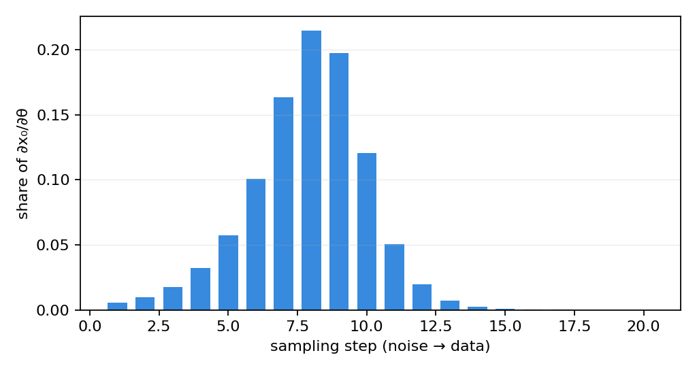

> **系列导航** ｜ [扩散模型综述：算法与应用](/2026/08/24/diffusion-survey-algorithms-applications/) ｜ [DDPM 深度剖析](/2026/11/01/ddpm-deep-dive/) ｜ [扩散模型采样器：把反向过程写成 ODE](/2026/11/01/diffusion-sampler-ode/) ｜ [Flow Matching 原理篇](/2026/10/20/flow-matching-00-principles/) ｜ [RL 信用分配](/2026/09/19/rl-credit-assignment-settlement/)

> **TL;DR**
>
> * **难点在信用分配的形状，不在「要不要反传」**：奖励只在 $$x_0$$ 上算一次，而 $$x_0$$ 由几十步串行去噪得到；梯度要沿整条链回传，每一步各占多少份额决定了该用哪种对齐方法。
> * **实测（§5，实验目录 `post-training`）**：K=20 步的链上，梯度份额单峰分布——峰值在第 8 步（22.55%），前 10 步累计 95.41%，**最后 5 步合计 0.010%**、最后一步为 0。所以「只反传最后一步」不是近似，是丢掉全部信用。
> * **三条路线的真实差别**：穿链反传（DRaFT）与「已知密度」的策略梯度都无偏，但标准差差 **27.1 倍**（§6）；把链上样本硬套 log-derivative 会偏 **145%**（这就是 ReFL 不用原始 REINFORCE 的原因）；样本效率上 DRaFT 与 DPO 同量级（320 / 256 条），朴素策略梯度慢 **993.6 倍**。
> * **适用边界**：反向图随链长线性增长（每步约 34 个节点，K 翻倍就翻倍），这是 DRaFT 的硬约束；玩具是一维倾斜族，绝对数值不可外推，但份额形状与无偏性结论只依赖链式法则。

## 一、一个只在末端给分的问题

扩散模型的后训练对齐有三个要素与语言模型不同，每一个都让问题变难：

- **奖励是稠密空间上的函数，但只在终点求值一次**。文本的奖励通常是序列级（整条回复），扩散的奖励可以逐像素算，但模型只在 $$x_0$$ 上产出可评的样本；中间状态 $$x_t$$ 是加噪的，算奖励没有意义。
- **采样是串行的几十步**。语言模型的方法（PPO/GRPO）把整条轨迹当一个动作序列处理，扩散的轨迹长度 $$K$$ 通常在 10–100 之间，每一步都是一次完整网络前向。
- **似然不可得**。扩散模型的对数似然只能估不能算（要解 ODE），所以「策略梯度」里那个 $$\nabla\log p_\theta(x_0)$$ 拿不到精确值。

三条主流路线正是针对这三点各让步一次：

| 路线 | 代表工作 | 怎么绕开 | 代价 |
| --- | --- | --- | --- |
| 穿链反传 | DRaFT（[arXiv:2309.17400](https://arxiv.org/abs/2309.17400)） | 直接把采样器当可微层，梯度穿过整条链 | 显存随步数线性增长 |
| 奖励加权回归 | ReFL（[arXiv:2304.06767](https://arxiv.org/abs/2304.06767)） | 采样丢弃梯度，用奖励当样本权重回归 | 梯度方差大、需要大量样本 |
| 偏好优化 | Diffusion-DPO（[arXiv:2311.12908](https://arxiv.org/abs/2311.12908)） | 用配对比较替代奖励模型，损失写到每个时间步 | 需要偏好数据、依赖 BT 假设 |

本文先给出把「奖励 → 梯度」这条链写清楚的最小数学（§2–§3），再在可解析的玩具上量出三件事：信用沿链怎么分布（§5）、估计器偏不偏（§6）、三条路线花多少样本（§8）。结论与 [RL 信用分配](/2026/09/19/rl-credit-assignment-settlement/) 那一篇的 GAE / V-trace 视角是同一件事的两个实例。

## 二、把问题写成链式法则

采样是一个确定性映射（以 DDIM / 概率流 ODE 为例）：

$$x_0=F_\theta(x_T),\qquad x_T\sim\mathcal N(0,I)$$

后训练要最大化的目标是

$$J(\theta)=\mathbb E_{x_0\sim F_\theta(x_T)}\big[r(x_0)\big]-\lambda\,\mathrm{KL}\big(p_\theta\,\Vert\,p_{\rm ref}\big)$$

其中 $$\lambda$$ 控制「偏离基座多远」。第一项的梯度是

$$\nabla_\theta J_{\rm reward}=\mathbb E\Big[\nabla_{x_0}r(x_0)^\top\frac{\partial x_0}{\partial\theta}\Big]$$

$$\partial x_0/\partial\theta$$ 是**流映射对参数的雅可比**。把它沿链展开：

$$\frac{dx_0}{d\theta}=\sum_{k=0}^{K-1}\Delta_k,\qquad \Delta_k=\frac{dx_{k+1}}{d\theta}-\frac{dx_k}{d\theta}$$

这里的 $$x_k$$ 是第 $$k$$ 步之后的样本，$$\Delta_k$$ 是**第 $$k$$ 步对最终梯度的贡献**。求和号说明一件事：奖励的梯度不是落在某一步上，而是被链式法则自动摊到所有步——每一份的大小取决于那一步的局部雅可比与它离终点的距离。

这就是本文要量的东西。$$\Delta_k$$ 的分布决定了三件事：能不能只反传最后几步、显存要多少、以及估计器该长什么样。

## 三、一个能算出真值的玩具

要判断「估计器偏不偏」，必须知道真值。扩散模型本身给不出——似然不可算，奖励空间高维。所以玩具要挑一个**既保结构又可解析**的：

**一维三峰高斯混合 + 指数倾斜族。** 数据分布是一维三个高斯（中心 −3 / 0 / +3，标准差 0.5，等权）；「策略」只用一个参数 $$\theta$$ 描述：

$$p_\theta(x)=\frac{1}{Z(\theta)}p_0(x)\,e^{\theta x},\qquad Z(\theta)=\mathbb E_{p_0}\big[e^{\theta x}\big]$$

选它的理由是**闭包**：高斯混合乘上指数倾斜之后仍是高斯混合——第 $$k$$ 个分量均值从 $$\mu_k$$ 平移到 $$\mu_k+\theta\sigma^2$$，权重重新归一化。于是三件事全部有闭式：

- **采样**：按新权重抽分量再高斯采样，精确；
- **score 与密度**：因为「先倾斜再扩散」等价于「倾斜后的混合再各自扩散」，任意时刻 $$t$$ 的 score 仍是高斯混合的形式；
- **最优解**：目标 $$J(\theta)=m(\theta)-\lambda\big(\theta m(\theta)-\log Z(\theta)\big)$$，其中 $$m(\theta)=\mathbb E_{p_\theta}[x]$$，令导数为零得

$$\frac{dJ}{d\theta}=m'(\theta)\big(1-\lambda\theta\big)=0\ \Longrightarrow\ \theta^*=\frac{1}{\lambda}$$

**这个结论与数据分布的形状无关**：KL 正则下的奖励最大化，最优解就是给 score 加一个常数漂移 $$1/\lambda$$。实验里 $$\lambda=2$$ 给出的数值最优是 0.5000，与 $$1/\lambda$$ 完全一致（A 组）。

玩具的好处是「真值可判」：$$m'(\theta)=\mathrm{Var}_\theta[x]$$ 也有闭式，在 $$\theta=0.5$$ 时为 2.6572（其中峰间方差 2.4072、峰内 0.25）。**任何估计器的偏差都可以对着这个数看**，而不是对着训练曲线猜。

## 四、穿链反传：DRaFT 在做什么

DRaFT（Reward Weighted Regression 之外的那一支）的做法最直接：把采样器当成可微层，用自动微分把 $$\nabla_\theta r(x_0)$$ 一路传回去。

对本文的玩具，这条链是

$$x_{k+1}=\frac{\sigma_{k+1}}{\sigma_k}x_k+\Big(\alpha_{k+1}-\alpha_k\frac{\sigma_{k+1}}{\sigma_k}\Big)\hat x_0(x_k,\theta)$$

每一步都把 $$\theta$$ 通过 $$\hat x_0$$ 注入，链式法则自动把贡献累乘起来。它的两个性质必须在同一张桌上讨论：

**准**。它是 pathwise 导数（重参数化技巧在扩散上的版本），没有「采样噪声」这一项——只要流映射对 $$\theta$$ 可微，估计就无偏。实验 C 组给了实测：均值 2.67812 对真值 2.65724，偏差 +0.02089，标准差 0.733。

把 $$\Delta_k$$ 写成局部的样子会更清楚。记 $$J_k=\partial x_{k+1}/\partial x_k$$（第 $$k$$ 步的流动雅可比）、$$g_k=\partial x_{k+1}/\partial	heta$$（同一步里 $$	heta$$ 的直接注入），则

$$rac{dx_K}{d	heta}=\sum_{k=0}^{K-1}\Big(\prod_{j=k+1}^{K-1}J_j\Big)g_k$$

**每一项都是一个「后方雅可比连乘 × 局部注入」**。连乘解释了 §5 的形状：靠近终点时连乘很短，但 $$g_k$$ 已经被干净的几何压平；靠近起点时 $$g_k$$ 不小，可连乘里每一层都在收缩。只有中段两者都处于中等量级。

**贵**。反向图要把每一步的中间量都留着。实验 E 组量了计算图规模：

| 链长 K | 5 | 10 | 20 | 40 |
| --- | --- | --- | --- | --- |
| 计算图节点数 | 168 | 338 | 678 | 1358 |
| 相对 K=5 | 1.00× | 2.01× | 4.04× | 8.08× |

严格线性，约 34 个节点/步。**链长翻倍，反向显存翻倍**——这是 DRaFT 最硬的约束，也是它在大分辨率模型上必须配 checkpointing 的原因。

## 五、信用到底落在哪一步

把 $$\Delta_k$$ 的绝对值归一化，就得到一条链上的「信用剖面」。K=20 的实测：

| step | 1 | 2 | 3 | 4 | 5 | 6 | 7 | 8 | 9 | 10 |
| --- | --- | --- | --- | --- | --- | --- | --- | --- | --- | --- |
| 占比 | 0.57% | 1.03% | 1.86% | 3.38% | 6.06% | 10.62% | 17.18% | **22.55%** | 20.58% | 11.58% |
| 累计 | 0.57% | 1.59% | 3.46% | 6.83% | 12.90% | 23.52% | 40.70% | 63.25% | 83.83% | 95.41% |



三条可以直接拿走的事实：

1. **单峰，峰在第 8 步。** 不是均匀摊开，也不是贴着末端。
2. **前 10 步拿走 95.41%**，第 11–20 步合计 4.59%，其中最后 5 步合计 0.010%。
3. **最后一步是 0。** 不是「很小」，是数值上的零。

为什么峰在中段？两端都有「压扁」的机制：在纯噪声端，$$\hat x_0$$ 由整个混合决定，改变 $$\theta$$ 只挪动一点点权重，局部雅可比小；在干净端，$$x$$ 已经收敛到数据附近，$$\hat x_0\approx x$$，它对 $$\theta$$ 的依赖也被压掉了。**只有信噪比接近 1 的中段，$$\hat x_0$$ 既敏感、又还没收敛**，信用就集中在那里。

由此可以直接推出一个工程结论：**「只反传最后几步」的做法不是省算力，是拿不到梯度**。B 组把链长从 5 换到 40 都测了：K=5 时最后一步占 0.006%，K≥10 起就是 0.000%——链越长，这个近似越离谱。

## 六、不能穿链时：策略梯度及其陷阱

穿链反传要求采样器可微且显存够用。绕开它的标准手段是策略梯度：

$$\nabla_\theta\,\mathbb E_{p_\theta}[r]=\mathbb E_{p_\theta}\big[r(x_0)\,\nabla_\theta\log p_\theta(x_0)\big]$$

这个式子成立的前提只有一条：**样本确实来自 $$p_\theta$$**。语言模型满足它（每 token 的 softmax 就是密度）；扩散模型不满足——采样走的是几十步 ODE，推前分布既写不出来也算不出来。

实验 C 组把这个陷阱直接量了出来：

| 估计器 | 均值 | 偏差 | 标准差 | 标准误 |
| --- | --- | --- | --- | --- |
| pathwise（DRaFT，穿链反传） | 2.67812 | +0.02089 | 0.73301 | 0.0518 |
| score-function，样本来自 $$p_\theta$$ | 1.57549 | −1.08174 | 19.89332 | 1.4067 |
| score-function，样本来自采样链 | 6.51508 | **+3.85785** | 21.60201 | 1.5275 |
| 只反传最后一步 | 0.00000 | −2.65723 | 0.00002 | 0.0000 |

解析真值 2.65724。读法有三层：

- **前两行都无偏**（偏差都在 3 个标准误内），但标准差差 27.1 倍——这是「重参数化 vs 得分函数」的经典差距。
- **第三行偏 +145%**。它用的密度是倾斜族的 $$p_\theta$$，而样本来自采样链的推前分布，两者不是同一个东西。这不是实现 bug，而是「拿不到似然」这件事的直接后果。
- **第四行是零**。对应 §5 的结论：最后一步不承担信用。

所以 ReFL 的真正贡献不是「用了策略梯度」，而是**承认似然拿不到、于是换一个不需要似然的替代目标**：把采样当无梯度样本，用奖励当权重去回归去噪目标。代价是方差，收益是显存与实现复杂度。

## 七、Diffusion-DPO：把偏好写到每一个时间步

第三条路连奖励模型都不要。起点是 Bradley–Terry 假设：给一对样本 $$(x^w,x^l)$$（胜 / 负），偏好概率是

$$p(x^w\succ x^l)=\sigma\big(r(x^w)-r(x^l)\big)$$

在 KL 正则下，最优策略有闭式 $$p^*\propto p_{\rm ref}e^{r/\beta}$$。把它代回偏好似然并对 $$r$$ 消元，就得到 DPO 的损失——用「策略与参考策略的对数比」替代奖励差：

$$\mathcal L_{\rm DPO}=-\mathbb E_{(x^w,x^l)}\log\sigma\Big(\beta\big[\log\tfrac{p_\theta(x^w)}{p_{\rm ref}(x^w)}-\log\tfrac{p_\theta(x^l)}{p_{\rm ref}(x^l)}\big]\Big)$$

搬到扩散上要解决一个技术问题：$$p_\theta(x_0)$$ 不可算。Diffusion-DPO 的解法是回到 ELBO 的逐项分解（[DDPM 篇](/2026/11/01/ddpm-deep-dive/) §4.1）——把 $$p_\theta(x_0)$$ 换成每条去噪转移的乘积，于是对数比变成**逐时间步的对数比之和**：

$$\log\frac{p_\theta(x_0)}{p_{\rm ref}(x_0)}\ \longrightarrow\ \sum_{t}\log\frac{p_\theta(x_{t-1}\mid x_t,x_0)}{p_{\rm ref}(x_{t-1}\mid x_t,x_0)}$$

关键一步是：给定 $$x_0$$ 时，真实后验 $$q(x_{t-1}\mid x_t,x_0)$$ 与偏好无关（它只由调度决定），所以在「胜样本减负样本」的差里它可以被约掉，剩下的只有 $$x_0$$ 预测项。最终损失是按 ELBO 权重（$$\beta_t/(2\alpha_t(1-\bar\alpha_{t-1}))$$）加权的逐时间步 DPO。

两个可以直接对照的点：

- **$$\beta$$ 与 $$\lambda$$ 是同一个东西的两面**。DPO 的最优解是 $$p^*\propto p_{\rm ref}e^{r/\beta}$$，本文的目标是 $$p\propto p_0e^{\theta x}$$、最优 $$\theta^*=1/\lambda$$。实验里取 $$\beta=1/\lambda=0.5$$，得到的 $$\hat\theta=0.5238$$，与 $$1/\lambda$$ 一致。
- **它不需要奖励模型，但需要配对数据**。这决定了它的适用面：有明确偏好信号（人评、A/B）时最好用；奖励是连续可算的（如 CLIP score、物理约束）时反而不如直接用奖励。

## 八、三条路线花多少样本

同一玩具、同一目标（$$\lvert\hat\theta-\theta^*\rvert\le0.05$$）、同一批超参范围内的最简实现，样本预算上限 40 万条：

| 路线 | θ̂ | \|θ̂−θ*\| | 样本数 |
| --- | --- | --- | --- |
| DRaFT（穿链反传） | 0.4611 | 0.0389 | 320 |
| REINFORCE（策略梯度） | 0.4506 | 0.0494 | 317952 |
| Diffusion-DPO | 0.5238 | 0.0238 | 256 |

REINFORCE / DRaFT = **993.6×**，DPO / DRaFT = 0.8×。

这个排序与 C 组的方差完全对应：策略梯度的标准差是 pathwise 的 27 倍，落到「达到同一精度」上就是三个数量级的样本差。**方差不是理论洁癖，它直接换算成采样成本。**

DPO 在这里最省，是因为它的梯度来自配对上的**监督信号**，而不是从稀疏的奖励标量里反推；反过来说，它的成本转移到了「偏好数据的采集」上，那部分不在样本计数里。

## 九、六条常见误解

**误解一：奖励在末端给出，所以梯度也应该只落在末端。** 恰恰相反，末端那一步的信用是 0（§5）。末端只提供**标量**，把它变成参数更新要靠整条链的雅可比连乘。

**误解二：既然是 MDP，就该用 PPO。** 扩散的「动作」是连续的高维张量、轨迹长度固定且可微，用 PPO 等于放弃可微性去换方差；§8 的 993.6 倍差距就是这个选择的代价。PPO 在扩散上只在「奖励不可微且无法构造代理」时才划算。

**误解三：ReFL 是策略梯度的一种。** 它是**加权回归**：采样时不求梯度，把奖励当样本权重最小化去噪损失。正因为它不是策略梯度，才不受 §6 那个「似然拿不到」的偏差影响。

**误解四：DPO 不需要超参。** $$eta$$ 就是 KL 系数的倒数，直接决定能偏离基座多远。把 $$r/eta$$ 的形式和本文的 $$e^{r/\lambda}$$ 对照，$$eta=1/\lambda$$ 是一一对应的。

**误解五：链越长，每步的信用越平均。** K 从 5 涨到 40，最后一步的占比从 0.006% 掉到 0.000%，峰值位置基本不动。长链是把信用**更集中**地压在中段，不是摊平。

**误解六：可微采样一定比不可微好。** 只在显存付得起时成立。反向图线性增长（34 节点/步），大分辨率 + 50 步的模型上，穿链反传的显存往往比模型本身还大，这时加权回归不是退让，是唯一可行解。

## 十、选择手册

| 条件 | 建议 | 理由 |
| --- | --- | --- |
| 奖励可微、显存够（$$\le$$ 30 步） | DRaFT | 无偏、样本最省；反向图线性增长 |
| 步数多、显存紧 | ReFL 式加权回归 | 采样不求梯度，显存 O(1)，代价是样本量多一个量级 |
| 有配对偏好数据 | Diffusion-DPO | 不需要奖励模型，且最省样本 |
| 奖励是离散判断（人评） | DPO 或 BT 奖励模型 + ReFL | 奖励不可微，穿链反传只能通过可微代理 |

四条补充：

1. **别只反传最后几步**。§5 的剖面说明那部分信用是 0；如果显存不够，正确做法是分段截断 + 用 ReFL 补后面，而不是「取最后 3 步」。
2. **KL 项决定终点，奖励梯度决定速度**。玩具里 $$(1-\lambda\theta)$$ 这个因子让所有方法都收敛到 $$\theta^*=1/\lambda$$，差别只在多快。真实模型参数高维、KL 项不会自动归零，所以 $$\lambda$$ 的选取比梯度估计器的选择更影响最终行为。
3. **$$\beta$$（DPO）与 $$\lambda$$（KL 系数）互为倒数**，论文里的取值不能混用：$$\beta=0.1$$ 相当于 $$\lambda=10$$。
4. **玩具是 1 参数族**。真实模型的「倾斜方向」由数据决定，不是标量；绝对数值（27.1×、993.6×）不可外推，但「单峰剖面」「pathwise 无偏 / 链上得分函数有偏」这两条只依赖链式法则，可以外推。

## 十一、复现与结论

全部数字来自同一份脚本，纯 CPU、约 12 秒、固定种子 `20261103`，全量跑通输出 **断言总数 = 30**：

```bash
git clone https://github.com/lrypcy/ipynbs
cd ipynbs/experiments/diffusion/post-training
python post_train_lab.py                 # A–E，约 12 秒
python post_train_lab.py A --figdir figs # 额外出两张图
```

脚本与逐条结果：[`experiments/diffusion/post-training`](https://github.com/lrypcy/ipynbs/tree/20d9da9/experiments/diffusion/post-training)。

四句话收尾：

1. 奖励只给一次，但信用不是「落在最后一步」——K=20 时峰在第 8 步，前 10 步拿走 95.41%，最后 5 步合计 0.010%。
2. 穿链反传（DRaFT）准（标准差 0.733）但贵（反向图线性，34 节点/步）；策略梯度便宜但慢 993.6 倍，而且直接套 log-derivative 会偏 145%。
3. ReFL 的价值在于**承认似然拿不到**，用加权回归替代策略梯度；Diffusion-DPO 的价值在于**把偏好写到每个时间步**，连奖励模型都不需要，$$\beta$$ 就是 KL 系数的倒数。
4. KL 项决定终点，梯度估计决定速度——所以调 $$\lambda$$（或 $$\beta$$）比调估计器更重要。

下一篇转向这条线的另一端：**把步数压到 1**（一致性模型与少步蒸馏）。

## 参考文献

1. Clark, Vicol, Swersky, Fleet. *DRaFT: Direct Reward Fine-Tuning of Diffusion Models.* [arXiv:2309.17400](https://arxiv.org/abs/2309.17400)
2. Xu et al. *ImageReward: Learning and Evaluating Human Preferences for Text-to-Image Generation.*（其中提出 ReFL） [arXiv:2304.06767](https://arxiv.org/abs/2304.06767)
3. Wallace, Dang, Rafailov, Zhou, Lou, Ermon. *Diffusion Model Alignment Using Direct Preference Optimization.* [arXiv:2311.12908](https://arxiv.org/abs/2311.12908)
4. Rafailov, Sharma, Mitchell, Ermon, Manning, Finn. *Direct Preference Optimization: Your Language Model is Secretly a Reward Model.* [arXiv:2305.18290](https://arxiv.org/abs/2305.18290)
5. Ho, Jain, Abbeel. *Denoising Diffusion Probabilistic Models.* [arXiv:2006.11239](https://arxiv.org/abs/2006.11239)

