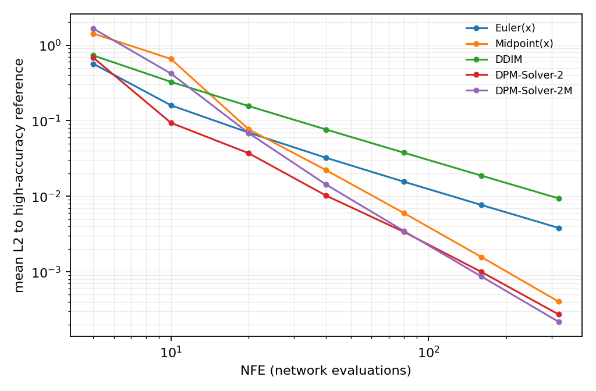
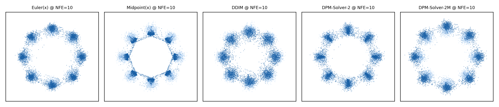

> **系列导航** ｜ [扩散模型综述：算法与应用](/2026/08/24/diffusion-survey-algorithms-applications/) ｜ [DDPM 深度剖析：前向闭式、时间步与 DDIM 采样](/2026/11/01/ddpm-deep-dive/) ｜ [Score、扩散与 SDE](/2026/08/22/flow-matching-02-score-diffusion-sde/) ｜ [Flow Matching 原理篇](/2026/10/20/flow-matching-00-principles/)

> **TL;DR**
>
> * **采样就是解一个 ODE**：把反向 SDE 换成概率流 ODE 后，生成退化成初值问题；换变量 $$\lambda=\log(\alpha/\sigma)$$，方程变成 $$du/d\lambda=e^{\lambda}\hat x_0$$ 的形式，线性部分可以解析积掉。
> * **DDIM 是「区间内 $$\hat x_0$$ 取常数」的精确解**，本质是一阶指数积分器。它的误差不来自线性部分，而来自被丢掉的 $$\hat x_0$$ 变化，并被因子 $$e^{\lambda}=\alpha/\sigma$$ 放大——在 $$\lambda$$ 接近 7 的干净端，这个放大接近 1000 倍（§3.3）。
> * **实测（§5，实验目录 `sampler-nfe`）**：NFE=80 时 DPM-Solver-2 到参考解的误差 0.00339，DDIM 0.03784、x 空间欧拉 0.01556，即 **11.17×** 与 **4.59×**。阶数拟合给出 1.176 / 1.048 / 2.068 / 1.889，与一阶/二阶理论一致。
> * **代价与边界**：二阶每步两次网络前向，NFE ≤ 20 时步数减半反而更差（表 §5.2 中 NFE=20 一行），交叉点在 20–40 之间；同时取点规则要跟阶数配套——二阶偏好 uniform-$$\lambda$$、一阶偏好 uniform-$$t$$（§7）。

## 一、DDIM 之后还剩什么问题

[DDPM 深度剖析](/2026/11/01/ddpm-deep-dive/) 的 §5 停在 DDIM：把随机项的系数设成 0，步数从 1000 拉到几十步，生成质量仍能看。那里的说法是「DDIM 是确定性采样」，但没回答三个更基本的问题：

- 把一个随机过程去掉随机项，凭什么还能得到正确的分布？
- 几十步凭什么够，二十步为什么就开始糊？
- 还想再往下压，该动的是步长、是取点、还是积分公式本身？

这三个问题的答案藏在同一处：扩散的反向过程可以写成 **ODE**。一旦写成 ODE，采样就变成数值分析里的初值问题，阶数、局部截断误差、稳定域这些现成的工具立刻可用。DDIM 是这个框架里**阶数最低、并且用了一个很粗近似**的那一档；它不是终点，只是入口。

本文按这条线走：先把反向过程改写成 ODE 并换两次变量（§2），由此看出 DDIM 到底做对了什么、错在哪（§3），再把「$$\hat x_0$$ 的变化」也积掉得到二阶方法（§4），然后用 2D 八峰的解析玩具把五个求解器摆在一起实测（§5），解释 DDIM 为什么会输给最朴素的欧拉法（§6），最后讲取点规则、选择手册与常见误解（§7–§9）。

与已有几篇的分工：前向闭式与 ELBO 的逐项分解在 [DDPM 篇](/2026/11/01/ddpm-deep-dive/)；概率流 ODE 与 SDE 的一般形式、以及与 flow matching 的对应关系在 [Score、扩散与 SDE](/2026/08/22/flow-matching-02-score-diffusion-sde/) 与 [Flow Matching 原理篇](/2026/10/20/flow-matching-00-principles/)。本文只讨论**同一个 ODE 该怎么离散**。

## 二、把反向过程写成 ODE

### 2.1 为什么存在这样的 ODE

VP 扩散的前向 SDE 是

$$dx=-\tfrac{1}{2}\beta_t x\,dt+\sqrt{\beta_t}\,dw$$

记它的边际分布为 $$p_t$$。Fokker–Planck 方程给出 $$p_t$$ 的演化：

$$\partial_t p_t=-\nabla\cdot\Big(-\tfrac{1}{2}\beta_t x\,p_t\Big)+\tfrac{1}{2}\beta_t\Delta p_t$$

把右边整理成散度的形式：

$$\partial_t p_t=-\nabla\cdot\Big[p_t\Big(-\tfrac{1}{2}\beta_t x-\tfrac{1}{2}\beta_t\nabla\log p_t\Big)\Big]$$

这仍然是一个连续性方程，只是把扩散项写进了速度场里。于是存在一个**确定性**的向量场

$$v_t(x)=-\tfrac{1}{2}\beta_t\big(x+\nabla\log p_t(x)\big)$$

使得 $$p_t$$ 满足 $$\partial_t p_t=-\nabla\cdot(p_t v_t)$$，即沿着 ODE

$$dx=-\tfrac{1}{2}\beta_t\big(x+\nabla\log p_t(x)\big)dt$$

从 $$t=T$$ 积分到 $$t=0$$，边际分布与原来的 SDE 完全相同（Song et al., 2021, [arXiv:2011.13456](https://arxiv.org/abs/2011.13456)）。这条式子就是概率流 ODE。

两点值得先记下来。第一，**这不是近似**：去掉随机项之所以不改变分布，是因为随机项已经在 Fokker–Planck 里被吸收进速度场了。第二，**采样变成了初值问题**：给定 $$x_T$$，整条轨迹是确定的，误差也只有一种——离散化误差。而离散化误差正好是可以被量化的东西。

### 2.2 第一次换变量：把信噪比提到坐标里

用 score 换掉噪声预测：由 $$x_t=\alpha_t x_0+\sigma_t\epsilon$$ 可得 $$\nabla\log p_t(x)=-\epsilon_\theta(x,t)/\sigma_t$$，代回 ODE 得到

$$dx=\Big[\tfrac{\beta_t}{2\sigma_t}\,x-\tfrac{\beta_t}{2\sigma_t}\epsilon_\theta(x,t)\Big]dt$$

这条式子对求解器并不友好。原因是它把两个尺度的量混在一起：信号 $$\alpha_t x_0$$ 在 $$t$$ 小时主导，噪声 $$\sigma_t\epsilon$$ 在 $$t$$ 大时主导，两段的自然步长相差几个数量级。**换变量的目的就是把这两个尺度拆开。**

定义对数信噪比

$$\lambda_t=\log\frac{\alpha_t}{\sigma_t}=\tfrac{1}{2}\log\frac{\bar\alpha_t}{1-\bar\alpha_t}$$

对线性 $$\beta$$ 调度，$$\bar\alpha_t=\exp\!\big(-\beta_0t-(\beta_1-\beta_0)t^2/2T\big)$$，直接求导得

$$\frac{d\lambda}{dt}=\frac{\dot\alpha_t}{\alpha_t}-\frac{\dot\sigma_t}{\sigma_t}=-\frac{\beta_t}{2}-\frac{\alpha_t^2\beta_t}{2\sigma_t^2}=-\frac{\beta_t}{2\sigma_t^2}$$

其中用到 $$\dot\alpha_t=-\tfrac{1}{2}\beta_t\alpha_t$$ 与 $$\dot\sigma_t=\tfrac{1}{2}\beta_t\alpha_t^2/\sigma_t$$。这条式子在 $$t\to0$$（$$\sigma\to0$$）处发散，说明**干净端在 $$\lambda$$ 坐标下被无限拉伸**——后面的误差全堆在这一端。

把本文玩具的调度摊开看（线性 $$\beta$$，$$T=1000$$）：

| $$t$$ | $$\bar\alpha_t$$ | $$\alpha_t$$ | $$\sigma_t$$ | $$\lambda_t$$ | $$d\lambda/dt$$ |
| --- | --- | --- | --- | --- | --- |
| 1000 | 0.00004 | 0.00657 | 0.99998 | −5.0250 | −0.0100 |
| 800 | 0.00158 | 0.03980 | 0.99921 | −3.2232 | −0.0080 |
| 500 | 0.07906 | 0.28118 | 0.95965 | −1.2276 | −0.0055 |
| 200 | 0.65836 | 0.81140 | 0.58450 | 0.3280 | −0.0060 |
| 100 | 0.89628 | 0.94672 | 0.32205 | 1.0783 | −0.0101 |
| 50 | 0.97057 | 0.98517 | 0.17156 | 1.7479 | −0.0186 |
| 10 | 0.99801 | 0.99900 | 0.04464 | 3.1081 | −0.0750 |
| 1 | 0.99989 | 0.99995 | 0.01049 | 4.5577 | −0.5453 |
| 0.01 | 1.00000 | 1.00000 | 0.00100 | 6.9073 | −50.0497 |

两列值得盯住。$$\lambda$$ 从 −5.025 走到 6.907，**跨度 11.9**；而 $$d\lambda/dt$$ 在最后一段从 −0.01 涨到 −50，**刚度变化 5000 倍**。均匀 $$t$$ 的网格在 $$t$$ 上等距，在 $$\lambda$$ 上却是极端不等距；这就是取点规则（§7）为什么会显著影响结果的根源。

### 2.3 第二次换变量：$$u=x/\sigma$$

用 $$\lambda$$ 重写 ODE。由链式法则 $$dx/d\lambda=(dx/dt)/(d\lambda/dt)$$，把 $$\dot\alpha,\dot\sigma$$ 与 $$\hat x_0=(x-\sigma\epsilon_\theta)/\alpha$$ 代进去，整理得

$$\frac{dx}{d\lambda}=\alpha\big(\hat x_0(x,\lambda)-\alpha x\big)$$

再令 $$u=x/\sigma$$。注意 $$\alpha^2=e^{2\lambda}/(1+e^{2\lambda})$$、$$\sigma=1/\sqrt{1+e^{2\lambda}}$$，于是

$$\frac{du}{d\lambda}=e^{\lambda}\,\hat x_0(x,\lambda),\qquad x=\sigma u$$

这一步是整个故事的关键：**原方程里的线性项被完全吸收**，右端只剩一个乘上 $$e^\lambda$$ 的 $$\hat x_0$$。于是问题收缩成一句话——**怎么积 $$\int e^\lambda\hat x_0\,d\lambda$$**。

实验 B 组把推导的每一环都核了一遍（实验目录 `sampler-nfe` 的 B 组）：解析的 $$d\lambda/dt$$ 与差分在 $$t=5,200,600,1000$$ 四点差 < $$10^{-5}$$（对应实测 $$-0.1333,-0.0060,-0.0062,-0.0100$$）；链式法则给出的 $$dx/d\lambda$$ 与解析式差 < $$10^{-9}$$；换元自洽性 $$\sigma\,du/d\lambda=dx/d\lambda+\alpha^2x$$ 也在 $$10^{-9}$$ 内成立。

### 2.4 这一步省掉了什么

如果不换变量，直接在 $$\epsilon$$ 参数化下做显式欧拉，得到的是

$$x_{k+1}=x_k+\Delta t\Big[\tfrac{\beta_t}{2\sigma_t}x_k-\tfrac{\beta_t}{2\sigma_t}\epsilon_\theta(x_k,t)\Big]$$

这条更新式里有 $$\beta_t/\sigma_t$$ 这个随 $$\sigma_t\to0$$ 发散的系数，步长必须跟着缩小，否则在干净端直接炸掉。换到 $$\lambda$$ 坐标之后，同一个方程变成「可以解析积的线性项」与「需要近似的 $$\hat x_0$$ 项」，而后者在干净端本身就趋于光滑。**换变量的收益不是数学上的优雅，而是把刚度从方程里挪到坐标里，让固定的步长在整段上都可用。**

## 三、指数积分器：DDIM 到底做对了什么

### 3.1 区间内取常数就是 DDIM

设从 $$\lambda_a$$ 走到 $$\lambda_b$$，区间内把 $$\hat x_0$$ 当常数：

$$u_b=u_a+\hat x_0(x_a,\lambda_a)\int_{\lambda_a}^{\lambda_b}e^{\lambda}d\lambda=u_a+\big(e^{\lambda_b}-e^{\lambda_a}\big)\hat x_0(x_a,\lambda_a)$$

两边乘 $$\sigma_b$$ 回到 $$x$$ 坐标：

$$x_b=\frac{\sigma_b}{\sigma_a}x_a+\Big(\alpha_b-\alpha_a\frac{\sigma_b}{\sigma_a}\Big)\hat x_0(x_a,\lambda_a)$$

这就是 DDIM 的更新式（Song et al., 2020, [arXiv:2010.02502](https://arxiv.org/abs/2010.02502)）。换句话说，**DDIM 不是「启发式地去掉随机项」，而是这个 ODE 在一阶近似下的精确解**：它把能解析积的部分解析积掉了，只把 $$\hat x_0$$ 当成常值。

实验 C 组核对了两种写法（$$u$$ 积分式与上面的论文式）逐元素差 < $$10^{-12}$$，也核对了给定真实 $$\epsilon$$ 时 $$\hat x_0$$ 能精确反解回 $$x_0$$。**所以后面测出来的误差不可能是实现写错了。**

### 3.2 误差被 $$e^{\lambda}$$ 放大

把 $$\hat x_0$$ 在区间内的真实变化记作 $$\delta(\lambda)=\hat x_0(x(\lambda),\lambda)-\hat x_0(x_a,\lambda_a)$$，那么 DDIM 丢掉的项是

$$\Delta=\int_{\lambda_a}^{\lambda_b}e^{\lambda}\,\delta(\lambda)\,d\lambda$$

$$e^\lambda$$ 在区间右端取最大。本文玩具的 $$\lambda$$ 一直走到 6.907，$$e^{6.907}=999.2$$，**干净端的一点小偏差会被放大接近三个数量级乘到结果上**。这就是 DDIM 在粗网格上精度不足的根源，与「DDIM 是更聪明的 DDPM」这类说法无关。

准确的表述是：**DDIM 把「线性部分」的误差清零了，但把「$$\hat x_0$$ 变化」的误差乘上了 $$e^\lambda$$。** 当区间足够小、或者 $$\hat x_0$$ 在区间内几乎不变时，后一项小到可以忽略，DDIM 就赢；一旦步长放大到 $$e^\lambda$$ 的量级压过 $$\delta$$，它就输。

### 3.3 一个具体的数字

把最后一档区间的量级算出来。取 $$\lambda_a=6.0,\ \lambda_b=6.907$$（对应 $$\sigma$$ 从 $$2.5\times10^{-3}$$ 到 $$1.0\times10^{-3}$$），则

$$I_0=e^{6.907}-e^{6.0}=999.2-403.4=595.8$$

而 $$x$$ 空间欧拉在同样区间上的系数是 $$\alpha\Delta\lambda\le0.907$$。**一个是 595.8，一个不到 0.907，差 657 倍。** 这个比值就是 §5 表里 DDIM 在 NFE=80 输给 Euler(x) 的原因：被丢掉的 $$\delta$$ 谁都会有，但 DDIM 把它乘了一个 657 倍的系数。

## 四、二阶：把 $$\hat x_0$$ 的变化也积掉

### 4.1 线性展开与两个积分

既然误差来自 $$\delta$$，最直接的办法就是把 $$\hat x_0$$ 在 $$\lambda$$ 上做一阶展开。取区间中点 $$\lambda_m=(\lambda_a+\lambda_b)/2$$，用一次预测步算出 $$x_m$$，再求 $$\hat x_0(x_m,\lambda_m)$$，于是区间内

$$\hat x_0(\lambda)\approx\hat x_0(\lambda_a)+s\,(\lambda-\lambda_a),\qquad s=\frac{\hat x_0(x_m,\lambda_m)-\hat x_0(x_a,\lambda_a)}{\lambda_m-\lambda_a}$$

代回积分，需要两个可解析的积分：

$$I_0=\int_{\lambda_a}^{\lambda_b}e^{\lambda}d\lambda=e^{\lambda_b}-e^{\lambda_a}$$

$$I_1=\int_{\lambda_a}^{\lambda_b}e^{\lambda}(\lambda-\lambda_a)\,d\lambda=e^{\lambda_b}(\lambda_b-\lambda_a-1)+e^{\lambda_a}$$

$$I_1$$ 的闭式可以直接验证：对 $$e^\lambda(\lambda-c)$$ 求原函数得 $$e^\lambda(\lambda-c-1)$$，代入上下限即得上式。于是更新式变成

$$u_b=u_a+I_0\,\hat x_0(\lambda_a)+I_1\,s$$

这就是 DPM-Solver-2 的构造（Lu et al., 2022, [arXiv:2206.00927](https://arxiv.org/abs/2206.00927)）。注意 $$s$$ 乘的是 $$I_1$$ 而不是 $$I_0$$：**变化的贡献按「离左端多远」加权**，这正是线性展开与常数近似在积分里的差别。

### 4.2 代价：每步两次前向

$$x_m$$ 需要一次额外的网络求值，所以二阶方法每走一步消耗 **2 NFE**（network function evaluation）。这一点决定了它的适用区间：同样 80 次前向，一阶能走 80 步，二阶只能走 40 步。§5 的表里 NFE=20 那一行就是这个代价暴露出来的地方。

### 4.3 第三种选择：多步变体

中点求值的那次额外前向可以省掉——用**上一步**的 $$\hat x_0$$ 来代替：

$$s=\frac{\hat x_0(x_a,\lambda_a)-\hat x_0(x_{a-1},\lambda_{a-1})}{\lambda_a-\lambda_{a-1}}$$

第一步没有历史，退化成 DDIM；之后每步只需 1 次前向，误差阶仍是 2。这是 DPM-Solver 的多步变体，也是 DPM-Solver++(2M) 的写法。实测里它的表现值得单独看：

| NFE | 单步二阶（DPM-2） | 多步二阶（DPM-2M） |
| --- | --- | --- |
| 10 | 0.09368 | 0.41949 |
| 20 | 0.03720 | 0.06881 |
| 40 | 0.01018 | 0.01431 |
| 80 | 0.00339 | 0.00349 |

**每步省一半前向，代价是低预算下起步段很差。** NFE=10 时多步比单步差 4.5 倍，因为前十步里能用的历史太少，斜率估计几乎是噪声；到 NFE=80 两者才追平。这也解释了为什么实现里多步法常用、但在极低步数（4–8 步）时会切回单步。

## 五、实测：NFE 账本

### 5.1 为什么必须用解析 score

比较求解器要的是「只有离散化误差」的条件。只要模型带一点近似误差，$$\hat x_0$$ 本身的偏差就会盖过离散化差异，测出来的排序只是模型误差的排序。

玩具取 2D 八峰高斯混合：8 个中心在半径 3 的圆上、峰内标准差 0.3、等权。VP 前向之后 $$p_t$$ 仍是高斯混合，第 $$k$$ 个分量均值 $$\alpha_t\mu_k$$、方差 $$v_k=\alpha_t^2\sigma_{\rm data}^2+\sigma_t^2$$，于是

$$\nabla\log p_t(x)=\sum_{k=1}^{8}r_k(x)\,\frac{-(x-\alpha_t\mu_k)}{v_k},\qquad r_k(x)=\frac{w_k\mathcal N(x;\alpha_t\mu_k,v_kI)}{\sum_j w_j\mathcal N(x;\alpha_t\mu_j,v_jI)}$$

$$\hat x_0(x,t)=\frac{x+\sigma_t^2\nabla\log p_t(x)}{\alpha_t}$$

两个式子都是闭式的。实验 A 组用 autograd 对 $$\log p_t$$ 求梯度对照解析 score，四个时间点上差 < $$10^{-9}$$；$$p_t$$ 的网格积分在 $$3\times10^{-3}$$ 内归一；$$t=T$$ 时样本方差 1.0020，符合「几乎是标准高斯」的预期。

**度量选「到高精度参考解的偏差」，而不是分布距离。** 两个有限样本之间的 sliced W2 有正的本底（本机 8000 vs 8000 时约 0.092），NFE 一大就撞上本底，曲线会假性走平甚至上翘。所以 D 组对同一批 8000 个初值，用中点法在 4000 步上积分得到参考解，再测各求解器终点的平均 L2 偏差；同时打印参考解到真实数据的 sliced W2 = 0.06658 < 本底 0.09208，说明参考解确实落在数据分布上。

时间用**连续**表示（$$t\in[10^{-2},1000]$$，线性 $$\beta$$），不落到 1000 个整数步上。否则终点最小只能取到 $$t=1$$（$$\sigma\approx0.0105$$），误差本底约 $$10^{-2}$$，NFE ≥ 40 之后的收敛会被整个糊掉，阶数根本拟合不出来。

### 5.2 结果

| NFE | Euler(x) | Midpoint(x) | DDIM | DPM-Solver-2 | DPM-Solver-2M |
| --- | --- | --- | --- | --- | --- |
| 5 | 0.56958 | 1.41092 | 0.72676 | 0.67829 | 1.65897 |
| 10 | 0.15900 | 0.66222 | 0.32630 | 0.09368 | 0.41949 |
| 20 | 0.06939 | 0.07766 | 0.15642 | 0.03720 | 0.06881 |
| 40 | 0.03219 | 0.02210 | 0.07654 | 0.01018 | 0.01431 |
| 80 | 0.01556 | 0.00601 | 0.03784 | 0.00339 | 0.00349 |



NFE=80 这一行：DPM-2 比 DDIM 好 **11.17×**，比 x 空间欧拉好 **4.59×**。

### 5.3 三条读法

**第一，阶数不是排序。** E 组对 8/16/32/64 四个预算做 log-log 斜率拟合：

| 求解器 | 斜率 | 误差 8 步 → 64 步 |
| --- | --- | --- |
| Euler(x) | 1.176 | 0.22806 → 0.019654 |
| DDIM | 1.048 | 0.41967 → 0.047422 |
| Midpoint(x) | 2.068 | 0.75006 → 0.009225 |
| DPM-Solver-2 | 1.889 | 0.22883 → 0.004859 |
| DPM-Solver-2M | 2.336 | 0.69127 → 0.005455 |

一阶两条落在 1.0–1.2、二阶三条落在 1.9–2.3，与理论吻合（多步的斜率偏高，因为起步段的坏估计把低端误差抬高了，拟合出来的斜率被拉陡）。但 DDIM 与 Euler(x) 同为 1 阶，误差差 2.4 倍；Midpoint(x) 与 DPM-2 同为 2 阶，差 1.9 倍。**阶数决定斜率，常数决定截距，工程上缺一不可。**

**第二，二阶方法在极低预算下会输。** NFE=20 时 Midpoint(x) 的 0.07766 输给 Euler(x) 的 0.06939，NFE=40 时才反超（0.02210 vs 0.03219）。原因是每步两次前向，20 次预算只够走 10 步。换成工程语言：**预算 20 次以内，二阶的额外求值买不回损失的步数。**

**第三，DDIM 每一步都不占优。** NFE=80 时 0.03784 对 Euler(x) 的 0.01556，输了 2.4 倍。这与流传的「指数积分器总是更优」相反，§6 单独讲。

### 5.4 云图上的证据



NFE=10 时把生成样本画出来：DDIM 那一格在峰与峰之间能看到明显的「桥」——质量被抹到了数据本没有的区域；Midpoint(x) 与多步法整体发散、峰被拉长；Euler(x) 尚可但边缘毛糙；DPM-2 最干净。**误差表的排序在这里可以肉眼验证**，不是小数点后的差异。

## 六、DDIM 在粗网格上为什么不占优

这条结论值得单独写，因为它同时否定了两种常见直觉。

**直觉一：「把线性部分解析积掉，离散误差一定更小。」** 只在 $$\hat x_0$$ 足够准、或者区间足够小时成立。DDIM 的剩余误差是 $$\int e^\lambda\delta\,d\lambda$$，$$e^\lambda$$ 在干净端能到 $$10^3$$ 量级（§3.3 的 595.8 对 0.907）；而 x 空间欧拉的误差没有这个放大因子，因为 $$\alpha\le1$$ 一直把步长压着。所以**精度取决于「放大因子 × 被丢掉的量」，不是取决于「有没有解析积掉线性部分」。**

**直觉二：「DDIM 是 DPM-Solver-1，所以一定优于欧拉。」** 严格说，DPM-Solver-1 **就是** DDIM，两者在这个玩具里数值完全相同（本文把它们当同一个东西）。所以「DPM-Solver 更好」这句话只能对二阶以上成立。论文里 DPM-Solver-2 相对一阶的收益，正是 §5 表里 11.17× 那一列。

那为什么 DDIM 在真实模型上还能把步数压到 20–50？三个原因叠在一起：

1. **真实模型的 $$\hat x_0$$ 在干净端比解析玩具更平**。玩具的八峰有硬边界，$$\delta$$ 在峰间跳变大；真实图像的 $$\hat x_0$$ 在低噪声端接近恒等映射，$$\delta$$ 小，$$e^\lambda$$ 的放大吃不到那么多。
2. **实践里几乎不用均匀 $$\lambda$$ 网格**，而是用均匀 $$t$$。F 组第一行给出了这个差别：同一个 DDIM，均匀 $$t$$ 的误差 0.12915，均匀 $$\lambda$$ 的 0.32759，**差 2.5 倍**。
3. **绝大多数实现停在 $$t=1$$ 或更晚**，不积到 $$\sigma=10^{-3}$$，最贵的那一段根本没走。

三条合起来说明：「DDIM 够用」是特定设置下的经验，不是方法本身的性质。换一个调度、换一个终点、换一个取点规则，结论就会翻。

## 七、取点规则与阶数必须配套

同样 10/20/40 次预算，两种取点规则的结果差得很远：

| NFE | DDIM(t) | DDIM(λ) | DPM2(t) | DPM2(λ) |
| --- | --- | --- | --- | --- |
| 10 | 0.12915 | 0.32759 | 0.20390 | 0.09503 |
| 20 | 0.06563 | 0.15697 | 0.09066 | 0.03777 |
| 40 | 0.03400 | 0.07682 | 0.03571 | 0.01045 |

**二阶偏好 uniform-$$\lambda$$（三行全胜），一阶偏好 uniform-$$t$$（三行全胜）。** 换成工程语言：你不能「保留原来的时间步表，只把 scheduler 换成 DPM-Solver」还指望拿到论文里的收益。

原因回到 §2.2 那张表：二阶的核心是把 $$\hat x_0$$ 在 **$$\lambda$$ 上**展开，那步长自然也应当按 $$\lambda$$ 均分；而一阶只要求区间内 $$\hat x_0$$ 变化小。均匀 $$\lambda$$ 在干净端把跨度切得比均匀 $$t$$ 更细（最后三个数量级的 $$\sigma$$ 只对应 0.9 的 $$\lambda$$ 差距），但如果求解器只用常数近似，细切并不能抵消 $$e^\lambda$$ 的放大。

**步长表沿用旧的，等于只换了半套东西**——这是换成 DPM-Solver 后收益常常不如预期的最常见原因。

## 八、代价与选择手册

把上面的结果翻译成一张决策表：

| 预算（NFE） | 建议 | 依据（§5.2 表） |
| --- | --- | --- |
| ≤ 20 | 一阶 + uniform-$$t$$；多步法此时不划算 | NFE=20 时单步二阶落后 12%，多步落后 99% |
| 20–40 | 单步二阶 + uniform-$$\lambda$$ | 交叉点在 20–40 之间 |
| 40–80 | 单步二阶，或多步二阶换一半算力 | NFE=40 时 0.01018 对 0.01431 |
| ≥ 80 | 单步二阶；多步追平但不再省 | NFE=80 时 0.00339 对 0.00349 |

四条补充：

1. **二阶的内存代价为零，算力代价是 2×**。它每步两次前向，但不需要保存中间激活，显存与一阶相同。这是它相对于「蒸馏出少步模型」的最大优势：不用重训。
2. **阶数越高，对 $$\hat x_0$$ 的局部光滑性要求越高**。玩具里 $$\hat x_0$$ 解析光滑；真实模型在低噪声端未必（尤其带强 guidance 时），这正是 DPM-Solver++ 改用数据预测形式、并对解做限幅的动机（Lu et al., 2022, [arXiv:2211.01095](https://arxiv.org/abs/2211.01095)）。
3. **多步法需要 scheduler 保存状态**。它要缓存上一步的 $$\hat x_0$$ 与 $$\lambda$$，接口上比单步法多一份状态；batch 内混着不同步数的请求时，这份状态要按请求分开存。
4. **本文所有数字都是 float64、2D 解析玩具。** 换成真实图像模型，常数项会变（网络误差、引导强度、分辨率都影响），但**斜率不变**——阶数是方法的性质，常数是问题的性质。

## 九、六条常见误解

**误解一：DDIM 是把随机项设成 0。** 随机项的系数在 DDIM 里确实为 0，但更准确的说法是：DDIM 是概率流 ODE 的一阶离散，而概率流 ODE 里本来就没有随机项。只把 $$\sigma_t$$ 设 0 而不换成确定性积分，得到的不是 DDIM。

**误解二：步数越多一定越好。** 在本文的度量下五条曲线都单调下降（D 组逐条断言），但这要求**终点固定**。如果实现把最后一次 $$\hat x_0$$ 计算省掉、直接输出 $$x$$，$$\sigma$$ 不为 0 时会留下残差，步数再翻倍也降不下去。

**误解三：二阶方法一定比一阶准。** NFE=20 那一行是反例。**同预算**比较要按网络调用次数记账，不能按迭代步数。

**误解四：DDIM 与 DPM-Solver 是两个方法。** DPM-Solver-1 就是 DDIM。真正带来收益的是二阶以上的展开，不是名字。

**误解五：多步法总是更省。** 它每步 1 NFE，但起步段没有历史，NFE=10 时误差是单步二阶的 4.5 倍。省算力与省步数是两件事。

**误解六：$$\lambda$$ 只是个记号。** 它决定了步长该怎么分、误差往哪一端堆、为什么 DDIM 会输给欧拉。把它当成「换个写法」，整篇文章的结论都拿不到。

## 十、复现与结论

全部数字来自同一份脚本，纯 CPU、约 30 秒、固定种子 `20261102`，每组末尾自断言，全量跑通输出 **断言总数 = 73**：

```bash
git clone https://github.com/lrypcy/ipynbs
cd ipynbs/experiments/diffusion/sampler-nfe
python sampler_lab.py                 # A–F，约 30 秒
python sampler_lab.py A --figdir figs # 额外出两张图
```

脚本与逐条结果：[`experiments/diffusion/sampler-nfe`](https://github.com/lrypcy/ipynbs/tree/99334f9/experiments/diffusion/sampler-nfe)。

结论可以压成四句：

1. 反向过程写成 ODE 后，采样变成初值问题；换到 $$\lambda$$ 坐标，线性部分解析可积，剩下的是 $$\int e^\lambda\hat x_0\,d\lambda$$。
2. DDIM 把这个积分按常数 $$\hat x_0$$ 算到底，误差被 $$e^\lambda$$ 放大 657 倍（§3.3），粗网格上会输给最朴素的欧拉法（NFE=80 时 0.03784 对 0.01556）。
3. 把 $$\hat x_0$$ 也在区间内线性展开，就得到 DPM-Solver-2：NFE=80 时误差 0.00339，比 DDIM 好 11.17×，代价只是每步两次前向。
4. **阶数与取点规则是一套东西**：二阶配 uniform-$$\lambda$$、一阶配 uniform-$$t$$，拆开用只拿到一半收益。

下一篇接着写这条线的两端：一端是**把步数压到 1**（一致性模型与蒸馏），另一端是**把奖励塞进采样链**（DRaFT / ReFL / Diffusion-DPO）。

## 参考文献

1. Song, Meng, Ermon. *Denoising Diffusion Implicit Models.* [arXiv:2010.02502](https://arxiv.org/abs/2010.02502)
2. Song, Sohl-Dickstein, Kingma, Kumar, Ermon, Poole. *Score-Based Generative Modeling through Stochastic Differential Equations.* [arXiv:2011.13456](https://arxiv.org/abs/2011.13456)
3. Lu, Zhou, Bao, Chen, Li, Zhu. *DPM-Solver: A Fast ODE Solver for Diffusion Probabilistic Model Sampling in Around 10 Steps.* [arXiv:2206.00927](https://arxiv.org/abs/2206.00927)
4. Lu, Zhou, Bao, Chen, Li, Zhu. *DPM-Solver++: Fast Solver for Guided Sampling of Diffusion Probabilistic Models.* [arXiv:2211.01095](https://arxiv.org/abs/2211.01095)
5. Ho, Jain, Abbeel. *Denoising Diffusion Probabilistic Models.* [arXiv:2006.11239](https://arxiv.org/abs/2006.11239)

## 上一篇 / 下一篇

- 上一篇：[DDPM 深度剖析：前向闭式、时间步与 DDIM 采样](/2026/11/01/ddpm-deep-dive/)
- 下一篇：[扩散模型的后训练对齐：奖励只给一次，信用怎么摊到每一步](/2026/11/01/diffusion-post-training/)
