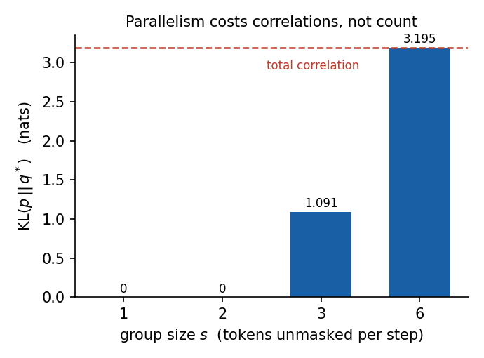
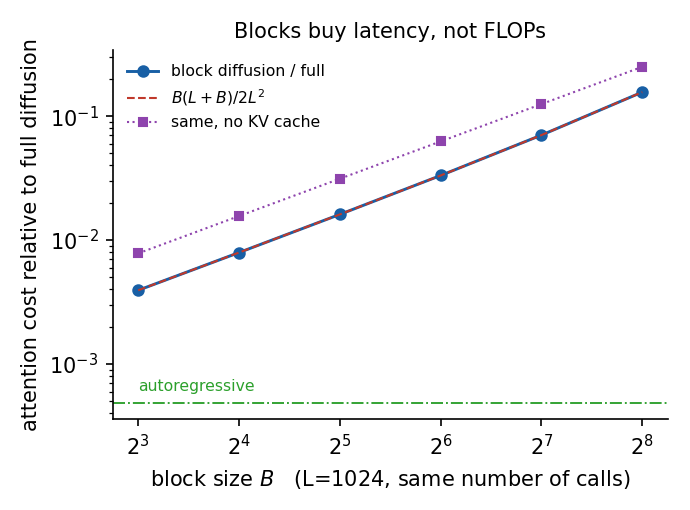

> **系列导航** ｜ [离散扩散的 ELBO](/2026/10/12/diffusion-lm-01-discrete-diffusion-elbo/) ｜ [扩散模型综述](/2026/08/24/diffusion-survey-algorithms-applications/) ｜ [扩散模型的少步生成](/2026/11/01/diffusion-few-step/)

> **TL;DR**
>
> * **块扩散的代价有闭式**：完美模型下，能表示的最优分布族仍然装不下真实分布，$$\mathrm{KL}(p\Vert q^*)$$ 恰好等于同组 token 之间的条件 total correlation，数值对到 1e-14（§3）。
> * **损失不来自「并行度」，来自「耦合」**：块大小从 1 变到 6、组大小恒为 1 时 KL 一动不动（1.02e-17）；把强耦合的两个位置塞进同一组，KL 从 0 跳到 1.598（§4）。
> * **两端是同一公式的退化**：B=1 精确等于自回归（KL=1e-17），一次解完等于「所有位置独立」（KL=3.195，即整序列 total correlation）（§5）。
> * **算力省在 query 数上，不省在 cache 上**：固定调用次数时成本比恰为 $$B(L+B)/2L^2$$（B=32 时 1.61%），cache 只抹掉「前缀重算」那一项（0.781%→0.394%）；自回归仍然最省（0.049%）（§6）。
> * **适用边界**：以上是 V=4、L=6 的可枚举结论，数字随数据相关结构变化；「KL = 条件 TC」这条恒等式与具体数据无关，可以外推，具体量级不可外推（§10）。

## 一、上一节停在哪

[离散扩散的 ELBO](/2026/10/12/diffusion-lm-01-discrete-diffusion-elbo/) 把损失推成了「掩码位置上的交叉熵乘以 $$1/t$$」，也量了并行解码的代价：两个相关性 0.9 的 token 一步同时解出时，一致概率从 0.90 掉到 0.50。

但那篇留了一个更基本的问题没答：**「同时解出」到底在结构上限制了什么？** 当时给的是数值现象（一致概率掉了多少），不是原因。

块扩散（block diffusion）把这个问题推到了台面上。它把序列切成长度 $$B$$ 的块，**块内双向、块间因果**：

- 训练时每个块独立加掩码，模型在一个块内看得见左右（双向），但只能看见之前的块；
- 采样时一个块一个块地出，块内可以分几步解，最后一步把整块定下来。

于是「一次解多少」变成了一个旋钮 $$B$$：$$B=1$$ 就是自回归，$$B=L$$ 就是一次性并解整条序列，中间是连续的谱。这篇文章要回答的是：**这个旋钮拧动时，换了什么、换掉了什么、账怎么算。**

配套实验：[`ipynbs` commit `3cf6cbe`](https://github.com/lrypcy/ipynbs/tree/3cf6cbe/experiments/diffusion-lm/block-diffusion)，纯 numpy、$$V=4$$、$$L=6$$、0.3 秒、21 条断言。选这个规模是因为 $$4^6=4096$$ 条序列可以全部枚举——真实分布是一个精确数组，每条断言都能算到 1e-15，不掺采样噪声。

## 二、机制：一个掩码，两条性质

### 2.1 注意力掩码

设位置 $$i$$ 属于第 $$\lfloor i/B\rfloor$$ 个块，块扩散的注意力掩码是

$$A_{ij}=\mathbb 1\big[\lfloor j/B\rfloor\le\lfloor i/B\rfloor\big]$$

即「同块全连、跨块只看前」。这一行式子同时给了块扩散两个性质，而它们经常被分开讨论：

- **块内双向**：同一块里 $$i$$ 和 $$j$$ 互相可见（$$A_{ij}=A_{ji}=1$$）。这让块内的预测能用上右侧上下文，是它相对自回归的唯一信息优势。
- **块间因果**：块 $$b$$ 的 token 看不见块 $$b+1$$。这让块内的 token 一旦确定就不会被后续块改写——**这才是 KV 缓存能成立的前提**。

实测确认：$$B=1$$ 时这套掩码退化成严格下三角，也就是标准因果注意力；$$B=2$$ 时位置 0 与 1 互相可见，但 0 看不见 2。

### 2.2 缓存能成立的条件

沿序列逐块生成时，第 $$b$$ 块的 query 只需要前 $$(b+1)B$$ 行的 K/V。实测「逐块复用」与「全量重算」的输出最大差 **2.22e-16**，即完全一致。

反过来验一次：若把块内改成「只看本块」（丢掉跨块上下文），输出立刻差 **1.726**。所以缓存不是实现细节，它是「块间因果 + 块内双向」这两条性质的直接推论——**改任何一条，缓存都不再成立**。

## 三、可表达性：把「并行」写成一个分布族

### 3.1 生成分布长什么样

设一次同时解出的位置集合为 $$G_j$$（组），组按顺序提交，$$x_{<G_j}$$ 是之前已提交的全部位置。块扩散的采样是：**每个位置各自从自己的条件分布里独立采**，然后整组一起定下来。所以它实际能产生的分布是

$$q^*(x)=\prod_{j}\ \prod_{i\in G_j} p\big(x_i\mid x_{<G_j}\big)$$

注意里面**没有** $$p(x_{G_j}\mid x_{<G_j})$$。同一个组内的 token 之间没有联合项——它们被当成条件独立。这不是训练没训好，是采样过程本身决定的：一次提交，组内就没有机会互相看。

### 3.2 KL 下界就是条件 total correlation

把 $$p$$ 按同一顺序做链式分解，再和 $$q^*$$ 相除：

$$\mathrm{KL}(p\Vert q^*)=\sum_j\Big[\underbrace{\sum_{i\in G_j}H\big(x_i\mid x_{<G_j}\big)-H\big(x_{G_j}\mid x_{<G_j}\big)}_{\text{组内条件 total correlation}}\Big]$$

每一步都是「同一个前缀下，边缘熵之和减去联合熵」，所以每一项非负，等号成立当且仅当该组内条件独立。

这条推论很硬：**即使模型完美，块扩散也只能逼近到这个距离**。它不是优化问题，是结构问题。

实测（B=1/2/3/6，组大小 1/2/3/6）：

| B | s | 组数 | $$\mathrm{KL}(p\Vert q^*)$$ | $$\sum$$ 条件 TC | 差 |
| --- | --- | --- | --- | --- | --- |
| 1 | 1 | 6 | 0.000000 | 0.000000 | 1.0e-17 |
| 2 | 2 | 3 | 0.000000 | 0.000000 | 3.7e-15 |
| 3 | 3 | 2 | 1.091177 | 1.091177 | 4.4e-16 |
| 6 | 3 | 2 | 1.091177 | 1.091177 | 4.4e-16 |
| 6 | 6 | 1 | 3.195174 | 3.195174 | 1.1e-14 |

数值 KL 与解析的 Σ 条件 TC 逐位相等。

顺带确认这个下界是**最小值**而不是一个估计：在同一个结构族内把条件分布做温度缩放（仍然是合法的块扩散模型），KL 只会变大——B=3、s=3 时 $$q^*$$ 处 KL=1.0912，T=0.70/0.85/1.15/1.40 分别是 1.3005/1.1322/1.1178/1.2294。族内没有比 $$q^*$$ 更好的解。

> 一处容易走错的验证方式：往 $$q^*$$ 里掺一点均匀分布，KL 反而会下降（1.0912→1.0831），因为掺完就不再属于这个族了。要验「族内最优」，扰动必须留在族内。

## 四、代价由「耦合」决定，不由「并行度」决定

这一节是全文最反直觉的部分。把三个旋钮分开拧，看各自花了多少表达力。数据用二阶马尔可夫链 $$\Pr(x_i=x_{i-2})=0.85$$，耦合落在**距离 2** 上。整条序列的 total correlation 是 3.195（$$H(x)=5.1226$$，独立时的 $$\sum H=8.3178$$）。

### 4.1 旋钮一：块大小 B（组大小固定为 1）

| B | 1 | 2 | 3 | 6 |
| --- | --- | --- | --- | --- |
| KL | 1.02e-17 | 1.02e-17 | 1.02e-17 | 1.02e-17 |

**块大小本身不花一分表达力。** 因为块内逐 token 解出时，块内仍是完整的链式分解，块边界只是训练时的注意力切断，不影响生成分布的族。

### 4.2 旋钮二：组大小 s（块大小固定为 L=6）

| s | 1 | 2 | 3 | 6 |
| --- | --- | --- | --- | --- |
| 组数 | 6 | 3 | 2 | 1 |
| KL | 0.000000 | 0.000000 | 1.091177 | 3.195174 |

组越大越差，但**s 从 1 到 2 一点没损失**。原因很具体：相邻配对 {1,2}、{3,4}、{5,6} 里，两两之间的耦合全是「距离 2」，也就是全部跨在组边界上；组内没有可丢的相关性。



*图 1：s=1 与 s=2 的 KL 都是 0，跳到 s=3 才出现 1.091，s=6 顶到整序列 total correlation 3.195。虚线是 3.195 这条天花板。*

### 4.3 旋钮三：分组方式（组大小都是 2，块大小 4）

| 配对 | KL |
| --- | --- |
| 相邻 (1,2)(3,4) | 0.000000 |
| 间隔 (1,3)(2,4) | **1.597587** |
| 交错 (1,4)(2,3) | 0.000000 |

同样的并行度、同样的组数，只换了配对，KL 从 0 跳到 1.598。因为 (1,3) 恰好是这条链上耦合最强的一对，被放进了同一组。

三条合起来是一句话：**丢掉的不是「同时解几个」，而是「同时解的那几个之间有没有相关性」**。这也给出了一条可操作的分组原则——并行组该按数据自身的相关结构切，而不是按位置平均切。

## 五、两端是同一个公式的退化

- **B=1**：每步一个 token，链式分解完整，KL=1.02e-17，$$\sum p\log q^*=-5.122592=-H(p)$$ 即 $$q^*=p$$。块扩散在这一点**精确等于自回归**。
- **一次解完整条序列**：$$q^*$$ 恰好等于六个位置边缘分布的乘积（最大差 0.00e+00），KL=3.195，正好等于整序列的 total correlation。这是本数据上并行解码的天花板。

所以块扩散不是「第三种范式」，而是从自回归到「全并行」这条谱上的一个连续参数。任何关于它的判断（质量、速度、能表达什么）都是 $$B$$ 的函数，说「块扩散行不行」没有意义。

## 六、算力账本：省在 query 数上，不省在 cache 上

口径先说清楚：只数 attention 的 query-key 对数，不计 MLP 与 KV 投影。$$L=1024$$，全序列扩散与块扩散用**同一个总调用次数** $$C=1024$$。

- 全序列扩散：$$C$$ 次调用，每次 $$L$$ 个 query 对 $$L$$ 个 key → $$C L^2$$
- 块扩散（$$n=L/B$$ 块，每块 $$S_b$$ 步，有缓存）：$$\sum_{b} S_b\,B\,(b+1)B$$
- 自回归：$$\sum_{i=1}^{L} i = L(L+1)/2$$

把 $$C=nS_b$$ 代进去，块扩散与全序列扩散的比值有闭式

$$\frac{\text{block}}{\text{full}}=\frac{B(L+B)}{2L^2}$$

| B | 每块步数 | 块扩散 | 无缓存 | 块/全序列 | 闭式 |
| --- | --- | --- | --- | --- | --- |
| 8 | 8 | 4.227e6 | 8.389e6 | 0.0039 | 0.0039 |
| 32 | 32 | 1.730e7 | 3.355e7 | 0.0161 | 0.0161 |
| 128 | 128 | 7.550e7 | 1.342e8 | 0.0703 | 0.0703 |
| 256 | 256 | 1.678e8 | 2.684e8 | 0.1562 | 0.1562 |
| 自回归 | — | 5.248e5 | — | 0.00049 | — |



*图 2：实线是实测的块扩散/全序列扩散成本比，红色虚线是闭式 $$B(L+B)/2L^2$$，两者完全重合；紫色点线是同一配置不开 KV 缓存（恒为 2 倍）；绿色点划线是自回归。*

三个读数：

1. **数值比与闭式逐位相等**，账本不用靠跑——它是结构性的。
2. **块越大越贵**（B=8 的 0.394% → B=256 的 15.62%）。这点和直觉相反：大块并行度高，但每一步要覆盖更长的前缀，单位 token 成本随 $$B$$ 线性涨。块大小买的是**墙钟延迟**，不是 FLOPs。
3. **缓存只抹掉一项**（B=8：0.781% → 0.394%）。真正把成本压下去的是「每步只算 $$B$$ 个 query 而不是 $$L$$ 个」，cache 只是不让前缀重算把这部分收益吃掉。

最后一行值得单独强调：**自回归仍然最省**（0.049%）。块扩散买的从来不是「比自回归更省算力」，而是「用接近自回归的代价换回块内并行」。

## 七、和上一节的 τ-leaping 结论对齐

01 里量的是「两个相关性 0.9 的 token 一步同时解出，一致概率从 0.90 掉到 0.50」。这里给的是它的结构版本：

- 那两个 token 就是一对组内元素，它们的条件互信息就是贡献给 KL 的那一项；
- 一致概率从 0.90 掉到 0.50，是这一项在具体采样上的表现；
- 而 §4.3 说明，只要把它们分到不同组，KL 立刻回到 0——**相关性本身不是问题，「同组」才是**。

换句话说，块扩散的问题不是「并行解码有损」，而是「并行解码把哪些位置放进了同一个组」。这从一条经验观察变成了一条可以预先计算的设计约束。

## 八、实践含义

| 决策 | 依据 | 代价 |
| --- | --- | --- |
| 块大小 B | 延迟目标与显存的折中；B 越大越贵（$$B(L+B)/2L^2$$） | 表达力**不受影响**（只要组大小为 1） |
| 组大小 s（每步提交几个） | 越小越好；s=1 时 KL=0 | s 决定墙钟步数，是唯一真正损失表达力的旋钮 |
| 分组方式 | 按数据的相关结构切，强耦合的位置不要同组 | 同 s 下 KL 可差 1.6 以上 |
| KV 缓存 | 块间因果 + 块内双向时必须开 | 不开则前缀重算把收益吃掉一半 |
| 需要精确似然 | 只用 B=1 或 s=1 的配置 | 否则似然有结构性缺口 |

## 九、五条常见误解

1. **「块扩散是第三种生成范式」**。它是自回归与全并行之间的一维谱，B=1 精确等于自回归（KL=1e-17），一次解完等于独立假设（KL=3.195）。
2. **「块越大质量越差」**。组大小为 1 时块大小对表达力没有影响（1.02e-17，四个 B 全一样）。质量差通常来自「每步提交了多个 token」这个更细的旋钮。
3. **「并行解码的主要损失是多样性」**。损失是结构性的条件独立，可以精确写成条件 total correlation，不是笼统的「多样性下降」。
4. **「有了 KV 缓存块扩散就比自回归便宜」**。固定调用次数时它比自回归贵 8–320 倍（0.394% vs 0.049% 那一行）。它省的是相对全序列扩散的算力。
5. **「块内双向只是让训练更充分」**。块内双向是缓存成立的一半前提：去掉它（只看本块）输出差 1.726，缓存也就无从谈起。

## 十、复现与结论

全部数字来自同一份脚本，纯 numpy、约 0.3 秒、固定种子 `20261105`，全量跑通输出 **断言总数 = 21**：

```bash
git clone https://github.com/lrypcy/ipynbs
cd ipynbs/experiments/diffusion-lm/block-diffusion
python block_diff_lab.py            # A–E 全部
python block_diff_lab.py A B        # 只跑指定组
```

脚本与逐条结果：[`experiments/diffusion-lm/block-diffusion`](https://github.com/lrypcy/ipynbs/tree/3cf6cbe/experiments/diffusion-lm/block-diffusion)。

四句话收尾：

1. 块扩散的可表达性有闭式下界：$$\mathrm{KL}(p\Vert q^*)=\sum_j\mathrm{TC}(p_{G_j\mid x_{<G_j}})$$，数值对到 1e-14。
2. 代价由耦合决定：块大小从 1 到 6、组大小为 1 时 KL 一点不变；把强耦合的两个位置放进同一组，KL 从 0 跳到 1.598。
3. 两端是同一公式的退化：B=1 是自回归（KL=0），一次解完是独立假设（KL=总相关 3.195）。
4. 算力省在 query 数上：固定调用次数时成本比恰为 $$B(L+B)/2L^2$$，cache 只抹掉前缀重算那一项，自回归仍然最省。

## 参考文献

1. Arriola, Gokaslan, Chiu, Yang, Qi, Han, Sahoo, Kuleshov. *Block Diffusion: Interpolating Between Autoregressive and Diffusion Language Models.* [arXiv:2503.09516](https://arxiv.org/abs/2503.09516)
2. Sahoo, Arriola, Schiff, Gokaslan, Marroquin, Chiu, Rush, Kuleshov. *Simple and Effective Masked Diffusion Language Models.* [arXiv:2406.07524](https://arxiv.org/abs/2406.07524)
3. Nie, Zhu, You, Zhang, Ou, Zhang, Zhao, Zhou, Lin, Wen, Li. *Large Language Diffusion Models.*（LLaDA） [arXiv:2502.09992](https://arxiv.org/abs/2502.09992)
4. Gat, Remez, Shaul, Kreuk, Chen, Synnaeve, Adi, Lipman. *Discrete Denoising Diffusion Models (D3PM).* [arXiv:2107.03006](https://arxiv.org/abs/2107.03006)
5. Ho, Jain, Abbeel. *Denoising Diffusion Probabilistic Models.* [arXiv:2006.11239](https://arxiv.org/abs/2006.11239)

## 上一篇 / 下一篇

- 上一篇：[扩散语言模型（01）：离散扩散的 ELBO——为什么「掩码 + 1/t 权重」就够用了](/2026/10/12/diffusion-lm-01-discrete-diffusion-elbo/)
- 下一篇：[扩散模型的计算账本：视频为什么贵，贵在哪一条轴上](/2026/11/02/diffusion-video-token/)
