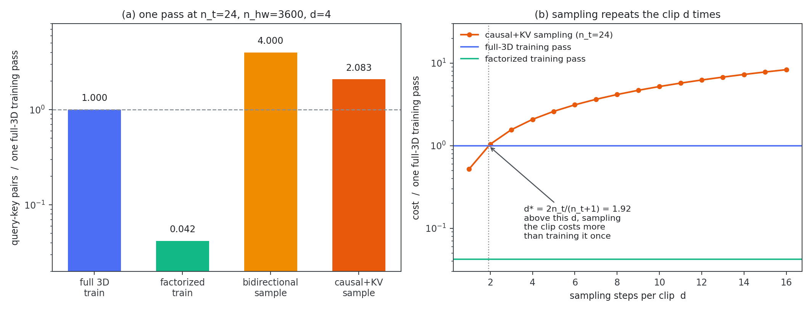
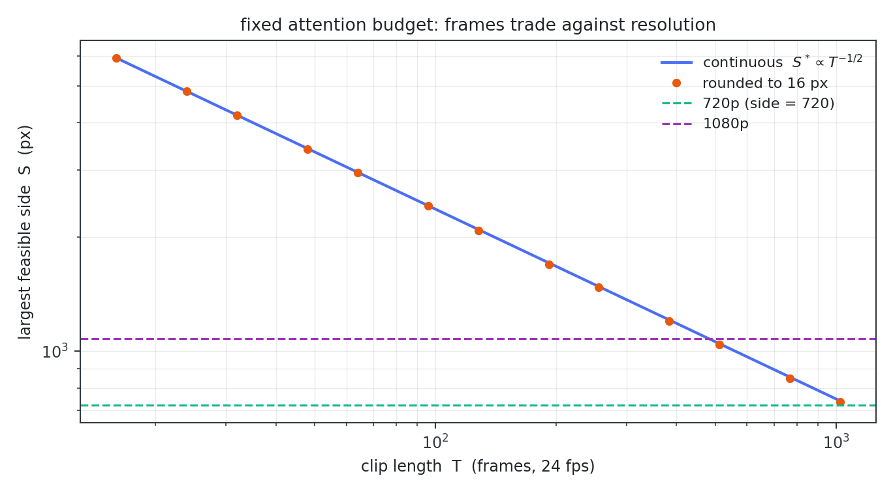

> **系列导航** ｜ [扩散模型综述：算法与应用](/2026/08/24/diffusion-survey-algorithms-applications/) ｜ [DDPM 深度剖析](/2026/11/01/ddpm-deep-dive/) ｜ [采样器数值分析](/2026/11/01/diffusion-sampler-ode/) ｜ [后训练对齐](/2026/11/01/diffusion-post-training/) ｜ [少步生成](/2026/11/01/diffusion-few-step/) ｜ [块扩散](/2026/11/02/diffusion-lm-02-block-diffusion/)

> **TL;DR**
>
> * **贵的不在时间轴**：时空分解之后，时间注意力只占空间项的 $$n_t/n_{hw}$$，720p/96 帧时是 0.67%（§4，表 4）。
> * **分解比是 $$1/n_t+1/n_{hw}$$，两项分母不同**：720p 上实测 0.041944，与闭式对到 1e-12（§3，表 3）。写成 $$1/n_t+1/n_t^2$$ 会得出「与分辨率无关」的错结论。
> * **因果只省 1.920×，上界 2×**：query 总数没变（都是 $$N$$），变的是平均 key 数减半；KV cache 在 query-key 对数上一分不省，它省的是 K/V 投影的 $$d(n_t+1)/2$$ = 50×（§5–§6，表 5）。
> * **采样与训练的指数相同（2.000 / 1.950），差别只在常数 $$2/d$$**：$$d\ge2$$ 时采样一遍比一次前向贵，720p 下是 2.08×（§7）。
> * **适用边界**：四张账都是整数计数与闭式，不含任何采样；指数与比值可外推，0.67%、50×、45 秒这类量级随分辨率与 $$d$$ 变（§11）。

## 一、先把「四次方」这三个字拆开

视频扩散的成本经常被一句话概括：**多了个时间轴，attention 是四次方**。这句话里至少有三处含混：

- 四次方是哪个量的四次方？是帧数、是 token 数，还是分辨率？
- 时间轴加进去，是把成本乘了 2，还是乘了 20？
- 训练和采样是同一笔账吗？如果不是，差在哪一项？

[上一篇](/2026/11/02/diffusion-lm-02-block-diffusion/) 把离散域的账算到闭式：块扩散的代价恰好是同组 token 的条件 total correlation。回到连续域，视频是当下最贵的一档，账反而更少人算清楚。这篇把它拆成四张互不干扰的账：

| 账本 | 问的问题 | 变量 |
| --- | --- | --- |
| token 账本 | $$N$$ 怎么随帧数、分辨率、patch、VAE 变 | $$n_t,\ n_{hw},\ p,\ f_t,\ f_s$$ |
| 训练账本 | 一次前向的 query-key 对数 | 全 3D 还是时空分解 |
| 采样账本 | 生成一条 clip 要几遍前向、每遍多少 query | 步数 $$d$$、因果与否、有无 cache |
| 预算账本 | 固定算力下帧数与分辨率怎么互相让路 | 预算 $$\mathcal B$$ |

四张账的每一笔都是整数计数，没有采样。实验目录 [`video-budget`](https://github.com/lrypcy/ipynbs/tree/1c45e0e/experiments/diffusion/video-budget)：纯 numpy、0.4 秒、31 条断言，每条断言的形式都是

$$\bigl\lvert \text{逐项求和} - \text{闭式} \bigr\rvert < 10^{-12}$$

这是这篇与前四篇最大的不同：采样器、后训练、少步生成、块扩散都要跑随机过程，因为测的是「误差如何随步数兑现」；这里测的是账本，随机过程只会往里塞噪声。代价是它更难被推翻——所以每一笔都同时给闭式与求和实测值，而不是「看起来差不多」。

和已有几篇的分工：DDIM 为什么是一阶指数积分器在 [DDPM 篇](/2026/11/01/ddpm-deep-dive/)，各阶求解器的误差结构在[采样器篇](/2026/11/01/diffusion-sampler-ode/)，把步数压到 1–4 的代价在[少步生成篇](/2026/11/01/diffusion-few-step/)，离散域并行解码的互信息损失在[块扩散篇](/2026/11/02/diffusion-lm-02-block-diffusion/)。本文只算算力。

## 二、token 账本：三个旋钮，两种指数

一条视频的 latent token 数

$$N = n_t\cdot n_{hw},\qquad n_t=\Bigl\lfloor \frac{T}{f_t}\Bigr\rfloor,\qquad n_{hw}=\Bigl\lfloor\frac{H}{f_s p}\Bigr\rfloor\cdot\Bigl\lfloor\frac{W}{f_s p}\Bigr\rfloor$$

其中 $$T,H,W$$ 是像素域的帧数与长宽，$$f_s,f_t$$ 是 VAE 的空间/时间下采样倍数，$$p$$ 是 latent 上的 patch 边长（DiT 的 patchify）。以 720×1280、96 帧（24 fps 下 4 秒）、VAE $$8\times/4\times$$、patch 2 为基准：$$n_t=24$$，$$n_h=45$$，$$n_w=80$$，$$N=86400$$。

| 旋钮 | $$N$$ | 一次全 3D 前向的对数 |
| --- | --- | --- |
| 帧数 ×2 | ×2.00 | ×4.00 |
| 长边 ×2 | ×2.00 | ×4.00 |
| patch 边长 ×2 | ×**0.2444** | ×0.0597 |
| VAE $$f_t$$ 1→8 | ×0.125 | ×0.0156 |

三个旋钮让 $$N$$ 线性变化，只有 patch 是平方反比——因为 patch 同时吃长和宽。表格最后一行留到 §8 再说。

patch 那一行的数字值得停一下：理想值应该是 0.25，实测 0.2444。原因是整除截断，$$720 \div 32 = 22$$ 而不是 22.5，$$45 \to 22$$ 掉了 2.2%。这不是舍入误差，是**真实实现里就会发生的事**：分辨率不能被 $$f_s p$$ 整除时，账本必须按整除算，直接用「1/4」估会系统性偏乐观。换成 1024×1024（能被 32 整除）时，比值精确等于 0.25。

典型配置对账：

| 配置 | $$n_t$$ | $$n_h\times n_w$$ | $$N$$ |
| --- | --- | --- | --- |
| 256×256, 16 帧, VAE 8/4, p=1 | 4 | 32×32 | 4 096 |
| 512×512, 49 帧, VAE 8/4, p=2 | 12 | 32×32 | 12 288 |
| 720×1280, 96 帧, VAE 8/4, p=2 | 24 | 45×80 | 86 400 |
| 720×1280, 96 帧, VAE 8/4, p=1 | 24 | 90×160 | 345 600 |
| 1080×1920, 192 帧, VAE 8/4, p=2 | 48 | 67×120 | 385 920 |

注意 1080p 那一行：像素数是 720p 的 2.25 倍、帧数是 2 倍，但 $$N$$ 只有 4.5 倍——因为 $$n_h=67$$、$$n_w=120$$ 都是整除截断后的值（$$1080/16=67.5$$，$$1920/16=120$$）。这条账本对截断很敏感，先算清楚再谈成本。

## 三、一次前向为什么是四次方，以及分解省的是哪一半

全 3D 注意力里每个 token 都看所有 token，对数

$$\text{cost}_{\text{3D}} = N^2 = n_t^2\,n_{hw}^2$$

帧数翻倍 ⇒ $$N$$ 翻倍 ⇒ 对数翻四倍。所以「四次方」的准确说法是：**对帧数二次、又在 $$N^2$$ 里被平方一次**，而 $$N$$ 对分辨率也是线性的，于是对长边同样是四次方。它不是「时间轴的专属惩罚」，分辨率一样吃。

时空分解注意力（divided space-time attention）先做帧内空间、再做跨帧时间：

$$\text{cost}_{\text{fac}} = \underbrace{n_t\,n_{hw}^2}_{\text{空间项}} + \underbrace{n_{hw}\,n_t^2}_{\text{时间项}}$$

两边都除以 $$N^2=n_t^2n_{hw}^2$$：

$$\frac{\text{cost}_{\text{fac}}}{\text{cost}_{\text{3D}}} = \frac{1}{n_t} + \frac{1}{n_{hw}}$$

这一行的两项**分母不同**——空间项除掉两个 $$n_t$$ 还剩一个 $$n_t$$ 在分母，时间项除掉两个 $$n_{hw}$$ 还剩一个 $$n_{hw}$$。这里很容易写错成 $$1/n_t+1/n_t^2$$（本文第一版就写错了），而那会得出「分解比与分辨率无关」的错结论。720p/96 帧上实测 0.041944，与 $$1/24+1/3600$$ 对到 1e-12。

| 方案 | query-key 对数 | 相对全 3D |
| --- | --- | --- |
| 全 3D（训练，1 遍） | 7.465e9 | 1.0000 |
| 时空分解（训练，1 遍） | 3.131e8 | **0.0419** |
| 双向采样（4 步） | 2.986e10 | 4.0000 |
| 因果 + KV 采样（4 步） | 1.555e10 | 2.0833 |

*表 3：720p、96 帧、$$d=4$$ 的四种方案。采样两行后面 §5 再解释。*

分解更省的充要条件也可以顺手解出来：$$\text{cost}_{\text{fac}} < \text{cost}_{\text{3D}} \iff n_t(n_{hw}-1) > n_{hw} \iff n_t > n_{hw}/(n_{hw}-1)$$。右边那个临界值对任何 $$n_{hw}\ge 2$$ 都不超过 2，所以只要 $$n_t\ge 2$$ 分解就便宜；反过来说 $$n_t=1$$（也就是图像）时，那项 $$n_{hw}n_t^2$$ 纯属白付——单帧不需要时间注意力，这条例外是小但真实的。

## 四、分解之后，钱到底花在哪一半

把两项单独拎出来看，比值是

$$\frac{\text{时间项}}{\text{空间项}} = \frac{n_{hw}n_t^2}{N\,n_{hw}} = \frac{n_t}{n_{hw}}$$

| 配置 | 空间项 | 时间项 | 时间/空间 |
| --- | --- | --- | --- |
| 256×256, 16 帧, p=1 | 4.194e6 | 1.638e4 | 0.00391 |
| 512×512, 49 帧, p=2 | 1.258e7 | 1.475e5 | 0.01172 |
| 720×1280, 96 帧, p=2 | 3.110e8 | 2.074e6 | **0.00667** |
| 720×1280, 384 帧, p=2 | 1.244e9 | 3.318e7 | 0.02667 |
| 1080×1920, 192 帧, p=2 | 3.103e9 | 1.852e7 | 0.00597 |

*表 4：720p/96 帧上，跨帧时间注意力只值全部注意力的 0.67%。*

这是全篇最反直觉的一条。n_hw 是每帧的空间 token 数（3600），n_t 是帧数（24）——在 720p 下前者比后者大两个数量级。时间项按 $$n_t^2$$ 长，但要被 $$n_{hw}$$ 除一下；空间项按 $$n_{hw}^2$$ 长，只被 $$n_t$$ 除一下。所以：

> 视频扩散的注意力账单，99% 花在帧内空间，跨帧时间只占零头。

把 $$T$$ 从 96 帧拉到 384 帧（16 秒），这一项也只从 0.67% 涨到 2.67%：帧数翻四倍，时间项占比翻四倍，仍然是个零头。

**后果是可操作的**：在分解结构下，压成本的杠杆是分辨率与 patch，不是帧数。帧数只通过 $$N$$ 的线性项进来；而分辨率同时进 $$N$$ 和 $$n_{hw}$$，双份。

## 五、采样不是一次前向

训练时整条 clip 一遍前向就完事。采样时同一条 clip 要跑 $$d$$ 遍（每步一遍），所以采样成本天然是 $$d$$ 倍——除非用因果结构把 query 数压下来。

现在的视频扩散主流是**双向**的：整条 clip 一起去噪，每步每个 token 都对所有 token。成本

$$\text{cost}_{\text{bidir}} = d\cdot N^2$$

因果 + KV 的路线（逐帧生成，第 $$t$$ 帧只对前缀）成本

$$\text{cost}_{\text{causal}} = d\cdot n_{hw}^2\sum_{t=0}^{n_t-1}(t+1) = d\cdot n_{hw}^2\cdot\frac{n_t(n_t+1)}{2}$$

两者之比

$$\frac{\text{cost}_{\text{causal}}}{\text{cost}_{\text{bidir}}} = \frac{n_t+1}{2n_t}$$

$$n_t=24$$ 时是 0.5208，也就是**只省 1.920×**。上界是 2×：$$n_t=6$$ 时省 1.714×，$$n_t=96$$ 时省 1.979×，clip 再长也压在 2× 以下。

为什么不是 $$n_t$$ 倍？把两边的 query 数数一遍就清楚了：双向每步 $$N$$ 个 query 对 $$N$$ 个 key；因果每帧 $$n_{hw}$$ 个 query，$$n_t$$ 帧加起来还是 $$N$$ 个 query。**query 总数一模一样**，变的只是平均 key 数——从 $$n_t n_{hw}$$ 落到 $$\frac{n_t+1}{2}n_{hw}$$，正好一半。所谓「逐帧生成省了一个数量级」省的是**每步的串行时间**，不是总配对量。



*图 1：左：720p/96 帧/$$d=4$$ 下四种方案相对一次全 3D 前向的成本，分解到 4.19%，采样反而超过 1。右：因果 + KV 采样的成本随步数线性长，与两条训练线分别相交——这就是 §7 里 $$d^*$$ 的来历。*

## 六、KV cache 省的是另一笔账

上一节说因果结构只省 1.92×，那 KV cache 呢？把两笔账分开记（因果采样，$$d=4$$）：

| | query-key 对数 | K/V 投影 token 次数 |
| --- | --- | --- |
| 不缓存 | 1.555e10 | 4 320 000 |
| 缓存 | 1.555e10 | **86 400** |

*表 5：KV cache 在两列上的收益完全不同。*

- **对数这一列两行完全相同**。因果采样第 $$t$$ 帧的对数是 $$d\cdot n_{hw}\cdot(t+1)n_{hw}$$，缓存与否这个求和式一字不差：cache 剪掉的是**重复的 K/V 投影**，不是重复的配对。
- **投影这一列低 50×**，正好是 $$d(n_t+1)/2$$。前缀帧在生成完就不再变化，它们的 K/V 只该算一次；不缓存就要为每个新帧、每一步重算一遍。

所以「KV cache 有 $$n_t$$ 倍加速」这句话是真的，但它落在投影上，不在配对上。把两笔混起来谈，就会以为给因果采样加上 cache 能把成本压到原来的 $$1/n_t$$——实际是 1.92×，剩下的都卡在配对数量上。

这条也解释了块扩散那篇的一个现象：那边的 cache 收益同样只是「前缀重算」那一项的差，而不是 query 数的差。**cache 优化的是重复计算，不是算法复杂度。**

## 七、训练与采样：同一个指数，不同的常数

把帧数从 24 帧拉到 384 帧，看两边的指数：

| $$T$$（帧） | $$n_t$$ | 训练（全 3D 前向） | 因果 + KV 采样 | 训练/采样 |
| --- | --- | --- | --- | --- |
| 24 | 6 | 4.666e8 | 1.089e9 | 0.429 |
| 48 | 12 | 1.866e9 | 4.044e9 | 0.462 |
| 96 | 24 | 7.465e9 | 1.555e10 | 0.480 |
| 192 | 48 | 2.986e10 | 6.096e10 | 0.490 |
| 384 | 96 | 1.194e11 | 2.414e11 | 0.495 |

*表 6：720p 分辨率固定，只拉帧数。*

log-log 斜率：训练 **2.0000**，采样 **1.9499**。采样略低于 2，正是因为 $$\frac{n_t+1}{2}$$ 里那个 $$+1$$（首帧只见自己，全程少了一点点）。

两者同为平方。这意味着「采样是线性的」这个说法站不住：它把 token 数 $$N$$ 当成了算力，漏掉了 $$d$$ 遍。真正的差别只在常数上：

$$\frac{\text{训练一遍}}{\text{采样一遍}} = \frac{N^2}{d\cdot n_{hw}^2\cdot n_t(n_t+1)/2} = \frac{2n_t}{d(n_t+1)} \longrightarrow \frac{2}{d}$$

$$n_t$$ 从 6 到 96，比值从 0.429 单调升到 0.495，收敛到 $$2/d=0.5$$。这个极限与分辨率无关、与 clip 长度无关，**只由步数决定**。

于是有了这条与直觉相反的结论：

> $$d\ge 2$$ 时，生成一条 clip 比训练时前向一次这条 clip 还贵。

720p/96 帧/$$d=4$$ 时是 1.555e10 对 7.465e9，2.08×；对分解注意力的那次前向（3.131e8）则是 49.7×。原因很朴素：训练把整条 clip 作为**一次**前向摊销，采样把同一条 clip 重跑 $$d$$ 遍，而因果结构只省回 1.92×。

反过来，$$d=1$$ 时采样一遍比训练一遍便宜——对全 3D 前向，阈值是 $$d^* = 2n_t/(n_t+1) \approx 1.92$$；对分解前向，$$d^*$$ 只有 0.08，整数步下永远跨不过去。**$$d$$ 是唯一能把整条账翻过来的旋钮**，这也正是[少步生成那篇](/2026/11/01/diffusion-few-step/)在算力上的位置：那里的每一步蒸馏，都是在这里换掉一个 $$d$$。

边界要说清楚：这里比的是「一次前向」与「一次采样」。真实训练要跑几十万步、每步一个 batch，真实推理一次服务一个请求——按 per-clip 记账才是可比的单位，拿「总训练 FLOPs 除以总生成条数」去比会得到完全不同的结论。

## 八、3D VAE 的兑换率：账本上等价，信息量上不等价

固定 720×1280、96 帧，把各种压缩组合摆在一起（这一组用 $$p=1$$，所以基准是 1 382 400）：

| 配置 | $$N$$ | 相对 |
| --- | --- | --- |
| $$f_s$$=8, $$f_t$$=1, p=1 | 1 382 400 | 1.0000 |
| $$f_s$$=8, $$f_t$$=4, p=1 | 345 600 | 0.2500 |
| $$f_s$$=8, $$f_t$$=1, p=2 | 345 600 | 0.2500 |
| $$f_s$$=8, $$f_t$$=4, p=2 | 86 400 | 0.0625 |
| $$f_s$$=16, $$f_t$$=4, p=2 | 21 120 | 0.0153 |

*表 7：时间压缩 4× 与空间压缩 2×（面积 4×）压出完全相同的 token 数。*

在 token 账本上两者**完全等价**（345 600 = 345 600），在 attention 上也等价（$$f_t$$ 1→4 让成本从 1.911e12 降到 1.194e11，正好 1/16）。原因是 $$f_t$$ 直接缩 $$n_t$$，而 $$n_t$$ 在 $$N^2$$ 里出现两次，压缩的收益被平方放大一次；空间压缩同理。

差别只在**信息量**：

- $$f_t=4$$ 意味着 4 帧合成一个 latent 帧，运动的高频先被抹掉；
- $$f_s=16$$ 意味着空间分辨率减半，纹理先被抹掉。

这部分没法用这条账算出来——它是生成质量问题，不是算力问题。账本能告诉你的只是：**选 $$f_t$$ 还是选 $$f_s$$ 在算力上是平价的，所以应该按「哪种信息更可丢」来选，而不是按「哪种更省」。** 相邻帧之间的相关性本来就远高于相邻像素，这是 $$f_t$$ 普遍开得比较大的一层原因（另一半原因是它直接把 $$n_t$$ 压小，在平方项上更划算）。

## 九、固定预算：帧数与分辨率怎么互相让路

把预算钉在 query-key 对数上，$$\text{cost}_{\text{3D}} = N^2 \le \mathcal B$$：

$$N \le \sqrt{\mathcal B},\qquad n_h = \sqrt{\frac{\sqrt{\mathcal B}}{n_t}}=\sqrt{\frac{4\sqrt{\mathcal B}}{T}}\ \Longrightarrow\ S \propto T^{-1/2}$$

其中 $$S$$ 是像素域边长。**帧数翻 4 倍，边长只能砍一半。**

取 $$\mathcal B = 3\times10^{11}$$（只是让 720p 落在几十秒这一段；比值与指数和 $$\mathcal B$$ 无关）：

| $$T$$（帧） | 边长*（连续解） | 边长（取 16 的倍数） | $$N$$ | 每秒 token |
| --- | --- | --- | --- | --- |
| 24 | 4 834 | 4 832 | 547 224 | 547 224 |
| 96 | 2 417 | 2 416 | 547 224 | 136 806 |
| 192 | 1 709 | 1 696 | 539 328 | 67 416 |
| 384 | 1 209 | 1 200 | 540 000 | 33 750 |
| 768 | 855 | 848 | 539 328 | 16 854 |

*表 8：整数解与连续解相差不到 16 px，N² 始终不超预算。*



*图 2：双对数下是一条斜率 −1/2 的直线，橙点是取 16 倍数后的整数解。两条虚线是 720p 与 1080p：它们与直线的交点就是「这个分辨率在这笔预算下能撑多久」。*

固定 720p、同一笔预算：

| 注意力结构 | $$n_t$$ | 帧数 | 时长 |
| --- | --- | --- | --- |
| 全 3D | 152 | 608 | **25.3 秒** |
| 时空分解 | 7 504 | 30 016 | **20.8 分钟** |

*表 9：两次都用满预算（2.994e11 / 3.000e11）。*

49 倍的差距。这个数字不该被读成「分解能让视频长 49 倍」，而该读成：**换掉注意力结构之后，瓶颈就不再是注意力了**——参数、显存、数据配比会接管成为新的约束。

再看固定分辨率下单次前向能撑多长：

| 分辨率 | $$n_t$$ | 帧数 | 时长 |
| --- | --- | --- | --- |
| 720p（$$n_{hw}$$=3600） | 270 | 1 080 | **45.0 秒** |
| 1080p（$$n_{hw}$$=4489） | 122 | 488 | **20.3 秒** |

*表 10：同一笔预算，全 3D 前向。*

比值 2.213，而 $$(1080/720)^2=2.25$$——在平方预算下，**分辨率涨一档就等于时长砍一半**。这解释了为什么「1080p 长视频」在注意力上是双杀：两个都是平方。

## 十、六条常见误解

1. **「视频贵在时间轴」**。720p 上时间注意力只占 0.67%（§4）。贵的是每帧 3600 个空间 token。
2. **「attention 是 token 数的四次方」**。是 $$N^2$$，即对数；$$N$$ 对帧数、对长边都是线性的。四次方只在「对帧数」或「对长边」这单一变量上成立。
3. **「KV cache 能带来 $$n_t$$ 倍加速」**。对数上一分不省，投影上 $$d(n_t+1)/2$$（§6）。两者是两笔账。
4. **「因果采样是线性的」**。斜率 1.95，仍是平方（§7）。线性是「每帧只算自己」的错觉，忽略了 $$n_t$$ 帧都要跑。
5. **「训练比推理贵」**。$$d\ge2$$ 时 per-clip 的采样比一次前向贵 2.08×（§7）。训练贵在「要跑很多步」，不贵在「单次前向」。
6. **「patch 翻倍省 4 倍」**。720p 上是 0.2444，不是 0.25（§2），整除截断吃掉 2.2%。

## 十一、复现与结论

全部数字来自同一份脚本，纯 numpy、不训练任何模型、约 0.4 秒：

```bash
git clone https://github.com/lrypcy/ipynbs
cd ipynbs/experiments/diffusion/video-budget
python video_budget_lab.py                 # A–E，约 0.4 秒
python video_budget_lab.py B E             # 只跑指定组
python video_budget_lab.py --figdir figs   # 额外画图（需 matplotlib）
```

脚本与逐条结果：[`experiments/diffusion/video-budget`](https://github.com/lrypcy/ipynbs/tree/1c45e0e/experiments/diffusion/video-budget)。全量跑通输出 **断言总数 = 31**。

README 里记下了三处不能省的细节：整除截断（0.2444 而不是 0.25）、分解闭式的两项分母不同、以及 KV cache 在对数与投影上是两笔账。

四句话收尾：

1. **账本对三个旋钮线性、只对 patch 平方反比**，但真正放大差距的是下一步：$$N$$ 翻倍 ⇒ 对数翻四倍。帧数、分辨率、patch 在这条链上的地位完全不同。
2. **分解比是 $$1/n_t+1/n_{hw}$$，两项分母不同**；720p 上空间项占 99.3%，时间注意力只值 0.67%——「视频建模难」在算力上不是跨帧注意力造成的。
3. **因果结构省 1.92×（上界 2×），KV cache 省 $$d(n_t+1)/2$$，两笔账不能混**。混着谈就会以为 cache 能把采样成本压到 $$1/n_t$$。
4. **$$d$$ 是唯一能把整条账翻过来的旋钮**：$$d<1.92$$ 采样便宜，$$d\ge2$$ 采样贵。视频生成提速的功夫都压在少步上，这也是这个系列从采样器一路走到蒸馏的原因。

这个系列到此收尾：采样器（怎么解方程）→ 后训练（奖励怎么变成梯度）→ 少步生成（步数换成什么）→ 块扩散（并行解码丢掉多少互信息）→ 计算账本（这些选择在算力上各值多少）。再往前是模型侧的话题——视频扩散的条件注入与时空表征——那是另一个系列的事。

## 参考文献

1. Ho, Salimans, Gritsenko, Chan, Norouzi, Fleet. *Video Diffusion Models.* [arXiv:2204.03458](https://arxiv.org/abs/2204.03458)
2. Bertasius, Wang, Torresani. *Is Space-Time Attention All You Need for Video Understanding?* [arXiv:2102.05095](https://arxiv.org/abs/2102.05095)
3. Peebles, Xie. *Scalable Diffusion Models with Transformers.* [arXiv:2212.09748](https://arxiv.org/abs/2212.09748)
4. Blattmann, Rombach, Ling, Dockhorn, Kim, Fidler, Kreis. *Align your Latents: High-Resolution Video Synthesis with Latent Diffusion Models.* [arXiv:2304.08818](https://arxiv.org/abs/2304.08818)
5. Rombach, Blattmann, Lorenz, Esser, Ommer. *High-Resolution Image Synthesis with Latent Diffusion Models.* [arXiv:2112.10752](https://arxiv.org/abs/2112.10752)
6. Kondratyuk, Yu, Gu, Lezama, Huang, Hornung, Adam, Akbari, Alon, Birodkar, et al. *VideoPoet: A Large Language Model for Zero-Shot Video Generation.* [arXiv:2312.14125](https://arxiv.org/abs/2312.14125)
7. Shazeer. *Fast Transformer Decoding: One Write-Head is All You Need.* [arXiv:1911.02150](https://arxiv.org/abs/1911.02150)

