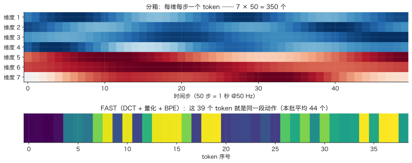
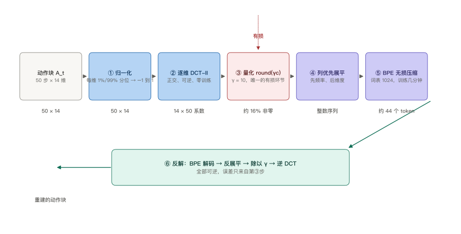
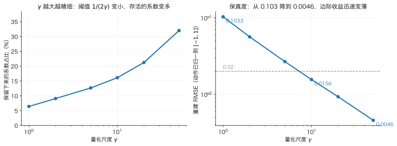
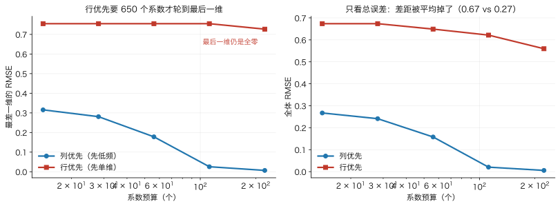
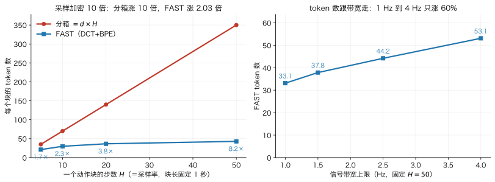
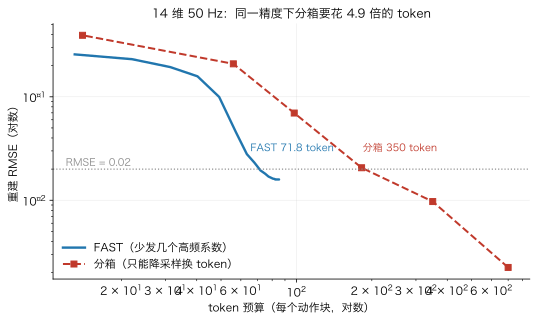
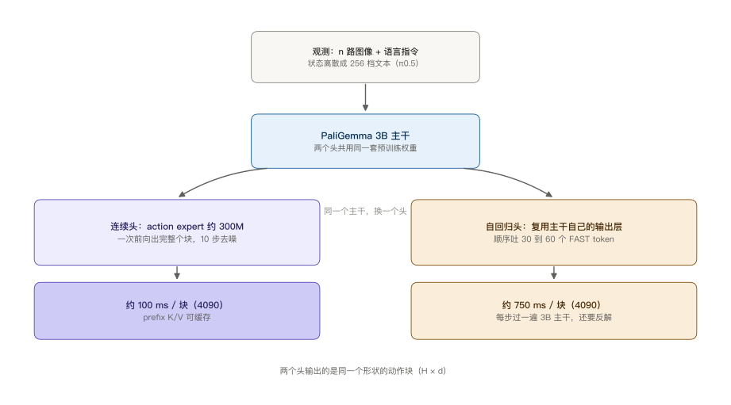

> **系列导航**：这是 π 系列具身模型深潜的第 2 篇。系列按**问题**组织：动作怎么表示（01 π0 / **02 FAST** / 03 KI）→ 长程任务怎么拆（04 Hi Robot / 05 π0.5）→ 延迟怎么吃掉（06 RTC）→ 怎么从经验里学（07 RECAP / 08 RLT）→ 记忆与条件（09 MEM / 10 π0.7）。上一篇 π0 走的是「连续动作 + 流匹配」，这一篇走的是完全相反的方向：把动作块压成几十个离散 token，交给自回归。两篇共用同一个动作块符号 $$\mathbf{A}_t\in\mathbb{R}^{H\times d}$$。

> **TL;DR**
>
> * **核心问题与结论**：自回归 VLA 要先决定连续动作怎么变成离散符号，而“每维每步分一个箱”的 token 数恒等于 $$d\times H$$，控制频率翻倍就翻倍。FAST 改成“逐维 DCT → 乘 $$\gamma$$ 取整 → 列优先展平 → BPE”，让 token 数由**信号带宽**决定而不是采样率。
> * **关键证据**：同一条 1 秒轨迹采样加密 10 倍（H=5→50），分箱 token 从 35 涨到 350，FAST 只从 21.1 涨到 42.9（2.03 倍），压缩比 1.66×→8.16×；固定 H=50 只改带宽，1 Hz 到 4 Hz 的 token 数从 33.1 涨到 53.1（实验 A1/A2）。
> * **适用边界与代价**：列优先展平不是风格问题——同样 14 个系数预算下，行优先会让最后一维留成全零（最差维 RMSE 0.755 vs 0.315），且要花到 650 个系数才轮得到那一维（实验 D）。代价是推理：每块从 ~100 ms 变成 ~750 ms，因为要顺序解码 30–60 个 token 且用的是 2B 主干。
> * **系列定位**：解决“动作怎么变成离散符号、以及怎么压得住高频”，不解决自回归对语言的灾难性遗忘（03 KI）。

## 1. 分箱的死法：token 数被锁死在一个乘法里

先看最直觉的做法：把每个动作维度归一化到 $$[-1,1]$$，切成 256 档，每个值一个 token。这就是 RT-2 / OpenVLA 的做法，也是 openpi 里 `BinningTokenizer` 的做法（`n_bins=256`）。token 数是

$$
n_{\rm bin}=d\cdot H
$$

这个式子里**没有任何可以调的项**。想让 token 变少？只能改 $$d$$（本体决定）或 $$H$$（控制频率决定）。精度也不是旋钮：256 档换 16 档不会让 token 数少一个，只会让误差变大。

问题在频率上炸开。π0 取 $$H=50$$、双臂 14 维，一个块就是 700 个 token；π0-FAST 的 `max_token_len` 默认 250，装都装不下。论文表 I 的四行就是这个乘法：

| 数据集 | 维度 | 频率 | 分箱 token | FAST token | 压缩比 |
| --- | --- | --- | --- | --- | --- |
| BridgeV2 | 7 | 5 Hz | 35 | 20 | 1.75× |
| DROID | 7 | 15 Hz | 105 | 29 | 3.6× |
| Bussing（清桌） | 7 | 20 Hz | 140 | 28 | 5.0× |
| Shirt Fold（折 T 恤） | 14 | 50 Hz | 700 | 53 | 13.2× |

注意 FAST 那一列的绝对值：**每只机械臂每个块差不多 30 个 token，几乎不随频率变**。分箱那一列是频率的线性函数，FAST 那一列是频率的近似常数。这一列数字背后是整篇文章要讲的东西。



上图里每一个小方格都是模型要吐的一个符号：横着数 50 列是时间，竖着数 7 行是维度，一共 350 个。要注意的是这张图的**形状**是被锁死的——不管动作有多简单，格子数只由 $$7\times 50$$ 决定。下图是同一段动作走完 FAST 之后的样子：39 个 token 排成一行，比上图的**一行**还短。多出来的 311 个 token 不是信息，是编码冗余。

更麻烦的还不是长度，是**监督信号的形状**。分箱把一条平滑轨迹拆成 $$d\times H$$ 个互相独立的分类标签，而这些标签在时间上高度相关：下一步大概率落在上一步那一档附近。模型的最优策略于是退化成“复制上一个 token”——交叉熵很低，行为却一动不动。论文里的合成实验直接观察到了这个退化：采样率越高，分箱模型的误差越大，最后学出的是“复制第一个动作”。

## 2. 三条路：分箱、FSQ、DCT+BPE

在 FAST 之前，把连续动作变离散有两条主流路线，加上 FAST 一共三条。它们的差别不在精度，在**谁来承担压缩**：

| 路线 | 压缩发生在哪 | 需要训什么 | token 数 | 跨本体 |
| --- | --- | --- | --- | --- |
| 分箱（RT-2 / OpenVLA） | 无压缩，只是量化 | 不用 | $$d\times H$$，锁死 | 天然（逐维独立） |
| FSQ（有限标量量化） | 学出来的编码器-解码器 | 要训一个小网络（每数据集） | 可调，但要训 | 需要重训 |
| FAST（DCT + BPE） | 手工变换 + 无损压缩 | 只训 BPE（几分钟） | 由带宽决定 | 逐维独立，可复用（FAST+） |

FSQ 用一个小自编码器把 $$H\times d$$ 的动作块压成若干个整数码，本质是**学一个量化器**。它有效，但有两个代价：要为每个数据集训一个网络；训出来的码本绑定了具体本体和动作空间，换个机器人就得重来。

openpi 里保留了一份 FSQ 实现（RoboArena 基线用），可以看清它的机制：编码器是多层 `ConvTranspose` 的 ResNet，把时间轴逐级下采样到几个 token 位置；每个位置的隐向量被映到一组独立维度上，每维取有限档（码本 2^8 时是 `(8, 6, 5)` 三档，2^10 时是 `(8, 5, 5, 5)`），最后按混合进制把这几档合成一个整数 token：

$$
\text{token}=\sum_{j} b_j\cdot\prod_{j'<j}\lvert\mathcal C_{j'}\rvert
$$

`(8,6,5)` 乘积是 240，正好塞进 8 bit 的词表。所以 FSQ 的 token 是**稠密**的——每个 token 都在编码一块时空邻域的信息，压缩比由下采样率决定，且完全依赖训练。它的优点是不用维护码本（不像 VQ-VAE 要防码本坍缩），缺点是“换数据集要重训 + 不可解释”。

FAST 的选择是把压缩拆成两段，两段都**不用神经网络**：DCT 负责去时间相关性（正交变换，可逆，零训练），BPE 负责去符号冗余（无损压缩，几分钟训练）。剩下真正“学”的东西只有一张合并表。

这个分工值得停一下。自编码器路线把“什么该保留”交给梯度去决定，代价是不可解释、需要数据、跨本体不迁移。FAST 把这件事交给两个有明确语义的操作：DCT 保留**低频**（= 运动的整体形状），BPE 保留**高频共现**（= 反复出现的系数组合）。哪一个都没学，所以换机器人还能用。

## 3. 六步流水线

论文 Algorithm 1 是六步，中间没有一处需要梯度：



这张图里只有**一个箭头是有损的**（②到③之间那一段），其余全是可逆操作。这一点决定了 §5 要讲的 $$\gamma$$ 是全流程唯一的压缩旋钮，也决定了 §7 里 BPE 的贡献是“把已经稀疏的符号写短”，而不是“决定留什么”。

**第一步，归一化。** 每维用训练集的第 1 与第 99 百分位映射到 $$[-1,1]$$：

$$
\tilde a^{(i)}=\mathrm{clip}\left(\frac{2\,a^{(i)}-\left(q_{99}^{(i)}+q_{1}^{(i)}\right)}{q_{99}^{(i)}-q_{1}^{(i)}},\,-1,\,1\right)
$$

用分位数而不是 min/max，是为了让少数异常值（碰撞、标定跳变）不把整维压扁。

**第二步，逐维 DCT。** 对每一维的时间序列单独做 II 型离散余弦变换：

$$
c_k=\alpha_k\sum_{h=0}^{H-1}\tilde a_h\cos\left(\frac{\pi k\,(2h+1)}{2H}\right),\qquad
\alpha_0=\sqrt{\frac{1}{H}},\;\;\alpha_{k>0}=\sqrt{\frac{2}{H}}
$$

$$\alpha_k$$ 的取法让变换矩阵正交，逆变换就是转置，没有数值放大。

**第三步，量化。** 乘一个尺度再取整：

$$
\bar c_k=\mathrm{round}\left(\gamma\,c_k\right)
$$

$$\gamma=10$$ 是论文所有单数据集实验的统一取值。

**第四步，列优先展平。** 把 $$d\times H$$ 的系数矩阵按“先频率后维度”拉成一维：

$$
\mathrm{idx}(k,i)=k\cdot d+i
$$

也就是先吐所有维度的直流分量，再吐所有维度的一阶分量。这一步是整篇文章最容易被忽略、又最不能改的地方，第 6 节专门算它的账。

**第五步，BPE 无损压缩。** 把展平后的整数序列当成“文本”，用 BPE 学一张合并表（论文词表 1024）。长串的 0 会被合成一个符号，反复共现的系数组合也会。

**第六步，反解。** 逆序执行：BPE 解码 → 反展平 → 除以 $$\gamma$$ → 逆 DCT。全过程可逆，误差只来自第三步的取整。

前三步是**有损**的（量化），第五步是**无损**的。所以压缩率的责任划分很清楚：DCT 决定“哪些信息值得留”，BPE 决定“留下的信息怎么写得短”。

## 4. 为什么是 DCT，而不是 PCA 或小波

动作块是 $$H\times d$$ 的矩阵，降维的第一反应是 PCA：对 $$H\times d$$ 的样本矩阵做主成分分析，取前几个主成分。FAST 没这么做，原因是**逐维**这两个字。

PCA 会把不同维度混在一起：主成分是 $$d$$ 个维度的线性组合。这在单本体上没问题，但一旦混训，主成分的方向就绑定到了那一批本体的动作空间上——换个 7 维机械臂，之前在 14 维上学到的主成分完全对不上。DCT 逐维独立，第 $$i$$ 维的第 $$k$$ 个系数只跟第 $$i$$ 维有关，所以“关节 3 的低频形状”这个概念可以跨本体复用。FAST+ 能做成一个通用 tokenizer，靠的就是这条性质。

那为什么不是小波？小波同样逐维、同样正交，而且在非平稳信号上通常比 DCT 更稀疏。代价是**要选基**：Daubechies 几阶、几层分解、边界怎么处理，每个选择都要按数据集调，调错了压缩率掉得比 DCT 还差。DCT 的基是固定的余弦，没有任何超参——对“要发一个能用在所有机器人上的黑盒 tokenizer”这个目标，固定基比最优基更值钱。

还有一个隐含优点：DCT 的系数有明确的频率语义。第 0 个系数是这一维在这一秒里的平均位置，第 1 个是一次谐波，第 $$k$$ 个对应 $$k$$ 个周期。这让“截断到前几个系数”等价于**低通滤波**，是一个可以解释、可以预算的操作。第 6 节和第 8 节的账全靠这个语义。

## 5. $$\gamma$$ 是唯一的旋钮，它的阈值是精确的

第三步的取整有一个解析结论：一个系数被舍入到 0，当且仅当

$$
\lvert c_k\rvert<\frac{1}{2\gamma}
$$

这不是近似，是取整的定义。它解释了两件事。

第一，**“保留几个 DCT 系数”不是超参**。论文里找不到这个数字，因为它根本不存在：保留多少由信号的系数分布和 $$\gamma$$ 共同决定，大量高频系数因为幅值小于阈值而被自动清零。所谓“稀疏化”不是额外的剪枝步骤，是量化自带的副作用。

第二，$$\gamma$$ 的方向容易记反。$$\gamma$$ 越大，阈值越小，**越多**系数活下来——压缩变弱、保真变强。压缩与保真是同一条轴的两端，不是两个独立旋钮。

实验 B 在 7 维 50 Hz 的合成块上扫了一遍（$$\gamma\in\{1,2,5,10,20,50\}$$）：

| $$\gamma$$ | 非零系数占比 | 重建 RMSE | 舍入阈值 $$1/(2\gamma)$$ |
| --- | --- | --- | --- |
| 1 | 6.4% | 0.1033 | 0.500 |
| 2 | 9.1% | 0.0564 | 0.250 |
| 5 | 12.6% | 0.0268 | 0.100 |
| 10 | 16.1% | 0.0156 | 0.050 |
| 20 | 21.2% | 0.0093 | 0.025 |
| 50 | 32.0% | 0.0046 | 0.010 |

三条断言都成立：所有非零系数的幅值都 $$\ge 1/(2\gamma)$$（精确性质）；保留比例随 $$\gamma$$ 单调上升；RMSE 随 $$\gamma$$ 单调下降。



左图那条上翘的线就是“稀疏化是量化的副作用”的量化版本：$$\gamma=1$$ 时 94% 的系数被抹成零，$$\gamma=50$$ 时仍有 68% 是零——**没有一个开关写着“保留几个系数”**，全是 $$1/(2\gamma)$$ 这条阈值线在起作用。右图是同一批数据的另一面，横轴对数、纵轴对数，两条都近似直线但斜率不同：误差从 0.1 降到 0.02 只要 $$\gamma$$ 从 1 走到 10，而从 0.02 降到 0.0046 要一路走到 50。

真正有信息量的是**边际效率**（每降 0.01 RMSE 要多留几个百分点的系数）：$$\gamma$$ 从 1 到 2 是 0.01，从 5 到 10 是 0.03，从 20 到 50 跳到 0.23——差了 20 倍。也就是说，前 10% 的系数买到的是“从完全不像到大致像”，后面 20 个百分点的系数买的是“从像到很像”。$$\gamma=10$$ 落在拐点之后：此时量化误差已经降到全量程的 1.6%，低于真实动作噪声，继续加码不划算。

## 6. 列优先展平：低频必须排在最前面

这一步最像实现细节，实际上是全流程里唯一“改一个 transpose 就全错”的地方。

自回归模型从左往右吐 token，一旦被截断、提前终止、或者中途某个 token 出错，模型留下的就是**前缀**。前缀里有什么，完全由展平顺序决定：

- **列优先**（$$\mathrm{idx}=k\cdot d+i$$）：前缀是所有维度的低频。前 $$d$$ 个 token 就给出了每一维在这一秒的平均位置——一个静止但完整的位姿。
- **行优先**（$$\mathrm{idx}=i\cdot H+k$$）：前缀是**第 0 维的全部频率**。前 $$H$$ 个 token 只描述一维，其余维度全是零。

实验 D 在同一批 14 维 50 Hz 数据上给了同样的系数预算（因为列优先下“预算 = 频率数 × 维度”）：

| 预算（系数） | 列优先 均值 RMSE | 列优先 最差维 | 行优先 均值 RMSE | 行优先 最差维 |
| --- | --- | --- | --- | --- |
| 14 | 0.2671 | 0.3154 | 0.6737 | 0.7546 |
| 28 | 0.2411 | 0.2807 | 0.6736 | 0.7546 |
| 56 | 0.1578 | 0.1779 | 0.6489 | 0.7546 |
| 112 | 0.0205 | 0.0255 | 0.6216 | 0.7546 |
| 224 | 0.0056 | 0.0067 | 0.5596 | 0.7267 |

看最后一列：行优先花到 **224** 个系数，第 13 维仍然是全零（最差维 0.727），因为它要等 $$13\times 50=650$$ 个系数才轮到那一维。而列优先花 112 个系数时，所有维度都已经重建到 0.026。



左图是这张表里真正要看的：蓝线（列优先）从 0.315 一路降到 0.0067，红线（行优先）几乎是一条水平线，卡在 0.75 附近——**增加预算完全救不了它**，因为预算是按维度顺序花的，第 13 维要排在最后。右图是同一批数据的全体 RMSE，两条线确实也有差距（0.67 vs 0.27），但形状上看起来只是“慢一点”，远没有左图那种“卡住”的信息量。对机器人来说，一个维度完全没被下发不是“精度差一点”，是那个关节不动——而这条结论只有左图能给，右图给不出。

这里有一个只在实验里才暴露的坑。第一版合成信号是零均值振荡，D 组两种顺序的最差维只差 1.03 倍——因为对这种信号，“什么都不发”（全零）和“发一个均值”几乎一样好。加上直流偏置（真实动作是绕着某个位姿摆动，不是绕着零）之后，差距才变成 2.4 倍。**归一化方式会决定这类实验能不能看出差别**，这跟 FAST 本身无关，但会让人误以为展平顺序无关紧要。

展平顺序还有第二个效应：它影响 BPE 的压缩率。同一批量化系数，列优先展平后是 83.0 个 token，行优先是 128.3 个。原因是列优先让“同一频率、不同维度”的系数相邻，而这些系数对应的物理量高度相关（几个关节常常一起动），BPE 学到的合并模式能复用；行优先则把同一维的 50 个系数串在一起，异质性太强，合并表用不上。

## 7. BPE 补的是稀疏游程

把 BPE 拿掉会怎样？最宽松的假想基线上，零是免费的（实际不可能），剩下的 token 数就是**非零系数的个数**。实验 C 拿这个当基线：

| 配置 | 分箱 | 非零系数（去 BPE） | FAST（含 BPE） | BPE 再压 |
| --- | --- | --- | --- | --- |
| 7 维 20 Hz | 140 | 45.4 | 36.2 | 1.25× |
| 14 维 20 Hz | 280 | 89.8 | 65.5 | 1.37× |
| 7 维 50 Hz | 350 | 54.0 | 43.6 | 1.24× |
| 14 维 50 Hz | 700 | 112.3 | 83.5 | 1.35× |

所以功劳分配是清楚的：**从 700 到 112 是 DCT 的（量化掉的系数），从 112 到 83.5 是 BPE 的**。BPE 的独立贡献是 1.24–1.37 倍，不算小，但不是主力。

这个结论和论文的消融一致：去掉 BPE 性能会下降，但仍显著优于分箱。原因也好理解——分箱那 700 个 token 里绝大部分是“上一步的值”这种冗余，模型要把注意力花在复制上；DCT 之后剩下的 112 个非零系数已经是稀疏的，只是零还占着位置。BPE 干的就是把长串零压成一个符号，让模型不必为“什么都没有”付注意力。

顺便说一句 BPE 在实现上**不是必须的**。论文提到可以用 Huffman 或 Lempel-Ziv 替代，留作未来工作。BPE 之所以被选中，是因为它天然产出固定词表、可增量编码的 token 流——这两点对塞进 LLM 词表很关键。

## 8. token 数跟带宽走，不跟采样率走

现在回到最开始的乘法。FAST 打破它的方式是把 token 数绑定到**信号的频率内容**上，而不是采样点数上。

实验 A1 用同一条 1 秒轨迹（每维 3 个正弦分量、带宽上限 2.5 Hz、外加大幅直流偏置），在不同采样率下加密采样——注意是**同一条物理曲线的疏密两种采样**，不是两段不同的运动：

| H（= 频率） | 分箱 | FAST | 非零系数 | 压缩比 |
| --- | --- | --- | --- | --- |
| 5 | 35 | 21.1 | 29.6 | 1.66× |
| 10 | 70 | 29.8 | 40.1 | 2.35× |
| 20 | 140 | 36.4 | 47.2 | 3.84× |
| 50 | 350 | 42.9 | 56.3 | 8.16× |

采样加密 **10 倍**，FAST 的 token 数只涨 **2.03 倍**；压缩比从 1.66× 一路升到 8.16×。这就是论文表 I 里“每只臂约 30 token”的来源：真实机器人运动的有效带宽有限，采样率提高并不会带来等比例的新信息，所以 token 数长得比线性慢得多。



左图红线是一条直线（$$n=d\times H$$），蓝线是一条越来越平的对数状曲线——**两者的差距全部来自频率这一维**。右图换了个自变量：采样率锁死在 50 Hz，只让动作“抖”起来（带宽 1→4 Hz），蓝线涨了 60%。这两张图合起来才是完整的结论：分箱的 token 数由**采样率**决定，FAST 的由**带宽**决定；真实机器人的带宽通常远小于采样率的一半，所以 FAST 才划算。

A2 把这个变量单独拆出来：固定 H=50，只改信号带宽。

| 带宽上限 | 非零系数 | FAST token |
| --- | --- | --- |
| 1.0 Hz | 39.4 | 33.1 |
| 1.5 Hz | 46.2 | 37.8 |
| 2.5 Hz | 56.7 | 44.2 |
| 4.0 Hz | 72.7 | 53.1 |

带宽从 1 Hz 放到 4 Hz，token 数涨 60%。所以正确的说法不是“FAST 的 token 数与采样率无关”，而是：

$$
n_{\rm FAST}\;\approx\;f\big(\text{带宽}\big)\quad\text{，与采样率只有很弱的正相关}
$$

这个区别在工程上很重要。想把 token 数压下来，改采样率没用（还降低了控制精度），要么提高控制周期（$$H$$ 变小、单块变短），要么接受带宽损失（低通）。前者动的是 RTC 那块（第 06 篇），后者动的是任务精度。

换个货币再算一遍这笔账会更清楚。分箱每个 token 最多带 $$\log_2 256=8$$ bit，700 个 token 就是 5600 bit/块；FAST 的 83.5 个 token 最多带 $$\log_2 1024=10$$ bit，合计 835 bit/块。**分箱多花 6.7 倍的位数**，多出来的部分全是量化冗余：256 档的精度远远超过真实动作噪声，而相邻时间步的强相关又让每个 token 的**实际**新信息远小于 8 bit。FAST 花 835 bit 就够，是因为实验 B 里 $$\gamma=10$$ 的重建误差已经到了 1.6%，再细没有意义。

所以“压缩比 8 倍”这个数字要分清是哪种比：token 数之比是 8 倍，比特数之比约 6.7 倍（词表大小不同），而**有效信息**之比接近 1——同一段运动就那么多信息。FAST 省下的是编码冗余，不是信息。

### 8.1 同一个 token 预算下，谁的重建更准

还有最后一笔账要算：如果把 token 数当**预算**而不是结果，两条路分别能买到多少精度？实验 E 让两条路各自用掉不同数量的 token，再比重建误差。FAST 的旋钮是“只发前 $$n$$ 个频率”；分箱没有旋钮，想少发 token 只能**降采样**（每隔 $$s$$ 步留一个，其余线性插值补回）：

| token 预算 | FAST 做到 | 分箱做到 |
| --- | --- | --- |
| ~14 | 0.2568（1 个频率） | 0.3928（每维 1 步） |
| ~56–64 | 0.0279（8 个频率，63.4 token） | 0.2082（每维 4 步，56 token） |
| ~98 | 0.0159（已到量化下限） | 0.0696（每维 7 步） |
| 350 | — | 0.0097 |
| 700 | — | 0.0022 |



两条线在左上角的差距就是全部论点：达到同一误差（0.02），FAST 花 71.8 个 token，分箱花 350 个，差 4.9 倍。这张图也把分箱的真实处境画清楚了——它**不是不能准**，花 700 个 token 能到 0.0022，比 FAST 的下限（0.0159，$$\gamma=10$$ 的量化噪声）还准；问题是要花 10 倍的自回归步数去买这一点点精度。在 750 ms/块的解码成本下，这个交易做不成。

## 9. 代价：$100$ ms 变成 $750$ ms

FAST 不是免费的。论文给的实测数字（NVIDIA 4090，每个 1 秒动作块）：

| 方案 | 生成一个块 | 结构 |
| --- | --- | --- |
| 扩散 π0 | ~100 ms | 10 步去噪 × 300M action expert，prefix KV 缓存 |
| π0-FAST | ~750 ms | 30–60 步自回归 × 2B Gemma 主干 |

两个结构性原因叠在一起：顺序步数 4.5 倍（45 步 vs 10 步），每步参数量 6.7 倍（2B vs 300M）。按算力估，差距应该是 30 倍左右，实测只有 7.5 倍——这说明扩散那条路的 10 步本身远没跑满算力（每步都是小批量、访存受限），而自回归那 45 步也没到 30 倍那么惨。**延迟的账不能只按 FLOPs 算**，这条在 π0 那篇的 KV cache 一节里已经出现过一次。

那为什么还要用它？论文的答案是**训练效率**。在 10k 小时量级的混训数据上，π0-FAST 零样本性能匹配扩散 π0（包括最难的折衣服），但训练用的 GPU 小时少 5 倍；在 Bussing 数据集上达到同等性能所需训练步数少 3 倍。

机制上可以这样理解（这是解释，不是论文原文结论）：扩散 π0 每个样本只有**一个标量**损失——速度场的 MSE 均值；π0-FAST 每个样本有 **30–60 个**交叉熵监督信号，每个动作 token 都单独给梯度。同样的数据过一遍，后者的梯度密度高一个量级。这也解释了为什么小数据集上两者性能相当（数据不够，监督密度补不回来），大数据集上差距才拉开。

一个反直觉的观察：论文说 π0-FAST 在 DROID 上**比扩散 π0 更听指令**。自回归模型把语言前缀和动作 token 放在同一个因果流里，语言不是“条件”而是“上文”；扩散 π0 的条件是交叉注意力注入的，权重容易被动作项盖过。这个差异在第 03 篇（KI）和第 05 篇（π0.5）里还会回来。

## 10. 与 π0 的关系：同一个主干，换个头

容易误解的一点：π0-FAST 不是“另一个模型”，是 π0 的另一个**输出头**。openpi 里两者的关系是并列配置，主干都是 PaliGemma：

| | π0（扩散/流匹配头） | π0-FAST（自回归头） |
| --- | --- | --- |
| 主干 | PaliGemma 3B | PaliGemma 3B（`gemma_2b`，全参微调） |
| 动作头 | 300M action expert + 流匹配 | 复用语言模型本身的输出层 |
| 动作表示 | 连续块，$$\mathbf{A}_t\in\mathbb R^{H\times d}$$ | 30–60 个 FAST token |
| 损失 | $$\lVert v_\theta-u\rVert^2$$ 的均值 | 动作 token 上的交叉熵 |
| 单块推理 | 10 步去噪 | 30–60 步自回归 |
| 配置 | `Pi0Config()` | `Pi0FASTConfig(action_dim=32, action_horizon=32, max_token_len=250)` |



右边自回归那条路上多背着两笔连续头没有的代价：**反解**（解码要多走一遍字符串往返，`extract_actions` 找不到 `"Action: "` 就返回全零，见 §11）和**词表占用**（把 PaliGemma 词表末尾的 1024 个位置永久占掉，见下）。连续头输出的是实数，既不需要词表，也不需要反解。

自回归头有个坑：它输出的是**整个词表**上的分布，而动作 token 只占词表末尾的一小段。openpi 的做法是把 FAST 的 1024 个词映射到 PaliGemma 词表顶部、跳过最后 128 个特殊 token 的那一段：

```python
def _act_tokens_to_paligemma_tokens(self, tokens):
    return self._paligemma_tokenizer.vocab_size() - 1 - self._fast_skip_tokens - tokens
```

这沿用了 RT-2 / OpenVLA 的“覆盖最少使用的 token”惯例。副作用是：这些位置原本的语义 token 被永久占了，模型再也吐不出它们。对机器人策略无所谓，对需要通用语言能力的场景是个隐患。

损失函数的写法还有一个细节值得记。自回归的交叉熵通常是

$$
\mathcal L=-\frac{1}{T}\sum_{t=1}^{T}\log\pi_\theta\left(y_t\mid y_{<t}\right)
$$

分母 $$T$$ 一般是序列长度。openpi 的写法是

$$
\mathcal L=-\frac{\sum_{t}\log\pi_\theta\left(y_t\mid y_{<t}\right)\cdot m_t}{\max\left(\sum_t m_t,\,1\right)}
$$

$$m_t$$ 是 loss mask（只在动作 token 上为 1，prefix 上为 0）。分母是**实际动作 token 数**，不是总长度，也不是常数。

这个改动在 FAST 上不是可选项，是必须项：BPE 的输出长度**逐样本不同**——同一个任务，动作平滑的那些块 30 个 token，抖的那些 60 个。如果按固定长度归一，抖的样本会因为 token 多而拿到更大的总损失权重，等于给“手抖”加权。按实际 token 数归一才能让每个样本等权。

顺带一提，同一个归一化在 π0 的连续头上有个对应物：那里是对动作维求平均而不是求和（第 01 篇 §5），动机完全一样——**别让“维度多”或“token 多”偷偷变成权重**。

## 11. 失效边界

**压缩比在低频低维下不够付账。** BridgeV2 只有 1.75×（35 → 20）。如果一个任务本来就是 5 Hz 单臂，token 数和 20 差不多，而自回归要花 750 ms 去解码 20 个 token——这时用扩散头（100 ms、10 步、一次出完）没有任何理由输。FAST 的收益随频率和维度上升，不是普遍收益。

**带宽一变，token 数就变。** A2 的 1 Hz → 4 Hz 是 33 → 53。这对训练有个隐蔽影响：`max_token_len` 是按最长样本设的，如果某些任务的动作特别抖（接触、擦拭），它们会把 `max_token_len` 顶上去，而大部分样本用不到，于是整体序列被 padding 拉长。padding 的位置不参与 loss（mask 掉），但**参与注意力计算的成本**，KV cache 也照样占显存。

**BPE 绑数据集。** 合并表要按数据集训（论文说几分钟）。换任务不重训，压缩率会掉。跨本体的通用版本是 FAST+（100 万条轨迹、32 维零填充、多种动作空间参数化），它把“每个数据集一个 tokenizer”变成“一个 tokenizer 打天下”，论文里 token 数至少减半。

**解码要过一遍文本，这是个静默失败点。** openpi 的 `extract_actions` 不是直接从 token id 解码，而是先把整段 token 用 PaliGemma 的分词器 decode 成**字符串**，再按 `"Action: "` 和 `"|"` 切出动作子串，重新 encode 回 token id，最后交给 FAST 解码器。这么绕是因为损失和采样都在语言模型的 token 空间里，中间可能混进非法 token。代码里的兜底是：

```python
if "Action: " not in decoded_tokens:
    return np.zeros((action_horizon, action_dim), dtype=np.float32)
```

**返回全零**。整块动作变成“不动”。在仿真里这是性能归零，在真机上这是让机械臂在 1 秒内保持一个零位（对关节空间就是全零角），可能撞到东西。这个兜底值得在部署时改成“重采样或保持上一块”。

**DCT 假设动作是平滑的。** 带宽实验的直接推论：动作越接近白噪声（高频抖动、接触冲击），DCT 的能量越摊平，压缩率越差。这不是实现问题，是方法的适用域。折衣服那类连续形状变化的动作正好在适用域里，拧螺丝、插拔那类含冲击的动作就未必。

## 12. 把公式对回代码

openpi 把三种 tokenizer 放在同一个文件里，正好可以直接对照：

| 本篇概念 | 代码位置 | 说明 |
| --- | --- | --- |
| 六步流水线 | `models/tokenizer.py` `FASTTokenizer` L51-146 | `tokenize` L64 走前缀+后缀；`extract_actions` L119 反解 |
| 动作 token 塞进词表 | `_act_tokens_to_paligemma_tokens` L136-139 | `vocab_size - 1 - 128 - token` |
| 分箱基线 | `BinningTokenizer` L148-244 | `n_bins=256`，**只能解码不能编码**（L188 直接抛 `NotImplementedError`） |
| FSQ 基线 | `FSQTokenizer` L246-371 | 学出来的量化器，RoboArena 基线用 |
| 自回归头 | `models/pi0_fast.py` `Pi0FAST` L134 | `compute_loss` L198-233，`sample_actions` L236-333 |
| 按动作 token 数归一 | `pi0_fast.py` L233 | `-sum(pplx*mask)/clip(sum(mask),1)` |
| 词表与长度预算 | `Pi0FASTConfig` L77-89 | `action_dim=32, action_horizon=32, max_token_len=250` |
| 采样与早停 | `pi0_fast.py` L236-333 | `max_decoding_steps=256`，`temperature=0` 走 argmax，遇 EOS 提前停 |

两处值得对照着看的实现细节。

第一，**分箱基线在 openpi 里只能解码**。`BinningTokenizer.tokenize` 在 `actions is not None` 时直接抛异常，注释写着 “only for inference use”。它存在的意义是跑 RoboArena 基线（把别人训好的分箱模型的动作 token 解出来），不是给 π0 训练用的。所以“openpi 支持分箱”这个说法要打折扣：它支持的是**解码**分箱模型的输出。

第二，**采样温度和早停**。`sample_actions` 默认 `temperature=0.0` 走 argmax，靠 `PALIGEMMA_EOS_TOKEN` 提前结束。论文里提到双臂任务（折 T 恤、烤面包、叠衣服）用 $$\beta=0.7$$——因为纯贪心会让模型卡在初始悬停位：第一个动作 token 一旦选中“不动”，后面全部沿着最可能的路径继续“不动”。这是自回归生成在闭环控制里的典型病：**解码策略会改变行为分布**，而不只是采样噪声。

再往下就是第 03 篇的问题了。FAST 让 π0 能吐 token，但自回归微调会把 VLM 预训练学到的语言能力冲掉——你越想让它听指令，它越忘词。KI（Knowledge Insulation）给的答案是：把动作专家的梯度拦住，不让它污染主干。这个 `stop_gradient` 放在哪张矩阵上，是下一篇的全部内容。

## 参考

- FAST 论文：*FAST: Efficient Action Tokenization for Vision-Language-Action Models*，Pertsch, Stachowicz, Ichter, Driess, Nair, Vuong, Mees, Finn, Levine，[arXiv:2501.09747](https://arxiv.org/abs/2501.09747)
- 官方项目页：[FAST: Efficient Action Tokenization](https://www.pi.website/research/fast)
- 通用 tokenizer：`physical-intelligence/fast`（HF `AutoProcessor`，`tokenizer.fit(...)` 可按数据集重训）
- 开源实现：`Physical-Intelligence/openpi`，commit [`215abfb`](https://github.com/Physical-Intelligence/openpi/tree/215abfb217dbac7d5f1273282331b9b1866c0479)
  - FAST tokenizer：`src/openpi/models/tokenizer.py` [L51-L146](https://github.com/Physical-Intelligence/openpi/blob/215abfb217dbac7d5f1273282331b9b1866c0479/src/openpi/models/tokenizer.py#L51-L146)
  - 动作 token 到词表的映射：`tokenizer.py` [L136-L139](https://github.com/Physical-Intelligence/openpi/blob/215abfb217dbac7d5f1273282331b9b1866c0479/src/openpi/models/tokenizer.py#L136-L139)
  - 分箱与 FSQ 基线：`tokenizer.py` [L148-L371](https://github.com/Physical-Intelligence/openpi/blob/215abfb217dbac7d5f1273282331b9b1866c0479/src/openpi/models/tokenizer.py#L148-L371)
  - 自回归头与损失：`src/openpi/models/pi0_fast.py` [L134-L333](https://github.com/Physical-Intelligence/openpi/blob/215abfb217dbac7d5f1273282331b9b1866c0479/src/openpi/models/pi0_fast.py#L134-L333)
  - 配置：`pi0_fast.py` [L77-L89](https://github.com/Physical-Intelligence/openpi/blob/215abfb217dbac7d5f1273282331b9b1866c0479/src/openpi/models/pi0_fast.py#L77-L89)
- 配套实验：`ipynbs` 的 [`experiments/pi-vla/fast-action-tokenizer/`](https://github.com/lrypcy/ipynbs/tree/6a2c379/experiments/pi-vla/fast-action-tokenizer)，commit `6a2c379`，46 条断言。正文里 5 张配图全部由该目录下的 `fast_tokenizer_figures.py` 生成（SVG），数据是合成探针，不是论文原图；论文表 I 的数字在 §1 直接引用并标注了出处。

> **下一篇**：π 系列具身模型（03）：KI —— 自回归微调为什么把语言能力冲掉，讲 stop_gradient 该压在哪张矩阵上。
>
> **上一篇**：[π 系列具身模型（01）：π0 —— 连续动作如何接进 VLM](/2026/11/02/pi-vla-01-pi0-flow-matching/)
