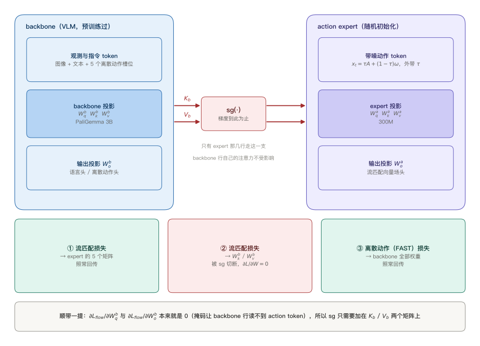
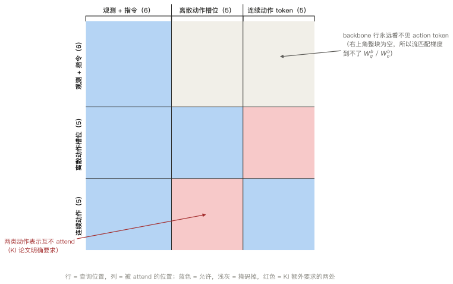
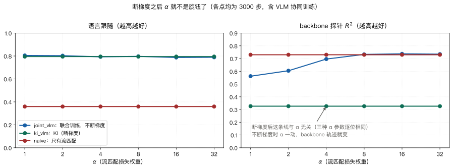
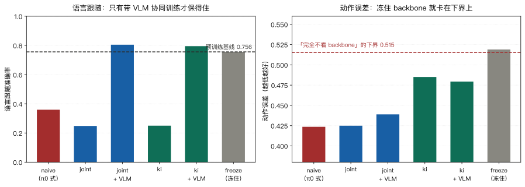

> **系列导航**：这是 π 系列具身模型深潜的第 3 篇。系列按**问题**组织：动作怎么表示（01 π0 / 02 FAST / **03 KI**）→ 长程任务怎么拆（04 Hi Robot / 05 π0.5）→ 延迟怎么吃掉（06 RTC）→ 怎么从经验里学（07 RECAP / 08 RLT）→ 记忆与条件（09 MEM / 10 π0.7）。前两篇各自解决了「连续动作怎么接进 VLM」和「动作块怎么压成 token」，这一篇解决它们共同暴露出来的副作用：**给预训练 VLM 接一个随机初始化的动作模块，会把它预训练学到的东西冲掉**。

> **TL;DR**
>
> * **核心问题与结论**：π0 式的流匹配 action expert 是随机初始化的，梯度顺着注意力的 K / V 回流进预训练 VLM，把语言跟随能力冲掉。KI 只在这条通路上加 stop-gradient，另用 FAST 离散动作 token 给主干留一条学习信号（[arXiv:2505.23705](https://arxiv.org/abs/2505.23705) §5.2）。
> * **关键证据**：断梯度只压两个矩阵——论文式 (5)(6) 的 $$K_b$$、$$V_b$$；$$Q_b$$ 与输出投影不用管，掩码已让主干行读不到 action token。合成探针上断梯度后 $$\alpha\in\lbrace1,8,32\rbrace$$ 的主干参数**逐位相同**，不断梯度时 joint 探针 $$R^2$$ 从 0.562 跳到 0.733（[本仓实验](https://github.com/lrypcy/ipynbs/tree/6d3ec92/experiments/pi-vla/knowledge-insulation)，42 条断言）。
> * **适用边界与代价**：训练算力贵约 20%（论文 §7），换 π0 需 7.5 倍步数追平；**冻住主干不可行**（论文 Fig.4(a)、Fig.8 接近 0%）。合成探针上 KI 把语言跟随从 0.36 保到 0.80，代价是同步数下主干里的动作信息更少（$$R^2$$ 0.326 vs naive 0.730）。
> * **系列定位**：解决「加动作模块不毁主干」，不解决长程任务怎么分解（04 Hi Robot）与推理延迟（06 RTC）。

## 1. 问题：三个模块，两套权重，一条回流路径

先把前两篇的结论摆在一起。π0 的做法（01 篇）是：VLM 主干照旧处理图像和文本，另外挂一组**随机初始化**的 expert 权重去处理连续动作 token，用流匹配训练它输出向量场。FAST 的做法（02 篇）是：把动作块压成几十个离散 token，让它像普通文本 token 一样进主干，用交叉熵训练。

这两条路各有一个要命的短板，而它们恰好是彼此的长处：

| | 推理速度 | 对主干的影响 |
| --- | --- | --- |
| 连续动作 + 流匹配（π0） | 快，10 Hz | 新增随机初始化模块，梯度回流进主干 |
| 离散动作 + 自回归（π0-FAST） | 慢，一块约 750 ms | 全是主干自己的权重，无新增模块 |

于是很自然会想：能不能**两个都训**？连续那条负责推理速度，离散那条负责给主干一个「机器人该有什么表示」的学习信号？KI 的答案是能，但必须配一刀：**连续那条不许把梯度送回主干**。

本文的符号沿用前两篇，并补上这一篇需要的几个：

| 符号 | 含义 | 出处 |
| --- | --- | --- |
| $$a_{1:H}$$ | 一个动作块，$$H$$ 步、每步 $$d$$ 维 | π0 论文 |
| $$\tau,\ \omega$$ | 流匹配时间与高斯噪声，$$\omega\sim\mathcal{N}(0,\mathbf{I})$$ | π0 / KI 论文式 (3) |
| $$a_{1:H}^{\tau,\omega}$$ | 加噪动作，$$\tau a_{1:H}+(1-\tau)\omega$$ | KI 论文 §3 |
| $$X_b,\ X_a$$ | 走主干权重的 token / 走 expert 权重的 token | KI 论文式 (5) |
| $$Q_b,K_b,V_b$$ | 主干的 query / key / value 投影 | KI 论文式 (5)(6) |
| $$Q_a,K_a,V_a$$ | action expert 的投影，$$d_q,d_k,d_v$$ 与主干相同 | KI 论文 §3 |
| $$P_{bb},P_{ab},P_{aa}$$ | 注意力概率按「谁看谁」分成的三块 | KI 论文式 (5) |
| $$E_b,E_a$$ | 注意力输出，按行分成主干段与 expert 段 | KI 论文式 (6) |
| $$\mathrm{sg}(\cdot)$$ | stop-gradient 算子 | KI 论文式 (5) |
| $$\alpha$$ | 流匹配项相对语言建模项的损失权重 | KI 论文式 (4) |
| $$M^{\ell},M^{\mathrm{act}}$$ | 语言损失掩码 / 是否预测动作的指示 | KI 论文式 (4) |

一个容易记混的点：$$\tau$$ 的方向。KI 论文写 $$a^{\tau,\omega}_{1:H}=\tau a_{1:H}+(1-\tau)\omega$$，$$\tau=0$$ 是纯噪声；openpi 里写的是 `x_t = time * noise + (1 - time) * actions`，$$\tau=1$$ 是纯噪声。**两者差一个 $$\tau\mapsto 1-\tau$$ 的翻折，训练目标 $$u=\omega-a_{1:H}$$ 完全一致**，读源码和读论文时要各自对齐（01 篇 §3 已经提过一次）。

## 2. 标准配方长什么样

先写下来「标准做法」是什么，后面才好说它坏在哪。一个 VLM 适配成 VLA，动作有三种表示可选：

**朴素离散化。** 每维每步切成一个箱，每个箱对应一个特殊文本 token，一个块变成 $$H\cdot d$$ 个 token，然后当普通下一个 token 预测来训。这是 RT-2 / OpenVLA 的做法。

**时间上的抽象。** 朴素离散化的 token 数被 $$H\cdot d$$ 锁死，频率一翻倍就翻倍。FAST（02 篇）先逐维做 DCT，再乘 $$\gamma$$ 取整、列优先展平、BPE，让 token 数由**信号带宽**决定而不是采样率。

**扩散 / 流匹配。** 输入加噪动作 $$a^{\tau,\omega}_{1:H}$$，训练模型预测流 $$\omega-a_{1:H}$$，推理时对这条向量场做几步积分。π0 用的就是这条，配一个比主干小得多的 action expert。

还有一处自由度是**本体状态怎么表示**。论文 §3 列了三种：离散化后当文本输进去（text state）、离散化后用特殊 token（special token state）、连续值直接过一个学出来的投影接进主干（continuous state）。附录 Fig.10 的结论是这套方法三种都能用，text 和 continuous 都行。后面几篇不专门讲它，但读论文表格时要知道这一维是存在且被扫过的。

对应的两个损失是（KI 论文式 (2)(3)）：

$$
\mathcal{L}_{\mathrm{AR\text{-}VLA}}(\theta)=\mathbb{E}_{(x,y)\sim\mathcal{D}}\Big[-\sum_{j=1}^{n-1}M_j\log p_\theta(y_{j+1}\mid x_{1:j})\Big]
$$

$$
\mathcal{L}_{\mathrm{FLOW\text{-}VLA}}(\theta)=\mathbb{E}_{\mathcal{D},\tau,\omega}\Big[\lVert \omega-a_{1:H}-f^a(a^{\tau,\omega}_{1:H})\rVert^2\Big]
$$

π0 只取第二个，主干和 expert 一起训，没有 $$\mathrm{sg}$$。这就是 §3 要讨论的「标准配方」。

## 3. 三个坏消息

**自回归 VLA 太慢。** π0-FAST 预测一个 1 秒动作块在 RTX 4090 上约 750 ms（02 篇 §1 引过这个数），折合约 1.3 Hz 的控制频率。闭环控制里，慢到这个程度会直接改变行为分布：机器人执行完一个块时，场景已经变了，论文把它称为 dynamics mismatch。π0 的 action expert 参数远少于主干，能做到 10 Hz——同样是「预测一秒的块」，差了将近一个数量级。

这两个数字放在一起，就说明了为什么不能简单地退回自回归：1.3 Hz 的闭环在需要精细操作的任务上（比如拉开厨房抽屉）不只是慢，是做不到。

**随机初始化的动作模块会毁掉语言跟随。** 这是 KI 论文 §4 的核心观察：π0 这类架构里，视觉编码器或语言主干来自预训练，而机器人专用模块是**从零初始化**的。论文的说法是，朴素地训练这样的模型会损害模型遵循语言指令的能力，原因推测是梯度干扰。Fig.2 给了个很直观的例子：指令是「把勺子收进垃圾桶」，π0 直接无视指令去抓了一团垃圾。

**冻住主干救不了。** 最直觉的解法——把预训练权重冻住，只训新增模块——行不通。原因是当下的 VLM 预训练数据里没有机器人数据，冻住后的表示不足以支撑高性能策略：论文 Fig.4(a) 与 Fig.8 里，冻住主干的那一档成功率接近 0%。

这三条合起来就是 KI 要解的问题：**既要让主干学到机器人表示（所以不能冻），又不能让随机初始化模块的梯度污染它（所以不能朴素地一起训）**。

为什么「随机初始化」这个定语这么关键？因为一个从零初始化的模块在训练最初期给出的是**大幅且无结构**的梯度：它还不知道自己该输出什么，但它的梯度会顺着共享的注意力一路传回已经收敛好的主干权重。主干这时候面对的不是「往机器人方向挪一点」这种有方向的信号，而是一次无差别的扰动。预训练里学到的东西（尤其是「语言 token 与视觉 token 之间那套对应关系」）在这种扰动下最先散架，表现出来的就是不听指令。相比之下，如果新模块是从主干权重复制来的（Transfusion 式的做法，只有动作投影是新参数），这个问题就轻得多——论文 §6 里 Transfusion 的语言跟随确实比 π0 好，原因就是这个。

## 4. 三味药：联合训练、VLM 数据协同、断梯度

KI 给的是一套组合拳（论文 §5），三条缺一不可：

1. **联合训练**：同一个模型同时做自回归的离散动作预测和流匹配的连续动作预测。前者**只在训练时用**，作用是给主干一个表示学习的目标；推理时只走后者，保住速度。
2. **VLM 数据协同训练**：把纯视觉语言数据（只有图和文本标注）、纯动作数据、以及既标动作又标语言的混合数据，混在同一个损失里训。这一条不只是「防止遗忘」——论文 §6 专门做了一个语义泛化实验：让移动机械臂把厨房台面上的东西收进抽屉，测试时用的物体训练时没见过（OOD）。结果是去掉 VLM 数据后泛化掉得最明显，也就是说**从非机器人数据里迁过来的语义，真的能被 action expert 用上**。有意思的是，去掉 VLM 数据对 joint-training（不断梯度）那一档的语言跟随伤害最大——论文的解释是，这种情况下主干最需要外部数据来对抗灾难性干扰。
3. **断梯度**：拦住从 action expert 流回预训练权重的梯度。

第 1、2 条合起来写进一个损失（论文式 (4)）：

$$
\mathcal{L}_{\mathrm{CO\text{-}VLA}}(\theta)=\mathbb{E}_{\mathcal{D},\tau,\omega}\Big[-\sum_{j=1}^{n-1}M^{\ell}_j\log p_\theta(\hat{\ell}_{j+1}\mid x_{1:j})+\alpha\,M^{\mathrm{act}}\big\lVert \omega-a_{1:H}-f^a_\theta(a^{\tau,\omega}_{1:H})\big\rVert^2\Big]
$$

这里 $$\hat{\ell}$$ 里既有文本 token，也有 FAST 离散化出来的动作 token；$$M^{\ell}$$ 标哪些位置算语言损失，$$M^{\mathrm{act}}$$ 标这条样本要不要预测动作。混数据的能力全靠这两个掩码：VLM 数据只开 $$M^{\ell}$$，动作数据两个都开。

**还有一条容易被漏掉的掩码约束**：论文明确要求「任何一个 FAST 离散动作 token 都不能 attend 到连续动作 token，反之亦然」。这不是风格问题——论文 §6 专门拿 HybridVLA 做了对照：HybridVLA 同样同时训离散和连续两套表示，但它允许自回归 token 去 attend 连续动作的输入，结果在 “items in drawer” 这个任务上差很多。把掩码改成 KI 这样，性能明显上去。

直觉上说得通：两套表示是同一件事的两种编码，让它们互相看见，模型会学到「从连续那一路抄答案」的捷径，离散那一路作为表示学习目标的价值就没了。

## 5. 断在哪：2×2 块分解与两个落点

主干和 expert 只在注意力层交互，所以要断梯度，改注意力层就够了。把注意力概率按「谁看谁」分块（论文式 (5)）：

$$
\begin{pmatrix}P_{bb}&0\\ P_{ab}&P_{aa}\end{pmatrix}=\mathrm{softmax}\left(\begin{pmatrix}Q_b(X_b)K_b(X_b)^{\top}&0\\ Q_a(X_a)\,\mathrm{sg}\big(K_b(X_b)^{\top}\big)&Q_a(X_a)K_a(X_a)^{\top}\end{pmatrix}+A\right)
$$

左上角的 $$0$$ 是掩码给的：主干的 token 永远看不见 expert 的 token。右上角那块就是 KI 动手的地方——$$Q_a$$ 去 attend $$K_b$$ 时，$$K_b$$ 被 $$\mathrm{sg}$$ 包住。

value 侧同理（论文式 (6)）：

$$
\begin{pmatrix}E_b\\ E_a\end{pmatrix}=\begin{pmatrix}P_{bb}V_b(X_b)\\ P_{ab}\,\mathrm{sg}\big(V_b(X_b)\big)+P_{aa}V_a(X_a)\end{pmatrix}
$$



左半边是主干，右半边是 expert，中间那个红色闸门就是 $$\mathrm{sg}$$。下面三块是梯度通路：①流匹配损失照常更新 expert 自己的五个矩阵；②流匹配损失想去更新 $$W^b_k$$、$$W^b_v$$，被闸门拦住；③离散动作（FAST）损失照常更新主干全部权重。第 ③ 条是整套设计能成立的前提——**主干必须另有学习信号，否则断掉梯度就等于冻住主干**，而 §3 已经说过冻住是死路。

一句话概括这个结构：expert 能读到主干算出来的 K 和 V，但读这个动作不会让主干为「expert 读得好不好」负任何责任。

### 5.1 把「只有两个矩阵」算一遍

式 (5)(6) 只断了两个矩阵，剩下两个为什么不用断，写一遍反向就清楚了。记流匹配损失为 $$L$$（它只作用在 $$E_a$$ 的行上），沿注意力往回走：

第一步，$$E_a=P_{ab}\,\mathrm{sg}(V_b)+P_{aa}V_a$$。对 $$V_b$$ 求导时，$$\mathrm{sg}$$ 把这条通路掐断，所以 $$\partial L/\partial V_b=0$$；对 $$P_{ab}$$ 求导是通的，梯度继续往 $$Q_a$$ 和 $$K_b$$ 走。

第二步，$$P_{ab}$$ 来自 $$\mathrm{softmax}$$ 的右下两块，它的输入是 $$Q_a(X_a)\,\mathrm{sg}(K_b(X_b)^{\top})$$。同理，$$\partial L/\partial K_b=0$$，梯度只能流到 $$Q_a$$ 上。

第三步，剩下的主干侧矩阵：

* $$W^b_q$$：它出现在 $$Q_b(X_b)$$ 里，而 $$Q_b$$ 只参与 $$P_{bb}$$；$$P_{bb}$$ 只决定 $$E_b$$。$$L$$ 不经过 $$E_b$$，所以梯度是 0。
* $$W^b_o$$：$$E_b$$ 之后才乘它，同样不在 $$L$$ 的通路上，梯度也是 0。

注意第一步和第二步的 0 是 $$\mathrm{sg}$$ 给的（把它拿掉就不是 0 了），第三步的 0 是**掩码**给的（拿掉 $$\mathrm{sg}$$ 也还是 0）。这个区别正是 §6 要说的：断梯度的落点不是四个矩阵里挑两个，而是「四个里只有两个真的会收到梯度，把这两个断掉就够了」。

## 6. 为什么只有两个矩阵，不是四个

式 (5) 只断了 $$K_b$$，式 (6) 只断了 $$V_b$$。$$Q_b$$ 呢？输出投影 $$W^b_o$$ 呢？答案是**它们本来就不需要断**，因为流匹配损失到它们的梯度恒等于零，掩码已经保证了。

理由是掩码的形状。把 token 排成三块：观测与指令（图像 patch + 文本）、离散动作槽位（FAST token 落在这里）、连续动作 token（expert 的）。掩码规则是：

* 观测块内部双向；
* 离散动作槽位看得见观测块，也看得见彼此；
* expert 的 token 看得见观测块，也看得见彼此；
* **expert 的 token 看不见离散动作槽位，反之亦然**；
* **任何主干 token 都看不见 expert 的 token**。



左图里右上角那一整块（主干行 × 连续动作列）是空的，这直接决定了两件事：

第一，主干那一侧的输出 $$E_b=P_{bb}V_b(X_b)$$ 只由 $$P_{bb}$$ 和 $$V_b$$ 决定，$$P_{bb}$$ 又只由 $$Q_b(X_b)K_b(X_b)^{\top}$$ 决定——**从头到尾不碰任何 expert 的 token**。流匹配的损失只作用在 $$E_a$$ 这一支上，它想影响主干权重只能经过 $$K_b$$ 和 $$V_b$$，所以 $$Q_b$$、$$W^b_o$$ 的梯度天然是 0。

第二，expert 那一侧的 $$Q_a$$ 也要参与（它决定了 $$P_{ab}$$ 和 $$P_{aa}$$），但这个矩阵属于 expert 自己，本来就该被流匹配损失训练。

所以「断两个矩阵」不是工程上的妥协，而是**恰好充分且必要**：多断一个没用（梯度本来就是 0），少断一个就漏（$$K_b$$、$$V_b$$ 是真的会收到梯度）。这一点在合成实验里是逐位核对过的（§8，A 组断言）。

补一个实现上的观察：openpi 里掩码是用一个 cumsum 技巧一次算出来的（`make_attn_mask`，`src/openpi/models/pi0.py` [L19-L44](https://github.com/Physical-Intelligence/openpi/blob/215abfb217dbac7d5f1273282331b9b1866c0479/src/openpi/models/pi0.py#L19-L44)），规则只有一句话——位置 $$i$$ 能 attend 位置 $$j$$ 当且仅当 $$\mathrm{cumsum}(m)_j\leq \mathrm{cumsum}(m)_i$$：

```python
cumsum = jnp.cumsum(mask_ar, axis=1)
attn_mask = cumsum[:, None, :] <= cumsum[:, :, None]
```

其中 $$m$$ 是一个布尔数组，标记「从这里开始起一段新的注意力块」。01 篇 §5 讲过它怎么把前缀变双向、后缀变一块；要在 KI 这套三块结构里用，只要给离散动作槽位再开一个 cumsum 段：图像与文本那段 $$m=0$$（cumsum 恒为 0，互相全可见），FAST 槽位段在开头放一个 $$m=1$$（cumsum 变 1，能看见前面那段，看不见后面），连续动作段再放一个 $$m=1$$（cumsum 变 2）。这样得到的掩码里，FAST 槽位与连续动作 token 天然互相看不见——**KI 那条掩码约束不需要额外代码，是这个 cumsum 构造的自然结果**。

## 7. $$\alpha$$ 为什么可以直接设成 1

论文在式 (6) 后面补了一句：这样设计之后，式 (4) 里的 $$\alpha$$ 可以简单地取 1，因为扩散（流匹配）损失项现在作用在一组**独立**的权重上。

这句话值得拆开，因为它其实是两件事叠出来的，而只有第一件是结构性保证：

**第一件（结构性）。** 断掉 $$\mathrm{sg}$$ 之后，$$\partial\mathcal{L}_{\mathrm{flow}}/\partial W^b_k$$ 与 $$\partial\mathcal{L}_{\mathrm{flow}}/\partial W^b_v$$ 恒为 0。于是流匹配损失与语言建模损失作用在**互不相交**的两组参数上：主干的轨迹由「离散动作损失 + VLM 损失」唯一决定，expert 的轨迹由「流匹配损失」唯一决定。两者各自怎么加权，不影响对方。

**第二件（优化器给的）。** 即便如此，expert 那一侧的梯度仍然严格等于 $$\alpha$$ 乘上流匹配梯度——$$\alpha$$ 并没有消失。是 Adam 的逐参数归一化把「整体放大 $$\alpha$$ 倍」这件事消掉了。写开 Adam 的第 $$t$$ 步更新：

$$
\Delta\theta_t=-\eta\,\frac{m_t/(1-\beta_1^t)}{\sqrt{v_t/(1-\beta_2^t)}+\varepsilon},\qquad m_t=\beta_1 m_{t-1}+(1-\beta_1)g_t,\quad v_t=\beta_2 v_{t-1}+(1-\beta_2)g_t^2
$$

把整个训练过程的梯度换成 $$\alpha g_t$$，$$m_t$$ 就整体乘 $$\alpha$$、$$v_t$$ 整体乘 $$\alpha^2$$，比值 $$\alpha m_t/\sqrt{\alpha^2 v_t}$$ 里的 $$\alpha$$ 正好约掉。所以 $$\alpha$$ 只影响分母里那个 $$\varepsilon$$ 的相对大小——这正是合成实验里 expert 参数残留 $$10^{-6}$$ 量级差别的全部来源。换成不带归一化的 SGD（$$\Delta\theta_t=-\eta g_t$$），步长就会原样放大 $$\alpha$$ 倍。

顺带一个可操作的推论：**只要两个损失作用在互不相交的参数上，它们的相对权重在 Adam 下就不影响任何一条轨迹**。反之，如果两组参数有交集（比如不断梯度时流匹配和离散动作损失都要更新 $$W^b_v$$），$$\alpha$$ 就是真旋钮——下图里那条蓝线就是在调这个交集的归属。

合成实验把这两件事分开了（§8，B 组）：断梯度后 $$\alpha\in\lbrace1,8,32\rbrace$$ 三跑的**主干参数逐位相同**（这是第一件，结构性的）；expert 参数也几乎不动，相对差只有 $$10^{-6}$$ 量级，残差全部来自 Adam 分母里那个 $$\varepsilon$$（这是第二件）。而同一批数据上 expert 的梯度仍然严格按 $$\alpha$$ 线性放大——可见「$$\alpha$$ 不影响结果」不是梯度变小了，是优化器吃掉了它。

不断梯度时是什么样？下图是同一个合成设置下的对比。



左图是语言跟随准确率，右图是从主干 $$V_b$$ 特征线性预测动作块的 $$R^2$$（衡量主干里到底装了多少动作信息）。三条线的含义：

* **joint（不断梯度，蓝）**：$$\alpha$$ 从 1 抬到 8，主干探针 $$R^2$$ 从 0.562 涨到 0.733，语言跟随从 0.805 掉到 0.797。$$\alpha$$ 是真的旋钮——调大就是让流匹配梯度压过离散动作梯度，主干往「装动作信息」的方向倒。
* **KI（断梯度，绿）**：两条图里都是一条水平线。三种 $$\alpha$$ 下参数逐位相同。
* **naive（只有流匹配，红）**：也是水平线，但机制完全不同。它只有一个损失，$$\alpha$$ 缩放的是唯一的那一项，Adam 直接吃掉；它的主干参数只是「近似相同」（相对差 $$4\times10^{-5}$$），做不到 KI 那种逐位为 0。

所以「$$\alpha=1$$ 不用调」这件事，准确的说法是：**断梯度让 $$\alpha$$ 失去了改变主干轨迹的能力，Adam 让它连 expert 的步长也改不了**。两条都成立，才有论文那句话。

## 8. 合成实验：把机制钉死

论文给的是真实机器人上的成绩，本节的实验不重算那些，只验机制：一个 32 维主干、注意力 K/V 瓶颈秩 8、4 个物体 + 指令的语言任务、5 步动作块的玩具，纯 numpy 手写前向与反向（反向必须手写——$$\mathrm{sg}$$ 在前向里是恒等映射，有限差分测的是「如果不断梯度会是多少」，测不出「梯度恒为 0」这件事）。

设定上是刻意对齐论文的：语言标签只依赖被选中物体的当次外观扰动，动作块依赖整幅场景在 $$\mathbf{U}$$ 上的 3 个读数，且 $$\mathbf{U}$$ 与语言任务需要的方向正交——这样「主干里装不装得下动作信息」才是一个真的瓶颈。全部 42 条断言与完整输出在 [`experiments/pi-vla/knowledge-insulation/`](https://github.com/lrypcy/ipynbs/tree/6d3ec92/experiments/pi-vla/knowledge-insulation)。

### 8.1 一个绕不开的构造问题：$$x_t$$ 里本来就带着 $$a$$

做这类实验必须先处理掉一个流匹配自带的性质，否则「expert 有没有真的读主干」这个指标是废的。给定 $$x_t=\tau a+(1-\tau)\omega$$ 和目标 $$u=\omega-a$$，如果 $$a$$ 和 $$\omega$$ 是独立高斯，那么

$$
\mathrm{cov}(u,x_t)=(1-\tau)\,\Sigma_\omega-\tau\,\Sigma_a
$$

当 $$\Sigma_\omega=\Sigma_a$$、$$\tau=0.5$$ 时它等于 0，而 $$u$$ 与 $$x_t$$ 联合高斯，不相关即独立——此时**从 $$x_t$$ 里一点 $$u$$ 的信息都榨不出来**，模型预测得准不准，全看它有没有从主干读到东西。

反过来，只要 $$\Sigma_\omega\neq\Sigma_a$$（比如标准做法里 $$\omega\sim\mathcal{N}(0,\mathbf{I})$$ 而 $$a$$ 的各维方差不是 1），expert 就算完全无视主干，也能从 $$x_t$$ 反解出一部分 $$u$$。用标准高斯噪声跑这一套时，冻住主干和 KI 两档的动作误差几乎完全一样——**指标彻底失去分辨力**。所以实验里让噪声 $$\omega$$ 与动作块同协方差，并且一律在 $$\tau=0.5$$ 处评估。

同一条性质还有一个推论：**动作块不能是严格低秩的**。若 $$a$$ 的秩只有 3 而维度是 35，那 32 个方向上 $$a\equiv 0$$，那些方向的 $$u$$ 可以直接从 $$x_t$$ 算出来。所以真值动作块里必须留一块「谁也预测不了」的随机性——这也是真实机器人数据的样子：同一个场景下两次示范本来就不完全一样。



左图六个柱子里只有两个保住了预训练的 0.756：ki + VLM（0.795）和 joint + VLM（0.805）。不带 VLM 协同训练的三档全塌（0.248–0.359）。右图的红虚线是「完全不看主干」的下界 0.515；冻住主干那一档正好卡在上面——这就是论文「冻住不行」在玩具里的样子。

四组结论：

| 组 | 结论 | 实测数字 |
| --- | --- | --- |
| A 梯度通路 | 不断梯度时流匹配损失确实流进主干 | $$\lvert\partial L/\partial W^b_k\rvert$$=5.5e-4，$$\lvert\partial L/\partial W^b_v\rvert$$=2.0e-2 |
| A | $$\partial L_{\mathrm{flow}}/\partial W^b_q$$ 与 $$\partial L_{\mathrm{flow}}/\partial W^b_o$$ 本来就是 0 | 逐位为 0 |
| A | 断梯度后 $$\partial L_{\mathrm{flow}}/\partial W^b_k$$、$$\partial L_{\mathrm{flow}}/\partial W^b_v$$ 归零 | 逐位为 0 |
| A | 离散动作那条通路完好 | $$\partial L_{\mathrm{AR}}/\partial W^b_k$$、$$\partial L_{\mathrm{AR}}/\partial W^b_v$$ 非零 |
| B $$\alpha$$ | 断梯度后主干轨迹与 $$\alpha$$ 无关 | $$\alpha=1/8/32$$ **逐位相同** |
| B | 不断梯度时 $$\alpha$$ 是真旋钮 | 主干相对差 98%–100% |
| C 语言跟随 | 不带 VLM 协同训练的全塌 | 0.756 → 0.248 / 0.250 / 0.359 |
| C | 带 VLM 协同训练保得住 | 0.795 / 0.805 |
| D 信息瓶颈 | 冻住主干做不了动作任务 | 动作误差 0.519 ≈ 下界 0.515；探针 $$R^2$$ 0.164 |
| D | 断梯度 + 离散动作能把动作信息灌进去 | $$R^2$$ 0.164 → 0.326；动作误差 0.519 → 0.479 |

六档的完整数字（$$\alpha=1$$，3000 步，同一份预训练权重出发）：

| 配方 | 断梯度 | 离散动作 | VLM 协同 | 语言跟随 | 离散 token 准确率 | 动作误差 | 主干探针 $$R^2$$ |
| --- | --- | --- | --- | --- | --- | --- | --- |
| naive（π0 式） | ✗ | ✗ | ✗ | 0.359 | 0.000 | 0.4236 | 0.730 |
| joint | ✗ | ✓ | ✗ | 0.248 | 0.381 | 0.4249 | 0.732 |
| joint + VLM | ✗ | ✓ | ✓ | 0.805 | 0.338 | 0.4390 | 0.562 |
| ki | ✓ | ✓ | ✗ | 0.250 | 0.370 | 0.4851 | 0.340 |
| **ki + VLM（论文配方）** | ✓ | ✓ | ✓ | **0.795** | 0.334 | 0.4794 | 0.326 |
| freeze（冻住） | — | ✗ | ✗ | 0.756 | 0.000 | 0.5190 | 0.164 |

（动作误差越低越好，探针 $$R^2$$ 越高越好；「完全不看主干」的下界是 0.5152）

三处值得单独看：

**freeze 那一档的语言跟随是 0.756，但动作误差 0.519。** 它保住了全部预训练知识，也彻底没学到动作——主干里那点 $$R^2$$=0.164 与预训练完一模一样，等于零。这就是「冻住不行」最直接的形态。

**ki 与 joint 都不带 VLM 协同时，语言跟随一样差（0.250 / 0.248）。** 断梯度本身不保语言，它只是**不再往坏的方向推**；真正把语言拉回来的是 VLM 数据协同训练。这一点和论文 §6 的观察一致：不断梯度时去掉 VLM 数据，语言跟随掉得最狠。

**naive 的动作指标最好（0.4236 / 0.730），语言最差（0.359）。** 因为它的主干只被流匹配一个目标训练，没有任何力量阻止它把预训练表示改写成动作表示。KI 是把这条通道关掉，换成一条更慢但更干净的通道。

**一处必须说明的不一致。** 论文说 KI 收敛更快（π0 需要 7.5 倍步数），玩具里**方向是反的**：同样 3000 步，naive 的主干探针 $$R^2$$ 是 0.730，KI 只有 0.326，动作误差 0.4236 vs 0.4794；把 KI 训到 9000 步（3 倍）也只到 $$R^2$$ 0.281——naive 在 1000 步时就已经是 0.709。但语言跟随那一侧的差距不随步数收窄（3000 步时 0.359 vs 0.795），所以「KI 换来的到底是什么」这个问题的答案是清楚的。原因是玩具主干只有 32 维、瓶颈秩 8，从零重新学会动作表示只要一千步，「流匹配梯度毁掉预训练知识」的代价在这里几乎不存在——而真实 3B VLM 上的这个代价，正是论文那条结论的来源。所以本节能下的是机制层面的结论，不是「KI 更快」。

## 9. 代价、边界与几个反直觉的点

### 9.1 这套配方最后拿到什么分

LIBERO 上的成功率（论文表 1，单位 %）：

| 方法 | Spatial | Object | Goal | 10 (Long) | 90 |
| --- | --- | --- | --- | --- | --- |
| OpenVLA-OFT | 97.6 | 98.4 | 97.9 | 94.5 | – |
| $$\pi_0$$ | 96.8 | 98.8 | 95.8 | 85.2 | – |
| $$\pi_0$$-FAST | 96.4 | 96.8 | 88.6 | 60.2 | – |
| Ours（从头训） | 96.6 | 97.2 | 94.6 | 84.8 | 92.7 |
| Ours（从通用模型微调） | **98.0** | 97.8 | 95.6 | 85.8 | **96.0** |

论文自己的定性是：在 LIBERO-90 和 LIBERO-Spatial 上是当时最好的，但 **LIBERO-10 上不如 OpenVLA-OFT**（85.8 vs 94.5）。所以「KI 全面更强」是不准确的说法——它在长程那一档（LIBERO-10）上并没有赢，而 LIBERO-10 恰恰是最需要长程分解的那一档，那正是 04 篇的事。

DROID 上的对比是 $$0.55\pm0.09$$（Ours）对 $$\pi_0$$ 的 $$0.49\pm0.09$$、$$\pi_0$$-FAST 的 $$0.45\pm0.09$$。真实任务上的结论见论文 Fig.4–Fig.9，趋势一致，这里不逐张复述。

**贵 20%，但墙钟时间更短。** 论文 §7 明确说同时训连续和离散两套输出会让训练算力涨约 20%，但因为收敛快得多，相对纯扩散的 π0（需要 7.5 倍步数）仍然是净赚。

**FAST 作为「训练期目标」这个用法，比它作为推理格式更省。** 离散动作只在训练时用，推理时完全不走自回归，所以 FAST 的 750 ms 代价一点都没付，只拿到了它「学习信号质量好」的好处。论文还试过把它换成朴素 tokenization：结果比只用连续动作好，但不如 FAST；如果一定要用朴素 tokenization，**按 stride 5 子采样**比稠密的好。

**π0.5 是两阶段，KI 是单阶段。** π0.5 的做法是先只训 FAST（离散），之后再加 action expert；KI 把这件事形式化成单阶段的一套损失 + 一个 $$\mathrm{sg}$$。两者目标相同，KI 的写法让「什么时候加 expert」不再是一个要调的阶段划分。

**语言跟随仍然不完美。** 论文 §7 承认，即便做了知识绝缘，模型还是会在训练数据相关性强的场合忽略语言指令。断梯度减的是梯度干扰，减不掉数据本身的偏差。

**什么时候不该用 KI。** 如果主干本来就是要从头训（没有预训练知识要保护），或者动作模块不是随机初始化而是从主干权重复制来的（Transfusion 式的做法），断梯度的收益就小很多——Transfusion 在论文的对照里语言跟随就比 π0 好，因为它的新增参数只有动作投影，没有一整个随机初始化的 expert。

## 10. 把 KI 放回 π 系列的演化里

π 系列在这篇之前已经出现过两个「动作头」版本，把它们和 KI 摆在一张表里，边界才清楚：

| | 动作表示 | 训练损失 | 新增模块 | 与主干的梯度关系 | 推理 |
| --- | --- | --- | --- | --- | --- |
| π0 | 连续，流匹配 | 式 (3) | action expert（随机初始化） | 全通 | 10 步积分，10 Hz |
| π0-FAST | 离散，FAST token | 式 (2) | 无 | 全是主干自己的权重 | 自回归，约 1.3 Hz |
| π0.5 | 两阶段：先 FAST，再加 expert | 式 (2) 然后式 (4) | action expert | 第二阶段全通 | 同 π0 |
| **KI** | **两者同时** | **式 (4)** | action expert | **$$K_b$$、$$V_b$$ 上断掉** | 同 π0 |

三个容易读错的点：

**KI 不是 π0.5 的替代品，是它的形式化。** 两者目标一致（让主干既学到机器人表示又不被 expert 污染），π0.5 用阶段划分实现（先只训离散，再加 expert），KI 把它写成单阶段的一套损失加一个 $$\mathrm{sg}$$。阶段划分里的「什么时候切」是个要调的超参，KI 里没有这个超参——这是形式化的收益。

**KI 的 $$\alpha$$ 与 π0.5 的两阶段不是同一个旋钮。** $$\alpha$$ 调的是「同一时刻两个损失的比重」，两阶段调的是「不同时刻训哪个损失」。断梯度之后 $$\alpha$$ 失效（§7），但两阶段仍然可以有自己的调度，两者不冲突。

**断梯度不是「冻住」。** 这是最容易混的一处。冻住是主干不更新；断梯度是主干更新，只是不为流匹配损失负责——它还要为离散动作损失和 VLM 损失负责。论文 §4 反复强调冻住会掉到接近 0%，正是因为「主干需要学」这件事是真的；合成实验里冻住那一档动作误差卡在下界上（§8），也是同一个事实。

## 11. openpi 里没有这套东西

这一节是源码层面的事实核对，锁定 commit [`215abfb`](https://github.com/Physical-Intelligence/openpi/tree/215abfb217dbac7d5f1273282331b9b1866c0479)。

**没有 stop-gradient。** `src/openpi/models/gemma.py` 的 `Attention.__call__`（[L164-L249](https://github.com/Physical-Intelligence/openpi/blob/215abfb217dbac7d5f1273282331b9b1866c0479/src/openpi/models/gemma.py#L164-L249)）把各个 expert 的 q / k / v 算出来后直接拼在一起：

```python
q, k, v = (jnp.concatenate(y, axis=1) for y in zip(*qkvs, strict=True))
```

（[L201](https://github.com/Physical-Intelligence/openpi/blob/215abfb217dbac7d5f1273282331b9b1866c0479/src/openpi/models/gemma.py#L201)）整个文件里没有一处 `jax.lax.stop_gradient`。这就是 §2 说的「标准配方」：expert 的梯度原样回流进主干。

**没有 FAST token 的交叉熵损失。** `src/openpi/models/pi0.py` 的 `compute_loss`（[L189-L214](https://github.com/Physical-Intelligence/openpi/blob/215abfb217dbac7d5f1273282331b9b1866c0479/src/openpi/models/pi0.py#L189-L214)）最后一行只有

```python
return jnp.mean(jnp.square(v_t - u_t), axis=-1)
```

纯流匹配 MSE，没有式 (4) 里那个语言建模项，也没有 $$M^{\mathrm{act}}$$。

**$$\pi_0$$-FAST 那一支也没有。** `pi0_fast.py` 走的是纯自回归（FAST token + 交叉熵），没有流匹配项，也就没有「两个损失怎么加权」这回事——它不需要断梯度，因为根本没有新增的 expert 权重。

**也没有 π0.5 / KI 的模型文件。** `src/openpi/models/` 下的模型实现只有 `pi0.py`、`pi0_fast.py`（外加 `gemma.py`、`gemma_fast.py`、`tokenizer.py`、`vit.py`、`siglip.py`、`lora.py`），没有对应式 (4) 那套联合训练的实现。

结论很直接：**开源出来的 π0 / π0-FAST 是「未绝缘」的版本**。想复现 KI，得自己动四处。

### 11.1 最小改动清单

1. **注意力层加两处 $$\mathrm{sg}$$。** 在 `gemma.py` 的 `Attention.__call__` 里，L201 那次拼接之后不能直接用拼好的 `k` 和 `v`，要再拼一份「只对 expert 那几行生效」的 `k_sg` / `v_sg`，其中主干贡献的那一段过 `jax.lax.stop_gradient`：

```python
k_sg = jnp.concatenate([jax.lax.stop_gradient(k_b), k_a], axis=1)
```

然后 logits 与 encoded 都按行取用：expert 行用 sg 版，主干行用普通版。前向数值完全不变，所以**这一步不会影响任何推理结果，只影响梯度**——这也是为什么「断梯度不改前向」可以直接当断言写。

2. **把 FAST token 接进同一条序列。** 它们和文本 token 一样走主干，落在前缀里、紧挨着观测块之后，位置由掩码的 cumsum 段决定（§6）。

3. **掩码保证两类动作互不 attend。** 用 §6 的 cumsum 构造即可，不需要额外代码。

4. **损失换成式 (4)。** 在流匹配 MSE 之外加上 FAST token 的交叉熵，再配 $$M^{\ell}$$ 与 $$M^{\mathrm{act}}$$ 两个掩码，好让 VLM 数据（只开 $$M^{\ell}$$）和动作数据（两个都开）能混在同一个 batch 里。

四处里第一处是唯一的算法改动，剩下三处是数据与配置。这也符合论文对自身的定位：KI 不是一个新架构，是一个**训练配方**。

## 12. 小结

* **问题不是「动作模块太大」，是「梯度回流」。** 随机初始化的 action expert 通过注意力的 K / V 把梯度送回预训练主干，冲掉语言跟随能力；冻住主干又不行，因为 VLM 预训练里没有机器人表示。
* **解法是给主干换一条学习信号。** 离散动作 token（FAST）只在训练时提供监督，让主干学到机器人表示；连续动作的流匹配 expert 照常训、照常推理，但它的梯度被 $$\mathrm{sg}$$ 挡在主干之外。挡的位置只有 $$K_b$$ 和 $$V_b$$ 两个矩阵，$$Q_b$$ 和输出投影本来就拿不到流匹配梯度。
* **副作用是 $$\alpha$$ 退化成常数。** 断梯度后主干轨迹与 $$\alpha$$ 逐位无关，Adam 又让 expert 的步长也不受 $$\alpha$$ 影响，所以式 (4) 里可以直接取 $$\alpha=1$$。

再往下是第 04 篇的问题。KI 保住了主干的语言能力，但「听懂指令」和「把一个长程任务拆成几十步」是两件事：桌面上摆着五样东西，指令说「把可回收的收走」，模型得自己决定先拿哪个、什么时候算完。Hi Robot 的做法是再挂一个高层策略，把指令先切成子任务。

## 参考

- KI 论文：*Knowledge Insulating Vision-Language-Action Models: Train Fast, Run Fast, Generalize Better*，Driess, Springenberg, Ichter, Yu, Li-Bell, Pertsch, Ren, Walke, Vuong, Shi, Levine，[arXiv:2505.23705](https://arxiv.org/abs/2505.23705)
- 官方项目页：[Knowledge Insulation](https://pi.website/research/knowledge_insulation)
- 开源实现：`Physical-Intelligence/openpi`，commit [`215abfb`](https://github.com/Physical-Intelligence/openpi/tree/215abfb217dbac7d5f1273282331b9b1866c0479)（Apache-2.0）
  - 注意力层（无 stop-gradient）：`src/openpi/models/gemma.py` [L164-L249](https://github.com/Physical-Intelligence/openpi/blob/215abfb217dbac7d5f1273282331b9b1866c0479/src/openpi/models/gemma.py#L164-L249)，拼接处 [L201](https://github.com/Physical-Intelligence/openpi/blob/215abfb217dbac7d5f1273282331b9b1866c0479/src/openpi/models/gemma.py#L201)
  - 掩码的 cumsum 构造：`src/openpi/models/pi0.py` [L19-L44](https://github.com/Physical-Intelligence/openpi/blob/215abfb217dbac7d5f1273282331b9b1866c0479/src/openpi/models/pi0.py#L19-L44)
  - π0 的损失（只有流匹配 MSE）：`pi0.py` [L189-L214](https://github.com/Physical-Intelligence/openpi/blob/215abfb217dbac7d5f1273282331b9b1866c0479/src/openpi/models/pi0.py#L189-L214)
  - 时间采样与加噪：`pi0.py` [L196-L200](https://github.com/Physical-Intelligence/openpi/blob/215abfb217dbac7d5f1273282331b9b1866c0479/src/openpi/models/pi0.py#L196-L200)
- 配套实验：[`experiments/pi-vla/knowledge-insulation/`](https://github.com/lrypcy/ipynbs/tree/6d3ec92/experiments/pi-vla/knowledge-insulation)，commit `6d3ec92`，42 条断言，纯 numpy。本文 4 张配图全部由该目录下的 `ki_figures.py` 生成（SVG），数字与 `results/stdout.txt` 逐字对应；**图上的数字是合成探针的结果，不是论文原图**。论文式 (5)(6) 的结构图是按论文公式重画的。

> **下一篇**：π 系列具身模型（04）：Hi Robot —— 长程指令怎么拆成子任务。
>
> **上一篇**：[π 系列具身模型（02）：FAST —— 把动作块压成 token](/2026/11/03/pi-vla-02-fast-action-tokenizer/)
