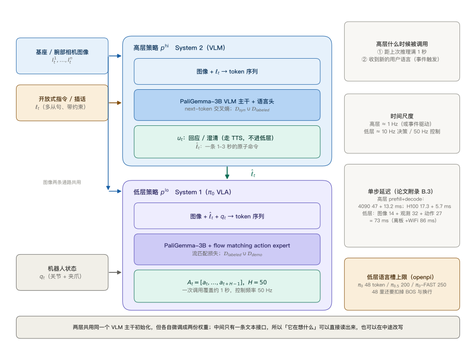
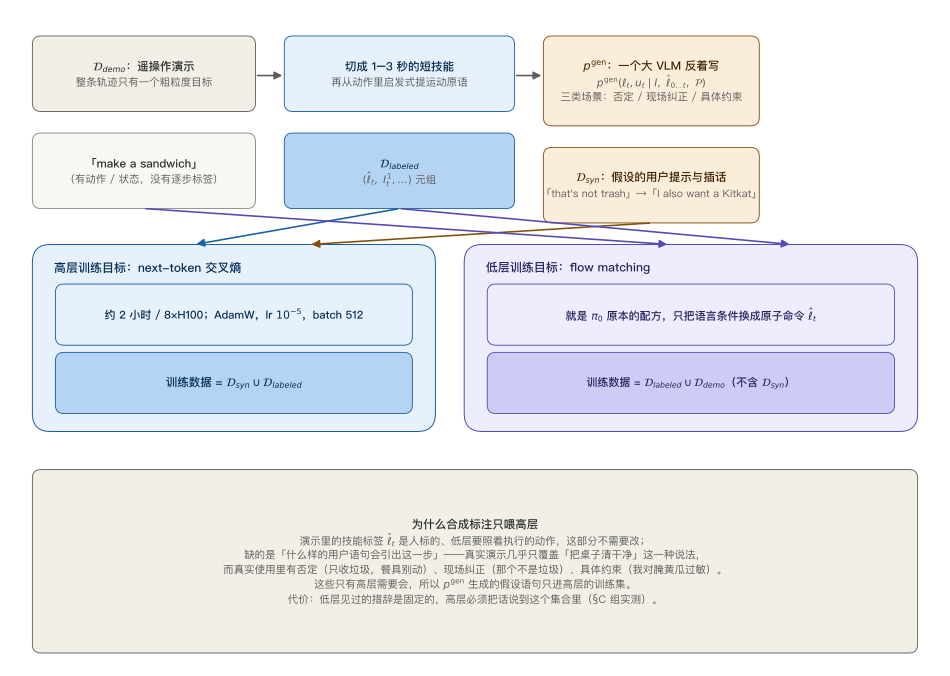
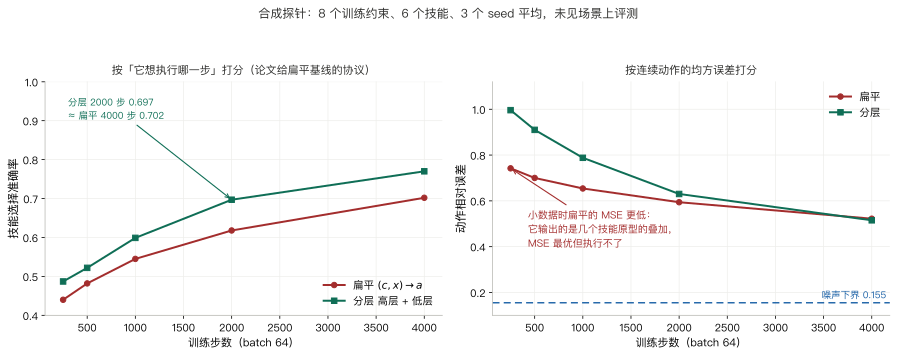
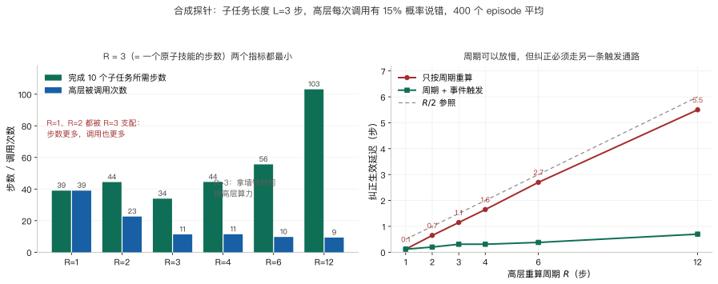
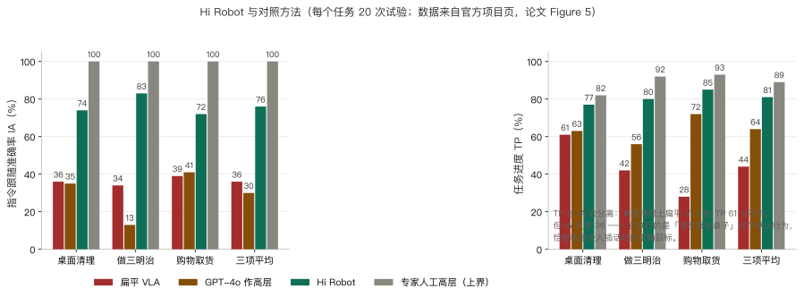
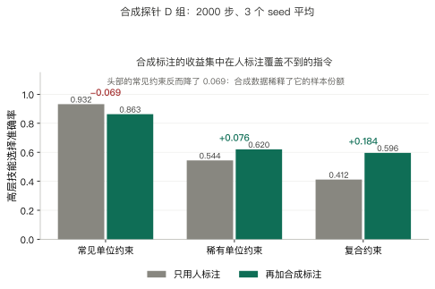
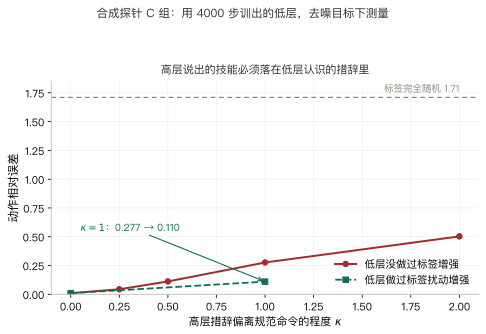

> **系列导航**：这是 π 系列具身模型深潜的第 4 篇。系列按**问题**组织：动作怎么表示（01 π0 / 02 FAST / 03 KI）→ 长程任务怎么拆（**04 Hi Robot** / 05 π0.5）→ 延迟怎么吃掉（06 RTC）→ 怎么从经验里学（07 RECAP / 08 RLT）→ 记忆与条件（09 MEM / 10 π0.7）。前三篇都在解决「动作怎么接进 VLM」，这一篇换一个问题：**动作已经接进去了，但用户说的话不是一条命令，而是一段带约束、会被中途改写的目标**。

> **TL;DR**
>
> * **核心问题与结论**：π0 的语言输入是个「原子命令」槽（48 个 token），训练时见的都是 1–3 秒短命令，开放式指令落在分布外，中途新信息没有入口。Hi Robot 在 π0 前再挂一个同主干 VLM，先把指令说成原子命令再交给 π0（[arXiv:2502.19417](https://arxiv.org/abs/2502.19417) §3）。
> * **关键证据**：三平台平均指令跟随准确率 Hi Robot 76 / 扁平 VLA 36 / GPT-4o 作高层 30，专家人工 100（论文 Fig.5）。合成探针上分层技能准确率高 7–10 个百分点、数据效率约 2 倍；**按动作 MSE 打分扁平反而更好**，因为它输出的是技能原型的叠加（[本仓实验](https://github.com/lrypcy/ipynbs/tree/5e12569/experiments/pi-vla/hi-robot)，29 条断言）。
> * **适用边界与代价**：两套权重、两次训练；高层每 1 秒或事件触发才跑一次，最优周期等于原子技能时长；代价是**高层措辞必须落在低层认识的集合里**，低层做标签扰动增强能把 $$\kappa=1$$ 的退化从 0.277 压到 0.110。
> * **系列定位**：解决「长程指令怎么拆成子任务」，不解决执行延迟（06 RTC）与跨本体记忆（09 MEM）。

## 1. 问题：听得懂指令，不等于能执行指令

前三篇把 π0 的骨架搭完了：VLM 主干处理图像与文本，另一组 expert 权重处理连续动作，用流匹配训练它输出向量场；动作块长度 $$H=50$$，一次推理覆盖约一秒。这个骨架在「拿起那个杯子」这类句子上工作得很好。

真实使用场景里的句子不长这样。论文开篇给的例子是：

> “Could you make me a vegetarian sandwich? I'd prefer it without tomatoes. Also, if you have ham or roast beef, could you make a separate sandwich with one of those for my friend?”

这句话里有三件事同时发生，而它们对应三种不同的能力：

| 要求 | 例子 | 缺了会怎样 |
| --- | --- | --- |
| **把词落到物体上（grounding）** | “vegetarian” 要翻译成「不要火腿、不要烤牛肉」 | 只会照抄训练时的默认行为 |
| **把一个目标拆成几十步** | 做两个三明治要十几次抓取与放置 | 做到一半就不知道下一步 |
| **执行中途接受新信息** | “that's not trash” / “leave the rest” | 按旧目标继续做完 |

第三点最容易被忽略，也最难。前两点可以靠「收集更多样的演示」硬堆，第三点不行——**用户说的话什么时候到达是不可预测的**，而且它的语义往往依赖当时的状态（“那个”指机器人手上正抓着的东西）。一个在 episode 开始时就固定的 prompt 字符串，没有承载这种信息的结构。

本文的符号沿用前几篇，补上这一篇需要的几个：

| 符号 | 含义 | 出处 |
| --- | --- | --- |
| $$\mathbf{o}_t$$ | 观测 $$\lbrack\mathbf{I}^1_t,\ldots,\mathbf{I}^n_t,\ell_t,\mathbf{q}_t\rbrack$$：多视角图像、语言、机器人配置 | 论文 §3 |
| $$\mathbf{A}_t$$ | 动作块 $$\lbrack\mathbf{a}_t,\ldots,\mathbf{a}_{t+H-1}\rbrack$$ | π0（01 篇） |
| $$\ell_t$$ | 用户在这一刻给出的**开放式**提示或插话 | 论文 §3 |
| $$\hat\ell_t$$ | 高层产出的**低层语言命令**，一条原子指令 | 论文式 (1) |
| $$u_t$$ | 高层产出的口头回应（确认 / 澄清），走 TTS 播出 | 论文 §3 |
| $$\mathcal{D}_{demo},\ \mathcal{D}_{labeled},\ \mathcal{D}_{syn}$$ | 遥操作演示 / 切分后的技能标注 / 合成标注 | 论文 §4 |

## 2. 扁平 VLA 的三个失效点

在讲 Hi Robot 怎么解决之前，先把「直接把开放式指令塞给 π0」为什么不行讲清楚。三条里前两条是数据问题，第三条是结构问题。

### 2.1 语言槽有物理上限，超了是静默截断

openpi 里 π0 的语言 token 数上限是 **48**，而且这个默认值藏在一个不起眼的地方——配置里写的是 `None`，真正的赋值在 `__post_init__` 里：

$$
\texttt{max\_token\_len} = \begin{cases} 200 & \pi_{0.5}\\ 48 & \pi_0 \end{cases}
$$

见 [`pi0_config.py` L27 与 L37-L39](https://github.com/Physical-Intelligence/openpi/blob/215abfb217dbac7d5f1273282331b9b1866c0479/src/openpi/models/pi0_config.py#L37-L39)；π0-FAST 是 250（[`pi0_fast.py` L84](https://github.com/Physical-Intelligence/openpi/blob/215abfb217dbac7d5f1273282331b9b1866c0479/src/openpi/models/pi0_fast.py#L84)）。

π0 的 prompt 编码方式是 `encode(text)` 再加一个换行 token（[`tokenizer.py` L33](https://github.com/Physical-Intelligence/openpi/blob/215abfb217dbac7d5f1273282331b9b1866c0479/src/openpi/models/tokenizer.py#L33)），所以留给正文的其实只有 46 个 token。而超长时的处理是**截断并打一条 warning**（[`tokenizer.py` L40-L45](https://github.com/Physical-Intelligence/openpi/blob/215abfb217dbac7d5f1273282331b9b1866c0479/src/openpi/models/tokenizer.py#L40-L45)）——不报错、不失败，句子后半截就这么没了。

上面那段三明治指令共 33 个词；按英文 SentencePiece 的经验比例 1 词约 1.3–1.5 个 token 估，约 43–50 个 token（**估算，本机没有 PaliGemma 词表，未实际编码**）。也就是说，光是把这句话完整塞进 π0 的语言槽就已经没有余量了，更不用说后面还要追加的纠正。

### 2.2 训练分布是 1–3 秒的原子命令

即便槽位够宽，还有一层不匹配：π0 的训练数据里，语言条件从来都是「一条短命令」。论文把演示切成 1–3 秒的短技能，例如 “pick up one piece of lettuce”，并从原始动作里启发式地提取运动原语，例如 “move the right arm to the left”。模型见过的 $$(\text{语言},\ \text{动作})$$ 配对全部落在这个尺度上。

让一个只在「短命令 → 短动作」上训练过的条件分布去接一段多从句的目标，等于让它做零样本的组合：它得自己在一次前向里同时完成「解析这句约束」和「生成这一秒的动作」。

### 2.3 中途的新信息没有入口

前两条是「能不能塞进去」，第三条是「塞进去之后还能不能改」。π0 的推理是 $$p(\mathbf{A}_t\mid\mathbf{o}_t)$$，其中 $$\ell_t$$ 是一次性给定的字符串。用户在机器人执行到一半时说“那个不是垃圾”，系统需要一个地方把这句话接进来、解析它、并把「接下来做什么」改掉。扁平 VLA 没有这个位置。

## 3. 分解：两个分布，一条文本接口

Hi Robot 的做法是把一个条件分布拆成两个（论文式 (1)(2)）：

$$
p^{\rm hi}(\hat\ell_t\mid \mathbf{I}^1_t,\ldots,\mathbf{I}^n_t,\ \ell_t)
$$

$$
p^{\rm lo}(\mathbf{A}_t\mid \mathbf{I}^1_t,\ldots,\mathbf{I}^n_t,\ \hat\ell_t,\ \mathbf{q}_t)
$$

两个都是 VLM，**都用 PaliGemma-3B 初始化，但各自微调成两份权重**。高层用 next-token 交叉熵训练，输出一段文本；低层就是 π0，用流匹配训练，输出动作块。注意高层**不消费机器人状态** $$\mathbf{q}_t$$——它只需要看懂场景和用户说了什么。

*左图是数据流，右列是三个容易被略过的设计参数。中间那条接口是一串文本，这带来三件别的结构做不到的事：*

- **可解释**：能直接读出机器人在「想」哪一步。论文里的例子是在收桌子时，模型自己念出 “pick up the plate” / “put it in the bin”，出错时看一眼命令就知道错在推理还是在执行。
- **可注入**：用户的新语句不需要改模型，只需要替换下一次高层调用的输入。
- **可换低层**：论文明确说这套框架是模块化的，低层只要是「吃语言命令的策略」就行，不一定是 π0。

口头回应 $$u_t$$ 也在同一段文本里产出：走 TTS 播给用户，然后**从 $$\hat\ell_t$$ 里摘掉**再交给低层。也就是说高层一次前向同时产出「对用户说的话」和「对自己说的话」，两者共用一个语言空间。

## 4. 数据从哪来：三段流水线，两个训练集

拆成两层之后，两层的训练数据也就分开了。论文的数据流水线是三段：

**第一步**，遥操作演示 $$\mathcal{D}_{demo}$$。每条轨迹只有一个粗粒度目标（“make a sandwich”），但有完整的动作与状态。

**第二步**，切分。把整条 episode 切成 1–3 秒的短技能，配上人写的标签 $$\hat\ell_t$$；再从原始动作里启发式地提取运动原语。得到 $$\mathcal{D}_{labeled}$$，形式是一批 $$(\hat\ell_t,\ \mathbf{I}^1_t,\ldots,\mathbf{I}^n_t)$$ 元组。

**第三步**，合成。这一步是论文的主要方法贡献之一。用一个大 VLM $$p^{\rm gen}$$ **反着写**：给定视觉上下文和这一步的技能标签，让它想象「在真实人机交互里，什么样的用户提示会引出这一步」：

$$
p^{\rm gen}(\ell_t,\ u_t\mid \mathbf{I}^1_t,\ldots,\mathbf{I}^n_t,\ \hat\ell_0,\ldots,\hat\ell_{t-1},\ \hat\ell_t,\ \mathcal{P})
$$

其中 $$\mathcal{P}$$ 是构造好的提示词，并要求模型把回答**落在视觉观测和之前的上下文上**。为了保持多步任务的一致性，生成时会条件化于同一 episode 里先前的技能标签 $$\hat\ell_0,\ldots,\hat\ell_{t-1}$$。论文把生成的场景分成三类（否定任务、现场纠正、具体约束），回复也分成三类（简单确认、澄清、错误处理），目的是提高覆盖度与多样性。

两个训练集的分工是关键：

| | 高层 $$p^{\rm hi}$$ | 低层 $$p^{\rm lo}$$ |
| --- | --- | --- |
| 训练数据 | $$\mathcal{D}_{syn}\cup\mathcal{D}_{labeled}$$ | $$\mathcal{D}_{labeled}\cup\mathcal{D}_{demo}$$ |
| 目标 | next-token 交叉熵 | 流匹配（就是 π0 原本的配方） |
| 语言条件 | 开放式提示 $$\ell_t$$ | 原子命令 $$\hat\ell_t$$ |
| 规模参考 | 约 2 小时 / 8×H100 | — |

**合成标注不进低层**。这一点值得单独说，§10 会用合成探针把它量化。

优化细节（论文 §4.3）：全参数微调，AdamW，$$\beta_1=0.9$$、$$\beta_2=0.95$$、无 weight decay，梯度范数裁剪 1，EMA 衰减 0.999，学习率 warmup 1000 步后保持常数 $$10^{-5}$$，batch 512。

## 5. 时间尺度：高层 1 Hz，低层 50 Hz

两层不在一个频率上跑。论文的规则是：

> 高层推理要么在**过了 1 秒**之后重算，要么在**收到新的用户语言**时立刻重算。

低层则以高频率产出动作块（配合 action chunking 可以到 50 Hz 控制）。论文附录 B.3 给了这套配置的时间预算：

| 环节 | 耗时 |
| --- | --- |
| 图像编码 | 14 ms |
| 观测处理 | 32 ms |
| 动作预测（×10） | 27 ms |
| 低层合计（板载） | 73 ms |
| 低层合计（离板 + WiFi） | 86 ms |
| 高层单步解码（H100） | 17.3 ms prefill + 5.7 ms decode |
| 高层单步解码（RTX 4090） | 47 ms prefill + 13.2 ms decode |

也就是说，高层跑一次的成本是低层的若干倍，所以「多久重算一次」是个真问题，不是一个随手写的常数。§8 会把它当设计参数来扫。

## 6. 换了什么：把一个回归问题拆成分类 + 回归

把两个分布写成损失函数之后，差别的形状就清楚了。扁平的目标是一个纯回归：

$$
L_{\rm flat}=\mathbb{E}\ \lVert f_\theta(c,\ x)-\mathbf{a}^\star\rVert^2
$$

分层是两个目标，其中第一个是分类：

$$
L_{\rm hier}=\underbrace{\mathbb{E}\ \mathrm{CE}\big(h_\phi(c,\ x),\ s^\star\big)}_{\text{下一步做什么}}+\underbrace{\mathbb{E}\ \lVert g_\psi(s^\star,\ x)-\mathbf{a}^\star\rVert^2}_{\text{这一步怎么做}}
$$

（这里用合成世界的记号：$$(c,x)$$ 是约束与场景，$$s^\star$$ 是真值的下一步技能，$$\mathbf{a}^\star$$ 是真值动作。）

拆开带来两个直接后果：

1. **决策边界直接暴露给梯度**。分类损失对「选对了吗」这件事的信号是锐利的；回归损失里，选错技能带来的误差只是众多误差分量之一，被 $$\lVert\cdot\rVert^2$$ 平均掉了。
2. **低层的学习与约束解耦**。$$g_\psi$$ 的输入是 $$(s,\ x)$$，与用户约束 $$c$$ 无关，所以所有约束下的演示都可以池化起来教同一个技能。

但要诚实：这两条**不自动等于更好的泛化**。它们只说明「函数类更容易拟合」，真正的结果要看数据。下面 §7 就是在合成世界里量这件事。

## 7. 合成探针：拆了之后到底换来什么

合成世界这样构造（[本仓实验](https://github.com/lrypcy/ipynbs/tree/5e12569/experiments/pi-vla/hi-robot)）：桌上有 5 个物体，每个 4 位二值属性；用户指令是作用在这些属性位上的**筛选谓词**（例如「可回收的收走」）；6 个技能各对应一个 8 维动作原型；真值动作 $$\mathbf{a}^\star=\mu_{s^\star}+Bx+\eta$$，其中 $$\eta$$ 是不可预测噪声，给出动作误差下界 0.155。训练只给 8 个单位谓词，测试给 4 个两位合取的复合谓词（多从句指令的替身）。

评分协议对齐论文 §5.1：扁平模型没有可解释的语言输出，论文是让评估者反推它「想做哪一步」来打分。这里照做——把扁平输出的连续动作反解成 $$\arg\min_s\lVert\hat{\mathbf{a}}-(\mu_s+Bx)\rVert$$。这个反解对扁平是**偏袒**的（它白拿了真值的场景修正项），所以差距只会低估。

*左图/右图用同一批演示、同一个预算训练，只是打分的尺子不同：*

- **按「它想执行哪一步」打分**：250 步到 4000 步共 5 个档位，分层全程领先（+0.047 到 +0.067）；分层 2000 步的 0.697 就追平了扁平 4000 步的 0.702，数据效率约 2 倍。
- **按动作 MSE 打分**：**结论反过来**。250 步时扁平 0.742、分层 0.996；要训到 4000 步分层（0.515）才追过扁平（0.522）。原因是小数据时扁平输出的是几个技能原型的**加权叠加**——叠加是 MSE 意义下的最优解，但机器人执行不了「半个抓取加半个放置」。
- **瓶颈确实在高层**：直接给低层真值技能时，它的误差是 0.1524，紧贴噪声下界 0.1553。
- **差距不随约束数放大**：训练约束数取 2 / 4 / 8 时，差距分别是 +0.083 / +0.075 / +0.079，量级相当。也就是说优势来自「拆成离散分类 + 连续回归两步」，**不是**来自组合爆炸。

最后一条值得展开说一句。把（约束, 技能）的格子挖掉一部分再测，会发现**分层也泛化不了**——因为高层没见过那个组合，它同样不知道该输出什么。所以「分层能组合泛化」这个常见的说法在本探针里不成立；成立的是前半句：**同样的演示，分层学得更省**。

顺带一个边界：这里的「技能」是 8 维动作原型，高层/低层都是两层 MLP，不是 PaliGemma-3B。论文那条「VLM 的网页预训练先验在语言空间里更好用」的论证，本探针测不出来；这里只测「拆成两步」这一半。

## 8. 高层多久算一次：1 Hz 不是随手写的

把重算周期当设计参数扫一遍，能看到一个清楚的结构。合成探针里：一个原子技能需要连续执行 $$L=3$$ 步，一个 episode 有 10 个子任务，高层每次调用有 15% 概率说错，命令一变就重新起一段。

*左图两根柱子是同一个 episode 的两个成本，右图两条线是「用户插话之后多久才跟上」：*

| $$R$$ | 完成所需步数 | 高层调用次数 |
| --- | --- | --- |
| 1 | 39.0 | 39.0 |
| 2 | 44.4 | 22.6 |
| **3（$$=L$$）** | **33.9** | **11.3** |
| 4 | 44.5 | 11.4 |
| 6 | 55.6 | 9.7 |
| 12 | 103.1 | 9.3 |

三个结论：

1. **最优值就是子任务长度**。$$R=L=3$$ 时步数最少。
2. **$$R<L$$ 是被支配的，不是「更实时所以更好」**。$$R=1$$ 要 39.0 步、39.0 次调用；$$R=3$$ 只要 33.9 步、11.3 次——两个指标都更差。原因是高层每次调用都重新掷一次骰子，掷错就把手上这段作废；$$R=2$$ 更糟（44.4 步），因为它与子任务长度**不对齐**，每个子任务末尾都要空等一步。
3. **$$R>L$$ 是用时间换算力**。步数从 44.5 涨到 103.1，调用次数从 11.4 降到 9.3。这条线落在帕累托前沿上：高层算力紧张时可以往右走，但要付墙钟时间。

中途纠正走的是另一条通路。只按周期重算时，延迟约为 $$R$$ 的一半（$$R=6$$ 时 2.70 步、$$R=12$$ 时 5.50 步）；加上事件触发后，延迟与 $$R$$ 无关地压到 1 步以内（$$R=12$$ 时 0.70 步，少浪费 4.4 步）。这解释了论文为什么把两条触发条件并列写：**周期决定「多久想一次」，事件决定「什么时候必须马上想」**。

## 9. 真实结果：三个平台

论文在单臂、双臂、双臂移动三个平台上评测，每个任务每个方法 20 次试验，两个指标：指令跟随准确率 IA（高层预测的这一步是否与用户意图和当前观测一致）与任务进度 TP（多少物体被放到了正确的位置或配置）。数值取自[官方项目页](https://www.pi.website/research/hirobot)（论文 Fig.5 的读数）：

| 任务 | 指标 | 扁平 VLA | GPT-4o 作高层 | Hi Robot | 专家人工高层 |
| --- | --- | --- | --- | --- | --- |
| 桌面清理 | IA | 36 | 35 | 74 | 100 |
| 桌面清理 | TP | 61 | 63 | 77 | 82 |
| 做三明治 | IA | 34 | 13 | 83 | 100 |
| 做三明治 | TP | 42 | 56 | 80 | 92 |
| 购物取货 | IA | 39 | 41 | 72 | 100 |
| 购物取货 | TP | 28 | 72 | 85 | 93 |
| 三项平均 | IA | 36 | 30 | 76 | 100 |
| 三项平均 | TP | 44 | 64 | 81 | 89 |

这张表里最有信息量的不是 Hi Robot 那一列，而是**IA 与 TP 的分离**：

- **桌面清理**上扁平 VLA 的 TP 有 61，不算难看，但 IA 只有 36。因为它执行的是「把整张桌子清空」这个默认行为，而「清空」恰好就是没人插话时的正确目标——一旦指令变成「只收垃圾，餐具别动」，TP 和 IA 就一起塌。
- **购物取货**上 GPT-4o 的 TP 有 72 而 IA 只有 41：它把东西拿起来了，但拿的不是用户要的那件。
- **专家人工高层**的 TP 在三个任务上是 82 / 92 / 93，说明**失败主要来自推理，不是来自动作**。低层拿到正确命令时几乎不会做错。

GPT-4o 作高层为什么不行，论文给的现象很具体：它会发出无法执行的命令（“pick up bermuda triangle”），或者把视野里所有东西都标成 “plate” / “spoon”；中途改需求时又常常维持不住内部状态。这两条分别对应缺 physical grounding 和缺可写的中间状态——恰好是分层结构提供的两样东西。

## 10. 消融：合成标注喂谁

论文给了两个消融（Fig.7 合成数据、Fig.8 分层 vs 扁平），但只给柱状图没给数字。合成探针能补上量级：让人标注的演示高度偏斜（一个谓词占 85%，其余 7 个均分），合成标注则均匀覆盖并额外带上复合谓词。

*三组的差别不在「整体涨了多少」，而在涨在哪：*

- **复合（多从句）指令**：0.412 → 0.596，$$+0.184$$。这一类几乎全靠合成标注——人标注的演示里根本没有多从句的说法。
- **稀有约束**：0.544 → 0.620，$$+0.076$$。
- **最常见的那个约束**：0.932 → 0.863，**$$-0.069$$**。这是代价：总预算固定，合成数据稀释了头部的样本份额。

也就是说合成标注做的不是「均匀抬高所有指令」，而是**把分布的尾巴抬起来，代价由头部承担**。这正好对应论文 §5.4(A) 的观察：没有合成数据时，模型会忽略澄清（例如 “this is not trash”）或把禁用的东西放进去（例如腌黄瓜）。

另一半的验证是「合成标注只喂高层」：直接给低层真值技能时，加不加合成标注的低层误差差不到 0.03（0.1572 / 0.1581、0.1540 / 0.1535、0.1626 / 0.1621）。低层的瓶子是动作原型，不是指令分布——所以往低层里加合成标注不会有用。

## 11. 接口的代价：高层说的话必须落在低层认识的词上

分层换来可解释、可注入的接口，代价是**这条接口是离散文本，两端必须对得上**。低层只在 $$\mathcal{D}_{labeled}$$ 里那批人工技能标签上训练过；高层是自由生成，完全可能产出一个语义正确但措辞不同的说法。

合成探针把「措辞偏离规范命令的程度」参数化成 $$\kappa$$（0 就是规范措辞）：

*两条线的差距就是「增强」的价值：*

| $$\kappa$$ | 0 | 0.25 | 0.5 | 1.0 | 2.0 |
| --- | --- | --- | --- | --- | --- |
| 动作相对误差 | 0.0101 | 0.0438 | 0.1120 | 0.2765 | 0.5033 |

$$\kappa=2$$ 时误差是规范措辞的 50 倍，已经到「标签完全随机」（1.710）的 29%——低层基本认不出来。端到端地看，高层每 10% 的输出是改写，就要折算成一份动作误差。

**这个退化是可以缓解的**：低层训练时对技能标签做扰动增强（30% 的样本把 one-hot 换成一个加了随机方向的归一化向量），$$\kappa=1$$ 的误差从 0.2765 降到 0.1100，而规范措辞下只从 0.0101 升到 0.0117。代价极小，收益明显。

工程上的结论很直接：**高层的输出词汇表要当成接口契约来维护**，不能让高层自由发挥；同时低层那边值得做一点标签增强，把契约的容错范围拓宽。

## 12. 源码核实：openpi 里有什么、没有什么

Hi Robot 本身**没有开源**——仓库树里没有对应的模型文件或训练脚本，`src/openpi/models/` 下只有 π0 与 π0-FAST。但低层那一半是开源的，而且接口恰好就是 Hi Robot 需要的那一个。以下行号锁 commit [`215abfb`](https://github.com/Physical-Intelligence/openpi/tree/215abfb217dbac7d5f1273282331b9b1866c0479)。

**能直接用上的：**

- **语言命令是每请求字段**。[`scripts/serve_policy.py` L45-L47](https://github.com/Physical-Intelligence/openpi/blob/215abfb217dbac7d5f1273282331b9b1866c0479/scripts/serve_policy.py#L45-L47) 的 `default_prompt` 注释写明：请求里的 `prompt` 键缺失时才用它兜底。也就是说客户端可以**每一步**换一条命令——这正是高层写东西的地方。
- **请求循环是无状态的**。[`websocket_policy_server.py` L48-L72](https://github.com/Physical-Intelligence/openpi/blob/215abfb217dbac7d5f1273282331b9b1866c0479/src/openpi/serving/websocket_policy_server.py#L48-L72) 就是 `recv → infer → send`，服务端不保留任何 episode 状态。所以「距上次高层推理满 1 秒」和「收到新语言立刻重算」这两条触发逻辑**只能放在客户端**。
- **入口就是一个 dict**。[`policy.py` L68-L95](https://github.com/Physical-Intelligence/openpi/blob/215abfb217dbac7d5f1273282331b9b1866c0479/src/openpi/policies/policy.py#L68-L95) 的 `infer(obs)` 把 `obs` 过一遍变换再交给 `Observation.from_dict`；字段定义在 [`model.py` L83-L129](https://github.com/Physical-Intelligence/openpi/blob/215abfb217dbac7d5f1273282331b9b1866c0479/src/openpi/models/model.py#L83-L129)。

**要在意的坑：**

- **48 个 token 的槽位**，见 §2.1。低层换 π0.5 会放宽到 200，换 π0-FAST 是 250。
- **默认 checkpoint 已经不是 π0**。[`serve_policy.py` L58-L76](https://github.com/Physical-Intelligence/openpi/blob/215abfb217dbac7d5f1273282331b9b1866c0479/scripts/serve_policy.py#L58-L76) 里 ALOHA / DROID / LIBERO 三个环境的默认值都是 π0.5（`pi05_aloha` / `pi05_droid` / `pi05_libero`），只有 ALOHA_SIM 还是 `pi0_aloha_sim`。

**把 Hi Robot 接到 openpi 上的最小改动：**

1. 客户端维护一个高层策略（独立的 VLM 权重），保留上一句 $$\hat\ell_t$$ 与上次调用时刻。
2. 每次要发请求前判断：距上次高层调用是否满 1 秒，或用户是否说了新话。是则重跑高层，更新 $$\hat\ell_t$$；口头回应 $$u_t$$ 送 TTS 后从命令里摘掉。
3. 把 $$\hat\ell_t$$ 放进 `obs["prompt"]` 发出去。服务端不用改。
4. 约束高层的输出词汇表——它只能输出低层训练时见过的那批命令（§11）。

## 13. 适用边界与代价

- **两套权重、两次训练。** 高层与低层各自微调自 PaliGemma-3B，推理时要同时驻留。高层只占总推理次数的一小部分（§8），但显存是按峰值算的。
- **高层错了就是整步错。** 低层没有仲裁能力，它只会照着命令做。这也是为什么重算周期不能太长（错了要能快点改）也不能太短（别把对的也抖掉）。
- **接口契约要维护。** §11 量化了这条代价，也给了缓解手段（低层的标签扰动增强）。
- **评测有主观成分。** IA 的定义是「评估者判断高层的预测是否与用户意图和当前观测一致」，不是自动指标；对扁平基线的打分更是依赖评估者对策略行为意图的解读。读这三个平台的数字时要记住这一点。
- **论文自己的对照也不完整。** 公开材料里只有「GPT-4o 作高层」这一个 VLM 高层对照，没有与其它开源 VLM 高层、或与其它分层方案的对比。

**与后续的衔接**：Hi Robot 是把「高层」和「低层」做成两个模型、两条通路；π0.5（05 篇）把子任务预测折进同一个模型——先用 FAST token 自回归地「说出这一步要做什么」，再接着生成动作 token，变成单模型两阶段。RTC（06 篇）则要解决的恰恰是这里引入的新延迟：高层与低层不在一个频率上，动作块之间的接缝怎么办。

## 14. 小结

* **问题不是「模型听不懂话」，是「语言输入的形状不对」。** π0 的语言槽是 48 个 token、训练分布是 1–3 秒的原子命令、prompt 在 episode 开始时固定。开放式指令在多从句、带约束、中途会被改写这三件事上同时落在分布外。
* **解法是把一个条件分布拆成两个，中间用文本当接口。** 高层 VLM 把开放式提示和插话变成一条原子命令，低层 π0 只消费这条命令。文本接口顺带带来可解释、可注入、可换低层三个性质。
* **换来的不只是「能拆」，还有数据效率。** 合成探针上，同一批演示下分层的技能准确率高 7–10 个百分点、数据效率约 2 倍；但按动作 MSE 打分时扁平在小数据下反而更好，因为它输出的是几个技能原型的叠加——这个叠加 MSE 最优、执行不了。这提醒一件事：**端到端的连续指标会奖励「不出错的平均」，而不是「做对一件事」**。
* **两个频率要分别调。** 最优重算周期等于一个原子技能的时长；比它更频繁会在步数和高层算力上两边都变差，比它更稀疏是用时间换算力。中途纠正必须走事件触发这条独立通路，延迟才能与周期解耦。
* **代价在接口上。** 高层说出的措辞必须落在低层认识的集合里，偏离越大动作误差涨得越快；低层做标签扰动增强能把 $$\kappa=1$$ 的退化从 0.2765 压到 0.1100，而规范措辞下只从 0.0101 升到 0.0117。

再往下是第 05 篇的问题。Hi Robot 证明了「先用语言把任务说成下一步，再动手」这条路走得通，但它是**两个模型、两套权重**。π0.5 问的是：这件事能不能折进一个模型里，让它自己先说出子任务再生成动作？

## 参考

- Hi Robot 论文：*Hi Robot: Open-Ended Instruction Following with Hierarchical Vision-Language-Action Models*，Shi, Ichter, Equi, Ke, Pertsch, Vuong, Tanner, Walling, Wang, Fusai, Li-Bell, Driess, Groom, Levine, Finn，[arXiv:2502.19417](https://arxiv.org/abs/2502.19417)
- 官方项目页：[Teaching Robots to Listen and Think Harder](https://www.pi.website/research/hirobot)（本文 §9 的 IA / TP 数值取自该页，为论文 Figure 5 的读数）
- 开源实现：`Physical-Intelligence/openpi`，commit [`215abfb`](https://github.com/Physical-Intelligence/openpi/tree/215abfb217dbac7d5f1273282331b9b1866c0479)（Apache-2.0）。**仓库里没有 Hi Robot 的模型或训练代码**，下面列出的是低层那一半与「怎么接高层」相关的入口：
  - 语言槽上限 48（π0）/ 200（π0.5）：`src/openpi/models/pi0_config.py` [L27](https://github.com/Physical-Intelligence/openpi/blob/215abfb217dbac7d5f1273282331b9b1866c0479/src/openpi/models/pi0_config.py#L27)、[L37-L39](https://github.com/Physical-Intelligence/openpi/blob/215abfb217dbac7d5f1273282331b9b1866c0479/src/openpi/models/pi0_config.py#L37-L39)；π0-FAST 250 在 [`pi0_fast.py` L84](https://github.com/Physical-Intelligence/openpi/blob/215abfb217dbac7d5f1273282331b9b1866c0479/src/openpi/models/pi0_fast.py#L84)
  - prompt 编码与超长截断：`src/openpi/models/tokenizer.py` [L22-L48](https://github.com/Physical-Intelligence/openpi/blob/215abfb217dbac7d5f1273282331b9b1866c0479/src/openpi/models/tokenizer.py#L22-L48)
  - `prompt` 是每请求字段：`scripts/serve_policy.py` [L45-L47](https://github.com/Physical-Intelligence/openpi/blob/215abfb217dbac7d5f1273282331b9b1866c0479/scripts/serve_policy.py#L45-L47)；默认 checkpoint 已换成 π0.5：[L58-L76](https://github.com/Physical-Intelligence/openpi/blob/215abfb217dbac7d5f1273282331b9b1866c0479/scripts/serve_policy.py#L58-L76)
  - 无状态的请求循环：`src/openpi/serving/websocket_policy_server.py` [L48-L72](https://github.com/Physical-Intelligence/openpi/blob/215abfb217dbac7d5f1273282331b9b1866c0479/src/openpi/serving/websocket_policy_server.py#L48-L72)
  - 推理入口与观测字段：`src/openpi/policies/policy.py` [L68-L95](https://github.com/Physical-Intelligence/openpi/blob/215abfb217dbac7d5f1273282331b9b1866c0479/src/openpi/policies/policy.py#L68-L95)、`src/openpi/models/model.py` [L83-L129](https://github.com/Physical-Intelligence/openpi/blob/215abfb217dbac7d5f1273282331b9b1866c0479/src/openpi/models/model.py#L83-L129)
- 配套实验：[`experiments/pi-vla/hi-robot/`](https://github.com/lrypcy/ipynbs/tree/5e12569/experiments/pi-vla/hi-robot)，commit `5e12569`，29 条断言，纯 numpy / CPU。本文 7 张配图全部由该目录下的 `hirobot_figures.py` 生成（SVG），数字与 `results/stdout.txt` 逐字对应；**图上与 §7/§8/§10/§11 的数字全部是合成探针的结果，不是论文原图**。图 1、图 2 是按论文 §3、§4 重画的结构图，图 5 的数据来自官方项目页（论文 Fig.5 的读数）。

> **下一篇**：π 系列具身模型（05）：π0.5 —— 把子任务折进同一个模型。
>
> **上一篇**：[π 系列具身模型（03）：KI —— 把流匹配的梯度挡在 VLM 之外](/2026/11/03/pi-vla-03-knowledge-insulation/)
