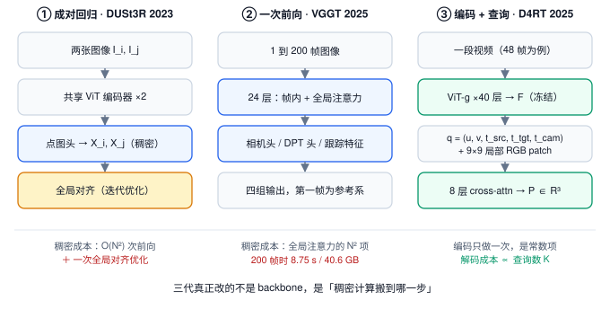
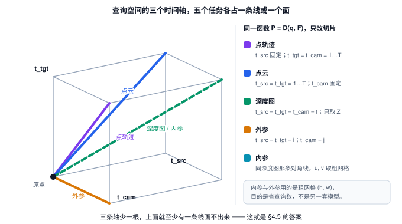
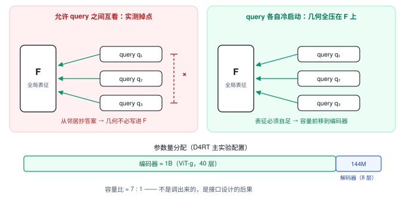
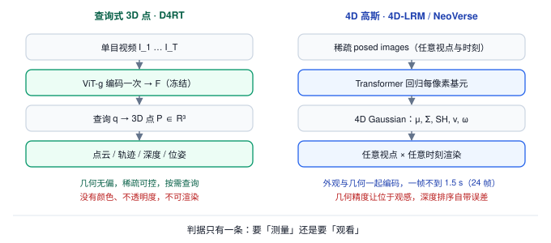

> **系列导航** ｜ 本文是《空间智能》系列 01。上游接口是[《世界模型与世界动作模型》](/2026/09/05/world-model-world-action-model/)——那篇把 WAM 的三条谱系讲完，却把「几何从哪来」整块留空；4D 基础模型补的正是这块。与[《DiT》](/2026/10/14/dit-01-patchify-adaln-zero-token-budget/) 与[《扩散模型的计算账本》](/2026/11/02/diffusion-video-token/) 的交集在「一次前向的算力怎么在编码与解码之间分配」。

> **TL;DR**
>
> * **核心问题与结论**：单目视频里「相机静止＋物体运动」与「相机运动＋物体静止」在 2D 投影上不可区分，所以 4D 重建缺的从来不是时间维，而是第三个约束。D4RT 的答案是把它做成一个函数 $P=\mathcal D(q,F)$，$q=(u,v,t_{\mathrm{src}},t_{\mathrm{tgt}},t_{\mathrm{cam}})$ 中三个时间索引互相独立，深度／点云／轨迹／位姿退化为对这个五元组的不同切片（§2、§4）。
> * **关键证据**：编码器约 1B（ViT-g、40 层）而解码器只有 144M（8 层），容量比约 7:1；论文 §2.2 报告让 query 之间做自注意力会大幅掉点——每个 query 必须冷启动把几何从冻结的 $F$ 里读全（§5.2）。
> * **适用边界与代价**：200+ FPS 指位姿估计吞吐，不是稠密重建；ADT 一格它的 AJ 是 0.240，低于 SpatialTrackerV2 的 0.260（Table 4），「新 SOTA」不等于每格都赢。D4RT 未放代码与权重、训练集含私有数据（§6、§9）。
> * **系列定位**：接住 WAM 留空的几何底座，往下通向「可渲染的 4D 资产」（4D-LRM、NeoVerse）与具身感知的输入层（§7、§10）。

---

## §1 4D 是什么：三维加一条时间轴这个说法是错的

「4D 重建 = 3D 再加一维时间」在**观测坐标系**里成立，在**世界坐标系**里不成立。相机在动，时间轴不指向世界的任何一个固定方向，它只在每帧的相机坐标系里才有定义。把 $t$ 当成空间的第四根轴，等于默认相机不动。

准确的形式是一张映射。给定视频 $I_{1:T}$，4D 重建求的是

$$
\Phi:\ (u,v,t)\ \mapsto\ X\in\mathbb{R}^{3}
$$

$X$ 表示「第 $t$ 帧、像素 $(u,v)$ 对应的那个物理点，在某个约定参考相机坐标系下的位置」。这个定义刻意不含外观：它只回答「在哪」，不回答「长什么样」。把外观加进来就是 4D 资产，那是另一类问题（§7）。本文只谈前者。

难点在于三个未知量彼此耦合：

| 未知量 | 记号 | 不解开会发生什么 |
|:---|:---|:---|
| 相机运动 | $g_t\in SE(3)$ | 相机自身的位移被读成场景在动 |
| 每帧几何 | 深度 $D_t$ 或点图 $X_t$ | 尺度与深度同时不可观测 |
| 表面运动 | 对应关系 $\pi_t$ | 动态物体被复制成多个副本 |

一帧 2D 观测只给两个方程，未知量有三个。所以 4D 重建的每一种方法，本质上都在补第三个方程的来源：多视图几何给的，或者从数据里学来的。

这个欠定可以写得再具体一点。设焦距 $f$，某点在相机坐标系下深度为 $Z$，同一帧内相机平移 $t$、物体平移 $\Delta X$，则该点的像移是

$$
\Delta u=\frac{f(\Delta X-t)}{Z}
$$

单帧只测到 $\Delta u$，未知的是 $\Delta X$ 与 $t$ 两个，任何让 $(\Delta X-t)$ 相同的组合都给出同一个像移。**这就是「相机在动」与「物体在动」不可分的解析形式**。

分开它们靠的不是「多几帧」本身，而是**视差随深度的分布**：相机平移的像移正比于 $1/Z$，物体平移的像移也正比于 $1/Z$，但两者对不同深度点的贡献方式不同；只有同时观测一批深度各异的点、并解出各自的 $Z$，两个分量才拆得开。于是「先估深度、再估运动」构成循环依赖——**深度与运动必须联合求解**。这是端到端 4D 模型的立足点，也解释了 §2 的四代为什么都要在同一个网络里同时吐出这两样。

传统流水线把这个耦合切成四段——SfM/SLAM 解相机、MVS 解稠密几何、非刚性配准解运动、时序平滑收尾。问题出在第一段：它默认世界是刚性的，后面三段只能在一个已经错位的坐标系里修。误差不是相加，是相乘。

| 符号 | 含义 | 本文出现位置 |
|:---|:---|:---|
| $g_t$ | 第 $t$ 帧相机位姿（世界到相机） | §1、§2 |
| $X$ / $X_t$ | 3D 点；第 $t$ 帧的点图 | §1、§4 |
| $F$ | 编码器输出的全局场景表征 | §4 |
| $q$ | 查询五元组 $(u,v,t_{\mathrm{src}},t_{\mathrm{tgt}},t_{\mathrm{cam}})$ | §4 |
| $\mathrm{AJ}$ | 3D 点跟踪的平均 Jaccard 指标 | §6、§8 |

## §2 四代「消元」：每一代删掉一个前提

把 2023 到 2026 的这条线按发表时间读，会读成一串方法名；按「删掉了什么前提」读，只有四步。

**第一代：删掉相机参数（[DUSt3R](https://arxiv.org/abs/2312.14132)，2023-12）。** 回归点图而不是深度：对每张图输出 $X_i\in\mathbb{R}^{H\times W\times 3}$，即每个像素在**自己视图坐标系**下的 3D 坐标。两张图的点图之间存在一个刚体变换，用全局对齐解出来就得到相对位姿。相机内参从「输入」变成了「不必存在的输入」。代价是成对：$N$ 张图要 $O(N^2)$ 次前向，再跑一次全局优化把所有成对结果拼起来。

**第二代：删掉成对与后处理优化（[VGGT](https://arxiv.org/abs/2503.11651)，2025-03）。** 一次吃 1 到 200 帧，24 层里每层同时含一个帧内自注意力和一个全局自注意力，四个头同时输出相机、深度、点图与跟踪特征。它把「成对拼图」换成「一次全局注意力」：十帧输入的位姿估计从 DUSt3R 的约 7 秒降到约 0.2 秒，精度反而更高（VGGT Table 1，AUC@30 从 67.7 到 85.3）。代价有两个：全局注意力对帧数二次，且第一帧被钉成参考系。

**第三代：删掉固定参考视图（[π³](https://arxiv.org/abs/2507.13347)，2025-07；[DA3](https://arxiv.org/abs/2511.10647)，2025-11）。** VGGT 把第一帧钉死当世界原点，这个归纳偏置在参考帧质量差时会连锁失效。π³ 用完全置换等变的架构，直接预测仿射不变位姿与尺度不变局部点图，不要参考帧；DA3 再往前走一步，把多任务头也删了——一个普通 DINO 编码器加一个统一的「深度射线」预测目标，在自建基准上相机位姿精度比 VGGT 高 44.3%、几何精度高 25.1%，且只用公开学术数据集训练。

**第四代：删掉逐帧稠密解码（[D4RT](https://arxiv.org/abs/2512.08924)，2025-12）。** 前三代无论怎么改，输出形状都是稠密的：每帧一张深度图、一张点图、一组跟踪特征。D4RT 把输出从「张量」换成「函数」——编码一次得到全局表征 $F$，之后按需查询任意时空点的 3D 位置。

**还没走完的第五步：删掉时序（[ARROW](https://arxiv.org/abs/2610.01314)，2026-10）。** D4RT 的查询索引 $t_{\mathrm{src}},t_{\mathrm{tgt}},t_{\mathrm{cam}}$ 隐含「输入是一段有序视频」。ARROW 把这三个整数换成由图像内容导出的 identity token，于是多路视频、不同时间拍的照片集、无序图像集合都能进同一个查询接口。



*图 1｜读图顺序：沿每栏自上而下，找第一个被标成稠密的方块，再看底部那行成本。数字取自 [VGGT](https://arxiv.org/abs/2503.11651) Table 9 与 [D4RT](https://arxiv.org/abs/2512.08924) 主实验配置。*

上图三栏分别是成对回归、一次前向、编码加查询三种形态。左栏的稠密计算落在解码与优化；中栏落在 200 帧规模的全局注意力；右栏的编码是一次性的固定成本，解码成本只跟查询数量成正比。**「稠密计算搬到哪里」比「用了什么 backbone」更能解释三代的性能差**。

一条容易忽略的旁证：VGGT 在静态的 ScanNet 上相机 ATE 是 0.016，与 D4RT 的 0.014 只差 0.002（[D4RT](https://arxiv.org/abs/2512.08924) Table 6），在强动态、快速模糊的 Sintel 上掉到 0.168，比 MegaSaM 的 0.074 差一倍以上。同一个模型在两套数据上的落差，就是「静态先验」的价格被单独量了一次。

**旁支：四条没走查询接口的路。** 主线之外还有几类做法，它们不是被淘汰的方案，而是在别的约束下更划算：

| 路线 | 代表 | 做法 | 什么时候更划算 |
|:---|:---|:---|:---|
| 鲁棒优化式 SfM | [MegaSaM](https://arxiv.org/abs/2412.04463) | 不学动力学，靠鲁棒优化在含运动物体的视频上直接解相机与深度 | 离线、精度优先、允许每段视频跑几分钟 |
| 逐帧点图 + 跨帧对齐 | [MonST3R](https://arxiv.org/abs/2410.03825) | 把 DUSt3R 微调成对动态场景直接出逐帧点图，再统一对齐 | 想要一个不绑视频先验的通用几何前端 |
| 2D 跟踪 + 深度反投影 | [SpatialTrackerV2](https://arxiv.org/abs/2507.12462) | 先做 2D 长程跟踪，再把每帧像素沿深度投到 3D | 已有可靠深度源，且更信任 2D 对应的鲁棒性 |
| 感知与重建合流 | [Foundation4D](https://arxiv.org/abs/2610.30340) | 多相机驾驶视频上同时出几何、3D 检测、语义占据与高斯 | 下游要的是「物体级」而不是「点级」的输出 |

这张表解释了 §6 里那个反例为什么会出现：ADT 一格赢的是 SpatialTrackerV2。组合式路线没有把「几何」压进一个共享表征，各段可以各自选最稳的实现，在强畸变、弱纹理的画面里这反而成了优势。端到端方法的价值要到「任务多、查询形态杂、要一个统一接口」时才兑现——这是本文对那条数据的一个读法，论文本身没有给出归因。

### 2.1 一个被忽略的分歧：过完备还是极简

VGGT 和 DA3 相邻半年、目标相同，结论却相反。

VGGT 走**过完备**：同时预测相机、深度、点图、跟踪特征四个互相冗余的量，四个头在[一次前向里全部落地](https://github.com/facebookresearch/vggt/blob/a288dd0f14786c93483e45524328726ab7b1b4ce/vggt/models/vggt.py#L22-L27)。它的 Table 6 显示，四项全训时点图 Chamfer 最低（0.709），砍掉任一项都变差，其中「加相机损失」带来的改善最大（0.834 → 0.727）。冗余在这里是正则——逼共享表征把几何学全。

DA3 走**极简**：一个普通 DINO 编码器，一个统一的「深度射线」预测目标，不做多任务；[`_process_ray_pose_estimation`](https://github.com/ByteDance-Seed/depth-anything-3/blob/3d835ec1a5802d64a8b8b15f817a1ab54809bfe4/src/depth_anything_3/model/da3.py#L181-L204) 就是从这个统一目标里反解位姿的地方。它在自建基准上比 VGGT 的相机位姿精度高 44.3%。

两者不矛盾，前提不同。过完备的作用是**在表征能力不足时补足监督密度**；一旦编码器本身够强、训练数据更大更干净，多任务就退化成浪费容量。判断自己该走哪边，看的是「你的数据够不够把几何直接喂进去」，而不是「任务多是不是更好」。

## §3 为什么加一个跟踪头不够

最直觉的修补是：既然缺运动，就在 VGGT 上再挂一个 3D 跟踪头。这条路走不通，原因不在工程，在输出空间的形状。

VGGT 的[跟踪头](https://github.com/facebookresearch/vggt/blob/a288dd0f14786c93483e45524328726ab7b1b4ce/vggt/heads/track_head.py#L72-L104)是 CoTracker2 式的：给一个查询点，输出它在所有帧的 **2D** 对应，返回的是 `track` / `vis` / `conf` 三个张量，没有 3D 坐标。要变成 3D 轨迹，得把它和每帧的点图相乘——而这一步隐含一个等式：

$$
X^{(i)} = g_i^{-1}\,g_j\,X^{(j)}
$$

同一个物理点在第 $i$、$j$ 两个相机坐标系下的坐标只差一个刚体变换。**这条等式就是「世界刚性」本身**。物体一动，$X$ 自己随时间变，等式不成立，于是两种失败方式必居其一：把每帧独立重建出的副本都留下（点云里出现重影），或者把差异当噪声平滑掉（运动消失）。

更深一层的问题是头的输出空间是固定的。深度头出 1 个通道，光流头出 2 个，跟踪头出 $T\times 2$。它们的联合分布没有被任何一项损失约束，四个头各自最优不等于彼此自洽。要自洽，得让它们成为**同一个函数的不同切片**，而不是四个并列的函数。

这就是 D4RT 那句「不要问世界的几何是什么，问某个点某个时刻在哪」的实际含义：$t_{\mathrm{tgt}}$ 不是特征，是自变量。把它放进查询里，动态对应就不是新加的任务，而是函数定义域里本来就有的一根轴。

## §4 D4RT：把四个任务写成同一个函数

### 4.1 编码器：一次，且只一次

编码器沿用 VGGT 的骨架：ViT-g、40 层、约 1B 参数，时空 patch 取 $2\times 16\times 16$（两帧拼一个 patch），层内交替做帧内自注意力与全局自注意力（[VGGT 的 `Aggregator.forward`](https://github.com/facebookresearch/vggt/blob/a288dd0f14786c93483e45524328726ab7b1b4ce/vggt/models/aggregator.py#L240-L266) 里 `frame` 与 `global` 两类 block 轮流出现，是这个骨架最容易读的一段）。输入视频先缩到固定方形分辨率，原始长宽比单独编码成一个 token 混进序列。输出是全局场景表征 $F=\mathcal{E}(V)\in\mathbb{R}^{N\times C}$，在第二阶段**冻结**。

用论文配置做一次算术：48 帧、$256\times 256$ 输入、patch $2\times 16\times 16$，token 数为

$$
N=\frac{48}{2}\times\frac{256}{16}\times\frac{256}{16}=24\times 16\times 16=6144
$$

全局注意力每层的 query-key 对数约 $N^2=6144^2\approx 3.77\times 10^{7}$。这个数字与查询数量无关——它是编码的固定开销，也是长视频必须分块的根本原因（§9）。

「沿用 VGGT 骨架」这句话掩盖了几处改动，逐项比一下才看得清哪些是为 4D 付的账：

| 项 | VGGT | D4RT |
|:---|:---|:---|
| patch | $14\times 14$，单帧，DINOv2 切分 | $2\times 16\times 16$，两帧拼一个 |
| 层数 | 24 | 40 |
| 初始化 | DINOv2 图像预训练 | VideoMAE 视频预训练 |
| 参考系 | 第一帧（写死） | 查询里由 $t_{\mathrm{cam}}$ 指定 |
| 输出 | 四组稠密张量 | 按需查询的 3D 点 |

三处变化指向同一件事：**时间维要从编码阶段就进模型**。patch 跨两帧，是为了让相邻帧在 token 层就发生交互，而不是全靠全局注意力去连；层数从 24 加到 40，是因为单个 token 现在要同时编码「这一帧的表面」与「它下一秒去哪」；初始化换成 VideoMAE，是因为图像预训练没见过运动，而随机初始化会大幅掉点（Table 11）。参考系从「写死第一帧」变成「查询参数」，则是 §3 那条论证的直接后果。

这条对预训练的依赖值得单独说：$F$ 要独立承担全部几何信息，它不能从一个只见过静态图像统计的起点长出来。随机初始化掉的不是收敛速度，是「表征里压根没有运动这个概念」——而查询阶段没有任何通道能把运动补回去（§5.2）。

### 4.2 解码器：144M 的查询回答器

解码器只有 8 层交叉注意力、约 144M 参数。每个查询向量由三部分拼成：

- 2D 坐标 $(u,v)$ 的傅里叶特征嵌入；
- 三个时间索引 $t_{\mathrm{src}},t_{\mathrm{tgt}},t_{\mathrm{cam}}$ 的可学习离散嵌入；
- 以 $(u,v)$ 为中心的 $9\times 9$ 局部 RGB patch 嵌入。

第三项看着像补丁，实际是承重的：去掉它，Sintel 上的深度 AbsRel 从 0.302 退到 0.366，相机 ATE 从 0.091 退到 0.173（Table 7）。纯坐标加时间不足以定位一个具体的表面点——同一个 $(u,v,t)$ 在遮挡边界上可能对应前景也可能对应背景，$9\times 9$ 的邻域是唯一能区分这两者的信息。

D4RT 本身没有官方代码，但[ARROW 的 `QueryEmbedding`](https://github.com/ifradlin/arrow/blob/e0e1a76a1681bbdc88a9fa7f0231ffb68c261cc7/src/arrow/models/query_embed.py#L24-L42)把这套拼法完整开源了：`forward` 里三项相加——局部 RGB patch、傅里叶编码的 $(u,v)$、三个时间／身份嵌入查表；[`fourier_encode_uv`](https://github.com/ifradlin/arrow/blob/e0e1a76a1681bbdc88a9fa7f0231ffb68c261cc7/src/arrow/models/query_embed.py#L44-L61) 与 [`_sample_rgb_patches`](https://github.com/ifradlin/arrow/blob/e0e1a76a1681bbdc88a9fa7f0231ffb68c261cc7/src/arrow/models/query_embed.py#L72-L111) 分别是前两项的落点。想对照源码读 §4.3 的查询接口，这份是目前最贴近的公开实现。

### 4.3 一个函数，五种切片

把 $q$ 的五个分量按「固定 / 遍历 / 彼此相等」三种关系分开，五个任务全部落地。下表按 [D4RT 论文 Table 1](https://arxiv.org/abs/2512.08924) 逐格抄录——**「谁和谁相等」是表里最关键的信息**，它决定了这条切片落在查询空间的哪条线或哪个面上。

| 任务 | $u,v$ | $t_{\mathrm{src}}$ | $t_{\mathrm{tgt}}$ | $t_{\mathrm{cam}}$ | 输出怎么用 |
|:---|:---|:---|:---|:---|:---|
| 点轨迹 | 固定 | 固定 | $1\ldots T$（$=t_{\mathrm{cam}}$） | $1\ldots T$（$=t_{\mathrm{tgt}}$） | 同一像素的全时段 3D 轨迹 |
| 点云 | $1\ldots W,\ 1\ldots H$ | $1\ldots T$（$=t_{\mathrm{tgt}}$） | $1\ldots T$（$=t_{\mathrm{src}}$） | 固定 | 所有帧的点直接落在同一参考系 |
| 深度图 | $1\ldots W,\ 1\ldots H$ | $1\ldots T$ | $=t_{\mathrm{src}}$ | $=t_{\mathrm{src}}$ | 只取输出 $P$ 的 $Z$ 分量 |
| 外参 | 粗网格 $1\ldots h,\ 1\ldots w$ | 固定 $i$ | $=t_{\mathrm{src}}$ | $1\ldots T$ | 两组 3D 点做 Umeyama |
| 内参 | 粗网格 $1\ldots h,\ 1\ldots w$ | $1\ldots T$ | $=t_{\mathrm{src}}$ | $=t_{\mathrm{src}}$ | 针孔反解焦距取中位数 |

外参与内参用粗网格 $(h,w)$ 而不是全图像素，为的是省查询数，不是另一套模型。深度图与内参走的是同一条对角线（三个索引相等），区别只在 $u,v$ 的采样密度和拿输出做什么。



*图 2｜三个时间索引张成一个三维格点，五个任务就是其中的线或面。绿色虚线是主对角线 $t_{\mathrm{src}}=t_{\mathrm{tgt}}=t_{\mathrm{cam}}$，深度图与内参都落在上面。*

举一个具体的查询。设视频 48 帧、$256\times 256$，取

$$
q=(120,\ 84,\ 7,\ 19,\ 7)
$$

它问的是：**第 7 帧上像素 $(120,84)$ 对应的那个物理点，到第 19 帧时在哪，答案用第 7 帧的相机坐标系写**。三个时间索引各管一件事：$t_{\mathrm{src}}$ 决定「从哪一帧取这个点」（局部 RGB patch 也从这帧取），$t_{\mathrm{tgt}}$ 决定「问它哪个时刻的位置」，$t_{\mathrm{cam}}$ 决定「答案写在哪个坐标系」。

同一个物理位置，把 $t_{\mathrm{cam}}$ 从 7 改成 19，三维坐标整个换掉，但点在空间里没动。外参估计用的正是这件事：对粗网格上的一批点 $k$ 发两组查询

$$
\mathbf{q}_{i,k}=(u_k,v_k,i,i,i),\qquad \mathbf{q}_{j,k}=(u_k,v_k,i,i,j)
$$

两组输出是**同一批 3D 点写在不同参考系里**，求它们之间的刚体变换就是帧 $i$ 到帧 $j$ 的相对位姿（Umeyama，一次 $3\times 3$ 的 SVD）。位姿不是被预测的，是被解出来的——这也是 §6 里 200+ FPS 的来源。

内参同理：对每帧 $i$ 取 $t_{\mathrm{src}}=t_{\mathrm{tgt}}=t_{\mathrm{cam}}=i$，把输出的 $P=(p_x,p_y,p_z)$ 代进针孔方程（坐标归一化到 $[0,1]$、主点取 $(0.5,0.5)$）

$$
f_x=\frac{p_z\,(u-0.5)}{p_x},\qquad f_y=\frac{p_z\,(v-0.5)}{p_y}
$$

再对一批点取中位数；带畸变的镜头要在这之后补一次非线性精化。

把切片规则写成代码，五元组接口就只剩一个查询生成器（不含模型本身）：

```python
def queries(task, T, H, W, step=16, t_src=0, t_cam=0):
    grid = [(u, v) for v in range(0, H, step) for u in range(0, W, step)]
    if task == "depth":       # t_src = t_tgt = t_cam = t
        return [(u, v, t, t, t) for t in range(T) for u, v in grid]
    if task == "pointcloud":  # t_src = t_tgt = t, t_cam 固定
        return [(u, v, t, t, t_cam) for t in range(T) for u, v in grid]
    if task == "track":       # t_src 固定, t_tgt = t_cam = t
        return [(u, v, t_src, t, t) for t in range(T) for u, v in grid]
    if task == "extrinsics":  # t_src = t_tgt = i 固定, t_cam = j 遍历
        return [(u, v, t_src, t_src, j) for j in range(T) for u, v in grid]
    raise ValueError(task)

assert len(queries("depth", 48, 256, 256)) == 48 * 16 * 16
```

点云这一行值得单独说。它不是「先算深度、再算位姿、再反投影」——它直接把每个像素投到同一个参考帧，**相机位姿完全不出现在这条路径上**。成对方法必须先估相对位姿再做坐标变换，误差在变换里滚一遍；查询式把这一步省掉了，代价是每个 query 都得自己知道「我该落在哪个系」。

### 4.4 训练：2048 个查询，500k 步

| 项 | 值 |
|:---|:---|
| 每 clip 解码查询数 | 2048（在深度不连续处与运动边界上过采样 30%） |
| 分辨率 / 帧数 | $256\times 256$ / 48 |
| 优化 | AdamW，500k 步，64 个 TPU，约两天 |
| 损失 | 归一化 3D 点 L1 为主，另加 2D、法向、可见性、位移、置信度五项 |
| 采样技巧 | 以 0.4 概率强制 $t_{\mathrm{tgt}}=t_{\mathrm{cam}}$ |

损失里最容易被忽略的是归一化方式：目标点和预测点各自按平均深度归一化，再过一次 $\mathrm{sign}(x)\log(1+\lvert x\rvert)$。这一步把远点的权重压下去，等价于承认「远景的绝对误差没有意义」。少了它，模型会把容量全花在把远处天空压平。

0.4 的强制相等概率是个小设计，作用在推理侧：它保证 $t_{\mathrm{tgt}}=t_{\mathrm{cam}}$ 这条切片（点轨迹走的就是它，深度图是上面再叠一个 $t_{\mathrm{src}}=t_{\mathrm{tgt}}$ 的子集）在训练中拿到足够多的样本，而不是被三个独立均匀采样稀疏覆盖。论文给的理由只有一句 “to improve downstream performance”。

### 4.5 为什么必须是三个索引

图 2 里那三条轴少任意一根，就至少有一条线画不出来。逐一看三种合并各自会丢掉什么，比记一句「时空解耦」有用：

- **合并 $t_{\mathrm{src}}$ 与 $t_{\mathrm{tgt}}$**（永远问「这个点现在在哪」）：深度图确实是它的特例，但点轨迹要求 $t_{\mathrm{src}}$ 钉死、$t_{\mathrm{tgt}}$ 从 $1$ 走到 $T$，跨时刻的对应全部消失，「同一个点在动」再也表达不出来。
- **合并 $t_{\mathrm{tgt}}$ 与 $t_{\mathrm{cam}}$**（答案只能写在被问时刻的相机系）：点轨迹还能做，Table 1 里恰好就是这么设的；但外参那对查询 $(u,v,i,i,i)$ 与 $(u,v,i,i,j)$ 里，$t_{\mathrm{tgt}}$ 固定为 $i$、$t_{\mathrm{cam}}$ 从 $i$ 变到 $j$——必须能只换参考系而不动被问的时刻。两者一合并，两组查询塌成一组，Umeyama 无从做起，位姿就没了。
- **合并 $t_{\mathrm{src}}$ 与 $t_{\mathrm{cam}}$**（答案只能写在源帧自己的系）：点云要求 $t_{\mathrm{cam}}$ 固定成共享参考帧、$t_{\mathrm{src}}$ 遍历 $1\ldots T$，一合并，所有帧的点各写在自己的系里，点云拼不起来。§4.3 说「相机位姿完全不出现在这条路径上」，前提正是这一格能独立固定。

注意「合并」和「相等」不是一回事：Table 1 里大量切片让两个索引取相等的值，那是**任务选择的切片**；架构上三者仍必须各自独立，训练时以 0.4 概率强制 $t_{\mathrm{tgt}}=t_{\mathrm{cam}}$ 只是分布上的偏置，不是把两个变量焊死。

三个索引全独立，代价是查询空间从一维涨到三维：$T^3$ 种组合里绝大多数没有真值。这解释了 §4.4 里那个 2048——**不是采不起，是没那么多真值可采**。稀疏查询在这里不是效率手段，是数据现实逼出来的采样策略。

### 4.6 监督从哪来

D4RT 的训练数据是三类的混合：室内真实扫描（ScanNet）、自动驾驶（Waymo Open）、合成场景（Kubric、PointOdyssey）。

| 来源 | 能给什么 | 缺什么 |
|:---|:---|:---|
| 真实静态扫描 | 精确的深度与位姿 | 几乎没有运动 |
| 自动驾驶 | 大量真实运动 | 场景单一，稀疏轨迹标注 |
| 合成 | 完美的点轨迹与遮挡标签 | 分布偏，材质与光照不真实 |

三类缺的东西正好互补，所以只能混。这也把 §6 里「静态数据压到地板」的因果说全了：真实动态数据拿不到稠密真值，模型只能从合成场景学运动先验，再在真实动态上打折。

监督信号本身也是异构的——深度、位姿、点轨迹三种真值的量纲与噪声特性完全不同。§4.4 那六项损失（3D、2D、法向、可见性、位移、置信度）本质是在给这些异构监督配权重，让它们不要互相拉扯。论文附录 A 直接给出 $\lambda_{3\mathrm{D}}=1.0$、$\lambda_{2\mathrm{D}}=\lambda_{\mathrm{vis}}=\lambda_{\mathrm{disp}}=0.1$、$\lambda_{\mathrm{normal}}=0.5$、$\lambda_{\mathrm{conf}}=0.2$，Table 8 只做了「逐项移除辅助损失」的消融，**权重本身没有扫描、也没有选取依据**。置信度 $c$ 同时进两处：既以 $-\log c$ 作为惩罚项，又拿来加权 3D 点误差。

## §5 稀疏解码：省的是哪一笔算力

「不解码稠密张量所以快」的说法太粗。把账拆开才看得清省在哪一层。

总成本可以写成两项：

$$
C_{\mathrm{total}}=C_{\mathrm{enc}}(N)+K\cdot c_{\mathrm{dec}}
$$

$C_{\mathrm{enc}}$ 只与 token 数 $N$ 有关，与查询数 $K$ 无关；$c_{\mathrm{dec}}$ 是单个查询穿过 8 层交叉注意力的成本。稠密解码做的事是把 $K$ 从两千提到三百万：

| 口径 | $K$ | 相对倍率 |
|:---|:---|:---|
| 训练（论文配置） | 2048 | 1 |
| 全像素（48 帧 $256^2$） | 3,145,728 | 1536 |

**但这不等于快 1536 倍**。编码器那一项一分没省，它本来就是常数。真正的收益出现在 $K$ 需要随分辨率或帧数增长的时候：稠密解码让第二项变成主导，查询式把它按需截断。

### 5.1 三个附带收益

**监督可以稀疏。** 3D 点轨迹的真值本来就是稀疏标注（TAPVid 系列给的是若干条轨迹，不是稠密场）。稠密解码时绝大多数 query 没有对应监督，只能靠辅助损失凑；只采有真值的点，监督密度反而上去了。

**查询可增可减。** 查询之间没有依赖，加一批或砍一批都不影响已算出的结果。全像素跟踪正是靠这一点做的：用一个占用网格记录「哪些像素已经起过轨」，只从没访问过的像素起新轨，随运动复杂度自适应拿到 5 到 15 倍加速。

**解码可以并行到不同的下游。** 需要 8 条轨迹就发 8 个 query，需要整帧点云就发一整张网格，同一个 $F$、同一组权重。

### 5.2 代价：冷启动与容量前移

省下来的东西一定要在别处付账。查询之间不交互，意味着每个 query 只能看到 $F$ 和自己的局部 patch——**它没有邻居可抄**。

论文 §2.2 报告了一条反向证据：早期实验里让 query 之间做自注意力，性能大幅下降。论文给的线索是分布外效应——推理时查询可以任意挑、彼此不必相关，训练时一旦让它们互看，换一种查询组合就落到分布外。换成表征的语言，就是模型会去抄邻居的答案而不把几何压进 $F$；这一层机制解释是本文的读法，论文只给了现象。



*图 3｜左右两栏的差别只有那条虚线：允许 query 互看，几何就不必写进 $F$。底部参数量条按主实验配置，消融默认配置（ViT-L、6 层解码器）是另一套。*

于是容量被迫前移。编码器 1B、解码器 144M，约 7:1——这个比例不是调出来的，是接口设计的直接后果。同一件事在 VGGT 上以另一种形式出现过：它同时预测相机、深度、点图、跟踪四个互相冗余的量（论文称之为 over-complete prediction），也是逼共享表征把几何学全。两篇论文用相反的手段得到同一个结论：**要让表征自己扛住几何，就不能给它外部依赖**。

## §6 数字怎么读：三张表，三个口径

D4RT 的结果分散在三张表里，口径各不相同。混着读会得出错误结论，所以分开列。

**Table 4：3D 点跟踪（相机坐标系，无 GT 内参，AJ 越高越好）**

| 方法 | DriveTrack | ADT | PStudio |
|:---|:---|:---|:---|
| SpatialTrackerV2 | 0.064 | **0.260** | 0.097 |
| D4RT | **0.257** | 0.240 | **0.138** |

DriveTrack 上高四倍，ADT 上反而低 0.02。ADT 用 Aria 眼镜采集、论文在无 GT 内参的设定下报告，D4RT 在这一格没有优势。它的主要卖点是解耦相机运动与物体运动，但这套能力在 ADT 上没有变成数字上的领先——**把「新 SOTA」读成「每格都赢」是这篇论文最容易被误读的地方**。

**Table 5：视频深度与点云（L1 越低越好）**

| 方法 | Sintel 点云 | ScanNet 点云 | Sintel AbsRel | ScanNet AbsRel |
|:---|:---|:---|:---|:---|
| MegaSaM | 1.531 | 0.072 | 0.342 | 0.050 |
| VGGT | 1.582 | 0.063 | 0.318 | 0.044 |
| SpatialTrackerV2 | 1.375 | 0.036 | 0.209 | 0.027 |
| π³ | 1.139 | 0.030 | 0.241 | 0.021 |
| D4RT | **0.768** | **0.028** | **0.171** | **0.020** |

Sintel 与 ScanNet 的差距值得看两遍：Sintel 上 D4RT 的点云 L1 是 π³ 的 0.67 倍，ScanNet 上只领先 0.002。**静态数据已经把这条线压到地板了**，动态数据才是分水岭。

**Table 6：相机位姿**

| 方法 | Sintel ATE | ScanNet ATE | Re10K Pose AUC |
|:---|:---|:---|:---|
| MegaSaM | 0.074 | 0.029 | 71.0 |
| VGGT | 0.168 | 0.016 | 70.2 |
| π³ | 0.086 | 0.015 | 78.7 |
| D4RT | **0.065** | **0.014** | **83.5** |

VGGT 在 Sintel 上 0.168、在 ScanNet 上 0.016，同一个模型差一个数量级——这条落差就是 §2 末尾说的「静态先验的价格」。

**吞吐**：[Table 3](https://arxiv.org/abs/2512.08924) 测的是「单卡 A100、维持给定帧率时最多能同时产出多少条全视频 3D 轨迹」，D4RT 在 60 / 24 / 10 / 1 FPS 下分别是 550 / 1570 / 3890 / 40180 条，同期 SpatialTrackerV2 是 29 / 84 / 219 / 2290 条，即 18 到 300 倍。位姿估计侧的 200+ FPS 是 [Fig. 3](https://arxiv.org/abs/2512.08924) 的另一组数，比 VGGT 快约 9 倍、比 MegaSaM 快约 100 倍；为公平比较，论文还把基线里与相机估计无关的头去掉了。

三个口径必须分开记：

- **坐标口径**：Table 4 有相机坐标系与世界坐标系两套，同一方法在两者上的 AJ 可以差一倍以上；
- **内参口径**：有 GT 内参与无 GT 内参是两组数，论文分开报；
- **任务口径**：位姿的「200 FPS」是解 $3\times 3$ SVD 的吞吐，全像素重建的「18 到 300 倍」是另一套对比基线，两者不能互相引用。

### 6.1 三个速度数字，三种前提

| 数字 | 相对什么 | 前提 | 说的是什么 |
|:---|:---|:---|:---|
| 200+ FPS | 无对照组，是绝对吞吐 | 位姿估计，每帧解一次 $3\times 3$ SVD | 位姿路径的延迟 |
| 9× / 100× | VGGT / MegaSaM | 同一个位姿任务 | 方法间的速度对比 |
| 18～300× | 各方法在给定帧率下能跟住的最大轨迹数 | 帧率预算固定 | 跟踪吞吐 |

第三个最容易被误读，因为它不是一个固定比值：60 FPS 时是 550 条对 29 条，1 FPS 时是 40180 条对 2290 条。**同一个「300 倍」在不同帧率下指的不是同一件事**，引用时必须带上帧率前提。

## §7 4D 的另一半：从「点」到「可渲染的高斯」

查询式输出的是 3D 点，没有颜色、没有不透明度、没有法向。要做「看」的应用，得换一种表征。

先得说清一件事：**前馈模型摊销掉的到底是什么。** 优化式 4D 重建（D-NeRF 一路、各类 4DGS）为每条视频单跑一次优化，几分钟到几小时，结果只对这一条片子有效。前馈模型把成本从「每场景」搬到「每模型」：

| 口径 | 优化式 | 前馈式 |
|:---|:---|:---|
| 单条视频的成本 | 分钟到小时级 | 秒级 |
| 一次性成本 | 无 | 训练一次（D4RT 是 64 卡两天） |
| 泛化 | 只对该场景有效 | 跨场景 |
| 效果不好时 | 调参重跑 | 只能换模型 |

两笔账的差别不是快慢，是**成本结构**。这解释了为什么两条路并存：只做一条片子、要极致质量时（影视、数字孪生），优化式仍占优；量大、要实时、要进闭环时（机器人、AR），前馈式没有替代品。

**[4D-LRM](https://arxiv.org/abs/2506.18890)（2025-06，Adobe / 密歇根，[项目页](https://4dlrm.github.io/)）** 走的是大规模重建模型那条路：输入任意视角、任意时刻的稀疏 posed image，Transformer 直接回归**每像素的各向异性 4D 高斯基元**，一次前向出 24 帧、单卡不到 1.5 秒，训练集是 Objaverse4D 的动态资产子集。它把 3D 高斯从「优化出来的场景表示」变成「前向预测的输出」。

**[NeoVerse](https://arxiv.org/abs/2601.00393)（2026-01，CVPR 2026 Highlight，[项目页](https://neoverse-4d.github.io/)）** 走的是重建加生成的混合路，但它把重建放在**条件**的位置，而不是终点：先用一个免位姿的前馈 4DGS 模型从野外单目视频重建出场景与双向运动，再从新视点渲出「退化渲染图」，交给视频生成模型（Wan 系列）合成新轨迹；训练时退化条件由单目视频在线模拟，原始视频自己当监督。这一手绕开了「4D 标注贵」——它不需要多视角 4D 数据，只需要视频。按项目页，蒸馏 LoRA 之后单卡不到 30 秒。

4D 高斯把「时间」写进参数有几种做法，代价各不相同：

| 写法 | 时间怎么进参数 | 能表达什么 | 代价 |
|:---|:---|:---|:---|
| 速度外推 | 每个基元带线速度与角速度，任意时刻位置由外推得到 | 刚性或近似刚性的整体运动 | 非刚性形变会穿模 |
| 形变场 | 规范空间上叠一个形变网络，输入 $(x,t)$ | 真实的非刚性形变 | 每渲一帧要过一次网络，帧间一致性没有保证 |
| 生命周期 | 基元带起止时刻，不透明度随时间衰减 | 「出现与消失」这类拓扑变化 | 中间时刻靠插值，快速运动下会断续 |

前两条是 4DGS 文献里的标准分歧，第三条更像工程折衷。**4D-LRM 与 NeoVerse 都没有引入形变网络**：一个直接回归每像素基元，一个用双向运动建模（bidirectional motion modeling）描述基元随时间的运动。这是它们能做到亚秒到数十秒级的原因，代价也直白——**「形变」被排除在能力之外**。要重建一个正在弯折的布，这三条路都还不行。



*图 4｜左右两栏共享「输入视频 → 一次前向 → 输出」的形状，差别在末端输出是 3D 点还是带外观的 4D 高斯。NeoVerse 的重建部分见 [`DepthAnything3Reconstructor`](https://github.com/IamCreateAI/NeoVerse/blob/bb97880d3f6d5cb06b2fcccc8ca889e0988daa4d/diffsynth/auxiliary_models/depth_anything_3/neoverse_adapter.py#L19-L114)。*

两条路的判据只有一条：**要「测量」还是要「观看」**。要测距离、算碰撞、给策略当输入，点云更合适——它是无偏的几何量，且稀疏可控；要渲染、要合成新视角、要给人生成结果，高斯更合适——外观与几何一起编码，代价是几何精度不再是唯一目标，深度排序、透明度累积都会引入自己的误差。把两者混着比「谁更准」没有意义。

## §8 评测：四个正交轴与复合指标的陷阱

4D 没有单一指标。现有基准各自只测其中一两根轴：

| 轴 | 测什么 | 代表基准 | 典型指标 |
|:---|:---|:---|:---|
| 几何 | 单帧表面是否准 | Sintel、ScanNet、KITTI、Bonn | AbsRel、点云 L1 |
| 对应 | 同一点跨帧是否连得上 | TAPVid-3D、WorldTrack | AJ、APD3D |
| 相机 | 轨迹是否漂 | Re10K、ScanNet、Sintel | ATE、RPE、Pose AUC |
| 时序 | 同表面在时间上是否闭合 | 无公认基准 | 无 |

第四根轴是空的。前三根全部只要求「逐帧正确」，没有任何一个指标检查「第 3 帧重建出的那块桌面与第 40 帧重建出的那块是不是同一块」。这在静态场景里无所谓——几何本来就不变；在动态场景里这是最大的漏洞：两帧各自完美、中间过程跳变的重建，能拿到很好的分数。

几个常用基准各自只覆盖一两根轴，把它们拼在一起才勉强凑出四维：

| 基准 | 素材 | 动态程度 | 给的真值 | 主要测 |
|:---|:---|:---|:---|:---|
| TAPVid-3D | DriveTrack / ADT / PStudio 三个子集 | 强动态 | 稀疏 3D 点轨迹 | 对应 |
| WorldTrack | 真实世界多场景 | 强动态 | 3D 轨迹 | 对应 |
| Sintel | 合成电影片段，带快速运动模糊 | 强动态 | 稠密深度、相机 | 几何 + 相机 |
| ScanNet | 室内静态扫描 | 近静态 | 深度、位姿 | 几何 + 相机 |
| Re10K | 互联网室内视频 | 静态场景 | 相机位姿 | 相机 |
| KITTI / Bonn | 驾驶场景 / 室内 RGB-D | 有运动物体 | 深度 | 几何 |

可跳转的入口：[TAPVid-3D 项目页](https://tapvid3d.github.io/)（含数据生成与评测代码）、[TAPVid-3D 论文](https://arxiv.org/abs/2407.05921)（AJ / $\mathrm{APD}_{3\mathrm{D}}$ 的定义与阈值设定）、[MPI Sintel](http://sintel.is.tue.mpg.de/)、[ScanNet](http://www.scan-net.org/)、[KITTI](https://www.cvlibs.net/datasets/kitti/)。先把指标定义读一遍，再回头看 §6 那三张表，能省掉大半误读。

这张表解释了一件事：**同一个模型换个基准排名就翻转，不是评测噪声，是各基准测的根本不是同一根轴**。§6 里 VGGT 在 ScanNet 与 Sintel 上差一个数量级，原因就在这里。

复合指标还有自己的陷阱。$\mathrm{AJ}$ 定义为交并比式的计数：

$$
\mathrm{AJ}=\frac{\mathrm{TP}}{\mathrm{TP}+\mathrm{FN}+\mathrm{FP}}
$$

其中「命中」的判据带一个距离阈值，而 $\mathrm{APD3D}$ 把阈值换成对距离的积分。**阈值选在哪里，等价于决定「多准算对」**。同一个模型在不同阈值下的排名可以翻转，这也是为什么 Table 4 里 0.257 与 0.240 这种量级的差异不能直接读成「强 7%」——它们的分母里含着各自对遮挡与出框的处理方式。

一个可操作的建议：读 4D 论文的数字时先确认三件事——阈值、是否用 GT 内参、报告的是相机坐标系还是世界坐标系。这三项对不上，表格就不能拼。

## §9 工程边界：200 FPS 的含义与长视频的漂移

**200+ FPS 不是「实时 4D 重建」。** 它指的是位姿估计这一条路径的吞吐：查询一批网格点、解 Umeyama、得到相对位姿（Fig. 3）。官方说明里另有一个数字——一分钟视频在单颗 TPU 上约 5 秒处理完——那是整段处理的耗时。两个数字的硬件、精度设定与统计口径都不同，**不能互相换算，更不能相乘**：把它们混用会得到一个不存在的产品承诺。

**长视频必须分块，原因是二次项。** VGGT 论文的 Table 9 把这件事量得很清楚：单卡 H100、$336\times 518$ 输入，100 帧是 3.12 秒 / 21.15 GB，200 帧是 8.75 秒 / 40.63 GB。帧数翻倍，时间涨 2.8 倍、显存涨 1.9 倍。这与 §4.1 的 $N^2$ 一致——token 数随帧数线性涨，注意力成本随之平方涨。

分块的代价是漂移。块与块之间靠 Umeyama 对齐拼接，每次对齐都带一点残差，几十个块之后累积成可见的弯曲。**目前没有误差界**：拼接后的全局一致性只能靠经验观察，不能像 BA 那样给一个协方差。这是这条路线在长序列上最实在的短板。

量级上可以估一下：设每块对齐残差是 $\varepsilon$，系统性偏差按 $n\varepsilon$ 累积、随机偏差按 $\sqrt{n}\,\varepsilon$ 累积。100 个块时，前者是单项的 100 倍、后者 10 倍。这条式子说明「多切几块」不是免费的——块切得越小，$n$ 越大，但每块之间重叠越少、$\varepsilon$ 同时上升，两个方向都朝坏处走。存在一个最优块长，但没有闭式解，只能按场景扫。

**失败模式是分类的，不是程度问题。** 下面几种坏法各有各的成因，混在一起说「鲁棒性不足」没有信息量：

| 场景 | 为什么坏 | 现有对策 |
|:---|:---|:---|
| 镜面、透明、水面 | 多视图一致性前提失效，反射像被当成真实几何 | 无通用解，靠置信度输出把不确定标出来 |
| 快速运动模糊 | 局部 patch 与轨迹真值对不上，监督本身带噪 | 合成数据里拟合模糊核，外推到真实 |
| 大遮挡、出框 | 目标点不可见，只能靠全局表征推断 | 隐式学习；可见性损失起一部分作用 |
| 非刚性形变（布、绳） | 4D 高斯的速度外推假设了近刚体 | 换形变场，代价是渲染变慢（§7） |
| 未知内参 + 强畸变 | 针孔反解失效，焦距中位数不稳 | 加非线性精化；ADT 一格的结果说明这条还没解决（§6） |

镜面与运动模糊是几何方法的旧账；遮挡、形变、畸变在 4D 里被放大成新账——因为它们不再是「某一帧的问题」，而是「一段时间里连续的问题」。读论文时按这张表对一遍，比看综合分数有用：综合分数是这些失败模式的加权平均，权重由基准的构成决定。

**可复现性是分水岭。** 前后两个月里，[DA3](https://github.com/ByteDance-Seed/depth-anything-3) 声明只用公开学术数据集、代码与权重全开；[D4RT](https://arxiv.org/abs/2512.08924) 拿下了 [CVPR 2026 最佳论文](https://tc.computer.org/tcpami/awards/cvpr-paper-awards)，但发布时无官方代码、无公开 API、训练集含私有数据（论文 §4 明列 public and internal datasets）。这不是八卦，它直接决定一件事：一个方法的结论能不能被独立复现，决定了它能不能进工程选型。读 4D 论文时，「有没有权重」和「指标多高」是同等重要的两列；具体能读到哪一层代码，见 §11。

## §10 选型与六个开放问题

按需求倒推，判据是五个是非题：

| 你的需求 | 先看 | 理由 |
|:---|:---|:---|
| 场景里有明显运动 | D4RT / ARROW | 静态假设一旦破了，前三代的误差不是线性的 |
| 需要相机内外参 | 任一代，但要查「有无 GT 内参」口径 | 位姿都是解出来的，差别在解法的鲁棒性 |
| 需要渲染新视角 | 4D-LRM / NeoVerse | 查询式点云不带外观 |
| 需要实时 | 先明确「哪个环节的实时」 | 位姿吞吐与整段视频处理是两个口径，不能换算 |
| 需要可复现 | DA3 系（公开权重） | D4RT 无代码无权重 |

六个还没解决的问题，按重要性排：

1. **时序一致性没有指标**（§8）。这条不补，所有 4D 数字都只覆盖了三根轴。
2. **分块漂移没有误差界**（§9）。长序列的全局一致性目前是经验问题。
3. **查询接口的容量分配没有 scaling law**。1B 对 144M 是设计后果，但没人扫过「编码器多大时解码器可以多小」。
4. **遮挡与出框靠隐式学习**。D4RT 的查询允许目标点不可见（靠 $F$ 推），但没有任何显式的可见性推理保证。
5. **4D 数据是瓶颈**。静态 3D 可以扫描，动态 4D 只能合成或标注稀疏轨迹，这是 §6 里「静态数据压到地板」的根源。
6. **重建与生成的接缝没有统一度量**。NeoVerse 用重建给生成当几何引导，但「引导得对不对」用什么指标衡量，目前没有共识。

## §11 代码索引：从论文跳到实现

正文里每个方法名都可以直接落到实现。仓库锁在固定 commit 上，下表只给仓库与复现状态；具体该打开哪个文件、哪几行，见后面那张按问题索引的表。没有官方代码的项目如实写明，不拿第三方复现冒充官方。

| 方法 | 仓库（锁 commit） | 复现状态 |
|:---|:---|:---|
| DUSt3R | [dust3r `4c24a6e`](https://github.com/naver/dust3r/tree/4c24a6ebf04809f2cfe59915e51779c8984aaa40) | 官方，权重公开 |
| MonST3R | [MonST3R `574cc77`](https://github.com/Junyi42/MonST3R/tree/574cc77ad278bad582f470e5382624e01f8769a7) | 官方 |
| VGGT | [vggt `a288dd0`](https://github.com/facebookresearch/vggt/tree/a288dd0f14786c93483e45524328726ab7b1b4ce) | 官方，权重公开 |
| π³ | [Pi3 `9fa3ddb`](https://github.com/yyfz/Pi3/tree/9fa3ddb3f8d53041f8b2738df404f62223bbaa7b) | 官方 |
| DA3 | [DA3 `3d835ec`](https://github.com/ByteDance-Seed/depth-anything-3/tree/3d835ec1a5802d64a8b8b15f817a1ab54809bfe4) | 官方，公开数据 |
| MegaSaM | [mega-sam `a27b4e6`](https://github.com/mega-sam/mega-sam/tree/a27b4e633c5cc0828a62ed943ef9f6505705fd3f) | 官方 |
| SpatialTrackerV2 | [SpaTrackerV2 `7e12274`](https://github.com/henry123-boy/SpaTrackerV2/tree/7e12274c52077860cebfe007a6290777db43b63c) | 代码公开 |
| ARROW | [arrow `e0e1a76`](https://github.com/ifradlin/arrow/tree/e0e1a76a1681bbdc88a9fa7f0231ffb68c261cc7) | 官方 |
| NeoVerse | [NeoVerse `bb97880`](https://github.com/IamCreateAI/NeoVerse/tree/bb97880d3f6d5cb06b2fcccc8ca889e0988daa4d) | 官方 |
| D4RT | 无官方代码；[lucidrains/d4rt](https://github.com/lucidrains/d4rt/tree/05f3aa0fc11f3df6b80aa629fb0c1358823ba910)、[D4RT-reproduction](https://github.com/sjkncs/D4RT-reproduction/tree/09b8b80a51d58175633629970563e906e92796b7) | 无官方权重 |
| 4D-LRM | 无官方代码，见[项目页](https://4dlrm.github.io/) | 未发布 |
| Foundation4D | 无官方代码，见[arXiv:2610.30340](https://arxiv.org/abs/2610.30340) | 未发布 |

按想弄清的问题找，比按方法名找更快：

| 想读什么 | 跳到哪 |
|:---|:---|
| 查询结构体存了哪几个字段 | [`types.py` L32–L62](https://github.com/ifradlin/arrow/blob/e0e1a76a1681bbdc88a9fa7f0231ffb68c261cc7/src/arrow/types.py#L32-L62)：`xy` 与三个 frame 索引 |
| 三个时间索引怎么进模型 | [`d4rt.py` L414–L416](https://github.com/lucidrains/d4rt/blob/05f3aa0fc11f3df6b80aa629fb0c1358823ba910/d4rt/d4rt.py#L414-L416) 独立嵌入；[L580–L587](https://github.com/lucidrains/d4rt/blob/05f3aa0fc11f3df6b80aa629fb0c1358823ba910/d4rt/d4rt.py#L580-L587) 三项相加 |
| 局部 RGB patch 怎么取 | [`_sample_rgb_patches`](https://github.com/ifradlin/arrow/blob/e0e1a76a1681bbdc88a9fa7f0231ffb68c261cc7/src/arrow/models/query_embed.py#L72-L111) ／ [`extract_patches`](https://github.com/lucidrains/d4rt/blob/05f3aa0fc11f3df6b80aa629fb0c1358823ba910/d4rt/d4rt.py#L51-L75) |
| 五种任务切片怎么生成 | [`queries.py` L76–L116](https://github.com/ifradlin/arrow/blob/e0e1a76a1681bbdc88a9fa7f0231ffb68c261cc7/src/arrow/queries.py#L76-L116) ／ [`reconstruction.py`](https://github.com/ifradlin/arrow/blob/e0e1a76a1681bbdc88a9fa7f0231ffb68c261cc7/src/arrow/tasks/reconstruction.py#L4-L16) |
| 解码为什么能按块取消 | [`decode_iter`](https://github.com/ifradlin/arrow/blob/e0e1a76a1681bbdc88a9fa7f0231ffb68c261cc7/src/arrow/models/arrow.py#L127-L170) |
| 过完备的四个头 | [`vggt.py` L17–L27](https://github.com/facebookresearch/vggt/blob/a288dd0f14786c93483e45524328726ab7b1b4ce/vggt/models/vggt.py#L17-L27) |
| 成对结果怎么拼成全局点云 | [`optimizer.py` L16–L62](https://github.com/naver/dust3r/blob/4c24a6ebf04809f2cfe59915e51779c8984aaa40/dust3r/cloud_opt/optimizer.py#L16-L62) ／ [`model.py` L142–L171](https://github.com/naver/dust3r/blob/4c24a6ebf04809f2cfe59915e51779c8984aaa40/dust3r/model.py#L142-L171) |
| 帧内／全局交替注意力 | [`aggregator.py` L187–L266](https://github.com/facebookresearch/vggt/blob/a288dd0f14786c93483e45524328726ab7b1b4ce/vggt/models/aggregator.py#L187-L266) |
| 置换等变前向 | [`pi3.py` L173–L216](https://github.com/yyfz/Pi3/blob/9fa3ddb3f8d53041f8b2738df404f62223bbaa7b/pi3/models/pi3.py#L173-L216) |
| 单一深度射线目标 | [`da3.py` L181–L204](https://github.com/ByteDance-Seed/depth-anything-3/blob/3d835ec1a5802d64a8b8b15f817a1ab54809bfe4/src/depth_anything_3/model/da3.py#L181-L204) ／ [`gs_adapter.py`](https://github.com/ByteDance-Seed/depth-anything-3/blob/3d835ec1a5802d64a8b8b15f817a1ab54809bfe4/src/depth_anything_3/model/gs_adapter.py#L27-L58) |
| 2D 跟踪 + 深度反投影 | [`predictor.py` L21–L92](https://github.com/henry123-boy/SpaTrackerV2/blob/7e12274c52077860cebfe007a6290777db43b63c/models/SpaTrackV2/models/predictor.py#L21-L92) |
| 免位姿 4DGS 重建 | [`neoverse_adapter.py`](https://github.com/IamCreateAI/NeoVerse/blob/bb97880d3f6d5cb06b2fcccc8ca889e0988daa4d/diffsynth/auxiliary_models/depth_anything_3/neoverse_adapter.py#L19-L114) |
| 五元组最短可读示例 | [README L34–L68](https://github.com/lucidrains/d4rt/blob/05f3aa0fc11f3df6b80aa629fb0c1358823ba910/README.md#L34-L68) ／ [`d4rt.py` L542–L590](https://github.com/lucidrains/d4rt/blob/05f3aa0fc11f3df6b80aa629fb0c1358823ba910/d4rt/d4rt.py#L542-L590) |
| 第三方复现做到哪一步 | [`query_decoder.py`](https://github.com/sjkncs/D4RT-reproduction/blob/09b8b80a51d58175633629970563e906e92796b7/models/query_decoder.py#L232-L330)：只两个时间索引、上下文取帧均值 |
| §4.3 的查询生成器、四张配图 | [本文源码](https://github.com/lrypcy/lrypcy.github.io/blob/1b3e13af79ac8daeb5f3865f2f3ce5833a4406fc/_posts/2026-11-05-4d-foundation-01-query-interface.md) ／ [配图 SVG 目录](https://github.com/lrypcy/lrypcy.github.io/tree/1b3e13af79ac8daeb5f3865f2f3ce5833a4406fc/assets/img/4d-foundation/) |

D4RT 那一行的分寸要说清：官方只给了论文与[项目页](https://d4rt-paper.github.io/)的演示结果，上面两个社区实现能帮读者把「五元组查询」从公式变成可读的张量形状，但都没有复现 ViT-g / 40 层、2048 查询、六项损失那一整套训练配置，任何数字都不能拿它们对表 §6。

## 结语

把四代方法串起来看，删掉的其实是同一个东西的不同形态：**对输入的前置要求**。相机参数、成对结构、参考视图、稠密输出、时序索引，每删一个，模型就要多学一点。

删到最后剩下的核心是一个五元组，以及一句很朴素的话——「某个点，在某个时刻，从某个相机看，在哪」。深度、点云、轨迹、位姿都不是任务，是这句话在不同切片上的取值。这句改写带来的不是精度，是**接口**：一个能按需增删、稀疏训练、并行解码的接口。

代价也清楚：接口越通用，单个回答就必须越自足，容量只能往表征里压。1B 对 144M 这个比例，是这条路线目前最诚实的一张账单。

## 参考文献

1. Wang, Leroy, Cabon, Chidlovskii, Revaud. *DUSt3R: Geometric 3D Vision Made Easy.* [arXiv:2312.14132](https://arxiv.org/abs/2312.14132) ｜ [代码](https://github.com/naver/dust3r/tree/4c24a6ebf04809f2cfe59915e51779c8984aaa40)
2. Zhang et al. *MonST3R: A Simple Approach for Estimating Geometry in the Presence of Motion.* [arXiv:2410.03825](https://arxiv.org/abs/2410.03825) ｜ [代码](https://github.com/Junyi42/MonST3R/tree/574cc77ad278bad582f470e5382624e01f8769a7)
3. Wang, Chen, Karaev, Vedaldi, Rupprecht, Novotny. *VGGT: Visual Geometry Grounded Transformer.* CVPR 2025 最佳论文. [arXiv:2503.11651](https://arxiv.org/abs/2503.11651) ｜ [代码](https://github.com/facebookresearch/vggt/tree/a288dd0f14786c93483e45524328726ab7b1b4ce)
4. Wang et al. *π³: Permutation-Equivariant Visual Geometry Learning.* [arXiv:2507.13347](https://arxiv.org/abs/2507.13347) ｜ [代码](https://github.com/yyfz/Pi3/tree/9fa3ddb3f8d53041f8b2738df404f62223bbaa7b)
5. Xiao et al. *SpatialTrackerV2: Advancing 3D Point Tracking with Explicit Camera Motion.* ICCV 2025. [arXiv:2507.12462](https://arxiv.org/abs/2507.12462) ｜ [代码](https://github.com/henry123-boy/SpaTrackerV2/tree/7e12274c52077860cebfe007a6290777db43b63c)
6. *Depth Anything 3: Recovering the Visual Space from Any Views.* [arXiv:2511.10647](https://arxiv.org/abs/2511.10647) ｜ [代码](https://github.com/ByteDance-Seed/depth-anything-3/tree/3d835ec1a5802d64a8b8b15f817a1ab54809bfe4)
7. Li et al. *MegaSaM: Accurate, Fast, and Robust Structure and Motion from Casual Dynamic Videos.* CVPR 2025. [arXiv:2412.04463](https://arxiv.org/abs/2412.04463) ｜ [代码](https://github.com/mega-sam/mega-sam/tree/a27b4e633c5cc0828a62ed943ef9f6505705fd3f)
8. Zhang, Le Moing, Koppula, Rocco, Momeni, Xie, Sun, Sukthankar, Barral, Hadsell, Ghahramani, Zisserman, Zhang, Sajjadi. *Efficiently Reconstructing Dynamic Scenes One D4RT at a Time.* [CVPR 2026 最佳论文](https://tc.computer.org/tcpami/awards/cvpr-paper-awards). [arXiv:2512.08924](https://arxiv.org/abs/2512.08924) ｜ [项目页](https://d4rt-paper.github.io/) ｜ 无官方代码
9. Ma, Chen, Yu, Bi, Zhang, Chen, Xu, Yang, Xu, Sunkavalli, Bansal, Chai, Tan. *4D-LRM: Large Space-Time Reconstruction Model From and To Any View at Any Time.* [arXiv:2506.18890](https://arxiv.org/abs/2506.18890) ｜ [项目页](https://4dlrm.github.io/)
10. Yang et al. *NeoVerse: Enhancing 4D World Model with in-the-wild Monocular Videos.* CVPR 2026. [arXiv:2601.00393](https://arxiv.org/abs/2601.00393) ｜ [项目页](https://neoverse-4d.github.io/) ｜ [代码](https://github.com/IamCreateAI/NeoVerse/tree/bb97880d3f6d5cb06b2fcccc8ca889e0988daa4d)
11. Fradlin et al. *ARROW: Arbitrary Reconstruction and Tracking of 4D Observations in the Wild.* [arXiv:2610.01314](https://arxiv.org/abs/2610.01314) ｜ [代码](https://github.com/ifradlin/arrow/tree/e0e1a76a1681bbdc88a9fa7f0231ffb68c261cc7)
12. *Foundation4D: Towards a unified perception and reconstruction model for autonomous vehicles.* [arXiv:2610.30340](https://arxiv.org/abs/2610.30340)
13. Koppula, Rocco, Yang, Heyward, Carreira, Zisserman, Brostow, Doersch. *TAPVid-3D: A Benchmark for Tracking Any Point in 3D.* NeurIPS 2024. [arXiv:2407.05921](https://arxiv.org/abs/2407.05921) ｜ [项目页与评测代码](https://tapvid3d.github.io/)
14. *CVPR Paper Awards*（VGGT 2025、D4RT 2026 的获奖记录）. [IEEE Computer Society](https://tc.computer.org/tcpami/awards/cvpr-paper-awards)
