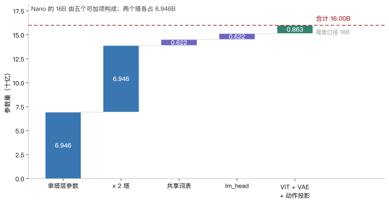
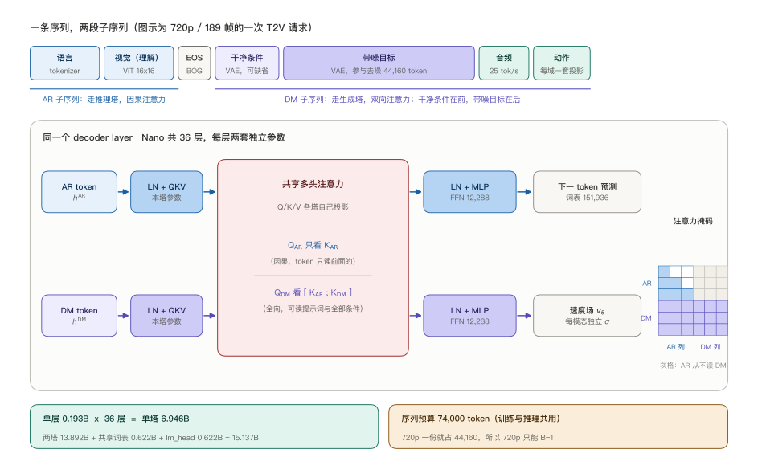
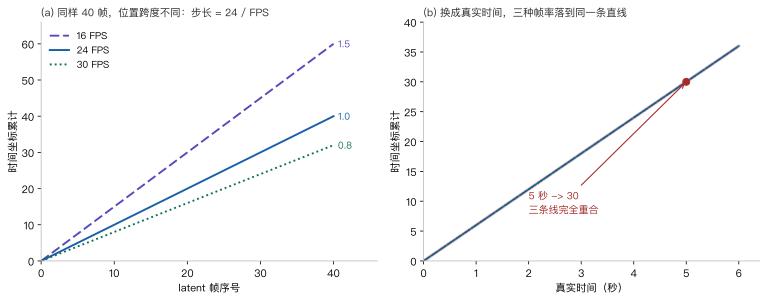
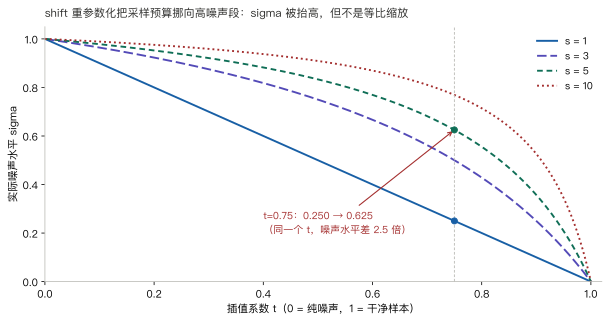
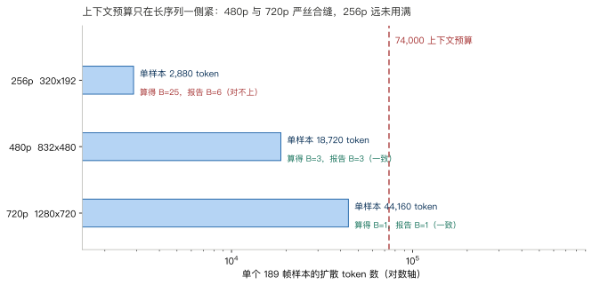
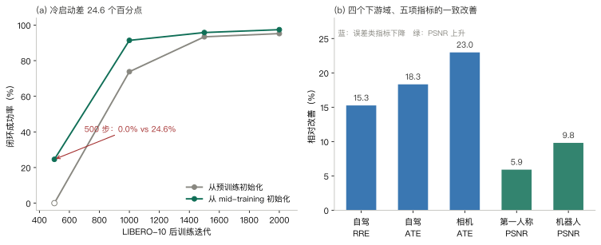
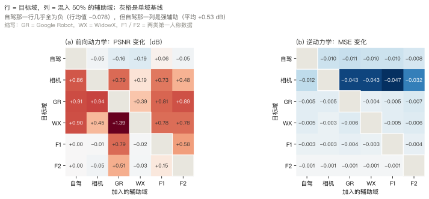

> **系列导航**：这是「世界模型与世界动作模型」深潜的第 1 篇。前序是单篇全景[《世界模型与世界动作模型（WAM）：从 Dreamer V4 到 Cosmos Policy / DreamZero 的完整地图》](/2026/09/05/world-model-world-action-model/)。这一篇不讲路线图，只拆一个具体模型：NVIDIA 2026 年中发布的 Cosmos 3，取其中最小的可用档 Nano。后面几篇分别接：交互式流式模拟（Sim-Bimanual / Transfer / Auto）、动作接口与跨本体迁移、世界模型当策略评测器。

> **TL;DR**
>
> * **核心问题与结论**：Cosmos 3 想让一套权重同时当 VLM、视频生成器、世界模拟器和世界动作模型。它用双塔 MoT 把「理解」与「生成」的参数分开，只用共享注意力连接；Nano 的 16B 精确分解是 **2 x 6.946B（两塔层）+ 0.622B（共享词表）+ 0.622B（lm_head）+ 0.863B（编码器）**，不是一个 16B 稠密模型（[技术报告](https://research.nvidia.com/labs/cosmos-lab/cosmos3/technical-report.pdf) §2.3、Table 2）。
> * **关键证据**：480p / 189 帧 / 35 步的一条请求里，理解塔只占整条轨迹 FLOPs 的 **0.090%**，却占 45.9% 的参数（[本仓实验](https://github.com/lrypcy/ipynbs/tree/6734f67/experiments/world-model/cosmos3-nano)，67 条断言）；74K 上下文把 720p 卡在 $$B=1$$、480p 卡在 $$B=3$$，与报告 Table 9 逐格吻合。
> * **适用边界与代价**：省的是算力不是显存——BF16 双塔权重仍要 32 GB（§8.2）；跨域动作数据的前向迁移**不对称**，自驾数据帮机器人 +0.91 dB，反方向 -0.16 dB，配比不能凭直觉（报告 Fig. 28）。
> * **系列定位**：只回答「一个模型怎么同时当四种东西、代价记在哪笔账上」；流式交互推理与动作接口的工程细节留给后续篇。

## 1. 一个模型当四种东西，代价落在哪

物理 AI 的训练闭环里通常摆着三类模型：一个 VLM 看画面、出计划；一个视频生成器造数据、模拟未来；一个策略模型（VLA 或 WAM）出动作。三者各自训练、各自服务，中间靠文本或张量对接。

Cosmos 3 的判断是这三件事本质上是同一件事的两面：理解需要预判未来，生成需要结构化的世界表示。于是它把语言、图像、视频、音频、动作放进**一条 token 序列**，用同一个 transformer 处理，靠「哪些 token 干净、哪些带噪」切换任务：

| 任务 | 输入 | 输出 | 在 Cosmos 3 里的实现 |
| --- | --- | --- | --- |
| 多模态理解 | 文本 + 图像 / 视频 | 文本 | 只跑自回归子序列 |
| 文生图 / 文生视频 | 文本 | 图像 / 视频 | 自回归前缀 + 带噪视觉 token |
| 图生视频 / 视频续写 | 文本 + 干净首帧 | 视频 | 干净条件帧在前，带噪目标在后 |
| 视频迁移 | 文本 + 控制视频（深度 / 边缘） | RGB 视频 | 控制 token 当条件，RGB 当目标 |
| 前向动力学 | 观测 + 干净动作 | 未来视频 | 动作干净，视觉带噪 |
| 逆动力学 | 观测视频 | 动作 | 视觉干净，动作带噪 |
| 策略 / WAM | 观测 + 提示词 | 动作 + 未来视频 | 动作与视觉同时带噪 |

这张表的最后三行值得单独看一眼：**前向动力学、逆动力学、策略是同一套权重的三种掩码配置**，不是三个模型。第 3 节会把这件事讲成「谁干净谁带噪」的开关。

这个设计的代价要记在好几笔账上。下表就是全文的阅读地图：每一行对应一章、一组可复算的实验，以及一张自画的图；各章末尾还会给出直达代码与报告的链接。

| 账 | 要回答的问题 | 章节 | 实验组 | 配图 |
| --- | --- | --- | --- | --- |
| 参数账 | 16B 花在哪，为什么必须两套参数 | §2 | A | 参数瀑布 |
| token 账 | 一条序列怎么塞下四种模态，预算怎么分配 | §3、§8.3 | C | 架构图、预算图 |
| 位置账 | 帧率不同的模态怎么落到同一根时间轴 | §4 | D | FPS 对齐 |
| 动作账 | 各本体的控制量怎么统一成一个去噪目标 | §5 | E | — |
| 噪声账 | 一条轨迹上四种模态各走各的时间表 | §6 | F | shift 曲线 |
| 计算账 | 每次去噪到底有多少参数在动 | §8.1 | B | — |
| 证据账 | 统一训练真能带来迁移吗，哪些没被证明 | §9 | G、H | 学习曲线、协同矩阵 |

配方（§7）不单独成账，它是把上面几笔账落到实际训练与部署参数上的那一层。

先把符号立清楚，后面不再重复定义：

| 符号 | 含义 | 出处 |
| --- | --- | --- |
| $$v_t$$ | 第 $$t$$ 个视频 latent token | 报告 §2.1.1 |
| $$a_t$$ | 第 $$t$$ 个动作 token，表示 $$v_{t-1}\to v_t$$ 的转移 | 报告 §2.1.3 |
| $$\tilde v$$、$$\tilde a$$ | 带噪（正在被去噪）的对应 token | 报告 §2.2.2 |
| $$T_t\in SE(3)$$ | 第 $$t$$ 帧的位姿 | 报告 §2.1.3 |
| $$\sigma\in[0,1]$$ | rectified flow 的噪声水平，$$\sigma=1$$ 是纯噪声 | 报告 §4.2 |
| $$s$$ | shift 重参数化的强度，$$s\ge 1$$ | 报告 §4.2 |
| $$\mathrm{TPS}$$ | tokens per second，某模态每秒产生多少 token | 报告 §2.4.2 |
| $$N$$ | 一条扩散子序列的 token 数 | 本文记号 |

**缩写对照**（全文只用这几个，不再逐个展开）：

| 缩写 | 含义 | 首次出现 |
| --- | --- | --- |
| MoT | Mixture-of-Transformers，按 token 属于哪条子序列分塔 | §2.3 |
| AR / DM | 自回归子序列 / 扩散子序列 | §3.1 |
| VAE / ViT | 变分自编码器（连续模态编码器）/ 视觉 transformer（理解侧图像编码） | §3.1 |
| VLA / WAM | 视觉-语言-动作模型 / 世界动作模型 | §1 |
| FD / ID | 前向动力学（动作 → 未来视频）/ 逆动力学（视频 → 动作） | §1 |
| TPS | tokens per second，某模态每秒产生多少 token | §4.2 |
| MRoPE | 3D Multimodal RoPE，把每个头的维度切成时间 / 高 / 宽三段 | §4.1 |
| CFG | classifier-free guidance，有条件与无条件两个速度场之差 | §8.4 |
| PT-init / MT-init | 从预训练 / 从 mid-training checkpoint 初始化 | §9.1 |
| RRE / ATE / PSNR | 相对旋转误差（度）/ 绝对轨迹误差（米）/ 峰值信噪比 | §9.1 |

### 1.1 三个入口：想去核数字，点哪里

本文所有数字都能点开看到出处，不要求读者自己跑模型：

| 入口 | 里面有什么 | 怎么进 |
| --- | --- | --- |
| 官方技术报告 | 超参、公式、表格、迁移矩阵 | [139 页 PDF](https://research.nvidia.com/labs/cosmos-lab/cosmos3/technical-report.pdf)，各章给出页码锚点 |
| 官方开源框架 | 推理参数、动作 schema、策略服务器配置 | [`nvidia/cosmos-framework` @ `1c7676ef`](https://github.com/nvidia/cosmos-framework/tree/1c7676efa45a42b23ef568adcdcebcb378877d3e)，只锁 commit 不锁行号 |
| 本文的配套实现 | 八组账、67 条断言、7 张图的生成代码 | [`ipynbs/experiments/world-model/cosmos3-nano` @ `6734f67`](https://github.com/lrypcy/ipynbs/tree/6734f67/experiments/world-model/cosmos3-nano) |

配套目录里的四件东西：[`cosmos3_lab.py`](https://github.com/lrypcy/ipynbs/blob/6734f67/experiments/world-model/cosmos3-nano/cosmos3_lab.py) 是账本，按 `# %` 切成 10 个 cell；[`cosmos3_lab.ipynb`](https://github.com/lrypcy/ipynbs/blob/6734f67/experiments/world-model/cosmos3-nano/cosmos3_lab.ipynb) 是同一份代码、输出已固化，点开就能看到「跑了什么、跑出什么」；[`results/stdout.txt`](https://github.com/lrypcy/ipynbs/blob/6734f67/experiments/world-model/cosmos3-nano/results/stdout.txt) 是完整输出，正文数字与它逐位对齐；[`cosmos3_figures.py`](https://github.com/lrypcy/ipynbs/blob/6734f67/experiments/world-model/cosmos3-nano/cosmos3_figures.py) 生成全部配图。**A–F 组是从论文超参与公式重算，G、H 组是论文表格读数的换算，两组都不是重跑模型**。每章末尾的「随文实现」会直接跳到该组代码行号、固化输出和画图函数。

## 2. 参数账：16B 是两个塔，不是一个稠密模型

### 2.1 官方文档里有两套口径

同一份发布里，参数写法有两套，而且都对：

- 技术报告 Table 1、2 与官网写 **Edge 4B / Nano 16B / Super 64B**；
- 技术报告正文与开源框架文档写 **「Nano 是建立在 8B 稠密 transformer 之上的 16B 模型」「Super (32B)」「Edge 是 2B omni 模型」**。

两套差一个 2 倍，原因在 MoT 的结构。技术报告 §2.5 的原话是「Nano is a 16B-parameter model built upon a dense 8B-parameter transformer」——**8B 指的是单塔，16B 是两塔之和**。所以 2B/8B/32B 是「一个 transformer 有多大」，4B/16B/64B 是「整个模型有多大」。这两个数在表里并排放着，读的时候很容易以为是笔误。[^1]

### 2.2 用超参把 8B 算出来

Nano 单塔的超参（Table 2）：36 层、hidden 4096、32 个注意力头、8 个 KV 头、head dim 128、FFN 12288。按 Qwen3 系的结构（无 bias 的线性层、SwiGLU、两个 RMSNorm）逐项加：

$$
P_{\rm layer}=\underbrace{4hd_{\rm head}n_{\rm head}}_{q,k,v,o}+\underbrace{3hf_{\rm ffn}}_{\rm gate,up,down}+\underbrace{2h}_{\rm norms}
$$

代入 $$h=4096$$、$$n_{\rm head}=32$$、$$d_{\rm head}=128$$、$$f_{\rm ffn}=12288$$：

| 项 | 参数 |
| --- | --- |
| $$q$$：$$4096\times 4096$$ | 16.78M |
| $$k$$、$$v$$：各 $$4096\times 1024$$ | 4.19M x 2 |
| $$o$$：$$4096\times 4096$$ | 16.78M |
| MLP：$$3\times 4096\times 12288$$ | 151.00M |
| 两个 RMSNorm | 0.008M |
| **单层合计** | **0.193B** |

36 层就是 **6.946B**。这个数与 Qwen3-8B 的关系很清楚：Qwen3-8B 官方 8.19B，减去词表（151936 x 4096 = 0.622B）和 lm_head（同样 0.622B），剩下的 6.946B 正好是层参数。也就是说 **Nano 的单塔在结构上与 Qwen3-8B 同构**，报告也确实是拿 Qwen3-VL-8B 初始化的。

于是整模的加法是：

| 加项 | 参数 | 说明 |
| --- | --- | --- |
| 两个塔的层 | 13.892B | 每塔 6.946B，参数完全独立 |
| 共享词表 | 0.622B | 输入 embedding 只有一份，两塔共用 |
| lm_head | 0.622B | 只有理解塔输出语言，需要它 |
| 小计（两塔 + 词表 + 输出头） | 15.137B | 这部分是纯 transformer |
| ViT + 视频 VAE 解码器 + 音频 VAE + 动作投影 | 0.863B | 编码器侧，报告未给分项 |
| **合计** | **16.00B** | 与 Table 2 的 16B 对上 |

同样的算法跑另外两档：Super 是 63.968B（报告 64B，误差 0.05%），Edge 是 4.187B（报告 4B，因为 Edge 的词表与 lm_head 是 tie 的，只算一份）。三档全部对得上，说明这条分解规则就是官方口径。

左起第一根柱子是单塔层参数，第二根把它翻倍——这一步就是「16B = 2 x 8B」的全部含义；后三根是词表、输出头与编码器。图上 0.863B 那一格是差额倒推出来的，报告没有给 ViT / VAE / 动作投影的分项，这也是本文唯一一处「用总数减出来」的数。

### 2.3 为什么必须两套参数

MoT（Mixture-of-Transformers）的做法是：每个 decoder layer 里放两套 LayerNorm、两套 QKV、两套 MLP，只在自注意力算子处汇合。技术报告 §2.3.1 说两条路径**都从同一个预训练 VLM 的权重初始化**，然后在训练时分开走。

为什么不干脆共享一套？有三个理由，前两个是报告写明的，第三个是本文的推断：

1. **目标函数不同。** 理解塔做离散 next-token 交叉熵；生成塔做连续速度场回归。同一组 MLP 权重上同时挂两种梯度，量纲与稀疏性都不同。
2. **训练节奏不同。** 生成塔预训练时，理解塔是**冻结**的（§4.2.1 原话：only the generation-specific parameters are updated）。冻结的塔与在训的塔自然不能共享权重。
3. **参数隔离是「不遗忘」的结构性保证（推断）。** 如果一套权重同时服务理解和生成，生成训练必然改写理解用的特征；分开之后，理解塔的权重在整个生成训练阶段一动不动，VLM 能力不会退化。这与后面 §8 的缓存优化是同一条设计的两面——因为塔是独立的、且输入不含噪声，它才可能被缓存。

顺带区分一个容易混的名字：**MoT 不是 MoE**。MoE 是每个 token 动态挑几个专家，路由随输入变，还要处理负载均衡；MoT 是按 token 属于哪条子序列，**静态**走哪一整套参数，路由在序列构造时就定了，没有路由器。所以 MoT 的参数量是「塔数 x 单塔」，而一条序列里两塔各处理自己那一段；到稳态去噪阶段理解塔的输出被缓存，每步就只剩生成塔在算（§8）。

代价也很直接：参数翻倍。这也是为什么 16B 的模型跑起来像 8B、但要占 16B 的显存。§8 会把这两件事分开算。

> **随文实现**：[参数账 A 组（`cosmos3_lab.py` L101）](https://github.com/lrypcy/ipynbs/blob/6734f67/experiments/world-model/cosmos3-nano/cosmos3_lab.py#L101) · [固化输出 A 段](https://github.com/lrypcy/ipynbs/blob/6734f67/experiments/world-model/cosmos3-nano/results/stdout.txt) · [瀑布图 `fig_param_waterfall()` L224](https://github.com/lrypcy/ipynbs/blob/6734f67/experiments/world-model/cosmos3-nano/cosmos3_figures.py#L224) · [报告 §2.5 / Table 2（PDF 第 14 页）](https://research.nvidia.com/labs/cosmos-lab/cosmos3/technical-report.pdf#page=14)

## 3. token 账：一条序列怎么切成两段

### 3.1 先把「什么变成 token」说清楚

后面的 74K 预算全靠这张表，先摆出来：

| 模态 | 编码器 | 压缩 / 密度 | 进哪段 |
| --- | --- | --- | --- |
| 文本 | tokenizer，词表 151,936 | 1 token / 子词 | AR |
| 图像（理解侧） | ViT，16x16 patch | 1 token / patch | AR |
| 视频 / 图像（生成侧） | 视频 VAE | 空间 32x（16x16 patch 再 2x2 merge）、时间 4x | DM |
| 音频 | 音频 VAE | 48 kHz / hop 1920 = 25 token / 秒 | DM |
| 动作 | 每域一套线性投影（§5.3） | 等于动作采样率 | DM |

VAE 为什么能把像素压进低维潜空间，见[《变分自编码器（01）》](/2026/10/13/vae-01-elbo-reparameterization-latent-space/)；32x / 4x 这两个压缩系数怎么折成 token 数，见[《扩散 Transformer（01）》](/2026/10/14/dit-01-patchify-adaln-zero-token-budget/) 里的同一笔账。

### 3.2 排布规则只有三条

Cosmos 3 的输入是一条序列，分成前后两段（报告 §2.2.1，[PDF 第 9 页](https://research.nvidia.com/labs/cosmos-lab/cosmos3/technical-report.pdf#page=9)）：

- **自回归（AR）子序列**：语言 token、以及 ViT 编码的图像 / 视频 token。走理解塔，因果注意力。
- **扩散（DM）子序列**：VAE 编码的视觉 token、音频 token、动作 token。走生成塔，双向注意力。

排布规则三条：AR 在前、DM 在后；DM 内部**干净条件在前、带噪目标在后**；两段内部都按「视觉、音频、动作」排序。就这三条，足以表达第 1 节表里全部七种任务：

$$
S_{\rm T2I}=[S_{\rm AR},\tilde v_1],\qquad
S_{\rm T2V}=[S_{\rm AR},\tilde v_{1:N},\tilde s],\qquad
S_{\rm V2V}=[S_{\rm AR},v_{1:P},\tilde v_{P+1:N}]
$$

其中 $$P$$ 是干净条件帧数：$$P=1$$ 就是图生视频，$$P>1$$ 就是视频续写；$$\tilde s$$ 是音频 token。视频迁移只是把条件换成控制视频（深度、边缘、分割）：

$$
S_{\rm Transfer}=[S_{\rm AR},v^{\rm ctrl}_{1:N},\tilde v_{1:N}]
$$

### 3.3 三种动作模式是同一个开关

动作 token 也在 DM 子序列里，位置夹在相邻视频 token 之间：$$a_t$$ 连接 $$v_{t-1}$$ 与 $$v_t$$。于是三种模式只差「哪些 token 加噪」：

| 模式 | 视觉 token | 动作 token | 学到什么 |
| --- | --- | --- | --- |
| 前向动力学 | 带噪 | 干净 | 给定动作，未来长什么样 |
| 逆动力学 | 干净 | 带噪 | 给定轨迹，动作是什么 |
| 策略 / WAM | 带噪 | 带噪 | 同时生成动作与它的视觉后果 |

这一点的意义比它看起来大。传统做法里，「预测未来」和「预测动作」是两个头、两套损失、两次前向；这里它们是**同一次去噪的两个输出通道**。策略模式下，动作与视频在同一条时间轴上、同一个注意力里互相约束——动作必须解释它自己生成的画面，画面又必须与动作一致。

代价是两者耦合：动作精度和视频质量会互相拉扯。报告在 PushT 上量了这个 trade-off（§9.3），联合训练让逆动力学的 MSE 降 72%，但前向动力学的 PSNR 掉了 3.35%。这个数不大，但方向是稳定的。

图的上半是一条 720p / 189 帧请求的实际排布：语言与 ViT 视觉走 AR 段，干净条件、带噪目标、音频、动作依次排在 DM 段。下半展开一个 decoder layer：两条泳道各自有 LN、QKV、MLP，中间那个红色框是唯一共享的算子。右下角的掩码图是整篇的结构关键——**AR 行读 DM 列的那一格是灰的**，理解塔永远看不到生成塔。

### 3.4 「AR 从不读 DM」这一条，值一次 97% 的优化

双流联合注意力的定义是（报告式 7、8）：

$$
O_{\rm AR}=\mathrm{Attn}_{\rm causal}(Q_{\rm AR},K_{\rm AR},V_{\rm AR})
$$

$$
O_{\rm DM}=\mathrm{Attn}_{\rm full}(Q_{\rm DM},[K_{\rm AR};K_{\rm DM}],[V_{\rm AR};V_{\rm DM}])
$$

注意第一式里没有 $$K_{\rm DM}$$。报告的原话是「AR tokens are never updated based on DM tokens, preserving the causal integrity of the conditioning pathway」（[PDF 第 12 页](https://research.nvidia.com/labs/cosmos-lab/cosmos3/technical-report.pdf#page=12)）。

两式合起来是一个**单向的信息阀门**：DM 可以读 AR，因为那是提示词与条件图，是生成必须服从的条件；AR 不能读 DM，因为那是正在被去噪、随 $$\sigma$$ 变化的目标。条件信息可以流进生成塔，噪声信息不能流回理解塔。反过来允许 AR 读 DM，理解塔的输出就依赖当前噪声水平，「算一次缓存 35 步」立刻不成立。

这也解释了「共享注意力」到底共享了什么：**共享的是算子，不是参数，也不是可见性**。Q / K / V 各自由本塔的投影产生，注意力计算把它们拼在一起；掩码决定谁能看见谁，两套 LN 与 MLP 始终各走各的。架构图里那个红色框是唯一共用的计算，右下角的掩码图才是真正的结构约束。

这句话的直接推论是：**理解塔的前向输出是（提示词，条件图）的纯函数，与当前噪声水平 $$\sigma$$、与部分去噪的样本都无关**。于是一条 35 步的采样轨迹里，理解塔只需要算一次，其余 34 步复用它的 KV 缓存。报告的推理实现正是这么做的（§5.3.1「Reasoner tower caching」），并强调缓存结果「在数学上与每步重算完全一致」。

这个优化的量级在 §8 算。这里先记住结构：**一个掩码设计决定了一条优化可能性**，而不是事后加的工程 trick。

> **随文实现**：[架构图 `fig_arch()` L113](https://github.com/lrypcy/ipynbs/blob/6734f67/experiments/world-model/cosmos3-nano/cosmos3_figures.py#L113) · [报告式 7 / 8 与 §2.3.2（PDF 第 12 页）](https://research.nvidia.com/labs/cosmos-lab/cosmos3/technical-report.pdf#page=12) · [框架推理模式与采样参数 `docs/inference.md`](https://github.com/nvidia/cosmos-framework/blob/1c7676efa45a42b23ef568adcdcebcb378877d3e/docs/inference.md)

## 4. 位置账：把 token 索引换成物理时间

### 4.1 三种模态，三种密度

底层用的是 3D MRoPE：每个注意力头的 hidden 维度切成**时间、高、宽**三段，各段按 RoPE 的方式做旋转，于是「同帧不同空间位置」与「同位置不同帧」由不同维度区分（报告 §2.4，[PDF 第 12 页](https://research.nvidia.com/labs/cosmos-lab/cosmos3/technical-report.pdf#page=12)）。原始 3D MRoPE 的时间段只记离散 token 索引，这在单一帧率的图像 / 视频理解里够用；但 Cosmos 3 要把视频、音频、动作塞进同一条序列，三者采样率不同，同一个索引增量对应的物理时长就不同。于是它把时间段换成**绝对物理时间轴**，这就是下一节的 $$\delta t$$。

一条序列里，视频、音频、动作的 token 密度完全不同：

| 模态 | 每秒 token 数 | 一个 token 覆盖的时间 |
| --- | --- | --- |
| 视频（24 FPS，VAE 时间压缩 4x） | 6 | 167 ms |
| 音频（48 kHz，hop 1920） | 25 | 40 ms |
| 动作 | 等于采样率 | 随数据集 |

如果位置嵌入直接用 token 索引，那么「第 10 个视频 token」和「第 10 个音频 token」会被认为在同一时刻——但它们相差 1.27 秒。三种模态挤在一条序列里，这个错误会直接毁掉音画同步与动作时序。

### 4.2 步长 = 24 / FPS

Cosmos 3 的做法是在 3D MRoPE 上加一个**绝对时间调制**：定义每个模态的 TPS，再定义基准 $$\mathrm{TPS}_{\rm base}=24/4=6$$（24 FPS 是主要帧率，4 是 VAE 时间压缩，[PDF 第 14 页](https://research.nvidia.com/labs/cosmos-lab/cosmos3/technical-report.pdf#page=14)），时间索引每前进一格，增量是

$$
\delta t=\frac{\mathrm{TPS}_{\rm base}}{\mathrm{TPS}}
$$

对视频，$$\mathrm{TPS}=\mathrm{FPS}/4$$，所以

$$
\delta t=\frac{6}{\mathrm{FPS}/4}=\frac{24}{\mathrm{FPS}}
$$

三档帧率下就是 1.5（16 FPS）、1.0（24 FPS）、0.8（30 FPS）。音频 $$\mathrm{TPS}=25$$，步长 0.24。动作按采样率。

这个式子把「帧率」从数据属性变成了**坐标尺度**。验证方式很直接：同样 5 秒的真实时长，三种帧率走出的位置跨度必须相同。

左图是「按帧数走」，右图是「按秒走」。左图三条线的斜率差就是 $$\delta t$$；右图它们必须完全重合——5 秒在三种帧率下都落在位置 30.0000。本仓实验把这个恒等式在 16 / 24 / 30 FPS 上逐位验过，误差为 0。

音频也一样：25 对 6 tok/s 的密度比是 4.1667，音频步长 0.240 对视频 1.000，两者相乘恰好回到 1.0000。**密度比与步长比互为倒数**，这才是「同一根时间轴」的准确含义。

### 4.3 那个 15000 的间隔不是时间

报告里有一个很容易读错的数：AR 子序列与 DM 子序列之间插了一个固定间隔，取值 **15000**（§2.4.1）。原文给的理由是：如果让 DM 直接接在 AR 最后一个 token 的位置上，首帧会出现过饱和与棋盘伪影，因为最后一个语言 token 与首帧视频 token 的位置嵌入几乎相同。

15000 个位置单位折算成时间是 $$15000/6=2500$$ 秒，41.7 分钟。这个数远超任何训练片段，所以它**只能是位置空间的缓冲，不能读成物理时间**。折算的价值只在于确认量级：一个 24 FPS 的帧只占 1.0 个位置单位，缓冲是它的 15000 倍——足以把文本末 token 与首帧的位置嵌入彻底拉开到不同的频段。

这条也说明了「位置 ≠ 时间」的边界：4.2 节的调制让位置**正比于**时间，但整条轴上可以叠加任意常数偏移而不改变语义。把 $$\delta t$$ 的物理意义用在偏移量上就会得到荒谬的结论。

> **随文实现**：[位置账 D 组（`cosmos3_lab.py` L247）](https://github.com/lrypcy/ipynbs/blob/6734f67/experiments/world-model/cosmos3-nano/cosmos3_lab.py#L247) · [固化输出 D 段](https://github.com/lrypcy/ipynbs/blob/6734f67/experiments/world-model/cosmos3-nano/results/stdout.txt) · [FPS 对齐图 `fig_fps()` L299](https://github.com/lrypcy/ipynbs/blob/6734f67/experiments/world-model/cosmos3-nano/cosmos3_figures.py#L299) · [报告 §2.4 与 15000 间隔（PDF 第 13 页）](https://research.nvidia.com/labs/cosmos-lab/cosmos3/technical-report.pdf#page=13)

## 5. 动作账：57 维怎么塞进同一个去噪过程

### 5.1 统一表示：可选 ego + 每末端一对

不同本体的控制空间差异极大：自驾是方向盘与油门，机械臂是关节角，第一人称是头与手的 6D 位姿。Cosmos 3 不直接回归任何一家的原生控制量，而是把动作重新定义成**位姿差分**（报告 §2.1.3）：

$$
\Delta T_t=T_{t-1}^{-1}T_t
$$

$$\Delta T_t$$ 用 3 维平移 + **6 维旋转**表示，共 9 维。原文明确说了为什么不用原始控制量：为了避开 PID 参数、底层驱动接口这些本体特有的细节，这些量在不同机器人之间不可迁移。

一个本体的动作向量由三类组件拼成：

| 组件 | 维度 | 含义 |
| --- | --- | --- |
| ego pose | 9 | 主观测帧（头相机 / 车体）的相对位姿 |
| effector pose | 9 | 每个末端的相对位姿 |
| grasp state | 15 或 1 | 手：5 指 x 3D 位置；夹爪：开合标量 |

按这条规则反算报告 [Fig. 3（PDF 第 8 页）](https://research.nvidia.com/labs/cosmos-lab/cosmos3/technical-report.pdf#page=8) 的六个格子，全部对上：

| 本体 | 组成 | 维度 |
| --- | --- | --- |
| 自动驾驶 | ego | 9 |
| 相机运动 | ego | 9 |
| 单臂 | 1 个末端 | 10 |
| 双臂 | 2 个末端 | 20 |
| 人形 | ego + 2 个末端 | 29 |
| 第一人称（双手） | ego + 2 个末端（手用 15 维） | 57 |

有一处容易看错：**人形 29 与双臂 20 的差恰好是 9，就是一个 ego**。如果按「双臂 = ego + 两个末端 = 29」去理解，人形就变成 38，与报告对不上。这条分解规则的自洽性（人形 − 双臂 = ego）也在实验里断言过。

开源框架的动作 schema 是 59 维、补齐到 64（`normalized_unified_v1`）。59 与 57 差 2，报告没有说明这两维是什么，只能记成对齐量。补齐到 64 是 8 的整数倍，便于按 kernel 的向量宽度对齐。

### 5.2 为什么是 6 维旋转

6D 表示取旋转矩阵的前两列，第三列叉乘得到：

$$
R=[b_1,\ b_2,\ b_1\times b_2],\qquad b_1=\frac{a_1}{\lVert a_1\rVert},\quad b_2=\frac{a_2-(b_1\cdot a_2)b_1}{\lVert a_2-(b_1\cdot a_2)b_1\rVert}
$$

这是 Zhou 等人 2019 的过参数化表示（[arXiv:1906.03232](https://arxiv.org/abs/1906.03232)）：网络输出一个自由的 6 维向量，上面的 Gram-Schmidt 把它投影回 $$SO(3)$$；报告在解码侧用的是 SVD，作用相同。要理解为什么非得用 6 维，得先看清 3 维表示坏在哪。

**轴角 / 四元数的毛病是双覆盖。** 绕轴 $$n$$ 转 $$\theta$$，与绕 $$-n$$ 转 $$2\pi-\theta$$，是同一个旋转。当 $$\theta\to 0$$ 时两个旋转趋于一致，但参数向量一个趋于 0、一个趋于 $$2\pi(-n)$$，距离恒为 $$2\pi$$。网络在原点附近无论选哪一支，跨界就得跳——回归目标不连续，梯度自然不稳。实验量了这一点：取 $$\theta=0.01$$，两组轴角参数写出的旋转矩阵最大元素差只有 3.12e-17（浮点意义上的同一个旋转），参数向量距离却是 6.2832，正好 $$2\pi$$。

**6D 消灭的正是这个双覆盖。** 从旋转矩阵取前两列，得到 $$SO(3)\to\mathbb{R}^6$$ 的映射：它连续，而且是**单射**——前两列唯一决定第三列，不同旋转给出不同的 6 维向量，不会再有「两组参数表示同一个旋转」。实验把前两列重新喂进 Gram-Schmidt，重建误差 2.22e-16；把第二列反向，得到的是**另一个**旋转（相差 180 度，两个矩阵的最大元素差 2.000），而不是同一旋转的第二组参数——这恰恰是单射的体现，不要把它和双覆盖混为一谈。

**代价在另一侧。** 网络输出的是 $$\mathbb{R}^6$$ 里的自由向量，并不在 $$SO(3)$$ 上，所以必须投影；投影会丢掉尺度与沿 $$b_1$$ 的平行分量，因此「任意 6 维输入 → 旋转」是多对一（实验里把第二列缩放并加上平行分量，两次投影结果完全相同，差 0.00e+00）。但多对一不破坏连续性：网络只需要学「直接输出合法的前两列」，投影负责把数值误差压回正交。2000 个随机 6 维输入的重建矩阵正交误差最大 5.02e-15，行列式恒为 +1（不是镜像）。

一句话：**用「多两个自由度 + 一次投影」，换掉「双覆盖带来的不连续」**。连续性才是回归网络真正要的性质。对照着看，[π0 把连续动作接进 VLM](/2026/11/02/pi-vla-01-pi0-flow-matching/) 走的是流匹配那条路，但「动作向量必须落在网络容易回归的空间里」是同一个问题。

### 5.3 每域一套投影，主干共用

统一表示只是「语义上」统一，各本体的向量长度仍然不同（9 / 10 / 20 / 29 / 57）。做法是给每个域一套独立的输入输出投影（报告式 1、2）：

$$
z=W^{(k)}_{\rm in}x+b^{(k)}_{\rm in},\qquad x=W^{(k)}_{\rm out}z+b^{(k)}_{\rm out}
$$

其中 $$k$$ 是域标识。这些投影**从零初始化**，与主干联合训练；主干（MoT）共用。注意这里的分工：**语义对齐靠主干的共享注意力，维度对齐靠每域的小矩阵**。如果把域信息编码进 token 内容而不是投影，主干就得学会一套「翻译表」，那才是真正的浪费。

动作损失还有两个工程细节：归一化（按维度统计量缩到约 $$[-1,1]$$），以及**损失权重乘 10**（§4.2.2，[PDF 第 29 页](https://research.nvidia.com/labs/cosmos-lab/cosmos3/technical-report.pdf#page=29)，理由是归一化后动作的逐元素 MSE 比视觉小一个量级）。这两个都是「让梯度别被视觉淹没」的手段。

> **随文实现**：[动作账 E 组（`cosmos3_lab.py` L297，旋转部分在 L320）](https://github.com/lrypcy/ipynbs/blob/6734f67/experiments/world-model/cosmos3-nano/cosmos3_lab.py#L297) · [固化输出 E 段](https://github.com/lrypcy/ipynbs/blob/6734f67/experiments/world-model/cosmos3-nano/results/stdout.txt) · [报告 Fig. 3（PDF 第 8 页）](https://research.nvidia.com/labs/cosmos-lab/cosmos3/technical-report.pdf#page=8) · [框架双臂动作 schema（59 维 / 补齐 64）`docs/inference_bimanual.md`](https://github.com/nvidia/cosmos-framework/blob/1c7676efa45a42b23ef568adcdcebcb378877d3e/docs/inference_bimanual.md) · [6D 旋转原文 arXiv:1906.03232](https://arxiv.org/abs/1906.03232)

## 6. 噪声账：一条轨迹上四种模态各走各的时间表

### 6.1 目标函数：从一条直线说起

生成塔用 rectified flow，所有模态共用一套形式（报告 §4.2，[PDF 第 27 页](https://research.nvidia.com/labs/cosmos-lab/cosmos3/technical-report.pdf#page=27)）。先把方向说清楚——这里 $$\sigma=1$$ 是纯噪声、$$\sigma=0$$ 是干净样本，**与常见扩散里「$$t=0$$ 干净」的约定相反**：

$$
x_\sigma=\sigma\epsilon+(1-\sigma)x_0,\qquad \epsilon\sim\mathcal N(0,I)
$$

$$x_0$$ 与 $$\epsilon$$ 之间是一条直线，沿它对 $$\sigma$$ 求导得到常速度：

$$
\frac{dx_\sigma}{d\sigma}=\epsilon-x_0\equiv v^*,\qquad
\mathcal L=\mathbb E_{\sigma,x_0,\epsilon}\Big\lVert v_\theta(x_\sigma,\sigma,c)-v^*\Big\rVert^2
$$

也就是说，网络预测的不是噪声、也不是干净图，而是**从干净样本指向噪声的那个恒定方向**。采样反过来走：从 $$\sigma=1$$ 出发，用 $$v_\theta$$ 沿 $$\sigma$$ 减小的方向一步步推到 $$\sigma=0$$。直线路径没有弯曲，这才让 4 步采样成为可能（§7.3 的策略后训练正好取 4 步）；弯曲的概率路径需要更多步去逼近。「概率路径 → 条件流匹配 → 常速度」的完整推导见[《从概率路径到 Flow Matching》](/2026/10/20/flow-matching-00-principles/)，本文只用到直线插值这一支。

两个细节值得单独拎出来。第一，**每个模态独立采样 $$\sigma$$**：图像、视频、音频、动作各抽各的，不是一条轨迹上统一加噪。这让同一次前向里「视频已经比较干净、动作还很噪」成为常态，也让损失里各模态的梯度尺度天然不同——这就是 5.3 节那个 10 倍权重的来源。

第二，**条件 token 被门控出损失**。图生视频时干净首帧也在序列里，但它不该贡献损失，否则模型会被训练去重建已知输入。

### 6.2 shift 把噪声预算往哪挪

$$
\sigma=\frac{s\bar t}{1+(s-1)\bar t},\qquad \bar t=1-t
$$

$$s=1$$ 时退化为恒等映射 $$\sigma=1-t$$；$$s>1$$ 时整条曲线向上凸，把采样步数更多分配给高噪声段。报告按分辨率取不同的 $$s$$：预训练 1 / 3 / 5（256p / 480p / 720p），mid-training 抬到 3 / 5 / 10（§4.2.2）。分辨率越高、$$s$$ 越大，等于说「高分辨率更需要先把全局结构定下来，再补细节」。

实验中验了四种 $$s$$ 的边界（$$\sigma(0)=1$$、$$\sigma(1)=0$$）与严格单调性，全部成立。放大的不均匀性也能量出来：$$s=5$$ 在 $$t=0.5$$ 处只把噪声抬到 1.67 倍，但在 $$t=0.75$$ 处抬到 2.5 倍。**shift 不是等比缩放，而是重排整条轨迹**——这一点如果读成「整体加噪更强」会误判它对采样器的影响。

### 6.3 视频用 mode sampling，其他用 logit-normal

报告 §4.2（[PDF 第 27 页](https://research.nvidia.com/labs/cosmos-lab/cosmos3/technical-report.pdf#page=27)）说，图像 / 音频 / 动作批次用 logit-normal 噪声分布，视频批次用 **mode sampling**，并注明「mode sampling 给出更好的生成质量」。这是一个很具体的经验选择，报告没有给对比表，只给了结论。

可以推测的理由（本文推断）：视频 token 数远大于图像，且同一批里帧数可变，logit-normal 的中段堆积会让「中等噪声」的样本占比过高，而视频最需要的是两端（结构 / 细节）的监督密度。mode sampling 在两端更均匀。这条没有实验支撑，只能作为读代码时的假设。

> **随文实现**：[噪声账 F 组（`cosmos3_lab.py` L393）](https://github.com/lrypcy/ipynbs/blob/6734f67/experiments/world-model/cosmos3-nano/cosmos3_lab.py#L393) · [固化输出 F 段](https://github.com/lrypcy/ipynbs/blob/6734f67/experiments/world-model/cosmos3-nano/results/stdout.txt) · [shift 曲线 `fig_shift()` L441](https://github.com/lrypcy/ipynbs/blob/6734f67/experiments/world-model/cosmos3-nano/cosmos3_figures.py#L441) · [报告 §4.2（PDF 第 27 页）](https://research.nvidia.com/labs/cosmos-lab/cosmos3/technical-report.pdf#page=27)

## 7. 配方：31.05T、2.4T、三次后训练

### 7.1 四段式

| 阶段 | Nano 的训练量 | 更新哪些参数 | 数据 |
| --- | --- | --- | --- |
| 理解塔预训练 + SFT | 24.2M 样本（22.0M + 2.2M） | 全部（含 ViT） | 图文、视频文本、纯文本 |
| 生成塔预训练 | 31.05T token | **只更新生成塔** | 图像 / 视频 / 音频，多分辨率 |
| mid-training | 2.4T token | 生成塔 | 加入动作（25%）、迁移（25%） |
| 后训练（可选） | 每任务 10k–20k 步 | 全部 | DROID / T2I / I2V |

两个数与直觉相反，值得点出来（[§4.2.1，PDF 第 27 页](https://research.nvidia.com/labs/cosmos-lab/cosmos3/technical-report.pdf#page=27)；配比见 [Table 6，PDF 第 30 页](https://research.nvidia.com/labs/cosmos-lab/cosmos3/technical-report.pdf#page=30)）。

第一，**小模型训得更多**。Nano 预训练 31.05T token，Super 只有 17.86T（§4.2.1）。mid-training 也是 2.4T 对 1.9T。这是典型的「小模型多吃数据」策略：参数少，就得靠 token 数补。

第二，**生成塔预训练时理解塔是冻结的**。所以 31.05T 这个数只记在生成塔的账上，理解塔在这一阶段一动不动。这也是 §2.3 第 2 条理由的来源。

### 7.2 mid-training 的配比

这是整份报告里信息密度最高的一张表（Table 6）：

| 训练流 | 模式 / 条件 | 占比 |
| --- | --- | --- |
| 图像 | 文生图 | 10% |
| 视频 | 文生视频、图生视频、视频续写 | 32% |
| 视频 + 音频 | 三种模式的音频版 | 8% |
| 动作 | 前向动力学、逆动力学、策略 | 25% |
| 通用迁移 | 边缘、模糊、深度、分割 | 20% |
| 驾驶迁移 | 世界场景图 | 5% |

动作占 25%，这是「世界模型」与「视频生成器」的分界点。支撑这 25% 的数据是 8.4M episode / 61.3K 小时，其中第一人称占 67.4%、自驾 16.3%、机器人 8.7%、相机运动 7.5%（Fig. 9）。

注意这四类的分布极不均衡：第一人称是机器人的 7.7 倍。而 §9.4 会看到，跨域迁移的方向性很强，配比不是「多的补少的」这么简单。

### 7.3 后训练：策略那一段

机器人策略的后训练（§4.2.5）值得单独看，因为它展示了「世界模型当策略」需要额外加什么：

- **加本体感受**：策略输入是当前本体状态 + 三视角观测。三视角拼成 540x640 画布（腕部 360x640 在上，两个外部视角 180x320 在下）。
- **降延迟**：推理只用 **4 步**去噪、shift 5、CFG 3，并且**跳过视频 latent 解码**。4 步是「能出动作」的下限，不是质量最优。
- **出可执行动作**：一次预测 32 步绝对关节位置，15 Hz 执行。绝对位置而非增量，是为了让下游控制器不需要积分。
- **动作参数 5 倍学习率**：新初始化的动作编码器、解码 MLP、动作 embedding 要从零追上主干。

这四条合起来说明一件事：**世界模型与策略模型之间差的不是「再训一下」，而是一组接口决定**——步数、guidance、是否解码视频、动作是绝对还是增量。任何一个选错，模型都还是那个模型，但闭环跑不起来（[报告 §4.2.5，PDF 第 31 页](https://research.nvidia.com/labs/cosmos-lab/cosmos3/technical-report.pdf#page=31)）。

> **随文实现（配方侧）**：[前向动力学样例 `inputs/omni/action_forward_dynamics_robot.json`](https://github.com/nvidia/cosmos-framework/blob/1c7676efa45a42b23ef568adcdcebcb378877d3e/inputs/omni/action_forward_dynamics_robot.json)（`action_chunk_size: 16`、`domain_name`、`golden_psnr_min`）· [策略服务器两卡 CFG 并行 `docs/action_policy_droid_server.md`](https://github.com/nvidia/cosmos-framework/blob/1c7676efa45a42b23ef568adcdcebcb378877d3e/docs/action_policy_droid_server.md) · [推理模式与采样参数 `docs/inference.md`](https://github.com/nvidia/cosmos-framework/blob/1c7676efa45a42b23ef568adcdcebcb378877d3e/docs/inference.md)

## 8. 计算账：那半个塔贡献多少 FLOPs

### 8.1 一笔具体的账

取一条 480p / 189 帧 / 35 步的请求：扩散子序列 18,720 token（$$26\times 15\times 48$$），条件是 200 个文本 token 加一张首帧（390 token）。前向 FLOPs 按 $$2PN$$ 估（一个参数对应一次乘法加一次加法，故 2 FLOPs；$$P$$ 是参与前向的层参数，$$N$$ 是这次前向实际流过的 token 数）：

| 项 | FLOPs |
| --- | --- |
| 单步去噪（只走生成塔，6.946B） | 260.06 TFLOPs |
| 一次 prefill（理解塔，590 token） | 8.196 TFLOPs |
| 整条轨迹（1 次 prefill + 35 步） | 9,110.32 TFLOPs |
| **理解塔占整条轨迹** | **0.0900%** |

如果每步都重算理解塔，它占 3.1489%；缓存之后降到 0.09%，相对省 97.1%。

这就是「16B 里只有 8B 在干活」的准确版本：**理解塔占 45.9% 的层参数，在稳态去噪里贡献 0.09% 的 FLOPs**，两者差 556 倍。

要诚实标注这个估算的边界：$$2PN$$ 只算前馈主干与投影，DM 对 AR 的注意力读取（KV 缓存）是额外项。粗算一下：36 层 x 32 头 x 18720 x 590 x 4 FLOPs 量级在 $$5\times 10^{10}$$，相对单步的 $$2.6\times 10^{14}$$ 是 0.02%，不影响结论。

### 8.2 省的是算力，不是显存

| 账 | 数 |
| --- | --- |
| BF16 双塔权重 | 32.0 GB |
| NVFP4 权重 | 约 8.0 GB |
| 单请求激活（粗估） | 0.3 GB |

权重必须整份驻留（或分片），所以 16B 的显存在哪都是 16B。这就是报告为什么要专门做 NVFP4（宣传口径「最高 2 倍加速」）与 FSDP 分片——**算力账省下来了，显存账一分没省**。理解这一点的实际意义是：部署时的瓶颈判断不能看 FLOPs 占比，要看权重常驻加 KV 缓存。权重常驻量与 KV 缓存谁才是瓶颈，见[《大模型量化算法（24）：KV Cache 量化》](/2026/08/29/llm-quant-24-kv-cache/)；低比特格式怎么逐层选，见[（25）Mixed-Precision](/2026/09/19/llm-quant-25-mixed-precision/)。

### 8.3 74K 预算怎么分配

生成侧的序列预算固定 74,000 token，训练与推理共用（[报告 Table 5，PDF 第 28 页](https://research.nvidia.com/labs/cosmos-lab/cosmos3/technical-report.pdf#page=28)；[Table 9，PDF 第 48 页](https://research.nvidia.com/labs/cosmos-lab/cosmos3/technical-report.pdf#page=48)）。VAE 的空间压缩是 32（16x16 patch 再 2x2 merge），时间压缩是 4，所以一条 189 帧样本的 token 数是

$$
N=\Big\lceil\frac{H}{32}\Big\rceil\cdot\Big\lceil\frac{W}{32}\Big\rceil\cdot\Big\lceil\frac{F}{4}\Big\rceil
$$

三种分辨率代入：

| 分辨率 | 16:9 尺寸 | token / 样本 | 算得最大批 | 报告 Table 9 |
| --- | --- | --- | --- | --- |
| 256p | 320x192 | 2,880 | $$B=25$$ | $$B=6$$ |
| 480p | 832x480 | 18,720 | $$B=3$$ | $$B=3$$ |
| 720p | 1280x720 | 44,160 | $$B=1$$ | $$B=1$$ |

720p 一格严丝合缝：44,160 放得下，两份 88,320 放不下。480p 更巧：三份 56,160 放得下，四份 74,880 刚好越过 74,000 一点点（超 1.2%），所以上限就是 3。这两格完全是 token 预算在决定。

**256p 那一格对不上**：算得 25，报告写 6。6 份只占 17,280 token，远没到预算。所以短序列一侧的约束不是上下文，更可能是显存或每步的 kernel 启动开销（样本太小，摊不开固定开销）。报告的表 9 把三个数都归给「74k-token limit」，这个说法在 256p 上不成立。把「所有批次上限都由上下文决定」当结论会读错。

同样能解释表 5 的帧数上限：720p 400 帧是 92,000 token，放不进 74K；300 帧是 69,000，占 93.2%，刚好塞得下。所以 720p 的帧数上限被压到 300，而 256p / 480p 可以到 400。

### 8.4 推理侧的三条结构性推论

报告的推理实现（§5.3）里有三个优化，都能从 §3.4 的掩码设计直接推出来：

| 优化 | 为什么成立 | 报告的收益 |
| --- | --- | --- |
| 理解塔缓存 | AR 不读 DM，所以理解塔输出与 $$\sigma$$ 无关 | 每步省 3.06 个百分点的 FLOPs |
| CFG 并行 | 有条件与无条件两次前向互不依赖，只在每步末尾合并 | 单步延迟近乎减半 |
| Ulysses 上下文并行 | 注意力之外沿 token 维分片，注意力内用两次 all-to-all 换成按 head 切 | 长序列能塞下，同时降延迟 |

**CFG 为什么是两次前向。** classifier-free guidance 的每一步要算两个速度场：带条件的 $$v_{\rm cond}$$，以及把文本 dropout 掉后的 $$v_{\rm uncond}$$，再按 $$v=v_{\rm uncond}+g(v_{\rm cond}-v_{\rm uncond})$$ 合成（策略后训练取 $$g=3$$）。两次前向互不依赖，可以放在两张卡上并行，单步延迟近乎减半；前提是训练时做过文本 dropout，报告 §4.2.1 给的率是 10%。

**Ulysses 切的不是注意力里的序列。** 它在注意力之外沿 token 维分片，进注意力前用一次 all-to-all 把 Q / K / V 从「序列分片」重排成「head 分片」，于是每个 rank 拿到完整序列、只负责一部分头，出注意力再换回来（报告 §5.2.3，[PDF 第 41 页](https://research.nvidia.com/labs/cosmos-lab/cosmos3/technical-report.pdf#page=41)）。原理见[《分布式训练（05）：序列并行》](/2026/08/31/dist-train-05-sequence-parallel/)。

报告把推理优化分成三类（§5.3，[PDF 第 48 页](https://research.nvidia.com/labs/cosmos-lab/cosmos3/technical-report.pdf#page=48)）：分布式推理（上下文并行 + CFG 并行）只降单请求延迟，批处理只提并发吞吐，`torch.compile` 与理解塔缓存两者都受益。§8.1 那笔 FLOPs 账属于最后一类。

三条都不是「试试看能不能更快」，而是结构决定的。反过来说，如果哪天有人把 AR 也改成读 DM（比如让理解塔感知生成进度），缓存这条立刻失效——**架构改动会静默废掉一层优化**，这种耦合在论文的表里看不出来。

批处理是第四类，但它只在吞吐场景有效：720p 在 74K 预算下只容 $$B=1$$，批处理无处可用。报告也说得很直白：机器人这类延迟敏感场景，batcher 配置成 1 就等于关掉。

> **随文实现**：[计算账 B 组（`cosmos3_lab.py` L148）](https://github.com/lrypcy/ipynbs/blob/6734f67/experiments/world-model/cosmos3-nano/cosmos3_lab.py#L148) · [token 账 C 组（L201）](https://github.com/lrypcy/ipynbs/blob/6734f67/experiments/world-model/cosmos3-nano/cosmos3_lab.py#L201) · [固化输出 B / C 段](https://github.com/lrypcy/ipynbs/blob/6734f67/experiments/world-model/cosmos3-nano/results/stdout.txt) · [预算图 `fig_token_budget()` L265](https://github.com/lrypcy/ipynbs/blob/6734f67/experiments/world-model/cosmos3-nano/cosmos3_figures.py#L265) · [报告 Table 9（PDF 第 48 页）](https://research.nvidia.com/labs/cosmos-lab/cosmos3/technical-report.pdf#page=48)

## 9. 证据：迁移、协同，以及它们不能证明什么

### 9.1 mid-training 到底值多少

报告做了一个干净的对照（[Table 18，PDF 第 65 页](https://research.nvidia.com/labs/cosmos-lab/cosmos3/technical-report.pdf#page=65)）：同一个下游域、同一套训练配方、同一个预算，唯一区别是初始化用预训练 checkpoint（PT-init）还是 mid-trained checkpoint（MT-init）。

| 指标 | PT-init | MT-init | 相对改善 |
| --- | --- | --- | --- |
| 自驾逆动力学 RRE（度） | 0.249 | 0.211 | 15.26% |
| 自驾逆动力学 ATE（米） | 1.20 | 0.98 | 18.33% |
| 相机前向动力学 ATE（米） | 1.61 | 1.24 | 22.98% |
| 第一人称前向动力学 PSNR | 15.22 | 16.12 | +5.91% |
| 机器人前向动力学 PSNR | 23.24 | 25.52 | +9.81% |

四个域全为正，这是「统一动作 mid-training 提供了可迁移先验」的直接证据。

最能说明问题的是 LIBERO-10 的冷启动对比（[Table 20，PDF 第 70 页](https://research.nvidia.com/labs/cosmos-lab/cosmos3/technical-report.pdf#page=70)）：

| 迭代 | PT-init | MT-init |
| --- | --- | --- |
| 500 | 0.0% | 24.6% |
| 1000 | 73.8% | 91.4% |
| 1500 | 93.4% | 95.8% |
| 2000 | 95.2% | 97.4% |

500 步时 MT 已经到 24.6%，PT 还是 0.0%。这不是「好一点」，是「能不能起步」的差别。

但换算成迭代数，故事要收敛一些：按对数插值，到 50% 的迭代数从 800 降到 651（1.23 倍），到 90% 从 1398 降到 986（1.42 倍）。**高门槛处的优势反而更大**——mid-init 不只买冷启动，还把后段收敛拉直了。这两个数都远小于「24.6 个百分点」给人的印象，媒体口径里说「快 2 倍」是不成立的。

### 9.2 理解塔对生成塔有用吗

这是双塔设计最该被质疑的地方：如果理解塔在生成时只贡献一次条件编码，它值那 6.9B 参数吗？

报告给了一个消融（[Table 28，PDF 第 107 页](https://research.nvidia.com/labs/cosmos-lab/cosmos3/technical-report.pdf#page=107)）：把理解塔分别换成 Cosmos 3 Reasoner 和 Qwen3-VL-8B，生成塔都从零训练，其余完全一致。

| 指标 | Qwen3-VL 作理解塔 | Cosmos 3 Reasoner | 差 |
| --- | --- | --- | --- |
| T2V 域均值 | 73.7 | 75.7 | +2.0 |
| 其中机器人 | 66.5 | 71.3 | +4.8 |
| 其中自驾 | 52.6 | 54.9 | +2.3 |
| I2V 域均值 | 80.0 | 80.8 | +0.8 |

增益集中在物理域（机器人 +4.8），质量分基本不变。这说明理解塔的价值不在「更好的通用视觉特征」，而在「对物理场景的判别力」——它给生成塔的条件嵌入里带了「这个动作在这个场景里合不合理」的信息。

这条证据也划定了边界：+2.0 的域均值提升，换 6.9B 参数与一倍的显存。值不值取决于你用不用得上物理域；纯做通用视频生成，共享参数的单塔方案大概更划算（这条是推断，报告没有给单塔共参的对照）。

### 9.3 三种动作模式能不能一起训

PushT 上的对照（[Table 31，PDF 第 109 页](https://research.nvidia.com/labs/cosmos-lab/cosmos3/technical-report.pdf#page=109)）：三个单模式 checkpoint 各训 2K 步，对一个联合 FD/ID/策略 checkpoint 训 6K 步——每模式优化步数相同。

| 指标 | 单模式 | 联合 | 变化 |
| --- | --- | --- | --- |
| 前向动力学 PSNR | 27.13 | 26.22 | -3.35% |
| 逆动力学 MSE | 1.11e-03 | 3.09e-04 | -72.2% |
| 策略覆盖率 | 74.1% | 77.3% | +3.2 pp |

逆动力学的改善是压倒性的（72%），策略覆盖率涨 3.2 个点，代价是前向动力学掉 3.35%。报告的解释是「三种模式共享有用结构，但前向动力学从单模式专精里获益」。

这个不对称本身有信息：动作→视觉（FD）与视觉→动作（ID）不是对称任务。ID 更依赖「从画面里读出因果」，而这正是共享表征能帮上忙的；FD 更依赖「从动作推出像素细节」，这部分与 ID 的梯度是竞争的。

### 9.4 跨域迁移的方向性

报告给了两张迁移矩阵（[Fig. 28，PDF 第 71 页](https://research.nvidia.com/labs/cosmos-lab/cosmos3/technical-report.pdf#page=71) / [Fig. 29，PDF 第 72 页](https://research.nvidia.com/labs/cosmos-lab/cosmos3/technical-report.pdf#page=72)）：每个非对角格是「目标域 + 50% 辅助域」相对「目标域单域」的差值，训 4000 步。

图里 GR 是 Google Robot、WX 是 WidowX、F1 / F2 是两类第一人称数据，行是目标域、列是混入 50% 的辅助域、灰格是单域基线。前向动力学侧（左图）的结构很清楚：

- **自驾那一行全为负或零**（-0.19 到 +0.06，行均值 -0.078），加了别的域几乎都变差；
- **自驾那一列很强**，平均 +0.534 dB，对机器人域是 +0.91 / +0.90；
- 最强的一格是 WidowX 加 Google Robot 数据，+1.39 dB；
- 30 个非对角格的整体均值 +0.427 dB。

也就是说：**自驾数据是好的老师，但不是一个好的学生**。同一对域，自驾帮机器人 +0.91，机器人帮自驾 -0.16。这种不对称在「多域混训一定互相有益」的直觉下是反例。

逆动力学侧（右图）几乎全是改善：30 个非对角格里 30 个为负，包括自驾自己那一行。这说明 ID 的共享结构比 FD 更强——从画面读动作这个能力，跨本体的共性确实比「从动作画画面」大。

这条结论对数据配比有直接含义：如果目标是机器人 FD，就该把自驾 / 相机数据加进来；如果目标是自驾，就该把机器人数据剔出去。配比不能按「域越多越好」来设。

### 9.5 这些证据不能证明什么

四条空白必须说清楚，否则上面的数会被读过头：

1. **没有单塔共参的对照。** 全部实验都在双塔内做，所以「双塔优于共享参数」这条从未被直接验证。它合理，但未被证明。
2. **PSNR 是代理指标。** 报告自己承认「一个可信的 rollout 不必与唯一记录的真相逐像素一致」，用 PSNR 只是因为它对短时程的时间对齐与运动一致性敏感。跨方法比 PSNR 时要小心——不同方法的生成多样性不同，PSNR 会系统性地偏向保守的模型。
3. **迁移矩阵只训 4000 步。** 这是「短期迁移」的测量，长训之后方向会不会反转（辅助域最终变成干扰）没有数据。
4. **策略成绩全部在 DROID 上后训练。** RoboLab 39.7%、RoboArena 第一、MolmoSpaces 39.0% 都是同一个 DROID checkpoint 零调参提交，这是它的优点（跨基准不调参）；但也意味着**没有跨本体的策略证据**，LIBERO-10 只验了「适配速度」。

> **随文实现**：[迁移账 G 组（`cosmos3_lab.py` L436）](https://github.com/lrypcy/ipynbs/blob/6734f67/experiments/world-model/cosmos3-nano/cosmos3_lab.py#L436) · [协同账 H 组（L510）](https://github.com/lrypcy/ipynbs/blob/6734f67/experiments/world-model/cosmos3-nano/cosmos3_lab.py#L510) · [固化输出 G / H 段](https://github.com/lrypcy/ipynbs/blob/6734f67/experiments/world-model/cosmos3-nano/results/stdout.txt) · [学习曲线 `fig_transfer()` L344](https://github.com/lrypcy/ipynbs/blob/6734f67/experiments/world-model/cosmos3-nano/cosmos3_figures.py#L344) · [协同矩阵 `fig_synergy()` L384](https://github.com/lrypcy/ipynbs/blob/6734f67/experiments/world-model/cosmos3-nano/cosmos3_figures.py#L384)

## 10. 边界与代价

把上面九节收成几句可执行的判断。

**什么时候值得用这个结构。** 当你要同时做「理解物理场景」和「生成物理合理的未来」两件事，并且两者需要共享同一套世界表征时，双塔的 2 倍参数换的是「不遗忘」与「可缓存」。前者是结构保证，后者是 97% 的 FLOPs 节省。

**什么时候不值得。** 只做通用视频生成时，理解塔只在条件编码处出现一次，6.9B 参数换 +2.0 的域均值提升，性价比不高。只做策略时，报告的 4 步采样 + 跳视频解码已经把生成塔的大部分能力闲置了——这时候你要的其实是一个 VLA，不是世界模型。

**三个具体的坑。**

- **别把位置当时间。** $$\delta t=24/\mathrm{FPS}$$ 让位置正比于时间，但整条轴上的 15000 偏移没有任何时间含义。用偏移量做任何时间推算都会错四个数量级。
- **别把批次上限都归给上下文。** 720p / 480p 是 token 预算决定的，256p 不是。照着「上下文决定一切」去调参会在短序列上得不到预期收益。
- **别默认多域混训有益。** 前向动力学侧的自驾行是明确的反例，而且方向性很强。配比要按「目标域是学生还是老师」分开设。

**最后一条是关于「统一」的代价。** Cosmos 3 把四类模型压成一个，省掉的是编排与接口转换，付出的是「每个任务都只能用一套超参」——采样步数、guidance、分辨率、是否解码视频，这些在专用模型里可以各自最优，在这里必须找一个折中。报告的策略后训练选了 4 步 + CFG 3 + 跳解码，就是把折中压到延迟这一侧的极端。这不是缺陷，是统一的定价。

## 参考

**技术报告**：NVIDIA, *Cosmos 3: Omnimodal World Models for Physical AI*，2026-06-22，139 页，[PDF](https://research.nvidia.com/labs/cosmos-lab/cosmos3/technical-report.pdf)。下列是本文用到的页码锚点（PDF 物理页，浏览器可直接跳转）：

[§2.2.1 token 排布（p9）](https://research.nvidia.com/labs/cosmos-lab/cosmos3/technical-report.pdf#page=9) · [§2.3.2 双流注意力式 7 / 8（p12）](https://research.nvidia.com/labs/cosmos-lab/cosmos3/technical-report.pdf#page=12) · [§2.4 位置嵌入（p12）](https://research.nvidia.com/labs/cosmos-lab/cosmos3/technical-report.pdf#page=12) · [15000 间隔与 §2.4.2（p13）](https://research.nvidia.com/labs/cosmos-lab/cosmos3/technical-report.pdf#page=13) · [§2.5 / Table 2 三档超参（p14）](https://research.nvidia.com/labs/cosmos-lab/cosmos3/technical-report.pdf#page=14) · [Fig. 3 统一动作表示（p8）](https://research.nvidia.com/labs/cosmos-lab/cosmos3/technical-report.pdf#page=8) · [Fig. 9 动作数据分布（p25）](https://research.nvidia.com/labs/cosmos-lab/cosmos3/technical-report.pdf#page=25) · [§4.2 训练目标（p27）](https://research.nvidia.com/labs/cosmos-lab/cosmos3/technical-report.pdf#page=27) · [Table 5 模型规格（p28）](https://research.nvidia.com/labs/cosmos-lab/cosmos3/technical-report.pdf#page=28) · [§4.2.2 mid-training（p29）](https://research.nvidia.com/labs/cosmos-lab/cosmos3/technical-report.pdf#page=29) · [Table 6 数据配比（p30）](https://research.nvidia.com/labs/cosmos-lab/cosmos3/technical-report.pdf#page=30) · [§4.2.5 策略后训练（p31）](https://research.nvidia.com/labs/cosmos-lab/cosmos3/technical-report.pdf#page=31) · [§5.3 推理优化与 Table 9（p48）](https://research.nvidia.com/labs/cosmos-lab/cosmos3/technical-report.pdf#page=48) · [Table 18 初始化对照（p65）](https://research.nvidia.com/labs/cosmos-lab/cosmos3/technical-report.pdf#page=65) · [Table 19 RoboLab（p68）](https://research.nvidia.com/labs/cosmos-lab/cosmos3/technical-report.pdf#page=68) · [Table 20 LIBERO-10（p70）](https://research.nvidia.com/labs/cosmos-lab/cosmos3/technical-report.pdf#page=70) · [Fig. 28（p71）](https://research.nvidia.com/labs/cosmos-lab/cosmos3/technical-report.pdf#page=71) · [Fig. 29（p72）](https://research.nvidia.com/labs/cosmos-lab/cosmos3/technical-report.pdf#page=72) · [Table 28 理解塔消融（p107）](https://research.nvidia.com/labs/cosmos-lab/cosmos3/technical-report.pdf#page=107) · [Table 29 FPS 消融（p108）](https://research.nvidia.com/labs/cosmos-lab/cosmos3/technical-report.pdf#page=108) · [Table 31 PushT（p109）](https://research.nvidia.com/labs/cosmos-lab/cosmos3/technical-report.pdf#page=109)
- 发布博客：[Develop Physical AI Reasoning, World, and Action Models with NVIDIA Cosmos 3](https://developer.nvidia.com/blog/develop-physical-ai-reasoning-world-and-action-models-with-nvidia-cosmos-3/)，2026-05-31
- 开源框架：`nvidia/cosmos-framework`，commit [`1c7676ef`](https://github.com/nvidia/cosmos-framework/tree/1c7676efa45a42b23ef568adcdcebcb378877d3e)。本文引用的文件（**未标行号：该仓库每日更新，行号会漂移，只锁 commit**）：
  - 推理模式与采样参数：[`docs/inference.md`](https://github.com/nvidia/cosmos-framework/blob/1c7676efa45a42b23ef568adcdcebcb378877d3e/docs/inference.md)
  - 双臂推理的动作 schema（59 维、补齐 64、四步 SDE 调度）：[`docs/inference_bimanual.md`](https://github.com/nvidia/cosmos-framework/blob/1c7676efa45a42b23ef568adcdcebcb378877d3e/docs/inference_bimanual.md)
  - 策略服务器的两卡 CFG 并行：[`docs/action_policy_droid_server.md`](https://github.com/nvidia/cosmos-framework/blob/1c7676efa45a42b23ef568adcdcebcb378877d3e/docs/action_policy_droid_server.md)
  - 前向动力学样例（`action_chunk_size: 16`、`domain_name`、`golden_psnr_min`）：[`inputs/omni/action_forward_dynamics_robot.json`](https://github.com/nvidia/cosmos-framework/blob/1c7676efa45a42b23ef568adcdcebcb378877d3e/inputs/omni/action_forward_dynamics_robot.json)
- 模型与数据：<https://huggingface.co/collections/nvidia/cosmos3>；交互式模拟页（三个 Sim 变体的 FPS 与延迟）：<https://research.nvidia.com/labs/cosmos-lab/cosmos-simulation>
- 6D 旋转表示：Zhou, Barnes, Lu, Yang, Li, *On the Continuity of Rotation Representations in Neural Networks*，[arXiv:1906.03232](https://arxiv.org/abs/1906.03232)
- 配套实验：[`experiments/world-model/cosmos3-nano/`](https://github.com/lrypcy/ipynbs/tree/6734f67/experiments/world-model/cosmos3-nano)，commit `6734f67`，67 条断言，纯 numpy / CPU，约 2 秒跑完。四件东西：[`cosmos3_lab.py`](https://github.com/lrypcy/ipynbs/blob/6734f67/experiments/world-model/cosmos3-nano/cosmos3_lab.py) 是账本，[`cosmos3_lab.ipynb`](https://github.com/lrypcy/ipynbs/blob/6734f67/experiments/world-model/cosmos3-nano/cosmos3_lab.ipynb) 是输出已固化的 notebook，[`results/stdout.txt`](https://github.com/lrypcy/ipynbs/blob/6734f67/experiments/world-model/cosmos3-nano/results/stdout.txt) 是完整输出（本文数字与它逐位对应），[`cosmos3_figures.py`](https://github.com/lrypcy/ipynbs/blob/6734f67/experiments/world-model/cosmos3-nano/cosmos3_figures.py) 生成全部 **7 张**配图（1 张架构 + 6 张数据），SVG / PNG 都在 [`figures/`](https://github.com/lrypcy/ipynbs/tree/6734f67/experiments/world-model/cosmos3-nano/figures)。**注意：A–F 组是从论文超参与公式重算，G、H 组是论文表格读数的换算，两组都不是重跑模型。**
- **站内延伸阅读**（按本文出现顺序）：
  - [《从概率路径到 Flow Matching》](/2026/10/20/flow-matching-00-principles/) —— §6 的直线插值与常速度从哪来
  - [《变分自编码器（01）：ELBO、重参数化与潜空间》](/2026/10/13/vae-01-elbo-reparameterization-latent-space/) —— §3.1 连续模态为什么先压进潜空间
  - [《扩散 Transformer（01）：Patchify、AdaLN-Zero 与 token 数的账》](/2026/10/14/dit-01-patchify-adaln-zero-token-budget/) —— §8.3 的 32x / 4x 怎么折成 token 数
  - [《分布式训练（05）：序列并行》](/2026/08/31/dist-train-05-sequence-parallel/) —— §8.4 Ulysses 的 all-to-all 换轴
  - [《π 系列具身模型（01）：π0》](/2026/11/02/pi-vla-01-pi0-flow-matching/) —— §5 动作表示的另一条路线
  - [《大模型量化算法（24）：KV Cache 量化》](/2026/08/29/llm-quant-24-kv-cache/) 与 [（25）Mixed-Precision](/2026/09/19/llm-quant-25-mixed-precision/) —— §8.2 的权重常驻与低比特选型

> **下一篇**：世界模型深潜（02）：Cosmos 3 的交互式流式模拟 —— Sim-Bimanual / Transfer / Auto 如何把同一个后训练配方变成三种实时世界模拟器。

[^1]: 两套口径同时出现在同一份报告里不是笔误：Table 2 的标题写着「LLM Layers」，即单塔层数，而 Table 1 的 64B 是双塔之和。开源框架的文档进一步把 Super 直接写作「Cosmos3-Super (32B)」，因为部署时按单塔估显存与分片。
