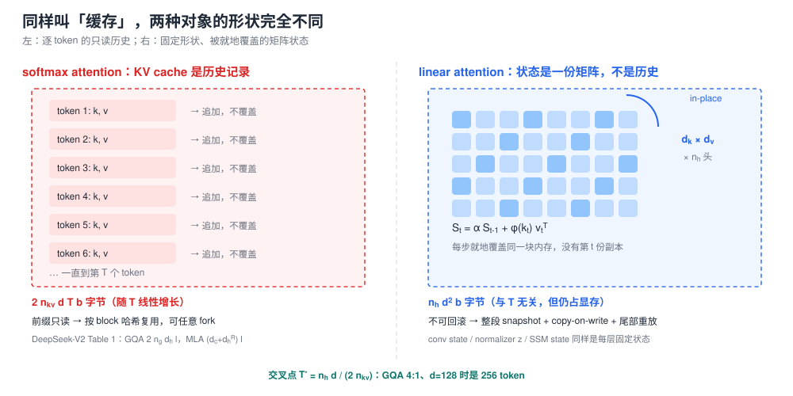
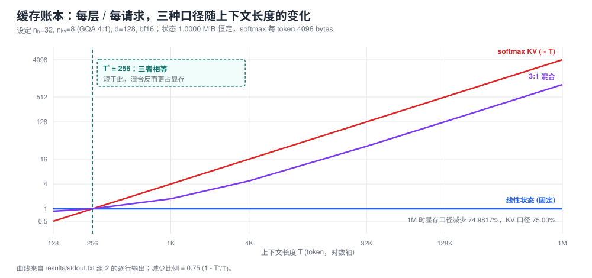
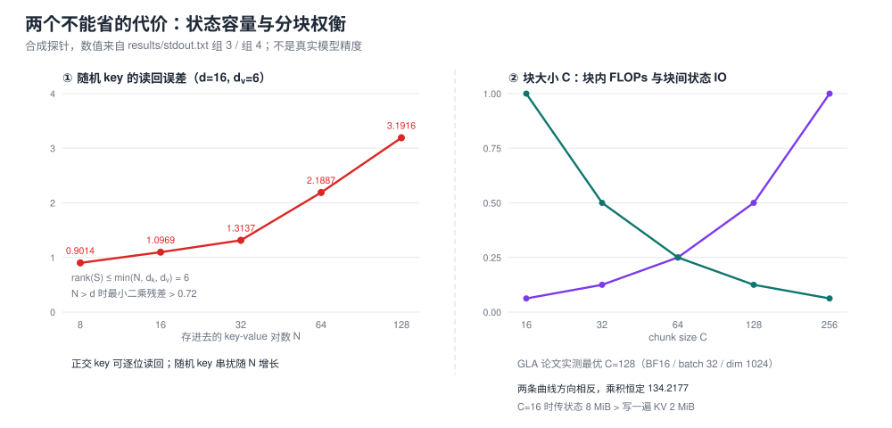
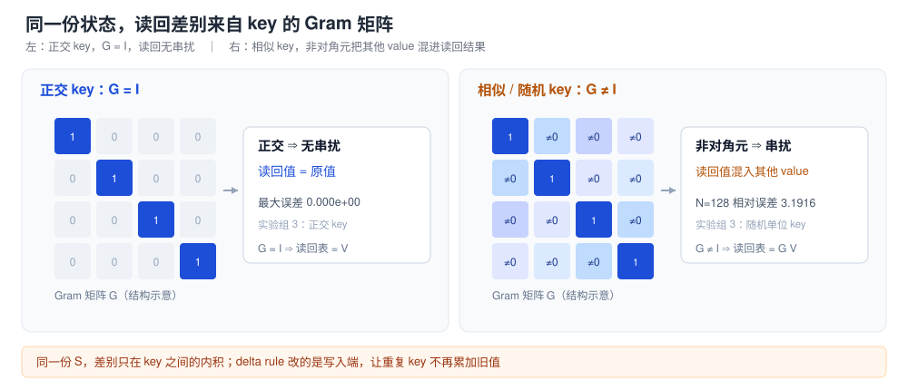

> **系列导航** ｜ 本文承接 [《Test-Time Training 全景》](/2026/09/02/ttt-00-overview/) 的「状态即记忆」、
> [《KV Cache 量化》](/2026/08/29/llm-quant-24-kv-cache/) 的显存与带宽账、以及
> [《推理服务（01）：架构分歧》](/2026/10/18/serving-01-architecture-divergence/) 的前缀复用。
> 三篇分别回答了「隐藏状态能是什么」「KV 占多少内存」「KV 怎么被复用」；本文补的是
> **当历史不再按 token 存放时，这三件事各自变成什么**。算子与编译器侧的注意力变体边界在
> [《FlexAttention（01）》](/2026/10/17/flex-attention-01-programming-model/)，不在这里重复。

> **TL;DR**
>
> * **核心问题与结论**：线性注意力不是把 KV cache 压小，而是把逐 token 的只读历史换成固定形状、就地覆盖的矩阵状态 $S_t$：缓存不再随 $T$ 增长，但常数仍在，短上下文里反而不省（§1–§3）。
> * **关键证据**：一般口径下交叉点为 $T^\ast=M_{\mathrm{state}}/(2n_{kv}d_{kv}b_{kv})$；简化模型取 $n_h=32$、$n_{kv}=8$、$d=128$、bf16 时为 256 token，合成探针 `linear-attention/kv-cache-state` 组 2（58 条断言）算得 3:1 混合在 4K 的显存口径减少 70.3125%（§3、§6）。Kimi Linear 官方的 75% 是 KV 口径 [arXiv:2510.26692](https://arxiv.org/abs/2510.26692)。
> * **适用边界与代价**：以上只对「按层、按请求的缓存字节」成立，不含权重与激活；$T<T^\ast$ 时混合反而更占显存。状态就地覆盖、不可回滚，按 token block 复用前缀要换成快照 + copy-on-write + 尾部重放（§8，[SGLang 官方博客](https://pytorch.org/blog/hybrid-models-meet-sglang-more-than-full-attention/)）。
> * **系列定位**：接住 TTT / KV 量化 / 推理服务三条主线的空档，下一篇回到引擎侧读 KV 缓存组织。

---

## §0 符号表与阅读地图

本文尽量沿用来源文献的符号，记账用的 $b$、$b_{\mathrm{kv}}$、$b_{\mathrm{state}}$、$T^\ast$、
$M_z$、$M_{\mathrm{conv}}$、$M_{\mathrm{aux}}$、$n_{\mathrm{state}}$ 是本文为算字节而定义的量。

| 符号 | 含义 | 出处 / 约定 |
|:---|:---|:---|
| $q_t,k_t,v_t,o_t$ | 第 $t$ 个 token 的 query / key / value / 输出 | 通用 |
| $\phi(\cdot)$ | 线性注意力的特征映射 | [arXiv:2006.16236](https://arxiv.org/abs/2006.16236) §3.2.1 |
| $S_t$ | 矩阵形状的递推状态 | Katharopoulos、GLA、Gated DeltaNet 均用 $S$ |
| $z_t$ | 归一化用的累计量（normalizer memory） | 同上，§3.4 公式 19 |
| $\gamma$ / $\alpha_t$ | RetNet 的固定衰减 / GLA 的数据依赖门控 | [arXiv:2307.08621](https://arxiv.org/abs/2307.08621) / [arXiv:2312.06635](https://arxiv.org/abs/2312.06635) |
| $\beta_t$ | delta rule 的写入强度（学习率） | [arXiv:2412.06464](https://arxiv.org/abs/2412.06464) 公式 10 |
| $n_h,n_{kv},d,L,T$ | query 头数 / KV 头数 / 每头维度 / 层数 / 序列长度 | [DeepSeek-V2 Table 1](https://arxiv.org/html/2405.04434v5) 的口径 |
| $b$ | 简化模型里 KV 与状态共用的每元素字节数（本文记账定义） | bf16 时 $b=2$ |
| $N_{\mathrm{KV}}(T)$ | 单层单请求累积的 K/V 元素数（本文记账定义） | §1 的字节账 |
| $F(C),B(C)$ | 块大小 $C$ 下的解析块内 FLOPs 与块间状态逻辑字节（本文记账定义） | §7，不是运行时间模型 |
| $b_{\mathrm{kv}},b_{\mathrm{state}},n_{\mathrm{state}}$ | 一般口径下两侧的 dtype 字节数、每层独立状态的份数（本文记账定义） | 两者 dtype 可不同，§3 |
| $M_z,M_{\mathrm{conv}},M_{\mathrm{aux}}$ | normalizer / 卷积状态 / 其余辅助状态的字节数（本文记账定义） | §3 一般式 |
| $T^\ast$ | 固定状态与逐 token KV 的字节数交叉点（本文记账定义） | §3 推导 |

阅读地图：

- §1–§3 是**账本**：先说清被换掉的对象是什么，再把字节数算出来。
- §4–§6 是**为什么不能全换**：容量下界、更新规则的谱系、混合架构的比例与口径。
- §7–§9 是**系统侧**：prefill 的分块、serving 的前缀复用、数值精度。
- §10 是判据与三条不能往外推的结论。

配套实验（纯 CPU numpy、固定 seed、七个分组、58 条断言、输出已固化）：
[`experiments/linear-attention/kv-cache-state/`](https://github.com/lrypcy/ipynbs/tree/ca8caa9e6a7352a4016e2c1b93e695ca2abdaada/experiments/linear-attention/kv-cache-state/)，
其中 [`results/stdout.txt`](https://github.com/lrypcy/ipynbs/blob/ca8caa9e6a7352a4016e2c1b93e695ca2abdaada/experiments/linear-attention/kv-cache-state/results/stdout.txt)
是正文所有 ```text 块与四张配图的数字来源。合成探针只验代数恒等式、字节账本与数值量级，
**不是真实模型的精度或吞吐**；论文数字单独标出处，不与探针数字混在同一张表。

---

## §1 被换掉的不是「一块显存」，是「一份历史」

先问一个容易被跳过的问题：KV cache 到底是什么？

自回归解码到第 $t$ 步时，softmax attention 要重算所有历史 token 的 key 与 value：

$$
o_t=\frac{\sum_{j=1}^{t}\exp(q_t^\top k_j/\sqrt{d})\,v_j}{\sum_{j=1}^{t}\exp(q_t^\top k_j/\sqrt{d})}
$$

因为 $\exp(q_t^\top k_j)$ 依赖当前 $q_t$，$k_j,v_j$ 无法被压成一个与 $t$ 无关的量，只能原样存下来。
这笔字节账按「每 token → 每层每请求」两步推：一个 KV 头每 token 存一对 $d$ 维向量，共 $2d$ 个元素；
$n_{kv}$ 个头是 $2n_{kv}d$，再乘历史长度 $T$ 与每元素字节数 $b$：

$$
\begin{aligned}
N_{\mathrm{KV}}(T)&=2d\,n_{kv}\,T,\\
M_{\mathrm{softmax}}(T)&=N_{\mathrm{KV}}(T)\,b=2n_{kv}dTb.
\end{aligned}
$$

这里的 $2$ 只是 K 与 V 各一份，没有乘层数 $L$；本文的账本一直按单层记（§3 会把口径摊开）。
GQA 让多个 query 头共享一组 KV 头，把这个数按 $n_h/n_{kv}$ 缩小
（[arXiv:2305.13245](https://arxiv.org/abs/2305.13245)）；DeepSeek-V2 的 MLA 把 K/V 联合压成一个 latent，
每层每 token 只存 $d_c+d_h^R=576$ 个元素
（[Table 1](https://arxiv.org/html/2405.04434v5)，$d_c=512$、$d_h^R=64$），
摘要里相对 DeepSeek 67B 报「KV cache 减少 93.3%」。

**但 MLA 不是线性注意力**。Table 1 的 $(d_c+d_h^R)L$ 是「每 token」的量，
总量仍然是 $576\cdot L\cdot T\cdot b$，随 $T$ 线性增长；逐 token 的显式历史还在，
QK 交互也还在。它把每个 token 的 KV 变短了，没有把「历史」变成「状态」。
把 MLA 与 Gated DeltaNet 放进同一句「省 KV cache 的注意力」里，是后续很多口径错误的起点。

线性注意力做的是另一件事：把核换成可分解的形式，让结合律把历史求和提前算完。
结果是每个解码步只需要一份形状固定的矩阵 $S_t$ 与一个向量 $z_t$。
所以「线性注意力没有 KV cache」这句话要分三层读：

1. **没有逐 token 的 K/V 列表**——这是真的，缓存不再随 $T$ 增长。
2. **仍然有缓存**——$S_t$、$z_t$ 要跨步保存；Mamba 类还多一份卷积状态（conv state），
   vLLM 的引擎参数把两者分开叫 `--mamba-cache-dtype`（conv 与 ssm state）和
   `--mamba-ssm-cache-dtype`（[官方文档](https://docs.vllm.ai/en/latest/configuration/engine_args/)）。
3. **缓存的语义变了**——KV 是只读追加，状态是就地覆盖。这一条决定了 §8 的全部内容。



*图：自绘。结构对照 [Katharopoulos et al., arXiv:2006.16236](https://arxiv.org/abs/2006.16236) §3.4 与 [vLLM Hybrid KV Cache Manager](https://docs.vllm.ai/en/latest/design/hybrid_kv_cache_manager/)，非论文原图，未搬用原图。*

左栏是 softmax：每个 token 追加一份 $k,v$，前缀天然只读、可以按 block 哈希复用、可以任意 fork；
右栏是线性注意力：$S_t\in\mathbb{R}^{d_k\times d_v}$ 每步被覆盖，不存在「第 $j$ 步那份状态」，
虚线框标出的正是系统必须额外保存的东西。两者都占内存，只是增长性与复用规则完全不同。

四条差异集中列在这里，后文逐条展开：

| 维度 | softmax KV cache | 线性注意力状态 |
|:---|:---|:---|
| 随 $T$ 增长 | 线性，$2n_{kv}dTb$ | 常数，$n_h d_k d_v b$ |
| 写入方式 | 追加、只读 | 就地覆盖、可回退性差 |
| 前缀复用粒度 | 任意 token block | 整段状态快照 |
| 精度敏感处 | 每 token 的量化误差 | 递推累积与衰减连乘 |

顺带说清一个常被混用的词：KV cache 是「键值列表」，state 是「递推状态」。
vLLM 的 [Hybrid KV Cache Manager](https://docs.vllm.ai/en/latest/design/hybrid_kv_cache_manager/)
把两者塞进同一个内存池，文档里仍统一叫 `kv cache`，但分配规则按层型分开——
Mamba 层的 `state_size` 与 attention 层的 `kv_hidden_size` 不是一回事，
文档 Case 4 甚至要为两者对齐 `page_size` 而把 attention 层的 `block_size` 撑到 400 以上。
**名字统一不代表对象统一**，这是读引擎源码时最容易踩的一处。

---

## §2 三种写法是同一个东西，但与 softmax 不是

把 softmax 核换成 $\phi(q)^\top\phi(k)$ 型的可分解核。先只动分子：令 $\phi(q_t),\phi(k_j)\in\mathbb{R}^{d_k}$、$v_j\in\mathbb{R}^{d_v}$，标量核乘向量可以改写成外积乘向量：

$$
\phi(q_t)^\top\phi(k_j)\,v_j=\phi(q_t)^\top\big(\phi(k_j)v_j^\top\big)
$$

括号里是 $d_k\times d_v$ 的矩阵。对 $j\le t$ 求和时 $\phi(q_t)$ 与 $j$ 无关，可以提到求和号外；分母把 $v_j$ 换成标量 1，得到

$$
\begin{aligned}
\sum_{j\le t}\phi(q_t)^\top\phi(k_j)v_j
&=\phi(q_t)^\top\sum_{j\le t}\phi(k_j)v_j^\top=\phi(q_t)^\top S_t,\\
\sum_{j\le t}\phi(q_t)^\top\phi(k_j)
&=\phi(q_t)^\top\sum_{j\le t}\phi(k_j)=\phi(q_t)^\top z_t,\\
o_t&=\frac{\phi(q_t)^\top S_t}{\phi(q_t)^\top z_t}.
\end{aligned}
$$

这两个累加项都能递推。记

$$
S_t=S_{t-1}+\phi(k_t)v_t^\top,\qquad z_t=z_{t-1}+\phi(k_t)
$$

就有 $o_t=\dfrac{\phi(q_t)^\top S_t}{\phi(q_t)^\top z_t}$。
这正是 [Katharopoulos et al. 2020](https://arxiv.org/abs/2006.16236) §3.3 公式 10–12 与 §3.4 公式 16–20 的形式：
原文称其为「attention memory $s$ 与 normalizer memory $z$ 两个 RNN hidden states」，
并写明单次预测的时间与内存是常数。原文用的特征映射是 $\phi(x)=\mathrm{elu}(x)+1$（§3.2.1 公式 7）。

关键在于**结合律换序**：$(\phi(Q)\phi(K)^\top)V$ 变成 $\phi(Q)(\phi(K)^\top V)$。
前者是 $T\times T$ 的注意力矩阵，后者是 $d_k\times d_v$ 的累计量。
所以同一个层有三种等价写法（RetNet 把它们命名为 parallel / recurrent / chunkwise，
[arXiv:2307.08621](https://arxiv.org/abs/2307.08621)）。三种写法的计算量并不相同：

| 写法 | 核心计算 | 随 $T$ 的量级 | 用在 |
|:---|:---|:---|:---|
| parallel | $S=K_\phi^\top V$、$O=Q_\phi S$ | $O(T d_k d_v)$ | 非因果整段 |
| recurrent | 逐步更新 $S_t,z_t$ | $O(T d_k d_v)$ 总量、单步常数 | 自回归解码 |
| chunkwise | 块内 matmul、块间传一份 $S$ | 每块 $\propto C^2 d$、共 $T/C$ 块 | 训练与 prefill（§7） |

最容易写错的是第一行：显式物化 $T\times T$ 的注意力或衰减矩阵才是 $O(T^2 d)$，
**不是**线性注意力换序之后的复杂度。原文摘要给的就是把 $O(N^2)$ 降到 $O(N)$
（[arXiv:2006.16236](https://arxiv.org/abs/2006.16236)）：非因果整段只需
$S=K_\phi^\top V$ 与 $O=Q_\phi S$ 两次收缩；因果版本要用前缀扫描或分块，
不能把全序列的 $K_\phi^\top V$ 一次算完再当成每个位置的答案。
RetNet / GLA 的 parallel 表示里确实带一个 $T\times T$ 的半可分离结构，
但实现靠 chunkwise 分解避免物化它（§7），这才是「训练友好」的来源。
不同算法的 parallel 实现也不完全一样，不能一律写成「一次算出 $K^\top V$」。

理论量级还不等于墙钟时间：逐步递推缺乏整段并行度，同等计算量下的实际吞吐更低，
所以训练实现普遍回到 chunkwise。[Nebius 的平行 / 递推对照图](https://nebius.com/blog/posts/mixers-are-rnns)
把这条换序关系画成了张量形状，可作结构参考。

配套实验组 1 用 $T=48$、$d_k=8$、$d_v=6$ 的合成数据，
把显式双重循环（构造真值）、parallel、recurrent、chunkwise 四种写法逐位对账，
同时拿同一组 $Q,K,V$ 跑一遍因果 softmax 作对照：

```text
  max|naive-parallel|   = 1.110e-16
  max|naive-recurrent|  = 2.220e-16
  max|naive-chunkwise|  = 2.220e-16 (C=8, 传递 6 次状态)
  mean|naive-softmax|/|naive| = 0.2947  <- 换核不是等价变换
  状态形状 S = 8 x 6 = 48 元素；z = 8 元素
```

三种写法与真值一致到机器精度，而线性核与 softmax 的平均相对差是 0.2947。
这个对照很重要：**线性化不是 softmax 的近似加速器，是换了一个核**。
Performer 用随机特征去无偏估计 softmax 核（[arXiv:2009.14794](https://arxiv.org/abs/2009.14794)），
Based 用二阶泰勒 $\phi(x)=[1,x,x^2/2]$ 近似 softmax（[arXiv:2402.18668](https://arxiv.org/abs/2402.18668) §4.2），
这两条是在「尽量像 softmax」上做文章；GLA / DeltaNet / Mamba 这一支则根本不追 softmax，
而是直接设计一份更好的**状态更新规则**。混淆这两支，就会把「容量」问题误当成「近似精度」问题。

顺手把递推写成可读的 numpy，注意 $S$ 的形状是 $(d_k,d_v)$，
输出读的是 $\phi(q)^\top S$，归一化项单独存：

```python
def step(S, z, q, k, v, phi):
    fk = phi(k)
    S = S + np.outer(fk, v)      # (dk, dv)
    z = z + fk                   # (dk,)
    return S, z, (phi(q) @ S) / (phi(q) @ z)
```

分母 $\phi(q)^\top z$ 不能省。它不是数值技巧，而是核化之后 softmax 分母的对应物；
省掉它，输出会随序列长度整体放大。xLSTM 的 mLSTM 甚至给这个分母加了下界
$\max(\lvert n^\top q\rvert,1)$ 防止除零（[arXiv:2405.04517](https://arxiv.org/abs/2405.04517)）。

随文实现：[组 1 `g1_forms`](https://github.com/lrypcy/ipynbs/blob/ca8caa9e6a7352a4016e2c1b93e695ca2abdaada/experiments/linear-attention/kv-cache-state/linear_attn_kv_cache_lab.ipynb)。

---

## §3 交叉点 $T^\ast$：固定状态在短上下文里并不便宜

「常数内存」听起来像「不要钱」，但它是一个与 $T$ 无关的**常数**，
而 softmax KV 是一个从 0 开始线性增长的量。两者必然有一个交叉点。

按**每层、每请求**记账。先把假设摊开：KV 与状态未必同 dtype，
每层独立状态的份数未必等于 query 头数，normalizer 与卷积状态也要占字节。一般形式是

$$
M_{\mathrm{softmax}}(T)=2\,n_{kv}\,d_{kv}\,T\,b_{\mathrm{kv}},\qquad
M_{\mathrm{state}}=n_{\mathrm{state}}\,d_k\,d_v\,b_{\mathrm{state}}+M_z+M_{\mathrm{conv}}+M_{\mathrm{aux}}
$$

其中 $M_z$、$M_{\mathrm{conv}}$、$M_{\mathrm{aux}}$ 分别是 normalizer、卷积状态与其余辅助状态；
两侧 dtype 分开写，是因为引擎常把它们分别配置（§9）。令两者相等就能解出交叉点：

$$
\begin{aligned}
2n_{kv}d_{kv}b_{kv}\,T^\ast
&=n_{\mathrm{state}}d_kd_vb_{\mathrm{state}}+M_z+M_{\mathrm{conv}}+M_{\mathrm{aux}},\\
T^\ast&=\frac{n_{\mathrm{state}}d_kd_vb_{\mathrm{state}}+M_z+M_{\mathrm{conv}}+M_{\mathrm{aux}}}{2n_{kv}d_{kv}b_{\mathrm{kv}}}
=\frac{M_{\mathrm{state}}}{2n_{kv}d_{kv}b_{\mathrm{kv}}}.
\end{aligned}
$$

分母是「每多一个 token 要多存多少字节」，分子是「与 $T$ 无关的固定字节」，
两者相除的量纲是 token。换成 MLA 的 latent、换成 fp32 状态、或把 conv state 算进来，
都只是替换这两个量，式子的形式不变。按架构把两侧填开，
就是一张缓存账本（每层、单请求，暂略辅助状态）：

| 架构 | 每 token 历史缓存 | 固定状态 | 核心特点 |
|:---|:---|:---|:---|
| MHA | $2n_h d T b$ | 无 | 完整显式历史 |
| GQA | $2n_{kv} d T b$ | 无 | 多个 query 头共享 KV 头 |
| MLA | $(d_c+d_h^R) T b$ | 无 | 联合压缩 latent，**仍随 $T$ 增长** |
| Linear Attention | 无 | $d_k d_v b$（每头） | 外积累积的矩阵状态 |
| GLA / Gated DeltaNet | 无 | 门控 / delta 矩阵状态，另有 $z$ | 动态遗忘、精确覆盖 |
| Mamba-2 | 无传统 KV | SSM 状态 + conv state | 状态空间递推 |
| Hybrid | 部分层的 K/V | 部分层的状态 | 两类对象在同一内存池里分配（§8） |

「每 token 历史」为 0 不等于缓存为 0，只是把线性增长那一列搬成了常数那一列；
把 $b$ 按架构拆回 $b_{\mathrm{kv}}$ 与 $b_{\mathrm{state}}$、补上 $M_z$、$M_{\mathrm{conv}}$，
每一行就落回上面的一般式。下面所有数字取的是**简化模型**：$d_k=d_v=d_{kv}=d$、
$b_{\mathrm{kv}}=b_{\mathrm{state}}=b$、$n_{\mathrm{state}}=n_h$、辅助状态全部忽略，于是

$$
M_{\mathrm{softmax}}(T)=2\,n_{kv}\,d\,T\,b,\qquad M_{\mathrm{state}}=n_h\,d^2\,b
$$

$$
T^\ast=\frac{n_h\,d^2}{2\,n_{kv}\,d}=\frac{n_h\,d}{2\,n_{kv}}
$$

约掉的是两侧共用的 $b$ 与一个 $d$：$n_hd^2b/(2n_{kv}db)=n_hd/(2n_{kv})$。
所以简化模型下的交叉点与 dtype 字节数无关（前提是两侧同 dtype），只由头数比与每头维度决定；
dtype 改变的是两侧各自的绝对字节，不改变它们相等的那一点。

$n_h=n_{kv}$ 时退化为 $d/2$；GQA 把 $n_{kv}$ 压小，交叉点会被放大
（分母小了，状态相对更贵）。代入一组工程上常见的配置
$n_h=32$、$n_{kv}=8$（4:1 GQA）、$d=128$、bf16：

- 每 token 的 KV = $2\times8\times128\times2=4096$ bytes；
- 线性状态 = $32\times128\times128\times2=1048576$ bytes $=1$ MiB；
- $T^\ast=1048576/4096=256$ token。

也就是说：**上下文短于 256 token 时，固定状态比 KV 列表还大**。
这还没算的两项，正是一般式里的 $M_z$ 与 $M_{\mathrm{conv}}$；
$n_{\mathrm{state}}$ 已按 $n_h$ 计入上面那份 1 MiB；
换成单头、无 GQA 的配置，$T^\ast=d/2=64$ token，量级同样在「几十到几百」，
不是「几十万」。

四种口径不能混用：以上是**单层、单请求**；乘层数 $L$ 是全模型单请求，
再乘并发请求数是 batch 总缓存，引擎实际分配还要按 page / block 对齐向上取整
（§1 的 Case 4）。本文只算第一种；$\text{save}(T)$ 在前三种口径下形式不变，
到引擎物理分配这一层还要再算对齐取整；「省下的字节够不够多开一路并发」，
这条比例式单独回答不了。

组 2 把三种口径随 $T$ 的变化整张算出来（第三列是 3:1 混合，按层型比例加权）：

```text
   T(token) | softmax MiB | state MiB | 3:1 MiB | 显存口径减少 | KV口径减少
        128 |      0.5000 |    1.0000 |   0.8750 |    -75.0000% |      75.00%
        256 |      1.0000 |    1.0000 |   1.0000 |      0.0000% |      75.00%
       1024 |      4.0000 |    1.0000 |   1.7500 |     56.2500% |      75.00%
       4096 |     16.0000 |    1.0000 |   4.7500 |     70.3125% |      75.00%
      32768 |    128.0000 |    1.0000 |  32.7500 |     74.4141% |      75.00%
     131072 |    512.0000 |    1.0000 | 128.7500 |     74.8535% |      75.00%
    1048576 |   4096.0000 |    1.0000 | 1024.7500 |     74.9817% |      75.00%
```



*图：自绘。数据来自[配套实验组 2](https://github.com/lrypcy/ipynbs/blob/ca8caa9e6a7352a4016e2c1b93e695ca2abdaada/experiments/linear-attention/kv-cache-state/results/stdout.txt) 与 [notebook](https://github.com/lrypcy/ipynbs/blob/ca8caa9e6a7352a4016e2c1b93e695ca2abdaada/experiments/linear-attention/kv-cache-state/linear_attn_kv_cache_lab.ipynb)，非论文原图，未搬用原图。*

红线是 softmax KV，蓝线是固定状态，紫线是 3:1 混合；竖虚线标出 $T^\ast=256$。
左半段紫线在红线之上——短上下文里混合架构的缓存反而更大；
右半段两条线逐渐拉开，但减少比例只能趋近 75%，永远到不了。

在简化模型下把混合记为线性层占比 $f$，全注意力层占比就是 $1-f$。
每层每请求的总字节是两类层按占比加权之和，相对纯 softmax 的减少比例可以一步步化简：

$$
\begin{aligned}
\text{save}(T)
&=1-\frac{(1-f)M_{\mathrm{softmax}}(T)+fM_{\mathrm{state}}}{M_{\mathrm{softmax}}(T)}\\
&=1-\left((1-f)+f\,\frac{M_{\mathrm{state}}}{M_{\mathrm{softmax}}(T)}\right)\\
&=f\left(1-\frac{M_{\mathrm{state}}}{M_{\mathrm{softmax}}(T)}\right)
=f\left(1-\frac{T^\ast}{T}\right).
\end{aligned}
$$

最后一步用 $M_{\mathrm{state}}=2n_{kv}db\,T^\ast$ 与 $M_{\mathrm{softmax}}(T)=2n_{kv}db\,T$：
同一个每 token 系数在分子分母里约掉。因此 $f$ 是这条曲线的上界，任意有限 $T$ 下
$\text{save}(T)<f$。

$f=3/4$ 时就是 $0.75(1-256/T)$：4K 是 70.3125%，1M 是 74.9817%。
这条式子把「官方 75%」和「显存口径」分得干干净净（§6 再对表）。

Mamba-2 的 [SSD 对偶](https://arxiv.org/abs/2405.21060) 给出的是同一件事的另一种记账：
作者官方博客的对照表里，attention 的 state size 是 $T$、SSM 是 $N$、SSD 也是 $N$；
training FLOPs 分别是 $T^2N$ 与 $TN^2$，inference FLOPs 是 $TN$ 与 $N^2$
（[Dao AI Lab, Mamba-2 Part I](http://dao-lab.ai/blog/2024/mamba2-part1-model)）。
注意这张表来自作者博客而非论文表格；论文 §4 Definition 4.2 给的是 SMA 的张量收缩定义，
§3.2.2 给 1-semiseparable 矩阵的形式。换成缓存语言就是：
$N$ 是状态维度，$T$ 是历史长度，换掉的是 $T$ 这一项，
代价是每步要维护一份 $N$ 大小的量，而不是免费。

三个常见误读在这里一次说清：

1. **「常数内存 = 零内存」**。常数是相对 $T$ 而言；在 $T<T^\ast$ 的短请求上它是净亏损。
2. **「KV cache 减少 75% = 显存减少 75%」**。前者是 KV 口径，后者还要把线性层的状态算进来，
   且权重、激活、MoE 路由都不在任何一边的分子里。
3. **「长上下文一定线性赢」**。缓存账上成立；但容量账（§4）与前缀复用账（§8）各有各的失败条件。

随文实现：[组 2 `g2_ledger`](https://github.com/lrypcy/ipynbs/blob/ca8caa9e6a7352a4016e2c1b93e695ca2abdaada/experiments/linear-attention/kv-cache-state/linear_attn_kv_cache_lab.ipynb)，
断言包括 $T=T^\ast$ 三口径相等、减少随 $T$ 单调增且恒小于 $f$、以及闭式与逐项计算一致。

---

## §4 状态装不下无限多的键值对：容量下界与 memory collision

为方便写读回，本节把状态排成 §2 的转置 $S_t\in\mathbb{R}^{d_v\times d_k}$，
两者是同一份记忆。外积和与用 $k_j$ 读回分别是

$$
S_t=\sum_{j\le t}v_j\phi(k_j)^\top,\qquad
\hat v_j=S_t\phi(k_j)=\sum_{i\le t}\big(\phi(k_j)^\top\phi(k_i)\big)v_i
$$

按行排布把 $N$ 个 key 与 value 堆成 $K_\phi\in\mathbb{R}^{N\times d_k}$、$V\in\mathbb{R}^{N\times d_v}$，
则 $S=V^\top K_\phi\in\mathbb{R}^{d_v\times d_k}$，Gram 矩阵 $G=K_\phi K_\phi^\top\in\mathbb{R}^{N\times N}$，
整张读回表是 $\hat V=GV$（每行是一个 $\hat v_j^\top$）。第一条的秩上界直接来自矩阵乘的秩不等式：

$$
\mathrm{rank}(S)=\mathrm{rank}(V^\top K_\phi)\le\min\{\mathrm{rank}(V),\mathrm{rank}(K_\phi)\}\le\min(N,d_k,d_v).
$$

于是有三件不同的事，不能混为一谈：

1. **状态维度**：$S_t$ 只有 $d_k d_v$ 个元素，上式给出的是自由度上界，
   不是「能记住几对关联」的答案。
2. **记忆容量**：能否把 $N$ 对关联无损写进状态，取决于是否存在线性映射 $W$ 使
   $K_\phi W=V$；$N\le d_k$ 时通常有解，$N>d_k$ 时一般没有（组 3 的最小二乘残差）。
3. **读回串扰**：即便映射存在，用 $k_j$ 去读时其他 key 的贡献由 $G$ 的非对角元给出，
   只有 $G=I$ 才有 $\hat V=V$。正交 key 精确、相似 key 串扰，差别全在这一项。

所以「秩有上界」只把第一件事钉死，推不出「$N>d$ 时网络必然 recall 失败」；
后两件事分别由数值实验与信息论下界回答。
[Based 官方博客的 recall–memory 权衡图](https://hazyresearch.stanford.edu/blog/2024-03-03-based)（Figure 1）
画的是同一条因果链的实测面：递推状态的字节数越小，关联回忆越差，
而状态大小相同的不同更新规则会落在 Pareto 前沿的不同位置。

构造两组合成探针（组 3，$d_k=16$、$d_v=6$）：

- **正交 key**：取标准正交基写入 $N=d_k$ 对关联，读回 $\hat v_j$ 与 $v_j$ 逐位相等（最大误差 $0.000\mathrm{e}+00$）。
  正交时没有串扰，状态确实能把 $d$ 对关联精确存下。
- **随机单位 key**：写入 $N=8,16,32,64,128$ 对，读回误差随 $N$ 单调上升；
  同时用最小二乘反算「是否存在一个 $W$ 使 $KW=V$」，$N\le d$ 时残差是机器精度，
  $N>d$ 时残差跳到 $0.72$ 以上。

```text
    N | rank(S) | 随机 key 读回相对误差 | 最小二乘残差
    8 |       6 |              0.9014 |     7.6636e-16
   16 |       6 |              1.0969 |     6.9448e-15
   32 |       6 |              1.3137 |     7.2029e-01
   64 |       6 |              2.1887 |     8.3428e-01
  128 |       6 |              3.1916 |     9.1035e-01

  同 key 覆盖：加性读回误差 1.8337，delta 读回误差 0.000e+00
```

注意 $\mathrm{rank}(S)=6$ 是因为 $d_v=6$ 也压住了秩；
真实模型里 $d_k=d_v=128$，天花板会高得多，但**有限**这一点不变。
最小二乘那一列的突变也能从形状读出来：解 $KW=V$ 时 $K$ 是 $N\times d_k$、$W$ 是 $d_k\times d_v$、$V$ 是 $N\times d_v$。$N\le d_k$ 且 $K$ 行满秩时，方程数不超过未知量，通常存在精确解；$N>d_k$ 时方程数多于未知量，随机 $V$ 一般不在 $K$ 的列空间里，残差于是从机器精度跳到 $0.72$ 以上。
这只说明该 $K$ 下不存在精确的线性读回映射，不等于真实模型在这些 $N$ 上的 recall 准确率；
读回误差随 $N$ 单调上升，才是 $\hat V=GV$ 里非对角元累积的直接后果。
Gated DeltaNet 论文 §1 把这个现象叫 memory collisions：
「可存储的正交 key-value 对数受模型维度限制，序列长度超过该维度时碰撞不可避免」
（[arXiv:2412.06464](https://arxiv.org/abs/2412.06464)）。

这不是实现瑕疵。Zoology 在 17 个模型上把 gated convolution 与 attention 的困惑度差距
拆开，发现 **82% 的差距由 in-context recall 解释**，且 70M 的 attention 模型在关联回忆任务上
胜过 1.4B 的 gated-convolution 模型（[arXiv:2312.04927](https://arxiv.org/abs/2312.04927)）。
Based 进一步给出通信复杂度下界：任何递推模型解 MQAR 需要 $\Omega(N)$ bits 的状态
（[Theorem 3.1](https://arxiv.org/html/2402.18668v1)，任务设定是长度 1024、
4–256 个键值对的 multi-query associative recall），因此「状态大小与 recall 能力」的权衡是根本性的。
Repeat After Me 的表述更直接：固定大小隐状态模型（文中统称 GSSM）无法准确复制
「比特数超过隐状态容量」的字符串，并据此建议做混合架构（[arXiv:2402.01032](https://arxiv.org/pdf/2402.01032)）。

于是更新规则的第一诉求不是「更省内存」，而是**同样大小的状态里少浪费**。
delta rule 的做法是写入前先擦掉这个 key 的旧值：

$$
S_t=S_{t-1}\left(I-\beta_t k_t k_t^\top\right)+\beta_t v_t k_t^\top
$$

这个式子就是「先擦旧值、再写新值」两步合并。按 §4 的 $d_v\times d_k$ 排布，用 $k_t$ 读回时 $S_{t-1}k_t$ 是旧值，直接把右边乘到 $k_t$ 上：

$$
\begin{aligned}
S_t k_t
&=S_{t-1}(I-\beta_t k_t k_t^\top)k_t+\beta_t v_t(k_t^\top k_t)\\
&=S_{t-1}k_t-\beta_t S_{t-1}k_t\,(k_t^\top k_t)+\beta_t v_t(k_t^\top k_t).
\end{aligned}
$$

$k_t$ 单位时 $k_t^\top k_t=1$，再取 $\beta_t=1$，上式收成 $S_t k_t=v_t$：同一个 key 写两次，读回的是新值。加性外积 $S_t=S_{t-1}+v_t k_t^\top$ 则给 $S_t k_t=S_{t-1}k_t+v_t$，读回的是两次 value 之和；组 3 用随机 value，这两个误差分别是 $0.000\mathrm{e}+00$ 与 $1.8337$。
这是 Gated DeltaNet 公式 10 去掉门控 $\alpha_t$ 后的形态。
Qwen 官方把整条证据链压成一句工程判断：「linear attention is fast but weak at recall」
（[Qwen3-Next 官方博客](https://qwen.ai/blog?id=4074cca80393150c248e508aa62983f9cb7d27cd)）。



*图：自绘。数据来自[配套实验组 3 与组 4](https://github.com/lrypcy/ipynbs/blob/ca8caa9e6a7352a4016e2c1b93e695ca2abdaada/experiments/linear-attention/kv-cache-state/results/stdout.txt)，非论文原图，未搬用原图。*

左面板的红线是容量碰撞：正交 key 可逐位读回，随机 key 的串扰随 $N$ 从 0.9014 涨到 3.1916，
且 $\mathrm{rank}(S)$ 被 $\min(N,d_k,d_v)=6$ 钉死；右面板的两条曲线方向相反，是 §7 要讲的
块内算力与块间状态传递。两张图用的都是合成探针，不是真实模型精度。



*图：自绘。结构对照 [Gated DeltaNet, arXiv:2412.06464](https://arxiv.org/abs/2412.06464) §1 的 memory collisions；[配图与生成脚本](https://github.com/lrypcy/ipynbs/tree/ca8caa9e6a7352a4016e2c1b93e695ca2abdaada/experiments/linear-attention/kv-cache-state/figures) 及[配套实验组 3](https://github.com/lrypcy/ipynbs/blob/ca8caa9e6a7352a4016e2c1b93e695ca2abdaada/experiments/linear-attention/kv-cache-state/linear_attn_kv_cache_lab.ipynb)，非论文原图，未搬用原图。*

左半的 $G=I$ 对应组 3 的正交 key（读回最大误差 $0.000\mathrm{e}+00$）；
右半的非对角元对应随机单位 key，$N=128$ 时读回相对误差 $3.1916$。
同一份 $S$，差别只在 key 之间的内积；delta rule 改的是写入端，
让同一个 key 重复出现时不再把旧值累加进来。

随文实现：[组 3 `g3_capacity`](https://github.com/lrypcy/ipynbs/blob/ca8caa9e6a7352a4016e2c1b93e695ca2abdaada/experiments/linear-attention/kv-cache-state/linear_attn_kv_cache_lab.ipynb)。

---

## §5 更新规则的谱系：状态仍是常数项，变的是写入方式

把各家工作按「改了什么」分类，比按年份排成一条链更能说明问题：
换核（历史怎么表示）、换遗忘（旧信息怎么衰减）、换写入（同一个 key 怎么覆盖）、
换容器（状态做多大、是不是一个模型）。下面这些写法都以矩阵形状的递推状态为载体
（按 §4 的读回排布写，与 §2 的 $d_k\times d_v$ 排布互为转置），
差别在右边的更新算子与状态尺寸——这正是「KV cache 去哪了」的答案：
历史被压进固定形状的容器，各家的差别全在**怎么往容器里写**。

| 改动对象 | 代表工作 | 更新规则（简化） | 解决了什么 |
|:---|:---|:---|:---|
| 特征映射 $\phi$ | Performer / Based | 随机特征近似 softmax / 二阶泰勒 | 让核更像 softmax，不改状态 |
| 固定衰减 $\gamma$ | RetNet | $S_t=\gamma S_{t-1}+v_t k_t^\top$ | 给旧信息一个统一遗忘速度 |
| 数据依赖门控 $\alpha_t$ | GLA | $S_t=\alpha_t S_{t-1}+v_t k_t^\top$ | 按 token 决定忘多少，可快速擦除 |
| delta 改写 $\beta_t$ | DeltaNet / Gated DeltaNet / RWKV-7 / KDA | $S_t=\alpha_t(I-\beta_t k_t k_t^\top)S_{t-1}+\beta_t v_t k_t^\top$ | 精确覆盖同一 key，缓解碰撞 |
| 状态扩张 | Mamba-2 SSD / xLSTM mLSTM | 更大的 $N$；矩阵记忆 + normalizer + stabilizer | 用容量换 recall |
| 状态本身是模型 | TTT | $W_t=W_{t-1}-\eta\nabla\ell(W_{t-1};x_t)$ | 用快权重提高状态表达力 |
| 并行形式 | 上述各家的 chunkwise | 块内 matmul、块间传 $S$ | 让递推能在训练里并行 |

表里 $S_t=\alpha_t S_{t-1}+v_t k_t^\top$ 是「衰减 + 外积」这一族的示意式，
不是各家的精确更新式：GLA 的 $\alpha_t$ 是按通道的数据依赖门控，作用在整个矩阵状态上；
Mamba-2 的 SSD 状态是 $N\times P$，衰减 $a_t$ 是头级标量，递推写成
$h_t=a_t h_{t-1}+B_t x_t^\top$，另有 conv state
（[arXiv:2405.21060](https://arxiv.org/abs/2405.21060) §3.2、§4）。
SSM 状态、GLA 的矩阵状态、TTT 的快权重不是同一种数据结构，
缓存布局与分页粒度不能按同一套 `state_size` 统一分配（§8 的 Case 4 就是后果）。

逐条给出处与必要的分寸：

- **RetNet**（[arXiv:2307.08621](https://arxiv.org/abs/2307.08621)）：parallel / recurrent / chunkwise 三形态是它明确提出并命名的，摘要原句「each chunk is encoded parallelly while recurrently summarizing the chunks」。
- **GLA**（[arXiv:2312.06635](https://arxiv.org/abs/2312.06635)）：把 RetNet 的数据无关衰减换成数据依赖的 $\alpha_t$，§4.2 给出块间递推 $S_{[i+1]}=(\gamma_{i+1}^\top 1)\odot S_{[i]}+(K\odot\Gamma)^\top V$。
- **DeltaNet**（[arXiv:2406.06484](https://arxiv.org/abs/2406.06484)）：用 delta rule 替换加性外积，并把递推重参数化为广义 Householder 变换，靠 WY 表示避免物化隐状态，从而把 chunkwise 并行搬过来。
- **Gated DeltaNet**（[arXiv:2412.06464](https://arxiv.org/abs/2412.06464)）：门控负责快速擦除、delta 负责精确改写，§2.2 用 UT transform 求 $C\times C$ 下三角矩阵的逆，把块内计算改写成 matmul。
- **Mamba-2 / SSD**（[arXiv:2405.21060](https://arxiv.org/abs/2405.21060)）：SSM 与 structured masked attention 对偶，摘要称状态可比 Mamba-1 大 8 倍或更多；官方实现默认 `d_state=128`、`headdim=64`、`chunk_size=256`（[`state-spaces/mamba`](https://github.com/state-spaces/mamba)）——这些是**实现默认值**，不是论文结论。
- **RWKV-5/6**（[arXiv:2404.05892](https://arxiv.org/abs/2404.05892)）矩阵值状态 + 动态递推；**RWKV-7**（[arXiv:2503.14456](https://arxiv.org/abs/2503.14456)）是广义 delta rule + 向量值门控 + in-context 学习率。
- **xLSTM mLSTM**（[arXiv:2405.04517](https://arxiv.org/abs/2405.04517)）：标量 cell 扩成矩阵 $C_t=f_t C_{t-1}+i_t v_t k_t^\top$（公式 15/16），另有 normalizer 与 stabilizer state；作者明确把它与 Fast Weight Programmers 等价起来。
- **TTT**（[arXiv:2407.04620](https://arxiv.org/abs/2407.04620)）：隐状态不是矩阵而是快权重 $W_t$，更新是一步自监督梯度下降。它把「KV cache 随 $t$ 线性增长的列表」与「RNN 的固定大小状态」对照得最清楚，也是本站 [TTT 系列](/2026/09/02/ttt-01-math-sequence/) 的起点。
- **KDA**（[arXiv:2510.26692](https://arxiv.org/abs/2510.26692)）：在 Gated DeltaNet 上加细粒度门控，用 DPLR 变体做 chunkwise 算法。

把这张表读成「算法名演进」会丢掉重点。真正的问题是三个：
**旧信息怎么忘**（$\gamma\to\alpha_t$）、**同一个 key 的新值怎么覆盖**（$\beta_t$）、
**容器本身要不要做大**（$N$ / 矩阵记忆 / 快权重）。
前两个不增加状态体积，第三个直接把 §3 的常数项抬高——
Mamba-2 用 8 倍状态换质量、xLSTM 用矩阵记忆换表达力，都是同一个方向。

对缓存账的后果很直接：**换更新规则不改变 $T^\ast$ 的形式，只改变常数 $M_{\mathrm{state}}$ 里的维度与份数**。
只要状态仍与 $T$ 无关，§3 的一般式就成立；要移动交叉点，得动 $d_k$、$d_v$、状态份数、
两侧 dtype，或者把辅助状态算进来。

---

## §6 混合架构：留下的那 1/4 与「75%」的两种口径

容量下界解释了为什么 2025–2026 的主流不是「全线性」，而是**层间混合**。
三家公开配置如下，比例都是官方给的层型比例：

| 模型 | 线性层 : 全注意力层 | 官方数字与设定 | 出处 |
|:---|:---|:---|:---|
| Kimi Linear (48B/A3B) | KDA : MLA = **3:1** | KV cache 最多减 75%、1M 上下文 decode 吞吐最高 6× | [arXiv:2510.26692](https://arxiv.org/abs/2510.26692) |
| Qwen3-Next-80B-A3B | Gated DeltaNet : Gated Attention = **3:1** | 75% 层用线性；>32K 时吞吐超 10×（相对 Qwen3-32B） | [官方博客](https://qwen.ai/blog?id=4074cca80393150c248e508aa62983f9cb7d27cd) |
| MiniMax-Text-01 | Lightning Attention : softmax = **7:1** | 每 8 层里 7 层线性、共 80 层；训练 1M、推理外推 4M | [arXiv:2501.08313](https://arxiv.org/abs/2501.08313) |

留下的那 $1/4$ 并不是同一种缓存：Kimi Linear 是 MLA 层（每 token 存压缩 latent，
$d_c+d_h^R$ 个元素，§1），Qwen3-Next 是 Gated Attention 层（标准 K/V，head dim 256），
MiniMax-01 是 softmax 层。层型比例同为 3:1，但「每 token 那份 KV 的字节基数」不同，
§3 用 GQA 口径算出的 $T^\ast=256$ 不能直接套到 MLA 层上，
要回到一般式 $T^\ast=M_{\mathrm{state}}/(2n_{kv}d_{kv}b_{kv})$ 重算。

三个容易混的数字必须分开：Kimi Linear 的 **6×** 是 1M 上下文的 decode 吞吐，
**3.98×** 是 RULER@128K 的加速，**6.3×** 是 1M 下的 TPOT（1.84 ms 对 11.48 ms）
（[技术报告 Figure 1 / §6.3](https://arxiv.org/html/2510.26692v2)）。
Qwen3-Next 的官方原话是「linear attention is fast but weak at recall」，
并把标准注意力层的 head dim 从 128 提到 256、RoPE 只加在前 25% 位置维度上。
另外两类混合也别混进来：Nemotron-H 是「只留 4 层 attention」的 Mamba-2 混合
（[arXiv:2504.03624](https://arxiv.org/abs/2504.03624)），
Falcon-H1 是**同一层内 head 级并行**而非层间 3:1（[arXiv:2507.22448](https://arxiv.org/abs/2507.22448)）。

现在对表 §3。「减少 75%」在官方摘要里写的是 **KV cache usage**，
即 3/4 的层不再持有逐 token KV；剩下 1/4 的 MLA 层仍随 $T$ 增长，
线性层的状态也不在这个口径里。把状态一并计入显存，组 7 的结果是：

```text
  Kimi Linear / Qwen3-Next (3:1): 线性层占比 f = 0.7500，官方 KV 口径减少 = 75.00%
      T | 显存口径减少 | 与 f 的差
   1024 |     56.2500% |   18.7500 pp
   4096 |     70.3125% |    4.6875 pp
  32768 |     74.4141% |    0.5859 pp
1048576 |     74.9817% |    0.0183 pp

  MiniMax-01 (7:1): 线性层占比 f = 0.8750，官方 KV 口径减少 = 87.50%
      T | 显存口径减少 | 与 f 的差
   1024 |     65.6250% |   21.8750 pp
   4096 |     82.0312% |    5.4688 pp
  32768 |     86.8164% |    0.6836 pp
1048576 |     87.4786% |    0.0214 pp
```

所以摘要里的 **up to 75%** 是精确的：「最多」既是层型比例的上界，
也是长上下文下显存口径渐近逼近的值。短上下文（1K）实际只有 56.25%。
这一层区分不是文字游戏——按 KV 口径做容量规划，会把线性层状态、conv state、
以及 full attention 层残留的 KV 一起漏掉。

2026 的后续（这里只列有一手来源的）：Qwen3.5 官方博客把架构写成
「Gated DeltaNet + 稀疏 MoE」，并明说建立在 Qwen3-Next 之上
（[Qwen3.5 官方博客](https://qwen.ai/blog?id=qwen3.5)）；
`transformers` 官方文档把它登记为 3:1 的 `layer_types` 列表
（[commit `be3d72c`](https://github.com/huggingface/transformers/commit/be3d72cc53009002606a0fca069ec70c8aeb3f8e)）；
NVIDIA Nemotron 3 用「Mamba-2 与 MoE 层交错、只留少量 self-attention」
（[官方博客](https://developer.nvidia.com/blog/inside-nvidia-nemotron-3-techniques-tools-and-data-that-make-it-efficient-and-accurate/)）。
Mamba-3 是 2026 的架构论文（[arXiv:2603.15569](https://arxiv.org/abs/2603.15569)），
用 Mamba-2 一半的状态尺寸达到相当困惑度——它改的是 §5 表里「状态扩张」那一行，
不是新的商用混合比例。这几条的精确层型计数在公开一手材料里并未全部给全，
正文因此不写具体层数。

随文实现：[组 7 `g7_hybrid`](https://github.com/lrypcy/ipynbs/blob/ca8caa9e6a7352a4016e2c1b93e695ca2abdaada/experiments/linear-attention/kv-cache-state/linear_attn_kv_cache_lab.ipynb)。

---

## §7 Prefill：为什么还要分块，块大小受哪两笔账夹住

递推形式解码很省，训练却不能逐步跑：逐步更新没有并行度，矩阵乘单元吃不饱。
于是所有主流实现都回到 §2 的第三种写法 **chunkwise**：块内用 parallel 形式做 matmul，
块间只传一份 $S$。GLA §4.2 的块间递推写成

$$
S_{[i+1]}=(\gamma_{i+1}^\top 1)\odot S_{[i]}+(K\odot\Gamma)^\top V
$$

其中 $\Lambda$ 编码「从块首开始的累积衰减」用于把上一块状态传播进块内，
$\Gamma$ 编码「到块尾的衰减」用于累积到下一状态（[arXiv:2312.06635](https://arxiv.org/abs/2312.06635)）。
Mamba-2 的 SSD 把它描述成半可分离矩阵的**块分解**：对角块是块内二次的 attention-like matmul，
非对角低秩块是块间传状态（[arXiv:2405.21060](https://arxiv.org/abs/2405.21060)、
[作者博客 Part I](http://dao-lab.ai/blog/2024/mamba2-part1-model)）。
Gated DeltaNet §2.1 说得更直白：recurrent 与 parallel 都不适合高效训练，
chunkwise 形式「rich in matrix multiplications」，才能吃到矩阵乘硬件。

组 4 用 $\alpha=0.97$ 的衰减版本把五种块大小与逐步递推逐位对账，
再按解析式算两笔账（$T=4096$、$d=128$、bf16；块内按 $QK^\top$ 与 $A V$ 两次 $C^2 d$ 计，
块间按每块传一份 $d\times d$ 状态计）：

```text
  C=  8  max|recurrent-chunkwise| = 2.220e-16  块数=32
  C= 16  max|recurrent-chunkwise| = 2.220e-16  块数=16
  C= 32  max|recurrent-chunkwise| = 2.220e-16  块数=8
  C= 64  max|recurrent-chunkwise| = 2.220e-16  块数=4
  C=128  max|recurrent-chunkwise| = 2.220e-16  块数=2

  softmax KV 一次性写入 = 2.0000 MiB（对照）
    C | 块内 FLOPs (M) | 块间状态传递 (MiB) | 乘积 (M*MiB)
   16 |        16.7772 |             8.0000 |       134.2177
   32 |        33.5544 |             4.0000 |       134.2177
   64 |        67.1089 |             2.0000 |       134.2177
  128 |       134.2177 |             1.0000 |       134.2177
  256 |       268.4355 |             0.5000 |       134.2177
```

表里两列都能从形状推出来，不需要背。每块长度 $C$，块内按 $QK^\top$ 与 $AV$ 两次矩阵乘计，每次的量级是 $C^2d$，所以一块是 $2C^2d$；共 $T/C$ 块：

$$
F(C)=\frac{T}{C}\cdot 2C^2d=2CdT.
$$

块间每块传一份 $d\times d$ 状态，按每元素 $b$ 字节、共 $T/C$ 块，逻辑传输量是

$$
B(C)=\frac{T}{C}\cdot d^2b.
$$

两者相乘 $F(C)B(C)=2T^2d^3b$，$C$ 正好约掉——这就是表中乘积恒定的来源。把 $F$ 换成 M（除以 $10^6$）、$B$ 换成 MiB（除以 $2^{20}$），代入 $T=4096$、$d=128$、$b=2$：$C=16$ 时 $F=2\times16\times128\times4096=16.7772$ M，$B=(4096/16)\times128^2\times2=8.0000$ MiB。

$C$ 翻倍，块内算力翻倍，块间状态传递减半，乘积恒定——**块大小是一个权衡旋钮，不是免费的加速开关**。
但乘积恒定只是两条解析曲线的代数恒等式，不是运行时间模型：它把两项按同等权重相乘，
既不含各自的单位成本，也不含调度与同步开销，推不出最优 $C$。
表中「块间状态传递」还是**逻辑量**：块数乘一份 $d\times d$ 状态再乘 $b$，
不是实际访存字节；同一份状态在真实 kernel 里可能被缓存、融合或重复读。
能作为一手依据的是实测：GLA 论文 Figure 2 与 §5 的实测结论是同一件事的两面：
「Inter-chunk computation is mainly bottlenecked by the HBM I/O cost,
while intra-chunk computation is mainly bottlenecked by FLOPs」，
在 BF16 / batch 32 / model dim 1024 设定下最优块大小是 128
（[arXiv:2312.06635](https://arxiv.org/pdf/2312.06635v1.pdf)）。
别把这个 128 写成通用常数：Gated DeltaNet 论文只给符号 $C$ 不给数值，
Mamba-2 代码默认 `chunk_size=256`，SGLang 的 FLA 后端常量是 `FLA_CHUNK_SIZE=64`
（[SGLang 文档](https://docs.sglang.io/cookbook/autoregressive/OpenBMB/MiniCPM-V-4_6)）——都是实现默认值。

还有一层服务侧的绑定：块大小决定状态 checkpoint 能落在哪些 token 边界上。
vLLM 的 `--mamba-block-size` 只在启用 prefix caching 时可设，
文档要求它是 8 的倍数以对齐 `causal_conv1d`；
`--prefix-cache-retention-interval` 控制「保留多少个滑动窗口 / Mamba 前缀 checkpoint」，
默认是 0（只保留语义 checkpoint）
（[引擎参数文档](https://docs.vllm.ai/en/latest/configuration/engine_args/)）。
也就是说，§3 的字节账、§7 的块内算力账与 §8 的复用粒度，被同一个 $C$ 串在一起。

随文实现：[组 4 `g4_chunk`](https://github.com/lrypcy/ipynbs/blob/ca8caa9e6a7352a4016e2c1b93e695ca2abdaada/experiments/linear-attention/kv-cache-state/linear_attn_kv_cache_lab.ipynb)。

---

## §8 Serving：前缀复用从「按块哈希」改成「整段快照」

PagedAttention / radix cache 那一套能成立，靠的是 KV 的三个性质：
只读追加、每个 token 独立寻址、前缀可以任意分叉。
状态三条都不满足。SGLang 官方博客给出的三条理由
（[Hybrid Models Meet SGLang](https://pytorch.org/blog/hybrid-models-meet-sglang-more-than-full-attention/)）：

1. **SSM states are updated in-place**，请求的状态无法回滚到它的某个前缀；
2. **SSM states are orders of magnitude larger than the KVs of a single token**，复制粒度完全不同；
3. 多数状态的前向 kernel 是 **all or nothing** 的复用——没有「复用前 7 个 token 的状态」这种中间态。

组 6 把第一条做成数值对照：前缀 $P$ 之后接后缀 $A$，再想接另一条后缀 $B$ 时，
若没有快照而直接从被覆盖过的 $\mathrm{state}(PA)$ 继续，输出相对偏差 0.4240；
保存 $\mathrm{state}(P)$ 的快照并 copy-on-write，则与正确路径逐位一致。
softmax 侧两条分支共享同一份只读前缀 K/V 即可，不需要任何回滚。

```text
  无快照直接从 state(PA) 接 B 的相对偏差 = 0.4240
  快照 + copy-on-write 后与正确路径最大偏差 = 0.000e+00
  需复制的状态元素数 = dk*dv = 48；前缀 KV 元素数 = 2*dk*8 = 128
```

三类替代方案，都有一手实现对应：

| 方案 | 做法 | 一手来源 |
|:---|:---|:---|
| 整段快照 | 在块边界 fork 一份状态 checkpoint，复用时私有拷贝 | vLLM [Case 3](https://docs.vllm.ai/en/latest/design/hybrid_kv_cache_manager/)、SGLang `MambaRadixCache` |
| 状态随请求走 | 按 request 级分配状态槽，生命周期与请求绑定 | SGLang `HybridReqToTokenPool` |
| 尾部重放 | 从最深的可用 checkpoint 之后重放剩余 token | vLLM ReplaySSM、[Unified Radix Cache](https://www.sglang.io/blog/unified-radix-cache) |

还有一处容易被漏掉的分支：**投机解码**。KV 侧被拒绝的草稿 token 对应的 block
直接丢弃即可，前缀始终只读；状态侧因为就地覆盖，每个草稿 token 都得有独立状态槽，
或者从 checkpoint 重放，才能在拒绝后回到分叉点
（[SGLang 官方博客](https://pytorch.org/blog/hybrid-models-meet-sglang-more-than-full-attention/)）。
这是「状态不可回滚」在解码侧的直接后果，不是另一套调度策略。

引擎侧的演进要**带版本读**，否则会写出互相矛盾的话：

- vLLM 的 [Hybrid KV Cache Manager](https://docs.vllm.ai/en/latest/design/hybrid_kv_cache_manager/)
  （文档注明基于 commit `458e74`）把缓存管理分成 `KVCacheManager → KVCacheCoordinator →
  SingleTypeKVCacheManager` 三层，Case 2 的「full attention + X」算法
  要求恰好两种注意力类型且必须有 full attention 组，Case 3 明确写
  「Mamba layers + full attention layers support prefix caching … with the Mamba state
  cached at block boundaries」。同一份文档的 Case 4 还指出混合 Mamba 模型里
  `state_size` 远大于 `kv_hidden_size`，单页大小对齐可能把 attention 的 `block_size` 撑到 400 以上。
- 更早的 V1 使用指南写过「prefix caching is not yet supported」，
  而 [v0.29.0 release notes](https://github.com/vllm-project/vllm/releases/tag/v0.29.0)
  已把 Mamba prefix caching 列为「internal prefill checkpoints deliver a 9%-25% TTFT improvement」，
  并把 `prefix_cache_retention_interval` 暴露成 CLI 参数。**笼统写「vLLM 不支持」或「支持」都不对**。
- SGLang 的 `MambaRadixCache`：match 要求节点上的 Mamba state 非空且 key 是输入前缀，
  insert 在 chunked prefill / decode 后 fork 一份 checkpoint，evict 用两条独立 LRU
  （KV 必须从叶到根驱逐，Mamba state 可从任意节点驱逐）。
  2026 的 [Unified Radix Cache](https://www.sglang.io/blog/unified-radix-cache) 把复用规则写得更干净：
  FULL 需要「沿匹配前缀的 KV」，SWA 需要「复用边界前连续一窗」，
  MAMBA 需要「该边界上的一份 recurrent state snapshot」；
  复用节点时请求通过 copy-on-write 拿到私有副本，计算从「所有组件都接受的最深边界」之后恢复。
- PD 分离也跟着变：SGLang 官方说明中，Mamba state 作为**单个连续块原子传输**，
  不像分页 KV 可以流式增量传（[同一篇博客](https://pytorch.org/blog/hybrid-models-meet-sglang-more-than-full-attention/)）。

与本站既有系列的边界在这里划清：
[《推理服务（01）》](/2026/10/18/serving-01-architecture-divergence/) 讲的是 KV 缓存的**组织结构**、
[《推理服务（08）》](/2026/10/18/serving-08-prefix-hit-rate/) 讲的是**命中率口径**（窗口、加权、分层、粒度），
两篇都以「逐 token KV」为前提；本节只回答「换成状态后，复用条件变成什么」，
不重算命中率，也不重复调度与批处理的讨论。

随文实现：[组 6 `g6_prefix`](https://github.com/lrypcy/ipynbs/blob/ca8caa9e6a7352a4016e2c1b93e695ca2abdaada/experiments/linear-attention/kv-cache-state/linear_attn_kv_cache_lab.ipynb)。

---

## §9 数值精度：误差不来自量化，来自连乘与累积

KV cache 量化的误差模型是「每个 token 一份、彼此独立」
（[《KV Cache 量化》](/2026/08/29/llm-quant-24-kv-cache/) §2）；
状态不一样：同一个矩阵被反复乘上衰减、再加上外积，误差会沿序列累积。

GLA §4.3 给出一手说明：朴素 parallel 形式需要 **log-space 的广义矩阵乘**才数值稳定，
而那样就吃不到矩阵乘硬件；大块还会「due to accumulated multiplications of sigmoids」失稳，
因此引入块内二级分块，块间用半精度 matmul、块内必须 **full precision**
（[arXiv:2312.06635](https://arxiv.org/abs/2312.06635)）。
xLSTM 同样为指数门控可能溢出而加 stabilizer state，并给 mLSTM 的分母加下界。

先看第一行的闭式从哪来。把 $S_t=\alpha S_{t-1}+k_t v_t^\top$ 逐项展开：

$$
\begin{aligned}
S_T&=\alpha S_{T-1}+k_T v_T^\top\\
&=\alpha\big(\alpha S_{T-2}+k_{T-1}v_{T-1}^\top\big)+k_T v_T^\top\\
&=\sum_{j=1}^{T}\alpha^{T-j}k_j v_j^\top.
\end{aligned}
$$

探针用 fp64 直接算最后这个和当真值，再与 fp32 / fp16 的逐步递推比，误差只来自递推中的舍入。

组 5 用两个合成探针把量级跑出来。参考精度与误差度量先说清：第一行的参考值就是这个
fp64 闭式累加 $S_T=\sum_{j=1}^{T}\alpha^{T-j}k_j v_j^\top$（$\alpha=0.999$、$T=20000$、$d=8$），
误差取 Frobenius 范数的相对偏差 $\lVert \hat S-S_T\rVert_F/\lVert S_T\rVert_F$；
第二行的参考值是 fp64 的 $\exp(\sum\log\gamma)$，$\gamma\sim U(0.70,0.99)$、$C=128$，
误差取标量相对偏差。

```text
  T=20000, alpha=0.999, d=8
  fp32 逐步递推相对误差 = 9.483e-06
  fp16 逐步递推相对误差 = 5.649e-02  (放大 5956.7 倍)

  C=128, gamma~U(0.70,0.99)：fp64 真值 = 1.824637e-10
  fp16 直接连乘 = 5.960464e-08（相对误差 325.7 倍）；log-space = 1.824635e-10（相对误差 8.729e-07）
```

第一行是「长递推累积」：fp16 每步舍入被 $\alpha$ 折叠进状态，2 万步后相对误差放大到 5.649e-02。
第二行是「块内衰减连乘」：128 个 0.70–0.99 的因子相乘，真值 1.824637e-10 已落在
fp16 的 subnormal 区，直接连乘得到 5.960464e-08（相对误差 325.7 倍），
改成 log-space 求和再取指数，相对误差回到 8.729e-07。
两个算法用的是同一个恒等式 $\prod_i\gamma_i=\exp\big(\sum_i\log\gamma_i\big)$，
区别只在中间量被表示在哪里：直接连乘的每一步都要用 fp16 表示，乘过 fp16 最小的 subnormal
$2^{-24}=5.960464\times10^{-8}$ 之后就只剩 0 或这个最小格点；128 个因子的真值
$1.824637\times10^{-10}$ 只有该格点的约 $1/327$，所以表里 fp16 直接连乘得到的正好是
$2^{-24}$ 本身。对数域把连乘换成求和，直到最后一步取指数才生成结果，中间不再经过 subnormal。
这正是 GLA 论文那句「log-space / full precision」的数值来源。

工程侧对应的是状态 dtype 开关，而不是一条定理：

- vLLM 提供 `--mamba-cache-dtype`（conv 与 ssm state）与 `--mamba-ssm-cache-dtype`（只管 ssm state），
  可选 `auto / bfloat16 / float16 / float32`，默认 `auto` 由模型 config 推断
  （[引擎参数文档](https://docs.vllm.ai/en/latest/configuration/engine_args/)）。
- SGLang 的 Qwen3-Next 使用指南把 `--mamba-ssm-dtype` 默认设为 float32，
  并注明 bfloat16 省缓存、float32 更准（[SGLang 文档](http://docs.sglang.com.cn/basic_usage/qwen3.html)）。

要守的分寸：**没有找到「状态必须用 fp32」或「长序列误差随 $T$ 如何增长」的一手量化研究**。
能核到的只有论文对数值不稳定机理的论述，以及各框架按版本变化的默认值与可选档位。
上面两行探针是合成数据上的量级演示，不能读成真实模型的精度损失；
把框架默认值写成结论，或者把 bf16 说成「必然不可用」，都超出了证据。

随文实现：[组 5 `g5_numeric`](https://github.com/lrypcy/ipynbs/blob/ca8caa9e6a7352a4016e2c1b93e695ca2abdaada/experiments/linear-attention/kv-cache-state/linear_attn_kv_cache_lab.ipynb)。

---

## §10 选型判据、边界，以及三条不能往外推的结论

把前面九节收成一张判据表。每一行都写清「什么条件下线性层划算」，而不是给一个通用结论：

| 判据 | 偏向线性层 | 偏向保留 full attention | 依据 |
|:---|:---|:---|:---|
| 上下文长度 $T$ | 远大于 $T^\ast$（本课设 256） | 短于 $T^\ast$，混合反更占缓存 | §3 账本 |
| 任务的 recall 强度 | 摘要、续写、局部依赖为主 | 多键值对精确检索、复制、查表 | §4 下界 |
| 前缀复用率 | 请求间前缀短或几乎不共享 | 大量共享长前缀、需要按块命中 | §8 快照代价 |
| 状态精度预算 | 可接受 fp32 状态或精度略降 | 对数值漂移敏感的长生成 | §9 |
| 引擎支持 | 已支持混合 KV / Mamba 池与 checkpoint | 只有标准分页 KV 栈 | §8 版本口径 |
| 层型比例 | 3:1 / 7:1 这类以线性层为主 | 需要每层都做全局交互 | §6 官方配置 |

判据按代价从低到高过一遍：先看 $T$ 与 $T^\ast$ 的关系（短上下文到这一步就可以否掉），
再看任务是否要求多键值对精确 recall，最后看前缀复用率与引擎是否已支持状态 checkpoint。

三条不能往外推的结论：

1. **不是「显存降 75%」**。官方 75% 是 KV cache 口径，等于线性层占比；
   把状态计入后是 $f(1-T^\ast/T)$，短上下文为负，长上下文渐近逼近 $f$。
   权重、激活、MoE 都不在这笔账里。
2. **不是「每层都没有缓存」**。混合模型里 full attention 层仍持有随 $T$ 增长的 KV，
   线性层仍持有状态、normalizer、conv state；[vLLM 的 Case 4](https://docs.vllm.ai/en/latest/design/hybrid_kv_cache_manager/)
   甚至要为这两种尺寸对齐同一个 `page_size`。
3. **不是「prefix caching 照旧」**。按 token block 哈希复用换成边界快照 + copy-on-write +
   尾部重放，命中边界要由所有组件共同接受；PD 分离里的状态传输也从分页流式改成原子整块。

与相邻优化的交互只点一句：KV 量化压的是「每 token 元素位宽」，
线性层没有逐 token 元素可压，对应的量是状态 dtype（§9）；
投机解码的状态分支管理见 §8，它与本站 [specdec 系列](/2026/10/18/specdec-02-acceptance-and-speedup-model/)
的收益模型是两笔账。

---

## 结语

问题问的是「KV cache 去哪了」，答案不该是「没了」。

它从一份**按 token 追加、只读、可任意分叉的历史**，变成了一份
**固定形状、就地覆盖、必须整段快照的矩阵状态**。缓存的体积不再随序列长度增长，
但代价被搬到了三个地方：常数项本身（§3 的 $T^\ast$）、有限容量带来的 recall 缺口
（§4 的秩下界），以及前缀复用语义的重写（§8 的 snapshot / COW / replay）。

所以 2025–2026 的主流答案不是「用线性注意力替换 attention」，
而是「按层留一小份 full attention，把线性层的状态当成另一类缓存对象来管」。
混合比例 3:1 也好、7:1 也好，本质上都是在这三笔账之间选一个工作点。

---

## 参考文献

1. Katharopoulos et al. *Transformers are RNNs: Fast Autoregressive Transformers with Linear Attention.* ICML 2020. [arXiv:2006.16236](https://arxiv.org/abs/2006.16236)
2. Choromanski et al. *Rethinking Attention with Performers.* ICLR 2021. [arXiv:2009.14794](https://arxiv.org/abs/2009.14794)
3. Sun et al. *Retentive Network: A Successor to Transformer for Large Language Models.* [arXiv:2307.08621](https://arxiv.org/abs/2307.08621)
4. Yang et al. *Gated Linear Attention Transformers with Hardware-Efficient Training.* ICML 2024. [arXiv:2312.06635](https://arxiv.org/abs/2312.06635)
5. Yang et al. *Parallelizing Linear Transformers with the Delta Rule over Sequence Length.* NeurIPS 2024. [arXiv:2406.06484](https://arxiv.org/abs/2406.06484)
6. Yang et al. *Gated Delta Networks: Improving Mamba2 with Delta Rule.* ICLR 2025. [arXiv:2412.06464](https://arxiv.org/abs/2412.06464)
7. Dao & Gu. *Transformers are SSMs: Generalized Models and Efficient Algorithms Through Structured State Space Duality.* ICML 2024. [arXiv:2405.21060](https://arxiv.org/abs/2405.21060) ｜ [作者博客 Part I](http://dao-lab.ai/blog/2024/mamba2-part1-model)
8. Peng et al. *Eagle and Finch: RWKV with Matrix-Valued States and Dynamic Recurrence.* [arXiv:2404.05892](https://arxiv.org/abs/2404.05892) ｜ *RWKV-7 “Goose”* [arXiv:2503.14456](https://arxiv.org/abs/2503.14456)
9. Beck et al. *xLSTM: Extended Long Short-Term Memory.* NeurIPS 2024. [arXiv:2405.04517](https://arxiv.org/abs/2405.04517)
10. Sun et al. *Learning to (Learn at Test Time): RNNs with Expressive Hidden States.* [arXiv:2407.04620](https://arxiv.org/abs/2407.04620)
11. Arora et al. *Zoology: Measuring and Improving Recall in Efficient Language Models.* [arXiv:2312.04927](https://arxiv.org/abs/2312.04927)
12. Arora et al. *Simple Linear Attention Language Models Balance the Recall-Throughput Tradeoff (Based).* [arXiv:2402.18668](https://arxiv.org/abs/2402.18668) ｜ [官方博客 Figure 1（recall–memory 权衡）](https://hazyresearch.stanford.edu/blog/2024-03-03-based)
13. Jelassi et al. *Repeat After Me: Transformers are Better than State Space Models at Copying.* [arXiv:2402.01032](https://arxiv.org/abs/2402.01032)
14. DeepSeek-AI. *DeepSeek-V2: A Strong, Economical, and Efficient Mixture-of-Experts Language Model.* [arXiv:2405.04434](https://arxiv.org/abs/2405.04434) ｜ [GQA: arXiv:2305.13245](https://arxiv.org/abs/2305.13245)
15. Kimi Team. *Kimi Linear: An Expressive, Efficient Attention Architecture.* 2025-10-30. [arXiv:2510.26692](https://arxiv.org/abs/2510.26692) ｜ [代码](https://github.com/MoonshotAI/Kimi-Linear)
16. Qwen Team. *Qwen3-Next: Towards Ultimate Training & Inference Efficiency.* 2025-09. [官方博客](https://qwen.ai/blog?id=4074cca80393150c248e508aa62983f9cb7d27cd) ｜ *Qwen3.5* [官方博客](https://qwen.ai/blog?id=qwen3.5)
17. MiniMax. *MiniMax-01: Scaling Foundation Models with Lightning Attention.* [arXiv:2501.08313](https://arxiv.org/abs/2501.08313)
18. NVIDIA. *Nemotron-H: A Family of Accurate and Efficient Hybrid Mamba-Transformer Models.* [arXiv:2504.03624](https://arxiv.org/abs/2504.03624) ｜ *Falcon-H1* [arXiv:2507.22448](https://arxiv.org/abs/2507.22448) ｜ *Mamba-3* [arXiv:2603.15569](https://arxiv.org/abs/2603.15569)
19. vLLM. *Hybrid KV Cache Manager*（基于 commit `458e74`）. [设计文档](https://docs.vllm.ai/en/latest/design/hybrid_kv_cache_manager/) ｜ [引擎参数](https://docs.vllm.ai/en/latest/configuration/engine_args/) ｜ [v0.29.0 release notes](https://github.com/vllm-project/vllm/releases/tag/v0.29.0)
20. SGLang Team. *Hybrid Models Meet SGLang: More than Full Attention.* 2025-12-03. [PyTorch 博客](https://pytorch.org/blog/hybrid-models-meet-sglang-more-than-full-attention/) ｜ *Unified Radix Cache* [SGLang 博客](https://www.sglang.io/blog/unified-radix-cache)
21. 配套实验（58 条断言、四张配图、输出固化）. [`ipynbs/experiments/linear-attention/kv-cache-state/`](https://github.com/lrypcy/ipynbs/tree/ca8caa9e6a7352a4016e2c1b93e695ca2abdaada/experiments/linear-attention/kv-cache-state/)
22. 结构参考（配图仅以文字链接引用，未搬用原图）. [Nebius, *How transformers, RNNs and SSMs are more alike than you think*](https://nebius.com/blog/posts/mixers-are-rnns) ｜ [Hazy Research, *Based: recall–memory tradeoff* Figure 1](https://hazyresearch.stanford.edu/blog/2024-03-03-based)
