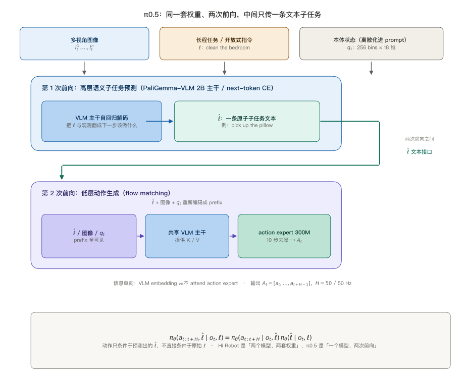
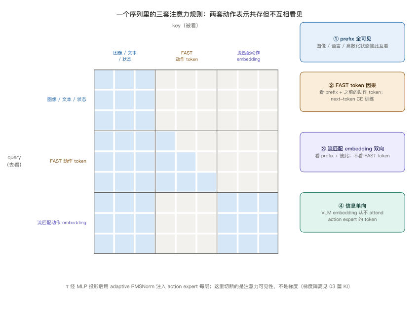
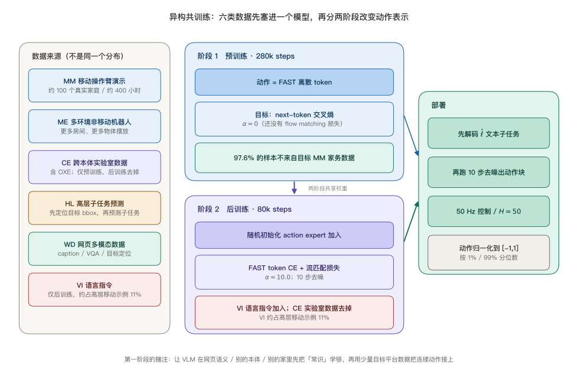
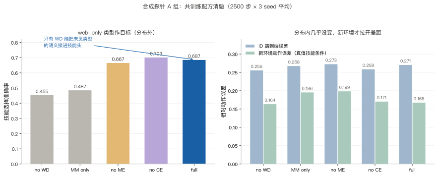
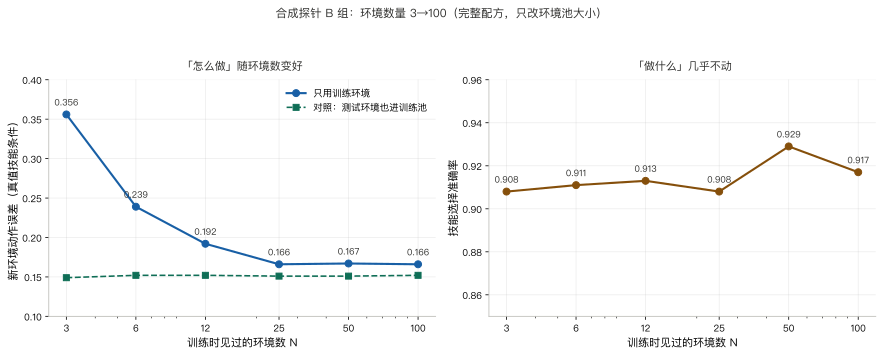
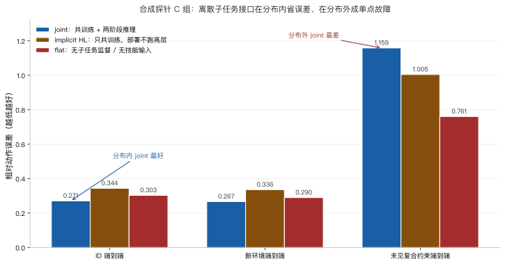
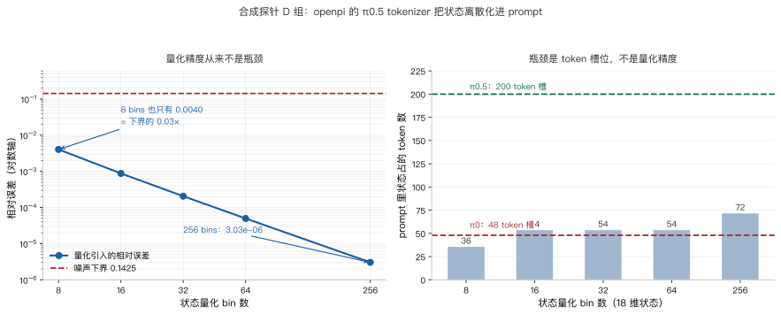

> **系列导航**：这是 π 系列具身模型深潜的第 5 篇。系列按**问题**组织：动作怎么表示（01 π0 / 02 FAST / 03 KI）→ 长程任务怎么拆（04 Hi Robot / **05 π0.5**）→ 延迟怎么吃掉（06 RTC）→ 怎么从经验里学（07 RECAP / 08 RLT）→ 记忆与条件（09 MEM / 10 π0.7）。04 篇回答了「长程指令能不能拆成子任务」，代价是两个模型、两套权重；这一篇换一个问题：**能不能把这两步折进同一套权重，并且让它在一个从没见过的家里把活干完**。

> **TL;DR**
>
> * **核心问题与结论**：Hi Robot 要两个模型才能把长程指令拆成子任务；π0.5 折进**同一套权重**：先自回归说出子任务文本，再让流匹配 action expert 出动作。真正的赌注是异构共训练——六类数据一起训，让模型在没见过的家里做十几分钟家务（[arXiv:2504.16054](https://arxiv.org/abs/2504.16054)）。
> * **关键证据**：官方消融 OOD 跟随 / 成功率 94 / 94，去掉 web 数据掉到 80 / 74，去掉多环境数据掉到 33 / 31；预训练 97.6% 的样本不来自目标家务数据。合成探针上 web 监督只抬未见类型 0.455→0.687，多环境只改善新环境动作，分布内几乎不变（[本仓实验](https://github.com/lrypcy/ipynbs/tree/830abdecf09be13c618fa738f8e7553d17d350b4/experiments/pi-vla/pi-05)，27 条断言）。
> * **适用边界与代价**：两阶段推理在分布内更省 0.271 vs 0.303，但离散子任务一错就成单点故障，未见复合约束上 1.159 vs 0.761；开源的是可运行的低层与 checkpoint，不是完整共训练管线。
> * **系列定位**：不解决实时执行（06 RTC）与从经验里学（07 RECAP）。

## 1. 问题：拆得开之后，还有两道坎

04 篇的结论是「把一个条件分布拆成两个，中间用文本当接口」：高层 VLM 把开放式提示 $$\ell_t$$ 与插话变成一条原子命令 $$\hat\ell_t$$，低层 π0 只消费这条命令。这条路走得通，但结构上是**两套权重、两次训练**——高层与低层都从 PaliGemma-3B 初始化，之后各自微调，彼此不再共享梯度。

π0.5 同时问了两件事，而且第二件比第一件重要：

| | 要解决的问题 | 如果只解决它会怎样 |
| --- | --- | --- |
| **结构** | 高层推理与低层动作能不能由**同一个模型**表示 | 省一套权重，但仍然只会在训练见过的房间里干活 |
| **数据** | 一个模型要从哪些数据里学到「新家也能用」的常识 | 架构再优雅，换一间房、换一批没见过的物体就失效 |

论文把目标写得很克制：**不是学新技能、也不是追求高灵巧度，而是泛化到新场景**——在训练数据里没出现过的家里，完成「把盘子放进水槽」「整理卧室地面」「铺床」这类需要十几分钟、几十次交互的长程任务。官方博客反复强调一句：「All experiments were done in homes that were not in the training data.」

这里有个容易被一带而过的量级差异。04 篇的 Hi Robot 在三个平台上做评测，单个任务是几十秒到几分钟的桌面操作；π0.5 报告的是**10 到 15 分钟**的连续家务，控制频率 50 Hz，一次推理输出 50 步（约 1 秒）动作块。也就是说，长程不只是「步数多」，还意味着高层子任务要在几十次调用里保持语义连贯，而底层动作要在不同房间、不同物体、不同光照下持续可用。

本文的阅读地图：

| 章 | 问题 | 合成探针 | 配图 |
| --- | --- | --- | --- |
| §2–§4 | 一个模型怎么同时装下文本与连续动作 | 自校验 | 图 1、图 3 |
| §5–§6 | 六类数据各补什么，真实结果如何 | — | 图 2 |
| §7–§8 | 共训练的收益落在哪个分布上 | A 组 | 图 4 |
| §9 | 环境数量 scaling 的两条曲线 | B 组 | 图 5 |
| §10 | 两阶段推理为什么既是收益也是单点故障 | C 组 | 图 6 |
| §11–§12 | 状态进 prompt 的 token 预算与 openpi 边界 | D 组 | 图 7 |

三个代码入口：[论文 HTML](https://arxiv.org/html/2504.16054v1)（附录 A-E 有完整模型配置与 attention mask）、[官方博客](https://www.pi.website/blog/pi05)（消融图的读数）、[openpi](https://github.com/Physical-Intelligence/openpi/tree/215abfb217dbac7d5f1273282331b9b1866c0479)（可运行的 π0.5 低层配置）。本文的合成探针在 [ipynbs `experiments/pi-vla/pi-05/`](https://github.com/lrypcy/ipynbs/tree/830abdecf09be13c618fa738f8e7553d17d350b4/experiments/pi-vla/pi-05)，纯 numpy / CPU / 3 个 seed 平均 / 27 条断言。

符号沿用前四篇，只补这一篇新增的：

| 符号 | 含义 | 出处 |
| --- | --- | --- |
| $$\ell$$ | 用户给的高层任务提示（如 “clean the bedroom”） | 论文 §3 |
| $$\hat\ell$$ | 模型自己产出的**文本子任务**（如 “pick up the pillow”） | 论文式 (2) |
| $$a_{t:t+H}$$ | 连续动作块，$$H=50$$ | π0（01 篇） |
| $$\alpha$$ | 组合损失里流匹配项的权重 | 论文式 (1) |
| $$\tau$$ | 流匹配时间步 | 01 篇 / 论文附录 A-E |
| $$\kappa$$ | 合成探针里的环境上下文向量 | 本文 §7 |

## 2. 分解：一个模型、两次前向，中间只传一条文本

π0.5 把联合分布写成两个因子的乘积，并明确要求**动作那一支不直接看原始任务**：

$$
\pi_\theta(a_{t:t+H},\hat\ell\mid o_t,\ell)
=
\pi_\theta(a_{t:t+H}\mid o_t,\hat\ell)\,
\pi_\theta(\hat\ell\mid o_t,\ell)
$$

论文原话是 “the action distribution does not depend on $$\ell$$, only on $$\hat\ell$$”，并且强调 “with both distributions represented by the same model”。这两句合起来才是 π0.5 与 Hi Robot 的分界线：

推理时是**两次调用、一套权重**：第一次让 VLM 主干按 next-token 方式解码出 $$\hat\ell$$（论文把它类比成 chain-of-thought——模型先「告诉自己下一步该做什么」）；第二次把 $$\hat\ell$$ 连同图像与离散化后的本体状态重新组成 prefix，走同一个主干，再由 action expert 做 10 步去噪输出动作块。官方博客给的示例串是 “clean the bedroom” → “pick up the pillow” → 连续关节动作。

为什么要有「动作只条件于 $$\hat\ell$$」这个约束？它把长程目标与底层控制之间的耦合**压成一条窄接口**。好处有三：

- 高层任务的长度、句式、从句数量不再影响动作头的输入分布；动作头永远只吃一句短的子任务。
- 训练时可以同时喂「给定子任务预测动作」与「给定观测预测子任务」两种样本，两者不需要成对出现在同一条轨迹里。
- 出错时可以读出 $$\hat\ell$$，直接判断是「想错了」还是「做错了」。

代价也同样来自这条窄接口：$$\hat\ell$$ 是一个离散的文本决策，**一旦预测错，后面没有任何机制能绕过它**。04 篇的合成探针量化过「措辞漂移」这一种失效；本文 §10 会量化另一种更彻底的失效——遇到训练时没见过的复合约束时，两步分解反而比扁平模型差。

| | 04 Hi Robot | 05 π0.5 |
| --- | --- | --- |
| 权重 | 高层、低层两套，分别微调 | 一套，两次前向 |
| 高层输出 | 口头回应 $$u_t$$ + 原子命令 $$\hat\ell_t$$ | 文本子任务 $$\hat\ell$$ |
| 语言条件 | 低层只看 $$\hat\ell_t$$ | 动作只看 $$\hat\ell$$ |
| 高层能否被网页语义直接训练 | 不能（两套权重分离） | 能（同一主干） |
| 中途插话 | 事件触发重算高层 | 不是该方法的主要评测轴 |
| 动作生成 | π0 流匹配 | π0.5 流匹配 + FAST 双表示共训 |

## 3. 「同一套权重」换来的不是省参数，是让语义监督直接进入主干

如果只把「两个模型」合并成「一个模型」，收益听起来只是省一份显存。真正的变化在**梯度路径**：网页图文描述、视觉问答、目标定位、子任务标签这些**不含任何机器人动作**的样本，现在会更新同一个 transformer 主干，而这个主干稍后要为低层动作提供 prefix 表示。

Hi Robot 的结构里，这类语义数据只能喂给高层 VLM；低层 π0 的主干收不到它们的梯度。π0.5 把这条墙拆了，于是「知道枕头是什么、脏盘子该放哪」这类知识可以直接改动作侧的表示。论文的 97.6% 那条数字正是这个设计的量化：**第一阶段 97.6% 的训练样本不来自「移动操作臂做家务」**，而是来自别的机器人、别的环境、以及网页。

这里必须和 03 篇的 KI 分清。KI（Knowledge Insulation）讲的是**把流匹配的梯度挡在 VLM 之外**，用 stop-gradient 防止动作回归破坏预训练表征；π0.5 附录里写的是 attention mask 上的**信息单向**：VLM embedding 不 attend action expert 的 token，两套动作表示之间不互相看见。前者是梯度口径，后者是注意力可见性——两者不矛盾，也不是同一件事。把 π0.5 的单向 mask 读成「梯度隔离」是常见误读。

## 4. 两套动作表示怎么塞进同一个 transformer

π0.5 最容易被略过的工程细节，是它**同时**用两套表示训练动作：

- **FAST 离散动作 token**：动作经 FAST tokenizer 变成整数 token，用标准 next-token 交叉熵训练。这一套让模型能像普通 VLM 一样从海量异构数据里预训练。
- **流匹配连续动作**：随机初始化的 action expert 接收带噪动作块，回归向量场，推理时迭代去噪出连续动作。

组合损失写成（论文式 (1)）：

$$
\mathbb{E}_{\mathcal{D},\tau,\omega}
\Big[
H\big(x_{1:M},\, f^{\ell}_{\theta}(o_t,\ell)\big)
+
\alpha\,\big\lVert \omega - a_{t:t+H}
- f^{a}_{\theta}(a^{\tau,\omega}_{t:t+H},o_t,\ell) \big\rVert^2
\Big]
$$

$$\alpha$$ 是一个开关：预训练阶段 $$\alpha=0$$（纯离散 token 的 VLM 训练），后训练阶段 $$\alpha=10.0$$（加入 action expert，两套损失联合）。推理时文本 token 走自回归解码，随后 10 步去噪出动作。

attention mask 的规则（论文附录 A-E、Fig.18）值得逐条读，因为「两套动作表示共存在一个序列里」全靠它才不互相泄漏：

| token 组 | 可以 attend 谁 | 目的 |
| --- | --- | --- |
| 图像 patch / 文本 prompt / 本体状态（prefix） | 整段 prefix，全可见 | 双向编码观测 |
| FAST 动作 token | prefix + 自己之前的动作 token | 自回归 next-token 训练 |
| 流匹配动作 embedding | prefix + 彼此（双向）；**不看 FAST 动作 token** | 避免两套动作表示互相抄答案 |
| VLM embedding | **从不** attend action expert 的 token | 信息单向：VLM → action expert |

模型规模沿用 π0（附录 A-E）：

| | width | depth | mlp_dim | heads | kv_heads | head_dim | 参数量 |
| --- | --- | --- | --- | --- | --- | --- | --- |
| VLM 主干（PaliGemma 初始化） | 2048 | 18 | 16,384 | 18 | 1 | 256 | 2B |
| action expert | 1024 | 18 | 4096 | — | — | — | 300M |

两组权重**只通过 self-attention 交互**。与 π0 不同的是时间步注入方式：π0 把 $$\tau$$ 与带噪动作拼在一起送进 transformer，π0.5 改成单独一个 MLP 投影 $$\tau$$，再用 adaptive RMSNorm 把时间步信息注入 action expert 的每一层：

$$
\mathrm{swish}\big(W_2\cdot \mathrm{swish}(W_1\cdot\phi(\tau))\big)
$$

其中 $$\phi$$ 是正弦位置编码。$$\tau$$ 的采样也不是均匀分布，而是偏向低时间步的 $$p(\tau)=\mathrm{Beta}\big((s-\tau)/s;\,\alpha=1.5,\beta=1\big)$$，$$s=0.999$$；超过 $$s$$ 的时间步不采，因为积分步长 $$\delta>1-s$$ 时用不上。

数据侧还有三条容易漏的口径（论文 §IV-D）：

1. 所有动作按**每个数据集、每个动作维的 1% / 99% 分位数**归一化到 $$[-1,1]$$；
2. 动作维度取所有数据集里最大的那个固定值，低维机器人的动作向量**零填充**；
3. 状态与动作空间总维度是 18 或 19（取决于平台），prompt 里还会加一个 `<<control_mode>> joint/end effector` 标记区分控制模式。

## 5. 异构共训练：六类数据到底各补什么

π0.5 的配方不是「多收集一点演示」，而是把六种**分布完全不同**的样本塞进同一个 next-token 目标里：

| 缩写 | 内容 | 补的是什么 | 出现阶段 |
| --- | --- | --- | --- |
| **MM** | 移动操作臂家务演示，约 400 小时、约 100 个不同家庭 | 目标平台的真实动作分布 | 预训练 + 后训练 |
| **ME** | 非移动机械臂在多种家庭环境里采的数据 | 「换个房间还能做」的物理与视觉变化 | 预训练 + 后训练 |
| **CE** | 实验室跨本体数据（含 OXE） | 不同机器人、不同任务、不同动作语义 | **仅预训练**，后训练去掉 |
| **HL** | 高层子任务预测：给观测，先预测相关目标 bbox，再预测子任务标签 | 把「现在该做哪一步」变成可监督的文本 | 预训练 + 后训练 |
| **WD** | 网页多模态：image captioning / VQA / 目标定位 | 开放词表的物体与场景语义 | 预训练 + 后训练 |
| **VI** | 人用语言逐步指导机器人的演示 | 让高层能听懂细粒度指令 | **仅后训练**，约占高层移动示例 11% |

两处细节值得单独标记。其一，**CE 在后训练被显式去掉**（论文 §IV-B 原文：“omit the laboratory cross-embodiment data (CE) to focus the model on mobile manipulation and diverse environments”），目的是让第二阶段聚焦目标平台与新环境；把它写成「六类数据全程混训」是错的。其二，VI 只占高层移动示例约 11%，但论文的 no VI 消融显著变差——小数据、大作用。

两个训练阶段：

| | 阶段 1 预训练 | 阶段 2 后训练 |
| --- | --- | --- |
| 步数 | 280k gradient steps | 80k additional steps |
| $$\alpha$$ | 0（还没有流匹配损失） | 10.0 |
| 动作表示 | FAST 离散 token | FAST token + 流匹配连续动作 |
| action expert | 不存在 | 随机初始化后加入 |
| 数据 | MM / ME / CE / HL / WD | MM / ME / HL / WD / VI（去 CE） |
| 目标平台样本占比 | 仅 2.4%（97.6% 来自其它来源） | 提高，但仍与其它源混合 |

部署时控制 50 Hz、动作块 50 步，论文报告的长程任务长度是 10–15 分钟。所有评测都在训练数据里没出现过的家里做。

## 6. 真实结果：消融比绝对分数更有信息量

官方博客给出了消融图的读数，四个指标分两种条件：**分布内**（与训练任务同类的清洁/整理）和 **OOD**（把 prompt 指定的特定物体放进抽屉）。每格是「单个子任务的平均」——例如物体被正确归位的比例。

| 配方 | 分布内 跟随率 | 分布内 成功率 | OOD 跟随率 | OOD 成功率 |
| --- | --- | --- | --- | --- |
| 完整 π0.5 | 86% | 83% | **94%** | **94%** |
| no WD（去网页数据） | 86% | 82% | 80% | 74% |
| no CE（去实验室跨本体） | 74% | 67% | 67% | 49% |
| no ME（去多环境数据） | 66% | 57% | 33% | 31% |

图注的结论是 “Web data (WD) makes the biggest difference for generalizing to out-of-distribution objects, while data from other robots (ME and CE) is important across all evaluation conditions”。这张表里最值得盯的是 **no WD 那一行**：分布内几乎不掉（86/82 对 86/83），OOD 的跟随率与成功率却从 94% / 94% 掉到 80% / 74%。也就是说，网页数据买的不是「把已知任务做得更好」，而是「遇到没见过的物体时还能认出来」。

另一组是环境数量的 scaling（论文 §V-B、Fig.8）：训练用的地点数取 3、12、22、53、82、104，绿色对照是「把测试家庭也放进训练集」的模型；到 104 个地点时，π0.5 已经接近这条上界。官方博客给的说法是「大约 100 个训练环境后就接近该基线」。注意这些 scaling 实验为了省算力，采用「先在与地点无关的机器人数据上预训练、再只后训练」的简化配方，固定 40k 步让每个模型见到同样数量的样本，**不是把完整的 280k+80k 配方重跑六遍**。

**这一节的数字全部是引用，不是复现。** 下面四节的合成探针只验机制，全部数字来自 [stdout.txt](https://github.com/lrypcy/ipynbs/blob/830abdecf09be13c618fa738f8e7553d17d350b4/experiments/pi-vla/pi-05/results/stdout.txt)，与论文的百分比不可对表。

## 7. 合成探针：把「共训练补了什么」拆成可测的量

04 篇的合成世界里有 5 个槽、每个 4 位二值属性、6 个技能、动作真值 $$a^\star=\mu_{s^\star}+Bx+\eta$$。本篇在这个世界上加三个结构，分别对应 π0.5 的三件事：

1. **外观 → 语义的间接层**（对应 WD）。观测给的是随机外观向量 $$\phi_t\in\mathbb{R}^8$$，决策要用互异的语义属性 $$z_t\in\{\pm1\}^4$$；10 个物体类型里只有 7 个出现在机器人演示中，另外 3 个是 **web-only**。模型要靠槽编码器 $$\psi:\phi\mapsto\hat z$$ 把语义恢复出来，而 web 数据直接给 $$(\phi_t,z_t)$$ 对。关键设计：web 批里一半是纯语义问答——对**全部**属性模式问「该选哪个技能」，不给任何动作——否则技能头与共享主干根本没见过 web-only 类型对应的语义模式。
2. **环境上下文 $$\kappa$$**（对应 ME / Fig.8）。动作里加一项 $$(v\cdot x)\,u(\kappa)$$，其中 $$u(\kappa)=C\kappa+\tanh(\kappa W_2^\top)C_2^\top$$ 是固定的**非线性**映射。用非线性是刻意的：线性映射三五个环境就能背下来，scaling 曲线会假。$$\kappa$$ 直接进动作头，环境项与 $$Bx$$ 项标定到同量级（$$0.25/D_A=0.0310$$）。
3. **三个推理变体**（对应 Fig.13）。`joint` 两阶段（动作头看预测技能）；`implicit` 训练时带技能头、部署时动作头直接看约束；`flat` 连技能监督都没有。

数据配方与论文的对应：每个 step 都有 MM 动作批（技能 CE + 动作 MSE），其中一部分步把 ME 的额外环境并进采样池；30% 的步加 CE 纯技能监督批，35% 的步加 WD 语义批。复合约束**始终不进任何训练集**——早前一版曾把测试约束漏进 CE 批，泛化结论直接不可信，已修掉。

网络是两层 MLP（隐藏 64）而不是 PaliGemma，动作用 MSE 而不是流匹配，训练 2500 步 × 3 个 seed。手写反向用有限差分校准（相对误差 4.5e-09 / 1.6e-08），27 条断言全过。**它测的是「分解与共训练的机制」，不是论文成绩的复现。**

| 论文概念 | 探针里的替身 | 没建模的部分 |
| --- | --- | --- |
| WD 网页语义 | $$(\phi,z)$$ 监督 + 覆盖全部属性模式的语义问答 | 开放词表、真实图像、语言先验 |
| web-only 类别泛化 | 3 个只在 WD 出现的物体类型 | 视觉外观的语义结构 |
| ME 多环境 | $$\kappa$$ 的非线性映射 $$u(\cdot)$$ | 图像里的房间布局 |
| CE 跨本体 | 更多任务 / 更多环境的纯技能监督 | **跨本体动作空间差异** |
| HL / VI | 子任务标签（技能 CE） | 自由文本、逐步语言指导 |
| 两阶段推理 | 技能 id → 动作头 | 文本接口的可解释与注入 |

## 8. A 组：web 数据补的是语义，多环境补的是动作

| 配方 | ID 技能准确率 | 未见复合约束 技能准确率 | web-only 目标 技能准确率 | 新环境动作误差（真值技能条件） | ID 端到端误差 |
| --- | --- | --- | --- | --- | --- |
| full | 0.929 | 0.451 | 0.687 | 0.168 | 0.271 |
| no WD | 0.946 | 0.406 | **0.455** | 0.164 | 0.256 |
| no ME | 0.927 | 0.483 | 0.667 | **0.199** | 0.273 |
| no CE | 0.941 | 0.434 | 0.703 | 0.171 | 0.259 |
| MM only | 0.932 | 0.420 | 0.487 | 0.196 | 0.268 |

三条结论：

- **WD 的收益只在未见类别上。** web-only 目标从 0.455 抬到 0.687，而 ID 反而从 0.946 降到 0.929；按「相对降幅」算，web 目标是 0.34，ID 是 −0.02。这和 §6 里官方消融「no WD 分布内 86/82 对 86/83 几乎不掉、OOD 从 94/94 掉到 80/74」是同一个形状。
- **ME 的收益只在新环境的「怎么做」上。** 去掉 ME，新环境真值技能误差从 0.168 涨到 0.199（+0.031），ID 只涨 0.001。技能准确率几乎不动。
- **完整配方在分布内没有变好。** full 的 ID 端到端误差 0.271，MM only 是 0.268。共训练买的是分布外，不是拟合已知分布。

一处必须说清的**负结果**：CE 在这个探针里几乎没有边际收益（复合约束技能准确率 0.451 vs no CE 0.434），而论文里 no CE 的 OOD 成功率从 94% 掉到 49%。原因不是「CE 没用」，而是探针里所有本体的动作空间都是同一个 8 维空间，只有约束、环境、类型分布不同——**CE 真正提供的跨本体动作语义对齐这一层，探针根本没建模**。这个负结果只能按「探针的结论」读，不能当成对论文消融的复现。

还有一条容易被误读的：no WD 的 ID 技能准确率（0.946）比 full（0.929）还高。这不是「web 数据有害」，而是 web 批占掉了 35% 的训练步，稀释了 ID 样本份额；收益全在没见过的类型上。§6 的官方表里 no WD 分布内 86/82 与完整 86/83 基本持平，也是同一个量级。

## 9. B 组：环境数量的 scaling，两条曲线必须分开看

| 训练环境数 N | 3 | 6 | 12 | 25 | 50 | 100 |
| --- | --- | --- | --- | --- | --- | --- |
| 新环境动作误差（真值技能条件） | 0.356 | 0.239 | 0.192 | 0.166 | 0.167 | 0.166 |
| 对照：测试环境也进训练池 | 0.149 | 0.152 | 0.152 | 0.151 | 0.151 | 0.152 |
| 新环境技能准确率 | 0.908 | 0.911 | 0.913 | 0.908 | 0.929 | 0.917 |

N=3 时最差（0.356），到 N=25 就基本饱和（0.166），N=100 是 0.166、把测试环境也放进训练池的对照是 0.152。与此同时，技能准确率在 0.908–0.929 之间小幅波动，对 N 几乎不敏感——**环境数量改变的是「怎么做」，不是「做什么」**。

这和论文 Fig.8 的读法一致：地点数从 3 增到 104，mean performance 稳步上升并接近绿色对照（把测试家庭放进训练集）。对照不是可部署的基线，只用来给 scaling 曲线一个上界。探针里的环境数档位（3/6/12/25/50/100）是自己的设定，不与论文的 3/12/22/53/82/104 逐点对应。

为什么要给 $$u(\cdot)$$ 加非线性？线性 $$u(\kappa)=C\kappa$$ 时，三四个环境就足够把映射解出来，曲线从第一档就平了，测不出「需要多少环境才能学会一个新函数」。加了 $$\tanh$$ 分量之后，少量 $$\kappa$$ 只能背下局部，环境多了才逼近真实映射——**这条曲线测的是函数的可辨识性，不是记忆容量**。

## 10. C 组：离散子任务接口既是收益，也是单点故障

| 变体 | 训练时有技能监督 | 部署时跑高层 | ID 端到端 | 新环境端到端 | 未见复合约束 端到端 | ID 动作误差（真值技能条件） |
| --- | --- | --- | --- | --- | --- | --- |
| joint（完整 π0.5 的形态） | 是 | 是 | **0.271** | **0.267** | **1.159** | 0.167 |
| implicit HL | 是 | 否 | 0.344 | 0.336 | 1.005 | 0.344 |
| flat | 否 | 否 | 0.303 | 0.290 | **0.761** | 0.303 |

分布内，两阶段确实更省：joint 0.271 优于 flat 0.303；真值技能条件下 joint 的动作误差 0.167 也明显低于 flat 0.290。但换到训练时没见过的复合约束上，顺序整个翻过来：joint 1.159 / implicit 1.005 / flat 0.761，implicit 正好落在中间。

机制不复杂。joint 把决策压成一个离散 id：预测对了，动作头拿到清晰的技能原型，误差低；预测错了，动作头拿到的原型与真值南辕北辙，而且**没有任何旁路可以让观测直接纠正它**。flat 没有这个瓶颈，输出的是几个原型的加权叠加，虽然分布内不够锐利，在分布外却不会「一步错、步步错」。04 篇也遇到同一件事：**端到端的连续指标会奖励「不出错的平均」**，而分层把一个回归问题拆成分类 + 回归之后，分类那一半的误差是不可回收的。

这里有一处**与论文 Fig.13 相反的结果**，必须诚实标注。论文的结论是「full π0.5 最好，甚至超过人工高层 oracle；第二名是 implicit HL——不跑高层推理、但训练里含高层数据，说明共训练配方本身贡献了很大一部分收益」。探针里 implicit 在分布内反而比 flat 更差（0.344 vs 0.303）。原因是探针把「高层」压成一个 6 分类的技能 id，而论文的高层是**在网页语料上预训练过的 VLM 输出自由文本子任务**——语言先验带来的隐性知识，两层 MLP 测不出来。换句话说，探针里 implicit 只有一个「分走容量的技能头」，没有「被语义任务预训练过的主干」。这一条正好划出了合成探针的能力边界：它能测「分解」与「数据分布」，测不了「预训练语言知识」。

## 11. D 组：状态进 prompt，瓶颈是 token 槽位不是量化精度

openpi 的 π0.5 格式把本体状态**离散化成文本，塞进 prompt**，而不是像 π0 那样作为连续量送进 action expert 的 suffix。pinned commit 里 `tokenizer.py` 的写法很直白：把状态按 $$\mathrm{linspace}(-1,1,257)$$ 的边界做 $$\mathrm{digitize}$$ 得到 0–255 的整数，拼成 `Task: ..., State: ...;\nAction: `。对应地 `pi0_config.py` 里 `max_token_len` 从 π0 的 48 提到 π0.5 的 200。

探针把 18 维状态、256 bins 的设定单独拿出来量一遍：真值动作 $$a=\mu_s+B_sx+\eta$$，噪声下界是 0.1425（相对误差口径）。

| bins | 量化引入的相对误差 | 占噪声下界 | 18 维状态占的 prompt token |
| --- | --- | --- | --- |
| 8 | 0.0040 | 0.03× | 36 |
| 16 | 0.0009 | 0.01× | 54 |
| 32 | 0.0002 | 0.00× | 54 |
| 64 | 0.0000 | 0.00× | 54 |
| 256 | 3.03e-06 | < 0.01× | **72** |

结论有点反直觉：**粗到 8 bins，量化误差也只有不可约噪声的 3%**；256 bins 的 3.03e-06 更是可以忽略。所以「把状态离散化」在精度上几乎不付代价，真正付的是 token 预算——18 维 × 256 bins 大约要 72 个 token，π0 的 48 槽装不下，π0.5 的 200 槽才装得下。

这可以看成 02 篇 FAST 那条线的另一面：FAST 关心「动作怎么压成尽量少的 token」，π0.5 关心「状态怎么塞进本来给语言用的槽」。两者共用同一个约束——**预训练 VLM 的 prompt 长度是有预算的**。也解释了为什么 π0.5 要把 $$q_t$$ 从连续 suffix 挪进文本 prefix：这样状态与子任务文本共享同一套 token 表示，高层与低层才能真的用同一个模型。

## 12. 源码核实：openpi 里有什么、没有什么

开源实现与论文不是一回事，按 pinned commit `215abfb` 逐条核过：

| 入口 | 位置 | 说明 |
| --- | --- | --- |
| `pi05` 开关 | `src/openpi/models/pi0_config.py` [L27-L39](https://github.com/Physical-Intelligence/openpi/blob/215abfb217dbac7d5f1273282331b9b1866c0479/src/openpi/models/pi0_config.py#L27-L39) | `max_token_len` 默认 π0.5=200 / π0=48；注释明确写出 π0.5 的两个差别：状态进离散语言 token、action expert 用 adaRMSNorm 注入 $$\tau$$ |
| `discrete_state_input` | 同上 [L41-L45](https://github.com/Physical-Intelligence/openpi/blob/215abfb217dbac7d5f1273282331b9b1866c0479/src/openpi/models/pi0_config.py#L41-L45) | 默认等于 `pi05`，由 `ModelTransformFactory` 读取 |
| π0.5 prompt 编码 | `src/openpi/models/tokenizer.py` [L22-L48](https://github.com/Physical-Intelligence/openpi/blob/215abfb217dbac7d5f1273282331b9b1866c0479/src/openpi/models/tokenizer.py#L22-L48) | 256 bins 离散化、`Task: ... State: ...;\nAction: `；π0 格式则是 `encode(text)+encode("\n")` |
| 动作头配置 | `src/openpi/models/pi0_config.py` [L20-L26](https://github.com/Physical-Intelligence/openpi/blob/215abfb217dbac7d5f1273282331b9b1866c0479/src/openpi/models/pi0_config.py#L20-L26) | `action_dim=32`、`action_horizon=50`、`gemma_2b` + `gemma_300m` |
| checkpoint | `README.md` | 提供 `pi05_base` / `pi05_libero` / `pi05_droid` 等可加载 / 可微调权重 |

**仓库里没有的东西更要紧**：没有论文的异构数据混合管线（MM / ME / CE / HL / WD / VI 的采样权重与构造脚本），没有高层子任务训练任务，也没有「先解码 $$\hat\ell$$ 再跑低层」的两次前向推理脚本。开源的是**可运行的 π0.5 低层 / 流匹配形式与 checkpoint**，即 `Pi0Config(pi05=True)` 那一半。把 `pi05_libero` 的微调结果当成论文新家泛化的复现，是对不上口径的。

04 篇核过的 `serve_policy.py`（`prompt` 是每请求字段）、`websocket_policy_server.py`（无状态 `recv → infer → send`）在 05 篇仍然成立，但要注意：**「每请求可换 prompt」不等于「运行时先自回归生成子任务」**，这两件事分别属于服务接口与模型内部推理。

## 13. 适用边界与代价

| 边界 | 具体表现 | 影响 |
| --- | --- | --- |
| 离散子任务是单点故障 | 未见复合约束上 joint 1.159 vs flat 0.761 | 分布外要用更保守的接口或 uncertainty 分支，本文未展开 |
| 两阶段不是免费 | 一次决策要两次前向；文本解码长度不固定 | 实时性交给 06 RTC 处理 |
| 共训练配方不开源 | 只有低层配置与 checkpoint | 复现论文新家结果缺少数据管线 |
| 探针没建模语言先验 | implicit 的结果与论文 Fig.13 相反 | §10 的 C 组只能读「分解」，不能读「共训练的隐性收益」 |
| 探针没建模跨本体动作差异 | CE 边际收益接近 0 | 与论文 no CE 的大幅掉点不矛盾，但不是复现 |
| 数据成本高 | 约 400 小时目标平台数据 + 约 100 个家庭 + 多源网页 / 实验室数据 | 「97.6% 不来自目标平台」只是占比，不是总成本低 |
| 方法本身不完美 | 论文自述高层语义推断与底层动作都会出错，不总是一次成功 | 需要后续从经验里改进（07 RECAP） |

论文自己给的失败模式也值得抄在这里：π0.5「far from perfect」，高层语义推断（该把衣服放洗衣篮还是衣柜）与底层动作（抓没抓稳）都会出错。它买的是**广度的泛化**，不是可靠性。

## 14. 小结

* **04 与 05 是同一个问题的两个答案。** Hi Robot 用两套权重把长程指令拆成子任务，π0.5 用一套权重、两次前向做同一件事，并且把网页语义、别的机器人、别的房间的数据一起灌进这个主干。
* **分解写成一条窄接口。** 动作只条件于 $$\hat\ell$$ 而不条件于 $$\ell$$；这条接口让长短不一的任务、不成对的训练样本、可读的中间决策同时成立，也让预测错误变得不可回收。
* **异构共训练的收益几乎全在分布外。** 官方消融里 no WD 分布内几乎不掉、OOD 从 94% / 94% 掉到 80% / 74%；合成探针里 WD 只把未见类型从 0.455 抬到 0.687，ME 只把新环境动作误差从 0.199 压回 0.168，而 ID 端到端误差 0.271 并不优于只用目标平台数据的 0.268。
* **两条曲线要分开看。** 环境数从 3 增到 100，新环境动作误差 0.356 → 0.166，技能准确率却在 0.908–0.929 之间不动——多环境数据补的是「怎么做」，web 数据补的是「做什么」。
* **工程细节里藏着设计意图。** 双动作表示靠 attention mask 隔离，$$\tau$$ 改用 MLP + adaptive RMSNorm 注入，状态离散化进 prompt（瓶颈是 48 / 200 的 token 槽而不是量化精度），CE 在后训练被去掉，VI 只占 11% 却不能拿掉。这些都不是超参微调，是「怎么让一个 VLM 同时当高层和低层」的答案。
* **开源边界要记住。** openpi 给的是 `pi05=True` 的低层配置与 checkpoint，不是完整的异构共训练管线。

再往下是第 06 篇的问题。π0.5 把长程任务拆成了十几分钟的子任务序列，但每一次低层调用都是「停下来想、再动一秒」；当动作块与动作块之间要无缝衔接时，推理延迟就成了新的瓶颈。

## 参考

- π0.5 论文：*π0.5: a Vision-Language-Action Model with Open-World Generalization*，[arXiv:2504.16054](https://arxiv.org/abs/2504.16054)（2025-04-22；本文 §4 的模型配置、attention mask、$$\tau$$ 采样与 §5 的数据配方取自 [HTML 版附录 A-E](https://arxiv.org/html/2504.16054v1)）。论文采用 arXiv.org perpetual non-exclusive license，**官方配图不复用**，本文 7 张图全部重画。
- 官方项目页：[π0.5: A VLA with Open-World Generalization](https://www.pi.website/blog/pi05)（§6 的四项消融读数、约 400 小时、约 100 个训练环境、50 步动作块、300M action expert 取自该页）。
- 开源实现：`Physical-Intelligence/openpi`，commit [`215abfb`](https://github.com/Physical-Intelligence/openpi/tree/215abfb217dbac7d5f1273282331b9b1866c0479)（Apache-2.0），§12 的 permalink 全部锁在该 commit 上。
- 前作：[π0 流匹配](/2026/11/02/pi-vla-01-pi0-flow-matching/)、[FAST 动作 tokenizer](/2026/11/03/pi-vla-02-fast-action-tokenizer/)、[Knowledge Insulation](/2026/11/03/pi-vla-03-knowledge-insulation/)（梯度隔离）、[Hi Robot](/2026/11/04/pi-vla-04-hi-robot/)（两个模型、两套权重）。
- 配套实验：[`experiments/pi-vla/pi-05/`](https://github.com/lrypcy/ipynbs/tree/830abdecf09be13c618fa738f8e7553d17d350b4/experiments/pi-vla/pi-05)，commit `830abde`，27 条断言，纯 numpy / CPU，`pi05_lab.py` + 固化输出的 `pi05_lab.ipynb` + `results/stdout.txt` 三件齐。`pi05_figures.py` 生成 7 张 SVG；**图 4–7 的数字全部是合成探针结果，不是论文原图**；图 1、图 2、图 3 是按论文 §3 / §4 / 附录 A-E 重画的结构图。

> **下一篇**：π 系列具身模型（06）：RTC —— 实时执行时动作块怎么接。
>
> **上一篇**：[π 系列具身模型（04）：Hi Robot —— 长程指令怎么拆成子任务](/2026/11/04/pi-vla-04-hi-robot/)
