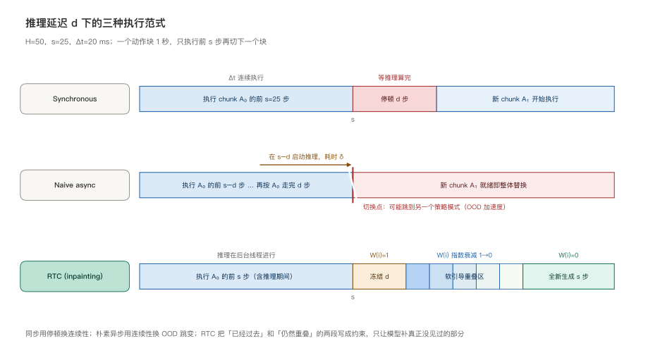
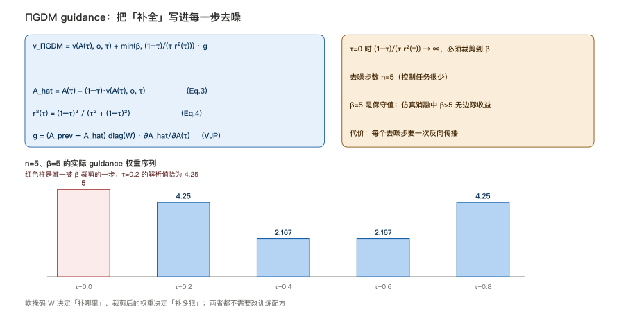
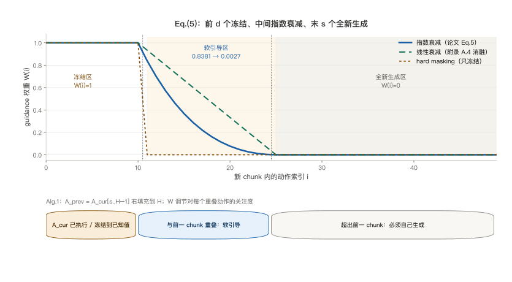
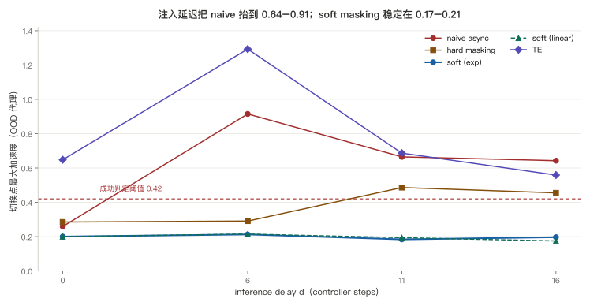
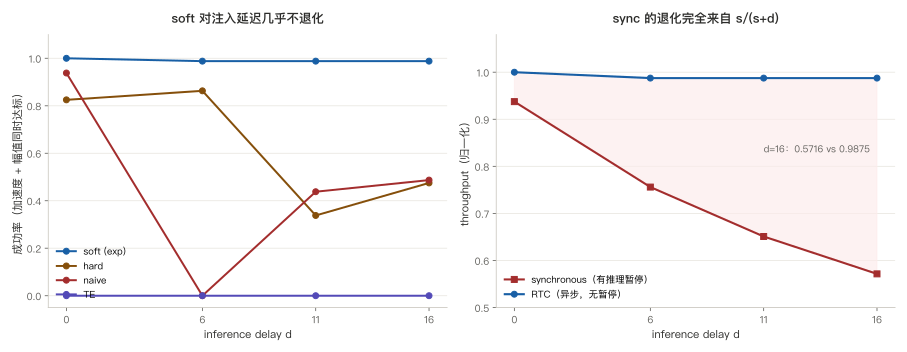
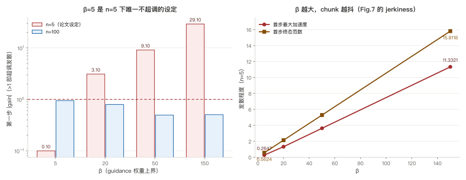
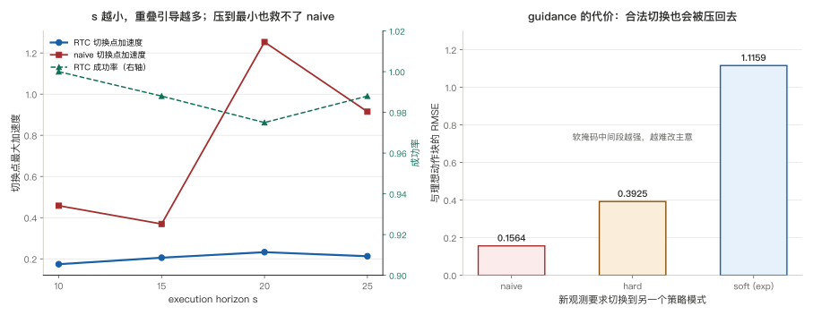

> **系列导航**：这是 π 系列具身模型深潜的第 6 篇。系列按**问题**组织：动作怎么表示（01 π0 / 02 FAST / 03 KI）→ 长程任务怎么拆（04 Hi Robot / 05 π0.5）→ **延迟怎么吃掉（06 RTC）** → 怎么从经验里学（07 RECAP / 08 RLT）→ 记忆与条件（09 MEM / 10 π0.7）。05 篇把子任务折进同一个模型，却留下一个更贴近物理的问题：每一次低层调用都要「停下来想、再动一秒」，而动作块与动作块之间必须无缝衔接。

> **TL;DR**
>
> * **核心问题与结论**：动作块策略每 $$s$$ 步要换一次块，但生成一个新块要花 $$d$$ 个控制步；同步等待会停顿，朴素异步会在切换点跳到分布外。RTC 把新块当成被挖掉一部分的图来**补**：冻结已过去的 $$d$$ 步、软引导重叠区、末 $$s$$ 步全新生成，纯推理时改动、无需重训练（[arXiv:2506.07339](https://arxiv.org/abs/2506.07339)）。
> * **关键证据**：Eq.(5) 的软掩码中间 14 个权重从 0.8381 指数降到 0.0027；合成探针上延迟从 0 涨到 16，naive async 的切换点加速度 0.2592 → 0.6425，soft masking 稳定在 0.1838–0.2127，成功率 1.000 → 0.988。$$\beta=5$$ 是 $$n=5$$ 去噪下唯一不超调的裁剪值（[本仓实验](https://github.com/lrypcy/ipynbs/tree/12bea380ce7a11d1323edd352c96676baa6566bd/experiments/pi-vla/pi-06)，42 条断言）。
> * **适用边界与代价**：guidance 每个去噪步要一次反向传播，论文 Table 3 的真机延迟 76 ms → 97 ms；软掩码会压抑**合法**的策略切换，实验 D 组换 mode 时与理想块的偏差 1.1159 对 0.1564；论文 Fig.5 / Fig.6 只有曲线、没有数值表。
> * **系列定位**：解决执行节奏，不改变策略本身；可靠性交给 07 RECAP，记忆交给 09 MEM。

## 1. 问题：动作块与动作块之间那一秒

01 篇的 π0 把动作表示成**一块**：一次流匹配采样输出 $$a_{t:t+H}$$，控制器逐条执行。05 篇的 π0.5 沿用这个接口，$$H=50$$、控制 50 Hz，一个块正好一秒；长程任务靠几十次这样的调用串起来。

于是每次调用之间出现了一个此前被隐含掉的量：生成一个块需要时间 $$\delta$$。论文给的量级很直接——3B 模型光是把观测灌进 KV cache 就要 46 ms，而 50 Hz 的控制器每 20 ms 要走一步；理想网络条件下远程推理还要再添 13 ms，为推理速度专门优化过的 7B 模型也要 321 ms。把这些折成控制步数就是

$$
d=\left\lfloor \frac{\delta}{\Delta t} \right\rfloor
$$

$$d$$ 不是可以靠「等一等」消掉的实现细节。论文把失效模式列成三类：

| 失效模式 | 表现 | 为什么会伤到策略 |
| --- | --- | --- |
| **边界停顿** | 同步推理在执行视界末端停下等新块 | 机器人动力学被改变，引入训练与部署之间的分布偏移 |
| **模式跳变** | 相邻块落到动作分布的不同 mode（绕障碍上方 / 下方） | 切换点出现不连续，$$s$$ 越短越频繁 |
| **OOD 加速度** | 新块基于 $$d$$ 步前的观测生成，接上时已经错过 $$d$$ 步 | 过渡点的动作可以任意不连续，延迟越大越剧烈 |

第三类最容易被忽略：朴素异步在 $$s-d$$ 时刻启动推理，用的是 $$o_{s-d}$$；等新块可用时机器人已经按旧块走到了 $$s$$。新块开头那 $$d$$ 个动作描述的是「过去」，而真正要执行的是它后半段——一个用旧观测预测出来的、没有闭环修正的动作。

时间轴上的三种范式画在下面：

论文 Fig.2 给的具体场景是：推理在 timestep 3 与 4 之间开始，原块计划从障碍**上方**走、新块走**下方**，新块直到 $$d=7$$ 步后才可用；naive async 可能直接从 $$a_{10}$$ 跳到 $$a'_{11}$$。temporal ensembling 能压低加速度，但把两个相反 mode 的预测平均之后，动作本身已经不是有效动作了。

本文的阅读地图：

| 章 | 问题 | 合成探针 | 配图 |
| --- | --- | --- | --- |
| §2–§3 | 延迟怎么形式化，为什么是 inpainting | — | 图 1 |
| §4–§6 | guidance、软掩码与异步循环 | A 组 | 图 2、图 3 |
| §7–§8 | 各方法在延迟下的切换点加速度 | A / B 组 | 图 4、图 5 |
| §9 | β 裁剪与去噪步数的稳定性 | C 组 | 图 6 |
| §10–§11 | execution horizon、吞吐与 guidance 的代价 | D 组 | 图 5、图 7 |
| §12–§13 | 真机与仿真实验、边界 | — | — |

三个入口：[论文 v2 HTML](https://arxiv.org/html/2506.07339v2)（§2 的符号、§3 的 Eq.(2)–(5) 与 Algorithm 1、附录 A.2 / A.4 的消融）、[arXiv abs 页](https://arxiv.org/abs/2506.07339)（CC BY 4.0，NeurIPS 2025）、[ipynbs `experiments/pi-vla/pi-06/`](https://github.com/lrypcy/ipynbs/tree/12bea380ce7a11d1323edd352c96676baa6566bd/experiments/pi-vla/pi-06)（纯 numpy / CPU / 42 条断言）。**图 4–7 的数字全部是合成探针结果，不是论文原图**；图 1–3 是按论文文字重画的结构图。

符号沿用前五篇，只补这一篇新增的：

| 符号 | 含义 | 出处 |
| --- | --- | --- |
| $$H$$ | 动作块长度（预测视界），真机 $$H=50$$ | 论文 §2 |
| $$s$$ | execution horizon，每块只执行前 $$s$$ 步，常取 $$s\approx H/2$$ | 论文 §2 |
| $$\Delta t$$ | 控制器周期，$$\Delta t = 20$$ ms | 论文 §2 |
| $$\delta$$ | 生成一个动作块的耗时 | 论文 §2 |
| $$d$$ | inference delay，$$d=\lfloor\delta/\Delta t\rfloor$$ | 论文 §2 |
| $$a_{t' \mid t}$$ | 由 $$o_t$$ 生成的块里对应时刻 $$t'$$ 的动作 | 论文 §2 |
| $$W_i$$ | Eq.(5) 的软掩码权重 | 论文 §3.2 |
| $$\beta$$ | guidance 权重的裁剪上界，$$\beta=5$$ | 论文 §3.1 |

## 2. 实时执行的形式化：条件 $$d \le H-s$$

论文 §2 把「实时」写成一条很朴素的要求：在固定的 $$\Delta t$$ 内对事件产生响应。若 $$\delta \le \Delta t$$，那么整个块可以在两个 timestep 之间算完；否则就必须**异步**——在还想切换的时候提前启动推理。

设上一块 $$\mathbf{A}_0$$ 已经执行了前 $$s$$ 步。若想在第 $$s$$ 步无缝接上新块，就必须在 $$s-d$$ 时刻启动推理，让新块正好在 $$s$$ 时刻可用。Alg.1 里把这个起点写成「wait 到 $$t\ge s_{\min}$$」，并取 $$s=t$$；正文给的是 $$s=\max(d, s_{\min})$$。无论哪种写法，都绕不开一条约束：

$$
d \le H - s
$$

否则新块可用时，上一块能提供的重叠动作已经不够 $$d$$ 个，动作会出现断供。这条约束在 Fig.3 里被写成 $$d \le s \le H-d$$：执行视界不能短于延迟，也不能长到把整个块都吃掉。

值得停下来强调的是，RTC 的答案**不是**把模型变快。论文摘要写得很明确：适用于任意 diffusion- 或 flow-based VLA，无需重训练、无需改动训练配方；扩散策略甚至可以在推理时转成 flow policy 再套用。它是一个**推理时算法**：给定同一个 $$\pi_\theta$$，换一种把前后两块拼起来的方式。

## 3. 把「接块」改写成 inpainting

关键的一步是换视角。新块可用时，它的前 $$d$$ 个时间步已经过去、不可再用——但它们的**值是已知的**（就是上一块在这些时刻实际执行过的动作）。论文把它们「冻结（freeze）」到这些值；剩下没被冻结的部分，则要在与冻结前缀一致的条件下**补全**，就像补全图像被挖掉的区域。

$$
\mathbf{A}^{1}_t \sim \pi(\mathbf{A}_t \mid \mathbf{o}_t),\quad
\text{s.t.}\ \ \mathbf{A}_t[0:d] = \mathbf{Y}[0:d]
$$

这里 $$\mathbf{Y}$$ 是已知的损坏版本（上一块的重叠部分），$$\mathbf{W}$$ 是逐位置的掩码。Alg.1 取 $$\mathbf{A}_{\text{prev}} = \mathbf{A}_{\text{cur}}[s..H-1]$$（长度 $$H-s$$）再右填充到 $$H$$，于是新块索引 $$i$$ 对齐到上一块的索引 $$s+i$$。

这么写有两个好处。第一，冻结前缀把「已经执行过的动作」变成硬约束，杜绝了切换点凭空跳变；第二，新块仍然条件于**新观测** $$\mathbf{o}_{s-d}$$ 生成，保留了纠错与反应能力——这跟单纯把旧块后半段继续执行是两回事。

但只冻结前 $$d$$ 个不够。论文 §3.2 指出：当 $$d$$ 小时，ΠGDM 的校正不完美、guidance 信号弱，新块仍可能切换策略，在冻结区末尾拐一个急弯。这就是软掩码的动机。

## 4. ΠGDM guidance：把补全写进每一步去噪

基础方法来自 training-free 图像 inpainting，其本身基于 **ΠGDM**（pseudoinverse guidance）。做法是在每个去噪步给学习到的速度场加一个梯度项，鼓励最终生成的块匹配目标 $$\mathbf{Y}$$：

$$
\mathbf{v}_{\Pi\mathrm{GDM}}
=
\mathbf{v}(\mathbf{A}^{\tau}_t, \mathbf{o}_t, \tau)
+
\min\!\left(\beta, \frac{1-\tau}{\tau r_{\tau}^{2}}\right)
\left(\mathbf{Y} - \widehat{\mathbf{A}^{1}_t}\right)^{\top}
\mathrm{diag}(\mathbf{W})
\frac{\partial \widehat{\mathbf{A}^{1}_t}}{\partial \mathbf{A}^{\tau}_t}
$$

其中

$$
\widehat{\mathbf{A}^{1}_t}
=
\mathbf{A}^{\tau}_t + (1-\tau)\,\mathbf{v}(\mathbf{A}^{\tau}_t, \mathbf{o}_t, \tau),
\qquad
r_{\tau}^{2} = \frac{(1-\tau)^{2}}{\tau^{2} + (1-\tau)^{2}}
$$

$$\mathbf{Y},\mathbf{A}_t,\mathbf{W}$$ 都视作 $$HM$$ 维向量（$$M$$ 是单步动作维度），guidance 项是 vector-Jacobian product，靠反向传播算。$$\beta$$ 裁剪是本文新增的：控制任务的去噪步数很少（$$n=5$$），不裁剪时 $$\tau=0$$ 处 $$\frac{1-\tau}{\tau r_\tau^2}$$ 发散，算法会不稳。

把 Eq.(4) 代进去化简，未裁剪的权重可以写成

$$
\frac{1-\tau}{\tau r_{\tau}^{2}} = \frac{\tau^{2} + (1-\tau)^{2}}{\tau(1-\tau)}
$$

$$n=5$$ 时 $$\tau=0,0.2,0.4,0.6,0.8$$ 对应的解析值是 $$\infty, 4.25, 2.1667, 2.1667, 4.25$$；取 $$\beta=5$$ 后只有第一步被裁到 5.0，权重序列是 `[5.0, 4.25, 2.1667, 2.1667, 4.25]`。附录 A.2 那句「$$\beta\ge4.25$$ 时裁剪只决定第一步」的 4.25，就是这么来的。合成探针 A 组把这个序列与闭式后验的退化行为都做了断言：42 条里前 12 条专门钉死掩码形状与权重，不含任何训练过程。

代价也很清楚：每个去噪步都要一次反向传播。Table 3 的分解显示，5 个去噪步从 14 ms 涨到 35 ms，总模型延迟 76 ms → 97 ms，即每个去噪步的开销约 2.5 倍。

## 5. Eq.(5)：为什么掩码必须是软的

hard masking（朴素 inpainting）取 $$W_i = 1$$（$$i<d$$）、其余为 0。论文 Fig.4 的观察是它与冻结区域匹配不好、方向变化更快。RTC 改成考虑**全部 $$H-s$$ 个重叠动作**，权重取实值：

$$
W_i =
\begin{cases}
1, & i < d \\[4pt]
c_i\,\dfrac{e^{c_i}-1}{e-1},\quad c_i = \dfrac{H-s-i}{H-s-d+1}, & d \le i < H-s \\[8pt]
0, & i \ge H-s
\end{cases}
$$

三段各有一个明确语义：前 $$d$$ 个**已经执行**，必须硬匹配；中间 $$H-s-d$$ 个与上一块重叠但尚未执行，越往后越不确定，权重从接近 1 指数衰减到接近 0；末 $$s$$ 个超出上一块，**必须全新生成**，权重 0。

$$d=11, s=25, H=50$$ 时中间 14 个权重从 `0.8381` 降到 `0.0027`；指数衰减的权重和 `3.8792`，线性衰减是 `7.0000`。因为 $$c_i\le 1$$ 时 $$\frac{e^{c_i}-1}{e-1}\le 1$$，指数掩码全程不高于线性掩码——它更保守地把「注意力」压在靠近冻结前缀的位置。附录 A.4 的消融结论是：指数衰减整体最好，线性非常接近；合成探针 B 组里两者在 $$d=11$$ 的切换点加速度 `0.1838` 与 `0.1938`，确实几乎分不开。

还有一条容易被跳过的一致性检查：当 $$d > H-s$$ 时中间段为空，软掩码自动退化成 hard masking。这正是 §2 那条 $$d\le H-s$$ 约束在代码里的样子。

## 6. Algorithm 1：把推理放进后台线程

Alg.1 是两条并发的线：

| 部分 | 动作 |
| --- | --- |
| `GetAction`（每 $$\Delta t$$ 被控制器调用） | $$t\leftarrow t+1$$；取下一帧观测；通知条件变量；返回 $$\mathbf{A}_{\text{cur}}[t-1]$$ |
| `InferenceLoop`（后台线程） | 维护长度 $$b$$ 的延迟队列 $$\mathcal{Q}$$；wait 到 $$t\ge s_{\min}$$；取 $$s=t$$；$$\mathbf{A}_{\text{prev}}\leftarrow\mathbf{A}_{\text{cur}}[s..H-1]$$；$$d\leftarrow\max(\mathcal{Q})$$（保守估计）；释放锁后调 `GuidedInference`；写回 $$\mathbf{A}_{\text{cur}}$$；$$t\leftarrow t-s$$；把实测延迟入队 |
| `GuidedInference` | 按 Eq.(5) 算 $$\mathbf{W}$$；$$\mathbf{A}_{\text{prev}}$$ 右填充到 $$H$$；$$\mathbf{A}^0\sim\mathcal{N}(0,I)$$；对 $$\tau=0\to1$$ 步长 $$1/n$$ 迭代 Eq.(1) 的 guided 更新；返回 $$\mathbf{A}^1$$ |

两个工程细节值得记住：**执行视界逐块可变**（$$s=t$$ 而不是固定值），以及**延迟取队列最大值**而不是均值——宁可高估 $$d$$ 多冻几步，也不能低估导致动作断供。真机超参 Table 4 给的是 $$n=5$$、$$H=50$$、$$s_{\min}=25$$、$$\beta=5$$、$$b=10$$。

## 7. 合成探针：把 guidance 换成可解析的高斯后验

真实 flow policy 的 inpainting 要跑 5 步带 VJP 的去噪；在**线性高斯流**里，同样的「带权重观测的条件化」有闭式解，于是可以扫很多 seed 而不必真的训练网络。合成世界的定义（详见 [README](https://github.com/lrypcy/ipynbs/tree/12bea380ce7a11d1323edd352c96676baa6566bd/experiments/pi-vla/pi-06)）：

- 动作轨迹是周期平滑函数，$$m\in\{+1,-1\}$$ 表示两种相反的策略模式；两个模式逐点平均会互相抵消。
- 旧块走 $$m=+1$$；按 Alg.1 取 $$Y_i = A_{\text{cur}}[s+i]$$ 作为重叠目标。
- 新块基于 $$d$$ 步前的观测，先验**相位滞后 $$d$$**；观测越陈旧，模式分叉概率越高。这是「延迟 → 分布偏移」的显式建模，不是论文里的物理量。
- guidance 写成高斯后验：后验精度 = 先验精度 + $$\mathrm{diag}(W)/\tau^2$$，权重越大约束越强。
- 指标是切换点附近 7 个点的**最大二阶离散差分**（论文附录 A.2 用最大加速度作 OOD 代理）、新段平均动作幅值、以及两者同时达标的成功率。

A 组的 12 条自校验包括：前 11 个权重全为 1、末 25 个全为 0、中间 14 个严格单调递减、指数 ≤ 线性、$$W=0$$ 时后验严格等于先验（数值误差 < $$10^{-8}$$）、$$W=1$$ 时后验均值 RMSE 从先验的 `0.7492` 被拉到 `0.0647`。这些是**解析性质**，不是拟合结果。

## 8. 延迟对照：谁在切换点保持了连续性

B 组固定 $$H=50, s=25$$，扫 $$d\in\{0,6,11,16\}$$（对应无注入 / 基线 / +100 ms / +200 ms），比较五种接块方式：

| 方法 | $$d=0$$ 加速度 | $$d=6$$ | $$d=11$$ | $$d=16$$ | $$d=11$$ 新段幅值 |
| --- | --- | --- | --- | --- | --- |
| naive async | 0.2592 | 0.9149 | 0.6647 | 0.6425 | 0.7562 |
| hard masking | 0.2851 | 0.2907 | 0.4860 | 0.4548 | 0.7486 |
| soft (exp) | **0.2002** | **0.2127** | **0.1838** | **0.1966** | 0.5647 |
| soft (linear) | 0.1997 | 0.2148 | 0.1938 | 0.1746 | 0.5441 |
| TE | 0.6479 | 1.2929 | 0.6865 | 0.5587 | 0.0870 |

三件事值得分开看：

**soft masking 把加速度钉在 `0.1838`–`0.2127` 之间。** 四个延迟下分别是 `0.2002`、`0.2127`、`0.1838`、`0.1966`，最大 `0.2127`、最小 `0.1838`；成功率 `1.000 / 0.988 / 0.988 / 0.988`。naive async 的端点从 `0.2592` 抬到 `0.6425`，成功率从 `0.938` 掉到 `0.487`；中间在 $$d=6$$ 冲到 `0.9149`、成功率 `0.000`，之后回落——**不是单调上升**，只有端点比较才显著。这一点在写结论时不能简化成「延迟越大越差」。

**hard masking 有收益但不稳定。** 它只冻结前 $$d$$ 个，中间重叠区没有引导；$$d=11$$ 的加速度 `0.4860` 明显低于 naive 的 `0.6647`，却仍远高于 soft 的 `0.1838`。论文 Fig.5 说 hard masking 略逊 soft、尤其 $$d$$ 小时，合成探针的方向一致。

**TE 是另一种坏。** 它的 chunk 内加速度 `0.2118` 低于 naive 的 `0.3099`——这正是 Fig.2 说的「降低加速度」；但动作幅值从 soft 的 `0.5647` 塌到 `0.0870`，成功率四档全 `0.000`。两个相反 mode 的预测逐点平均，平均出来的不是「折中动作」，是噪声。切换点口径下 TE 的加速度反而不低（`d=11` 时 `0.6865`），因为幅值塌掉本身又制造了一类不连续。

## 9. β 与去噪步数：0.1 和 29.1 之间

附录 A.2 / Fig.7 的消融最容易被读成一句「β 太大不好」。把 ΠGDM 的 VJP 近似成单位算子后，第一步的收缩系数可以解析地写出来：

$$
\text{gain} = 1 - \frac{k + \beta}{n}
$$

$$\lvert\text{gain}\rvert > 1$$ 就是单步超调发散。$$n=5, k=0.5$$ 时：

| $$\beta$$ | 5 | 20 | 50 | 150 |
| --- | --- | --- | --- | --- |
| $$\lvert\text{gain}\rvert$$（$$n=5$$） | 0.10 | 3.10 | 9.10 | 29.10 |
| 首步最大加速度 | 0.2647 | 1.3172 | 3.6284 | 11.3321 |
| 首步终态范数 | 0.5624 | 2.1333 | 5.2888 | 15.8118 |
| $$\lvert\text{gain}\rvert$$（$$n=100$$） | 0.9450 | 0.7950 | 0.4950 | 0.5050 |

$$\beta=5$$ 是 $$n=5$$ 下唯一满足 $$\lvert\text{gain}\rvert<1$$ 的取值；$$\beta=150$$ 时 gain 达到 29.10，首步范数 15.8118、加速度 11.3321。同样这个 $$\beta=150$$ 在 $$n=100$$ 下 gain 只有 0.5050，首步范数 0.8265——**超调来自大步长配大权重，不是 guidance 本身**。论文说「$$n=5$$ 高 $$\beta$$ 令 chunk 发散、$$n=100$$ 不会」，这条解析条件把原因说清楚了；也说清了为什么仿真消融里 $$\beta>5$$ 没有边际收益：$$\beta\ge4.25$$ 之后裁剪只影响 $$\tau=0$$ 那一步，再往上加只会放大第一步。

## 10. execution horizon 与吞吐：退化的形状不一样

D 组把 $$s$$ 从 25 压到 10（更频繁推理、重叠区更长），固定 $$d=6$$：

| $$s$$ | 10 | 15 | 20 | 25 |
| --- | --- | --- | --- | --- |
| soft 切换点加速度 | 0.1740 | 0.2056 | 0.2324 | 0.2127 |
| soft 成功率 | 1.000 | 0.988 | 0.975 | 0.988 |
| naive 切换点加速度 | 0.4581 | 0.3694 | 1.2532 | 0.9149 |

论文 Fig.5 的结论是「只有 RTC 与 BID 随 execution horizon 减小单调提升」。合成探针里 soft 的加速度随 $$s$$ 减小不增、成功率不降，而 naive 在四个 $$s$$ 上都显著更差——把执行视界压到最小也救不了没有重叠引导的方法。

吞吐是另一条曲线。同步推理的动作本身不受延迟影响，代价只有「执行 $$s$$ 步后停下等 $$d$$ 步」，于是 $$\text{tp} \propto s/(s+d)$$：

| $$d$$ | 0 | 6 | 11 | 16 |
| --- | --- | --- | --- | --- |
| synchronous | 0.9375 | 0.7560 | 0.6510 | 0.5716 |
| RTC | 1.0000 | 0.9875 | 0.9875 | 0.9875 |

$$d=16$$ 时 sync 与 $$d=0$$ 的比值 `0.6098`，恰好等于 $$25/41$$。论文 Fig.6 的定性结论正是这个形状：RTC 在所有注入延迟下 throughput 最佳且无退化，synchronous 线性退化，两个 TE 变体在 +100 / +200 ms 因剧烈振荡触发机器人保护性停止而根本无法运行。

## 11. guidance 的代价：合法换 mode 也会被压回去

软掩码的中间段本质上是在说「尽量别改主意」。当新观测**确实**要求换策略模式时，这份保守就变成代价。D 组固定相位、只隔离 mode 切换：

| 方法 | 与理想动作块的 RMSE |
| --- | --- |
| naive | 0.1564 |
| hard | 0.3925 |
| soft (exp) | 1.1159 |

soft 被重叠区一路拉回旧模式，偏差 `1.1159` 对 naive 的 `0.1564`；hard 只冻结前 $$d$$ 个，还能在中段改过来（`0.3925`）。这不是实现 bug，而是「让新块保持策略连贯」与「让新块充分反映新观测」之间的真实张力：论文自己也把「新 chunk 仍须纳入新观测以保持纠错能力」写进 §3.2，但权重调度是固定的，没有按观测新旧程度自适应。

合成探针里还有一处必须写清的口径差异：论文用「最大加速度」作 OOD 代理时，指的是**整个 chunk**；这里的切换点加速度只看拼接处 7 个点。TE 在两个口径下的排序并不一致，正文引用时要带上口径。

## 12. 论文报了什么，没报什么

RTC 的实验分两块，规模都不小：

| | 仿真（§4.1） | 真机（§4.2） |
| --- | --- | --- |
| 基座 | Kinetix 里训练的 action chunking flow policy，$$H=8$$，4 层 MLP-Mixer，32 epochs | $$\pi_{0.5}$$，$$H=50$$、$$\Delta t=20$$ ms、$$n=5$$ |
| 任务 | 12 个高动态任务（10 已有 + 2 新建），抛接 / 平衡类 | 6 个双臂任务，含 2 个移动操作 |
| 评估 | 每数据点 2048 rollouts，延迟 0–4 | 每任务每方法 10 trials，共 480 episodes / 28 小时 |
| 基线 | naive async、BID（rejection sampling）、TE | synchronous、TE sparse、TE dense |
| 关键量 | 95% Wilson 区间；只有 RTC 与 BID 随 $$s$$ 减小单调提升 | 基线延迟 76 ms、RTC 97 ms；注入 +100 / +200 ms 对应 $$d\approx11/16$$ |

结论层面：RTC 在所有推理延迟下平均 task throughput 最佳，+100 / +200 ms 处统计显著；即使去掉推理暂停，仍比 synchronous 更快完成任务（更少错误、更少重试）。Fig.1 那个点火任务里，超过 300 ms 的延迟占预测视界 30% 以上仍能点火，RTC 比同步推理快 20%，且比所有对比方法平滑。

**但 Fig.5、Fig.6 的曲线没有数值表**：只有 95% Wilson 区间与 ±1 SEM，正文给的是相对结论和「统计显著」，不给逐点 solve rate 与 throughput 数值。hard masking / naive async / BID / TE 的精确成功率同样只在图里。合成探针的 0.988、0.5716 这些数字是**探针自己的量**，不是论文成绩，两者不能混用。

代价也别略过：RTC 每个去噪步要一次反向传播，Table 3 给出 2.5 倍的单步开销；Table 1 里 RTC 97 ms、BID 变体 115 / 169 / 223 ms、vanilla 76 ms。论文还专门说明真机未比 BID，因为仿真中表现差且算力大——$$\pi_{0.5}$$ 上 batch=16 的 BID 延迟是 RTC 的 2.3 倍。

## 13. 边界与代价

| 边界 | 具体表现 | 怎么读 |
| --- | --- | --- |
| 只适用于 diffusion / flow VLA | 自回归离散动作策略没有「去噪中间态」可引导 | 02 篇 FAST 那类表示要另想办法 |
| guidance 的算力不是免费的 | 每去噪步一次 VJP，76 ms → 97 ms | 换来的是不停顿，不是更快的模型 |
| 软掩码权重是固定调度 | 不看观测新旧、不看任务阶段 | §11 的换 mode 代价没有自适应机制 |
| $$d \le H-s$$ 是硬约束 | 延迟超过重叠区就没有可用的冻结前缀 | 延迟越大，可自由生成的部分越少 |
| 合成探针不是复现 | 线性高斯流 + 显式陈旧相位 | 只比较同一口径下的相对差异 |
| 论文曲线无数值表 | Fig.5 / Fig.6 只有图与误差棒 | 精确成功率、吞吐提升百分比不可目测估 |

还有一处版本坑：v1 与 v2 的章节、图表编号不同（v2 把 Related Work 移到 §5、新增 Table 3 与 Fig.8、删掉 v1 的六任务照片 Fig.6）。v2 §4.2 正文里「Figure 5, top」是笔误，实际指 Fig.6 上图。引用图号时要按 v2 核对。

## 14. 小结

* **延迟改变的是接块方式，不是策略。** $$d=\lfloor\delta/\Delta t\rfloor$$ 一旦不可忽略，同步等待会停顿、朴素异步会在切换点跳到分布外；RTC 不改训练配方，只改推理时怎么把前后两块拼起来。
* **把「已经过去」写成硬约束，把「仍然重叠」写成软约束。** Eq.(5) 三段式掩码是全文最核心的一步：前 $$d$$ 个权重 1、中间从 `0.8381` 指数降到 `0.0027`、末 $$s$$ 个权重 0。只冻结不够，Fig.4 与合成探针的 hard `0.4860` 对 soft `0.1838` 都说明了这一点。
* **β 裁剪是一个有限步稳定性条件。** $$n=5$$ 时解析权重序列 `[5.0, 4.25, 2.1667, 2.1667, 4.25]`，$$\lvert\text{gain}\rvert = \lvert 1-(k+\beta)/n\rvert$$ 在 $$\beta=5$$ 时 0.10、$$\beta=150$$ 时 29.10；换到 $$n=100$$ 后者降到 0.5050。
* **鲁棒与反应是一对矛盾。** soft 在 $$d=0\to16$$ 上成功率 1.000 → 0.988、加速度落在 `0.1838`–`0.2127`，但当新观测要求换 mode 时偏差 1.1159，naive 只有 0.1564。
* **别把探针数字当论文成绩。** 480 episodes、28 小时、20% faster、2.3×、2.5× 都是引用；Fig.5 / Fig.6 没有数值表。

06 篇解决的是「动作块之间怎么接」。接下来两篇换一个问题：策略本身不够好时，怎么从自己跑出来的经验里改进——07 篇 RECAP 走的是全模型端到端 + advantage 条件化，08 篇 RL Token 走的是冻结 VLA、只训一个小 actor-critic。

## 参考

- RTC 论文：*Real-Time Execution of Action Chunking Flow Policies*，[arXiv:2506.07339](https://arxiv.org/abs/2506.07339)（v1 2025-06-09，v2 2025-12-05；本文符号、Eq.(2)–(5)、Alg.1、附录 A.2 / A.4 消融与 Table 1–4 取自 [v2 HTML 全文](https://arxiv.org/html/2506.07339v2)）。论文采用 **CC BY 4.0**，本系列仍统一自画，本文 7 张图全部重画。
- ΠGDM / inpainting 前作：论文 §3.1 引用 Pokle et al. 的 training-free 图像 inpainting 与 Song et al. 的 pseudoinverse guidance；§5 的 Diffuser inpainting 对比见 v2 附录 A.4。
- 前作：[π0 流匹配](/2026/11/02/pi-vla-01-pi0-flow-matching/)、[FAST 动作 tokenizer](/2026/11/03/pi-vla-02-fast-action-tokenizer/)、[Knowledge Insulation](/2026/11/03/pi-vla-03-knowledge-insulation/)、[Hi Robot](/2026/11/04/pi-vla-04-hi-robot/)、[π0.5](/2026/11/05/pi-vla-05-pi05/)（动作块接口与长程子任务）。
- 配套实验：[`experiments/pi-vla/pi-06/`](https://github.com/lrypcy/ipynbs/tree/12bea380ce7a11d1323edd352c96676baa6566bd/experiments/pi-vla/pi-06)，commit `12bea38`，42 条断言，纯 numpy / CPU，`rtc_lab.py` + 固化输出的 `rtc_lab.ipynb` + `results/stdout.txt` 三件齐。`rtc_figures.py` 生成 7 张 SVG；**图 4–7 的数字全部是合成探针结果，不是论文原图**。

> **下一篇**：π 系列具身模型（07）：RECAP / π*0.6 —— 从经验与纠正里学。
>
> **上一篇**：[π 系列具身模型（05）：π0.5 —— 把子任务折进同一个模型，再用异构数据喂大它](/2026/11/05/pi-vla-05-pi05/)
