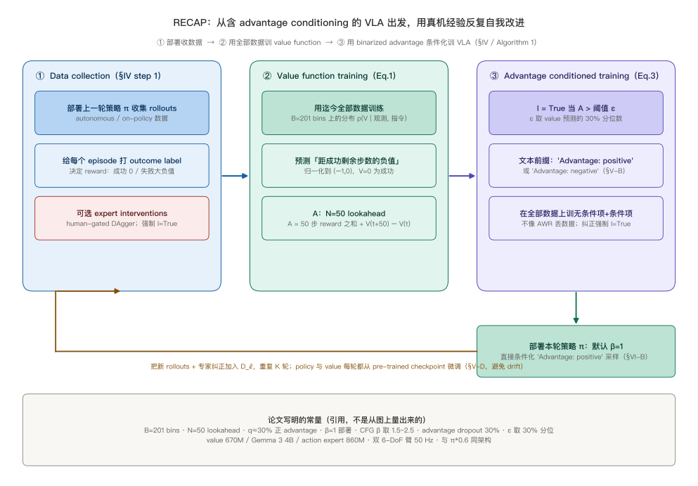
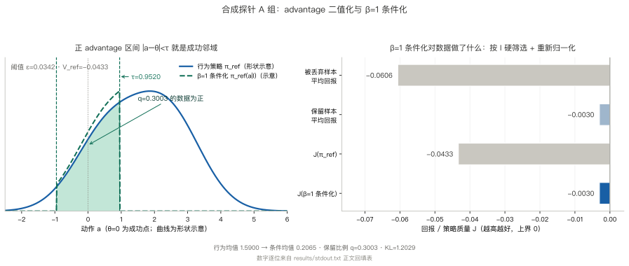
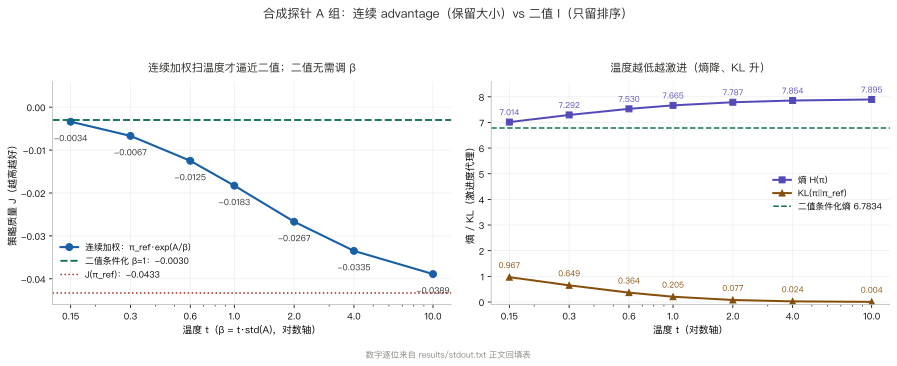
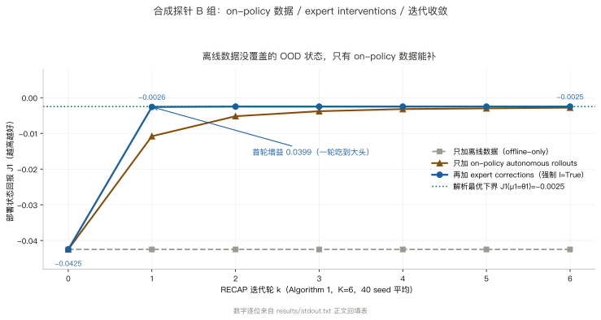
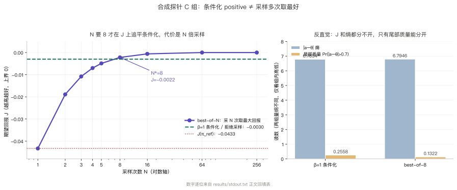
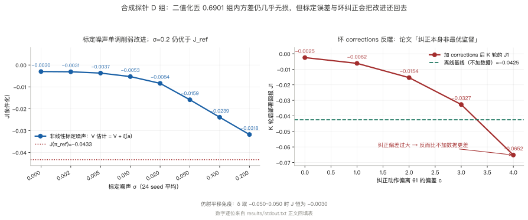

> **系列导航**：这是 π 系列具身模型深潜的第 7 篇。系列按**问题**组织：动作怎么表示（01 π0 / 02 FAST / 03 KI）→ 长程任务怎么拆（04 Hi Robot / 05 π0.5）→ 延迟怎么吃掉（06 RTC）→ **怎么从经验里学（07 RECAP / 08 RLT）** → 记忆与条件（09 MEM / 10 π0.7）。06 篇 RTC 解决的是动作块之间的执行节奏——推理延迟下怎么接才不抖，它不改策略，策略该出错还是出错。本篇换一个问题：**策略本身怎么从自己跑出来的经验与人工纠正里改进**，答案是从离线预训练的 VLA 出发，用 value function 把每段数据标成好或坏，再靠 advantage 条件化把好动作提取出来（[arXiv:2511.14759](https://arxiv.org/abs/2511.14759)）。

> **TL;DR**
>
> * **核心问题与结论**：06 篇 RTC 只管动作块之间的执行节奏，策略本身仍会犯错。RECAP 让 VLA 从真实部署经验里自我改进：先训一个 distributional value function 给数据打 advantage，再把 advantage 二值成文本条件喂回策略，从含次优数据的集合里提取更优行为（[arXiv:2511.14759](https://arxiv.org/abs/2511.14759)）。
> * **关键证据**：合成探针上 $$\beta=1$$ 条件化把 $$J_{\mathrm{ref}}=-0.0433$$ 拉到 $$J_{\mathrm{cond}}=-0.0030$$，等价于按 $$I$$ 硬筛选数据（保留 $$-0.0030$$ vs 丢弃 $$-0.0606$$）；离线基线 $$J_1=-0.0425$$ 恒定，加人工纠正后到 $$-0.0025$$（[实验目录](https://github.com/lrypcy/ipynbs/tree/12bea380ce7a11d1323edd352c96676baa6566bd/experiments/pi-vla/pi-07)，36 条断言）。
> * **适用边界与代价**：论文没有数值结果表，Fig.7–12 柱状图无柱顶数字，吞吐翻倍以上、失败率减半只是正文相对结论；合成探针里 best-of-N 在回报与熵上都与条件化分不开，坏纠正反而比不加数据更差（[实验目录](https://github.com/lrypcy/ipynbs/tree/12bea380ce7a11d1323edd352c96676baa6566bd/experiments/pi-vla/pi-07)）。
> * **系列定位**：不改执行节奏，改策略本身；08 RLT 走冻结 VLA、只训小 actor-critic 的另一条路。

## 1. 问题：策略不够好时，经验怎么变成改进

05 篇收尾时留了一句很不客气的话：π0.5 “far from perfect”，高层语义推断（该把衣服放洗衣篮还是衣柜）与底层动作（抓没抓稳）都会出错。06 篇 RTC 补的是另一层——低层调用之间怎么接才不停顿、不跳到分布外。但把动作块接得再平滑，也不会让一个本来就会选错动作的策略突然选对。RTC 是**推理时算法**，给定同一个 $$\pi_\theta$$ 只换拼接方式；策略参数一个字节都没动（[arXiv:2506.07339](https://arxiv.org/abs/2506.07339)）。

于是剩下的问题很直接：能不能让 VLA 用自己部署出来的数据变好？难点不在「RL 能涨点」，而在**数据本身是异构的**—— demonstrations 是人给的好动作，autonomous rollouts 是策略自己跑出来的、好坏混杂，expert interventions 是人在自主执行中途插进来的纠正。传统 offline RL 要么把次优数据大幅降权，要么干脆丢掉；RECAP 的目标是把三类数据一起用上，从含次优数据的集合里把更优策略提取出来（[arXiv:2511.14759](https://arxiv.org/abs/2511.14759)）。

| | 06 RTC | 07 RECAP |
| --- | --- | --- |
| 改的是什么 | 推理时怎么拼接动作块 | 训练时用什么目标、从什么数据学 |
| 是否重训 | 否，纯推理时改动 | 是，端到端微调 VLA 与 value function |
| 数据来源 | 不改数据 | demonstrations + autonomous rollouts + expert interventions |
| 对应失效 | 切换点抖动、执行停顿 | 策略本身出错、次优数据没被利用 |
| 不改的部分 | 策略本身 | 执行节奏（仍交给 RTC） |

论文把方法命名为 **RECAP**，全称是 RL with Experience and Corrections via Advantage-conditioned Policies（首字母缩成 RECAP）：用经验与纠正做 RL，靠 advantage 条件化的策略把它落地。起点是一个用 offline RL 预训练好的通用 VLA（即 $$\pi^*_{0.6}$$），再在下游任务上靠 on-robot data collection 专门化。

本文的阅读地图与实验入口放在下一节。有一处口径必须先说清：**图 1、图 2 是按论文文字重画的结构图，图 3–图 6 的数字全部来自合成探针 `results/stdout.txt`，不是论文原图**；论文 Fig.7–12 的柱状图没有柱顶数字，正文也不给数值表，不能目测估数。

## 2. 阅读地图、代码入口与符号表

| 章 | 问题 | 合成探针 | 配图 |
| --- | --- | --- | --- |
| §3–§4 | 三阶段、value function 与 advantage 条件化 | — | 图 1、图 2 |
| §5 | π*0.6 与 π0.6 的架构差异、基线对照 | — | — |
| §6 | 合成世界与自校验 | 自校验 | — |
| §7 | 二值化与 $$\beta=1$$ 硬筛选 | A 组 | 图 3 |
| §8 | on-policy 数据、纠正与迭代 | B 组 | 图 4 |
| §9 | best-of-N 的等价边界 | C 组 | 图 5 |
| §10 | 标定代价、信息损失、坏纠正 | D 组 | 图 6 |
| §11–§12 | 论文实验与边界 | — | — |

三个入口：[论文 v2 HTML 全文](https://arxiv.org/html/2511.14759v2)（§III 的 advantage 定义、§IV 的 Eq.(1)–(3) 与 Algorithm 1、§V-C 的 reward 与 value 预测目标、附录 A-E / A-F 的超参）、[arXiv abs 页](https://arxiv.org/abs/2511.14759)（arXiv.org perpetual non-exclusive license，[项目页](https://pi.website/blog/pistar06)）、[ipynbs `experiments/pi-vla/pi-07/`](https://github.com/lrypcy/ipynbs/tree/12bea380ce7a11d1323edd352c96676baa6566bd/experiments/pi-vla/pi-07)（纯 numpy / CPU / 36 条断言）。

符号沿用前六篇，只补这一篇新增的：

| 符号 | 含义 | 出处 |
| --- | --- | --- |
| $$I_t$$ | binarized advantage indicator，文本串 `Advantage: positive/negative` | 论文 §V-B |
| $$A^{\pi}(\mathbf{o}_t,\mathbf{a}_t)$$ | n-step advantage，post-training 取 $$N=50$$ lookahead | 论文 §III / 附录 A-F |
| $$V^{\pi_{\mathrm{ref}}}$$ | 由 distributional value function 反算的连续值 | 论文 §IV-A Eq.(1) |
| $$B$$ | value bins 数，$$B=201$$ | 论文 §IV-A |
| $$\epsilon_\ell$$ | 任务相关阈值，取 30% percentile | 论文 §V-D / 附录 A-F |
| $$\beta$$ | 条件化强度；部署默认 $$\beta=1$$，CFG 取 $$[1.5,2.5]$$ | 论文 §VI-B / 附录 A-E |
| $$\alpha$$ | Eq.(3) 里条件项的权重 | 论文 §IV-B |
| $$\hat\ell$$ | 模型自产的文本子任务 | 05 篇 / 论文 §V-A |
| $$J(\pi)$$ | 合成探针里的策略质量 $$\mathbb{E}_\pi[V]$$，越高越好 | 本文 §6 |

## 3. 方法推导（一）：RECAP 的三阶段与 Algorithm 1

RECAP 把「从经验里学」拆成可重复的三步（§IV step 1–3、Algorithm 1）：

| 阶段 | 输入 | 产出 | 出处 |
| --- | --- | --- | --- |
| ① Data collection | 部署 $$\pi_\ell^{k-1}$$；给每个 episode 打 task outcome label 决定 reward；可选 expert interventions 纠正早期错误 | 加入 $$\mathcal{D}_\ell$$ 的 on-policy 数据 | §IV step 1 |
| ② Value function training | 迄今收集的全部数据 | 多任务 distributional value function $$V^{\pi_{\mathrm{ref}}}$$，能检测失败并判断距完成还剩多久 | §IV step 2 / Eq.(1) |
| ③ Advantage conditioned training | 全部数据 + ② 导出的 advantage 的 optimality indicator | 条件化于 $$I_t$$ 的 VLA，从含次优数据里提取更优策略 | §IV step 3 / Eq.(3) |

Algorithm 1 把它写成两道工序：预训练阶段在全部 demonstrations 上只做 ②+③（tens of thousands of hours、多个任务与多种机器人），得到 $$V_{\mathrm{pre}}$$ 与 $$\pi_{\mathrm{pre}}$$；下游任务再做 ①②③ 一轮或多轮。

| Algorithm 1 步骤 | 动作 |
| --- | --- |
| 0–2 | 在 $$\mathcal{D}_{\mathrm{demo}}$$ 上用 Eq.(1) 训 $$V_{\mathrm{pre}}$$、用 Eq.(3) 训 $$\pi_{\mathrm{pre}}$$ |
| 3–5 | 用任务 $$\ell$$ 的 demonstrations 初始化 $$\mathcal{D}_\ell$$；$$V_\ell^0$$、$$\pi_\ell^0$$ 分别从 $$V_{\mathrm{pre}}$$、$$\pi_{\mathrm{pre}}$$ 出发微调 |
| 6–10 | 对 $$k=1..K$$：用 $$\pi_\ell^{k-1}$$ 收数据加入 $$\mathcal{D}_\ell$$；从 $$V_{\mathrm{pre}}$$ 训 $$V_\ell^k$$；从 $$\pi_{\mathrm{pre}}$$ 训 $$\pi_\ell^k$$ |

最容易读漏的是 6–10 行的起点：**每一轮的 policy 与 value function 都从 pre-trained checkpoint 微调，而不是接着上一轮的权重继续训**。论文 §V-D 把理由写明为防止多轮迭代的漂移（drift）；同一节还说实践中一轮常已带来显著改进。specialists 从 pre-trained model 微调，final generalist 则从头训练（[arXiv:2511.14759v2 §IV / §V-D](https://arxiv.org/html/2511.14759v2)）。

## 4. 方法推导（二）：value function、Eq.(2) 与 Eq.(3)

### value function 预测的不是「好坏分」，是「还差多少步成功」

§IV-A 把 value function 写成 **distributional** 形式：$$p_\phi(V\mid\mathbf{o}_t,\ell)\in\Delta_B$$ 把观测与语言命令映射到 $$B$$ 个离散 value bins 上的分布，架构与 VLA 相同但用更小的 VLM backbone。经验回报 $$R_t(\tau)=\sum_{t'=t}^{T}r_{t'}$$ 离散化到 $$B=201$$ bins，训练目标是交叉熵（Eq.(1)）：

$$
\min_\phi\ \mathbb{E}_{\tau\in\mathcal{D}}\Big[\sum_{\mathbf{o}_t\in\tau}H\big(R_t^B(\tau),\,p_\phi(V\mid\mathbf{o}_t,\ell)\big)\Big]
$$

连续值由 bin 分布反算：

$$
V^{\pi_{\mathrm{ref}}}(\mathbf{o}_t,\ell)=\sum_{b\in[0,B]}p_\phi(V=b\mid\mathbf{o}_t,\ell)\,v(b),\qquad B=201
$$

这里有个极容易写错的点：它预测的是**成功 episode 中「距成功还剩多少步」的负值**，按每任务最大 episode 长度归一化到 $$(-1,0)$$，$$0$$ 对应成功完成；失败 episode 对应一个大负值。§V-C 的 Eq.(5) 把 reward 定义得很干净——成功末端 $$0$$、失败末端 $$-C_{\mathrm{fail}}$$（大常数）、其余每步 $$-1$$：

$$
r_t=\begin{cases}
0, & t=T,\ \text{success}\\
-C_{\mathrm{fail}}, & t=T,\ \text{failure}\\
-1, & \text{otherwise}
\end{cases}
$$

这个估计器是数据集所代表 behavior policy 的 **Monte Carlo / on-policy 估计**，比经典 off-policy Q 函数「更不优」但简单、可靠。网络用 **670M 参数**的 VLM backbone、同样从 **Gemma 3** 初始化，与 VLA 同语言输入、同架构设计，为防止过拟合还 co-train 一小份多模态 web data（[arXiv:2511.14759v2 §V-C](https://arxiv.org/html/2511.14759v2)）。

advantage 在 post-training 用 $$N=50$$ lookahead（附录 A-F）：

$$
A^{\pi}(\mathbf{o}_t,\mathbf{a}_t)=\sum_{t'=t}^{t+N-1}r_{t'}+V^{\pi}(\mathbf{o}_{t+N})-V^{\pi}(\mathbf{o}_t),\qquad N=50
$$

预训练阶段取 $$N=T$$（方差更高，但 VLA 预训练时单次 value function 推理即可在线算 advantage）。

| value function 要点 | 内容 | 出处 |
| --- | --- | --- |
| 形式 | distributional，输出 $$B=201$$ 个 value bins 上的分布 | §IV-A Eq.(1) |
| 训练目标 | 经验回报离散化后的交叉熵 | §IV-A |
| 预测目标 | 成功 episode「距成功剩余步数的负值」，归一化到 $$(-1,0)$$ | §V-C / Fig.4 |
| reward | 成功末端 0、失败末端 $$-C_{\mathrm{fail}}$$、其余步 $$-1$$ | §V-C Eq.(5) |
| 网络 | 670M 参数 VLM backbone，从 Gemma 3 初始化 | §V-C |
| 估计器性质 | behavior policy 的 Monte Carlo / on-policy 估计 | §IV-A |
| advantage | post-training $$N=50$$；预训练 $$N=T$$ | 附录 A-F |

### Eq.(2)：把「提取更优策略」写成一次 Bayes 重写

§III 先摆出正则化 RL 的两个结果。KL 情形下 $$\hat{\pi}\propto\pi_{\mathrm{ref}}\exp(A^{\pi_{\mathrm{ref}}}/\beta)$$；更一般地，若 $$p(I\mid A)=g(A)/\int g(A')\,dA'$$ 且 $$g$$ 单调递增，则

$$
\hat{\pi}(\mathbf{a}\mid\mathbf{o})\propto\pi_{\mathrm{ref}}(\mathbf{a}\mid\mathbf{o})\,p(I\mid A^{\pi_{\mathrm{ref}}}(\mathbf{o},\mathbf{a}))^{\beta}
$$

保证 $$\mathcal{J}(\hat{\pi})\ge\mathcal{J}(\pi_{\mathrm{ref}})$$。用 Bayes 把 $$p(I\mid A)$$ 展开成两个条件策略之比，就得到 Eq.(2)：

$$
\hat{\pi}(\mathbf{a}\mid\mathbf{o},\ell)\ \propto\ \pi_{\mathrm{ref}}(\mathbf{a}\mid\mathbf{o},\ell)\left(\frac{\pi_{\mathrm{ref}}(\mathbf{a}\mid I,\mathbf{o},\ell)}{\pi_{\mathrm{ref}}(\mathbf{a}\mid\mathbf{o},\ell)}\right)^{\beta}
$$

取 $$\beta=1$$ 时分子分母相消，结论干净得几乎不像 RL：

$$
\beta=1\ \Longrightarrow\ \hat{\pi}=\pi_{\mathrm{ref}}(\mathbf{a}\mid I,\mathbf{o},\ell)
$$

也就是说，**最优策略就是「在给定改进指示器为真」的条件下，行为策略本来的条件分布**。改进指示器取 $$p(I\mid A)=\delta(A^{\pi_{\mathrm{ref}}}(\mathbf{o},\mathbf{a},\ell)>\epsilon_\ell)$$，$$\epsilon_\ell$$ 是任务相关阈值。论文特意用 $$\epsilon_\ell$$ 来权衡正则与最优性，而不是像 CFGRL 那样取 $$\epsilon=0$$ 再在测试时调 $$\beta$$——后者用高 CFG 权重会把动作分布推向支撑集角落、产生过于激进的动作（[arXiv:2511.14759v2 §IV-B](https://arxiv.org/html/2511.14759v2)）。

### Eq.(3)：训练用全部数据，人工纠正强制为真

策略目标（Eq.(3)）在**迄今所有数据** $$\mathcal{D}_{\pi_{\mathrm{ref}}}$$ 上同时学无条件项与条件项：

$$
\min_\theta\ \mathbb{E}_{\mathcal{D}_{\pi_{\mathrm{ref}}}}\Big[-\log\pi_\theta(\mathbf{a}_t\mid\mathbf{o}_t,\ell)-\alpha\log\pi_\theta(\mathbf{a}_t\mid I_t,\mathbf{o}_t,\ell)\Big]
$$

$$
I_t=\mathbf{1}\big(A^{\pi_{\mathrm{ref}}}(\mathbf{o}_t,\mathbf{a}_t,\ell)>\epsilon_\ell\big)
$$

$$\mathcal{D}_{\pi_{\mathrm{ref}}}$$ 是 demonstrations 与 autonomous attempts 的混合，$$\pi_{\mathrm{ref}}$$ 因而是人类行为与历史策略的混合；论文强调这**不像 AWR 那样丢弃或大幅降权大量数据**。对自主 rollout 中提供的 expert corrections，**强制 $$I_t=\text{True}$$**（假设专家总给出好的纠正动作）。连续动作的似然无法精确求值，改用 flow matching loss，Eq.(4) 给出其作为整体动作似然下界的推导。

二值化落到输入上是两个文本串（§V-B）：$$I_t=\text{True}$$ 时写 `Advantage: positive`，否则写 `Advantage: negative`。indicator 放在训练序列里 $$\hat{\ell}$$ **之后**、离散与连续动作**之前**，于是**只有 action log-likelihoods 受影响**，模型其余的 next-token 预测照旧。

| 条件化设置 | 取值 | 出处 |
| --- | --- | --- |
| 文本条件 | $$I_t=\text{True}$$ → `Advantage: positive`；否则 `Advantage: negative` | §V-B |
| 位置 | $$\hat\ell$$ 之后、动作之前 | §V-B |
| 部署默认 | $$\beta=1$$，直接条件化为 $$I_t=\text{True}$$ 采样 | §VI-B |
| CFG 可选 | $$\beta\in[1.5,2.5]$$；训练时 advantage conditioning dropout 30%，使同一模型能表示条件与无条件分布 | §V-B / 附录 A-E、A-F |
| 阈值 | $$\epsilon_\ell$$ 取 value function 对该任务预测值的 30% percentile | §V-D |
| SFT 阶段 | 下游先用目标任务 demonstrations 微调，固定 $$I_t=\text{True}$$（等价 SFT） | §V-D |

## 5. π*0.6 与 π0.6：唯一架构差异与基线对照

架构这条线要接回 05 篇。π0.5 已经能用 flow matching 表示 chunked action distributions，并产生中间文本做高层策略推理；**KI（Knowledge Insulation）** 用 stop gradient 端到端训练连续动作与离散 FAST tokens，防止 flow-matching action expert 影响模型其余部分。π0.6 相对 π0.5 有三点改进：预训练数据增加多个机器人平台、base VLM 换成 **Gemma 3 4B**、action expert 增大到 **860M** 参数。模型形式是 $$\pi_\theta(\mathbf{a}_{t:t+H},\hat{\ell}\mid\mathbf{o}_t,\ell)$$，输出 50 Hz 的关节角与夹爪指令动作块，动作在 $$\hat{\ell}$$ 之后生成，故条件化于预测子任务（[arXiv:2511.14759v2 §V-A](https://arxiv.org/html/2511.14759v2)）。

**π*0.6 相对 π0.6 的唯一架构差异，是新增「条件化于 binarized advantage indicator $$I_t$$」的能力**——也就是那段 `Advantage: positive/negative` 文本；VLA 其余部分与 π0.6 完全相同。配套还有一个一同训练、也从 VLM 初始化的 value function（670M、Gemma 3、$$B=201$$ bins），VLA 条件化于它给出的二值 advantage。

| | π0.5 | π0.6 | π*0.6 |
| --- | --- | --- | --- |
| base VLM | PaliGemma 初始化 | Gemma 3 4B | Gemma 3 4B |
| action expert | 300M | 860M | 860M |
| 训练配方 | KI + FAST + 异构共训练 | KI + FAST + 更多平台数据 | 同 π0.6，另加 advantage indicator |
| 条件于 $$I_t$$ | 否 | 否 | 是 |

§VI-B 列了 **5 个对比模型**，与两个 policy extraction 基线：

| 模型 | 构成 |
| --- | --- |
| Pre-trained $$\pi_{0.5}$$ | 无 RL、无 RECAP |
| Pre-trained $$\pi_{0.6}$$ | 监督预训练、无 advantage indicator |
| RL pre-trained $$\pi^*_{0.6}$$ | offline RL 预训练 + value function，含 $$I_t$$ |
| $$\pi^*_{0.6}$$ offline RL + SFT | 加 demonstrations 微调，$$I_t$$ 固定 True |
| $$\pi^*_{0.6}$$ (ours) | 完整 RECAP：autonomous rollouts + expert corrections，默认 $$\beta=1$$ |

对照方法是 **AWR**（从 $$\pi_{0.6}$$ 出发，用同一 value function 的 advantage 做 advantage weighted regression）与 **PPO**（DPPO/FPO 变体，单步 diffusion 目标算 likelihood + SPO 约束）。两者用与最终 RECAP 模型相同的数据（§VI-C3 说明这对基线略有利），论文给的是定性结论：都远逊于 RECAP、难以超过 offline RL + SFT，PPO 需很小的 trust-region 约束（$$\eta=0.01$$）才能在此 off-policy 设定下稳定。

## 6. 合成探针：把 advantage 条件化搬进可解析的高斯世界

真实 VLA 的 RECAP 要跑多轮 on-robot 收集、670M value function 与 4B VLA 的微调；在**单步标量动作的高斯世界**里，「带二值 advantage 的条件化」有闭式解，可以扫很多 seed 而不必训练网络。合成世界的定义（详见 [README](https://github.com/lrypcy/ipynbs/tree/12bea380ce7a11d1323edd352c96676baa6566bd/experiments/pi-vla/pi-07)）：

- 回报 $$V(a)=-(a-\theta)^2/A_{\mathrm{MAX}}^2\in(-1,0]$$，$$\theta=0$$ 是成功点（$$V=0$$），$$A_{\mathrm{MAX}}=10.0$$；这是论文「预测距成功剩余步数的负值」的连续化抽象，仿射归一化不改变 advantage 的符号与排序。
- 行为策略 $$\pi_{\mathrm{ref}}$$ 是两个高斯的混合：「好」模式 $$\mathcal{N}(0.6,1)$$ 与「次优」模式 $$\mathcal{N}(2.4,1)$$，后者权重 0.55，整体均值 1.5900，偏离成功点。
- $$V_{\mathrm{ref}}=\mathbb{E}_{\pi_{\mathrm{ref}}}[V]=-0.0433$$（解析高斯二阶矩、网格积分、201-bin 直方图反算三路一致：-0.0433 / -0.0433 / -0.0435）；$$A(a)=V(a)-V_{\mathrm{ref}}$$ 是 behavior policy 的 on-policy MC 估计，单步世界即 $$N=50$$ lookahead 的退化。
- $$I=\mathbf{1}(A>\epsilon_\ell)$$，$$\epsilon_\ell$$ 取使约 30% 数据为正的分位阈值。因 $$V$$ 是 $$a^2$$ 的单调仿射，$$I=\text{True}$$ 等价于 $$\lvert a-\theta\rvert<\tau=0.9520$$，实测 $$\epsilon_\ell=0.0342$$、正比例 0.3003（重合度 0.9999）。
- 策略质量 $$J(\pi)=\mathbb{E}_\pi[V]$$（上界 0），另看熵与 $$\mathrm{KL}(\hat{\pi}\Vert\pi_{\mathrm{ref}})$$ 作激进度代理。

$$
V(a)=-\frac{(a-\theta)^2}{A_{\mathrm{MAX}}^2}\in(-1,0],\qquad I=\mathbf{1}(A>\epsilon_\ell)\ \Longleftrightarrow\ \lvert a-\theta\rvert<\tau
$$

自校验包括 201-bin distributional value 的手写梯度与有限差分一致（相对误差 4.23e-09）、$$\pi_{\mathrm{ref}}$$ 在网格上归一、成功点是 $$V$$ 的全局最大。**36 条断言全绿，纯 numpy / CPU / 固定 seed / 多 seed 平均**；它测的是机制，不是论文成绩的复现。

| 论文概念 | 探针里的替身 | 没建模的部分 |
| --- | --- | --- |
| distributional value / $$B=201$$ | 201 bins 上的分布与手写梯度 | 670M VLM backbone、Gemma 3、真实图像 |
| 异构数据 | 双高斯混合行为策略 | 多机器人平台、可变形物体 |
| advantage 二值化 | 30% 分位阈值 → 文本条件 | FAST token / flow matching / KI |
| 三阶段 Algorithm 1 | 两状态 contextual bandit 的 K 轮 | 多步轨迹、失败末端 $$-C_{\mathrm{fail}}$$ |
| on-policy / 纠正 | autonomous rollouts + 强制 $$I=\text{True}$$ 的纠正 | human-gated DAgger 的质量波动 |

## 7. A 组：二值化与 $$\beta=1$$ 条件化对数据做了什么

A 组先扫连续加权 $$\hat{\pi}\propto\pi_{\mathrm{ref}}\exp(A/\beta)$$（§III 的 KL 结果），温度写成无量纲 $$\beta=t\cdot\mathrm{std}(A)$$：

| $$t$$ | $$\beta=t\cdot\mathrm{std}(A)$$ | $$J(\hat{\pi})$$ | 熵 $$H$$ | $$\mathrm{KL}(\hat{\pi}\Vert\pi_{\mathrm{ref}})$$ |
| --- | --- | --- | --- | --- |
| 0.15 | 0.00712 | -0.0034 | 7.0142 | 0.9672 |
| 0.30 | 0.01424 | -0.0067 | 7.2920 | 0.6491 |
| 0.60 | 0.02848 | -0.0125 | 7.5296 | 0.3641 |
| 1.00 | 0.04747 | -0.0183 | 7.6648 | 0.2047 |
| 2.00 | 0.09495 | -0.0267 | 7.7870 | 0.0768 |
| 4.00 | 0.18989 | -0.0335 | 7.8539 | 0.0242 |
| 10.00 | 0.47473 | -0.0389 | 7.8950 | 0.0045 |

$$t$$ 越小越锐利，$$J$$ 越靠近 0、熵越低、KL 越大；连续加权最优在 $$t=0.15$$、$$J=-0.0034$$。二值条件化（$$\beta=1$$）不调温度，直接给 $$J=-0.0030$$——两者几乎分不开。

| $$\beta=1$$ 条件化的读数 | 原始值 |
| --- | --- |
| $$J_{\mathrm{ref}}\to J_{\mathrm{cond}}$$ | -0.0433 → -0.0030 |
| 保留样本平均回报 / 被丢弃样本平均回报 | -0.0030 / -0.0606 |
| 保留比例 $$q$$ / 阈值 $$\tau$$ / $$\epsilon_\ell$$ | 0.3003 / 0.9520 / 0.0342 |
| 行为策略均值 → 条件策略均值 | 1.5900 → 0.2065 |
| 熵 $$H_{\mathrm{ref}}\to H_{\mathrm{cond}}$$ / $$\mathrm{KL}_{\mathrm{cond}}$$ | 7.9222 → 6.7834 / 1.2029 |
| Eq.(2) Bayes 逐点等价最大偏差 | 1.08e-19 |

三件事值得分开看（[stdout.txt](https://github.com/lrypcy/ipynbs/tree/12bea380ce7a11d1323edd352c96676baa6566bd/experiments/pi-vla/pi-07)）：

**$$\beta=1$$ 条件化 = 按 $$I$$ 硬筛选数据 + 重新归一化。** 保留样本平均回报 -0.0030，丢弃样本 -0.0606；动作均值从 1.5900 被拉到 0.2065（成功点 $$\theta=0$$）；支撑收缩到熵 7.9222 → 6.7834、KL 1.2029。Eq.(2) 的 Bayes 重写在 $$\beta=1$$ 时逐点等于 $$\pi_{\mathrm{ref}}(a\mid I)$$，最大偏差 1.08e-19。

**但训练并没有丢数据。** Eq.(3) 在全部数据上学无条件项与条件项两项，部署只从条件分布采样；「硬筛选」是部署采样的效果，不是训练丢弃了样本——这正是论文强调「不像 AWR 那样丢弃 / 大幅降权大量数据」的地方。

**硬二值指示下 CFG 的 $$\beta$$ 会退化。** 此时 $$p(I\mid A)=\mathbf{1}/\mathrm{Pr}(I)$$ 在区间内是常数，$$(\cdot)^{\beta}$$ 归一化后 $$\beta$$ 被消掉；论文 A-E 的 $$\beta>1$$ 锐化依赖 learned conditional 与 unconditional 之间的**连续似然比**，本探针用硬集合指示，没有建模这一层。

## 8. B 组：on-policy 数据、人工纠正与迭代

B 组把「分布偏移」压成两个离散状态：demonstrations 覆盖状态 0，部署要面对 demo 没覆盖的状态 1。离线数据永远碰不到状态 1，on-policy rollouts 能覆盖但不一定指向好动作，expert corrections 既覆盖又强制 $$I=\text{True}$$ 地指向 $$\theta_1$$。

| 轮 $$k$$ | 只离线 | +autonomous | +corrections |
| --- | --- | --- | --- |
| 0 | -0.0425 | -0.0425 | -0.0425 |
| 1 | -0.0425 | -0.0108 | -0.0026 |
| 2 | -0.0425 | -0.0052 | -0.0025 |
| 3 | -0.0425 | -0.0038 | -0.0025 |
| 4 | -0.0425 | -0.0032 | -0.0025 |
| 5 | -0.0425 | -0.0030 | -0.0025 |
| 6 | -0.0425 | -0.0028 | -0.0025 |

只加离线数据时 $$J_1$$ 恒定 -0.0425：OOD 状态从未被覆盖，迭代再多也不涨。加 corrections 后一轮就到 -0.0026、第二轮到 -0.0025，正好贴住解析最优下界 -0.0025；**首轮增益 0.0399**，之后逐轮增益 0.0000，一轮就吃到大部分收益（对应论文 §V-D「实践中一轮常已显著改进」）。只加 autonomous rollouts 也能改进但慢，K=6 时 -0.0028 仍逊于 corrections 的 -0.0025（[stdout.txt](https://github.com/lrypcy/ipynbs/tree/12bea380ce7a11d1323edd352c96676baa6566bd/experiments/pi-vla/pi-07)）。

这正好给 §3 那条实现细节一个可测的注脚：每轮用**迄今全部累积的 $$I=\text{True}$$ 样本**重新提策略，且 policy 与 value function 都从 pre-trained checkpoint 起算而非上一轮权重，增益才会逐轮收敛而不是漂移。论文 §VI-C2 的真机迭代也是这个形状：laundry 两轮约 50% throughput 提升、第一轮成功率已超 90%，box assembly 第二轮后 2× 提升但先降后升。

## 9. C 组：best-of-N 与条件化的等价性边界

「条件化为 positive」常被随口等价于「多采几次取最好」。C 组把三件事分开：二值接受拒绝采样（按 $$I$$ 接受、保留原密度）、$$\beta=1$$ 条件化、best-of-N 取最大回报（order statistic）。前两者的分布相同（$$J_{\mathrm{rej}}=-0.0030=J_{\mathrm{cond}}$$），best-of-N 是另一回事。

| $$N$$ | 1 | 2 | 3 | 4 | 5 | 8 | 16 | 64 | 256 |
| --- | --- | --- | --- | --- | --- | --- | --- | --- | --- |
| $$J(\text{best-of-}N)$$ | -0.0433 | -0.0189 | -0.0108 | -0.0070 | -0.0049 | -0.0022 | -0.0006 | -0.0000 | -0.0000 |
| 选中 $$\lvert a-\theta\rvert$$ 的熵 | 7.9222 | 7.6763 | 7.4768 | 7.3050 | 7.1546 | 6.7946 | 6.1878 | 4.8576 | 3.4839 |

期望回报随 $$N$$ 单调增、上界是成功点 $$V=0$$（$$N=256$$ 时 -0.0000）。数值上最接近条件化的是 $$N^*=8$$、$$J=-0.0022$$（对 -0.0030）。**反直觉的地方在这里**：在 $$J$$ 最接近的 $$N^*$$ 处，两者连 $$\lvert a-\theta\rvert$$ 的熵都几乎相等——条件化 6.7834 对 best-of-8 6.7946，**回报与熵都分不开两种机制**。真正的区别在区间边缘尾部质量 $$\mathrm{Pr}(\lvert a-\theta\rvert>0.7)$$：条件化 0.2558 对 best-of-8 0.1322，以及代价——best-of-N 部署要 $$N^*$$ 倍候选，条件化从单模型一次采样即可（[stdout.txt](https://github.com/lrypcy/ipynbs/tree/12bea380ce7a11d1323edd352c96676baa6566bd/experiments/pi-vla/pi-07)）。

## 10. D 组：标定代价、信息损失与坏纠正

D 组专收代价。第一件是**二值化丢了多少信息**：把连续 $$A$$ 压成 1 bit，方差分解成组间（二值可解释）与组内（丢失）两部分。

| 信息损失 | 原始读数 |
| --- | --- |
| $$\mathrm{Var}(A)$$ 总 / 组间 / 组内 | 0.002254 / 0.000699 / 0.001555 |
| 组内方差占比（信息损失） | 0.6901 |
| 二值 $$J$$ / 连续加权最优 $$J$$ | -0.0030 / -0.0034 |

丢了 0.6901 的组内方差，二值 $$J$$ 仍是 -0.0030、甚至略优于连续加权最优 -0.0034。原因不是「二值化无损」，而是 $$I$$ 只依赖 $$A$$ 的**排序**，这个世界里 reward 又是 $$a^2$$ 的单峰函数、正 advantage 区间恰是成功邻域；换成多峰 reward，丢大小信息的代价会更大。

| 标定噪声 $$\sigma$$ | 0.000 | 0.002 | 0.005 | 0.010 | 0.020 | 0.050 | 0.100 | 0.200 |
| --- | --- | --- | --- | --- | --- | --- | --- | --- |
| $$J(\text{条件化})$$ | -0.0030 | -0.0031 | -0.0037 | -0.0053 | -0.0084 | -0.0159 | -0.0239 | -0.0318 |

第二件是 **value 标定误差怎么传导**。仿射平移 $$\delta$$ 从 -0.050 扫到 0.050，$$J$$ 恒为 -0.0030——$$I$$ 只看排序，仿射标定误差被完全免疫。与 $$a$$ 相关的非线性噪声会打乱排序，$$J$$ 随 $$\sigma$$ 单调不增；但即便 $$\sigma=0.2$$（远超 $$V$$ 量级），$$J=-0.0318$$ 仍优于 $$J_{\mathrm{ref}}=-0.0433$$，改进没有被完全抹平。

| 纠正偏差 $$c$$ | 0.00 | 1.00 | 2.00 | 3.00 | 4.00 |
| --- | --- | --- | --- | --- | --- |
| K 轮后 $$J_1$$ | -0.0025 | -0.0062 | -0.0154 | -0.0327 | -0.0652 |

第三件最该写进边界：**坏 corrections 会让迭代比不加数据更差**。纠正动作偏离 $$\theta_1$$ 越远（$$c$$ 越大），K 轮后 $$J_1$$ 单调下降；$$c=4$$ 时 -0.0652 已经差于「完全不加数据」的离线基线 -0.0425。这正对应论文 §V-D 那句提醒：intervention 是干扰事件，专家也无法保证一致质量或改善细微行为，纠正主要用于修大错与克服探索困难，**本身不构成最优监督**（[stdout.txt](https://github.com/lrypcy/ipynbs/tree/12bea380ce7a11d1323edd352c96676baa6566bd/experiments/pi-vla/pi-07)）。

## 11. 论文实验报了什么，没报什么

先把最要紧的一条摆前面：**论文全文没有数值结果表**。arXiv v2 里 15 个 `<table>` 全是公式排版（Eq.(1)–(13) 等），所有量化结果都在 **Fig.7–12 的 PNG 柱状图**里，图内**没有柱顶数值标注**，只有纵轴刻度与 standard error 误差棒。因此吞吐翻倍、失败率减半的**具体表格读数在论文里不存在**，能引用的只有正文写明的相对倍数与文字数字（[arXiv:2511.14759v2 §VI](https://arxiv.org/html/2511.14759v2)）。

| | 论文写明的 | 论文没给的 |
| --- | --- | --- |
| 头号结论 | 最难任务上 throughput **more than doubles**、failure rate **roughly halves / 2× or more**（Abstract、§I、§VI-C1、§VII） | 逐任务 successes/hour 与绝对成功率 |
| 持续运行 | 连续 **13 小时**做 espresso、**两小时以上**在新家叠 novel laundry（§I）；工厂真实装箱 | 逐小时曲线、绝对件数 |
| 评测设置 | **5 个对比模型**；AWR / PPO 用同一数据对照；除 diverse laundry 外最终成功率 **90%+**（§VI-B、§VI-C1、§VI-C3） | AWR / PPO 的精确 throughput 数值 |
| 多轮迭代 | 两轮后 laundry 约 **50%** throughput 提升、box assembly **2×** 提升（§VI-C2、Fig.9 / Fig.10） | 每轮逐柱读数 |
| 失败模式移除 | 两轮 RECAP、每轮 600 trajectories 后 **97%** 成功率，且完全不靠 intervention data 或额外 demonstrations（§VI-C4、Fig.12） | 消融的精确数值 |
| 指标 | throughput = successes/hour；success rate 由人工标注者聚合多个质量指标 | 逐任务绝对 throughput / 成功率 |

用户常点名的「去掉 interventions」「去掉 on-policy data」「只做 BC」这类消融，论文**没有以这些名字命名的独立数值表**，只有阶段式基线的**定性**相对结论：T-shirt folding 迭代实验只用 autonomous evaluation data（无人工纠正）两轮后仍约 50% throughput 提升；失败模式移除实验无 intervention data 也无额外 demonstrations 仍达 97%；「$$\pi^*_{0.6}$$ offline RL + SFT」到最终模型之间才是 throughput more than doubles、failure rate 约 factor of two 的差距。AWR 成功率合理但更慢、throughput 更低，PPO 稳定但性能不佳（需 $$\eta=0.01$$），**精确数值均不可得**。

合成探针里的 -0.0030、-0.0425 这些数字是探针自己的量（单步标量动作的回报），与 successes/hour 不是同一量纲，改进幅度不可与真机直接比，更不能拿去补 Fig.7–12 的空。

## 12. 边界与代价

| 边界 | 具体表现 | 怎么读 |
| --- | --- | --- |
| 论文无数值表 | Fig.7–12 柱状图无柱顶数字，只有刻度与误差棒 | 只能引用相对倍数，不能目测估数 |
| 二值化丢信息 | 组内方差占比 0.6901 | 单峰 reward 下才几乎无损；多峰 / 高 advantage 区不等于最优区时代价更大 |
| CFG 锐化未建模 | 硬二值指示下 $$\beta$$ 在理论 Bayes 形式里退化 | 探针只验 $$\beta=1$$；$$\beta>1$$ 依赖连续似然比 |
| best-of-N 分不开 | $$J$$ -0.0022 vs -0.0030、熵 6.7946 vs 6.7834 | 回报与熵都不足以判别机制，要看尾部质量 0.2558 vs 0.1322 与 $$N^*$$ 倍采样代价 |
| 坏纠正反噬 | $$c=4$$ 时 -0.0652 差于离线基线 -0.0425 | 人工纠正非最优监督，专家质量不一致会拖累迭代 |
| 合成探针不是复现 | 单步标量动作、两状态 OOD | 只比同一口径下的相对差异，不对表真机 |
| 许可证与配图 | arXiv.org perpetual non-exclusive（与 06 篇 CC BY 4.0 不同） | 官方图不复用，6 张图全部重画 |

两条反直觉结论必须再强调一次，不能只报正结果：**best-of-N 在 $$J$$ 与熵上都与条件化分不开**（差别落在尾部质量与采样代价），**坏纠正反而比不加数据更差**（对应论文「纠正本身非最优监督」）。它们一个划清了「条件化 positive」与拒绝采样 / 重采样的边界，一个划清了人工干预数据的适用条件。

还有一处口径：论文 §V-D 自己承认 intervention 无法保证一致质量、也改善不了整体速度这类细微行为，所以纠正用于修大错与克服探索困难；把 DAgger 式「专家即最优」的假设直接搬过来，就会在 $$c$$ 偏大时得到比基线更差的策略。

## 13. 小结

* **三阶段回答的是「经验怎么进策略」。** data collection → value function training → advantage conditioned training；每轮 policy 与 value function 都从 pre-trained checkpoint 微调而非上一轮（防 drift），实践中一轮常已显著改进。
* **value function 预测的是「还差多少步成功」的负值。** distributional、$$B=201$$ bins、归一化到 $$(-1,0)$$、670M Gemma 3 backbone；$$N=50$$ lookahead 给 advantage，reward 是成功末端 0 / 失败末端 $$-C_{\mathrm{fail}}$$ / 其余 $$-1$$。
* **$$\beta=1$$ 条件化等价于按 $$I$$ 硬筛选数据。** Eq.(2) 给出 $$\hat{\pi}=\pi_{\mathrm{ref}}(\mathbf{a}\mid I,\mathbf{o},\ell)$$；合成探针上 $$J_{\mathrm{ref}}=-0.0433\to J_{\mathrm{cond}}=-0.0030$$、保留 -0.0030 vs 丢弃 -0.0606，但 Eq.(3) 训练仍用全部数据，人工纠正强制 $$I_t=\text{True}$$。
* **唯一架构差异是新增 advantage indicator。** π0.6 = Gemma 3 4B + 860M action expert + KI + FAST；π*0.6 只是多一个插在 $$\hat\ell$$ 之后、动作之前的文本条件 `Advantage: positive/negative`，部署默认 $$\beta=1$$、CFG 可选 $$[1.5,2.5]$$。
* **别把探针数字当论文成绩，也别只报正结果。** 吞吐翻倍以上 / 失败率减半 / 13 小时 espresso / 两小时新家叠衣 / 90%+ / 两轮 50% 与 2× / 97% 都是引用，Fig.7–12 没有数值表；合成探针里 best-of-N 在 $$J$$ 与熵上都分不开、坏纠正反而更差。
* **代价落在数据与标定上。** 二值化丢 0.6901 组内方差仍几乎无损（单峰 reward 下）；标定噪声 $$\sigma=0.2$$ 时 $$J=-0.0318$$；坏纠正 $$c=4$$ 时 -0.0652 差于 -0.0425。

07 篇解决的是「策略本身怎么从经验里改」。08 篇 RLT 换一条路：冻结 VLA，只训一个小 actor-critic，用更少的改动去碰同一个自我改进问题。

## 参考

- RECAP / π\*0.6 论文：*π\*0.6: a VLA That Learns From Experience*，[arXiv:2511.14759](https://arxiv.org/abs/2511.14759)（v2，2025-11-19；本文 §III 的 advantage 定义、§IV 的 Eq.(1)–(3) 与 Algorithm 1、§V 的架构与部署设置、§VI 的实验结论、附录 A-E / A-F 的超参取自 [v2 HTML 全文](https://arxiv.org/html/2511.14759v2)）。论文采用 **arXiv.org perpetual non-exclusive license**（与 06 篇 RTC 的 CC BY 4.0 不同），**官方图不复用**；[项目页](https://pi.website/blog/pistar06)。本文永久链接 [/2026/11/06/pi-vla-07-recap/](/2026/11/06/pi-vla-07-recap/)。
- **配图说明**：本文 6 张图全部重画。**图 1、图 2 是按论文文字重画的结构图**——三阶段流水线与 advantage 条件化，图上标注的常量（$$B=201$$、$$N=50$$、$$\beta=1$$、CFG $$[1.5,2.5]$$、dropout 30%、$$\epsilon_\ell$$ 30% 分位）来自论文写明的值，不是从图上量出来的；**图 3–图 6 是数据图，数字逐位来自 `results/stdout.txt` 的合成探针，不是论文原图**。
- 前作：[π0 流匹配](/2026/11/02/pi-vla-01-pi0-flow-matching/)、[FAST 动作 tokenizer](/2026/11/03/pi-vla-02-fast-action-tokenizer/)、[Knowledge Insulation](/2026/11/03/pi-vla-03-knowledge-insulation/)、[Hi Robot](/2026/11/04/pi-vla-04-hi-robot/)、[π0.5](/2026/11/05/pi-vla-05-pi05/)、[RTC](/2026/11/06/pi-vla-06-rtc/)（动作块接口、长程子任务与执行节奏）。RTC 论文见 [arXiv:2506.07339](https://arxiv.org/abs/2506.07339)。
- 配套实验：[`experiments/pi-vla/pi-07/`](https://github.com/lrypcy/ipynbs/tree/12bea380ce7a11d1323edd352c96676baa6566bd/experiments/pi-vla/pi-07)，commit `12bea38`，**36 条断言全绿**，纯 numpy / CPU，`recap_lab.ipynb`（notebook）+ `results/stdout.txt` + `recap_figures.py` 生成的 6 张 SVG（figures）三件齐，`recap_lab.py` 为其源码。合成世界的 J 与真机 successes/hour 不是同一量纲，不对表。

> **下一篇**：π 系列具身模型（08）：RL Token —— 冻结 VLA，只训一个会改动作的小脑袋。
>
> **上一篇**：[π 系列具身模型（06）：RTC —— 推理延迟下，动作块怎么接才不会抖](/2026/11/06/pi-vla-06-rtc/)
