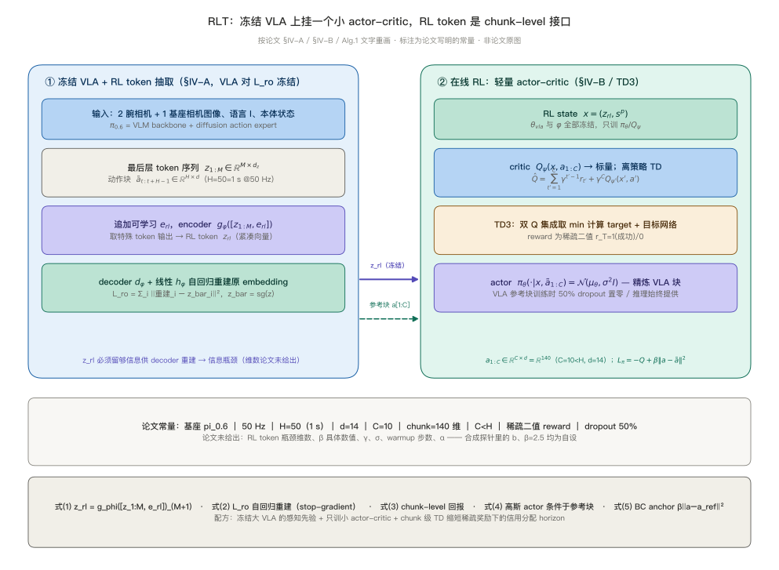
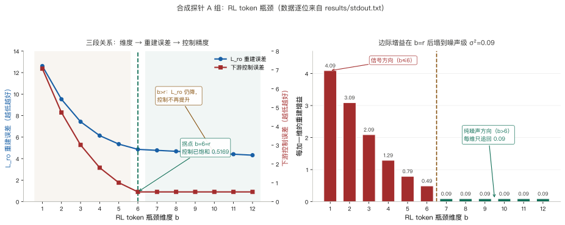
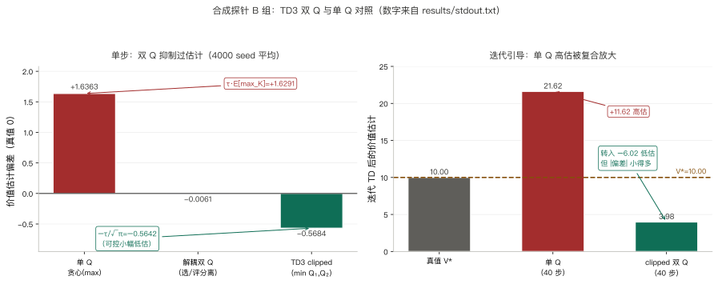
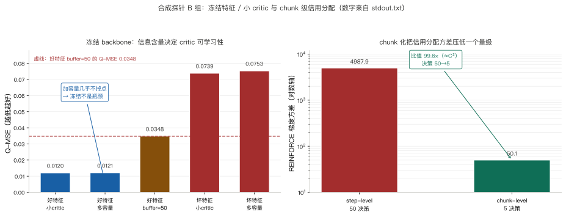
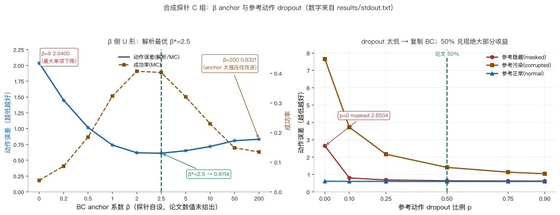
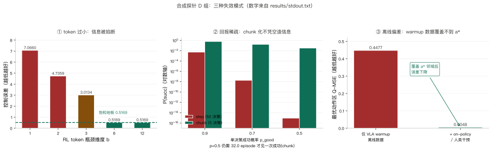

> **系列导航**：这是 π 系列具身模型深潜的第 8 篇。系列按**问题**组织：动作怎么表示（01 π0 / 02 FAST / 03 KI）→ 长程任务怎么拆（04 Hi Robot / 05 π0.5）→ 延迟怎么吃掉（06 RTC）→ **怎么从经验里学（07 RECAP / 08 RLT）** → 记忆与条件（09 MEM / 10 π0.7）。07 篇 RECAP 的回答是端到端训整个 $$\pi^*_{0.6}$$、用大尺度数据改长时程策略；本篇的 RLT 是同一个问题的另一条路：**冻结 VLA，只训一个挂在紧凑表示上的小 actor-critic，用几小时真机在线 RL 只改精细阶段**（[arXiv:2604.23073](https://arxiv.org/abs/2604.23073)）。两条路不是替代关系，而是「改多少参数、用多少数据、改哪一段」上的不同取舍。

> **TL;DR**
>
> * **核心问题与结论**：07 篇 RECAP 端到端训整个 $$\pi^*_{0.6}$$、靠大尺度数据改长时程；本篇冻结 $$\pi_{0.6}$$，在最后层 token 序列后追加可学习 embedding 训出 RL token，让几小时真机在线 RL 只训一个小 actor-critic，专改 5–20 秒精细阶段（[arXiv:2604.23073](https://arxiv.org/abs/2604.23073)）。
> * **关键证据**：合成探针上瓶颈维度到内在秩即饱和、重建仍降而控制精度停在 0.5169，双 Q 用 −0.5684 的小幅低估换掉 +1.6363 的高估，β 锚定呈倒 U 形且 β=0 比满锚定更差（[实验目录](https://github.com/lrypcy/ipynbs/tree/12bea380ce7a11d1323edd352c96676baa6566bd/experiments/pi-vla/pi-08)，45 条断言全绿）。
> * **适用边界与代价**：只覆盖关键阶段、依赖稀疏二值奖励与 VLA 参考块；论文无数值表，20%→65%、up to 3× 等仅是正文相对结论，逐任务成功率与吞吐只在柱状图里，引用须带限定（[v2 全文](https://arxiv.org/html/2604.23073v2)）。
> * **系列定位**：与 07 RECAP 同属「从经验里学」的两条路；记忆与条件交给 09 MEM。

## 1. 问题：从经验里学，还有一条更轻的路

06 篇 RTC 是**推理时算法**：给定同一个策略，只换动作块之间的拼接方式，参数一个字节都不动。07 篇 RECAP 反过来动策略本身——用分布价值函数给每段数据打 advantage，再靠 advantage 条件化把好动作提取出来，端到端微调整个 VLA 与 value function，在 espresso、叠衣、装箱这类长时程任务上换来吞吐翻倍以上（[arXiv:2511.14759](https://arxiv.org/abs/2511.14759)）。

于是有一个很自然的问题：**如果任务不长，只是某个 5–20 秒的精细阶段总做不好，值不值得把整个大模型再训一遍？** 拧螺丝、穿扎带、插网口、插充电器这类动作，前段的抓取与搬运基座已经能做，真正难的是接触瞬间那几秒的对齐与果断插入。RLT 的答案是把「改策略」收缩成「改一个局部动作编辑器」：VLA 与一个压缩表示**全部冻结**，只在冻结表示上在线训练一个轻量 actor-critic，用稀疏二值奖励把精细阶段练好（[arXiv:2604.23073v2 §I](https://arxiv.org/html/2604.23073v2)）。

| | 07 RECAP | 08 RLT |
| --- | --- | --- |
| 基座 | $$\pi^*_{0.6}$$（含 advantage indicator） | **$$\pi_{0.6}$$**（不是 $$\pi^*_{0.6}$$） |
| 改哪些参数 | 端到端微调整个 VLA 与 value function | 冻结 VLA 与 RL token，只训 2–3 层 MLP 的 actor / critic |
| 表示 | 分布式 value function + 文本 advantage 条件 | 追加 embedding 压出的紧凑 **RL token** |
| 策略形式 | advantage 条件化，全模型重新采样动作 | 高斯 actor 以 VLA 参考块为条件做**局部精炼** |
| 数据规模 | 大尺度、示范 + 自主 rollout + 人工纠正、长时程 | 每任务 1–10 小时示范 + 几小时在线 RL |
| 作用范围 | 长时程整体行为 | 只改 5–20 秒 critical phase |
| 对应失效 | 次优数据没被利用、策略整体出错 | 精细接触阶段反复试探、对齐失败 |

有一处口径必须先说清：**论文全文没有表格**（HTML 中 `ltx_table` 计数为 0），Fig.4 / Fig.5 / Fig.6 的逐任务成功率与吞吐只在柱状图里，正文只给了零星百分比与相对倍数；β 的具体数值、RL token 的瓶颈维度、折扣因子 γ 都**未给出**。本文 6 张图里，图 1 是按论文文字重画的结构图，图 2–图 6 是数据图、数字逐位来自合成探针 `results/stdout.txt`，不是论文原图。

## 2. 阅读地图、代码入口与符号表

| 章 | 问题 | 合成探针 | 配图 |
| --- | --- | --- | --- |
| §3 | RL token 怎么构造、为什么是信息瓶颈 | 自校验 | 图 1 |
| §4 | 冻结之后 actor / critic 怎么接、Eq.(3)–(5) | — | — |
| §5 | 完整系统、Alg.1 循环与工程常量 | — | — |
| §6 | 合成世界定义与构造真值↔反算值自校验 | 自校验 | — |
| §7 | 瓶颈维度 ↔ 重建误差 ↔ 控制精度 | A 组 | 图 2 |
| §8 | 双 Q 过估计、小 critic 可学习性、信用分配与稀疏奖励 | B 组 | 图 3、图 4 |
| §9 | β 锚定的倒 U 形与 50% 参考动作 dropout | C 组 | 图 5 |
| §10 | 维度过小 / 回报过稀疏 / 离线偏差三类失效 | D 组 | 图 6 |
| §11–§12 | 论文实验、消融、边界与代价 | — | — |

三个入口：[论文 v2 HTML 全文](https://arxiv.org/html/2604.23073v2)（§III 的 VLA 接口与稀疏奖励、§IV-A 的 Eq.(1)–(2) 与 Fig.2、§IV-B 的 Eq.(3)–(5)、§V 的 Algorithm 1、§VI 的实验与 App.-B 超参）、[arXiv abs 页](https://arxiv.org/abs/2604.23073)（arXiv.org perpetual non-exclusive license，[项目页](https://pi.website/research/rlt)）、[ipynbs `experiments/pi-vla/pi-08/`](https://github.com/lrypcy/ipynbs/tree/12bea380ce7a11d1323edd352c96676baa6566bd/experiments/pi-vla/pi-08)（纯 numpy / CPU / 45 条断言，notebook + 固化输出 + figures 三件齐）。

符号沿用前七篇，只补这一篇新增的：

| 符号 | 含义 | 出处 |
| --- | --- | --- |
| $$H$$ | VLA 动作块长度，$$H=50$$，对应 1 s @ 50 Hz；开环只执行前 20 步 | 论文 §III |
| $$C$$ | RL 动作块长度，$$C=10<H$$ | 论文 §III / App.-B |
| $$d$$ | 单步动作维度 $$d=14$$；RL chunk 为 $$C\cdot d=140$$ 维 | 论文 §VI-A |
| $$z_{1:M}$$ | VLA 最后层 token 嵌入序列 | §IV-A |
| $$e_{rl}$$ | 追加在序列末尾的可学习 embedding | Eq.(1) |
| $$z_{rl}$$ | 特殊位置读出的紧凑 **RL token**，瓶颈维度**未给出** | Eq.(1) |
| $$g_\phi,\,d_\phi,\,h_\phi$$ | 轻量 encoder transformer / decoder transformer / 线性输出投影 | §IV-A |
| $$L_{\mathrm{ro}}$$ | Eq.(2) 自回归平方 L2 重建损失 | Eq.(2) |
| $$\mathrm{sg}(\cdot)$$ | stop-gradient，作用于 VLA 嵌入 $$\bar z_i=\mathrm{sg}(z_i)$$ | Eq.(2) |
| $$x$$ | RL state，$$x=(z_{rl},\,s^p)$$ | Eq.(3) |
| $$Q_\psi$$ | critic，输入 $$x$$ 与动作块、输出标量；TD3 双 Q 取 min | Eq.(3) / §III |
| $$\pi_\theta$$ | 高斯 actor，$$\mathcal{N}(\mu_\theta,\,\sigma^2 I)$$，直接输出动作块 | Eq.(4) |
| $$\tilde a_{1:C}$$ | VLA 采样的**参考动作块**，actor 以它为条件 | Eq.(4) / Eq.(5) |
| $$\beta$$ | Eq.(5) 锚定正则系数，**具体数值未给出**（消融只有 $$\beta=0$$） | Eq.(5) / §IV-B |
| $$r_T$$ | episode 末尾稀疏二值奖励，成功 $$1$$、否则 $$0$$ | §III |

## 3. 方法推导（一）：把 VLA 最后层压成一个 RL token

基座是 **$$\pi_{0.6}$$**：输入最多 4 路相机图像、语言指令 $$\ell$$ 与本体状态 $$s^p_t$$，由 VLM backbone 与 diffusion-based action expert 输出动作块 $$\tilde a_{t:t+H-1}\in\mathbb{R}^{H\times d}$$，$$H=50$$、50 Hz、一块正好 1 秒，控制器开环只执行前 20 步再重规划。VLA 只负责整体行为；RL 只用于 5–20 秒的 critical phase，简单前段仍由 base VLA 执行，测试时可再对 VLA 做一次短微调让它自己预测切换点（[arXiv:2604.23073v2 §III / §V](https://arxiv.org/html/2604.23073v2)）。

图 1 把整条链路画在一起。关键一步是**给 VLA 最后层 token 序列追加一个可学习 embedding** $$e_{rl}=e_\phi(\langle\mathrm{rl}\rangle)$$，用轻量 encoder transformer $$g_\phi$$ 处理拼接序列，取特殊位置的输出作为 $$z_{rl}$$（Eq.(1)）：

$$
z_{rl}=g_\phi\big([z_{1:M},\,e_{rl}]\big)_{M+1},\qquad e_{rl}=e_\phi(\langle\mathrm{rl}\rangle)
$$

随后另加一个 decoder transformer $$d_\phi$$ 与线性投影 $$h_\phi$$，**自回归重建原始嵌入**。重建目标写成 Eq.(2) 的平方 L2 损失，目标 $$\bar z_i=\mathrm{sg}(z_i)$$ 对 VLA 嵌入取 stop-gradient：

$$
L_{\mathrm{ro}}=\mathbb{E}_{\mathcal{D}}\Big[\sum_{i=1}^{M}\Vert h_\phi\big(d_\phi([z_{rl},\,\bar z_{1:i-1}])\big)_i-\bar z_i\Vert^2\Big],\qquad \bar z_i=\mathrm{sg}(z_i)
$$

encoder 的最后一个输入必须独自承载重建整段序列所需的信息，于是 $$z_{rl}$$ 天然成为**信息瓶颈**：既要小到够轻量在线 actor-critic 学习，又要留下任务相关结构。这是 RLT 与「直接用通用 CV 编码器」最本质的区别，§11 的 w/o RL token 消融正是把这一点单独拆出来验。

| RL token 构造要点 | 内容 | 出处 |
| --- | --- | --- |
| 追加位置 | VLA 最后层 token 序列 $$z_{1:M}$$ 之后 | §IV-A / Eq.(1) |
| 读取方式 | 轻量 encoder transformer 取特殊位置 $$M+1$$ 输出 | §IV-A |
| 瓶颈机制 | encoder–decoder 自回归重建，$$z_{rl}$$ 必须保留重建信息 | §IV-A / Fig.2 |
| 重建损失 | Eq.(2) 平方 L2，目标对 VLA 嵌入 stop-gradient | Eq.(2) |
| 训练数据 | 每任务 1–10 小时遥操作示范，2000–10000 gradient steps | §IV-A / §VI-B / App.-B |
| 联合目标 | $$\phi,\theta_{\mathrm{vla}}=\arg\min[L_{\mathrm{ro}}(\phi)+\alpha L_{\mathrm{vla}}(\theta_{\mathrm{vla}})]$$，$$\alpha$$ 数值未给出 | Alg.1 |
| VLA 是否冻结 | 对 $$L_{\mathrm{ro}}$$ 冻结；可选与 SFT 联合，之后 $$\theta_{\mathrm{vla}}$$ 与 $$\phi$$ 全部冻结 | §IV-A |

两个易混淆的数必须点名：actor / critic 的 MLP hidden 是 256（扎带、以太网、充电器，2 层）或 512（螺丝，3 层），$$d=14$$、chunk 为 140 维——**这些都不是 RL token 的瓶颈维度**，论文只称 compact embedding / small vector / bottleneck，全文未给 $$z_{rl}$$ 的具体维数。

## 4. 方法推导（二）：冻结之后，只训一个小 actor-critic

初始适配阶段结束后，**VLA 与 RL token 表示全部冻结**，从零初始化的轻量 actor $$\pi_\theta$$ 与 critic $$Q_\psi$$ 才开始在线训练。RL state 是 $$x=(z_{rl},\,s^p)$$：$$z_{rl}$$ 由 2 路腕部相机 + 1 路基座相机图像产生，$$s^p$$ 是本体状态（关节位置或末端位姿）。critic 输入状态与动作块 $$a_{1:C}$$、输出**标量**；actor 输出一个高斯分布，**直接生成动作块**，并且额外以 VLA 采样的参考块 $$\tilde a_{1:C}$$ 为条件（Eq.(4)）：

$$
\pi_\theta(\cdot\mid x,\,\tilde a_{1:C})=\mathcal{N}\big(\mu_\theta(x,\,\tilde a_{1:C}),\,\sigma^2 I\big)
$$

这一步是全文最容易被读漏的设计：actor **不是从零生成动作，而是精炼（refine / edit）VLA 提出的动作块**。参考块同时保留了 VLA 多峰动作分布的 mode 信息——单峰高斯若没有 $$\tilde a$$ 作条件，很难自己恢复该走哪个 mode。因此 RLT 是「围绕 VLA 动作分布的局部编辑」，不是残差策略，也不是在 flow VLA 的隐噪声空间里做 RL。

critic 走经典 off-policy actor-critic，论文明确「follow TD3」：目标网络 $$\psi'$$、**双 Q 集成取 min** 计算 target，critic 损失为 Eq.(3)：

$$
L_Q=\mathbb{E}\big[(\hat Q-Q_\psi(x,\,a_{1:C}))^2\big],\qquad \hat Q=\sum_{t'=1}^{C}\gamma^{t'-1}r_{t'}+\gamma^{C}\,\mathbb{E}_{a'\sim\pi_\theta}\big[Q_{\psi'}(x',\,a')\big]
$$

奖励是 **episode 末尾的稀疏二值**：人类监督者在结尾标成功或失败，$$r_T=1$$（成功）或 $$0$$（否则），其余步没有稠密 shaping。$$C=10$$、$$d=14$$、chunk 为 $$140$$ 维、控制 50 Hz；$$C<H$$ 让 RL 的决策次数比逐步决策少一个量级，这一点 §8 会用梯度方差量化。

actor 目标（Eq.(5)）在最大化 critic value 的同时用 $$\beta$$ 锚定到参考块：

$$
L_\pi(\theta)=\mathbb{E}\Big[-Q_\psi(x,\,a_{1:C})+\beta\,\Vert a_{1:C}-\tilde a_{1:C}\Vert^2\Big]
$$

| 设计点 | 内容 | 出处 |
| --- | --- | --- |
| 冻结范围 | VLA 与 RL token 表示全部冻结，只训 actor / critic | §IV-B |
| RL state | $$x=(z_{rl},\,s^p)$$，$$z_{rl}$$ 来自 2 腕 + 1 基座相机 | Eq.(3) / §VI-A |
| critic | $$Q_\psi(x,\,a_{1:C})\in\mathbb{R}$$ 标量；TD3 双 Q 取 min + 目标网络 | Eq.(3) / §III / App.-B |
| actor | 高斯分布直接输出动作块，以 $$\tilde a_{1:C}$$ 为条件 | Eq.(4) |
| 精炼语义 | 保留 VLA 多峰 mode，局部编辑而非从零生成 | §IV-B |
| Eq.(5) 正则 | $$\beta\,\Vert a_{1:C}-\tilde a_{1:C}\Vert^2$$ 锚定到 VLA 参考块 | Eq.(5) |
| 奖励 | 稀疏二值，$$r_T\in\lbrace 0,\,1\rbrace$$ | §III / App.-B |
| 尺寸 | $$C=10$$、$$d=14$$、chunk 140 维、50 Hz | §VI-A / App.-B |

β 的含义是「actor 被正则到采样 VLA 动作有多强」，类比 KL-regularized RL；**它的具体数值论文未给出**，全文只有符号 $$\beta$$ 与消融里的 $$\beta=0$$。与锚定正则配套的是**参考动作 dropout**：训练时把 batch 中随机一部分 transition 的参考块**置零**（50%），推理时**始终提供**。失败模式很具体——「以 $$\tilde a$$ 为条件」加「向 $$\tilde a$$ 正则」都鼓励 actor 留在 VLA 附近，critic 尚无信息时 actor 可能直接复制 $$\tilde a$$；dropout 强制它维持一条独立的动作生成通路，等 critic 给出有用信号再自然偏离（[arXiv:2604.23073v2 §IV-B / §VI-C Q3](https://arxiv.org/html/2604.23073v2)）。

## 5. 方法推导（三）：完整系统、Alg.1 与工程常量

Alg.1 把在线循环写成两道并发的工序。先按 $$t=0,\,C,\,2C,\ldots$$ 推进环境步，每步采一次 VLA 参考块、组 RL state，再按「人工干预 / warmup / $$\pi_\theta$$」三选一取动作执行，存 transition，最后做 $$G$$ 次离策略更新（$$G$$ 数值未给出）。rollout 与 learning 异步。

| Alg.1 / §V 环节 | 内容 | 出处 |
| --- | --- | --- |
| Warmup | 先用 VLA 参考策略 rollout $$N_{\mathrm{warm}}$$ 步预填充 replay buffer，给 critic 初始信号；$$N_{\mathrm{warm}}$$ 未给出 | §V / Alg.1 |
| Buffer 组成 | VLA warmup 数据 + 在线 RL rollouts + 可选人类遥操作干预 | §V / §I |
| 人类干预 | 操作员可用 $$a^h$$ 覆盖 actor 输出，干预动作**替换 buffer 中的 VLA 参考** | §V |
| 块子采样 | stride = 2，存 $$\langle x_0,a_{0:C}\rangle,\langle x_2,a_{2:C+2}\rangle,\ldots$$；每秒约 25 个样本 | §V / App.-B |
| 更新比 | update-to-data = 5；**每次 actor 更新配 2 次 critic 更新** | §V |
| 评测 | critical-phase 设定下每 agent 每任务 50 episodes | §VI-A |
| 指标 | 成功率（人类二值 reward）；throughput = 每 10 分钟成功完成次数 | §VI-B |

| 常量 | 值 | 出处 |
| --- | --- | --- |
| 基座 / 频率 | $$\pi_{0.6}$$ / 50 Hz | §III / §VI-A |
| VLA 块 | $$H=50$$（1 s），开环只执行前 20 步 | §III |
| RL 块 | $$C=10$$、$$d=14$$、chunk 140 维、$$C<H$$ | §III / §VI-A |
| 奖励 | 稀疏二值 $$r_T=1/0$$ | §III / App.-B |
| 参考动作 dropout | 50%（训练置零，推理始终提供） | App.-B |
| 示范 / 训练量 | 每任务 1–10 小时示范、2000–10000 gradient steps | §VI-B / App.-B |
| 在线 RL | 400–1000 episodes；排除 reset 后约 15 分钟–5 小时真机数据 | §VI-B |

## 6. 合成探针：把冻结 VLA 上的在线 RL 搬进线性高斯世界

真实 RLT 要跑几小时真机、VLM backbone 与去噪 action expert；在**线性高斯世界**里，encoder–decoder 的平方 L2 重建损失有闭式 Bayes 最优解——秩-$$b$$ 的 PCA 投影，于是可以扫很多 seed 而不必训练 transformer。世界定义（详见 [README](https://github.com/lrypcy/ipynbs/tree/12bea380ce7a11d1323edd352c96676baa6566bd/experiments/pi-vla/pi-08)）：VLA 最后层 token 序列由低秩任务码 $$v\in\mathbb{R}^r$$（$$r=6$$）经冻结正交映射加噪生成，$$D=60$$、$$\sigma^2=0.09$$；$$z_{rl}$$ 取秩-$$b$$ 投影；actor 用 Eq.(5) 的闭式最优局部编辑，critic 用线性岭回归，双 Q 过估计用离散候选 + 估计噪声的标准抽象。

自校验先钉死构造真值与反算值：手写 encoder / decoder 重建梯度 ↔ 有限差分相对误差 `1.10e-09`；PCA 解析重建误差 ↔ MC 最大相对误差 `0.002`；下游控制误差解析 ↔ MC 最大相对误差 `0.001`。**45 条断言全绿，纯 numpy / CPU / 固定 seed / 多 seed 平均**；它测的是机制，不是论文成绩的复现。

| 论文概念 | 探针里的替身 | 没建模的部分 |
| --- | --- | --- |
| encoder–decoder 瓶颈、Eq.(2) | 秩-$$b$$ PCA 投影、stop-gradient 目标 | transformer 自回归、VLM backbone、图像编码器 |
| RL token 维度 | $$b=1..12$$ 扫描（**自设**） | 真实瓶颈维数（论文未给出） |
| 冻结特征上的 critic | 含 $$z_{rl}$$ 的线性岭回归 | 2 / 3 层 MLP、目标网络软更新 |
| TD3 双 Q 取 min | K 候选 + 估计噪声的离散抽象 | 真实 Q 网络、$$\gamma$$、$$\tau$$ |
| chunk 信用分配 | 决策数 50 → 5 的 REINFORCE 方差 | 稀疏二值 reward 另用 $$P(\mathrm{succ})=p_{\mathrm{good}}^N$$ 解析 |
| Eq.(5) 锚定 / dropout | 闭式局部编辑 + 状态通路有效训练度 | 可训练 Gaussian MLP、多峰动作分布 |

| 组 | 对应机制 | 验什么 |
| --- | --- | --- |
| A | §IV-A Eq.(1)(2)、Fig.2 瓶颈 | 维度 ↔ 重建 ↔ 控制三段关系与饱和拐点 |
| B | §IV-B Eq.(3)、TD3 双 Q、稀疏奖励、Alg.1 | 过估计、小 critic 可学习性、信用分配方差 |
| C | Eq.(4)(5)、50% dropout、$$\beta=0$$ / w/o Pass-Through | β 倒 U 形、复制依赖、不给参考还能不能学 |
| D | w/o Chunk、稀疏 reward、replay buffer 偏差 | 维度过小 / 回报枯竭 / 离线外推三类失效 |

## 7. A 组：瓶颈维度、重建误差与控制精度的三段关系

图 2 把 A 组最要紧的一件事画成一张图：重建误差单调下降，控制精度却在中途就停住。

| $$b$$ | 重建误差 $$L_{\mathrm{ro}}$$（解析） | 下游控制误差（解析） | 边际重建增益 |
| --- | --- | --- | --- |
| 1 | 12.6100 | 7.0660 | 4.0900 |
| 2 | 9.5200 | 4.7359 | 3.0900 |
| 3 | 7.4300 | 3.0134 | 2.0900 |
| 4 | 6.1400 | 1.8041 | 1.2900 |
| 5 | 5.3500 | 1.0067 | 0.7900 |
| 6 | 4.8600 | **0.5169** | 0.4900 |
| 7 | 4.7700 | 0.5169 | 0.0900 |
| 8 | 4.6800 | 0.5169 | 0.0900 |
| 9 | 4.5900 | 0.5169 | 0.0900 |
| 10 | 4.5000 | 0.5169 | 0.0900 |
| 11 | 4.4100 | 0.5169 | 0.0900 |
| 12 | 4.3200 | 0.5169 | 0.0900 |

三件事要分开看。第一，**$$b<r$$ 段维度不足**：$$b=1$$ 时控制误差 `7.0660`，是饱和值 `0.5169` 的 `13.7×`；重建 `12.6100` 也远高于 $$b=6$$ 的 `4.8600`。第二，**拐点恰好等于内在秩**：饱和拐点 $$b=6=r=6$$，$$b=6$$ 与 $$b=12$$、$$b=60$$ 全维 oracle 的控制误差同为 `0.5169`，压缩比 $$60/6=10\times$$。第三，也是最反直觉的一件——**$$b>r$$ 之后重建误差仍在降，控制精度已完全饱和**：$$b=6\to 12$$ 重建从 `4.8600` 降到 `4.3200`、共降 `0.5400`（$$=6\sigma^2$$），可那只是每维拟合到 $$\sigma^2=0.09$$ 的噪声，控制恒为 `0.5169`。

结论不能简化成「重建损失越低越好」。Eq.(2) 的 $$L_{\mathrm{ro}}$$ 是**表示目标**，不是控制目标；拿它继续往上堆 RL token 维度，买到的是噪声自由度，不是操纵精度。这一点与论文「compact embedding 够用即可」的措辞一致，但定量形状是合成世界里的读数，不是论文成绩。注意表中 $$b$$、$$r=6$$、$$D=60$$ 全部是**探针自设**，与论文未给出的瓶颈维度不是一回事。

## 8. B 组：双 Q 过估计、小 critic 与信用分配

图 3 画的是 TD3 双 Q 的偏差结构。B 组先在一个可解析的单步世界里量 maximization bias（真值 $$q_0=0$$，$$K=12$$ 候选，$$\tau=1$$，4000 seed 平均）。

| 估计量 | 单步偏差 | 解析参考 |
| --- | --- | --- |
| 单 Q 贪心（max） | **+1.6363** | $$\tau\,\mathbb{E}[\max_K]$$ = +1.6291 |
| 解耦双 Q（选 / 评分离） | −0.0061 | — |
| TD3 clipped（min） | **−0.5684** | $$-\tau/\sqrt{\pi}$$ = −0.5642 |

把偏差放进 40 步迭代 TD（16 seed，真值 $$V^*=10.00$$），复合效应把差别放大：单 Q 到 `21.62`（偏离 +11.62），clipped 双 Q 只到 `3.98`（偏离 −6.02）。

**这里必须诚实写清口径**：TD3 的 clipped min **不是无偏估计**，它是用可控的「小幅低估」换掉单 Q 的「大幅高估」——单步 −0.5684 对 +1.6363，迭代后 3.98 对 21.62。低估的绝对偏差（6.02）小于单 Q 高估的绝对偏差（11.62），这才是「抑制过估计」的准确含义，不能读成「双 Q 消除了偏差」。

冻结特征下的小 critic 可学习性是同一组的第二条线（16 seed 平均 Q-MSE，越低越好）：

| 特征 | 小 critic | 加大容量（多 40 随机特征） |
| --- | --- | --- |
| 好特征（含 RL token） | **0.0120** | 0.0121 |
| 坏特征（通用 CV，无任务信息） | 0.0739 | 0.0753 |

buffer 从 50 增到 2000，好特征 Q-MSE 从 `0.0348` 降到 `0.0120`——critic 确实在学，不是固定映射；backbone 全程冻结、不回传梯度，加大 critic 容量也几乎不掉点（`0.0120` 对 `0.0121`），说明瓶颈不在 critic 容量而在**特征有没有任务信息**。换成无任务信息的通用特征，Q-MSE 涨到 `0.0739` / `0.0753`，容量也救不回；这正对应论文 w/o RL token 换成 ResNet-10 后 throughput 下降 50% 的消融（[arXiv:2604.23073v2 §VI-C Q3](https://arxiv.org/html/2604.23073v2)）。

### chunk 化缩短的是信用分配，不是单个目标的噪声

图 4 把 $$C=10$$ 的意义拆成两个不同的量。

| 量 | step（$$N=50$$） | chunk（$$N=5$$） |
| --- | --- | --- |
| REINFORCE 梯度方差 | 4987.9 | **50.1** |
| 方差比值 | — | **99.6×**（解析 $$2N^2$$：5000 / 50） |
| 单 episode 决策数 | 50 | 5 |
| TD 引导传播次数 | 50 | 5 |

Eq.(3) 的 chunk 化把决策 / 引导传播次数按 $$C=10$$ 缩短（50 → 5），REINFORCE 方差按 $$C^2$$ 量级从 `4987.9` 压到 `50.1`，比值 `99.6×`——这是稀疏奖励长任务能不能学的关键。**但另一条必须同时说**：chunk 级**单个 TD 目标**是 $$C$$ 步奖励之和 $$\sum_{k<C}\gamma^k r$$，把 $$C$$ 步噪声一起加进来，其方差反而是单步目标的 `4.62×`（$$\gamma=0.9$$、$$C=10$$ 的合成设定）。chunk 化减小的是**决策数与引导传播次数**，即信用分配，不是单个目标内的噪声；把这两件事混成一个「方差变小」会读错 Eq.(3)。这里的 $$\gamma=0.9$$ 是探针自设，论文未给出 $$\gamma$$。

稀疏二值奖励下，chunk 化还决定了「能不能见到成功」（$$P(\mathrm{succ})=p_{\mathrm{good}}^N$$）：

| $$p_{\mathrm{good}}$$ | $$P(\mathrm{succ}\mid\mathrm{step})$$ | $$P(\mathrm{succ}\mid\mathrm{chunk})$$ | chunk 相对方差 $$\mathrm{CV}^2$$ |
| --- | --- | --- | --- |
| 0.9 | 5.15e-03 | 0.5905 | 0.7 |
| 0.7 | 1.80e-08 | 0.1681 | 4.9 |
| 0.5 | 8.88e-16 | 0.0312 | 31.0 |

step 粒度在 $$p_{\mathrm{good}}=0.5$$ 时成功率只有 `8.88e-16`，几乎不可学；chunk 把它抬到 `0.0312`。但相对方差随 $$p_{\mathrm{good}}$$ 下降从 `0.7` 涨到 `31.0`——回报越稀疏，二值回报的信息下界越紧，chunk 化也不凭空造信息（§10 会把这条推到边界）。

## 9. C 组：β 锚定的倒 U 形与 50% 参考动作 dropout

图 5 把 Eq.(5) 的锚定正则与参考动作 dropout 放在同一张图里看。

β 扫描（$$\kappa=1/(1+\beta)$$，$$D=0.80$$、$$V=2.00$$，解析最优 $$\beta^*=V/D=2.5$$）：

| $$\beta$$ | 动作误差（解析） | 动作误差（MC） | 成功率（MC） |
| --- | --- | --- | --- |
| 0.0 | **2.0400** | 2.0347 | 0.039 |
| 0.2 | 1.4511 | 1.4479 | 0.087 |
| 0.5 | 1.0178 | 1.0162 | 0.185 |
| 1.0 | 0.7400 | 0.7397 | 0.324 |
| 2.0 | 0.6178 | 0.6183 | **0.407** |
| 2.5 | **0.6114** | 0.6120 | 0.403 |
| 5.0 | 0.6511 | 0.6519 | 0.320 |
| 10.0 | 0.7177 | 0.7185 | 0.230 |
| 50.0 | 0.8097 | 0.8105 | 0.149 |
| 200.0 | **0.8321** | 0.8329 | 0.135 |

**$$\beta$$ 与动作误差是倒 U 形，不是单调**：$$\beta=0$$（论文 w/o BC Regularizer）动作误差 `2.0400`，比满锚定 $$\beta=200$$ 的 `0.8321` 还差，印证论文「最大的单项性能下降」；解析最优 $$\beta^*=2.5$$ 处 `0.6114`；$$\beta\gg\beta^*$$ 又把动作粘在带系统偏置的 VLA 参考上、压住 RL 改进。原因是这个世界里 critic 噪声 $$\tau_Q^2>D$$，完全没有锚定时 actor 只能靠带噪 Q 梯度在全动作空间探索。

还有一处不能抹平的反直觉：**阈值化成功率与 MSE 不必逐点同峰**。成功率峰值在 $$\beta=2$$（`0.407`），而 $$\beta^*=2.5$$ 为 `0.403`，二者差 `0.004`；倒 U 形结论不变，但「MSE 最优点 = 成功率最高点」并不成立。

参考动作 dropout 扫描（$$\beta=\beta^*=2.5$$）：

| $$p$$ | masked（无参考） | corrupted（参考污染） | normal（参考正常） | 复制依赖 $$\rho$$ |
| --- | --- | --- | --- | --- |
| 0.00 | **2.6504** | 7.6551 | 0.6119 | 1.0000 |
| 0.10 | 0.8029 | 3.7270 | 0.6033 | 0.6000 |
| 0.25 | 0.6865 | 2.1678 | 0.6028 | 0.3750 |
| 0.50 | **0.6405** | 1.4102 | 0.5999 | 0.2308 |
| 0.75 | 0.6270 | 1.1359 | 0.5998 | 0.1667 |
| 0.90 | 0.6231 | 1.0442 | 0.6002 | 0.1429 |

$$p=0$$ 时参考被污染会被原样复制（corrupted `7.6551`），不给参考就完全不会动（masked `2.6504`）——正是「塌缩成照抄 VLA」的失效模式。升到 $$p=0.5$$，masked 降到 `0.6405`（`4.1×`）、corrupted 降到 `1.4102`，复制依赖 $$\rho$$ 从 `1.0000` 单调降到 `0.2308`；而 normal 误差全程基本持平（`0.6119` → `0.6002`），因为推理时参考始终提供，dropout 不损害正常推理。

**但 50% 并非严格饱和**：$$p=0.5$$ 的 masked `0.6405` 升到 $$p=0.9$$ 还再降 `2.7%`（到 `0.6231`）。50% 兑现的是**绝大部分**收益，不是全部——把论文里的 50% 读成「理论最优」或「刚好饱和」都不准确。

最后一道口径必须钉死：上面所有 $$\beta$$ 扫描值（含 $$\beta^*=2.5$$）、$$\gamma=0.9$$、$$\sigma=0.2$$ 全部是**合成探针自设**，用来说明倒 U 形与 dropout 机制；论文只给了符号 $$\beta$$ 与消融里的 $$\beta=0$$，**没有给具体数值**，合成探针的 $$\beta=2.5$$ 不能冒充论文数值。同理，$$b=1..12$$、$$r=6$$、$$D=60$$ 也不是论文瓶颈维度。

## 10. D 组：三种失效边界

图 6 收的是前面四组里「什么时候这套办法不灵」的三类。

| 失效 | 合成读数 | 对应论文 |
| --- | --- | --- |
| token 维度过小 | $$b=1$$ 控制误差 `7.0660`（饱和值 `13.7×`）；$$7.0660\to4.7359\to3.0134\to0.5169$$ | 瓶颈须保留任务信息（§IV-A） |
| 回报过稀疏 | $$p_{\mathrm{good}}=0.5$$ 时仍需 `32.0` 个 episode 才见一次成功（chunk 化也不凭空造信息） | 稀疏二值奖励（§III） |
| 离线数据偏差 | 仅 VLA warmup 数据最优区 Q-MSE `0.4477`；补 on-policy / 干预数据后 `0.0048` | 干预替换 buffer 中 VLA 参考（§V） |

第三条最贴论文的工程细节：只用 VLA warmup 离线数据时，动作只覆盖参考块 $$\tilde a$$ 附近，最优动作区是外推，Q 误差 `0.4477`；补上 on-policy rollout 与人类干预、覆盖到 $$a^*$$ 邻域后降到 `0.0048`。这解释了 §5 里「人类干预动作会替换 buffer 中的 VLA 参考」为什么不是可有可无的便利功能，而是让 critic 见到最优区样本的必要条件。

## 11. 论文实验报了什么，没报什么

先把最要紧的一条摆前面：**论文全文没有任何数值结果表**，Fig.4 / Fig.5 / Fig.6 的逐任务成功率与吞吐只在柱状图里，正文只给了零星百分比与相对结论，不能目测估数（[arXiv:2604.23073v2 §VI](https://arxiv.org/html/2604.23073v2)）。

四个真机任务（§VI-A / Fig.3）：

| 任务 | 难点 | 精度线索 |
| --- | --- | --- |
| Screw installation | 螺丝头与刀头亚毫米对齐，刀尖距抓取点远、末端旋转被放大 | 主要来自对侧手臂广角腕相机 |
| Zip tie fastening | 双臂协调、可变形物体、紧公差 | 仅靠腕相机推断尾端与锁槽位置 |
| Ethernet insertion | 位置与角度对齐后须果断有力插入 | 小角度误差或犹豫接触会卡在外壳 |
| Charger insertion | 厘米级对齐，插脚与插座不总可见 | 小误差导致反复试探 |

能落到正文的成绩引用只有这些：

| 结论 | 精确表述 | 出处 |
| --- | --- | --- |
| 成功率举例 | 「substantially improves success rates, **for example from 20% to 65%** for a challenging screw-insertion task」 | §I |
| 全任务提升 | screwdriver 成功率提升 **40%**、zip tie 提升 **60%**；原文**未注明是绝对百分点还是相对提升**，引用须带这一限定 | §VI-C Q1 |
| 最高提速 | 最难 / 关键阶段执行速度 **up to 3×**；较易任务关键阶段约 3× faster | Abstract / §I / §VI-C Q1 / §VII |
| 步数 | 以太网任务匹配 base 高成功率，mean steps to completion 相对 base 降低 **2×** | §VI-C Q2 |
| 快于遥操 | 关键插入阶段有一半 RL episodes 比所有遥操作示范都快；最终策略快于专家遥操与 base VLA | §I / Fig.9 caption / §VI-C Q4 |
| 新行为 | base 在接触附近反复试探，RLT 一气呵成插入，失败时施压并轻微摆动利用顺应性；该行为不在示范数据里 | §VI-C Q4 |
| 数据量 | 每任务 1–10 小时示范；400–1000 episodes；排除 reset 后约 15 分钟–5 小时真机数据；50 episodes/agent/task 评测 | §VI-B / §VI-A |
| 最快见效 | 只消耗 5 分钟关键阶段数据即超过对照策略（该实验总时长约 40 分钟） | Fig.7 caption |

评测分两种设定：controlled critical-phase（重置到关键阶段前、轻微随机化）与 full-task（从 home 开始、base 跑前段再进关键阶段），两个更难任务（螺丝 / 扎带）做 full-task；full-task 因前段误差累积，总体成功率低于 critical-phase。

四个消融（§VI-B / §VI-C Q3 / Fig.7）：

| 消融 | 定义 | 定性结论 |
| --- | --- | --- |
| w/o RL token | 用冻结的 ImageNet 预训练 **ResNet-10** 替换 RL token | throughput 下降 **50%**，证明 RL token 编码了通用 CV 编码器没有的操纵结构 |
| w/o Chunk | $$C=1$$ 单步；50 Hz 下无法用 RL token，须同时换 ResNet-10 | 有效 horizon 剧增、credit assignment 变难，**无法可靠达到 base 性能** |
| w/o BC Regularizer | Eq.(5) 取 $$\beta=0$$ | **最大的单项性能下降**：actor 只能靠 Q 梯度在全动作空间探索 |
| w/o Pass-Through | 从 Eq.(4) 输入中移除 $$\tilde a$$ | 学习变慢、早期探索漂移；在这个较简单任务上最终仍能追平，但训练中失败显著更多 |

各消融曲线 / 柱的**精确 throughput 数值未给出**，只在 Fig.7 图片里；上表「下降 50%」是正文写明的唯一数值。

与其他方法的对比（§VI-B / §VI-C Q2 / Fig.6）：

| 基线 | 做法 | 以太网任务结果 |
| --- | --- | --- |
| HIL-SERL | 小 actor-critic + ResNet 编码器，无 VLA 表示 | 单步方法，稀疏长任务**学不动** |
| PLD | 单步残差 policy | 单步方法，**学不动** |
| DSRL | 在 flow VLA 的 latent noise 空间做在线 RL | 成功率与 RLT 相当，但**速度提升明显更小**（强约束贴近 base VLA） |
| DAgger | 在人类干预数据上微调 base VLA | 成功率与 RLT 相当，但速度受人类示范 / 干预上限限制 |
| RLT | 冻结 VLA + RL token + chunk TD3 + 局部编辑 | 匹配 base 高成功率，同时 mean steps 降 2× |

w/o Chunk、HIL-SERL、PLD 三者指向同一个机制：在 50 Hz 高控制频率 + 稀疏二值奖励下，单步决策的信用分配太长（§8 的 `4987.9` 对 `50.1` 就是这个形状的探针版），$$C=10$$ 的 chunk 化不是工程便利而是可学性的前提。DSRL 与 DAgger 则划出另一条边界：贴近 base 的强约束或只靠人类干预，能保住成功率，却吃不到 RLT 在**速度**上的收益。

## 12. 边界与代价

| 边界 | 具体表现 | 怎么读 |
| --- | --- | --- |
| 只改精细阶段 | RL 只用于 5–20 秒 critical phase，前段仍由 base VLA 执行 | 长时程整体行为不归它管，那是 07 RECAP 的范围 |
| 冻结表示是硬前提 | VLA 与 RL token 全部冻结，只训 2–3 层 MLP | 表示里没有的任务信息，RL 阶段补不回来（§8 的 `0.0739`） |
| 论文无数值表 | Fig.4 / 5 / 6 只有柱状图，正文无逐任务数值 | 20%→65%、up to 3×、2× 只能按原文相对结论引用 |
| 40% / 60% 口径不明 | 未注明绝对百分点还是相对提升 | 引用必须带这一限定，不能换算成绝对成功率 |
| β 与瓶颈维度未给出 | 全文只有符号 $$\beta$$ 与 $$\beta=0$$；$$z_{rl}$$ 只称 compact | 合成探针的 $$\beta=2.5$$、$$b=1..12$$ 不能冒充论文数值 |
| γ / σ / warmup / α 未给出 | 正文与附录都无数值 | 探针的 $$\gamma=0.9$$、$$\sigma=0.2$$ 同样是自设 |
| 稀疏奖励依赖 chunk | $$p_{\mathrm{good}}=0.5$$ 仍需 `32.0` episode 才见一次成功 | chunk 化不凭空造信息，回报过稀疏时信号仍会枯竭 |
| 合成探针不是复现 | 线性高斯 PCA + 闭式局部编辑 | 只比同一口径下的相对差异，不与 successes/hour 对表 |

两条与 07 篇的边界要写足：RECAP 端到端训整个 $$\pi^*_{0.6}$$、用分布式 value function 与 advantage conditioning、面向长时程大尺度数据；RLT 冻结 $$\pi_{0.6}$$、只训 2–3 层 MLP、几小时在线 RL、只改精细阶段。二者是「从经验里学」这个问题的两条路，不是版本迭代。另外，π0.7 的论文全文及其参考文献**零引用 RLT**，本篇不推断二者关系；10 篇仅作为系列导航里的后续篇目出现。

还有几处**反直觉结论必须照口径保留**，不能只报正结果：

* **$$b\ge r$$ 后重建误差仍降、控制精度已饱和**：$$b=6\to12$$ 重建降 `0.5400`（$$=6\sigma^2$$）而控制恒 `0.5169`，别拿 $$L_{\mathrm{ro}}$$ 继续堆维度。
* **clipped 双 Q 是「用低估换掉高估」**：单步 −0.5684 对 +1.6363、迭代 3.98 对 21.62，不是无偏。
* **chunk 单目标方差反增**：$$C$$ 步奖励和方差是单步的 `4.62×`；减小的是决策数 / 引导传播次数，不是单个目标内的噪声。
* **50% dropout 非严格饱和**：$$p=0.5$$ 的 masked `0.6405` 升到 $$p=0.9$$ 还再降 `2.7%`。
* **成功率峰值 $$\beta=2$$ 不等于 $$\beta^*=2.5$$**：`0.407` 对 `0.403`，阈值化成功率与 MSE 不必逐点同峰。

许可证按 arXiv v2 / abs 页谨慎表述：RLT（arXiv:2604.23073）采用 **arXiv.org perpetual non-exclusive license**，与 06 篇 RTC 的 CC BY 4.0 不同；**官方图不复用**，本文 6 张图全部重画，结构图标注的是论文写明的常量（$$H=50$$、$$C=10$$、$$d=14$$、50 Hz、chunk 140 维、$$z_{rl}$$ 维数与 $$\beta$$ 未给出），不是从图上量出来的。

## 13. 小结

* **同一个问题，两条路。** 07 RECAP 端到端训整个 $$\pi^*_{0.6}$$、大尺度长时程；08 RLT 冻结 $$\pi_{0.6}$$、只训小 actor-critic、几小时在线 RL 只改精细阶段。
* **RL token 是信息瓶颈，不是另一个编码器。** 在 VLA 最后层 token 序列后追加可学习 embedding $$e_{rl}$$、由 encoder 读出 $$z_{rl}$$、decoder 自回归重建原始嵌入，Eq.(2) 平方 L2 损失对 VLA 嵌入 stop-gradient；之后 VLA 与 RL token 全部冻结。
* **actor 是局部编辑，不是从零生成。** 高斯 actor 以 VLA 参考块 $$\tilde a_{1:C}$$ 为条件、Eq.(5) 用 $$\beta\,\Vert a-\tilde a\Vert^2$$ 锚定，配 50% 参考动作 dropout 防塌缩；critic 是 TD3 式双 Q 取 min 的标量 Q，奖励为 episode 末尾稀疏二值。
* **$$C=10$$ 缩短的是信用分配。** 决策数 50 → 5、REINFORCE 方差 `4987.9` → `50.1`（`99.6×`）；但单个 chunk 目标的奖励和方差反而是单步的 `4.62×`。
* **别把探针数字当论文成绩，也别只报正结果。** 20%→65%、40% / 60%（口径不明）、up to 3×、2× steps、400–1000 episodes、15 分钟–5 小时都是引用，Fig.4 / 5 / 6 没有数值表；合成探针里 $$b>r$$ 控制饱和、clipped 双 Q 是低估换高估、50% dropout 非严格饱和、成功率峰值 $$\beta=2\ne\beta^*=2.5$$。
* **合成自设量不能冒充论文数值。** $$\beta^*=2.5$$、$$b=1..12$$、$$r=6$$、$$D=60$$、$$\gamma=0.9$$ 全部自设；论文的 β 数值与 RL token 瓶颈维度都未给出。

08 篇解决的是「冻结 VLA、只训小脑袋改精细阶段」。下一篇换回记忆这条线：09 MEM 讲模型怎么把过往经验存下来、再条件化到当前任务。

## 参考

- RLT / RL Token 论文：*RL Token: Bootstrapping Online RL with Vision-Language-Action Models*，[arXiv:2604.23073](https://arxiv.org/abs/2604.23073)（v2，2026-04-30；本文 §III 的 VLA 接口与稀疏奖励、§IV-A 的 Eq.(1)–(2) 与 Fig.2、§IV-B 的 Eq.(3)–(5)、§V 的 Algorithm 1、§VI 的实验与消融、App.-B 的超参取自 [v2 HTML 全文](https://arxiv.org/html/2604.23073v2)）。论文采用 **arXiv.org perpetual non-exclusive license**（与 06 篇 RTC 的 CC BY 4.0 不同），**官方图不复用**；[项目页](https://pi.website/research/rlt)。本文永久链接 [/2026/11/06/pi-vla-08-rlt/](/2026/11/06/pi-vla-08-rlt/)。
- **配图说明**：本文 6 张图全部重画。**图 1 是按论文文字重画的系统结构图**，标注的是论文写明的常量；**图 2–图 6 是数据图，数字逐位来自 `results/stdout.txt` 的合成探针，不是论文原图**。论文 Fig.4 / 5 / 6 的逐任务数值只在柱状图里，正文未给出，不目测估数；β 的具体数值、RL token 瓶颈维度、γ、σ、warmup 步数、α 均**未给出**。
- 前作：[π0 流匹配](/2026/11/02/pi-vla-01-pi0-flow-matching/)、[FAST 动作 tokenizer](/2026/11/03/pi-vla-02-fast-action-tokenizer/)、[Knowledge Insulation](/2026/11/03/pi-vla-03-knowledge-insulation/)、[Hi Robot](/2026/11/04/pi-vla-04-hi-robot/)、[π0.5](/2026/11/05/pi-vla-05-pi05/)、[RTC](/2026/11/06/pi-vla-06-rtc/)（[arXiv:2506.07339](https://arxiv.org/abs/2506.07339)）、[RECAP / π*0.6](/2026/11/06/pi-vla-07-recap/)（[arXiv:2511.14759](https://arxiv.org/abs/2511.14759)）。
- 配套实验：[`experiments/pi-vla/pi-08/`](https://github.com/lrypcy/ipynbs/tree/12bea380ce7a11d1323edd352c96676baa6566bd/experiments/pi-vla/pi-08)，commit `12bea38`，**45 条断言全绿**，纯 numpy / CPU，`rlt_lab.ipynb`（notebook）+ `results/stdout.txt`（固化输出）+ `rlt_figures.py` 生成的 6 张 SVG（figures）三件齐，`rlt_lab.py` 为其源码。合成探针的控制误差、动作误差、Q-MSE 与真机 successes/hour 不是同一量纲，不对表。

> **下一篇**：π 系列具身模型（09）：MEM —— 短时视频记忆与长时文本记忆各补什么。
>
> **上一篇**：[π 系列具身模型（07）：RECAP / π*0.6 —— 从经验与纠正里学](/2026/11/06/pi-vla-07-recap/)
