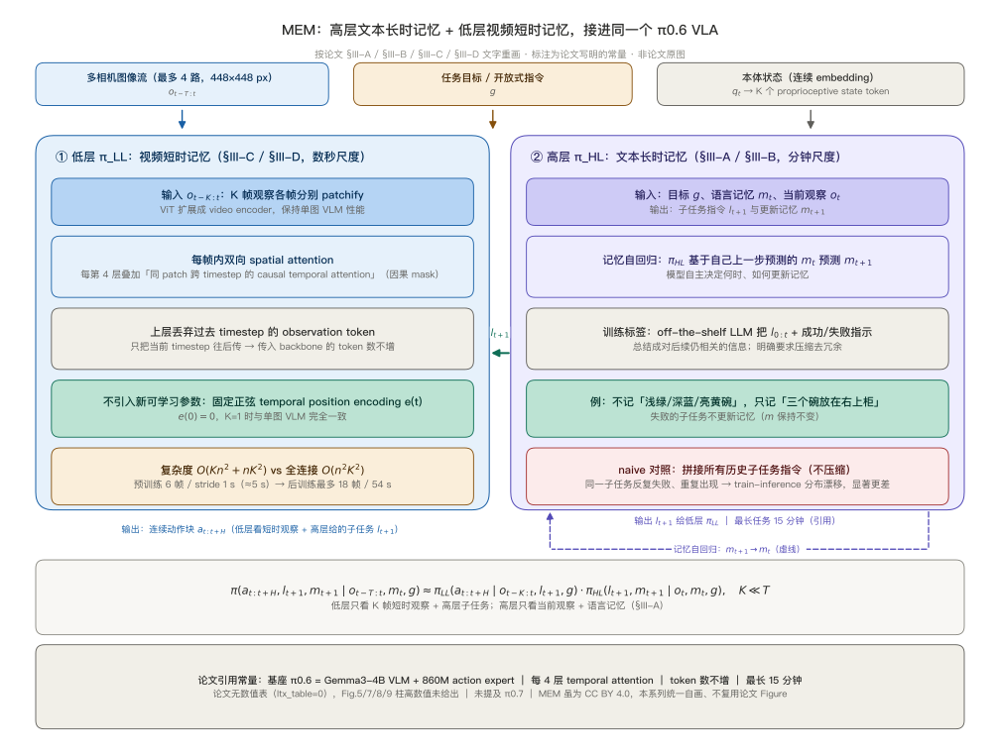
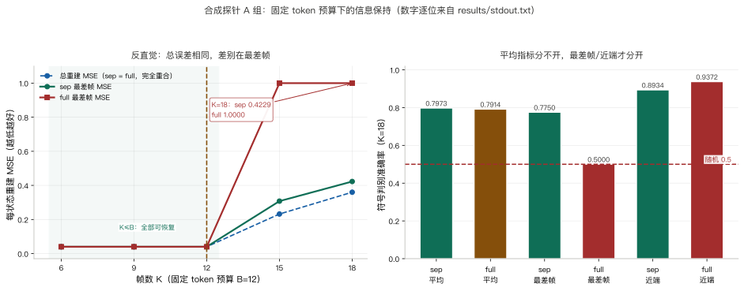
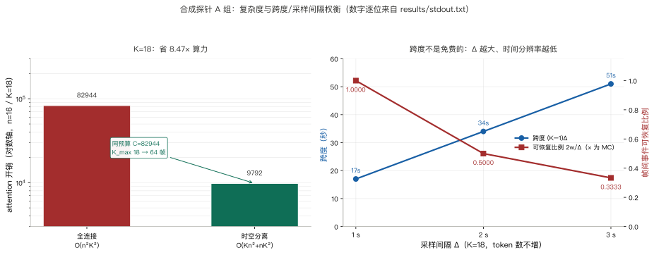
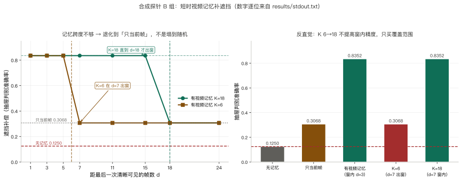
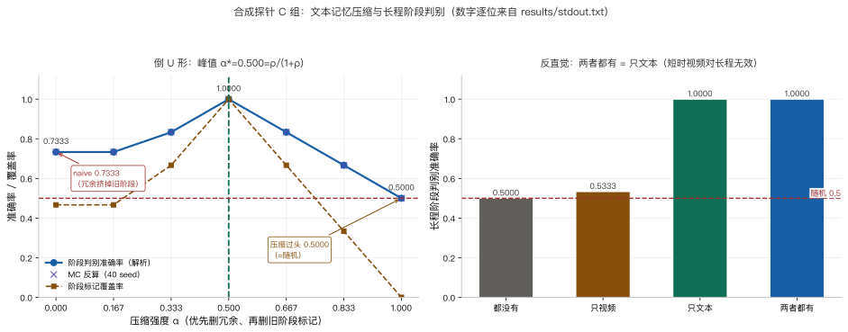
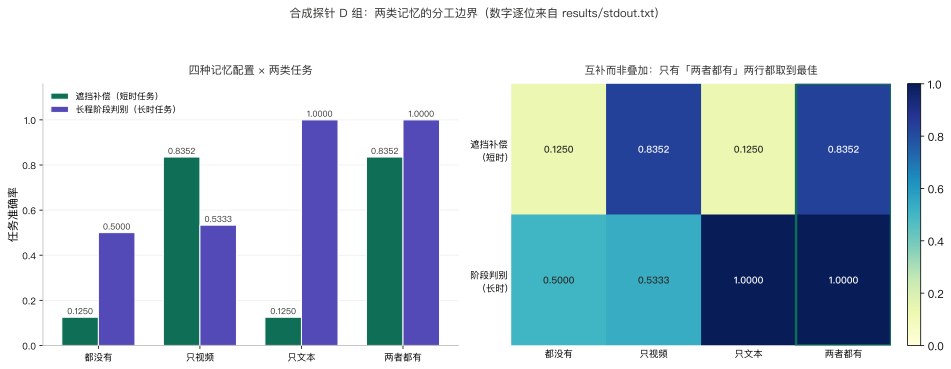

> **系列导航**：这是 π 系列具身模型深潜的第 9 篇。系列按**问题**组织：动作怎么表示（01 π0 / 02 FAST / 03 KI）→ 长程任务怎么拆（04 Hi Robot / 05 π0.5）→ 延迟怎么吃掉（06 RTC）→ 怎么从经验里学（07 RECAP / 08 RLT）→ **记忆与条件（09 MEM / 10 π0.7）**。06 篇 RTC 补的是动作块之间的执行节奏，07 篇 RECAP 与 08 篇 RLT 补的是策略本身怎么从经验里改；本篇换一个此前一直被隐含掉的问题：任务拉长到十几分钟之后，模型怎么把「刚才发生过什么」和「已经做完了哪几步」都记住，答案是把记忆按时间尺度拆成两级（[arXiv:2603.03596](https://arxiv.org/abs/2603.03596)）。

> **TL;DR**
>
> * **核心问题与结论**：06 RTC 管动作块之间的执行节奏，07 RECAP 与 08 RLT 管从经验里学，本篇处理十几分钟任务里“记不住”：MEM 把记忆拆成短时视频与长时文本两级，分别交给低层与高层策略（[arXiv:2603.03596](https://arxiv.org/abs/2603.03596)）。
> * **关键证据**：合成探针里固定 token 预算下两种 attention 的总重建误差逐点相同，差别只在误差分布，最差帧 0.4229 对 1.0000；只有视频加文本同时在遮挡与长程阶段上达标（[实验目录](https://github.com/lrypcy/ipynbs/tree/12bea380ce7a11d1323edd352c96676baa6566bd/experiments/pi-vla/pi-09)，44 条断言）。
> * **适用边界与代价**：论文没有数值结果表，Fig.5/7/8/9 柱状图无柱顶数字，独立遮挡实验不存在，文本记忆更新频率与 prompt 插入位置均未给出；合成探针自设参数不能当论文数值（[v2 全文](https://arxiv.org/html/2603.03596v2)）。
> * **系列定位**：承接 06 执行节奏与 07/08 从经验学，本篇补记忆与条件；下一篇读 10 π0.7。

## 1. 问题：十几分钟任务里，模型把什么忘了

06 篇 RTC 是**推理时算法**：给定同一个策略，只换动作块之间的拼接方式，参数一个字节都不动（[arXiv:2506.07339](https://arxiv.org/abs/2506.07339)）。07 篇 RECAP 反过来动策略本身，用分布价值函数与 advantage 条件化端到端微调整个 VLA（[arXiv:2511.14759](https://arxiv.org/abs/2511.14759)）；08 篇 RLT 冻结 VLA、只训一个小 actor-critic 改精细阶段（[arXiv:2604.23073](https://arxiv.org/abs/2604.23073)）。三者都没有碰一个此前被隐含掉的量：**跨越几分钟的状态**。

| | 06 RTC | 07 RECAP | 08 RLT | 09 MEM |
| --- | --- | --- | --- | --- |
| 改的是什么 | 推理时怎么拼接动作块 | 训练目标与数据 | 冻结 VLA 上的小 actor-critic | 策略的输入：两种时间尺度的记忆 |
| 作用时间尺度 | 单次动作块（约 1 秒） | 长时程整体行为 | 5–20 秒精细阶段 | 数秒视频 + 十几分钟文本 |
| 参数是否动 | 否 | 是，端到端微调 | 只训 2–3 层 MLP | 整体训练，**未冻结** |
| 对应失效 | 切换点抖动、执行停顿 | 策略整体出错 | 接触阶段反复试探 | 遮挡、忘记已完成子任务 |

论文把任务拉到**最多 15 分钟**（[arXiv:2603.03596v2 §IV-A](https://arxiv.org/html/2603.03596v2)）：备料要记住已经取了哪些配料、记得关被打开的抽屉与柜门；清洁厨房要记住是否已经加皂、碗的正反面是否都洗过、哪些台面擦过；烤芝士每面要煎 30 秒–3 分钟，需要计时；4 抽屉找物要记住物体藏在哪个抽屉；舀咖啡要记住已经加了几勺。这些信息单帧观测里没有，动作块的一秒视界也装不下。

MEM 的回答是把记忆按时间尺度拆成两级：低层看**数秒的密集视频历史**，高层读写**几分钟尺度的自然语言事件摘要**。有一处口径必须先说清：论文全文没有数值结果表（HTML 中 `ltx_table` 计数为 0），Fig.5 / Fig.7 / Fig.8 / Fig.9 是柱状图且柱高无数字标签，项目页只保留 `Task Progress (%)` 轴刻度；唯一能落到正文的量化锚点是随机基线 **4 抽屉找物 25%**、**是否再加一勺咖啡 50%**（[arXiv:2603.03596v2 §IV-C](https://arxiv.org/html/2603.03596v2)）。本文 6 张图里，图 1 是按论文文字重画的结构图，图 2–图 6 是数据图、数字逐位来自合成探针 `results/stdout.txt`，不是论文原图。

## 2. 阅读地图、代码入口与符号表

| 章 | 问题 | 合成探针 | 配图 |
| --- | --- | --- | --- |
| §3 | 两级分解、高层读写记忆、低层只吃短观察序列 | — | 图 1 |
| §4–§5 | video encoder 与文本记忆各怎么构造 | — | — |
| §6 | π0.6-MEM 架构常量、合成世界定义与自校验 | 自校验 | — |
| §7 | 固定 token 预算下的跨度、误差分布与算力 | A 组 | 图 2、图 3 |
| §8 | 短时记忆补遮挡与跨度不够的失效 | B 组 | 图 4 |
| §9 | 压缩强度、naive 对照与失败不更新 | C 组 | 图 5 |
| §10 | 两类记忆的分工边界 | D 组 | 图 6 |
| §11–§12 | 论文实验、边界与代价 | — | — |
| §13 | 小结 | — | — |

三个入口：[论文 v2 HTML 全文](https://arxiv.org/html/2603.03596v2)（§III-A 的两级分解、§III-B 的文本记忆、§III-C 的 video encoder、§III-D 的架构与实时性、§IV 的实验与 Fig.5 / Fig.7 / Fig.8 / Fig.9、附录 B 的任务清单）、[arXiv abs 页](https://arxiv.org/abs/2603.03596)（CC BY 4.0，[项目页](https://pi.website/research/memory)）、[ipynbs `experiments/pi-vla/pi-09/`](https://github.com/lrypcy/ipynbs/tree/12bea380ce7a11d1323edd352c96676baa6566bd/experiments/pi-vla/pi-09)（纯 numpy / CPU / 44 条断言，notebook + 固化输出 + figures 三件齐）。

符号沿用前八篇，只补这一篇新增的：

| 符号 | 含义 | 出处 |
| --- | --- | --- |
| $$g$$ | 任务目标 | 论文 §III-A |
| $$o_t$$ | 当前观测（图像 + 本体状态） | 论文 §III-A |
| $$o_{t-K:t}$$ | 最近 $$K$$ 帧短观察序列 | 论文 §III-A |
| $$a_{t:t+H}$$ | 低层输出的连续动作块 | 论文 §III-A / 01 篇 |
| $$m_t$$ | 长时文本记忆，自然语言语义事件摘要 | 论文 §III-B |
| $$m_{t+1}$$ | 高层同时预测出的**更新后记忆** | 论文 §III-A |
| $$\hat\ell_{t+1}$$ | 高层给出的下一子任务指令 | 论文 §III-A / 05 篇 |
| $$\pi_{HL}$$ | 高层策略，输入 $$g,m_t,o_t$$，输出 $$\hat\ell_{t+1},m_{t+1}$$ | 论文 §III-A |
| $$\pi_{LL}$$ | 低层策略，输入 $$g,o_{t-K:t},\hat\ell_{t+1}$$，输出动作块 | 论文 §III-A |
| $$K,T$$ | 短观察窗口长度 / 完整历史长度，$$K\ll T$$ | 论文 §III-A |
| $$n$$ | 每帧 patch 数（复杂度公式） | 论文 §III-C |
| $$\Delta$$ | 采样间隔（秒） | 论文 §III-D / 本文 §7 |
| $$\tau^{2}$$ | 合成探针里的表示噪声方差，**自设** | 本文 §6 |
| $$B$$ | 固定 token 预算的标量槽数，**自设** $$B=12$$ | 本文 §6 |
| $$L$$ | 抽屉类别数，**自设** $$L=8$$ | 本文 §6 |
| $$d$$ | 距最后一次可见帧的遮挡时长（帧） | 本文 §8 |
| $$\alpha$$ | 文本记忆压缩强度，**自设** | 本文 §9 |
| $$W$$ | 短时视频记忆覆盖秒数，**自设** $$W=54$$ s | 本文 §9 |

## 3. 两级分解与两种记忆

图 1 把整条链路画在一起。论文 §III-A 把「带记忆的策略」写成一次因式分解：

$$
\pi(a_{t:t+H},\hat\ell_{t+1},m_{t+1}\mid o_{t-T:t},m_t,g)\approx\pi_{LL}(\cdot\mid o_{t-K:t},\hat\ell_{t+1},g)\,\pi_{HL}(\cdot\mid o_t,m_t,g),\qquad K\ll T
$$

左边是完整的长历史条件策略，右边把它拆成两个只看局部条件的因子。关键在 $$K\ll T$$：低层不必吞下长度 $$T$$ 的完整历史，只吃长度 $$K$$ 的短观察序列。

| | 高层 $$\pi_{HL}$$ | 低层 $$\pi_{LL}$$ |
| --- | --- | --- |
| 输入 | 任务目标 $$g$$、语言记忆 $$m_t$$、当前观测 $$o_t$$ | 任务目标 $$g$$、短观察序列 $$o_{t-K:t}$$、子任务指令 $$\hat\ell_{t+1}$$ |
| 输出 | 下一子任务 $$\hat\ell_{t+1}$$ **与更新后的记忆** $$m_{t+1}$$ | 连续动作块 $$a_{t:t+H}$$ |
| 频率 | 低频，随高层子任务推理产生 | 高频，动作块级 |
| 时间尺度 | 几分钟的语义事件 | 数秒的密集图像历史 |

以往 HL/LL 分层（04 篇 Hi Robot、05 篇 π0.5）里高层只产出子任务指令；MEM 的**关键区别是记忆自回归**：$$\pi_{HL}$$ 额外基于自己上一步预测的 $$m_t$$ 来预测 $$m_{t+1}$$，模型「显式决定何时、如何更新自己的记忆表示」（[arXiv:2603.03596v2 §III-A](https://arxiv.org/html/2603.03596v2)）。低层则完全不接触长时文本记忆，只看短观察序列加子任务指令。

一级记忆补什么，论文给的定位很直白：短时视频记忆编码数秒密集图像历史，用来解决自遮挡、理解动力学、做快速 in-context 抓取调整；长时文本记忆记录「哪些子任务已完成 / 哪些配料已加 / 记得关被打开的柜门」，只需几 bit 信息却要长时间保存（[arXiv:2603.03596v2 §I](https://arxiv.org/html/2603.03596v2)）。

## 4. 短时视频记忆：把 ViT 扩成 video encoder

视频侧的出发点是不改 VLM 的 token 预算。做法是把预训练单图 **ViT 扩展成 video encoder**：输入视频各帧分别 patchify，保持单图 VLM 的性能不变，于是任意预训练 VLM 都能加视觉记忆。

| 项 | 内容 | 出处 |
| --- | --- | --- |
| attention 设计 | 空间–时间可分离：每帧内标准双向 spatial attention；**每第 4 层**额外叠加同一图像 patch 跨 timestep 的 **causal temporal attention** | §III-C / Fig.3 |
| 复杂度 | 相应层从 $$O(n^{2}K^{2})$$ 降到 $$O(Kn^{2}+nK^{2})$$ | §III-C |
| 压缩方式 | **上层丢弃过去 timestep 的 observation token**，只把当前 timestep 的表示往后传，把时间信息逼进当前帧表示 | §III-C |
| token 数 | 传入 VLA backbone 的 token 数**与无记忆单帧 VLA 相同**；过去的本体状态线性投影成 $$K$$ 个 proprioceptive state token | §III-C / §III-D |
| 新参数 | **不引入新可学习参数**：只改 attention 模式 + 加固定正弦 temporal position encoding $$e(t)$$，且 $$e(0)=0$$ 保证 $$K=1$$ 时与 VLM 初始化完全一致；权重从预训练 VLM 的 ViT 初始化 | §III-C / 附录 C |

复杂度这一条值得单独写成式子，它是「不增 token」能成立的算力前提：

$$
C_{\mathrm{full}}=n^{2}K^{2},\qquad C_{\mathrm{sep}}=Kn^{2}+nK^{2}
$$

帧数与时间跨度有两处口径，正文都给、不合并：

| 阶段 | 观察序列 | 时间跨度 | 出处 |
| --- | --- | --- | --- |
| 预训练 | 6 个观察（5 个过去 + 当前），stride 1 秒 | 约 5 秒历史 | §III-D |
| 后训练 | 最多 18 帧 | 54 秒 | §III-D |
| 另一处概括口径 | horizon 从 5 秒扩到最多 1 分钟 | 最多 1 分钟 | §IV-C |

§III-D 给的是具体帧数与秒数，§IV-C 给的是「5 秒 → 最多 1 分钟」的概括说法，两者粒度不同、不矛盾，引用时按所在章节注明。实时约束是硬边界：要在**几百毫秒**量级的延迟预算内处理十几分钟的高频多帧视频，不能把全历史塞进 context；论文 Fig.2 在 4 路相机流下测得，朴素地逐帧把历史塞进 backbone 会迅速超出实时阈值（[arXiv:2603.03596v2 §III-C](https://arxiv.org/html/2603.03596v2)）。这里只把它当作实时预算的论据，不展开计时硬件。

## 5. 长时文本记忆：几 bit 语义事件与压缩

文本侧存的是自然语言**语义事件摘要** $$m_t$$。论文 §III-B 的示例里，$$m_t$$ 记的是 `I placed a plate in the cabinet and moved to the counter.`，一步之后变成 `I placed a plate in the cabinet, moved to the counter, and picked up a bowl.`——只追加真正发生的语义事件。

| 项 | 内容 | 出处 |
| --- | --- | --- |
| 内容 | 自然语言语义事件摘要：哪些子任务已完成 / 哪些配料已加 / 记得关被打开的柜门；只需几 bit 但要长时间保存 | §I / §III-B |
| 推理时谁生成 | **$$\pi_{HL}$$ 自身**在产生下一子任务 $$\hat\ell_{t+1}$$ 的同时预测更新后的 $$m_{t+1}$$；模型自主决定何时、如何更新 | §III-A / §III-B |
| 训练标签谁生成 | **现成预训练 LLM**：把子任务语言标注连同「该子任务成功 / 失败的指示」喂给 LLM，让它总结对后续执行仍相关的信息，用其输出标注序列训练 $$\pi_{HL}$$ | §III-B |
| 压缩指令 | 明确要求删除 / 压缩不再需要的信息（不记碗的颜色细节，只记「三个碗放在右上柜」），使记忆简洁、推理快、并减小 train-inference 分布漂移 | §III-B |
| 失败不更新 | 失败的子任务**不更新记忆**，直到成功才写入 | §III-B / §IV-A |
| naive 对照 | 不压缩、把所有历史子任务指令拼到最大长度 → **显著更差**，因推理时同一子任务反复失败重复出现，产生 train-inference 分布漂移 | §IV-A |
| 更新频率 | **未给出**精确频率（无 Hz / 秒 / 步数）；只说随高层子任务低频产生 | §III-B / 项目页 |
| prompt 位置 | 论文只说明记忆作为高层输入、子任务指令作为低层输入；**具体插入 prompt 的位置 / 顺序 / 模板未给出** | §III-A / 项目页 |

naive 对照是这一节最该记住的负面结果：不压缩地拼接全部历史子任务，推理时同一个失败子任务会反复出现，把训练时没见过的重复模式塞进输入，于是训练与推理分布漂移、表现显著更差。论文因此让 LLM 标签生成时**主动删冗余**，并让 $$\pi_{HL}$$ 在失败时不写记忆（[arXiv:2603.03596v2 §IV-A](https://arxiv.org/html/2603.03596v2)）。

## 6. 架构接入与合成探针世界

基座是 **π0.6-MEM**，把两类记忆接进 π0.6：

| 项 | 值 | 出处 |
| --- | --- | --- |
| 基座 | 从预训练 **Gemma3-4B VLM** 初始化的 π0.6；评测模型名 π0.6-MEM | §I / §III-D |
| action expert | **860M** 参数的 flow-matching action expert | §III-D |
| 训练目标 | 含**离散 FAST action token 预测**与 **Knowledge Insulation** | §III-D |
| 输入 | **448×448 px / 相机流**，最多 **4 路**相机流 | §III-D |
| 实时推理 | 所有真机实验用 **inference-time 或 training-time RTC** 做异步推理 | §III-D |
| 主干是否冻结 | **未冻结**：整体在预训练与后训练中更新；但按 KI，action expert 的梯度**不回传** VLM backbone | §III-D |
| 最长任务 | 最多 **15 分钟** | Abstract / §IV-A |

合成探针不重算真机成绩，只把「两类记忆凭什么分工、各在什么条件下失效」拆成可解析的线性高斯 + 离散阶段世界。世界参数**全部自设**，不得冒充论文数值：

| 短时侧 | 值 | 长时侧 | 值 |
| --- | --- | --- | --- |
| $$B$$（token 预算） | 12，与 $$K$$ 无关 | 阶段数 $$N$$ | 15 |
| $$K$$ 网格 | 6, 9, 12, 15, 18 | 每阶段 | 60 秒 |
| $$\Delta$$ 网格 | 1, 2, 3 秒 | 冗余标签 $$\rho$$ | 1 |
| patch 数 $$n$$ | 16 | 文本 buffer 容量 | 15 |
| ViT 层数 | 12（every 4 → 3 个 temporal 层） | 视频窗口 $$W$$ | 54 秒 |
| 表示噪声 $$\tau^{2}$$ | 0.04 | 抽屉数 $$L$$ | 8 |
| 观测噪声 $$\sigma$$ | 0.4 | 信号强度 | 清晰 1.0 / 弱 0.3 |

video encoder 被抽象成固定的正交 DCT-II（正弦 temporal position encoding）线性映射 $$A(K)\in\mathbb{R}^{B\times K}$$：无论 $$K$$ 多大，表示永远只有 $$B=12$$ 行（对齐「token 数不增」），秩为 $$\mathrm{rank}(A_{\mathrm{sep}})=\min(K,B)$$。对照的「全连接 attention」在同样 $$B$$ 个槽里只保留最近 $$B$$ 帧、旧帧整体丢弃——这是探针为公平比较设的建模假设，不是论文声称的实现。

遮挡任务里，物体藏在 $$L=8$$ 个抽屉之一、当前帧被遮挡；清晰历史帧给观测 $$y=a\,\mathrm{e}_j+\eta$$，被遮挡当前帧只给弱线索，$$\eta\sim\mathcal{N}(0,\sigma^{2})$$。argmax 判别正确率有确定性积分闭式：

$$
P_{\mathrm{correct}}=\int\varphi(z)\,\Phi(z+a/\sigma)^{L-1}\,\mathrm{d}z,\qquad a=0\ \Longrightarrow\ P_{\mathrm{correct}}=1/L
$$

前置自校验先钉死构造真值与反算值：DCT-II 正交偏差 `2.44e-15`（24×24）；线性高斯后验增益 $$g^{*}=1/(1+\sigma^{2})$$ 的解析最小点 `0.917431` 与有限差分、网格扫描一致；无观测时抽屉判别准确率精确等于 $$1/L=0.125000$$（MC `0.1250`）；弱线索 `0.3068`（MC `0.3048`）、清晰帧 `0.8352`（MC `0.8355`）；任意 $$K$$ 下表示恒为 $$(12,K)$$ 形状，跨度不变量写成 $$\mathrm{span}=(K-1)\Delta$$。**44 条断言全绿，纯 numpy / CPU / 固定 seed / 多 seed 平均**（[实验目录](https://github.com/lrypcy/ipynbs/tree/12bea380ce7a11d1323edd352c96676baa6566bd/experiments/pi-vla/pi-09)）。

| 组 | 对应论文机制 | 验什么 |
| --- | --- | --- |
| A | §III-C / §III-D：固定 token 预算、每 4 层 temporal attention、6 帧 → 18 帧、复杂度 | 时间跨度 ↔ 误差分布 ↔ 算力 |
| B | §III-C 部分可观测 / 自遮挡；Fig.7 的定性载体 | 遮挡补偿与跨度不够的失效 |
| C | §III-A / §III-B、§IV-A Fig.5：$$\pi_{HL}$$ / LLM 标签 / 压缩 / naive | 压缩强度 ↔ 长程阶段判别 |
| D | §IV-A「两者都必不可少」、§IV-C Fig.9「无退化」 | 两类记忆的分工边界 |

| 论文概念 | 探针里的替身 | 没建模的部分 |
| --- | --- | --- |
| video encoder | 固定正交映射 $$A(K)$$ 与窗内充分统计量 | ViT 层级堆叠、4 路 448×448 相机流 |
| 上层丢弃历史 token | 表示恒为 $$B$$ 行 | 更细的 token 数、层数、隐藏维度 |
| 长时文本记忆 | 阶段标记 + 冗余标签的删除与 buffer 截断 | 精确更新频率、prompt 模板、压缩比 |
| $$\pi_{HL}$$ 失败不更新 | 冗余标签从不写入 | $$\pi_{HL}$$ 更新规则本身 |
| 真机长时程任务 | 8 抽屉遮挡 + 15 个阶段 | Gemma3-4B VLM、flow matching、FAST、RTC |

## 7. A 组：固定 token 预算下的时间跨度与算力

图 2 把 A 组最要紧的一件事画成一张图：帧数在涨、token 数不动，两种注意力的总误差还逐点相等。

| $$K$$ | span | sep 总 MSE | full 总 MSE | sep 最差帧 MSE | full 最差帧 MSE | sep 平均判别 | full 平均判别 | sep 最差帧判别 | full 最差帧判别 |
| --- | --- | --- | --- | --- | --- | --- | --- | --- | --- |
| 6 | 5 | 0.0400 | 0.0400 | 0.0400 | 0.0400 | 0.9372 | 0.9372 | 0.9372 | 0.9372 |
| 9 | 8 | 0.0400 | 0.0400 | 0.0400 | 0.0400 | 0.9372 | 0.9372 | 0.9372 | 0.9372 |
| 12 | 11 | 0.0400 | 0.0400 | 0.0400 | 0.0400 | 0.9372 | 0.9372 | 0.9372 | 0.9372 |
| 15 | 14 | 0.2320 | 0.2320 | 0.3077 | 1.0000 | 0.8433 | 0.8497 | 0.8132 | 0.5000 |
| 18 | 17 | 0.3600 | 0.3600 | 0.4229 | 1.0000 | 0.7973 | 0.7914 | 0.7750 | 0.5000 |

三件事要分开看。**其一，固定 token 预算下两种注意力的信息总量相同**：$$K=18$$ 时 sep 与 full 的总重建 MSE 都是 `0.3600`，五个 $$K$$ 上逐点相等；差别只在**误差分布**——分离把误差摊平到整个跨度，全连接把误差全压到远端帧，$$K=18$$ 的 sep 最差帧 MSE `0.4229` 对 full `1.0000`。**其二，平均指标分不开二者**：$$K=18$$ 的平均符号判别 `0.7973` 对 `0.7914`，只有「最差帧 / 远期召回」能分开（`0.7750` 对 `0.5000`，后者塌到随机）。**其三，全连接在近端帧反而更准**：`0.9372` 对分离最好帧 `0.8934`，因为误差集中在远端。

所以论文这条设计的价值不是「塞进更多信息」，而是「不丢远期帧 + 省算力」。图 3 把后半句补上。

$$
\mathrm{span}=(K-1)\Delta,\qquad P_{\mathrm{recover}}=\min(1,2w/\Delta)
$$

| $$\Delta$$ | span | $$P_{\mathrm{recover}}$$（解析） | $$P_{\mathrm{recover}}$$（MC） |
| --- | --- | --- | --- |
| 1 | 17 | 1.0000 | 1.0000 |
| 2 | 34 | 0.5000 | 0.5002 |
| 3 | 51 | 0.3333 | 0.3337 |

**跨度不是免费的**：token 数不增时靠加大 $$\Delta$$ 把 span 从 17 s 拉到 51 s，帧间事件可恢复比例按 $$2w/\Delta$$ 从 `1.0000` 掉到 `0.3333`——对应论文 5 秒 → 54 秒 horizon 扩展的同时，时间分辨率下降。

| 量 | 值 |
| --- | --- |
| $$K=18$$ 全连接开销 | 82944 |
| $$K=18$$ 分离开销 | 9792 |
| 比值 | 8.47× |
| 预算 $$C=82944$$ 下 $$K_{\max}$$（全连接 → 分离） | 18 → 64 |
| 12 层 every 4 → temporal 层数 | 3 |
| 分离 $$K_{\max}$$ 比值 / $$\sqrt{n}$$ | 3.56 / 4 |

时空分离在 $$K=18$$ 省下 `8.47×` 算力；同一预算下把可支持帧数从 18 推到 64（`3.56` 倍），但**达不到理想 $$\sqrt{n}=4$$**——空间项也占预算。这三条反直觉都得留着，不能只报「省算力」。

## 8. B 组：短时记忆补遮挡与跨度不够的失效

论文**没有独立编号的遮挡补偿实验，也没有对应数值**；只有 §III-C 的定性表述（compensate for occlusions / resolve self-occlusions）与 Fig.7 的部分可观测任务。下面整张表是合成探针的抽象，不是论文成绩。

| $$d$$（帧） | 无记忆 | 只当前帧 | video($$K=6$$) | video($$K=18$$) |
| --- | --- | --- | --- | --- |
| 1 | 0.1250 | 0.3068 | 0.8352 | 0.8352 |
| 3 | 0.1250 | 0.3068 | 0.8352 | 0.8352 |
| 5 | 0.1250 | 0.3068 | 0.8352 | 0.8352 |
| 7 | 0.1250 | 0.3068 | 0.3068 | 0.8352 |
| 11 | 0.1250 | 0.3068 | 0.3068 | 0.8352 |
| 15 | 0.1250 | 0.3068 | 0.3068 | 0.8352 |
| 18 | 0.1250 | 0.3068 | 0.3068 | 0.3068 |
| 24 | 0.1250 | 0.3068 | 0.3068 | 0.3068 |

当前帧被遮挡时，无记忆只有机会水平 `0.1250`、只当前帧只有弱线索 `0.3068`，有视频记忆（窗内）把补偿拉到清晰帧 `0.8352`。**但跨度买的是覆盖范围，不是精度**：$$K$$ 从 6 增到 18，窗内 $$d=1$$ 的补偿精度不变（均 `0.8352`），只是把「不失效」的遮挡时长上限从 $$d<6$$ 推到 $$d<18$$；同一 $$d=7$$ 下 $$K=18$$ 仍 `0.8352`、$$K=6$$ 已退化到 `0.3068`。

失效形状也要照实写：$$d\ge K$$ 时**不是塌到随机 `0.1250`，而是退化到「只当前帧」`0.3068`**（弱线索还在）；$$d=24$$ 超过最大跨度时连 $$K=18$$ 也失效。整张 $$d$$ 扫描的解析 ↔ MC 反算最大偏差 `0.0021`（[stdout.txt](https://github.com/lrypcy/ipynbs/tree/12bea380ce7a11d1323edd352c96676baa6566bd/experiments/pi-vla/pi-09)）。

## 9. C 组：长时记忆补阶段、压缩与 naive

长时侧把 $$N=15$$ 个阶段、每阶段 60 秒（15 分钟是论文引用，$$N$$ 与 60 秒自设）压成「阶段标记 + 冗余标签」的删除与 buffer 截断；视频窗口 $$W=54$$ s < 阶段 60 s，最多只看见 1 个阶段标记——这是两类记忆分工的结构来源。

| $$\alpha$$ | 覆盖率 | 阶段判别（解析） | 阶段判别（MC） |
| --- | --- | --- | --- |
| 0.000 | 0.4667 | 0.7333 | 0.7334 |
| 0.167 | 0.4667 | 0.7333 | 0.7334 |
| 0.333 | 0.6667 | 0.8333 | 0.8338 |
| 0.500 | 1.0000 | 1.0000 | 1.0000 |
| 0.667 | 0.6667 | 0.8333 | 0.8338 |
| 0.833 | 0.3333 | 0.6667 | 0.6659 |
| 1.000 | 0.0000 | 0.5000 | 0.5001 |

**压缩准确率是倒 U 形，不是越狠越好、也不是不压缩最好**：峰值在 $$\alpha^{*}=0.500=\rho/(1+\rho)$$，恰是「冗余全删、阶段标记一个不丢」处，达到 `1.0000`；naive 拼接全部历史（$$\alpha=0$$，含失败重试冗余）只有 `0.7333`，压缩过头 $$\alpha=1$$ 退化到 `0.5000`。$$\pi_{HL}$$「失败不更新记忆」等价于把冗余全删，`1.0000` 与显式压缩峰值相同。

| 配置（长程阶段判别） | 都没有 | 只视频 | 只文本 | 两者都有 |
| --- | --- | --- | --- | --- |
| 准确率 | 0.5000 | 0.5333 | 1.0000 | 1.0000 |

反直觉的一条在这里：**「两者都有」= 只文本**；短时视频记忆对长程阶段判别几乎无效（`0.5333` 对 `0.5000`，差 `0.0333`）。文本记忆把阶段判别从机会水平 `0.5` 拉到 `1.0`，视频记忆在 54 s 窗口里最多只看得见 1 个标记，帮不上忙（[stdout.txt](https://github.com/lrypcy/ipynbs/tree/12bea380ce7a11d1323edd352c96676baa6566bd/experiments/pi-vla/pi-09)）。

## 10. D 组：两类记忆的分工边界

图 6 把遮挡任务与长程阶段任务放在同一张交叉表里，四种记忆配置各跑一遍。

| 配置 | 遮挡补偿准确率 | 长程阶段判别准确率 |
| --- | --- | --- |
| 都没有 | 0.1250 | 0.5000 |
| 只视频 | 0.8352 | 0.5333 |
| 只文本 | 0.1250 | 1.0000 |
| 两者都有 | 0.8352 | 1.0000 |

| 对照 | 读数 | 结论 |
| --- | --- | --- |
| 遮挡任务：只视频 vs 只文本 | 0.8352 vs 0.1250 | 短时视频有效，长时文本等于机会基线 |
| 阶段任务：只文本 vs 只视频 | 1.0000 vs 0.5333 | 长时文本有效，短时视频几乎无效（差 0.0333） |
| 两者都有 vs 对应单项 | 0.8352 / 1.0000 | 等于各单项最大值，**无叠加增益，也无性能退化** |

**两类记忆互补而非叠加**：「两者都有」在单项任务上等于对应单项记忆的最大值，但它是**唯一**同时在两类任务上都取到各自最佳水平的配置（遮挡 `0.8352` / 阶段 `1.0000`，两项都达最佳的配置数 1）。这正对应论文「视频 + 文本两者都不可缺」与 Fig.9「无因果混淆退化」的相对结论（[arXiv:2603.03596v2 §IV-A / §IV-C](https://arxiv.org/html/2603.03596v2)）。

交叉边界还要写一句：记忆跨度不够时（$$K=6$$、$$d=7$$）视频在遮挡任务只有 `0.3068`，而文本记忆阶段仍是完好的 `1.0000`——**完好的长时文本记忆也救不了遮挡**，两类记忆彼此不能代偿。

## 11. 论文实验报了什么，没报什么

先把口径摆前面：**论文全文没有任何数值结果表**（`ltx_table` 计数为 0），Fig.5 / Fig.7 / Fig.8 / Fig.9 是柱状图、柱高无数字标签，项目页只保留 `Task Progress (%)` 轴刻度与图例；逐任务成功率、消融柱高、独立遮挡实验数值、in-context 适应成功率一律「未给出」（[arXiv:2603.03596v2 §IV](https://arxiv.org/html/2603.03596v2)）。

| | 论文写明的 | 论文没给的 |
| --- | --- | --- |
| 长时程场景 | 备料 / 清洁厨房 / 烤芝士三类；训练 **42 个 recipes**，在未见厨房 + 未见物体上评测 **5 个 recipes**；每 recipe 6–7 分；烤芝士每面 30 秒–3 分钟；清洁厨房平均 8 个子任务 | 逐任务进度分数与各柱读数 |
| in-context 适应 | 筷子拾取（最低桌高评测）、开冰箱（开门 grasps ≤4）；首次失败后人类介入给正确示范，把失败尝试保留在短时记忆里一起微调 | 成功率与平均尝试次数 |
| 分析实验任务 | 3 杯交换、4 抽屉找物、拆 groceries、舀咖啡、擦窗、12 件物品 bussing 等 | 逐任务百分比（项目页轴刻度不是结果） |
| 评测规模 | 每 policy × task **10 rollouts**，所有图报 **mean ± standard error** | 显著性检验与置信区间数值 |
| 唯一量化锚点 | 4 抽屉找物随机基线 **25%**、是否再加一勺咖啡随机基线 **50%** | 其余绝对成功率 |
| 头号结论 | 视频 + 文本**两者都不可缺**；**只有 MEM** 在部分可观测 / 计数 / 视觉记忆全部能力上强；MEM 在不需要记忆的灵巧任务上**匹配**无记忆 SOTA、没有因果混淆退化 | 上述结论的精确数值 |
| 更新频率 / prompt 位置 | 只说模型自主决定何时更新、随高层子任务低频产生、失败不更新 | 精确 Hz / 秒 / 步数；插入位置 / 顺序 / 模板 |

附录 B1 另写「over 40 recipes」且评测「seen recipes」，与 §IV-A 的「42 recipes / 5 recipes in unseen kitchens with unseen objects」措辞略不一致，正文按 §IV-A 引用并在此注明。四类基线在同一 π0.6 backbone 上重实现、对比版本去掉长时语言记忆：

| 基线 | 定义 | 出处 |
| --- | --- | --- |
| No Memory | 无记忆 SOTA VLA π0.6 | §IV-C |
| Pool Memory | 每个过去观察用预训练单帧 ViT 单独编码后平均池化压成单个 memory token | §IV-C |
| Proprio Memory | 只条件于低维机器人状态历史，各状态线性投影后喂入 backbone | §IV-C |
| MEM-Posttrain-Only | 从预训练 π0.6 checkpoint 出发、只在后训练引入 video encoder | §IV-C |

Fig.8 的预训练消融给出定性结论：只在后训练引入记忆明显更差，预训练记忆可泛化到更长 horizon；Fig.9 则说 MEM 在不需要记忆的灵巧任务上匹配无记忆 VLA、没有以往工作常报告的「加记忆导致性能下降」。**各柱精确读数均不可得**，合成探针里的 `0.3600`、`0.8352`、`1.0000` 是探针自己的量，与 `Task Progress (%)` 不是同一量纲，不对表、更不能拿去补 Fig.5 / Fig.7 的空。

## 12. 边界与代价

| 边界 | 具体表现 | 怎么读 |
| --- | --- | --- |
| 论文无数值表 | `ltx_table`=0；Fig.5/7/8/9 柱高无数字标签，项目页只有轴刻度 | 只能引用相对结论与 25% / 50% 两个随机基线，不能目测估数 |
| 独立遮挡实验不存在 | 只有 §III-C 定性表述与 Fig.7 部分可观测任务 | 遮挡收益的量化载体是合成探针，不是论文数值 |
| 文本记忆更新频率未给出 | 只说模型自主决定、随高层子任务低频产生、失败不更新 | 不能补一个 Hz 或步数 |
| prompt 插入位置未给出 | 只说记忆作高层输入、子任务作低层输入 | 位置 / 顺序 / 模板不详，别照 07 篇的 indicator 位置类推 |
| 主干未冻结 | 整体训练更新，但 KI 使 action expert 梯度不回传 VLM backbone | 别读成「冻结 backbone」，也别读成「全模型端到端回传」 |
| 视频记忆跨度两处口径 | §III-D：6 帧 / 1 秒 ≈5 秒 → 18 帧 / 54 秒；§IV-C：5 秒 → 最多 1 分钟 | 两处并列，粒度不同，引用按章节注明 |
| π0.7 未提及 | 论文原文与项目页均无 | 不推断 MEM 与 π0.7 的关系；10 篇仅作系列后续篇目 |
| 合成探针不是复现 | 线性高斯 + 离散阶段；$$B=12$$、8 抽屉、15 阶段、60 秒、$$\tau^{2}=0.04$$、$$\alpha$$ 网格全部自设 | 只比同一口径下的相对差异，不与任务进度分数对表 |
| 许可证与配图 | MEM 是 CC BY 4.0，但本系列统一自画 | 官方图不复用，6 张图全部重画 |

**反直觉结论不能只报正结果**，几条按 stdout / README 口径再列一次：

* **A 组**：固定 token 预算下两种注意力总重建误差逐点相同（`0.3600` 对 `0.3600`），差别只在误差分布（sep 最差帧 `0.4229` 对 full `1.0000`）；平均判别 `0.7973` / `0.7914` 分不开，只有最差帧 `0.7750` 对 `0.5000` 能分开；全连接近端 `0.9372` 反而比分离最好帧 `0.8934` 更准。跨度靠 $$\Delta\uparrow$$ 拉长不增 token，可恢复事件比例却从 `1.0000` 掉到 `0.3333`。
* **B 组**：$$K$$ 6→18 在窗内 $$d=1$$ 的补偿精度不变（均 `0.8352`），跨度买覆盖范围不是精度；$$d\ge K$$ 退化到「只当前帧」`0.3068` 而非随机 `0.1250`。
* **C 组**：压缩是倒 U 形，峰值 `1.0000`，naive `0.7333` 与压缩过头 `0.5000` 都差；「两者都有」= 只文本，短时视频对长程几乎无效（`0.5333` 对 `0.5000`）。
* **D 组**：两类记忆互补而非叠加，只有「两者都有」同时取到两类最佳；长时文本对遮挡无效（`0.1250` = 机会），短时视频对长程几乎无效。

## 13. 小结

* **两级分解回答的是「记不住」。** 因式分解把长历史策略拆成 $$\pi_{LL}(\cdot\mid o_{t-K:t},\hat\ell_{t+1},g)$$ 与 $$\pi_{HL}(\cdot\mid o_t,m_t,g)$$，$$K\ll T$$；高层 $$\pi_{HL}$$ 输入任务目标 / 语言记忆 / 当前观测、输出子任务与**更新后的记忆**（记忆自回归，这是与以往 HL/LL 的关键区别），低层只吃短观察序列加子任务指令。
* **视频短时记忆不增 token、不增参数。** ViT 扩成 video encoder，每帧分别 patchify、每第 4 层加 causal temporal attention、复杂度 $$O(n^{2}K^{2})\to O(Kn^{2}+nK^{2})$$、上层丢弃历史 token 把时间信息逼进当前帧、$$e(0)=0$$ 保证 $$K=1$$ 时与 VLM 初始化一致；预训练 6 帧 / stride 1 秒（≈5 秒），后训练最多 18 帧 / 54 秒（§IV-C 另给最多 1 分钟）。
* **文本长时记忆是几 bit 语义摘要、由 $$\pi_{HL}$$ 自回归更新。** 训练标签由现成预训练 LLM 根据子任务语言 + 成功/失败指示生成，明确要求删除 / 压缩不再需要的信息；失败的子任务不更新记忆；naive 不压缩拼接全部历史因 train-inference 分布漂移显著更差。更新频率与 prompt 插入位置**未给出**。
* **合成探针把分工量化成四组。** A 组 `0.3600` / `0.4229` 对 `1.0000` / `82944` 对 `9792`（`8.47×`）/ `18→64`；B 组 `0.1250` / `0.3068` / `0.8352`；C 组峰值 `1.0000`（$$\alpha^{*}=0.500$$）对 naive `0.7333`、四配置 `0.5000` / `0.5333` / `1.0000` / `1.0000`；D 组遮挡 `0.1250` / `0.8352`、阶段 `0.5000` / `1.0000`。
* **别把探针数字当论文成绩，也别只报正结果。** 论文无数值表、Fig.5/7/8/9 柱高无数字，唯一量化锚点是 25% / 50%；独立遮挡实验不存在、更新频率与 prompt 位置未给出、主干未冻结、π0.7 未提及。A 组两种注意力总误差相同、B 组跨度只买覆盖范围、C 组压缩是倒 U 形、D 组互补而非叠加，这些都得照口径留着。
* **自设参数不能冒充论文数值。** $$B=12$$、8 抽屉、15 阶段、60 秒、$$\tau^{2}=0.04$$、$$\alpha$$ 网格全部自设；论文的 token 数、层数、隐藏维度、推理延迟毫秒数同样未给出。

09 篇解决的是「十几分钟任务里记不住」。下一篇换到记忆与条件这条线的收尾篇目：10 π0.7。

## 参考

- MEM 论文：*MEM: Multi-Scale Embodied Memory for Vision Language Action Models*，[arXiv:2603.03596](https://arxiv.org/abs/2603.03596)（v2，2026-03-08；本文 §III-A 的两级分解、§III-B 的文本记忆、§III-C 的 video encoder、§III-D 的架构与实时性、§IV 的实验与 Fig.5 / Fig.7 / Fig.8 / Fig.9、附录 B 的任务清单取自 [v2 HTML 全文](https://arxiv.org/html/2603.03596v2)）。论文采用 **CC BY 4.0**，但本系列仍统一自画，**官方图不复用**；[项目页](https://pi.website/research/memory)。本文永久链接 [/2026/11/06/pi-vla-09-mem/](/2026/11/06/pi-vla-09-mem/)。
- **配图说明**：本文 6 张图全部重画。**结构图按论文文字重画**（图 1 两级记忆架构，标注的是论文写明的常量，不是从图上量出来的）；**数据图数字来自 stdout**（图 2–图 6 逐位来自 `results/stdout.txt` 的合成探针，不是论文原图）。论文 Fig.5 / Fig.7 / Fig.8 / Fig.9 的逐任务数值只在柱状图里、柱高无数字标签，项目页只有轴刻度，不目测估数；文本记忆更新频率、记忆插入 prompt 的位置 / 顺序 / 模板、独立遮挡实验数值均**未给出**；主干**未冻结**（KI 使 action expert 梯度不回传 VLM backbone）；论文与项目页均**未提及 π0.7**。
- 前作：[π0 流匹配](/2026/11/02/pi-vla-01-pi0-flow-matching/)、[FAST 动作 tokenizer](/2026/11/03/pi-vla-02-fast-action-tokenizer/)、[Knowledge Insulation](/2026/11/03/pi-vla-03-knowledge-insulation/)、[Hi Robot](/2026/11/04/pi-vla-04-hi-robot/)、[π0.5](/2026/11/05/pi-vla-05-pi05/)、[RTC](/2026/11/06/pi-vla-06-rtc/)（[arXiv:2506.07339](https://arxiv.org/abs/2506.07339)）、[RECAP / π\*0.6](/2026/11/06/pi-vla-07-recap/)（[arXiv:2511.14759](https://arxiv.org/abs/2511.14759)）、[RLT](/2026/11/06/pi-vla-08-rlt/)（[arXiv:2604.23073](https://arxiv.org/abs/2604.23073)）。
- 配套实验：[`experiments/pi-vla/pi-09/`](https://github.com/lrypcy/ipynbs/tree/12bea380ce7a11d1323edd352c96676baa6566bd/experiments/pi-vla/pi-09)，commit `12bea38`，**44 条断言全绿**，纯 numpy / CPU，`mem_lab.ipynb`（notebook）+ `results/stdout.txt`（固化输出）+ `mem_figures.py` 生成的 6 张 SVG（figures）三件齐，`mem_lab.py` 为其源码。合成探针的判别准确率与真机任务进度分数不是同一量纲，不对表。

> **下一篇**：π 系列具身模型（10）：π0.7 —— 把「怎么做」也写进 prompt，模型才听指挥。
>
> **上一篇**：[π 系列具身模型（08）：RL Token —— 冻结 VLA，只训一个会改动作的小脑袋](/2026/11/06/pi-vla-08-rlt/)
