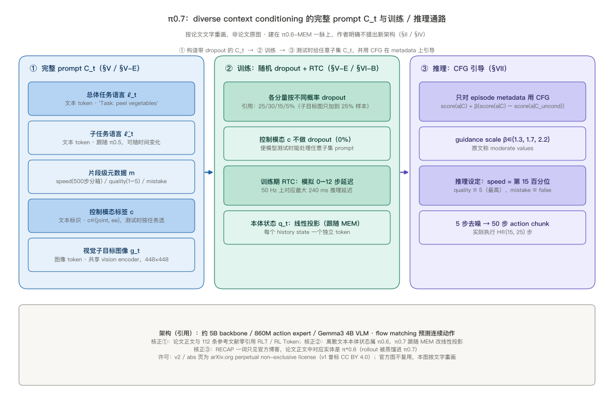
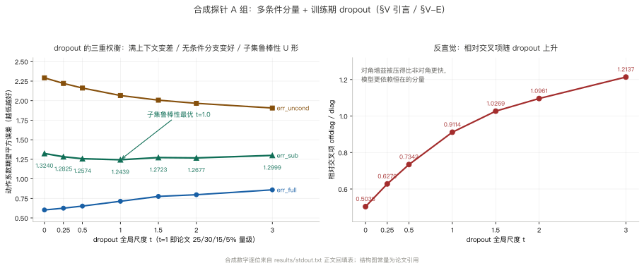
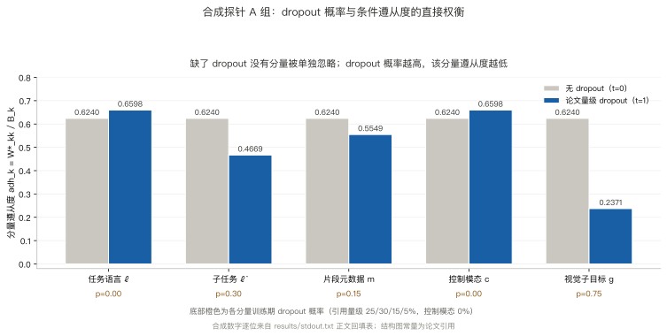
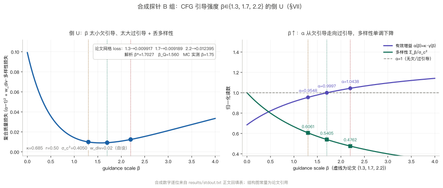
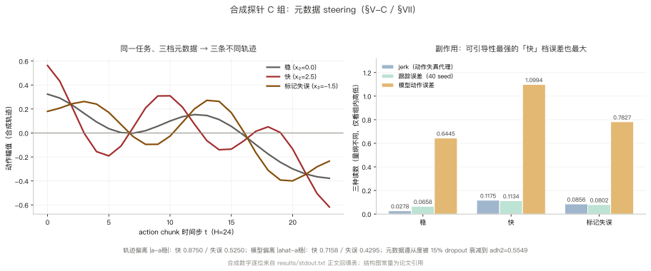
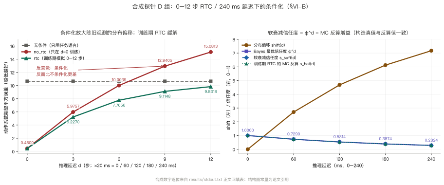

> **系列导航**：这是 π 系列具身模型深潜的第 10 篇，也是收尾篇。系列按**问题**组织：动作怎么表示（01 π0 / 02 FAST / 03 KI）→ 长程任务怎么拆（04 Hi Robot / 05 π0.5）→ 延迟怎么吃掉（06 RTC）→ 怎么从经验里学（07 RECAP / 08 RLT）→ **记忆与条件（09 MEM / 10 π0.7）**。前九篇一直在往模型里加东西：加表示、加层次、加约束、加经验、加记忆。这一篇问的是反过来的一件事——**模型已经会做很多事之后，怎么让它按指定的方式去做其中一件**。

> **TL;DR**
>
> * **核心问题与结论**：异构数据里同一任务有快有慢、有好有坏，只给一句任务描述会把冲突行为平均掉。π0.7 把「怎么做」也写进 prompt：子任务语言、片段元数据、控制模态、视觉子目标图，测试时即可引导；作者明确**不提出新架构**（[arXiv:2604.15483](https://arxiv.org/abs/2604.15483)）。
> * **关键证据**：各分量按 25 / 30 / 15 / 5% 随机 dropout，使模型接受任意子集；CFG 只对元数据用，$$\beta\in\{1.3,1.7,2.2\}$$。探针解析最优 $$\beta^\star=1.7027$$、实测 1.75，落在论文网格中段（[本仓实验](https://github.com/lrypcy/ipynbs/tree/12bea380ce7a11d1323edd352c96676baa6566bd/experiments/pi-vla/pi-10)，44 条断言）；跨本体折衫人类 90.9% / 80.6% 对 π0.7 85.6% / 80%。
> * **适用边界与代价**：论文无数值表；实验 A 组的 dropout 削弱可引导性（0.6240 → 0.2371）；实验 D 组的条件化放大延迟偏移（15.0813 对 9.8318）。
> * **系列定位**：把前九篇的能力变成可被指挥的能力。

## 1. 问题：会做，不等于听指挥

09 篇的 MEM 让策略能记住十几分钟里发生过什么；07 篇的 RECAP 让策略能从自己的 rollout 里变好；06 篇的 RTC 让动作块之间不抖。到这一步，一个通用 VLA 手上已经攒了大量不同来源的数据：多机器人演示、开源数据集、人类第一视角视频、自主评测轨迹、人工干预、失败 episode、低质量但成功的轨迹。

数据的**多样性**在这里第一次变成负担。同一句 “fold the shirt”，演示里有做得快的、有做得慢的、有折歪了的、有中途抓空又救回来的。如果 prompt 里只有这一句任务描述，模型能做的只能是**把它们平均掉**——把高质量轨迹和低质量轨迹当成同一个条件分布里的采样。论文把这个叫歧义：上下文描述不了「以何种方式做」，模型就无法区分。

π0.7 的答案不是加一个更大的模型，也不是再设计一套 RL。论文 §II 写得很直白：不追求新架构或新模型设计，方法就是 **diverse data + detailed context**。给每条训练样本补足「这一段到底是怎么做的」的描述，让模型把这些差异学成**可条件化的维度**；测试时把想要的那档条件写进 prompt，就得到对应的行为。



一句具体的 prompt 长这样（论文 §V-E 给的实例）：

```text
<Multi-view observation><Multi-view subgoals>
Task: peel vegetables. Subtask: pick up the peeler.
Speed: 8000. Quality: 5. Mistake: false. Control Mode: joint.
<Proprioception>
```

注意这里没有任何「请快一点」之类的自然语言修饰：速度是一个按 500 步区间离散化的数字，质量是 1–5 的整数，失误是布尔值，控制模态是枚举。**把风格写成结构化字段，模型才能把它当条件用。**

## 2. 阅读地图与符号

| 章 | 问题 | 合成探针 | 配图 |
| --- | --- | --- | --- |
| §3–§4 | 完整上下文由什么构成，为什么这是数据问题 | — | 图 1 |
| §5–§6 | 训练 dropout 与推理 CFG | A / B 组 | 图 2、图 3、图 4 |
| §7–§8 | 世界模型子目标图、架构与 training-time RTC | — | 图 1 |
| §9 | 数据来源与 π*0.6 专精策略的蒸馏 | — | — |
| §10–§13 | dropout  tradeoff、β 倒 U、元数据副作用、延迟 | A / B / C / D 组 | 图 2–图 6 |
| §14–§15 | 实证、边界与十篇的问题线 | — | — |

三个入口：[论文 v2 HTML](https://arxiv.org/html/2604.15483v2)（§V 的上下文与 dropout、§VII 的 CFG 与推理设定、§IX 的实证、附录 A-B 的 attention mask）、[arXiv abs 页](https://arxiv.org/abs/2604.15483)（v1 2026-04-16、v2 2026-04-24）、[ipynbs `experiments/pi-vla/pi-10/`](https://github.com/lrypcy/ipynbs/tree/12bea380ce7a11d1323edd352c96676baa6566bd/experiments/pi-vla/pi-10)（纯 numpy / CPU / 44 条断言）。**图 2–6 的数字全部是合成探针结果，不是论文原图**；图 1 是按论文文字重画的结构图。

| 符号 | 含义 | 出处 |
| --- | --- | --- |
| $$\mathcal{C}_t$$ | 完整上下文（多模态 prompt 的全部分量） | 论文 §III |
| $$\ell_t$$ / $$\hat\ell_t$$ | 总体任务语言 / 子任务语言 | 论文 §V-A |
| $$m$$ | 片段级元数据（speed / quality / mistake） | 论文 §V-C |
| $$c$$ | 控制模态标签，$$c\in\{\mathrm{joint},\mathrm{ee}\}$$ | 论文 §V-D |
| $$g_t$$ | 多视角视觉子目标图 | 论文 §V-B |
| $$q_t$$ | 本体状态，线性投影后按历史帧各占一个 token | 论文 §VI-B |
| $$\beta$$ | CFG guidance scale，$$\beta\in\{1.3,1.7,2.2\}$$ | 论文 §VII |

## 3. 五类上下文分量，各自补什么

| 分量 | 内容 | 编码 | 补的是哪一类歧义 |
| --- | --- | --- | --- |
| 总体任务语言 $$\ell_t$$ | “clean up the kitchen” | 文本 token | 做什么 |
| 子任务语言 $$\hat\ell_t$$ | “open the fridge door”，跟随 05 篇 π0.5 的轨迹切段标注；推理时可由高层策略或人类实时给出，也可省略 | 文本 token | 长程任务当前处在哪一步 |
| 片段级元数据 $$m$$ | episode 长度按 500 步区间离散（1750–2250 归入 “2000 steps”）、质量 1–5 分、段内是否失误 | 文本字段 | 同一任务里的**行为质量与速度差异** |
| 控制模态 $$c$$ | `joint` / `ee`，测试时按任务挑选 | 文本标识符 | 同一指令在不同本体上的动作空间 |
| 视觉子目标图 $$g_t$$ | 多视角近未来期望图像，最多 3 张（省略 rear view），与观测共用 vision encoder、统一 448×448 | 图像 token | 语言说不清的空间细节（抓把手的角度、臂与夹爪的相对位置） |

附带的本体状态 $$q_t$$ 用线性投影把 state 维映射到 backbone 维，每个 history state 一个独立 token；历史帧被丢弃时对应 state token 一并 mask。

这里有一条需要核正的归属：**离散文本本体状态是 π0.6 的做法，不是 π0.5**；π0.7 跟随 09 篇 MEM 改成线性投影。论文 §VI-B 的原句是 “Unlike π0.6 that uses discretized text tokens … π0.7 follows MEM and embeds the state using a linear projection”。

元数据最实际的价值是让**次优数据也能进训练集**：给自主评测里的低质量轨迹标上低分、慢速、含失误，模型就不必把它们和高质量演示平均在一起。§IX-E 的消融把这件事说得更直接：不带 metadata 时数据变多反而变差，带 metadata 时随数据增多持续改进（尽管平均质量在下降）。

## 4. 不是新架构，是把条件维度补齐

π0.7 建在 **π0.6-MEM** 之上：约 5B 总参数，Gemma3 4B VLM 初始化（含 400M vision encoder）、860M flow-matching action expert，沿用 03 篇的 Knowledge Insulation——VLM backbone 用 FAST tokens 监督，action expert 可 attend VLM 全部激活但梯度不回流，VLM 由离散交叉熵训练。action token 固定 50 个、彼此双向 attend，timestep 用 adaptive RMSNorm 注入。

与 π0.6-MEM 相比的主要架构改动只有两项：MEM 的 history vision encoder，以及上下文里的 visual subgoal images。**方法层面的改动是 prompt，不是网络。**

这也决定了它跟 07、08 两篇的分工：RECAP 用 advantage 条件化把「哪些数据更好」写进训练目标；RLT 冻结 VLA 只训小 actor-critic 改精细阶段；π0.7 既不改训练目标、也不加 RL 头，而是让「好 / 快 / 稳 / 是否失误」在**输入侧**就可见，于是同一个前向既能复现高质量行为，也能按指令切换到别的档。

## 5. 训练时随机 dropout：让任意子集都合法

如果每个分量每次都在，模型会学会依赖全套 prompt；测试时少给一个就崩。所以每个分量都按不同概率随机丢弃：

| 对象 | dropout 策略 | 出处 |
| --- | --- | --- |
| 视觉子目标图 | 只加到每个 batch 中 **25%** 的样本（给了子目标图后动作预测近似变成逆动力学问题，训练显著更快） | §V-E |
| 子任务语言 $$\hat\ell_t$$ | 在**有子目标图**的那些样本里再以 **30%** 概率丢掉 | §V-E |
| 整组 episode metadata | **15%** 概率全部丢弃 | §V-E |
| metadata 单个分量 | speed / quality / mistake 各自再以 **5%** 概率单独丢弃 | §V-E |
| 控制模态 $$c$$ | **不做 dropout**，测试时必然给定 | §V-E |
| 历史帧 / rear view | 各以 **0.3** 概率整组丢弃，历史帧 stride 1 秒 | §VI-B |
| 真实子目标图取帧 | **0.25** 概率取 segment 末帧（与世界模型预测目标一致），**0.75** 概率在当前时刻未来 0–4 秒均匀采样 | §VI-C |



另外还会采样大量**世界模型生成**的子目标图替换真实未来图，用来缓解 real / generated 的 train-test mismatch。这里的设计逻辑跟 05 篇的异构共训练是同构的：缺什么就造什么，但造出来的东西必须和真实分布对齐。

## 6. 推理：把想要的那档写进 prompt

测试时任何任务**总是**给 control mode 与 episode metadata，其余分量可任意组合。三个固定设定：

$$
\text{speed} = \text{该任务 episode 长度的第 15 百分位},\quad
\text{quality} = 5,\quad
\text{mistake} = \mathrm{false}
$$

也就是明确要求「又快又好又不出错」。子任务指令来自学到的高层语言策略或人类实时 coaching，可省略；子目标图在语义意图改变或距上次生成已过 $$\Delta = 4$$ 秒时刷新，二者取先到，且生成放在独立线程异步进行。所有实验用 5 个去噪步生成 50 步动作块，实际执行 $$\hat H\in\{15,25\}$$ 步。

**CFG 只对 episode metadata 用**，尽管任何分量理论上都能做：

$$
\nabla_a \log \pi_\theta(a \mid o, \mathcal{C})
+ \beta\left(
\nabla_a \log \pi_\theta(a \mid o, \mathcal{C})
- \nabla_a \log \pi_\theta(a \mid o, \mathcal{C}^{\mathrm{uncond}})
\right)
$$

$$\beta\in\{1.3,1.7,2.2\}$$，原文称 “moderate values”。工程上把正 / 负样本打包进同一序列，构造两分支互不 attend 的 attention tree 一次算完。推理设定里固定 quality=5 再配合 CFG，目的就是在灵巧任务上把动作往更高速度、更高质量的方向推。

## 7. 视觉子目标图：测试时才生成的世界模型

$$g_t$$ 不是从数据里检索出来的，而是一个 lightweight world model $$g_\psi$$ **在测试时**生成：输入与主模型相同的子任务指令 $$\hat\ell_t$$，用标准 conditional flow matching 训练，真值是 segment 末帧 $$g_t^\star = o_{t_{\mathrm{end}}}$$。初始化沿用 SuSIE 的做法，取现成 web 规模图像生成 / 编辑模型 BAGEL（14B mixture-of-transformers）；训练数据混入 web 数据、人类第一视角视频与开源图像编辑 / 视频数据集。

代价是实打实的：迭代去噪 25 步、序列长度近 10000 tokens，生成一张子目标图约 1.25 秒。所以 §VII 用异步策略——VLA 边执行边等下一张图，刷新间隔 $$\Delta=4$$ 秒，正好覆盖生成时间。这跟 06 篇 RTC 是同一类工程判断：不要求生成变快，只要求生成不挡住控制。

**块因果 attention mask** 的规则值得单独列出来，因为它是「图像目标不污染文本因果性」的关键：

| 位置 | 可见范围 |
| --- | --- |
| 观测 token 内部 | 双向 |
| 子目标图像 token 内部 | 双向 |
| 子目标 → 观测 | 可额外 attend 观测（单向额外通路） |
| 后续文本 token | 因果 |
| 有 image goals 时 | 子目标作为文本 prompt 之后的一个额外 block-causal 双向块插入 |
| 无 image goals 时 | 退回 π0.5 的注意力模式 |

## 8. 延迟：训练期就把 RTC 模拟进去

π0.7 采用 **training-time** 版 real-time action chunking：训练时模拟 0–12 个 timestep 的延迟，对应 50 Hz 机器人上最大 240 ms 推理延迟；推理时用 $$a_{t:}$$ 前缀 + 异步 RTC。附录 A-D 给的时延是最小变体 38 ms、启用 MEM vision encoder 并加入子目标图后最坏 127 ms——正是 06 篇那个 $$d=\lfloor\delta/\Delta t\rfloor$$ 的场景，只不过这里的解法是把延迟**当成训练分布的一部分**，而不是只在推理时补。

两篇的区别很清楚：06 篇 RTC 是 inference-time inpainting，不动训练；π0.7 用的是 training-time 版，好处是没有额外推理开销。

## 9. 数据：把专精策略的行为蒸馏回通用模型

训练数据来源按 §VI-A 可以分成六类：多机器人真机演示（static / mobile、单臂 / 双臂、实验室与真实家庭）、开源机器人数据、人类第一视角视频、网页视觉语言辅助任务（目标定位、属性预测、VQA 等）、自主评测与人工干预轨迹（含失败与低质量成功 episode），以及 **π*0.6 专精策略 RL 训练期间采集的 rollout**。

最后一类最值得注意：它等价于把 07 篇 RECAP 训出来的专精行为「蒸馏」进通用模型，配合 strategy metadata 让模型知道这些轨迹属于哪一档。论文称这使 π0.7 能达到与单任务 RL 后训练专精相当、有时更强的表现；消融 `no eval data` 正是剥离这部分数据。但要核正两处措辞：

* 论文**正文与 112 条参考文献里没有 “RECAP” 一词**，对应实体是 π*0.6；RECAP 这个叫法出自官方博客。
* **π0.7 全文零引用 RLT / RL Token**。08 篇那条「冻结 VLA 挂小 critic」的路线，在这篇论文里没有对应引用或对比，不要把它接成一条因果链。

数据量上有两个刻意的设计：明确排除所有 generalization-focused evaluation 任务里采集的自主数据（避免评测泄漏）；消融时按 fold quality 与 speed 把 Laundry 数据切成 top 30% / 50% / 80% / 全部四桶，各训带 / 不带 metadata 的模型，共 8 个从零训练模型。

## 10. 合成探针 A 组：dropout 到底换来了什么

合成世界把五个上下文分量做成可解析的线性高斯条件模型，dropout 强度用 $$t$$ 缩放，全部读数来自 [stdout 回填表](https://github.com/lrypcy/ipynbs/tree/12bea380ce7a11d1323edd352c96676baa6566bd/experiments/pi-vla/pi-10)。自校验包括手写梯度与有限差分相对误差 `3.75e-10`、闭式最优 $$W^\star$$ 与拟合结果偏差 `0.0016`、U 正交偏差 `3.33e-16`。



第一条反直觉结论：**不做 dropout 时模型并不特别忽略某一个分量**。$$t=0$$ 时五个分量的遵从度全是 `0.6240`（岭正则均匀收缩）；真正被「忽略」的是从没见过缺分量样本的**无条件分支**，它的误差 `2.2919` 最大——而 CFG 的负分支 $$\mathcal{C}^{\mathrm{uncond}}$$ 恰恰依赖它。

第二条：dropout 概率越高，该分量的遵从度越低。子目标图从 `0.6240` 掉到 `0.2371`；代价是满上下文误差从 `0.6021` 升到 `0.8596`。收益体现在**任意子集鲁棒性的 U 形**：

| $$t$$ | 0 | 1.0 | 3.0 |
| --- | --- | --- | --- |
| 子集误差 | 1.3240 | **1.2439** | 1.2999 |

最优点恰在论文 dropout 量级 $$t=1.0$$。还有一个不容易想到的读数：相对交叉项占比随 dropout 从 `0.5036` 升到 `1.2137`，因为对角增益被压得比非对角更快。

## 11. 合成探针 B 组：β 为什么落在 1.7 附近

把 CFG 写成「条件均值与无条件均值的外推」，纯遵从目标有解析最优

$$
\beta^\star = \frac{1-\kappa}{\kappa + r - 1} = 1.7027
$$

此时有效增益 $$\alpha$$ 恰为 1：$$\beta=1.3$$ 时 0.9548（欠引导），$$\beta=2.2$$ 时 1.0438（过引导）。2000 seed 的实测最优 $$\beta_{\mathrm{emp}}=1.75$$，与解析值差 `0.0473`；把多样性惩罚算进去的复合质量最优 $$\beta_Q=1.560$$。三者都落在论文网格 $$\{1.3,1.7,2.2\}$$ 的中段附近。



| $$\beta$$ | 1.3 | 1.7 | 2.2 |
| --- | --- | --- | --- |
| $$\alpha(\beta)$$ | 0.9548 | 0.9997 | 1.0438 |
| $$\Sigma_\beta/\sigma_c^2$$ | 0.6061 | 0.5405 | 0.4762 |
| quality loss | 0.009917 | **0.009189** | 0.012395 |

两端各坏一半：$$\beta=0$$ 时 loss `0.099225`，$$\beta=4$$ 时 `0.033403`，都比网格最优差一个量级。**但 $$\kappa, r, w_{\mathrm{div}}$$ 全是自设参数**，这组绝对数值不是对论文 β 取值的复现，只是说明「倒 U」这个形状从解析上就成立。

## 12. 合成探针 C 组：可引导性最强的档，副作用也最大

固定任务、只切元数据三档（稳 / 快 / 标记失误），轨迹确实分开了：相对「稳」档的偏离分别是 `0.0000`、`0.8750`、`0.5250`，模型预测轨迹的偏离 `0.0000`、`0.7158`、`0.4295`。



| 档 | jerk | 跟踪误差 | 模型误差 |
| --- | --- | --- | --- |
| 稳 | 0.0278 | 0.0658 | 0.6445 |
| 快 | **0.1175** | **0.1134** | **1.0994** |
| 失误 | 0.0856 | 0.0802 | 0.7827 |

「快」档的 jerk 是「稳」档的四倍多，跟踪误差和模型误差都最大；「标记失误」档反而介于两者之间。还有一条跟 A 组连起来的结论：元数据遵从度被 15% dropout 衰减到 `0.5549`——**训练期为了让任意子集合法而做的 dropout，直接削弱了测试期的可引导性**。这是同一枚硬币的两面，论文没有把它当成代价来讨论。

## 13. 合成探针 D 组：条件化会放大延迟

把 06 篇的延迟 $$d$$ 接回来：观测陈旧 $$d$$ 步后，条件化模型对「条件已失效」这件事比无条件模型敏感得多。信任度按 Bayes 最优衰减，$$\varphi^d$$ 从 `1.0000` 降到 `0.2824`（$$d=12$$ 对应 240 ms）。



| $$d$$ 步 | 0 | 3 | 6 | 9 | 12 |
| --- | --- | --- | --- | --- | --- |
| 分布偏移 shift | 0.0000 | 2.7100 | 4.6856 | 6.1258 | 7.1757 |
| no_rtc 误差 | 0.4500 | 5.9757 | 10.0039 | 12.9405 | 15.0813 |
| 训练期 RTC 误差 | 0.4500 | 5.2270 | 7.7656 | 9.1148 | 9.8318 |

无条件误差恒为 `10.6450`。没有 training-time RTC 的模型从 $$d=9$$ 步（180 ms）起就比无条件基线还差；模拟过延迟的模型始终不超过无条件基线，$$d=12$$ 时 `9.8318` 对 `15.0813`。软衰减信任度 `s_soft` 与 MC 估计 `s_hat` 逐点吻合到三位小数（`1.0000 / 0.7290 / 0.5314 / 0.3874 / 0.2824`）。

这条结论把 06 与 10 两篇接上了：**上下文越丰富，模型越依赖条件是对的；条件一旦陈旧，损失也越大。** π0.7 训练期模拟 0–12 步延迟不是顺手加的增强，而是 diverse context conditioning 能落地的必要前提。

## 14. 论文报了什么，没报什么

论文 **0 个数值表**（全文 22 个 figure），绝大多数定量结果只以柱状图呈现，柱上没有数据标签；SVG 图里的文字已转成 path，PNG 图没有数值。可以安全引用的是轴刻度、图注的定性结论，以及正文里少数印刷数字。

| 实证轴 | 可引用的结论 | 数字状态 |
| --- | --- | --- |
| Fig.6 开箱 dexterity | 同一个 π0.7 **开箱匹配**每个任务的 π*0.6 / π0.6 专精策略；diverse laundry 与 box building 吞吐更高 | 逐任务 SR / 归一化吞吐未给出 |
| Fig.7 消融 | `no metadata` 与 `no eval data` 都显著更差，**差距在吞吐上最突出** | 读数未给出 |
| Fig.9–11 语言跟随 | 14 个场景、每场景 3–6 条指令、4 个未见厨房 + 2 个未见卧室；简单重排指令所有模型都行，复杂指称与反数据方向任务上 π0.7 显著更好，加生成子目标图 (GC) 再提升 | 成功率未给出；Reverse Bussing 满分 12、Reverse Fridge to Microwave 满分 6 |
| Fig.12/13/22 跨本体 | 训练集无 UR5e 折衣数据；10 名 top 2% 专家遥操作员（平均 375 小时经验）、每人 3 次共 30 次无热身 | **人类 progress 90.9% / SR 80.6%，π0.7 progress 85.6% / SR 80%** |
| Fig.13 涌现策略 | 源机器人需双臂撑袋，UR5e 上改用单臂 pick-and-place；源机器人倾斜夹布，UR5e 上改垂直抓取 | 定性 |
| Fig.14–17 组合任务 | 空气炸锅 / 百吉饼等无对应训练 episode，最多 5 分钟交互；coaching 有效，用 coaching 指令训出的高层策略在 5 个任务上大致匹配人工 coaching | 读数未给出 |
| Fig.18 数据消融 | 不带 metadata 数据变多反而变差，带 metadata 持续改进；去掉多样性最高 20% 比随机去掉 20% 明显更差 | 读数未给出 |

§X 给的两个整体口径是：已见任务 SR 常 > 90%，未见任务 / 未见「任务-机器人」组合 SR 在 60–80%。作者自己留了两句很克制的限定：大规模数据下「哪些任务真正 seen / unseen 难以界定」，模型可能主要是在 **remix** 已有技能；不过作者认为这恰恰就是组合泛化的本质。

四类 emergent capabilities 分别是开箱性能、指令泛化、跨本体泛化、组合任务泛化。论证链条不是靠某一张图，而是「与专精策略对比 + 两个消融 + 8 模型 scaling + 人类专家对照 + 策略级证据」合起来支撑的。

## 15. 边界与代价

| 边界 | 具体表现 | 怎么读 |
| --- | --- | --- |
| 论文无数值表 | 0 个 `ltx_table`，Fig.6/7/9/18 柱高无标签 | 精确 SR / 吞吐不可目测估 |
| dropout 与可引导性互斥 | 子目标图遵从度 0.6240 → 0.2371，满上下文误差 0.6021 → 0.8596 | §10 / §12 是同一枚硬币 |
| 条件化放大陈旧观测 | d=12 时 15.0813 对 9.8318 | training-time RTC 是前提，不是增强 |
| 世界模型是独立大系统 | 单张子目标图约 1.25 秒、近 10000 tokens | 只能异步、4 秒刷新，不能进控制回路 |
| 元数据靠人工粗标 | speed / quality / mistake 来自标注与 episode 统计 | 标签噪声直接变成条件噪声 |
| 合成探针不是复现 | 线性高斯世界、$$\kappa/r/w_{\mathrm{div}}$$ 自设 | 只验机制形状，绝对数值不构成对论文的复现 |
| 三条归属要核正 | 离散文本状态属 π0.6；π0.7 正文用 π*0.6 实体而非 RECAP 一词；**零引用 RLT / RL Token** | 别把 07 / 08 接成因关系 |
| 许可证按 v2 | v1 页首 CC BY 4.0，v2 与 abs 页是 arXiv perpetual non-exclusive | 官方图不复用，本系列统一自画 |

## 16. 小结：十个问题，一条线

* **01–03 解决动作怎么接进 VLM。** π0 用流匹配输出连续动作块，FAST 把它离散成可自回归的 token，KI 用梯度隔离让两种表示共存而不互相拖累。
* **04–05 解决长程任务怎么拆。** Hi Robot 用两个模型、两套权重把开放式指令变成原子命令；π0.5 折进同一套权重、两次前向，并把异构共训练当成真正的赌注。
* **06 解决执行节奏。** $$d=\lfloor\delta/\Delta t\rfloor$$ 不可忽略时，RTC 把前后两块拼成一次 inpainting：冻结已过去的、软引导重叠的、全新生成末段，不动训练配方。
* **07–08 解决怎么从经验里学。** RECAP 端到端训整个模型、用分布式 value function 与二值 advantage 条件化；RL Token 反过来冻结 VLA、只训一个小 actor-critic，在几小时真机数据里改精细阶段。
* **09–10 解决记忆与条件。** MEM 把短时视频记忆和长时文本记忆分给低层 / 高层，且 token 数不增；π0.7 把「怎么做」也写进 prompt，让同一套权重能被精确指挥。
* **贯穿始终的是同一件事**：每加一个条件维度，就要同时解决「条件从哪来」「条件缺失时怎么办」「条件陈旧时怎么办」。06 篇的软掩码、09 篇的压缩记忆、10 篇的 dropout 与 training-time RTC，都是这三个问题的不同答案。
* **别把探针数字当论文成绩。** 五篇 companion lab 共 211 条断言，量的是机制形状；真机成绩、人类对照、消融结论引用的是论文，且论文多数结果没有数值表。

## 参考

- π0.7 论文：*π0.7: a Steerable Generalist Robotic Foundation Model with Emergent Capabilities*，[arXiv:2604.15483](https://arxiv.org/abs/2604.15483)（v1 2026-04-16，v2 2026-04-24；本文 §V 的上下文与 dropout、§VII 的 CFG、§IX 的实证、附录 A-B / A-D 取自 [v2 HTML 全文](https://arxiv.org/html/2604.15483v2)）。**v1 页首标 CC BY 4.0，v2 与 abs 页改为 arXiv.org perpetual non-exclusive license**，按 v2 表述；官方配图不复用，本文 6 张图全部重画。
- 前作与系列内引用：[π0 流匹配](/2026/11/02/pi-vla-01-pi0-flow-matching/)、[FAST 动作 tokenizer](/2026/11/03/pi-vla-02-fast-action-tokenizer/)、[Knowledge Insulation](/2026/11/03/pi-vla-03-knowledge-insulation/)、[Hi Robot](/2026/11/04/pi-vla-04-hi-robot/)、[π0.5](/2026/11/05/pi-vla-05-pi05/)、[RTC](/2026/11/06/pi-vla-06-rtc/)、[RECAP / π*0.6](/2026/11/06/pi-vla-07-recap/)、[RL Token](/2026/11/06/pi-vla-08-rlt/)、[MEM](/2026/11/06/pi-vla-09-mem/)。
- 论文内引用的外部组件：SuSIE / BAGEL（世界模型初始化）、Gemma 3（VLM backbone）、FAST 与 knowledge insulation、conditional flow matching、training-time real-time action chunking。
- 配套实验：[`experiments/pi-vla/pi-10/`](https://github.com/lrypcy/ipynbs/tree/12bea380ce7a11d1323edd352c96676baa6566bd/experiments/pi-vla/pi-10)，commit `12bea38`，44 条断言，纯 numpy / CPU，`pi07_lab.py` + 固化输出的 `pi07_lab.ipynb` + `results/stdout.txt` 三件齐。`pi07_figures.py` 生成 6 张 SVG；**图 2–6 的数字全部是合成探针结果，不是论文原图**；图 1 是按论文 §V / §VII 重画的结构图。06–10 五篇共用 `experiments/pi-vla/series_common.py`。

> **系列完结**：本系列共 10 篇，按问题而非时间线组织。
>
> **上一篇**：[π 系列具身模型（09）：MEM —— 短时视频记忆与长时文本记忆各补什么](/2026/11/06/pi-vla-09-mem/)
