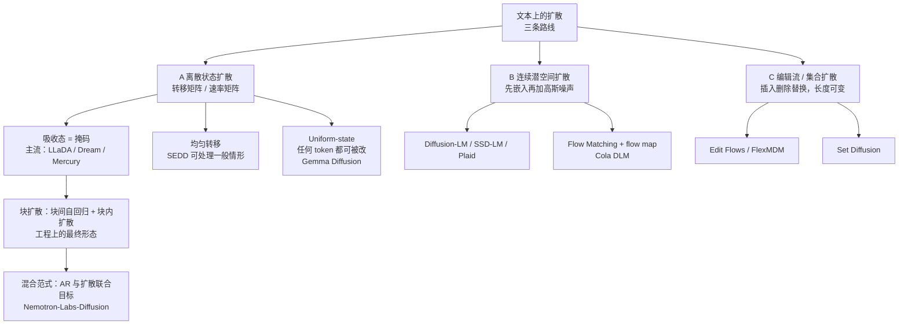
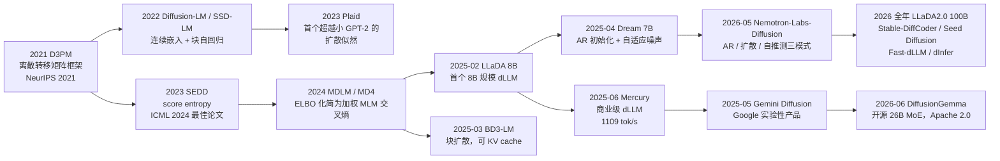

# 01 动机与谱系：为什么要有扩散语言模型

> 系列文档：扩散语言模型（Diffusion LM）学习资料
> 上一篇：[README 学习路线与索引](README.md) | 下一篇：[02 数学基础](02-math-foundations.md)

---

## 1. 自回归的三个结构性瓶颈

现代 LLM 的解码是**逐 token 串行**的：第 $$t+1$$ 个 token 的条件分布依赖前 $$t$$ 个 token 的采样结果，生成 $$K$$ 个 token 必然要走 $$K$$ 次串行的模型前向。这一条约束派生出三个无法通过堆算力消除的结构性缺陷。

### 1.1 瓶颈一：解码过程天然无法并行

每一步都要把完整权重从显存搬进计算单元参与一次前向，而单步实际消费的浮点运算量极小。在批大小较小（尤其是单用户场景）时，解码表现为明显的 memory-bound 特征：计算单元大量闲置，时间在搬运权重 [1](https://arxiv.org/abs/2211.17192)。这不是实现不佳，而是串行依赖的直接后果——第 $$N$$ 步在物理上不能早于第 $$N-1$$ 步开始。

### 1.2 瓶颈二：单向因果带来的方向性偏差

自回归模型只在"给定前文、预测后文"这一个方向上接受训练，于是存在著名的**逆转诅咒**（reversal curse）：在"A 是 B"形式的数据上训练出的模型，不能可靠地反推出"B 是 A"。LLaDA 的对照实验给出了直观数字：在逆向诗歌补全任务上，GPT-4o 正向 82.7、逆向仅 34.3；LLaDA 8B Instruct 正向 51.8、逆向 45.6，两个方向的差距远小于自回归模型 [2](https://arxiv.org/html/2502.09992)。

注意这里的取舍：LLaDA 的正向分数更低，逆向更高。双向建模不是"全面超越"，而是**放弃了一部分从左到右的归纳偏置，换来对位置对称的建模能力**。

### 1.3 瓶颈三：错误不可修订

自回归一旦写出第 $$t$$ 个 token，它就作为后续所有 token 的条件被固化。想改只能整体重来——这正是思维链与 test-time scaling 大行其道的深层原因：模型只能靠"再多写一段"来间接补救中间的错误，而不能就地修改 [3](https://www.qbitai.com/2025/12/360425.html)。

---

## 2. 扩散给的三件礼物

扩散模型把生成重述为"从一个粗糙的整体草稿出发，反复修订若干轮"。这一改写同时针对上面三条：

| 维度 | 自回归 | 扩散 | 备注 |
|---|---|---|---|
| 生成顺序 | 严格从左到右 | 全位置并行、任意顺序 | 顺序成为可调参数而非硬约束 |
| 注意力 | causal | 双向（块内或全局） | 双向是逆转诅咒缓解的机制 |
| 是否可修订 | 否 | 是（remasking / 重噪声） | 见 §4.3 与文档 04 |
| 步数 | 固定等于输出长度 | 自由参数 $$T$$ | 步数即质量-延迟旋钮 |
| 每步产出 | 1 个 token | 多个 token（由采样器决定） | 受条件独立假设限制 |
| KV cache | 天然支持 | 需块化改造 | 见文档 06 |
| 定长输出 | 天然变长 | 朴素实现为定长 | 需块扩散或编辑流 |
| 似然 | 精确可算 | 只有 ELBO 上界 | 见文档 02、07 |

> **直觉先行**
> 把生成一段文本类比成"写一篇文章"。自回归是打字机：一个字一个字往下敲，敲错只能退格重敲后面的全部内容。扩散是先在纸上用铅笔勾一遍全篇骨架（哪怕很多地方是空白或错的），然后一轮一轮地补全、擦改、润色。前者每一步都必须正确，后者允许"先错后改"。代价是后者需要额外的轮次，且每一轮里同时改多处时必须假设这些改动互不影响。

---

## 3. 为什么图像扩散那套不能照搬

连续扩散的成功建立在"加一点高斯噪声后样本仍然有意义"这一前提上。文本没有这个性质：对离散 token 施加 $$\epsilon$$ 级别的高斯扰动，结果要么还是同一个 token（离散查表后不变），要么跳到一个语义完全无关的 token。连续扩散的整套数学（score matching、概率流 ODE、DDIM）依赖梯度 $$\nabla_x \log p(x)$$，而词表是有限集，这个梯度无从定义 [4](https://ar5iv.arxiv.org/html/2506.13759)。

于是必须回答一个问题：**离散状态空间上的"噪声"是什么？** 三条答案构成了三条技术路线。

### 3.1 路线 A：离散状态扩散（主流）

直接在词表上定义马尔可夫转移。用转移矩阵 $$\mathbf{Q}_t$$（或连续时间的速率矩阵 $$\mathbf{R}_t$$）描述每个 token 变成其他 token 的概率，其中最重要的是**吸收态**（absorbing）：任何 token 都可能被换成特殊符号 `MASK`，而 `MASK` 自身永不还原。这条路线在 2024 年之后成为主流，LLaDA、Dream、Mercury、Seed Diffusion 均属此列 [5](https://aiwiki.ai/wiki/diffusion_language_models)。

### 3.2 路线 B：连续潜空间扩散

先把 token 嵌到连续向量空间，在那里做标准高斯扩散，再解码回 token。代表工作有 Diffusion-LM、SSD-LM、Plaid、CDCD，以及 2026 年的 Cola DLM（Text VAE + 块因果 Diffusion Transformer，用 Flow Matching 建模潜变量先验）[6](https://aiwiki.ai/wiki/diffusion_language_models)[7](https://startupfortune.com/?p=10749/)。优点是可以完整继承图像扩散的工具箱（包括蒸馏与流匹配），跨模态也更自然；缺点是离散化损失与质量-似然双目标难以兼顾，历史上长期落后于离散路线 [8](https://ai-beat.github.io/news/2026/08/diffusion-lm-two-roads)。

### 3.3 路线 C：编辑流与集合扩散（长度可变）

把生成建模为**插入 / 删除 / 替换**的编辑操作序列，或把块扩散推广到任意位置集合上。Edit Flows、FlexMDM、Set Diffusion 属于这一类，它们共同解决的是"朴素掩码扩散只能生成定长序列"这一硬伤 [6](https://kuleshov-group.github.io/blog/blog/2026/how-to-build-a-diffusion-language-model/)。

---

## 4. 时间线：从 2021 到 2026

各节点的要点：

- **2021 D3PM**：把 DDPM 的高斯前向过程推广为离散转移矩阵，并指出均匀转移、嵌入近邻转移、吸收态转移三种选择可以统一在同一个框架下；吸收态变体正式建立了"离散扩散 ↔ 掩码语言模型"的联系 [9](https://aiwiki.ai/wiki/discrete_diffusion)。
- **2023 SEDD**：解决"离散空间无法做 score matching"的障碍，用**分布比值** $$p_t(y)/p_t(x)$$ 替代梯度 $$\nabla \log p$$，提出 score entropy 损失，首次让离散扩散在 GPT-2 尺度的语言建模上与自回归可比 [4](https://ar5iv.arxiv.org/html/2506.13759)。
- **2024 MDLM / MD4**：证明吸收态下连续时间 ELBO 就是**带权重的交叉熵积分**，训练从此可以用几乎和 BERT 一样的代码路径 [5](https://aiwiki.ai/wiki/diffusion_language_models)。这一步是后续一切规模化的前提。
- **2025 LLaDA**：把掩码扩散推到 8B 规模，证明"LLM 的能力不依赖自回归机制本身，而依赖最大似然这一生成建模原则" [2](https://arxiv.org/html/2502.09992)。
- **2025 BD3-LM**：给出块扩散这一工程形态，同时解决变长生成与 KV cache 两件事 [10](https://arxiv.org/abs/2503.09573)。
- **2025–2026 商业化**：Mercury、Gemini Diffusion 先后把"千 token 每秒"变成产品指标；2026 年 DiffusionGemma、Nemotron-Labs-Diffusion、Seed Diffusion、LLaDA 2.0 密集出现，路线从"能不能训"转向"训得快不快、服务起来便不便宜" [11](https://arxiv.org/abs/2506.17298)[12](https://blog.google/innovation-and-ai/technology/developers-tools/diffusion-gemma-faster-text-generation)。

---

## 5. 与相邻概念的边界

这张表用来避免把 dLLM 与已有概念混为一谈。

| 概念 | 与 dLLM 的关系 | 关键差异 |
|---|---|---|
| BERT / MLM | 损失形式相近 | 掩码率固定、无 $$1/t$$ 权重、非生成模型，不能从全 `MASK` 生成 |
| MaskGIT | 同为掩码迭代生成 | 无变分下界支撑，训练目标是启发式的；不做连续时间建模 |
| 非自回归机器翻译（NAT） | 同属并行解码思潮 | 前 LLM 时代方法，缺乏密度估计的理论基础 |
| 投机解码 | 互补而非竞争 | 用草稿模型并行出 token，目标模型并行验证；dLLM 本身也可充当草稿模型 [13](https://cse.hkust.edu.hk/pg/defenses/S26/gheaf-28-04-2026.html) |
| 多 token 预测（MTP） | 竞争关系 | 在 AR 骨架上加辅助头；不改变双向性，也不支持自我纠错 |
| FIM / 代码补全 | dLLM 的甜区之一 | 双向注意力天然支持中间填充，无需专门的 FIM 训练 [14](https://github.com/jwkirchenbauer/DiffuLLaMA) |

---

## 6. 什么时候值得关心 dLLM

| 场景 | 适配度 | 说明 |
|---|---|---|
| 单用户 / 低并发的交互式生成 | 高 | 从 memory-bound 迁到 compute-bound 的收益最明显 [12](https://blog.google/innovation-and-ai/technology/developers-tools/diffusion-gemma-faster-text-generation) |
| 代码补全、行内编辑、中间填充 | 高 | 双向上下文 + 可修订，天然契合 |
| 强约束满足（数独、约束排布、格式化输出） | 高 | 自回归无法回头，扩散可以反复修订 [15](https://developers.googleblog.com/diffusiongemma-the-developer-guide/) |
| 需要全局一致性的长文本结构化生成 | 中 | 依赖块扩散与长上下文工程，仍在演进 |
| 高并发在线服务 | 低 | AR 生态的批处理与工具链仍显著领先 |
| 追求极致质量的通用对话 | 低 | 官方也承认扩散版质量低于同源自回归版本，追求质量应选自回归 [12](https://blog.google/innovation-and-ai/technology/developers-tools/diffusion-gemma-faster-text-generation) |
| 需要精确似然的任务（如某些评测、重排序） | 低 | dLLM 只有 ELBO 上界 |

---

## 7. 小结

扩散语言模型的动机不是"把图像扩散搬到文本上"，而是针对自回归的三个结构性瓶颈各给出一条出路：**并行解码**对冲串行延迟，**双向注意力**对冲方向性偏差，**迭代修订**对冲错误固化。三条出路各自带代价：并行要付出条件独立假设的质量代价，双向要放弃从左到右的归纳偏置并和 KV cache 冲突，修订要多付迭代轮次。整个领域的工程演进，基本就是在偿付这三笔代价——文档 03–06 讲的都是怎么付得更少。

下一篇进入数学基础，把吸收态扩散的前向核、连续时间 ELBO 与 $$1/t$$ 权重一步步推出来。

---

## 参考链接

1. Leviathan et al., Fast Inference from Transformers via Speculative Decoding — https://arxiv.org/abs/2211.17192
2. Nie et al., Large Language Diffusion Models (LLaDA) — https://arxiv.org/html/2502.09992
3. 量子位 MEET2026：扩散语言模型的 Scaling Law（二手报道，含团队主张） — https://www.qbitai.com/2025/12/360425.html
4. Discrete Diffusion in Large Language and Multimodal Models: A Survey — https://ar5iv.arxiv.org/html/2506.13759
5. Diffusion Language Models（aiwiki 条目，含 D3PM / SEDD / MDLM 脉络） — https://aiwiki.ai/wiki/diffusion_language_models
6. Kuleshov Group, How to Build a Diffusion Language Model — https://kuleshov-group.github.io/blog/blog/2026/how-to-build-a-diffusion-language-model/
7. Cola DLM（ByteDance Seed，连续潜空间路线，二手报道） — https://startupfortune.com/?p=10749/
8. Two Roads Through Diffusion Space（连续 vs 离散两条路线的对照，二手） — https://ai-beat.github.io/news/2026/08/diffusion-lm-two-roads
9. Discrete diffusion language model（aiwiki，D3PM 与 SEDD 细节） — https://aiwiki.ai/wiki/discrete_diffusion
10. Arriola et al., Block Diffusion: Interpolating Between Autoregressive and Diffusion Language Models — https://arxiv.org/abs/2503.09573
11. Inception Labs, Mercury: Ultra-Fast Language Models Based on Diffusion — https://arxiv.org/abs/2506.17298
12. Google, DiffusionGemma: 4x faster text generation — https://blog.google/innovation-and-ai/technology/developers-tools/diffusion-gemma-faster-text-generation
13. Discrete Diffusion Language Models: Standalone Alternatives and Complementary Drafts（HKUST 资格考试摘要，二手） — https://cse.hkust.edu.hk/pg/defenses/S26/gheaf-28-04-2026.html
14. DiffuLLaMA & DiffuGPT: Scaling Diffusion Language Models — https://github.com/jwkirchenbauer/DiffuLLaMA
15. Google Developers Blog, DiffusionGemma: The Developer Guide — https://developers.googleblog.com/diffusiongemma-the-developer-guide/
